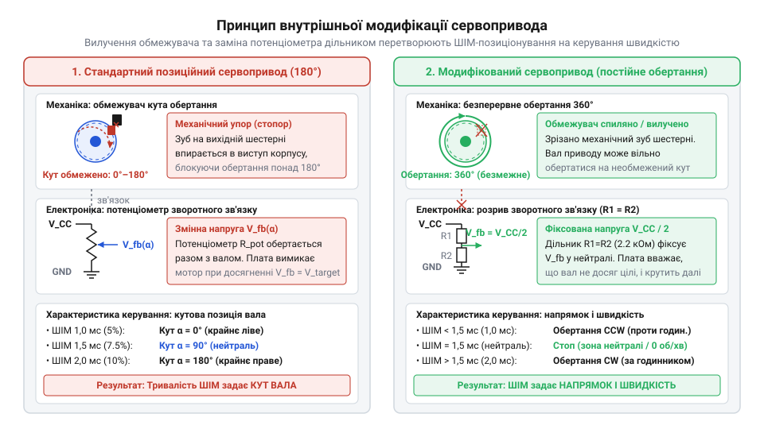
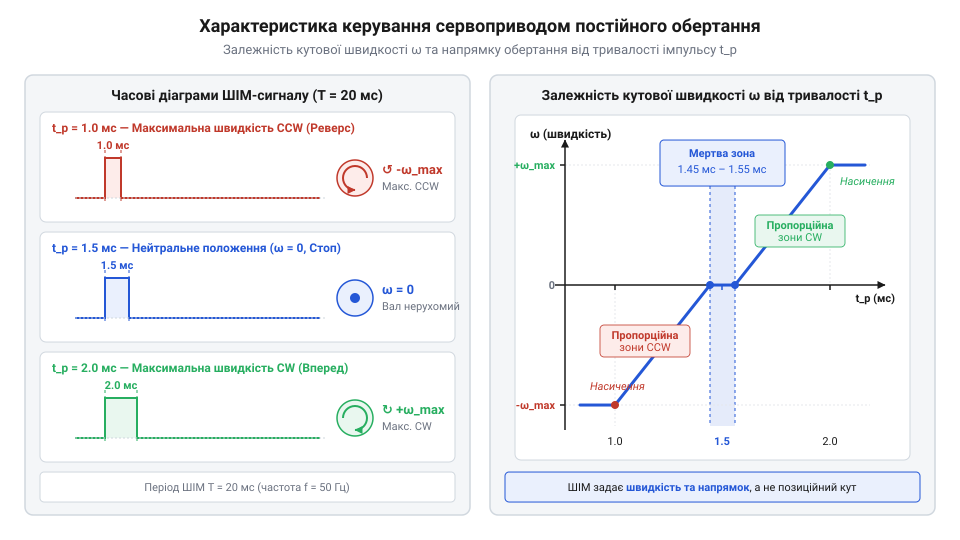
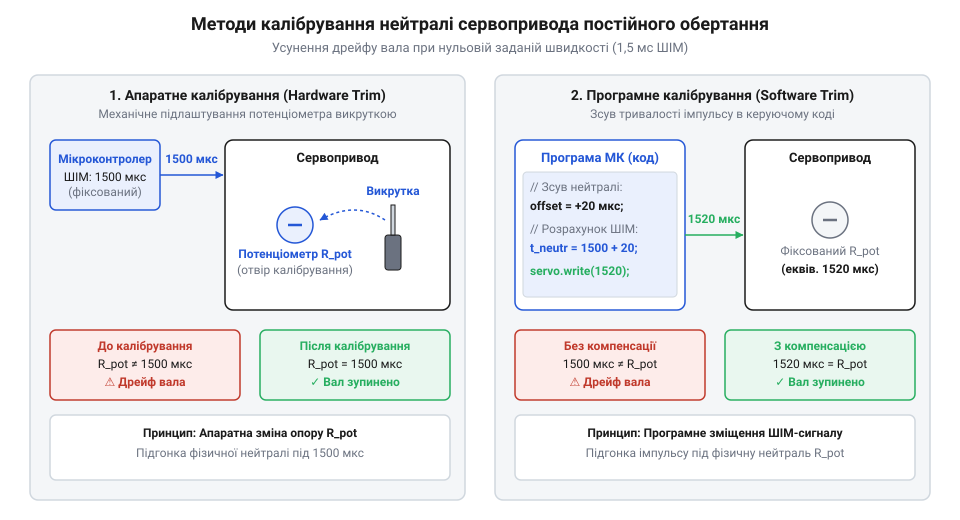

# Сервоприводи постійного обертання

<preknowlist>
- [Сервоприводи радіокерованих моделей: будова, редуктори та ШІМ-керування](root:cat-hw-actuators/rc-servo-mechanisms-and-control) — принципи роботи внутрішнього контуру зворотного зв'язку позиційних сервоприводів та формат імпульсно-широтної модуляції
- [Tower Pro SG90 — мікросерво 9g](root:cat-hw-actuators/sg90-servo) — конструктивне влаштування типового 9-грамового мікросервопривода, його редуктора та внутрішнього потенціометра
</preknowlist>

## Проблема обертання та розрив зв'язку

Під час розробки компактних мобільних роботів або протяжних механізмів перед інженером постає завдання вибору компактного двигуна з високим крутним моментом на низьких обертах. Класичний колекторний двигун вимагає встановлення зовнішнього редуктора та окремої плати керування, що суттєво збільшує габарити пристрою. Стандартні [сервоприводи радіокерованих моделей](root:cat-hw-actuators/rc-servo-mechanisms-and-control) пропонують ідеально зкомпоноване рішення: в одному корпусі вже поєднано електродвигун, багатоступеневий зубчастий редуктор та силовий драйвер. Проте спроба використати звичайний сервопривід (англ. @@en|servo drive@@, від лат. *servus* — слуга) для безперервного обертання коліс швидко опирається в принципове обмеження. При досягненні крайнього кута вал жорстко впирається в механічний стопор вихідної шестерні, а внутрішня електронна плата блокує струм двигуна, захищаючи силовий каскад від перегріву.

Щоб зрозуміти причину такої поведінки, необхідно розглянути внутрішній контур керування. У [класичних позиційних сервоприводах](root:cat-hw-actuators/rc-servo-mechanisms-and-control) вихідний вал жорстко з'єднано з рухомим контактом внутрішнього потенціометра (англ. @@en|potentiometer@@, від лат. *potentia* — сила, та грец. *metron* — міра). Електронна схема порівняння перетворює вхідний ШІМ-сигнал (широтно-імпульсна модуляція, англ. @@en|PWM@@) тривалістю від 1,0 до 2,0 мс у опорну напругу й порівнює її з напругою зворотного зв'язку, знятою з потенціометра через внутрішній аналоговий підсилювач похибки. Коли двигун повертає вал у задану точку, напруга на потенціометрі зрівнюється з опорною, сигнал похибки зменшується до нуля, і силовий H-міст (англ. @@en|H-bridge@@) знеструмлює обмотки електродвигуна.

Для перетворення кутового приводу на двигун постійного обертання необхідно виконати два взаємопов'язаних втручання в його конструкцію. Насамперед з вихідної шестерні [редуктора](root:cat-hw-actuators/sg90-servo) фізично видаляють (зрізають або спилюють) механічний штифт-обмежувач, який блокує вільний коловий рух вала. Другим обов'язковим кроком є розрив механічного або електричного зворотного зв'язку за кутом. Для цього вал потенціометра від'єднують від шестерні й фіксують у середньому положенні, або ж повністю випаюють потенціометр і замінюють його на [резистивний дільник](root:cat-hw-actuators/continuous-rotation-servo-mod/proj-servo-continuous-modification-step-by-step.md), зібраний з двох прецизійних резисторів однакового опору (наприклад, по 2,2 кОм).

Фізична суть цієї модифікації полягає в переведенні системи зворотного зв'язку в стан постійної похибки. Оскільки замінний резистивний дільник видає фіксовану напругу, що відповідає точно 50% від шини живлення, внутрішня схема сервопривода завжди «вважає», що вал перебуває в нейтральному центральному положенні 90° (якому відповідає керуючий імпульс тривалістю 1,5 мс). Якщо на вхід подати імпульс 1,5 мс, схема порівняння фіксує нульову похибку й залишає двигун нерухомим. Але як тільки мікроконтролер подає сигнал 1,0 мс (вимагаючи повернути вал у 0°), схема фіксує максимальне відхилення на -90° і подає повну напругу на двигун для обертання проти годинникової стрілки. Оскільки обертання вала більше не змінює напругу дільника, похибка ніколи не зменшується, і вал продовжує безперервно обертатися з максимальною швидкістю.

Історія виникнення сервоприводів постійного обертання розпочалася в середовищі аматорської робототехніки як вимушене й елегантне рішення проблеми дефіциту компактних мотор-редукторів. Спроби побудувати невеликих колісних роботів опиралися на відсутність дешевих і мініатюрних приводів із високим крутним моментом, тож інженери-ентузіасти винайшли метод хакінгу сервоприводів (@@en|servo modding@@). Початкова методика полягала у спилюванні пластикового стопора на вихідній шестерні та випаюванні внутрішнього потенціометра з заміною його на дільник із двох постійних резисторів рівного опору. Згодом ця популярна практика переросла у промислове виробництво готових сервоприводів безперервного руху, де виробники замість постійних резисторів почали вбудовувати зручний підлаштовний резистор для швидкого налаштування центрального положення. Завдяки цій історичній спадкоємності такі приводи зберегли стандартний керуючий протокол ШІМ із частотою 50 Гц та тривалістю нейтрального імпульсу 1,5 мс від класичних авіамодельних сервомашинок, що дозволяє підключати їх до мікроконтролерів без жодних додаткових силових драйверів.


*Внутрішня організація приводу: у позиційній системі потенціометр зв'язаний із валом для вимірювання кута, а в модифікованій — механічний стопор зрізано, а зворотний зв'язок замінено фіксованим дільником на резисторах.*

## Керування швидкістю та мертва зона

Після розриву кола зворотного зв'язку внутрішній компаратор сервопривода втрачає можливість відстежувати кутове положення вала, але зберігає здатність вимірювати різницю між тривалістю вхідного ШІМ-імпульсу та опорним значенням нейтралі 1,5 мс. Внаслідок цього керуючий сигнал перетворюється з команди кута на орган пропорційного регулювання напрямку та відносної швидкості обертання. Внутрішній силовий драйвер подає на обмотки двигуна напругу, величина якої пропорційна модулю відхилення тривалості імпульсу від точки рівноваги.

При подачі ШІМ-імпульсів тривалістю понад 1,5 мс (аж до верхньої межі 2,0 мс) підсилювач похибки формує сигнал позитивної полярності. Внутрішній силовий H-міст відкриває відповідні транзисторні ключі, змушуючи вал обертатися за годинниковою стрілкою. Чим більша тривалість імпульсу відхиляється від 1,5 мс у більшу сторону, тим вищою стає середня напруга на двигуні і тим швидше обертається вал. І навпаки, при тривалості імпульсу менше 1,5 мс (до нижньої межі 1,0 мс) полярність живлення змінюється на протилежну, і вал починає обертатися проти годинникової стрілки. При досягненні крайніх значень 1,0 мс та 2,0 мс електронний каскад входить у насичення, забезпечуючи максимальну паспортну кутову швидкість.

Щоб запобігти самовільному сіпанню та гудінню двигуна через мікроскопічні нестабільності часових інтервалів мікроконтролера або електричні наведення в колі дільника, розробники сервоконтролерів закладають в електронну схему поняття мертвої зони (англ. @@en|deadband@@). Мертва зона являє собою вузький часовий інтервал довкола значення 1,5 мс (зазвичай від ±10 до ±30 мкс), у межах якого підсилювач похибки свідомо ігнорує розбіжність сигналів і утримує силовий вихід знеструмленим. Поки тривалість вхідного імпульсу перебуває всередині цієї зони, вал залишається повністю нерухомим.

Залежність кутової швидкості обертання вала `ω` від тривалості вхідного ШІМ-імпульсу `t_pulse` у спрощеному лінійному наближенні описується такою математичною моделлю:

```
ω(t_pulse) = 0                                                                [при |t_pulse - t_neutral| ≤ Δt_dead]
            = + ω_max × (t_pulse - t_neutral - Δt_dead) / (t_max - t_neutral - Δt_dead)   [при t_pulse > t_neutral + Δt_dead]
            = - ω_max × (t_neutral - t_pulse - Δt_dead) / (t_neutral - t_min - Δt_dead)   [при t_pulse < t_neutral - Δt_dead]
```

У цій математичній моделі величина `t_neutral` позначає номінальну тривалість нейтрального імпульсу (1,5 мс), `Δt_dead` відповідає півширині мертвої зони, `t_min` та `t_max` задають межі робочого діапазону ШІМ (1,0 мс та 2,0 мс відповідно), а `ω_max` позначає максимальну кутову швидкість вала при повному живленні. Докладний [математичний опис зв'язку імпульсу](root:cat-hw-actuators/continuous-rotation-servo-mod/math-continuous-servo-kinematics-and-deadband.md) із динамікою робоплатформи враховує також нелінійність розгону та характеристики редуктора.


*Характеристика керування: у зоні мертвої смуги довкола 1,5 мс вал повністю зупинено, а при відхиленні тривалості імпульсу швидкість зростає напряму до досягнення насичення.*

Слід враховувати важливу системну відмінність: на відміну від комбінації, у якій використовуються [колекторні двигуни з H-мостом](root:cat-hw-drivers/h-bridge-motor-driver-circuits) та [зовнішні енкодери](root:cat-hw-sensors/optical-and-magnetic-encoders), сервопривід постійного обертання працює у розімкненому контурі швидкості. Модифікований внутрішній контролер регулює напругу на обмотках, але не вимірює реальні оберти вихідного вала. Через це швидкість обертання суттєво залежить від механічного навантаження на валу, напруги живлення акумулятора та температури обмоток. Детальні [електричні параметри та часові діаграми](root:cat-hw-actuators/continuous-rotation-servo-mod/api-continuous-servo-hardware-interface.md) сигналів керування наведені у відповідній апаратній довідці.

## Апаратне й програмне усунення дрейфу

У реальних електронних схемах технологічний розкид параметрів деталей унеможливлює ідеальну симетрію. Постійні резистори дільника мають допуск опору (зазвичай 1% або 5%), а внутрішні операційні підсилювачі сервоконтролера володіють власним зсувом напруги. Внаслідок цього фізична точка рівноваги модифікованого сервопривода майже ніколи не збігається з еталонною тривалістю імпульсу 1,500 мс. Якщо мікроконтролер подає стандартну уставку 1,500 мс, внутрішня схема розпізнає невелику похибку й подає незначну напругу на обмотки, через що вал починає повільно й самовільно обертатися. Цей ефект називається дрейфом нейтралі (від нід. *drijven* — плавати, англ. @@en|drift@@).

Для усунення фонового дрейфу застосовують два основні методи: апаратний та програмний. Апаратне калібрування можливе на сервоприводах, у яких замість фіксованих резисторів збережено або вбудовано підлаштовний резистор (англ. @@en|trimmer potentiometer@@ або @@en|trimpot@@), виведений під викрутку крізь отвір у корпусі. Процедура апаратного налаштування полягає в тому, що на сервопривід подають суворо фіксований ШІМ-сигнал з тривалістю імпульсу 1,500 мс від еталонного генератора або мікроконтролера. Після цього інженер обережно повертає підлаштовний резистор діелектричною викруткою доти, доки обертання вала повністю не припиниться і двигун не вийде з режиму створення моменту. Докладніше про принципи розрахунку допусків та застосування таких елементів ідеться у статті про [підлаштовні резистори та дільники напруги](root:hw-components/trimmer-potentiometers-and-dividers).

```
+-------------------------------------------------------------------------+
|                  МЕТОДИ УСУНЕННЯ ДРЕЙФУ НЕЙТРАЛІ                        |
+------------------------------------+------------------------------------+
| Апаратне калібрування (Hardware)   | Програмне калібрування (Software)  |
+------------------------------------+------------------------------------+
| Підкручування тримера викруткою    | Зміна значення t_neutral в коді    |
| Змінює опір резистивного дільника  | Зсуває опорний сигнал під привід   |
| Працює без зміни коду прошивки     | Не вимагає розбирання корпусу      |
+------------------------------------+------------------------------------+
```

Якщо привід не має зовнішнього підлаштовного елемента або його корпус загерметизовано, застосовують програмне калібрування. Для цього в прошивці мікроконтролера замість стандартизованого значення 1,500 мс впроваджують індивідуальну константу зсуву neutral_offset. Експериментальним шляхом підбирають таку тривалість імпульсу `t_zero` (наприклад, 1,522 мс для першого привода та 1,485 мс для другого), при якій конкретний екземпляр повністю зупиняє обертання. Усі подальші розрахунки швидкості виконуються відносно знайденої індивідуальної точки нульового руху.


*Методи усунення дрейфу: ліворуч механічне повертання тримера викруткою компенсує розкид опорів дільника, праворуч — зміщення програмного нуля в мікроконтролері усуває рух.*

Нижче наведено практичний приклад реалізації програмного калібрування нейтралі та керування швидкістю з урахуванням мертвої зони для двох різних програмних платформ:

:::tabs
:::code continuous-rotation-servo-mod-d/cpp/arduino/continuousservo.cpp
:::code continuous-rotation-servo-mod-d/c/esp-idf/continuous-servo-set-speed.c
:::

Програмна компенсація дрейфу є критично важливою під час проектування робототехнічних систем. Наприклад, коли будується [автономна двоколісна робоплатформа](root:cat-hw-actuators/continuous-rotation-servo-mod/proj-two-wheeled-robot-differential-drive.md) диференціального типу, неразомкнені дрейфи лівого й правого коліс призведуть до самовільного відхилення робота від прямолінійної траєкторії навіть у режимі простою. Більш детальні розробницькі деталі та готові фреймворки розглядають [програмні інтерфейси керування](root:cat-hw-actuators/continuous-rotation-servo-mod/api-continuous-servo-software-control.md) у спеціальній програмній довідці.

## Вибір між сервоприводом та H-мостом

Створення мобільних колісних роботів та компактних тягових механізмів вимагає перетворення електричної енергії акумулятора на механічний моментовий рух із можливістю зміни напрямку та швидкості обертання вала. При розробці схеми інженер постає перед вибором між двома фундаментальними підходами: використанням сервоприводів постійного обертання або побудовою класичного привода на основі колекторних двигунів постійного струму із зовнішнім силовим драйвером.

Традиційна схема привода на колекторному двигуні вимагає побудови розгалуженого ланцюга керування. Для забезпечення реверсу струму через обмотки двигуна застосовують двонаправлений мостовий підсилювач — Н-міст (англ. @@en|H-bridge@@). Такий мостовий каскад складається з чотирьох силових польових транзисторів (англ. @@en|MOSFET@@), якими керує окрема драйверна мікросхема. Щоб підключити один колекторний двигун до мікроконтролера, необхідно задіяти щонайменше три лінії: два дискретних виходи для встановлення напрямку обертання та один вихід з імпульсно-широтною модуляцією (англ. @@en|pulse-width modulation@@, @@en|PWM@@) для регулювання швидкості. Крім того, низькомоментний високообертовий мотор вимагає монтажу зовнішнього механічного редуктора (англ. @@en|gearbox@@), що збільшує габарити пристрою та ускладнює компонування механічної частини.

Сервопривід постійного обертання об'єднує всі ці компоненти в одном компактному корпусі. Всередині сервопривода вже розміщено плату керування із мостовим каскадом транзисторів, знижувальний зубчастий редуктор та колекторний мікродвигун. Головна порівняльна перевага сервопривода полягає в апаратному узгодженні рівнів: керування напрямком і відносною кутовою швидкістю здійснюється за допомогою єдиного сигнального провідника за допомогою стандартного 50-герцового ШІМ-сигналу. Мікроконтролеру не потрібно формувати силові струми чи генерувати комбінації логічних рівнів для ключових транзисторів — внутрішній контролер сервопривода самостійно декодує тривалість керуючого імпульсу (в межах від 1.0 мс до 2.0 мс) та пропорційно комутує напругу на обмотках двигуна.

| Критерій порівняння | Сервопривід постійного обертання | Колекторний двигун + зовнішній Н-міст |
| :--- | :--- | :--- |
| **Силові та керуючі лінії** | 1 сигнальний провід ШІМ + 2 лінії живлення | 2–3 лінії керування на один мотор + силові кабелі |
| **Вбудований редуктор** | Наявний у стандартному корпусі (пластик/метал) | Вимагає окремого зовнішнього редуктора |
| **Зовнішня силова плата** | Не потрібна (драйвер інтегровано всередину) | Обов'язкова (модуль Н-моста, наприклад L298N) |
| **Зворотний зв'язок по швидкості** | Відсутній (розімкнений контур) | Можливий при монтажі енкодера |
| **Діапазон робочої напруги** | Фіксований (зазвичай 4.8 В – 6.0 В) | Широкий (від 3 В до 24 В і вище) |
| **Силовий момент і потужність** | Обмежені габаритами корпусу сервопривода | Визначаються вибором зовнішнього мотора |

Використовуючи [колекторні двигуни постійного струму](root:cat-hw-drivers/h-bridge-motor-driver-circuits), можна будувати високопотужні системи з широким діапазоном напруг живлення. Однак у габаритних обмеженнях мікроробототехніки застосування сервоприводів дозволяє радикально спростити монтажну схему. Замість громіздкої плати драйвера з масивними радіаторами та джунглями з'єднувальних дротів розробник отримує повністю автономні силові модулі, які підключаються безпосередньо до трипінових роз'ємів плати керування.

Водночас вибір на користь модифікованих сервоприводів має суттєві обмеження у вимогах до точності. Оскільки при серво-моддингу внутрішній потенціометр замінюють на фіксований резистивний дільник, привід втрачає замкнений контур зворотного зв'язку. ШІМ-сигнал задає лише відносну ширину імпульсу на обмотках мотора, але не контролює реальну швидкість обертання. При зміні напруги акумулятора або механічного опору на колесі кутова швидкість вала буде змінюватися. Якщо для проєкту критична точна синхронізація коліс або точне вимірювання пройденої відстані, класичний двигун із застосуванням [зовнішніх оптичних енкодерів](root:cat-hw-sensors/optical-and-magnetic-encoders) та PID-регулятора є єдиним правильним вибором.

Для швидкого прототипування компактних колісних платформ, де пріоритетом є мінімальна вага, просте розведення друкованої плати та мінімальна кількість задіяних ніжок мікроконтролера, сервоприводи безперервного обертання виступають безальтернативним рішенням. Конструктивні особливості збірки та кінематику диференціального руху на базі таких приводів розглянуто у [проєкті колісного робота](root:cat-hw-actuators/continuous-rotation-servo-mod/proj-two-wheeled-robot-differential-drive.md), а кроки самостійної переробки стандарного [мікросервопривода SG90](root:cat-hw-actuators/sg90-servo) наведено в [практичному керівництві з модифікації](root:cat-hw-actuators/continuous-rotation-servo-mod/proj-servo-continuous-modification-step-by-step.md).

## Обмеження під навантаженням та захист

Експлуатація сервоприводів постійного обертання у реальних механізмах виявляє специфічну фізичну поведінку розімкненої системи під навантаженням. Коли на вихідний вал сервопривода діє механічний опір — наприклад, при підйомі робоплатформи на похилу поверхню або переміщенні важкого вантажу — кутова швидкість обертання помітно зменшується навіть за незмінної ширини вхідного ШІМ-імпульсу.

Фізична причина цього явища полягає у зміні проти-ЕРС (англ. @@en|back electromotive force@@, проти-електрорушійна сила), що індукується в обмотках обертового якоря колекторного мотора. Напруга на обмотці визначається різницею між прикладеною силовою напругою та індукованою проти-РСУ, яка прямо пропорційна кутовій швидкості обертання вала:

E = k × ω
I = (V - E) ÷ R

тут E — проти-РСУ якоря, k — конструктивна стала мотора, ω — кутова швидкість вала, V — середня напруга від ключових транзисторів H-моста, R — омічний опір обмоток якоря, I — струм споживання.

Коли зовнішнє навантаження уповільнює вал (зменшується значення ω), величина проти-РСУ E падає. У результаті різниця потенціалів (V - E) зростає, що призводить до автоматичного збільшення струму I через обмотки та силові транзистори внутрішнього драйвера. Оскільки у модифікованому сервоприводі відсутній внутрішній контур вимірювання реальних обертів чи струму, вбудована мікросхема продовжує подавати повну тривалість ШІМ-імпульсів на ключі H-моста, не маючи уявлення про просідання швидкості.

Найнебезпечнішим граничним режимом є повне механічне заклинювання вала (англ. @@en|stall state@@). Якщо перешкода повністю зупиняє обертання редуктора (ω = 0), проти-РСУ падає до нуля (E = 0). У цей момент струм через обмотки мотора обмежується виключно їхнім власним активним опором R і сягає максимально можливого значення — струму заклинювання (англ. @@en|stall current@@). Для стандартних 9-грамових сервоприводів струм споживання у спокої становить близько 5–10 мА, тоді як при заклинюванні він миттєво зростає до 800–1200 мА. У потужніших сервоприводах із металевим редуктором струм заклинювання може перевищувати 3–5 А.

Тривале протікання струму заклинювання призводить до двох критичних наслідків:
1. **Тепловий пробій транзисторів.** Малогабаритні поверхнево-змонтовані (англ. @@en|surface-mount device@@, @@en|SMD@@) MOSFET-транзистори внутрішнього H-моста швидко перегріваються. Перевищення допустимої температури напівпровідникового кристала спричиняє тепловий пробій силового каскаду, перетворюючи сервопривід на непридатне для ремонту коротке замикання. 2. **Пластичне руйнування редуктора.** Якщо силові транзистори витримують струмове перевантаження, високий механічний момент на заклиненому валу зрізає зубці пластикових шестерень [внутрішньої механіки сервопривода](root:cat-hw-actuators/rc-servo-mechanisms-and-control).

Другою серйозною проблемою при роботі з сервоприводами є імпульсне просідання напруги живлення (англ. @@en|brownout effect@@). У момент пуску або різкої зміни напрямку обертання мотору потрібен значний пусковий струм для подолання інерції ротора. Якщо мікроконтролер та сервоприводи живляться від одного джерела без належної розв'язки, високі пікові струми створюють падіння напруги на внутрішньому опорі батареї та з'єднувальних провідниках. Падіння живлення нижче порога скидання мікроконтролера викликає спонтанне перезавантаження управляючої системи.

Для забезпечення стабільної та довговічної роботи схем із сервоприводами постійного обертання застосовують комплексний апаратний захист:

- **Розділення силових та логічних кіл.** Слід застосовувати топологію «зірка» для провідників маси (GND) та живити сервоприводи від окремого силового перетворювача напруги чи акумуляторного блоку, ізольованого від чутливої логіки контролера. - **Ємнісна буферизація.** Паралельно силовим лініям живлення сервоприводів встановлюють електролітичні конденсатори високої ємності (від 470 мкФ до 1000 мкФ на один-два приводи) з низьким еквівалентним послідовним опором (англ. @@en|equivalent series resistance@@, @@en|ESR@@). Вони віддають накопичений заряд під час мікросекундних піків пускового струму, згладжуючи просідання напруги. - **Самовідновлювані запобіжники.** У силовий провід кожного сервопривода послідовно вмикають PTC-запобіжник (англ. @@en|polyfuse@@). При виникненні заклинювання підвищений струм розігріває полімерний матеріал запобіжника, стрибкоподібно збільшуючи його опір і обмежуючи струм до безпечних мільіампер. Після усунення заклинювання та охолодження запобіжник відновлює свою провідність.

Повні деталі електричного підключення, таблиці допустимих струмів та схеми фільтрації наведено в [апаратній довідці з інтерфейсів](root:cat-hw-actuators/continuous-rotation-servo-mod/api-continuous-servo-hardware-interface.md), а програмні методи плавного розгону для зниження пускових струмів описано в [програмному інтерфейсі керування](root:cat-hw-actuators/continuous-rotation-servo-mod/api-continuous-servo-software-control.md).