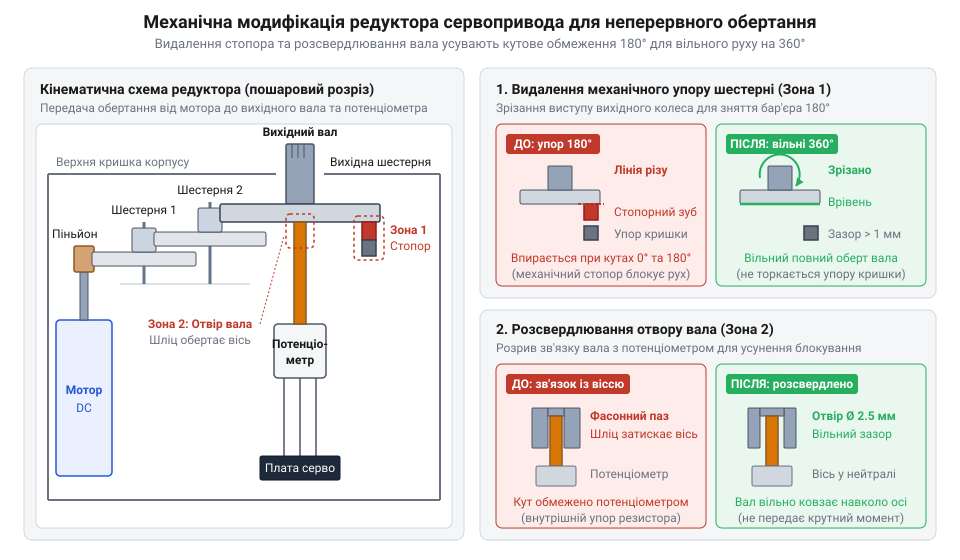
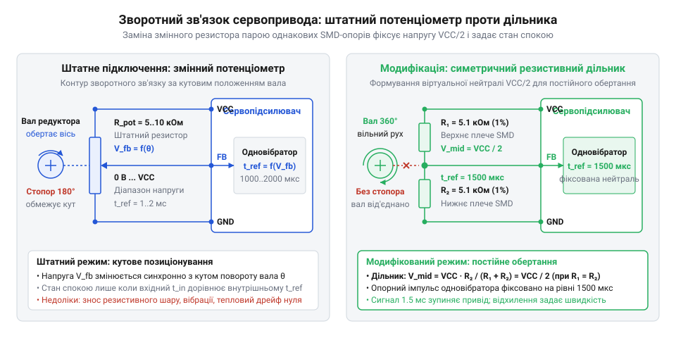
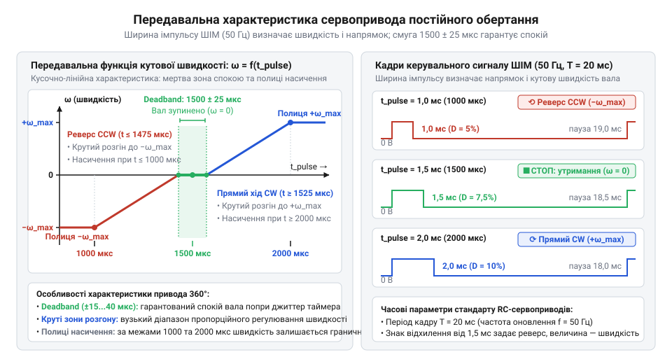
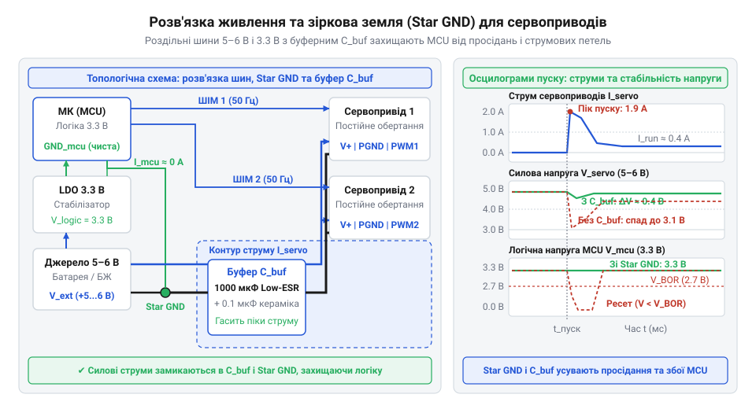
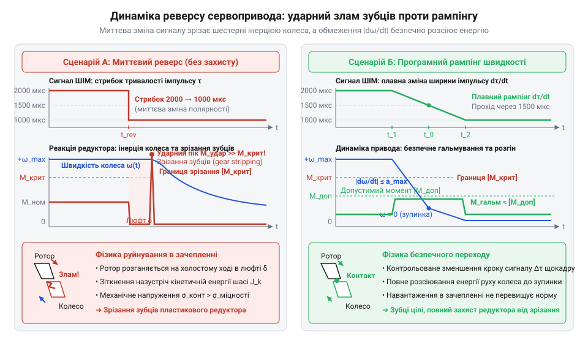

# Сервоприводи постійного обертання

<preknowlist>
- [Tower Pro SG90 — мікросерво 9g](root:cat-hw-actuators/sg90-servo) — будова класичного позиційного сервопривода, керування кутом через ШІМ-імпульси 1–2 мс та принцип зворотного зв'язку за потенціометром
- [Серво-роги (запасні)](root:cat-hw-actuators/servo-horns) — геометрія вихідного шліцьового вала, механічне кріплення коліс і важелів до сервопривода та передача крутного моменту
</preknowlist>

## Чому звичайне серво не обертає колеса

Під час конструювання легкого колісного робота або компактного механізму протягування стрічки перед інженером неминуче постає вибір тягового приводу. Звичайний мініатюрний колекторний двигун постійного струму обертається із частотою понад десять тисяч обертів на хвилину, проте його вал моментально глухне від найменшого опору на колесі. Щоб отримати достатнє тягове зусилля, до мотора доводиться додавати багатоступеневий редуктор (від латинського @@la|reducere@@ — повертати назад, зменшувати), а для керування швидкістю й реверсом — окрему плату силового моста (англ. @@en|H-bridge@@) із купою з'єднувальних дротів, які захаращують малий корпус пристрою. Готові ж мотор-редуктори часто мають незручні габарити та складні точки кріплення.

На цьому тлі класичний кутовий сервопривід (від латинського @@la|servus@@ — слуга), на зразок [масового дев'ятиграмового мікросерво](root:cat-hw-actuators/sg90-servo), здається бездоганним моноблоком: у крихітному корпусі вже зібрано двигун, редуктор із великим передатним числом, транзисторний H-міст і плату керування. Привід підключається всього трьома дротами — живлення, земля та логічний сигнал, а колесо легко монтується безпосередньо на вихідний шліцьовий вал за допомогою [штатних пластикових качалок](root:cat-hw-actuators/servo-horns). Проте спроба використати таке серво для [диференціальної колісної платформи](root:sys-dron/differential-drive-kinematics) миттєво зазнає краху: колесо повертається щонайбільше на півоберту, різко смикається і намертво заклинює в одному положенні.

Ця поведінка зумовлена двома незалежними внутрішніми бар'єрами стандартного привода — механічним та електронним. Перший бар'єр криється в самій геометрії редуктора: на вихідній пластиковій чи металевій шестерні відлито спеціальний стопорний виступ, а у верхній кришці корпусу передбачено монолітне ребро-упор. Щойно шестірня повертається приблизно на 180–200 градусів, виступ жорстко впирається у стінку корпусу. Механічний стопор фізично блокує подальший оберт вала навіть за вимкненого живлення, а спроба провернути його силою призводить до зрізання дрібних зубців проміжних шестерень.

Другий бар'єр — принцип роботи замкненого контуру позиціювання. Вихідний вал стандартного серво жорстко зчеплений з віссю внутрішнього змінного резистора — потенціометра (від латинського @@la|potentia@@ — сила та грецького @@el|metron@@ — міра). Схема [внутрішнього аналогового сервопідсилювача](root:hw-motion/analog-rc-servo-electronics) сприймає керувальний ШІМ-сигнал не як команду швидкості, а виключно як координату цільового кута. Електроніка порівнює тривалість імпульсу із напругою, яку знімає повзунок потенціометра, і формує сигнал неузгодженості (англ. @@en|error signal@@). Двигун обертає вал лише доти, доки ця помилка не впаде до нуля. Щойно кут досягнуто, вбудований драйвер вимикає подачу струму й переходить у режим утримання позиції. Серія однакових імпульсів не змушує вал обертатися далі — вона лише мертво тримає його на місці.

Щоб змусити привід безперервно крутити колесо, потрібно усунути обидві перешкоди: зрізати механічний упор шестерні та розірвати електричний зворотний зв'язок між валом і потенціометром. Саме така винахідлива [модифікація стандартних сервоприводів](root:cat-hw-actuators/continuous-rotation-servo-mod/hist-continuous-rotation-servo-evolution.md) у середовищі конструкторів роботів перетворила звичайні авіамодельні серва на унікальний клас тягових пристроїв — мотор-редуктори постійного обертання (англ. @@en|continuous rotation servo@@), здатні плавно змінювати швидкість і напрямок обертання за єдиним імпульсним дротом.

## Розбирання редуктора та розрив зворотного зв'язку

Щоб дістатися внутрішніх вузлів, із нижньої кришки сервопривода викручують чотири довгі стяжні гвинти, які пронизують корпус наскрізь і притискають верхній ковпак редуктора. Знявши кришку, відкривають багатоступеневий прямозубий редуктор (англ. @@en|spur gearbox@@). Ротор високооборотного колекторного двигуна оснащено малою ведучою шестірнею — піньйоном (від французького @@fr|pignon@@ — шестерня). Оскільки мікродвигун розвиває швидкість до 10 000–15 000 обертів на хвилину за мізерного крутного моменту, оберти передаються через каскад проміжних парних шестерень на паралельних сталевих осях. Кожен ступінь редуктора зменшує кутову швидкість і пропорційно примножує крутний момент, доводячи сумарне передавальне відношення до значень близько 1:250 у [поширених мікросервах SG90](root:cat-hw-actuators/sg90-servo) або моделях [MG90S із металевим редуктором](root:cat-hw-actuators/mg90s-servo).

Вершиною кінематичного ланцюга є вихідна шестерня, об'єднана із зовнішнім валом — шліцом (від німецького @@de|Schlitz@@ — щілина, поздовжній паз), на який насаджують серво-роги або колеса. На внутрішній площині цієї шестерні відлито монолітний стопорний виступ. Під час повороту вала виступ упирається у вертикальне ребро на внутрішній стінці верхньої кришки, жорстко обмежуючи робочий кут сектора межами близько 180–200 градусів. Для забезпечення неперервного обертання цей виступ необхідно видалити. На пластикових колесах упор акуратно зрізають гострими бокорізами врівень із площиною диска або зрізують скальпелем, а на латунних шестернях сточують надфілем. Поверхню зрізу ретельно зачищають: залишений задирок або пластиковий опил, потрапивши між зуби редуктора, спричинить заклинювання передачі.


*Кінематика прямозубого редуктора: каскад проміжних ступенів між ротором двигуна й вихідним валом, лінія зрізання механічного упору та циліндричне розточування отвору для вільного обертання на 360°.*

Однак видалення стопорного виступу розблоковує механізм лише частково. По центру нижнього торця вихідної шестерні розташовано фасонне гніздо — зріз-лиску або паз, у який щільно заходить плаский хвостовик осі потенціометра. Власний діапазон обертання резистора обмежено внутрішніми упорами струмознімача приблизно на рівні 220–270 градусів. Якщо залишити шестірню жорстко зчепленою з резистором, перша ж спроба нескінченного обертання вала двигуном моментально зріже рухомий графітовий повзунок або скрутить металеву вісь датчика.

Кінематичний зв'язок розривають розточуванням цього посадкового гнізда. У пластикових шестернях фасонний отвір акуратно розсвердлюють свердлом діаметром 2.2–2.5 мм або розточують круглим надфілем, доки він не набуде строго циліндричної форми. Діаметр підбирають так, щоб вихідна шестерня вільно оберталася навколо осі потенціометра без найменшого тертя, перетворюючи резистор на звичайну нерухому опорну вісь. Під час ручного розсвердлювання легко відхилити інструмент: через нерівномірний бічний натиск свердло зміщується від осі шестерні, спричиняючи ексцентриситет (від латинського @@la|eccentricus@@ — поза центром). Таке зміщення викликає радіальне биття зубчастого вінця, через що міжосьова відстань до сусідньої проміжної шестерні постійно коливається під час обертання. У зоні зближення зубці надмірно притискаються й підклинюють передачу, викликаючи стрибки споживання струму двигуном, а в протилежній зоні зачеплення слабшає, утворюючи надмірний люфт. Періодичне заїдання швидко зношує передачу й здатне зламати крихкі пластикові зубці, тому отвір виводять строго співвісно без радіального тиску на деталь. Покрокову послідовність розбирання й безпечної механічної обробки деталей наведено в [посібнику з переробки](root:cat-hw-actuators/continuous-rotation-servo-mod/proj-servo-continuous-rotation-conversion.md) сервопривода.

Перед зворотним складанням редуктора зубці коліс очищають від мікростружки м'яким пензликом і змащують нейтральним силіконовим мастилом. Шестерні послідовно встановлюють на свої напрямні осі, уникаючи перекосів і надмірного зусилля під час закриття кришки корпусу. Найменший перекіс осей або зминання зубців створюють паразитне навантаження, яке під час реверсу мотора призводить до [зрізання зубців редуктора](root:hw-motion/gearbox-backlash-impact). Після затягування корпусних гвинтів правильно модифікований вихідний вал повинен легко й без зусиль прокручуватися пальцями на повні 360 градусів у будь-якому напрямку без характерного заїдання чи упору.

## Електрична фіксація нейтралі: потенціометр чи дільник

Коли редуктор позбавлено механічного стопора, а вихідну шестерню розчеплено з віссю потенціометра, вал сервопривода отримує фізичну можливість вільно обертатися на повні 360 градусів. Проте перше ж підключення живлення та керувального сигналу виявляє електронну проблему: мотор починає безперервно крутитися на максимальній швидкості в один бік і зовсім не реагує на спроби зупинки. Причина криється в розриві контуру зворотного зв'язку. Вбудований контролер сервопривода розрахований на те, що обертання двигуна механічно повертає повзунок потенціометра, доки сигнал неузгодженості не спаде до нуля. Коли ж вісь резистора стоїть нерухомо, електроніка сприймає будь-яку розбіжність між кутом команди та поточним станом датчика як нескінченну неусувну помилку, утримуючи ключі H-моста постійно відкритими.

Щоб приборкати привід, необхідно розібратися у внутрішній логіці сервопідсилювача. Як описано в [схемотехніці аналогових сервопідсилювачів](root:hw-motion/analog-rc-servo-electronics), класична мікросхема керування містить генератор одиночних імпульсів — внутрішній одновібратор (англ. @@en|monostable multivibrator@@, від латинського @@la|vibrare@@ — коливатися). Кожен вхідний імпульс ШІМ запускає цей таймер, тривалість вихідного імпульсу якого задається внутрішнім RC-ланцюгом, де регульованим опором слугує штатний потенціометр зворотного зв'язку. Вбудований компаратор зіставляє тривалість вхідного імпульсу `t_in` із опорним імпульсом одновібратора `t_ref`. Якщо `t_in` перевищує `t_ref`, схема крутить мотор в один бік; якщо `t_in` менший за `t_ref` — у протилежний. Збіг тривалостей відповідає стану спокою, або нейтралі (від латинського @@la|neutralis@@ — ні той, ні інший), яка зазвичай припадає на `1500` мкс. Якщо ж напругу зворотного зв'язку зафіксувати на рівні половини живлення, внутрішній генератор завжди видаватиме стабільні `1500` мкс: вхідний імпульс `1500` мкс змусить привід завмерти, а будь-яке відхилення від цієї точки перетвориться з позиційного кута на пропорційну швидкість обертання.


*Формування опорної напруги зміщення: заміна змінного потенціометра парою прецизійних резисторів створює нерухому віртуальну нейтраль VCC/2, перетворюючи сигнал неузгодженості на кероване обертання.*

Найпростіший спосіб досягти такого стану — апаратне юстування (від німецького @@de|justieren@@ — точно налаштовувати) штатного потенціометра. На сигнальний вхід сервопривода подають еталонний сигнал спокою `1500` мкс (для чого зручно використовувати спеціалізований [калібрувальний стенд із дисплеєм](root:cat-hw-actuators/continuous-rotation-servo-mod/proj-servo-neutral-calibration-rig.md)). Двигун при цьому починає обертатися. Повільно повертаючи шліц осі потенціометра тонкою викруткою, знаходять вузьку точку рівноваги, в якій мотор повністю зупиняється. Після цього вісь резистора нерухомо консервують у корпусі краплею ціаноакрилатного клею, епоксидної смоли або фарби. Цей метод не вимагає паяльника й детально описаний у [посібнику з переробки мікросерв](root:cat-hw-actuators/continuous-rotation-servo-mod/proj-servo-continuous-rotation-conversion.md). Проте він найменш надійний і приховує технологічну пастку ще на етапі монтажу: у процесі полімеризації ціаноакрилатний клей зазнає помітної об'ємної усадки. Стягуючись у зазорі між рухомою віссю та корпусом, клей створює нерівномірні механічні напруження, які провертають вільний шліц на частку градуса. Через вузькість внутрішньої мертвої зони навіть такого мікроскопічного механічного зміщення осі потенціометра достатньо, щоб зсунути повзунок по резистивній доріжці й порушити баланс напруг: щойно знерухомлений мотор знову починає самочинно повзти безпосередньо під час затвердіння клею, зводячи юстування нанівець. Надалі ж вібрації редуктора поступово розхитують клейовий шов, а високий температурний коефіцієнт опору графітової доріжки викликає температурний дрейф — візок починає самочинно повзти за зміни температури повітря або нагрівання обмоток.

Кардинальне розв'язання проблеми — демонтаж штатного датчика та встановлення симетричного дільника напруги (англ. @@en|voltage divider@@). Потенціометр повністю випоюють із плати, а замість нього між шиною живлення `VCC` та спільним проводом `GND` монтують два однакові резистори поверхневого монтажу (англ. @@en|SMD@@, surface-mount device). Точку їхнього з'єднання припаюють до колишнього контактного майданчика повзунка. Зазвичай обирають деталі типорозміру 0603 або 0805 номіналом від `2.2` до `10` кОм з точністю 1% або 0.1%. Напругу на середньому виводі дільника `V_mid` (де `VCC` — напруга живлення, а `R₁` та `R₂` — опори верхнього й нижнього плечей) визначають за класичним співвідношенням:

```
V_mid
= VCC · R₂ / (R₁ + R₂)          [формула резистивного дільника]
= VCC · R / (2 · R)             [рівність номіналів R₁ = R₂ = R]
= VCC / 2                       [скорочення однакового опору R]
```

Отримана напруга `V_mid` не залежить від механічного зношування чи вібраційного брязкоту рухомого контакту. Навіть під час просідання напруги живлення `VCC` під навантаженням співвідношення плечей лишається незмінним.

Зіставлення двох методів окреслює чіткий інженерний компроміс між швидкістю переробки та довгостроковою стабільністю. Фіксація штатного резистора клеєм займає кілька хвилин, проте привід залишається чутливим до ударів і тепла. Монтаж SMD-дільника вимагає ювелірної роботи з мікропаяльником, але дає довговічний вузол без рухомих частин. Крім того, як показує [розрахунок теплового дрейфу дільника](root:cat-hw-actuators/continuous-rotation-servo-mod/math-resistive-divider-drift-and-calibration.md), тонкоплівкові резистори на одній платі мають однаковий температурний коефіцієнт опору: за будь-якого нагрівання обидва плечі змінюють опір синфазно, жорстко утримуючи віртуальну нейтраль і перетворюючи колишнє серво на передбачуваний тяговий мотор-редуктор.

## Керування швидкістю, реверсом і мертвою зоною

Фіксація внутрішньої нейтралі на `1500` мкс перетворює вхідний імпульсний інтерфейс із каналу позиціювання на важіль керування безперервним рухом. Як описано в [апаратній специфікації інтерфейсу](root:cat-hw-actuators/continuous-rotation-servo-mod/api-continuous-servo-hardware.md), сервопривід очікує періодичні імпульси з частотою кадрів `50` Гц (період кадру `20` мс) та активним високим рівнем тривалістю від `1000` до `2000` мкс. Оскільки внутрішній одновібратор налаштований на нерухому опорну тривалість `t_0 = 1500` мкс, компаратор безперервно вимірює часову розбіжність: `Δt = t_in - t_0`. Замість зупинки після повороту вала ця різниця тепер задає напрямок і швидкість його постійного обертання. Подання імпульсу тривалістю рівно `1500` мкс зводить різницю до нуля, і привід завмирає. Зменшення ширини імпульсу від `1500` до `1000` мкс формує від'ємну похибку: сервопідсилювач комутує ключі H-моста так, що ротор розганяється за годинниковою стрілкою (англ. @@en|clockwise@@). Подовження імпульсу від `1500` до `2000` мкс змінює знак похибки на додатний, і мотор починає плавно обертатися проти годинникової стрілки (англ. @@en|counterclockwise@@).

Утім, якби сервопідсилювач реагував на кожну мікросекунду відхилення, привід не міг би спокійно зупинятися. Будь-які високочастотні наведення на сигнальному проводі або часове тремтіння апаратного таймера мікроконтролера викликали б мікропомилку. Двигун неперервно смикався б, гудів обмотками та перегрівався навіть під час команди повної зупинки. Щоб запобігти цьому паразитному режиму, у схему інтегровано вікно нечутливості — мертву зону (англ. @@en|deadband@@, від @@en|dead@@ — нерухомий та @@en|band@@ — смуга). Вона утворює симетричний коридор завширшки `±15`–`40` мкс навколо центральної точки `1500` мкс (тобто діапазон приблизно від `1460` до `1540` мкс). Поки тривалість вхідного імпульсу залишається всередині цієї смуги, сервопідсилювач повністю знеструмлює ключі вихідного H-моста. Обмотки двигуна позбавлені живлення, споживання струму падає до чергових `5`–`10` мА, а вихідний вал завмирає в абсолютній тиші без вібрацій і марної витрати енергії акумулятора. Проте симетричною ця зона є лише номінально. В аналоговому сервопідсилювачі знак похибки визначають дві окремі гілки внутрішнього компаратора: одна фіксує вкорочення імпульсу, а друга — його подовження. Через технологічний розкид параметрів кремнію та напруги зміщення внутрішнього компаратора чутливість цих гілок ніколи не є однаковою. Як наслідок, виникає асиметрія порогів спрацьовування мертвої зони за годинниковою та проти годинникової стрілки відносно точки `1500` мкс. Наприклад, для пуску за годинниковою стрілкою приводу може вистачити відхилення лише на `-15` мкс (межа `1485` мкс), тоді як рух проти годинникової стрілки почнеться лише після подовження сигналу на `+35` мкс (межа `1535` мкс). Через таку асиметрію подача номінального імпульсу `1500` мкс залишає небезпечно малий часовий запас до одного з порогів. Найменший температурний дрейф резисторів або коливання напруги живлення виштовхують сигнал із вужчого боку зони спокою, і вал починає самочинно повзти в одному напрямку, тоді як протилежний рух зберігає надлишковий запас нечутливості. У колісних роботах такий перекіс призводить до неодночасного старту коліс: при однаковій команді розгону один привід уже обертається, а другий усе ще залишається заблокованим у мертвій зоні. Щоб усунути цей паразитний ефект, фізичні межі нечутливості вимірюють окремо для кожного напрямку — наприклад, застосовуючи [автоматичне сканування мертвої смуги](root:cat-hw-actuators/continuous-rotation-servo-mod/proj-servo-neutral-calibration-rig.md) для точного розрахунку програмного центра спокою.


*Зв'язок тривалості імпульсу з напрямком і швидкістю обертання вала: симетрична мертва зона гарантує знеструмлений стан спокою, круті лінійні схили забезпечують розгін, а відхилення понад 150 мкс спричиняють повне насичення вихідного каскаду.*

Коли вхідний імпульс виходить за межі мертвої смуги, вал рушає з місця, але динаміка розгону виявляється несподівано різкою. Як доводить [математична модель передавальної характеристики](root:cat-hw-actuators/continuous-rotation-servo-mod/math-continuous-servo-transfer-function.md), аналоговий сервопідсилювач має навмисно завищений коефіцієнт підсилення в пропорційному контурі. Ця чутливість потрібна класичному позиційному приводу, щоб швидко долати опір і усувати навіть крихітну кутову неузгодженість, але в приводі постійного обертання вона викликає швидке насичення (від латинського @@la|saturatio@@ — пересичення) вихідного каскаду. Уже за відхилення `|Δt|` понад `100`–`150` мкс шпаруватість внутрішнього ШІМ-керування H-мостом досягає 100%: ключі відкриваються повністю, подаючи на мотор усю напругу живлення. Через це залежність кутової швидкості від тривалості імпульсу має кусочно-лінійний характер: після мертвої зони йде вузька ділянка активного розгону завширшки всього `100`–`120` мкс, після якої починається широка полиця насичення, де вал уже обертається на граничній швидкості й зовсім не реагує на подальше наближення сигналу до `1000` чи `2000` мкс.

Така крутизна характеристики висуває безкомпромісні вимоги до таймерів керівного мікроконтролера. Якщо весь робочий діапазон регулювання швидкості стиснуто у часовий проміжок близько `100` мкс, звичайний 8-бітний ШІМ із періодом кадру `20` мс виявляється безпорадним: його дискретність (від латинського @@la|discretus@@ — розділений, переривчастий) становить близько `78` мкс (`20000` мкс / 256). Із такою великою сходинкою в зону регулювання потрапляє щонайбільше одна-дві градації швидкості, перетворюючи плавний привід на грубе реле «пуск — стоп». Щоб тонко дозувати швидкість у коді [програмного драйвера керування](root:cat-hw-actuators/continuous-rotation-servo-mod/api-continuous-servo-driver-cpp.md), генерацію сигналів перекладають на 16-бітні апаратні таймери з дискретністю не гірше `1` мкс. Лише такий крок дозволяє розбити круту зону розгону на сотню проміжних ступенів, точно нормалізувати швидкість у діапазоні від `-1.0` до `+1.0` та позбавити колісну платформу різких ударних ривків під час старту.

## Температурний дрейф, калібрування та чистота живлення

Навіть після монтажу симетричного дільника перше вмикання привода часто супроводжується паразитною поведінкою: контролер подає імпульс нейтралі `1500` мкс, проте вихідний вал не стоїть на місці, а повільно й невпинно повзе зі швидкістю кілька обертів на хвилину. Такий самочинний рух виникає через те, що точка електричної рівноваги сервопідсилювача зсунулася за межі внутрішньої мертвої смуги. Головна причина початкового зміщення — допуски компонентів. Навіть у дільнику з резисторів із точністю 1% технологічний розкид номіналів зміщує середню напругу на десятки мілівольтів. Внутрішній компаратор сприймає це як часову похибку величиною `20`–`40` мкс — достатню, щоб вийти з коридору нечутливості. Додаткову асиметрію вносить власна напруга зміщення (англ. @@en|offset voltage@@) мікросхеми сервопідсилювача. Під час роботи виникає інший дестабілізувальний чинник — нагрівання. Струм в обмотках мотора нагріває редуктор і плату керування. Через температурний коефіцієнт опору (англ. @@en|temperature coefficient of resistance@@, TCR) номінали резисторів дільника змінюються. Виникає температурний дрейф (англ. @@en|thermal drift@@, від @@en|drift@@ — відхилення, поступове зміщення): точка нейтралі «пливе» в часі, і привід починає повільно обертатися в міру прогріву корпусу. Як демонструє математичний аналіз у [розрахунку теплового дрейфу дільника](root:cat-hw-actuators/continuous-rotation-servo-mod/math-resistive-divider-drift-and-calibration.md), навіть однакові резистори не захищають від дрейфу через нерівномірний розподіл тепла всередині сервопривода. Додатковий внесок у повзання вала робить електрична нестабільність кіл двигуна: зі зростанням температури опір обмоток ротора підвищується, змінюючи динаміку споживання струму, а падіння напруги на нагрітому моторі та живильних проводах досягає `0.2`–`0.4` В. Вбудована мікросхема керування живить свій внутрішній опорний генератор одновібратора від тієї самої спільної лінії без окремої стабілізації. Оцінка показує, що просідання напруги живлення навіть на `5`% змінює швидкість заряду часозадавального конденсатора та зміщує вихідну тривалість опорного імпульсу одновібратора на `10`–`20` мкс. Додаючись до похибки резисторів дільника, це зміщення виштовхує сумарну неузгодженість за межі мертвої смуги, через що відкалібрований у холодному стані привід неминуче рушає з місця під час робочого прогріву.

Усувають паразитичний рух апаратним або програмним юстуванням. Апаратний метод полягає у введенні в одне з плечей дільника регулювального елемента — змінного резистора, або тримера (від англійського @@en|trimmer@@, від @@en|trim@@ — підрівнювати, припасовувати), чи постійного шунтувального резистора (від англійського @@en|shunt@@ — відгалужувати). Більшість заводських приводів безперервного обертання мають отвір у днищі корпусу під шліц вбудованого тримера. Подавши на вхід еталонний сигнал `1500` мкс із [портативного стенда калібрування](root:cat-hw-actuators/continuous-rotation-servo-mod/proj-servo-neutral-calibration-rig.md), викруткою обертають тример до повної нерухомості вала. Коли ж привід уже запаяно на фіксованих SMD-резисторах і розбирати його недоцільно, застосовують програмне калібрування. Контролер покроково сканує діапазон імпульсів навколо `1500` мкс із дискретністю `1` мкс, визначаючи межі, де вал завмирає. Середину знайденого вікна нечутливості приймають за фактичну нейтраль (наприклад, `1522` мкс). У коді [драйвера керування швидкістю](root:cat-hw-actuators/continuous-rotation-servo-mod/api-continuous-servo-driver-cpp.md) це значення призначають опорною точкою спокою, від якої симетрично відраховують імпульси розгону вперед і назад.

Навіть за точного калібрування нейтралі рух мотора може викликати збої системи через пікове енергоспоживання. Під час пуску з місця або заклинювання ротора двигун споживає струм блокування (англ. @@en|stall current@@). Якщо на холостому ходу пара [мікросервоприводів SG90](root:cat-hw-actuators/sg90-servo) бере лише `100`–`200` мА, то в момент пуску сумарний стрибок струму сягає `1.5`–`2.0` А. Підключення приводів до загальної шини з мікроконтролером викликає глибоке імпульсне просідання напруги. Щойно напруга падає нижче порога спрацьовування вбудованого супервізора (зазвичай `2.7`–`2.9` В для логіки 3.3 В), відбувається скидання за спадом напруги (англ. @@en|brown-out reset@@, @@en|BOR@@, від @@en|brown-out@@ — спад напруги, часткове затемнення). Мікроконтролер миттєво перезавантажується, імпульси ШІМ зникають, мотори зупиняються, напруга відновлюється, після чого цикл перезавантаження повторюється знову.

Захистити електроніку дозволяє суворе схемотехнічне розділення живлення. Цифрову частину й сервоприводи живлять від незалежних стабілізаторів: мікроконтролер — від лінії `3.3` В або `5.0` В, а мотори — від силової шини `5.0`–`6.0` В зі струмом від `2`–`3` А. З'єднання загального проводу виконують за зірковою топологією землі (англ. @@en|star ground@@, Star GND): мінусові дроти від кожного привода та цифровий мінус мікроконтролера сходяться в єдиній фізичній точці на клемах джерела живлення. Це відсікає силові зворотні струми від логічної плати й запобігає наведенню перешкод на цифрові шини. Безпосередньо біля силових контактів сервоприводів встановлюють електролітичний буферний конденсатор (від англійського @@en|buffer@@ — амортизатор, пом'якшувач) ємністю `470`–`1000` мкФ паралельно з керамічним на `0.1` мкФ. Буферний резервуар бере на себе імпульсний пусковий струм, утримуючи напругу шини від падіння, як вимагають правила [захисту від просідання живлення](root:hw-power/power-rail-isolation-for-motors).


*Схемотехнічна розв'язка силових і логічних кіл: зіркове підключення загального проводу усуває паразитні сплески напруги на цифровій землі, а буферний електролітичний конденсатор гасить імпульсні просідання під час пускових струмів.*

## Зрізання шестерень, безконтрольність положення та захист

Коли електричні кола стабілізовано, на перший план виходять обмеження механічної міцності редуктора. Найважче навантаження виникає під час різкого реверсу на повній швидкості — за стрибка тривалості імпульсу від `2000` до `1000` мкс. Силові ключі H-моста змінюють полярність напруги двигуна майже миттєво. Ротор намагається негайно змінити напрямок обертання з частотою понад `10 000` обертів на хвилину, тоді як вихідний вал, масивне колесо та рухоме шасі за інерцією (від латинського @@la|inertia@@ — бездіяльність, нерухомість) продовжують рухатися вперед. Силу динамічного удару під час такої зміни напрямку обертання багаторазово помножує механічний люфт (від німецького @@de|Luft@@ — зазор, проміжок; англ. @@en|backlash@@) прямозубого редуктора. Щоб зубчасті колеса вільно оберталися без заклинювання від теплового розширення та похибок виготовлення, між спряженими зубами кожного ступеня обов'язково залишають бічний зазор. У момент реверсу робочий контакт поверхонь розривається, і цей зазор тимчасово від'єднує ротор від інерційного навантаження колеса. Поки зубці проходять відстань вільного ходу, легкий ротор мотора не відчуває протидії шасі й безперешкодно розганяється на холостому ході у зворотному напрямку, накопичуючи кінетичну енергію. Щойно зазор вибирається до нуля, розкручений ротор на високій кутовій швидкості жорстко стикається з робочими гранями зубців, які через інерцію шасі все ще рухаються назустріч. Зіткнення триває частки мілісекунди: виникає механічний імпульс, чиє пікове контактне зусилля в кілька разів перевищує штатний пусковий момент двигуна. Через високе передавальне відношення прямозубого редуктора (близько `1:250`) кінетична енергія шасі створює колосальний зворотний ударний момент на зубцях проміжних шестерень. Закономірності руйнування в зачепленні детально розкриті в аналізі [динамічних ударів під час реверсу](root:hw-motion/gearbox-backlash-impact): механічне напруження багаторазово перевищує границю міцності нейлону, і зубці шестерень зрізаються (англ. @@en|gear stripping@@). У моделях із [металевими шестернями MG90S](root:cat-hw-actuators/mg90s-servo) такий удар спричиняє викришування зубів або згинання тонких сталевих осей, назавжди ламаючи привід.

Механічний редуктор захищають програмним обмеженням кутового прискорення — рампінгом швидкості (від англійського @@en|speed ramping@@, від @@en|ramp@@ — схил, похила площина). Замість стрибкоподібної зміни сигналу алгоритм обмежує темп зміни кутової швидкості: `|dω/dt| ≤ a_max`. Під час реверсу програма покроково зсуває ширину імпульсу на кілька мікросекунд щокадру (`20` мс), плавно переводячи привід у нейтраль. Вал гальмує до повної зупинки, механічна енергія візка безпечно розсіюється, і лише тоді мотор плавно розганяється у зворотному напрямку. Якщо ж привід тривалий час не рухається, застосовують деактивацію сигналу (англ. @@en|detach@@, від французького @@fr|détacher@@ — відв'язувати). Замість безперервної видачі імпульсів нейтралі генерацію сигналу на піні мікроконтролера повністю вимикають. Без вхідного тактування вбудований сервопідсилювач знеструмлює ключі H-моста: обмотки двигуна не гріються, шум зникає, а вихідний вал переходить у режим вільного механічного вибігу.


*Динаміка механічних зусиль у редукторі: стрибкоподібна зміна напрямку обертання породжує руйнівний імпульс крутного моменту від інерції коліс, тоді як програмне обмеження прискорення dω/dt плавно сповільнює вал через нейтраль.*

Головна конструктивна плата за безперервне обертання — повна втрата інформації про положення вала. Розрив кінематичного зв'язку з потенціометром перетворює сервопривід на звичайний мотор-редуктор: контролер регулює швидкість, але не знає поточний кут повороту колеса, пройдену відстань чи факт механічного заклинювання. Навіть два однакові сервоприводи обертаються з дещо різною швидкістю через розкид параметрів моторів і тертя редукторів. При створенні [двоколісного диференціального робота](root:cat-hw-actuators/continuous-rotation-servo-mod/proj-continuous-servo-differential-robot.md) ця нерівність викликає постійний відхід платформи від прямолінійного курсу. Контроль переміщення повертають за допомогою зовнішніх датчиків за правилами [одометрії на кутових енкодерах](root:hw-sensing/rotary-encoder-odometry) (від грецького @@el|hodos@@ — шлях та @@el|metron@@ — міра). Оптичні диски з прорізами на колесах або магнітні датчики Холла формують пачки імпульсів на кожен оберт. Порівнюючи лічильники обох коліс, мікроконтролер у реальному часі коригує керувальні імпульси приводів, забезпечуючи точний рух за заданою траєкторією.
