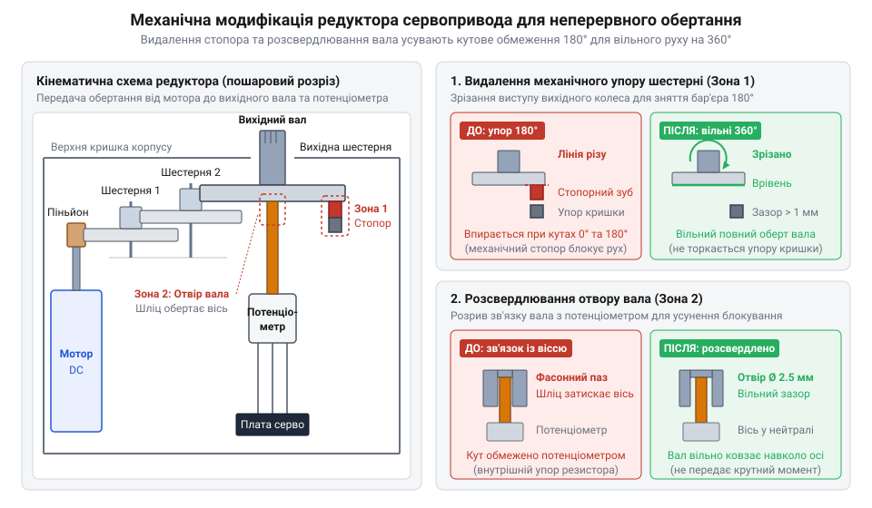
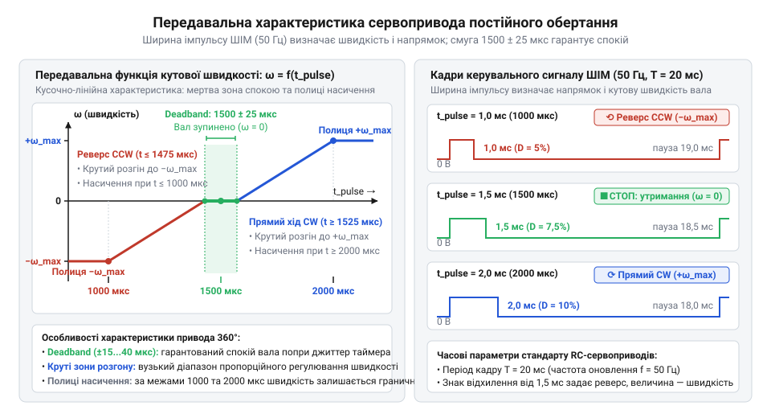

# Сервоприводи постійного обертання

<preknowlist>
- [Tower Pro SG90 — мікросерво 9g](root:cat-hw-actuators/sg90-servo) — будова класичного позиційного сервопривода, керування кутом через ШІМ-імпульси 1–2 мс та принцип зворотного зв'язку за потенціометром
- [Серво-роги (запасні)](root:cat-hw-actuators/servo-horns) — геометрія вихідного шліцьового вала, механічне кріплення коліс і важелів до сервопривода та передача крутного моменту
</preknowlist>

## Чому звичайне серво не обертає колеса

Створення рушія колісного робота одразу виявляє суперечність: мікромотор без редуктора глухне під навантаженням і вимагає зовнішнього моста керування, а компактне позиційне [кутове мікросерво](root:cat-hw-actuators/sg90-servo) клинить після спроби зробити повний оберт. Вільне обертання коліс на шліцах [штатних серво-рогів](root:cat-hw-actuators/servo-horns) блокують два бар'єри.

Механічний стопор — відлитий на вихідній шестерні редуктора (від лат. *reducere* — зменшувати) виступ, який жорстко впирається в упор кришки корпусу за межами 180°. Електронний бар'єр — замкнений контур регулювання: вихідний вал зв'язаний із віссю потенціометра (від лат. *potentia* — сила та грец. *metron* — міра). Внутрішній підсилювач порівнює напругу з його повзунка з керівним імпульсом і знеструмлює двигун, щойно різниця спадає до нуля.

Щоб дістати тяговий мотор-редуктор безперервного обертання, необхідно зрізати механічний упор і розірвати зв'язок редуктора з потенціометром.

## Механічне розблокування та фіксація нейтралі

Для переробки редуктор розбирають: на вихідній шестерні зрізають стопорний виступ урівень із вінцем, а її центральне гніздо розсвердлюють. Тепер шестерня вільно ковзає навколо осі потенціометра, не пошкоджуючи його графітовий повзунок.

*Модифікація редуктора: зрізання виступу звільняє оберт на 360°, а розсвердлювання отвору захищає повзунок потенціометра від провертання.*

Після розчеплення двигун обертається некеровано: нерухомий резистор не компенсує вхідний сигнал, і внутрішній одновібратор із компаратором (від лат. *comparare* — порівнювати) сприймають це як постійну кутову похибку, тримаючи ключі моста відкритими.

Керування відновлюють фіксацією штучної нейтралі на рівні половини напруги живлення:
- **Юстування потенціометра:** подають сигнал 1500 мкс, повертають вісь резистора до зупинки мотора та фіксують краплею клею.
- **Монтаж SMD-дільника:** резистор замінюють двома однаковими прецизійними резисторами (по 2.2 кОм), усуваючи зношення контакту.

Стабільне зміщення перетворює сигнал неузгодженості кута на пропорційне завдання швидкості та напрямку обертання.

## Керування швидкістю, живлення та захист

Приводом керують імпульсами з періодом 20 мс (50 Гц). Імпульс 1500 мкс зупиняє вал, звуження до 1000 мкс розганяє його за годинниковою стрілкою, а подовження до 2000 мкс викликає реверс проти неї. Вузька мертва зона (@@en|deadband@@) навколо нейтралі знеструмлює обмотки, захищаючи їх від гудіння й нагріву. Проте температурний дрейф дільника зміщує точку спокою, викликаючи самочинне повзання вала; це усувають програмним калібруванням центру під час старту.

*Залежність швидкості від імпульсу: відхилення від 1500 мкс регулює оберти й реверс, а мертва зона запобігає нагріву в спокої.*

Пускові струми до 1 А просаджують напругу та викликають [скидання мікроконтролера через спад живлення](root:hw-arch/mcu-brownout-reset) (@@en|Brown-out Reset@@). Схему захищають розділенням силової й логічної ліній, розведенням землі за схемою «зірка» (@@en|Star GND@@) і буферним конденсатором на 100–470 мкФ.

Різкий реверс під інерцією коліс загрожує зрізанням зубів редуктора через люфт. Механіку захищає програмний рампінг (@@en|ramping@@ — від англ. @@en|ramp@@ — схил) — ступенева зміна ширини імпульсу, а також знеструмлення сигналу у простої. Втрачену одометрію (від грец. *hodos* — шлях та *metron* — міра) та вирівнювання курсу відновлюють зовнішніми [колісними енкодерами](root:com-signal/odometry).
