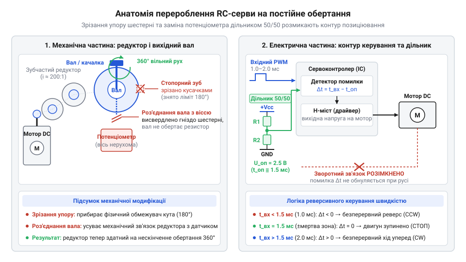
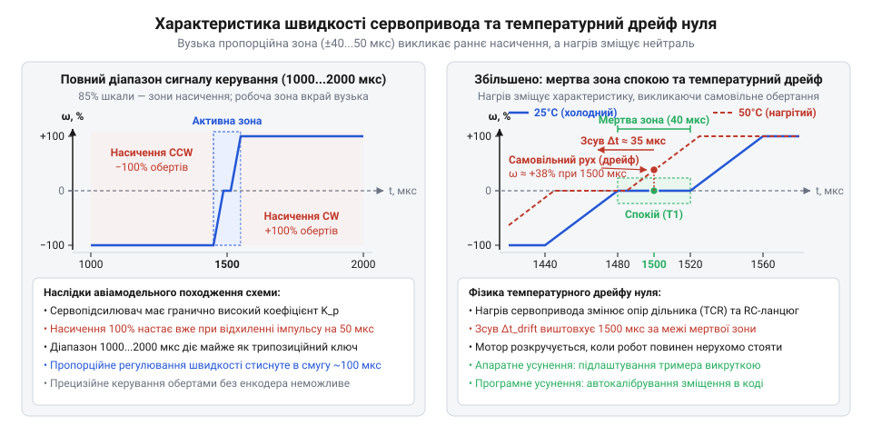

# Історія появи приводів постійного обертання: від хакерського зламу до заводського стандарту

<preknowlist>
- [Tower Pro SG90 — мікросерво 9g](root:cat-hw-actuators/sg90-servo) — будова стандартного аналогового сервопривода (колекторний двигун, редуктор, вихідний потенціометр зворотного зв'язку, плата керування), позиціонування тривалістю імпульсу 1–2 мс при частоті 50 Гц та наявність механічного обмежувача кута повороту вала
- [MG90S V2 — мікросерво з металевим редуктором](root:cat-hw-actuators/mg90s-servo) — кінематика багатоступеневого редуктора мікросервопривода, розташування механічного упору на головній шестерні, передача крутного моменту та поведінка шестерень під механічним навантаженням
</preknowlist>

## Глухий кут приводів ранньої мобільної робототехніки

На зламі 1980–1990-х років зародження автономної мобільної робототехніки — перших турнірів міні-сумо, швидкісного слідування лінією та виникнення @@en|BEAM-робототехніки@@ Марка Тілдена (англ. @@en|BEAM@@ від *Biology, Electronics, Aesthetics, Mechanics*) — уперлося в апаратний глухий кут. Для маневрування двоколісному візку був потрібен [диференційний привід](root:sys-dron/differential-drive-kinematics) (від лат. @@la|differentia@@ — різниця): два незалежні компактні рушії з можливістю плавного регулювання швидкості й реверсу кожного колеса.

Спроба встановити звичайні мініатюрні колекторні двигуни постійного струму безпосередньо на колеса зазнавала повної невдачі. На робочій швидкості у 10 000–15 000 об/хв їхній ротор розвивав мізерний крутний момент і миттєво зупинявся під вагою навіть порожнього шасі. Оберти вимагали кардинального зниження заради пропорційного примноження обертального моменту. Зубчастий редуктор (від лат. @@la|reducere@@ — зменшувати, повертати назад) працює як механічний перетворювач: він розмінює надлишкову кутову швидкість на кратний приріст тяги. Зв'язок між вхідним крутним моментом ротора `M_вх`, передавальним відношенням редуктора `i` та механічним коефіцієнтом корисної дії передачі `η` визначає вихідний крутний момент на валу колеса `M_вих`:

```
M_вих
= M_вх · i · η                            [множення вхідного моменту на передавальне відношення з урахуванням ККД]
```

Вихідна частота обертання вала `n_вих` при цьому спадає в `i` разів відносно початкової частоти ротора `n_вх`, а лінійне тягове зусилля колеса `F_тяг` визначається діленням вихідного моменту на плече радіуса колеса `r`. Ця залежність розкриває фізичну прірву між прямим приводом і редукторною парою.

**Обчислення на прикладі:** розрахунок падіння частоти обертання `n_вих`, вихідного крутного моменту `M_вих` та порівняння тягового зусилля прямого привода `F_пряме` із зусиллям редуктора `F_тяг` для передавального відношення `i = 150` і ККД `η = 0.7` при частоті ротора `n_вх = 12 000 об/хв` і моменті `M_вх = 0.5 мН·м` на колесі радіусом `r = 0.02 м` (діаметр 40 мм):

```
n_вих
= n_вх / i                                [падіння вихідної частоти обертання]
= 12000 об/хв / 150                       [підстановка вхідної частоти та передавального числа]
= 80 об/хв                                [вихідна швидкість близько 1.33 об/с]

F_пряме
= M_вх / r                                [тягове зусилля прямого привода без редуктора]
= 0.0005 Н·м / 0.02 м                     [підстановка моменту ротора та радіуса колеса]
= 0.025 Н                                 [лінійна сила тяги прямого вала]
≈ 2.55 гс                                 [зусилля в грам-силах: 0.025 / 0.00980665]

M_вих
= M_вх · i · η                            [підстановка значень у формулу вихідного моменту]
= 0.5 мН·м · 150 · 0.7                    [перемноження моменту, передавального числа та ККД]
= 52.5 мН·м                               [приріст обертального моменту в 105 разів]
= 0.0525 Н·м                              [вихідний момент у системі SI]

F_тяг
= M_вих / r                               [тягове зусилля на ободі колеса з редуктором]
= 0.0525 Н·м / 0.02 м                     [підстановка вихідного моменту та радіуса колеса]
= 2.625 Н                                 [лінійне зусилля на валу колеса]
≈ 268 гс                                  [зусилля в грам-силах: 2.625 / 0.00980665]
```

Без редуктора мізерна тяга у два з половиною грами виявлялася меншою за опір тертя спокою, через що двигун миттєво клинить під вагою візка. Зубчаста передача приносить кратний виграш у силі ціною падіння обертів: тяга у 268 грам-сил упевнено штовхає вперед навіть півкілограмове шасі. Проте готовий мотор-редуктор був або надто важким промисловим вузлом вартістю в сотні доларів, або вимагав ювелірного саморобного виготовлення мініатюрних зубчастих передач.

Другою прірвою ставала силова комутація. Щоби реверсувати полярність живлення на обмотці двигуна, ентузіасти були змушені збирати [дискретний H-міст](root:hw-motion/h-bridge) (англ. @@en|H-bridge@@, названий за схемною схожістю чотирьох ключів із перемичкою на літеру «H»). Саморобні мости на окремих біполярних транзисторах вимагали громіздкої обв'язки із захисних діодів і базових резисторів. Вони займали більшу частину шасі, швидко спустошували батареї через високе падіння напруги й вимагали від мікроконтролера кількох дефіцитних ліній ШІМ і напрямку.

Рання аматорська робототехніка опинилася в пастці: готових дешевих приводів не існувало, а саморобні силові вузли перетворювали мініатюрного робота на непідйомну й енергетично ненажерливу конструкцію.

## Авіамодельні серва як готова мехатронна база

Відповіддю на кризу приводів став масовий ринок авіамоделей. Стандартний модельний сервопривід (від лат. @@la|servus@@ — слуга, раб) японських марок @@en|Futaba@@ і @@en|Sanwa@@ або корейської @@en|Hitec@@ вагою близько 40 грамів виявився закінченим мехатронним вузлом. В одному пластиковому корпусі виробники вже скомпонували високообертовий колекторний двигун, [багатоступеневий редуктор](root:cat-hw-actuators/sg90-servo) із високим передавальним числом і колосальним виграшем у моменті, а також мініатюрну плату керування з інтегрованим транзисторним H-мостом. Замість громіздких силових ключів привід вимагав лише живлення та єдиний сигнальний дріт, приймаючи стандартні модельні імпульси тривалістю 1–2 мс із частотою 50 Гц.

Проте конструкція сервопривода була цілковито підпорядкована його призначенню — відхиленню рулів літаків у секторі 180°. Використанню пристрою для обертання коліс перешкоджав подвійний бар'єр. Механічно вільний рух блокував відлитий на головній шестерні [механічний упор](root:cat-hw-actuators/mg90s-servo), що впирався в стінку корпусу. Схемотехнічно вихідний вал був жорстко сполучений з віссю зворотного зв'язку — потенціометром (від лат. @@la|potentia@@ — сила та грец. @@grc|μέτρον@@ — міра). Електроніка неперервно порівнювала тривалість вхідного імпульсу з опором потенціометра й утримувала заданий кут, сприймаючи будь-яку спробу кругового обертання як помилку позиціонування.

## Хакерський злам механіки та зворотного зв'язку

У середині 1990-х років спільнота ентузіастів знайшла витончене рішення, що одночасно зняло обидва обмеження. Модифікація починалася з розбирання редуктора: конструктори зрізали або спилювали стопорний зуб на вихідній шестерні, відкриваючи валу вільне обертання на 360°. Одночасно вісь шестерні від'єднували від рухомого контакту потенціометра, щоби не пошкодити його внутрішні обмежувачі під час неперервного руху.

Другим кроком став обхід контуру регулювання положення. Внутрішня мікросхема сервопідсилювача містить [компаратор сигналу неузгодженості](root:hw-motion/servo-error-comparator) (від лат. @@la|comparare@@ — порівнювати), який формує сигнал помилки між тривалістю зовнішнього імпульсу та опорною тривалістю внутрішнього генератора, заданою потенціометром. Щоби розірвати цей контур, потенціометр або фіксували клеєм у нейтральній точці, або повністю випаювали. Замість нього встановлювали симетричний резистивний дільник із двох однакових резисторів номіналом по 2,2 кОм. Дільник постійно подавав на вимірювальний вхід незмінну напругу, що суворо відповідала центральній точці спокою — імпульсу тривалістю 1,5 мс.


*Зрізання механічного упору вихідної шестерні та фіксація зворотного зв'язку резистивним дільником перетворюють сервопривід позиціонування на тяговий мотор-редуктор безперервного обертання.*

Ця підміна створювала штучну неусувну розбіжність. За нейтрального імпульсу 1,5 мс сигнал помилки дорівнював нулю, і двигун залишався нерухомим. Збільшення імпульсу понад 1,5 мс схема розцінювала як відставання вала від заданої позиції й подавала струм через H-міст, обертаючи мотор уперед. Оскільки опір резисторів дільника залишався незмінним, опорна напруга не наздоганяла команду, змушуючи двигун обертатися безперервно. Зменшення імпульсу нижче 1,5 мс викликало дзеркальний реверс. Позиційний привід перетворився на тяговий мотор-редуктор, керований за швидкістю й напрямком одним логічним сигналом без зовнішніх силових драйверів.

## Фабрична стандартизація та екосистема Parallax Boe-Bot

Кустарне перероблення сервоприводів залишалося ризикованим ремеслом. Під час спилювання механічного упору новачки часто ламали тендітні зубці шестерень редуктора, а через перегрівання плати паяльником відшаровувалися мідні доріжки. До того ж технологічний розкид опору резисторів спричиняв зсув нейтралі: зібраний вузол міг повільно обертатися за сигналу 1,5 мс, вимагаючи виснажливого підбору деталей.

Популяризація модифікації у працях американського інженера @@en|Gordon McComb@@ (Гордона Мак-Комба) збіглася зі стрімким розвитком освітньої робототехніки. Наприкінці 1990-х років компанія @@en|Parallax@@ створювала [освітнього колісного робота](root:sys-dron/parallax-boe-bot-robot) @@en|Boe-Bot@@ на базі мікроконтролера @@en|BASIC Stamp 2@@. Для серійного навчального конструктора був потрібен дешевий тяговий вузол, який учням не довелося б власноруч пиляти й паяти.

@@en|Parallax@@ домовилася з японською корпорацією @@en|Futaba@@ про пряме фабричне виготовлення приводів безперервного руху — @@en|Parallax Continuous Rotation Servo@@. Виробник розв'язав проблему на рівні прес-форм: вихідну шестерню почали відливати без стопорного зубця. Замість монтажу постійних резисторів штатний потенціометр від'єднали від вихідного вала й перетворили на підлаштовний @@en|тример@@ (від англ. @@en|trimmer@@, від @@en|trim@@ — припасовувати, підрівнювати). У корпусі навпроти його шліца передбачили отвір, що дозволило механічно калібрувати точку спокою викруткою за лічені секунди прямо під час подачі імпульсу 1,5 мс.

Успіх робота вивів модернізацію на світовий ринок. Конструкцію з калібрувальним отвором швидко перейняли азійські фабрики — @@en|SpringRC@@, @@en|FEETECH@@ та виробники масових [сервоприводів Tower Pro](root:cat-hw-actuators/sg90-servo). Гаражний хак остаточно перетворився на промисловий стандарт, надійно забезпечивши навчальну робототехніку готовими мотор-редукторами.

## Спадщина авіамоделей: вузька зона й дрейф

Серійний випуск усунув ручну роботу, проте електроніка привода залишилася авіамодельною. В авіамоделях рулі висоти й елерони мають блискавично долати зустрічний потік повітря, тому підсилювач неузгодженості проєктували з граничним коефіцієнтом підсилення. Для колісного рушія це виявилося згубним. У [типових аналогових мікросервах](root:cat-hw-actuators/mg90s-servo) насичення схеми й максимальні оберти настають уже за зміщення імпульсу на 50–100 мкс від нейтралі 1500 мкс. Замість плавного наростання швидкості в діапазоні 1000–2000 мкс інженер має вузьку пропорційну зону, за якою мотор працює практично як бінарний вимикач.


*Характеристика швидкості вала: круті робочі ділянки насичують оберти вже за відхилення 50 мкс, а тепловий зсув виводить нейтраль 1500 мкс із мертвої зони та спричиняє самовільне обертання.*

Другим компромісом стала нестабільність точки зупинки. Щоб двигун не тремтів від дрібних перешкод, логіка [спеціалізованих сервопідсилювачів](root:cat-hw-drivers/servo-analog-driver-ic) задає симетричну @@en|мертву зону@@ (від англ. @@en|deadband@@: @@en|dead@@ — нерухомий, та @@en|band@@ — смуга) завширшки 10–20 мкс навколо нейтралі, де живлення мотора вимкнено. Проте опорну тривалість внутрішнього генератора формує аналоговий часозадавальний RC-ланцюжок. Нагрівання двигуна під навантаженням і коливання температури повітря змінюють опір резисторів та ємність конденсатора, викликаючи @@en|дрейф нуля@@ (від англ. @@en|drift@@ — повільний зсув, знесення). Оскільки колекторний мотор і плата запаковані в один невеликий корпус, тривала робота нагріває схему на 20–30 °C. Через сумарний температурний коефіцієнт тримера й конденсатора тривалість внутрішнього часозадавального імпульсу змінюється на 1–2%: нейтраль зміщується на 15–30 мкс від початкових 1500 мкс. Це відхилення суттєво перевищує напівширину мертвої зони у ±5–10 мкс. Робоча характеристика зміщується: імпульс 1500 мкс виходить за межі @@en|мертвої зони@@, підсилювач подає струм на двигун, і знерухомлений робот починає повільно повзти. Це змушує періодично підлаштовувати @@en|тример@@ викруткою або компенсувати зсув програмно.

## Міф прецизійності та розімкнений контур руху

Назва «сервопривід постійного обертання» часто створює оманливе враження, ніби це спеціально спроєктований прецизійний мотор для колісних роботів. Проте означення «серво» тут суто історичне. Через розрив зв'язку між вихідним валом і внутрішнім датчиком пристрій втрачає зворотний зв'язок за положенням. Він більше не відстежує власний кут і перетворюється на звичайний мотор-редуктор із розімкненим контуром керування (англ. @@en|open-loop@@, від *loop* — петля). Вбудована плата лише комутує живлення двигуна відповідно до тривалості вхідного імпульсу, слугуючи компактним силовим драйвером, але не має жодної інформації про реальний кут повороту, швидкість чи пробуксовування коліс.

Фізичні наслідки такого розриву найгостріше відчутні на мобільних шасі з @@la|диференційним приводом@@. Якщо подати однаковий керувальний сигнал на два зовні ідентичні приводи, платформа ніколи не поїде строго прямо. Технологічний розкид параметрів двигунів, неоднакове тертя в шестернях редуктора та температурне нагрівання компонентів задають різну фактичну швидкість обертання коліс. Платформа неминуче відхиляється від курсу, а точна @@el|одометрія@@ (грец. ὁδός — шлях та μέτρον — міра) стає неможливою без монтажу [зовнішніх датчиків обертання](root:hw-sensing/optical-incremental-encoder) чи гіроскопа.

Справжня інженерна ніша таких вузлів — не прецизійна навігація, а швидке й доступне прототипування. Як готовий блок «все в одному», подібний до масових [бюджетних мікроприводів](root:cat-hw-actuators/sg90-servo), модифікована серва незамінна для навчальних платформ, поворотних стендів, конвеєрів або лебідок, де похибка швидкості не має значення. Проте для точного руху вона непридатна й повністю поступається промисловим мотор-редукторам із замкненим контуром регулювання.
