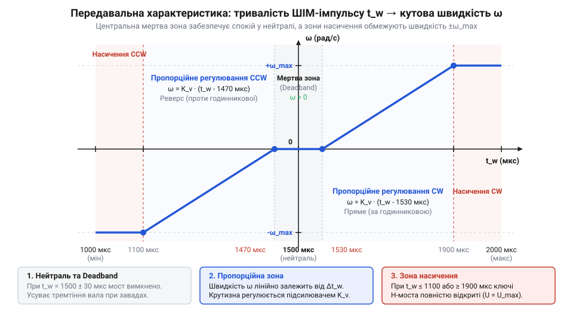
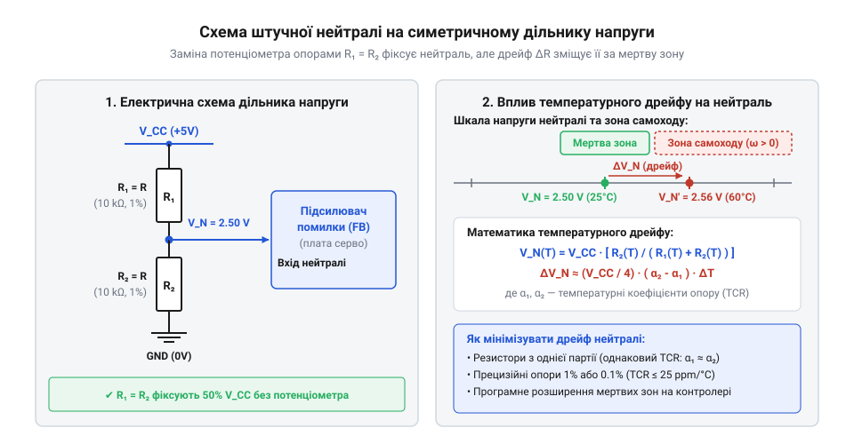

# Математична модель керування, нейтралі та кінематики сервопривода постійного обертання

<preknowlist>
- [Сервоприводи радіокерованих моделей: будова, редуктори та ШІМ-керування](root:cat-hw-actuators/rc-servo-mechanisms-and-control) — Базовий принцип ШІМ-керування позиційним сервоприводом, призначення внутрішнього потенціометра зворотного зв'язку та механічну будову редуктора.
- [Tower Pro SG90 — мікросерво 9g](root:cat-hw-actuators/sg90-servo) — Конструктивні й електричні параметри бюджетного аналогового мікросервопривода, який використовується як базовий приклад для модифікації.
</preknowlist>

## Проблема нестабільної нейтралі модифікованого сервопривода

Спроба зупинити робототехнічну платформу з модифікованим сервоприводом постійного обертання часто призводить до несподіваного ефекту: при поданні стандартного імпульсу нейтралі вал продовжує повільно обертатися або раптово набирає максимальні оберти від найменшого цифрового шуму в каналі керування. У стандартному виконанні класичні [сервоприводи радіокерованих моделей](root:cat-hw-actuators/rc-servo-mechanisms-and-control) (від латинського @@la|servus@@ — слуга) розраховані на утримання заданого кута `θ`. Внутрішній потенціометр (від латинського @@la|potentia@@ — сила та грецького @@gr|μετρέω@@ — вимірювати) жорстко з'єднаний із вихідним валом і утворює замкнений негативний зворотний зв'язок (@@en|feedback@@). Внутрішній аналоговий підсилювач розсогласування порівнює напругу заданого кута від ШІМ-сигналу з напругою поточного кута від потенціометра. Коли різниця цих напруг прямує до нуля, двигун зупиняється точно в заданій позиції.

Під час конструктивної модифікації для забезпечення безперервного обертання механічний обмежувач редуктора видаляють, а вал потенціометра від'єднують від вихідного вала і фіксують у середньому положенні. Для модифікації бюджетного [мікросервопривода Tower Pro SG90](root:cat-hw-actuators/sg90-servo) потенціометр часто замінюють двома резисторами, створюючи штучну нейтраль. Ця дія фізично розриває контур зворотного зв'язку за кутом. Внутрішня мікросхема керування більше не отримує інформації про фактичний поворот вала: значення поточного кута стає константою `θ_fix = 0`. Детальніше про практичні кроки розбирання корпусу, спилювання стопорів шестерень та демонтаж потенціометра читайте у керівництві про [механічну модифікацію сервоприводів на постійне обертання](root:cat-hw-actuators/continuous-rotation-servo-mod/proj-servo-continuous-modification-step-by-step.md).

У результаті розриву зворотного зв'язку внутрішній контур позиціонування перетворюється на розімкнений контур (@@en|open-loop@@) із високим коефіцієнтом підсилення `K_p`. Мікросхема сервопідсилювача обчислює напругу розсогласування `U_err` за виразом:

        U_err = K_p × (U_pwm - U_pot)

Оскільки `U_pot` зафіксовано на рівні штучної нейтралі `U_n`, будь-яке найменше відхилення тривалості управляючого ШІМ-імпульсу `t_p` від значення нейтралі `t_0` створює напругу `U_err`, яка миттєво перевищує поріг відкривання транзисторів Т-мостового підсилювача (@@en|H-bridge@@). Вузька зона пропорційного регулювання аналогової мікросхеми (що становить лише `3...10 мкс`) перетворює сервопривод на двійковий перемикач: вал або стоїть у вузькій зоні спокою, або обертається з граничною швидкістю. Детальний аналіз внутрішньої структури аналогового дискримінатора та формування напруги розсогласування наведено в статті про [інтегральні аналогові сервопідсилювачі KC2462 та AA51880](root:cat-hw-actuators/analog-servo-amplifier-ic).

Фізична величина керування принципово змінюється. Модифікований сервопривод більше не є виконавчим пристроєм кутового положення `θ`. Він стає приводом кутової швидкості `ω`. Для побудови плавного регулятора руху робота виникає необхідність математично формалізувати залежність кутової швидкості `ω` від тривалості керуючого імпульсу `t_p`, враховуючи нелінійність підсилювача та ширину внутрішньої зони спокою.

## Передавальна функція керування та мертва зона

Формалізація керування сервоприводом постійного обертання потребує математичної моделі, яка описує перетворення тривалості імпульсу `t_p` у кутову швидкість вала `ω`. Внутрішній тривалісний дискримінатор (від латинського @@la|discriminare@@ — розрізняти) сервопідсилювача генерує внутрішній опорний імпульс тривалістю `t_0`. Якщо тривалість зовнішнього ШІМ-сигналу `t_p` перебуває в безпосередній близькості до `t_0`, схема порівняння блокує подачу живлення на двигун для запобігання високочастотному коливанню (@@en|jittering@@). Ця область становить мертву зону (@@en|deadband@@).


*Графік кусочно-лінійної передавальної функції сервопривода постійного обертання, що демонструє симетричну мертву зону навколо центрального значення імпульсу та вихід на максимальну швидкість у зонах насичення.*

Математично передавальна функція `ω(t_p)` є кусочно-лінійною залежністю з трьома характерними областями: зоною спокою (мертвою зоною), лінійною зоною пропорційного регулювання та зоною насичення (@@en|saturation@@).

Нехай `t_0` — тривалість імпульсу нейтралі (зазвичай `1500 мкс`), `Δt_dead` — напівширина мертвої зони (типово `4...8 мкс`), `Δt_sat` — відхилення імпульсу до виходу на максимальні оберти (типово `40...60 мкс`), а `ω_max` — максимальна кутова швидкість вала без навантаження при номінальній напрузі живлення.

Для визначення кутової швидкості в пропорційній зоні обчислюємо ефективне відхилення керуючого імпульсу `δt`. При імпульсах, більших за нейтраль з урахуванням мертвої зони (`t_p > t_0 + Δt_dead`), ефективне відхилення становить:

        δt = t_p - t_0 - Δt_dead

Крутизна передавальної характеристики `K_s` (коефіцієнт передачі за швидкістю в `рад/(с · мкс)`) визначається співвідношенням максимальної кутової швидкості до ширини робочого діапазону пропорційної зони:

        K_s = ω_max ÷ (Δt_sat - Δt_dead)

Повна кусочно-лінійна математична модель передавальної функції кутової швидкості `ω(t_p)` має такий вигляд:

        ω(t_p) = 0                                       [при |t_p - t_0| ≤ Δt_dead]
        ω(t_p) = K_s × (t_p - t_0 - Δt_dead)             [при t_0 + Δt_dead < t_p < t_0 + Δt_sat]
        ω(t_p) = K_s × (t_p - t_0 + Δt_dead)             [при t_0 - Δt_sat < t_p < t_0 - Δt_dead]
        ω(t_p) = sign(t_p - t_0) × ω_max                 [при |t_p - t_0| ≥ Δt_sat]

Для сервоприводів із металевим редуктором, як-от пристрої серії [MG90S V2 з металевим редуктором](root:cat-hw-actuators/mg90s-servo), крутизна `K_s` є вищою через менший коефіцієнт редукції та більший крутний момент двигуна.

**Розрахунок кутової швидкості вала при тривалості імпульсу 1540 мкс**

Розглянемо сервопривод із нейтраллю `t_0 = 1500 мкс`, напівшириною мертвої зони `Δt_dead = 6 мкс`, межею насичення `Δt_sat = 50 мкс` та максимальною швидкістю `ω_max = 6.28 рад/с` (що відповідає `60 об/хв`). Обчислимо кутову швидкість при поданні імпульсу `t_p = 1540 мкс`:

        δt = 1540 - 1500 - 6
        = 34 мкс                 [обчислення ефективного відхилення імпульсу]
        K_s = 6.28 ÷ (50 - 6)
        = 0.1427 рад / (с · мкс) [обчислення крутизни передавальної характеристики]
        ω = 0.1427 × 34
        = 4.85 рад / с           [обчислення підсумкової кутової швидкості вала]

Розраховане значення `4.85 рад/с` (близько `46.3 об/хв`) показує, що вал обертається зі швидкістю `77%` від максимальної. Вузький діапазон пропорційної зони (`44 мкс`) вимагає від мікроконтролера високої точності таймера: похибка генерації ШІМ в `2 мкс` спричиняє зміну швидкості на `4.5%`.

## Синтез штучної нейтралі та температурний дрейф

Стійкість мертвої зони залежить від стабільності електричного потенціалу в точці штучної нейтралі (від латинського @@la|neutralis@@ — той, що не належить ні до тих, ні до інших). При вилученні потенціометра зворотного зв'язку його замінюють симетричним резистивним дільником з двох прецизійних резисторів `R_1` та `R_2`.


*Електрична схема синтезу штучної нейтральної точки за допомогою двох фіксованих резисторів R1 та R2, підключених до ліній живлення та загального проводу.*

Напруга штучної нейтралі `U_n`, яка подається на вхід аналогового порівнювача мікросхеми, обчислюється за правилом дільника напруги живлення `V_cc`:

        U_n = V_cc × R_2 ÷ (R_1 + R_2)

У разі ідеальної рівності опорів `R_1 = R_2 = R_0` напруга нейтралі становить точно половину живлення: `U_n = V_cc ÷ 2`. Внутрішній генератор сервопривода порівнює `U_n` із напругою `U_ref`, що пропорційна тривалості керуючого імпульсу `t_p`. Залежність `U_ref(t_p)` описується коефіцієнтом перетворення `K_t` (типово `K_t = 1 ÷ 2000 мкс = 0.0005 1/мкс` від відносного рівня `V_cc`).

Якщо опір резисторів змінюється під впливом температури навколишнього середовища, потенціал `U_n` зміщується. Температурна залежність опору визначається температурним коефіцієнтом опору (ТКО, @@en|TCR@@ — @@en|Temperature Coefficient of Resistance@@), який вимірюється в мільйонних частках на градус Цельсія (@@en|ppm/°C@@):

        R_1(ΔT) = R_1,0 × (1 + α_1 × ΔT)
        R_2(ΔT) = R_2,0 × (1 + α_2 × ΔT)

де `α_1` та `α_2` — температурні коефіцієнти першого та другого резисторів, а `ΔT` — зміна температури у градусах Цельсія.

При відхиленні опорів дільника напруга штучної нейтралі `U_n(ΔT)` набуває вигляду:

        U_n(ΔT) = V_cc × R_2,0 × (1 + α_2 × ΔT) ÷ [R_1,0 × (1 + α_1 × ΔT) + R_2,0 × (1 + α_2 × ΔT)]

Підставляючи початкову рівність `R_1,0 = R_2,0`, після спрощення лінійного наближення отримуємо відносне зміщення напруги нейтралі:

        ΔU_n ÷ V_cc ≈ (α_2 - α_1) × ΔT ÷ 4

Зміщення електричної нейтралі на `ΔU_n` викликає відповідний часовий зсув точки спокою ШІМ-сигналу `Δt_0` у мікросекундах:

        Δt_0 = V_cc × (α_2 - α_1) × ΔT ÷ (4 × K_u)

Оскільки `K_t = 0.0005 1/мкс`, множник `1 ÷ (4 × K_t)` дорівнює `500 мкс`. Звідси зміщення нейтралі становить:

        Δt_0 = (α_2 - α_1) × ΔT × 500

**Розрахунок зсуву нейтральної точки при зміні температури на 30 °C**

Розглянемо дільник із двох SMD-резисторів широкого вжитку з допуском `5%` та граничним ТКО `α = ±200 ppm/°C` (`200 × 10⁻⁶ 1/°C`). У найгіршому випадку резистор `R_1` має позитивний ТКО `α_1 = +200 ppm/°C`, а `R_2` — негативний `α_2 = -200 ppm/°C`. Обчислимо зміщення нейтралі при нагріванні плати приводу на `ΔT = +30 °C`:

        Δα = -200 × 10⁻⁶ - 200 × 10⁻⁶
        = -400 × 10⁻⁶ 1 / °C     [обчислення різниці температурних коефіцієнтів]
        Δt_0 = -0.0004 × 30 × 500
        = -6 мкс                 [обчислення часового зсуву нейтральної точки]

Отримане значення `-6 мкс` перекриває весь допуск мертвої зони `Δt_dead = 6 мкс`. Це означає, що при нагріванні на `30 °C` робот, який повинен нерухомо стояти при імпульсі `1500 мкс`, почне самовільно обертати колеса.

Для усунення самовільного дрейфу нейтралі в модифікованих приводах слід застосовувати прецизійні тонкоплівкові резистори (@@en|thin-film@@) з ТКО не гірше `±25 ppm/°C` з однієї виробничої партії. У такому разі різниця `|α_2 - α_1|` не перевищує `10 ppm/°C`, а температурний зсув нейтралі `Δt_0` становить менше ніж `0.15 мкс`, що повністю зберігає стабільність зони спокою. У складних системах із моторами високої потужності альтернативою є [безколекторні інтегральні сервоконтролери](root:cat-hw-actuators/bldc-servo-controller), де підтримання нейтралі реалізовано повністю цифровим алгоритмом.

## Кінематика вала й механічна характеристика

Коли напруга на колекторному моторчику постійного струму сформована підсилювачем розсогласування та ШІМ-імпульсом (широтно-імпульсна модуляція, @@en|pulse-width modulation@@ або @@en|PWM@@), вихідний вал сервопривода починає обертатися. Проте мотор працює не у вакуумі: він сполучений із багатоступеневим редуктором, а до вихідного вала прикладено зовнішнє механічне навантаження. Зростання опору на валу сповільнює обертання мотора, що змінює внутрішній струм якоря та проти-електрорушійну силу. Щоб передбачити роботу привода, потрібно встановити математичний зв'язок між напругою живлення мотора, тривалістю керуючого імпульсу, кутовою швидкістю та крутним моментом вихідного вала.

В електричному колі мотора постійного струму ефективна напруга `U_eff`, прикладена до обмотки якоря, урівноважується падінням напруги на внутрішньому активному опорі `R` та проти-електрорушійною силою @@en|back-EMF@@ (від англійського @@en|back electromotive force@@). Проти-@@en|back-EMF@@ виникає внаслідок обертання якоря в постійному магнітному полі статора і прямо пропорційна кутовій швидкості ротора мотора `ω_m`. Електрична рівновага описується рівнянням:

```
U_eff
= I · R + e_b         [закон Кірхгофа для кола якоря]
= I · R + K_e · ω_m   [вираження проти-ЕРС через швидкість]
```

Тут `I` — струм якоря мотора в амперах, `R` — активний опір обмотки в омах, `e_b` — напруга проти-@@en|back-EMF@@ у вольтах, `K_e` — коефіцієнт проти-ЕРС мотора у вольт-секундах на радіан, а `ω_m` — кутова швидкість якоря мотора в радіанах за секунду. З цього рівняння видно, що при зростанні кутової швидкості `ω_m` проти-@@en|back-EMF@@ збільшується, зменшуючи струм якоря `I`. Повний вивід диференціальних рівнянь, динамічних часових сталих та електромеханічних переходів описує [електромеханічна модель мотора постійного струму](root:hw-motion/dc-motor-electromechanical-dynamics).

Електромагнітний крутний момент мотора `τ_m` (від англійського @@en|torque@@) пропорційний струму якоря з коефіцієнтом моменту `K_t`. Оскільки між ротором мотора та вихідним валом привода встановлено редуктор (від латинського *reducere* — зменшувати, @@en|gearbox@@) із передавальним відношенням `N` (де `N = ω_m / ω_out > 1`) та коефіцієнтом корисної дії `η`, механічні параметри на вихідному валу змінюються: кутова швидкість зменшується в `N` разів, а момент зростає:

```
ω_out
= ω_m / N                                       [кінематичне співвідношення редуктора]

τ_out
= N · η · τ_m - τ_friction                      [трансформація моменту з урахуванням втрат]
= N · η · K_t · I - b_v · ω_out - τ_friction    [вираження моменту через струм і тертя]
```

У цих виразах `ω_out` — кутова швидкість вихідного вала в радіанах за секунду, `τ_out` — корисний крутний момент (@@en|torque@@) на валу в ньютон-метрах, `η` — коефіцієнт корисної дії редуктора, `b_v` — коефіцієнт в'язкого тертя (від латинського *viscosus* — липкий, @@en|viscous friction@@) у підшипниках та редукторі, а `τ_friction` — момент сухого тертя спокою.

Поєднуючи електричний баланс якоря та механічне перетворення редуктора, виведемо залежність кутової швидкості вала `ω_out` від прикладеного крутного моменту `τ_out` та ефективної напруги `U_eff`. Ефективна напруга `U_eff` прямо пропорційна відхиленню тривалості керуючого ШІМ-імпульсу `t_pulse` від нейтралі `t_neutral` поза межами мертва зона (@@en|deadband@@) `Δt_dead`:

```
U_eff
= K_amp · (|t_pulse - t_neutral| - Δt_dead) · sgn(t_pulse - t_neutral)   [лінійне підсилення помилки]
```

Принципова будова підсилювача та передавальна функція детально описані в контексті [будови редуктора сервопривода](root:cat-hw-actuators/rc-servo-mechanisms-and-control). Підставивши струм якоря `I = (U_eff - K_e · N · ω_out) / R` у вираз для моменту `τ_out`, дістаємо рівняння механічної характеристики вихідного вала:

```
τ_out
= (N · η · K_t / R) · (U_eff - K_e · N · ω_out) - τ_friction   [підстановка струму якоря]

ω_out
= (U_eff / (K_e · N)) - (R · (τ_out + τ_friction) / (η · K_t · K_e · N²)) [механічна характеристика вала]
```

Це фундаментальне рівняння показує лінійну спадну залежність кутової швидкості `ω_out` від механічного навантаження `τ_out`. При нульовому зовнішньому моменті (`τ_out = 0`) вал обертається зі швидкістю холостого ходу швидкість холостого ходу (@@en|no-load speed@@) `ω_0 = U_eff / (K_e · N)`. Збільшення опору на валу лінійно знижує швидкість до повного зупинення, де момент сягає значення пусковий момент (або момент блокування, @@en|stall torque@@) `τ_stall = η · N · K_t · U_eff / R - τ_friction`.

**Розрахунок робочої швидкості та моменту мікросервопривода**

Обчислимо кутову швидкість і доступний крутний момент модифікованого сервопривода на базі популярного [мікросервопривода Tower Pro SG90](root:cat-hw-actuators/sg90-servo). Приймемо параметри: напруга живлення `U_supply = 5.0 V`, передавальне відношення редуктора `N = 300`, коефіцієнт ККД `η = 0.75`, опір якоря `R = 8.0 Ом`, конструктивна стала `K_e = K_t = 0.0015 В·с/рад`. Нехай керуючий ШІМ-імпульс `t_pulse = 1750 мкс`, нейтраль `t_neutral = 1500 мкс`, мертва зона (@@en|deadband@@) `Δt_dead = 10 мкс`, а зона насичення підсилювача досягається при `|t_pulse - t_neutral| = 200 мкс`. Зважаючи на це, при `Δt = 250 мкс` підсилювач перебуває в насиченні, і до мотора прикладається повна напруга `U_eff = 5.0 V`. Момент сухого тертя прийнято `τ_friction = 0.01 Н·м`.

```
ω_0
= 5.0 / (0.0015 × 300)                                       [швидкість холостого ходу мотора]
= 5.0 / 0.45
= 11.11 рад/с                                               [переведення у радіани за секунду]

n_0
= (11.11 × 60) / (2 × π)                                     [переведення в оберти за хвилину]
= 666.6 / 6.2832
= 106.1 об/хв                                                [кутова швидкість холостого ходу вала]

τ_stall
= (0.75 × 300 × 0.0015 × 5.0) / 8.0 - 0.01                  [пусковий момент блокування]
= 1.6875 / 8.0 - 0.01
= 0.2109 - 0.01
= 0.2009 Н·м                                                 [максимальний момент утримання]

ω_work (при τ_out = 0.08 Н·м)
= 11.11 × (1 - (0.08 + 0.01) / 0.2109)                       [робоча швидкість під навантаженням]
= 11.11 × (1 - 0.09 / 0.2109)
= 11.11 × (1 - 0.4267)
= 11.11 × 0.5733
= 6.37 рад/с                                                 [робоча кутова швидкість]
```

Розрахунок показує, що при робочому навантаженні 0.08 Н·м (приблизно 0.82 кг·см) кутова швидкість вала зменшується з 11.11 рад/с (106 об/хв) до 6.37 рад/с (60.8 об/хв). Для більш надійних металевих редукторів, таких як у [моделі MG90S з металевим редуктором](root:cat-hw-actuators/mg90s-servo), ККД `η` вищий, що дає менший спад швидкості під навантаженням.

## Розрахунок руху та тяги колеса

Розраховані механічні характеристики вихідного вала є вихідними даними для побудови кінематики (від грецького *kineo* — рухати, @@en|kinematics@@) та динаміки (від грецького *dynamis* — сила, @@en|dynamics@@) колісного робота. Перетворення обертового руху вала в поступальний рух шасі відбувається через колесо, жорстко закріплене на серво-розі. Якщо радіус колеса обрано занадто великим, крутного моменту (@@en|torque@@) сервопривода не вистачить для подолання опору коченню чи підйому, і робот зупиниться. Натомість занадто мале колесо обмежить максимальну лінійну швидкість платформи.

При відсутності просковзування лінійна швидкість руху `v` центру колеса радіусом `R_wheel` зв'язана з кутовою швидкістю вихідного вала `ω_out` простою геометричною співвідношенням:

```
v
= ω_out · R_wheel                                 [лінійна швидкість без просковзування]
= (U_eff / (K_e · N)) · R_wheel · (1 - τ_out / τ_stall) [залежність швидкості від напруги та навантаження]
```

Тут `v` — лінійна швидкість руху платформи в метрах за секунду, `R_wheel` — радіус колеса в метрах, а `ω_out` — кутова швидкість у радіанах за секунду. Якщо робототехнічна платформа використовує два приводних колеса з незалежними сервоприводами постійного обертання, лінійна швидкість поздовжнього руху дорівнює середньому арифметичному швидкостей лівого `v_L` та правого `v_R` коліс: `v_center = (v_L + v_R) / 2`.

Для створення поступального руху колесо має прикласти до поверхні тягове зусилля (@@en|traction force@@) `F_drive`. Тягове зусилля створюється крутним моментом вала `τ_out` і обчислюється як:

```
F_drive
= τ_out / R_wheel                                 [тягове зусилля одного колеса]
```

Для двоколісної платформи сумарне тягове зусилля двох приводних приводів дорівнює `F_total = 2 · F_drive = 2 · τ_out / R_wheel`. Щоб платформа рухалася вперед із прискоренням або долала перешкоди, сумарне тягове зусилля (@@en|traction force@@) `F_total` повинно перевищувати суму сил опору руху:

```
F_total
≥ F_roll + F_slope + F_air                        [умова руху платформи]
= f_roll · m · g · cos(θ) + m · g · sin(θ) + F_air [розклад сил опору]
```

У цьому рівнянні `m` — загальна маса робота в кілограмах, `g = 9.81 м/с²` — прискорення вільного падіння, `f_roll` — коефіцієнт опору коченню (від латинського *resistere* — протистояти, @@en|rolling resistance@@), `θ` — кут нахилу поверхні в радіанах або градусах, а `F_air` — сила опору повітря (якою при малих швидкостях робота можна знехтувати). Крім того, тягове зусилля обмежене коефіцієнтом зчеплення колеса з поверхнею зчеплення (@@en|friction grip@@) `μ`: `F_drive ≤ μ · N_load`, де `N_load` — нормальна реакція опори на колесо. Для розрахунку складніших кінематичних схем та розширеного силового балансу мобільного робота перегляньте матеріал про [кінематику та динаміку колісних робототехнічних платформ](root:sys-dron/wheel-kinematics-and-dynamics).

**Розрахунок динаміки двоколісного робота на сервоприводах**

Розрахуємо максимальну лінійну швидкість і граничний кут підйому для робота масою `m = 1.2 кг`, оснащеного двома модифікованими сервоприводами SG90. Радіус коліс `R_wheel = 0.035 м` (діаметр 70 мм, [стандартні колеса для серво-рогів](root:cat-hw-actuators/servo-horns)). Параметри кожного сервопривода взято з попереднього розрахунку: `ω_0 = 11.11 рад/с`, `τ_stall = 0.20 Н·м`. Коефіцієнт опору коченню (@@en|rolling resistance@@) гумового колеса по пластиковому покриттю `f_roll = 0.04`. Маса робота рівномірно розподілена на два приводні колеса, тобто `N_load = (m · g) / 2`.

```
v_max (без навантаження)
= 11.11 × 0.035                                   [максимальна швидкість холостого ходу]
= 0.3888 м/с ≈ 0.39 м/с                           [переведення в м/с (1.4 км/год)]

F_roll_total
= 0.04 × 1.2 × 9.81                              [сила опору коченню на плоскій поверхні]
= 0.4709 Н                                        [загальний опір коченню]

τ_req_per_wheel (на плоскій поверхні)
= (F_roll_total / 2) × R_wheel                    [необхідний момент одного сервопривода]
= (0.4709 / 2) × 0.035
= 0.2354 × 0.035
= 0.00824 Н·м                                     [робочий момент для подолання кочення]

sin(θ_max) (граничний кут підйому при τ_out = 0.15 Н·м)
F_total_max = 2 × (0.15 / 0.035) = 8.571 Н        [максимальне сумарне тягове зусилля]
F_slope_max = F_total_max - F_roll_total          [доступне зусилля на підйом]
= 8.571 - 0.4709 = 8.100 Н                        [тяга для подолання градієнта]
sin(θ_max) = 8.100 / (1.2 × 9.81) = 8.100 / 11.772 = 0.688
θ_max = arcsin(0.688) ≈ 43.5°                      [максимальний кут підйому]
```

Розрахунок показує, що з колесами діаметром 70 мм робот досягає швидкості майже 0.39 м/с. На плоскій поверхні опір коченню вимагає лише 0.0082 Н·м на валу (що становить лише 4% від пускового моменту (@@en|stall torque@@)), тому сервопривід працює практично на швидкості холостого ходу (@@en|no-load speed@@). При збільшенні маси або встановленні важчих елементів [живлення з родини Power HD](root:cat-hw-actuators/powerhd-family) для збереження динаміки знадобиться зменшити радіус колеса або використати приводи з більшим крутним моментом.