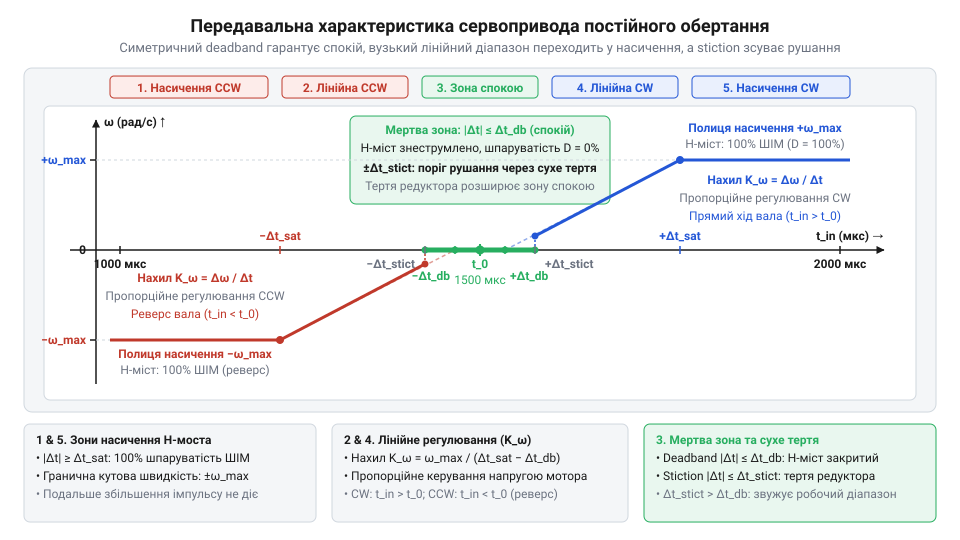

# Математична модель передавальної характеристики та мертвої зони сервопривода постійного обертання

<preknowlist>
- [Tower Pro SG90 — мікросерво 9g](root:cat-hw-actuators/sg90-servo) — Принцип керування стандартним сервоприводом імпульсами тривалістю 1000–2000 мкс із періодом 20 мс (нейтральне положення 1500 мкс), базова внутрішня будова (колекторний мікромотор, редуктор, потенціометр зворотного зв'язку) та діапазон живлення 4.8–6.0 В
- [MG90S V2 — мікросерво з металевим редуктором](root:cat-hw-actuators/mg90s-servo) — Особливості характеристик мікросервоприводів із металевим редуктором: підвищене тертя зачеплення шестерень (stiction), залежність швидкості холостого ходу від напруги живлення та специфіка поведінки при модифікації на постійне обертання
</preknowlist>

## Чому модифікований сервопривод не регулюється плавно

Спроба зібрати колісне шасі чи протяжний механізм на доступних компонентах приводить до сервопривода (від лат. @@la|servus@@ — слуга), переробленого на постійне обертання. У [мікросервопривода SG90](root:cat-hw-actuators/sg90-servo) зрізають упор редуктора й замінюють потенціометр резистивним дільником за [посібником із модифікації сервопривода](root:cat-hw-actuators/continuous-rotation-servo-mod). Очікується плавне регулювання: стандартний імпульс тривалістю 1000–2000 мкс із періодом 20 мс мав би лінійно змінювати швидкість вала від -100% до +100%, з повною зупинкою на 1500 мкс.

На практиці привід поводиться катастрофічно. Сигнал 1500 мкс не зупиняє вал: через тепловий дрейф резисторів та апаратне тремтіння (@@en|jitter@@) тривалості вісь повільно повзе або дрижить. Зсув імпульсу всього на 20–30 мкс у будь-який бік зриває мотор на повні оберти. Замість пропорційного дроселювання швидкості виникає жорсткий двійковий перемикач «стоп — максимальний хід». Широкі діапазони 1000–1470 мкс та 1530–2000 мкс взагалі не реагують на зміну сигналу.

Звичайна моторна інтуїція тут відмовляє. Сервопривод спроєктовано для жорсткого утримання кута, а не швидкості. Конфлікт між позиційною схемотехнікою та завданням обертання вимагає розібрати внутрішній ланцюг обробки сигналу.

## Формування напруги з часового відхилення імпульсу

Аналоговий сервопідсилювач порівнює вхідний імпульс тривалістю `t_in` із внутрішнім опорним імпульсом `t_0`. Опорну тривалість задає внутрішній генератор, чий час заряду визначався потенціометром (від лат. @@la|potentia@@ — сила та грец. @@grc|metron@@ — міра) зворотного зв'язку на валу. У модифікованому приводі цей зв'язок розімкнено: потенціометр замінено фіксованим дільником напруги, тому генератор завжди формує сталу тривалість `t_0 ≈ 1500` мкс.

Різницю між тривалістю зовнішнього імпульсу `t_in` та внутрішньою опорною величиною `t_0` визначає часова неузгодженість `Δt`:

```
Δt = t_in - t_0
```

Цей сигнал похибки надходить на підсилювач із високим пропорційним коефіцієнтом `K_p`. Схема перетворює зсув `Δt` на шпаруватість керування вихідного H-моста (@@en|H-bridge@@), що подає напругу `V_motor` на обмотки двигуна.

Високий коефіцієнт `K_p` закладено для утримання позиції: щоб протистояти зовнішньому навантаженню, сервопривод має розвивати максимальне зусилля вже при похибці у 20–40 мкс. За такого відхилення шпаруватість сягає 100%, і вихідний H-міст зазнає насичення (від лат. @@la|saturatio@@ — пересичення), подаючи на мотор повну напругу живлення.

У позиційному приводі мотор повертає вал, підлаштовує `t_0` під `t_in` і гасить похибку `Δt` до нуля. У модифікованому приводі потенціометр не рухається, тож при сталому `t_in` похибка `Δt` лишається незмінною, обертаючи вал із постійною швидкістю як розімкнений інтегратор. Через великий коефіцієнт `K_p` лінійна зона регулювання звужується до смуги ±30 мкс біля `t_0`, а поза нею настає насичення.

## Фізична природа та межі мертвої зони

Якби вихідний @@en|H-bridge@@ сервопідсилювача реагував на будь-яке часове відхилення `Δt ≠ 0`, зупинити модифікований сервопривод було б неможливо. Апаратне тремтіння (@@en|jitter@@) таймера мікроконтролера та теплові шуми постійно генерують випадкові коливання тривалості імпульсу в кілька мікросекунд. Через високий коефіцієнт підсилення ці мікропохибки відкривали б силові ключі, спричиняючи гудіння мотора, перегрів обмоток, перевитрату струму та повільний дрейф вала.

Щоб запобігти паразитному руху, серводекодер містить віконний компаратор, який формує симетричну мертву зону (від англ. @@en|deadband@@: dead — нерухомий та band — смуга) навколо центральної точки `t_0`. Межу блокування задає умова, за якої абсолютна похибка сигналу не перевищує поріг `Δt_db`:

```
|Δt| ≤ Δt_db
```

У цих межах компаратор блокує всі транзистори @@en|H-bridge@@: шпаруватість дорівнює нулю, напруга `V_motor = 0`, і вал перебуває в механічному спокої. Для типових аналогових мікросервоприводів напівширина мертвої зони `Δt_db` становить від 2 до 10 мкс.

Звідси випливає аналітична умова гарантованого спокою, яка обмежує тривалість вхідного імпульсу `t_in` симетричним інтервалом:

```
t_0 - Δt_db ≤ t_in ≤ t_0 + Δt_db
```

Потрапляння імпульсу в це вікно гарантує повну зупинку вала попри апаратний шум таймера.

В аналогових схемах еталонний час `t_0` дрейфує через температурну нестабільність підстроювальних резисторів на 10–30 мкс від номінальних 1500 мкс. Для програмного калібрування нейтралі експериментально фіксують нижню межу зупинки обертання `t_min_stop` і верхню межу `t_max_stop`, визначаючи справжній центр як середину зони спокою:

```
t_0 = (t_min_stop + t_max_stop) ÷ 2
```

Центрування імпульсу навколо розрахованого `t_0` максимізує запас стійкості до завад в обидва боки обертання.

Проте точне виставлення нейтралі не гарантує механічного спокою, якщо крок формування імпульсу в мікроконтролері є завеликим. Апаратний таймер змінює тривалість сигналу дискретними кроками, величину яких визначає його роздільна здатність `Δt_timer`. Стійкість контуру до випадкового зриву в рух оцінюють через коефіцієнт запасу завадостійкості `K_noise`, що виражає співвідношення між напівшириною мертвої зони `Δt_db` та роздільною здатністю таймера `Δt_timer`:

```
K_noise = Δt_db ÷ Δt_timer
```

Цей коефіцієнт показує, скільки дискретних кроків таймера вміщується всередині зони спокою в один бік від центру. За умови `K_noise ≤ 1` (коли `Δt_timer ≥ Δt_db`) один крок таймера перевищує напівширину мертвої зони: найменша зміна керувального коду перекидає привід одразу в режим обертання, а випадкове апаратне тремтіння (@@en|jitter@@) виштовхує сигнал за межі вікна блокування й спричиняє мимовільне обертання вала. Надійна зупинка можлива лише за умови `K_noise ≥ 3…5` (відповідно `Δt_timer ≤ Δt_db ÷ 3`), коли напівширина мертвої зони містить кілька дискретних відліків таймера, створюючи запас проти апаратних шумів.

## Кусочно-лінійна модель передавальної характеристики швидкості

Взаємозв'язок між шириною вхідного імпульсу `t_in` і кутовою швидкістю вала `ω` поділяє діапазон керування 1000–2000 мкс на п'ять областей: центральну мертву зону (@@en|deadband@@), дві лінійні пропорційні ділянки різного напрямку та дві зони насичення (@@en|saturatio@@).

Кутова швидкість вала `ω(t_in)` як функція часової похибки `Δt = t_in - t_0` за максимальної швидкості `ω_max` та крутизни `K_ω` описується кусочно-лінійним виразом:

```
ω(t_in) = sgn(Δt) · min(ω_max, max(0, K_ω · (|Δt| - Δt_db)))
```

Функція знака `sgn(Δt)` визначає напрямок обертання вала: від'ємні значення відповідають руху за годинниковою стрілкою, додатні — проти неї. Оператор `max(0, ...)` обнуляє швидкість усередині мертвої зони `|Δt| ≤ Δt_db`. Поза нею швидкість лінійно зростає з коефіцієнтом `K_ω` аж до порогу насичення `Δt_sat = Δt_db + ω_max ÷ K_ω`. Оператор `min(ω_max, ...)` обмежує швидкість рівнем `±ω_max`, коли шпаруватість сягає 100% і H-міст подає на мотор повну напругу.


*П'ять областей передавальної характеристики сервопривода: симетрична мертва зона гарантує спокій, вузький лінійний діапазон переходить у насичення, а сухе тертя зсуває момент рушання вала.*

Реальний рух спотворює механіка редуктора: сухе тертя спокою (від англ. @@en|stiction@@, злиття static — статичний та friction — тертя) не дає шестерням рушити при малих напругах. Особливо відчутно це в сервоприводах із [металевим редуктором MG90S](root:cat-hw-actuators/mg90s-servo), де тертя зачеплення вище, ніж у пластику. Обертання починається лише при переході порогу рушання `Δt_stict > Δt_db`, що додатково розширює практичну нечутливість привода та ще більше звужує лінійний діапазон.

## Квантування таймером та чутливість до напруги

Апаратний таймер мікроконтролера задає тривалість імпульсу не неперервно, а дискретними кроками квантування (від лат. @@la|quantum@@ — скільки) `Δt_timer`, зазвичай із роздільною здатністю 0.5–1 мкс. Оскільки активна лінійна зона між порогом мертвої зони `Δt_db` та порогом насичення `Δt_sat` становить лише `Δt_lin = Δt_sat - Δt_db ≈ 30–60` мкс, кількість доступних градацій швидкості `N_steps` визначає відношення:

```
N_steps = Δt_lin ÷ Δt_timer
```

За `Δt_lin = 40` мкс і `Δt_timer = 1` мкс привід отримує лише 40 градацій на весь робочий діапазон обертання. Крок квантування швидкості `Δω` показує зміну кутової швидкості на один апаратний дискрет таймера через крутизну передавальної характеристики `K_ω`:

```
Δω = K_ω · Δt_timer
```

Кожен крок таймера викликає відчутний стрибок обертів вала, тому цифрове регулювання швидкості безповоротно втрачає плавність.

Другий фактор апаратної нестабільності — коливання напруги живлення шини `V_supply`. Швидкість холостого ходу двигуна прямо пропорційна напрузі на клемах, тому максимальна швидкість [мікросервопривода SG90](root:cat-hw-actuators/sg90-servo) `ω_max(V)` масштабується відносно опорного калібрувального рівня `V_ref`:

```
ω_max(V) = ω_max(V_ref) · (V_supply ÷ V_ref)
```

Разом із граничною швидкістю змінюється й нахил лінійної ділянки `K_ω(V) = ω_max(V) ÷ Δt_lin`. У міру розряджання акумулятора той самий імпульс обертає вал повільніше, що змушує систему вводити динамічний масштабний коефіцієнт `V_ref ÷ V_supply` для коригування сигналу.
