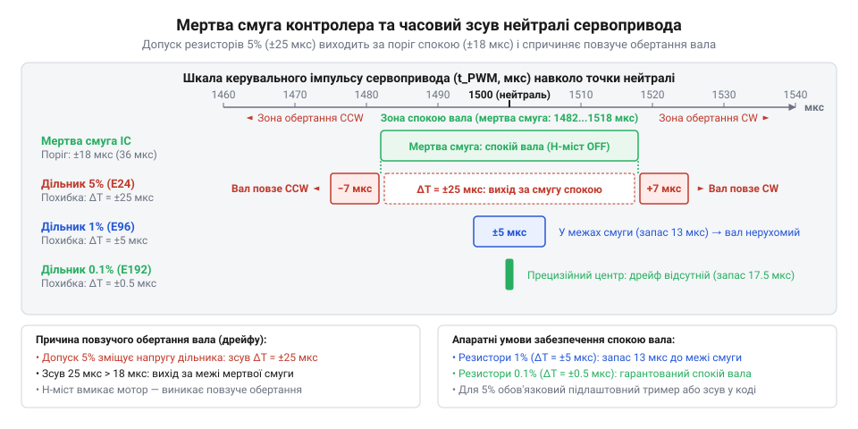
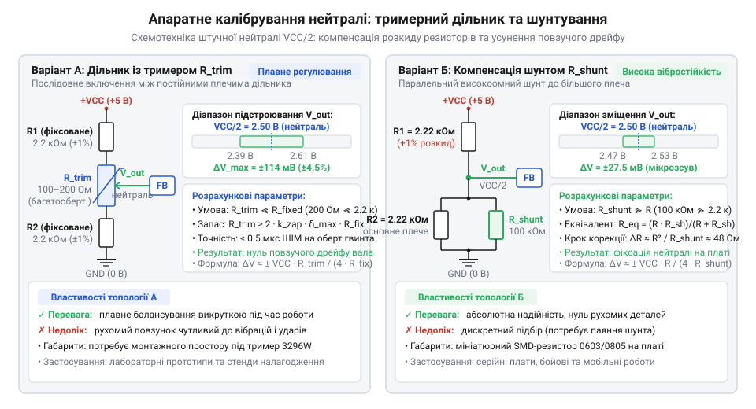

# Розрахунок резистивного дільника зворотного зв'язку та теплового дрейфу нейтралі

<preknowlist>
- [Tower Pro SG90 — мікросерво 9g](root:cat-hw-actuators/sg90-servo) — Конструктивна будова класичного мікросервопривода, призначення внутрішнього змінного резистора зворотного зв'язку за положенням вала та керування кутом за допомогою ШІМ-сигналів із нейтраллю 1500 мкс
- [MG90S V2 — мікросерво з металевим редуктором](root:cat-hw-actuators/mg90s-servo) — Особливості роботи мікросервопривода під механічним навантаженням: високі робочі й пускові струми, інтенсивний нагрів двигуна й корпусу та ризик виникнення температурного градієнта на платі контролера
</preknowlist>

## Чому серво повзе на нейтралі

Під час створення колісного шасі мобільного робота стандартний сервопривод переробляють на привід постійного обертання (@@en|continuous rotation servo@@): внутрішній механічний упор видаляють, а штатний кутовий потенціометр (від лат. *potentia* — сила, та грец. *метрон* — міра; @@en|potentiometer@@) замінюють двома постійними резисторами однакового номіналу. Очікування інженера просте: такий симетричний дільник ділить напругу живлення строго навпіл, створюючи штучну точку нейтралі. Щойно мікроконтролер подає на вхід стандартний ШІМ-імпульс тривалістю 1500 мкс, внутрішня схема повинна сприйняти його як команду повної зупинки, і вихідне колесо має нерухомо застигнути на місці.

Проте на практиці виникає інженерний глухий кут: замість спокою вал починає самочинно й повільно повзти в один бік. Причина криється у звичайних резисторах із заводським допуском 5%: навіть розкид номіналів у 2–3% порушує симетрію дільника, зміщуючи вихідну середню напругу від точної половини живлення. Внутрішній компаратор сервопідсилювача порівнює цю напругу з тривалістю вхідного імпульсу й сприймає асиметрію дільника як постійну кутову помилку неузгодженості (англ. @@en|error signal@@). Якщо отримана похибка перевищує ширину апаратної мертвої смуги (англ. @@en|deadband@@ — зона нечутливості вхідного каскаду, від *dead* — нерухомий, та *band* — смуга), мікросхема подає живлення на двигун, безупинно намагаючись усунути розбіжність.

Спроби виправити це сповзання програмно — підбором скоригованої тривалості нейтралі в коді мікроконтролера (наприклад, 1514 мкс замість 1500 мкс) — швидко зазнають невдачі. Під час тривалого руху робота, особливо у навантажених приводах із [металевим редуктором MG90S](root:cat-hw-actuators/mg90s-servo), колекторний двигун і силові транзистори розсіюють тепло всередині замкненого корпусу. Через нерівномірний тепловий градієнт плечі дільника прогріваються неоднаково, а температурний коефіцієнт опору матеріалу викликає тепловий дрейф (від нід. *drijven* — плавати, нестися за течією; англ. @@en|thermal drift@@). Точка зупинки безупинно «пливе», а через поступовий розряд тягового акумулятора колеса непередбачувано рушають з місця навіть у режимі простою.

Підбір компонентів навмання чи спроби програмного підлаштування принципово не усувають цієї нестабільності. Щоб колеса робота непохитно стояли на нейтралі за будь-якої робочої температури та напруги батареї, потрібен строгий математичний апарат: розрахунок граничного відхилення напруги симетричного дільника за найгіршим сценарієм, аналітичний перерахунок електричної похибки в часовий зсув ШІМ та схемотехнічний розрахунок ланцюгів апаратного калібрування.

## Схемотехніка штучної нейтралі та допуски

Щоб сервопривід не обертав вал самочинно, внутрішній підсилювач має отримувати постійну опорну напругу механічної рівноваги. Замість штатного рухомого потенціометра між лінією живлення `VCC` та землею `GND` впаюють два постійні резистори `R1` та `R2`. Їхня спільна точка з'єднання підключається до входу зворотного зв'язку мікросхеми, формуючи штучну середню точку.

Сумарний опір кола обирають як компроміс між енергоспоживанням і точністю. Опір менше `1 кОм` веде до марного споживання струму спокою від шини живлення, спричиняючи небажане нагрівання плати в [компактних редукторних приводах](root:cat-hw-actuators/mg90s-servo). Опір понад `50 кОм` спотворює опорний потенціал через паразитне падіння від вхідного струму зміщення (англ. @@en|bias current@@) вхідного каскаду мікросхеми. Оптимальним є базовий опір плечей у діапазоні від `2.2 кОм` до `10 кОм`: вхідний струм зміщення практично не зміщує потенціал середньої точки, а струм спокою дільника не перевищує кількох міліамперів.

Для ідеально симетричних плечей напруга середньої точки `V_mid` ділить напругу живлення `VCC` між двома однаковими постійними опорами `R1` та `R2`:

```
V_mid
= VCC · R2 / (R1 + R2)                                   [поділ напруги між плечима]
```

За рівних номіналів середня точка створює опорний потенціал рівно в половину напруги живлення `VCC / 2`.

У реальних компонентах опір відхиляється через технологічний допуск (англ. @@en|tolerance@@) `δ`. За найгіршим сценарієм (англ. @@en|worst-case analysis@@) одне плече має максимальне додатне відхилення від базового опору `R`, а друге — максимальне від'ємне: `R1 = R · (1 + δ)` та `R2 = R · (1 - δ)`. Підставимо ці граничні номінали у вираз дільника:

```
V_mid_min
= VCC · (R · (1 - δ)) / (R · (1 + δ) + R · (1 - δ))      [найгірший розбіг плечей дільника]
= VCC · (1 - δ) / 2                                      [скорочення R та зведення знаменника]
= VCC / 2 - VCC · δ / 2                                  [виділення ідеальної середньої точки]
```

Граничне абсолютне відхилення напруги штучної нейтралі від точки рівноваги становить `ΔV_mid = ±VCC · δ / 2`. Поділивши його на напругу живлення, дістаємо вираз для відносної електричної похибки дільника:

```
ΔV_mid / VCC
= ±δ / 2                                                 [відносна електрична похибка]
```

Відносна електрична похибка не залежить від опору резисторів, а дорівнює рівно половині їхнього технологічного допуску.

Для дешевих резисторів із допуском 5% (`δ = 0.05`) похибка напруги сягає `±2.5%` від `VCC`. Допуск 1% (`δ = 0.01`) знижує відхилення до `±0.5%`, а прецизійні деталі 0.1% (`δ = 0.001`) утримують зміщення в межах `±0.05%`.

## Перерахунок похибки напруги в ШІМ-зсув

Сервоконтролер зіставляє тривалість зовнішнього імпульсу з внутрішнім еталоном. Внутрішній одновібратор (від лат. @@la|vibro@@ — коливатися; англ. @@en|monostable multivibrator@@) формує еталонний часовий інтервал `T_ref(V_mid)` за допомогою часзадавального конденсатора, джерела зарядного струму та компаратора порогу розряду. Передній фронт вхідного імпульсу розмикає розрядний ключ, і внутрішнє джерело зарядного струму починає наповнювати часзадавальний конденсатор постійним струмом. Завдяки стабільному струму напруга на конденсаторі зростає строго лінійно, утворюючи пилкоподібний сигнал замість викривленої експоненти звичайного резистивного заряду. Компаратор порогу розряду безперервно порівнює напругу конденсатора з опорним потенціалом штучної нейтралі `V_mid`. При досягненні рівня `V_mid` компаратор спрацьовує, обриває еталонний інтервал і замикає розрядний ключ, миттєво скидаючи заряд конденсатора до вихідного нуля. Тривалість сформованого імпульсу жорстко визначається моментом спрацьовування компаратора. Будь-яке апаратне відхилення напруги дільника зміщує цей поріг, безпосередньо подовжуючи або скорочуючи внутрішній часовий еталон. Повний робочий сектор повороту вала на 180° відповідає зміні напруги від `0` до `VCC` та тривалості вхідного імпульсу від 1000 до 2000 мкс із розмахом `ΔT_span = 1000 мкс`.

Визначимо коефіцієнт перетворення напруги зворотного зв'язку в час `K_v` через відношення часового розмаху `ΔT_span` до напруги живлення `VCC`:

```
K_v
= ΔT_span / VCC                                          [коефіцієнт перетворення одновібратора]
= 1000 / VCC                                             [підстановка повного розмаху 1000 мкс]
```

Величина `K_v` задає крутизну перетворення і показує, на скільки мікросекунд змінюється внутрішній часовий еталон при зміні опорної напруги на один вольт.

Помножимо коефіцієнт `K_v` на аналітичне відхилення напруги дільника `ΔV_mid`, щоб знайти еквівалентний часовий зсув точки спокою `ΔT`:

```
ΔT
= K_v · ΔV_mid                                           [лінійний перерахунок напруги в час]
= (1000 / VCC) · (±VCC · δ / 2)                          [підстановка виразів K_v та ΔV_mid]
= ±500 · δ                                               [скорочення VCC та спрощення]
```

Напруга живлення `VCC` взаємно скорочується: часовий зсув нейтралі не залежить від коливань напруги живлення чи просідання акумулятора, а визначається виключно допуском резисторів. Для резисторів із допуском 5% (`δ = 0.05`) зсув становить `ΔT = ±500 · 0.05 = ±25` мкс, допуск 1% (`δ = 0.01`) дає `ΔT = ±500 · 0.01 = ±5` мкс, а допуск 0.1% (`δ = 0.001`) — лише `ΔT = ±500 · 0.001 = ±0.5` мкс.

Самочинне повзуче обертання вала виникає тоді, коли модуль еквівалентного часового зсуву перевищує напівширину внутрішньої мертвої смуги контролера `T_db`:

```
|ΔT| ≥ T_db / 2                                          [критерій виникнення повзучості вала]
```

Щойно часове зміщення виходить за межі цієї зони нечутливості, схема формує помилку неузгодженості й відкриває транзисторні ключі двигуна.


*Зіставлення апаратної мертвої смуги контролера з еквівалентним часовим зсувом нейтралі ΔT: похибка резисторів 5% виходить за поріг спокою, спричиняючи самочинне обертання вала.*

У поширених [аналогових мікроприводах](root:cat-hw-actuators/sg90-servo) ширина мертвої смуги зазвичай становить `T_db ≈ 15...20 мкс` (поріг спокою `±7.5...±10 мкс`). Зсув `±25 мкс` від звичайних резисторів 5% далеко виходить за поріг нечутливості, змушуючи колесо повільно обертатися при сигналі нейтралі 1500 мкс. Резистори 1% із похибкою `±5 мкс` надійно вкладаються всередину мертвої смуги, а компоненти з допуском 0.1% практично зводять часове зміщення до нуля.

## Мертва смуга та межа повзучості

За відсутності захисного часового інтервалу будь-яка завада живлення чи тепловий шум змушували б вихідний вал неперервно тремтіти, перегріваючи двигун. Щоб запобігти паразитному коливанню, внутрішній компаратор (від лат. @@la|comparare@@ — порівнювати; англ. @@en|pulse-duration comparator@@) тривалості імпульсів сервоконтролера формує симетричну зону нечутливості навколо опорного сигналу — мертву смугу @@en|deadband@@ завширшки `T_db`. Усередині цього часового вікна вихідні транзисторні ключі H-моста (англ. @@en|H-bridge@@) повністю закриті, струм через обмотки мотора дорівнює нулю, шпаруватість вихідного ШІМ-сигналу становить `D = 0`, а вал залишається нерухомим. Щойно абсолютна часова похибка неузгодженості `|Δt_e|` перевищує напівширину мертвої смуги `T_db / 2`, схема формує на ключах моста імпульси живлення зі змінною тривалістю. У межах пропорційної зони регулювання шпаруватість ШІМ `D` лінійно залежить від величини виходу похибки за поріг нечутливості: `D = K_pwm · (|Δt_e| - T_db / 2)`, де `K_pwm` — крутизна модуляції. Поблизу самого порогу `T_db / 2` ця різниця прямує до нуля, тому шпаруватість становить лічені відсотки: на двигун надходить мінімальна середня напруга, яка створює слабкий обертальний момент, ледь достатній для подолання тертя шестерень редуктора, через що вал не смикається різко, а починає повільно повзти. Зі зростанням похибки шпаруватість пропорційно зростає, розганяючи мотор аж до повного відкриття ключів при `D = 100%`, коли привід сягає максимальної швидкості обертання.

У разі надходження керувального сигналу тривалістю 1500 мкс різниця між зовнішнім імпульсом та внутрішнім еталоном дорівнює еквівалентному часовому зсуву дільника `ΔT`. Привід гарантовано зберігає спокій лише тоді, коли цей зсув строго менший за напівширину зони нечутливості:

```
|ΔT| < T_db / 2                  [умова стабільного спокою вала]
```

Щойно асиметрія плечей дільника порушує цю нерівність (`|ΔT| ≥ T_db / 2`), компаратор фіксує похибку неузгодженості. Керувальна логіка відкриває відповідну діагональ ключів H-моста, на обмотках двигуна з'являється напруга, і починається самочинне повзуче обертання вала @@en|creep@@.

Ширина мертвої смуги залежить від призначення та схемотехніки контролера. У масових аналогових пристроях на кшталт [популярних сервоприводів SG90](root:cat-hw-actuators/sg90-servo) та [металевих сервоприводів MG90S](root:cat-hw-actuators/mg90s-servo) напівширина зони нечутливості `T_db / 2` становить від `±15` до `±25 мкс`. Натомість у прецизійних цифрових сервоконтролерах вона значно вужча — від `±2` до `±5 мкс`.

Зіставлення зсуву `ΔT` із цими порогами визначає межу виникнення паразитного руху. Дільник на резисторах із допуском 5% формує часове відхилення `ΔT = ±25 мкс`, яке досягає або перевищує поріг `T_db / 2` аналогового контролера, неминуче відкриваючи ключі й спричиняючи повзучість. Резистори з допуском 1% зменшують зсув до `±5 мкс`: в аналогових сервах цей зсув надійно вкладається у вікно нечутливості, гарантуючи зупинку, проте для цифрових контролерів із порогом `±2...±5 мкс` він опиняється на небезпечній межі спрацьовування. Стабільний спокій прецизійних цифрових приводів гарантують лише резистори класу 0.1%, чий часовий зсув `ΔT = ±0.5 мкс` не перевищує часток мікросекунди.

## Температурний коефіцієнт і тепловий дрейф

Під час тривалої роботи під механічним навантаженням сервопривід відчутно нагрівається. У замкненому корпусі втрати потужності в колекторному двигуні та вихідних транзисторах розсіюються у вигляді тепла, підвищуючи внутрішню температуру на `ΔT_temp = 30–50 °C` відносно довкілля.

Опір плечей дільника змінюється з температурою залежно від базового опору `R₀`, початкової температури `T₀` та температурного коефіцієнта опору `TCR` (англ. @@en|temperature coefficient of resistance@@):

```
R(T)
= R₀ · [1 + TCR · (T - T₀)]                          [лінійна температурна залежність опору]
```

Коефіцієнт `TCR` задає відносну зміну опору на один градус і вимірюється в частках на мільйон на градус Цельсія (англ. @@en|ppm@@/°C, `10⁻⁶ °C⁻¹`). Для дешевих вуглецевих резисторів цей показник сягає `±1000 ppm/°C`, стандартні товстоплівкові SMD-компоненти мають розкид `±100–200 ppm/°C`, а прецизійні металоплівкові не перевищують `±10–25 ppm/°C`. Фізичну природу зміни опору від нагріву та класифікацію матеріалів за термостабільністю детально розкриває [температурний коефіцієнт опору резисторів](root:hw-components/resistor-temperature-coefficient).

Нагрів дестабілізує напругу нейтралі через два одночасні чинники. По-перше, індивідуальні коефіцієнти `TCR` двох плечей можуть різнитися за знаком: опір одного зростає, а другого спадає. По-друге, через різне віддалення резисторів від мотора виникає локальний температурний градієнт (від лат. @@la|gradi@@ — ступати), тому перегрів плечей стає неоднаковим: `ΔT₁ ≠ ΔT₂`.

Помноживши крутизну одновібратора на різницю відносних теплових приростів опорів плечей, дістаємо аналітичний вираз додаткового теплового зсуву нейтралі `ΔT_therm` у мікросекундах:

```
ΔT_therm
≈ 500 · [TCR₁ · ΔT₁ - TCR₂ · ΔT₂]                    [тепловий часовий зсув нейтралі]
```

Отриманий вираз показує, що тепловий зсув визначається не абсолютним опором плечей, а розбіжністю їхніх індивідуальних приростів під дією температурного градієнта.

**Розрахунок теплового зсуву для товстоплівкових резисторів із `TCR = ±100 ppm/°C` за перегріву плечей `ΔT₁ = 50 °C` та `ΔT₂ = 40 °C`:**

```
ΔT_therm
= 500 · [100 · 10⁻⁶ · 50 - (-100 · 10⁻⁶ · 40)]       [найгірший розбіг коефіцієнтів]
= 500 · (0.005 + 0.004)                              [підсумовування відносних теплових похибок]
= 4.5 мкс                                            [тепловий дрейф точки нейтралі]
```

За більшого перегріву та розкиду `TCR` до `±200 ppm/°C` додатковий дрейф сягає `5–12 мкс`. У сумі з початковим технологічним відхиленням резисторів 1% (`±5 мкс`) результуючий зсув зростає до `10–17 мкс`. Це перевищує напівширину мертвої смуги аналогових [мікроприводів MG90S V2](root:cat-hw-actuators/mg90s-servo) (`±15 мкс`), відновлюючи самочинну повзучість вала @@en|creep@@. Натомість високостабільні металоплівкові компоненти (`TCR ≤ 25 ppm/°C`) обмежують сумарний дрейф величиною менше `1 мкс`, гарантуючи надійний спокій вала під тривалим навантаженням.

## Апаратне калібрування тримером і шунтами

Технологічний розкид номіналів або локальне нагрівання зміщують напругу штучної нейтралі від половини живлення `VCC / 2`. Коли часова похибка перевищує половину мертвої смуги @@en|deadband@@, виникає повзуче обертання вала — @@en|creep@@. Програмна корекція не компенсує апаратної асиметрії, тому точну фіксацію спокою забезпечують схемотехнічним балансуванням.


*Схеми балансування нейтралі тримером або шунтом для зведення потенціалу середньої точки до половини живлення.*

У першій топології між фіксованими плечима `R_fixed` вмикають підлаштовний резистор — тример (від англ. *trim* — підрізати; @@en|trimmer@@) `R_trim`, знімаючи середню точку з повзунка. Мінімальний опір тримера розраховують для перекриття сумарного відносного розкиду `δ_max` із коефіцієнтом запасу `k_zap`:

```
R_trim
= 2 · k_zap · δ_max · R_fixed    [перекриття сумарного розкиду]
```

Множник 2 враховує протилежний розбіг плечей у найгіршому разі, а коефіцієнт `k_zap ≥ 1.5` гарантує запас на температурний градієнт. За умови `R_trim ≪ R_fixed` повний хід гвинта змінює напругу лише на частки відсотка `VCC`, забезпечуючи субмікросекундну точність.

Друга топологія зберігає габарити: паралельно до плеча `R` із більшим опором підключають високоомний шунт (від англ. *shunt* — відгалужувати; @@en|shunt@@) `R_shunt`. Скоригований еквівалентний опір `R_eq` обчислюють за формулою:

```
R_eq
= (R · R_shunt) ÷ (R + R_shunt)    [паралельне з'єднання опорів]
```

Оскільки `R_shunt ≫ R`, зміна номіналу шунта викликає плавний мікровольтовий зсув напруги, що захищає точку спокою від вібрацій.

Інженерний алгоритм синтезу складається з чотирьох кроків. Спершу за осцилографом чи паспортом привода (наприклад, [мікросервопривода SG90](root:cat-hw-actuators/sg90-servo)) визначають мертву смугу `T_db` та умову спокою `|ΔT| < T_db / 2`. Потім обирають металоплівкові резистори з TCR ≤ 25 ppm/°C, що пригнічує температурний дрейф. Далі розраховують `R_trim` чи `R_shunt` і балансують дільник за сигналу 1500 мкс до зупинки вала. Насамкінець привод прогрівають під навантаженням, перевіряючи відсутність повзучості в усьому діапазоні температур.
