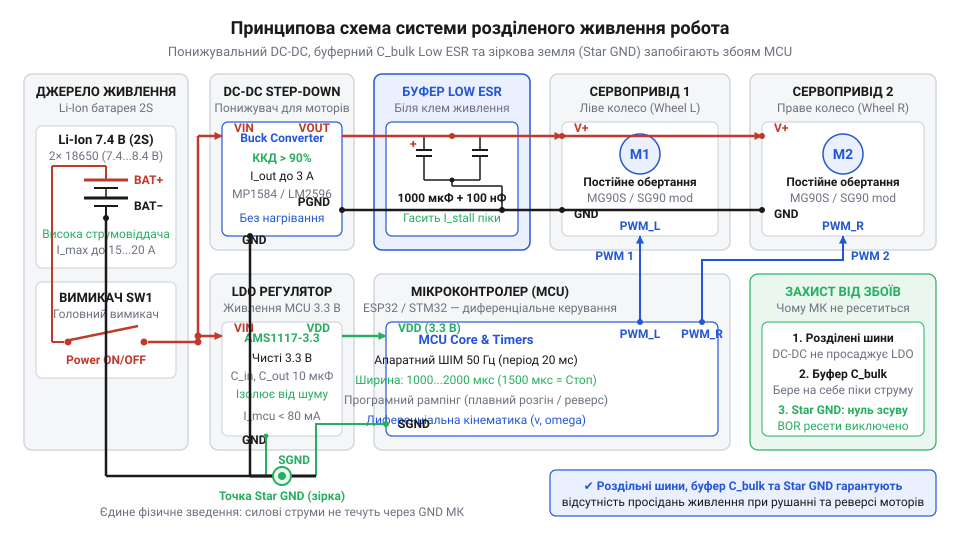
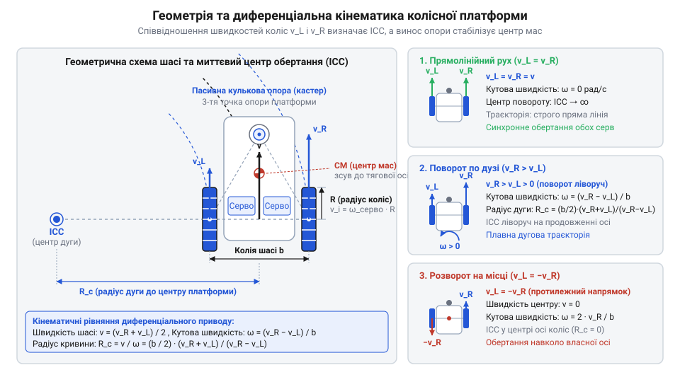

# Складання та налаштування ходової частини двоколісного робота на сервоприводах постійного обертання

<preknowlist>
- [Tower Pro SG90 — мікросерво 9g](root:cat-hw-actuators/sg90-servo) — Конструктивна будова 9-грамового мікросервопривода, керування тривалістю ШІМ-імпульсів у стандартному діапазоні 1000–2000 мкс із нейтраллю 1500 мкс та навантажувальна здатність пластикового редуктора
- [Серво-роги (запасні)](root:cat-hw-actuators/servo-horns) — Геометрія шліцьових з'єднань вихідного вала мікросервоприводів, конструкція штатних пластикових качалок та способи їх жорсткого кріплення до маточини колеса робота
- [MG90S V2 — мікросерво з металевим редуктором](root:cat-hw-actuators/mg90s-servo) — Особливості сервоприводів із металевими шестернями: стійкість до зрізання зубів, підвищений струм блокування вала (stall current) та вимоги до пікової струмовіддачі джерела живлення
</preknowlist>

## Чому двоколісний робот відмовляє на старті

Спроба побудувати мобільну платформу прямим підключенням пари сервоприводів постійного обертання (англ. @@en|continuous rotation servo@@) до спільних ліній живлення мікроконтролера призводить до аварії під час першої ж спроби рушити з місця. Замість передбачуваного руху робот смикається на місці, описує неконтрольовану дугу або циклічно гасне в момент подачі сигналу.

Ця поведінка спричинена кількома фізичними конфліктами нерозрахованої конструкції. Перший конфлікт — електричний. У мить пуску чи раптового реверсу нерухомий двигун не створює зворотної електрорушійної сили (@@uk|проти-ЕРС@@; англ. @@en|back-EMF@@), тому споживає піковий пусковий струм. Внутрішній опір акумулятора та спільних провідників викликає падіння напруги нижче робочої межі цифрової логіки. Схема супервізора мікроконтролера сприймає це як аварію й активує апаратне скидання процесора — @@en|Brown-Out Reset@@ (від англ. *brownout* — просідання напруги та *reset* — скидання; скорочено @@en|BOR@@). Процесор перезавантажується, знову запускає програму, видає імпульси на мотори й знову знеструмлюється, замикаючись у нескінченну петлю перезапусків.

Другий конфлікт — механічний удар у редукторі. Миттєвий перепад тривалості керівного імпульсу широтно-імпульсної модуляції (@@uk|ШІМ@@) від точки спокою `1500 мкс` до крайніх значень `1000` чи `2000 мкс` змушує мотор розвинути граничний пусковий момент проти сили інерції платформи. Виникають руйнівні напруження зрізу, які злизують тонкі зубці шестерень у [пластиковому редукторі SG90](root:cat-hw-actuators/sg90-servo). Якщо ж на приводи встановлено колеса надмірного діаметра, необхідний для подолання тертя крутний момент перевищує можливості двигуна, приводячи до його повного заклинювання.

Третій конфлікт — кінематичний. Навіть зі стабільним живленням подача однакових сигналів на обидва борти не забезпечує прямолінійного руху. Заводський розкид компонентів внутрішнього резистивного дільника зміщує межі зони нечутливості (англ. @@en|deadband@@ — мертва смуга) кожного привода, через що одне колесо обертається швидше або продовжує повзти при нульовій швидкості. Створення робочої платформи неминуче вимагає системного інженерного підходу: узгодження діаметра коліс із моментом двигунів, схемотехнічного розділення силового й логічного живлення, алгоритмічного плавного розгону (рампінгу) та індивідуального калібрування швидкості коліс.

## Механіка шасі та вибір коліс

Спроба прискорити робота з диференціальним приводом (від лат. @@la|differentia@@ — різниця; англ. @@en|differential drive@@) великими колесами зупиняє платформу на підйомах. Радіус колеса `R` є плечем важеля для крутного моменту (англ. @@en|torque@@, від лат. @@la|torquere@@ — скручувати) редуктора: зі зростанням радіуса лінійна швидкість `v = ω · R` збільшується, проте тягова сила на ободі падає.

Сумарну тягову силу `F_t` двох ведучих коліс радіуса `R` від сервоприводів із крутним моментом `M` визначають як:

```
F_t
= (2 · M) / R                    [тягова сила пари коліс через крутний момент]
```

Для руху робота масою `m` підйомом кутом `α` тяга мусить долати опір: `F_t ≥ m · g · (μ + sin(α))`, де `g` — прискорення вільного падіння, `μ` — коефіцієнт тертя кочення. За дефіциту тяги сервоприводи переходять у блокування вала зі споживанням граничного струму (англ. @@en|stall current@@). Для платформи масою `300–500 г` колеса діаметром `40–60 мм` забезпечують швидкість `15–25 см/с` із запасом за моментом; за потреби більшої тяги обирають [металевий редуктор MG90S](root:cat-hw-actuators/mg90s-servo).

Стійкість платформи задає розподіл ваги між ведучим мостом і пасивною кульковою опорою (англ. @@en|ball caster@@). Зміщення центра мас назад перекидає робота під час прискорення, а винесення вперед спричиняє буксування коліс. Центр мас розміщують так, щоб `65–70%` ваги припадало на тягову вісь, а `30–35%` — на кульку.

Посадка колеса безпосередньо на вал або клей викликає радіальне биття (англ. @@en|radial runout@@, від лат. @@la|radius@@ — промінь) і злизує дрібні шліци (від нім. @@de|Schlitz@@ — паз). Безлюфтове кріплення забезпечують [штатні серво-качалки](root:cat-hw-actuators/servo-horns) (англ. @@en|servo horn@@): качалку притискають осьовим гвинтом до вала, а обід колеса фіксують до її отворів гвинтами.

## Роздільне живлення та буферизація шини

Під час пуску двигуни сервоприводів беруть піковий струм через нульову проти-ЕРС нерухомого ротора. Внутрішній опір батареї викликає спад напруги, через що живлення логіки падає нижче порогу супервізора й викликає циклічне перезавантаження за сигналом @@en|BOR@@.

Для стабільності силове й логічне живлення розводять на дві незалежні лінії від акумулятора. Мікроконтролер живиться від власного стабілізатора, а сервоприводи — через імпульсний понижувальний стабілізатор (англ. @@en|step-down converter@@) на `5–6 В` із ККД понад 85%.


*Принципова електрична схема системи розділеного живлення робота: понижувальний перетворювач стабілізує живлення моторів, буферний конденсатор усуває просідання напруги, а точка Star GND виключає паразитні контури заземлення.*

Імпульсний перетворювач має затримку `Δt = 50–100 мкс` і не встигає за перемиканням ключів @@uk|ШІМ@@. Біля роз'ємів моторів ставлять буферний електролітичний конденсатор (від англ. @@en|buffer@@ — пом'якшувач) з низьким еквівалентним послідовним опором (англ. @@en|Equivalent Series Resistance@@, скорочено @@en|Low ESR@@). Внутрішній опір конденсатора спричиняє миттєвий спад напруги на фронті пускового струму, тому величина @@en|ESR@@ має вирішальне значення для стабільності живлення. В алюмінієвих конденсаторах із рідким електролітом цей опір сильно залежить від температури: на холоді в'язкість електроліту зростає, рухливість іонів падає, а @@en|ESR@@ збільшується у десятки разів. Через це при охолодженні робота навіть велика номінальна ємність не рятує від глибокого просідання напруги та перезавантаження мікроконтролера. Танталові електролітичні конденсатори містять твердий електроліт, тому їхній @@en|ESR@@ залишається стабільним як на морозі, так і за нагрівання. Проте вони значно дорожчі за алюмінієві й мають небезпечний характер відмови: різкі пускові струми моторів та індуктивні сплески викликають пробій діелектрика з коротким замиканням шини. Через ризик пробою танталові конденсатори вимагають щонайменше подвійного запасу за робочою напругою. Тому для живлення приводів зазвичай обирають алюмінієві конденсатори @@en|Low ESR@@, закладаючи запас за опором на випадок низьких температур. Потрібну ємність `C` для утримання спаду напруги `ΔU` при імпульсі струму `I_peak` тривалістю `Δt` знаходять із балансу заряду:

```
C
= (I_peak · Δt) / ΔU             [ємність через імпульс струму та допустимий спад]
```

Цей заряд живить двигуни до виходу стабілізатора на режим.

**Два сервоприводи споживають `I_peak = 1.6 А` за час `Δt = 80 мкс` при допустимому спаді `ΔU = 0.25 В`:**

```
C
= (1.6 · 80 · 10⁻⁶) / 0.25       [підстановка параметрів імпульсу]
= 1.28 · 10⁻⁴ / 0.25             [обчислення заряду]
≈ 512 мкФ                        [переведення у мікрофаради]
```

Отримане значення округлюють до номіналу `1000 мкФ Low ESR`. Поруч ставлять керамічний конденсатор `0.1 мкФ` для шунтування високочастотних перешкод від іскріння щіток колектора.

Зворотні струми моторів не повинні текти сигнальною землею логіки, інакше опір дроту створить стрибки потенціалу. Щоб усунути паразитні контури заземлення (англ. @@en|ground loop@@), застосовують зіркоподібне заземлення (англ. @@en|star ground@@): земляні лінії від мікроконтролера, стабілізатора та моторів зводять в одну точку безпосередньо на мінусовій клемі батареї.

## Диференціальна кінематика та керування рухом

Спроба керувати двоколісною платформою без математичного зв'язку між бортами спричиняє рискання: будь-який маневр вимагає узгодження швидкостей обох коліс. Цей взаємозв'язок описує диференціальна кінематика (від грец. @@grc|κίνημα@@ — рух; англ. @@en|differential kinematics@@). Рух платформи у площині визначають поступальна лінійна швидкість `v` її центра та кутова швидкість повороту `ω`.


*Геометрична модель платформи: лінійні швидкості правого й лівого бортів визначають положення миттєвого центра обертання ICC для руху прямо, по дузі чи розвороту на місці.*

Пряма кінематика (англ. @@en|forward kinematics@@) знаходить рух робота за колісними швидкостями: поступальна швидкість дорівнює півсумі швидкостей коліс `v = (v_R + v_L) / 2`, а кутова — їхній різниці, поділеній на ширину колії (англ. @@en|track gauge@@) `b`: `ω = (v_R - v_L) / b`. Для керування застосовують зворотну кінематику (англ. @@en|inverse kinematics@@), обчислюючи лінійні швидкості правого `v_R` та лівого `v_L` бортів:

```
v_R
= v + (ω · b) / 2                [швидкість правого колеса через поступальну й кутову]
v_L
= v - (ω · b) / 2                [швидкість лівого колеса через поступальну й кутову]
```

Співвідношення `v_R` та `v_L` задає положення точки повороту робота — миттєвого центра обертання (англ. @@en|Instantaneous Center of Curvature@@, скорочено @@en|ICC@@). За `ω = 0` швидкості рівні (`v_L = v_R = v`), радіус дуги нескінченний, і платформа їде прямо. За `v = 0` колеса обертаються назустріч із рівною швидкістю (`v_R = -v_L`), забезпечуючи розворот на місці навколо центру осі. Якщо обидва колеса обертаються вперед із різною швидкістю, робот повертає дугою радіуса `R_c = v / ω`.

Лінійну швидкість кожного колеса перераховують у кутову швидкість вала `ω_k = v_k / R`, де `R` — радіус колеса, а потім — у тривалість імпульсу @@uk|ШІМ@@. Для приводів на зразок [мікросервоприводів SG90](root:cat-hw-actuators/sg90-servo) номінальна тривалість `t_0 = 1500 мкс` зупиняє вал, а крайні значення `1000 мкс` і `2000 мкс` відповідають максимальній швидкості реверсу й прямого ходу. Проте залежність кутової швидкості від часового відхилення `Δt = t - t_0` описує виражено нелінійна передавальна характеристика (англ. @@en|transfer characteristic@@). Внутрішній компаратор сервопідсилювача формує апаратну мертву смугу (@@en|deadband@@) `Δt_db` завширшки `10–25 мкс`, у межах якої силові ключі закриті й напруга на моторі дорівнює нулю. Через це вікно нечутливості та сухе тертя шестерень редуктора малі значення сигналу взагалі не зрушують колесо з місця. Водночас через високий внутрішній коефіцієнт підсилення похибки максимальна шпаруватість у 100% досягається вже при невеликому зміщенні — порозі насичення (від лат. @@la|saturatio@@ — насичення; англ. @@en|saturation@@) `Δt_sat ≈ 70–100 мкс`. Подальше відхилення імпульсу до крайніх меж `1000` чи `2000 мкс` уже не збільшує швидкість понад граничну `ω_max`. Спроба лінійно масштабувати кутову швидкість на весь інтервал `500 мкс` робить рух релейним: робот або стоїть у мертвій зоні, або одразу зривається на максимальну швидкість без плавного регулювання ходу. Для передбачуваного керування нелінійність компенсують оберненою кусково-лінійною моделлю: сигнал миттєво зміщують на величину `Δt_db`, а приріст швидкості масштабують строго в активній смузі `Δt_sat - Δt_db`. Часове відхилення `Δt_k` для досягнення цільової кутової швидкості колеса `ω_k` знаходять із компенсаційної моделі з урахуванням знака напрямку `sgn(ω_k)`:

```
Δt_k
= sgn(ω_k) · (Δt_db + (|ω_k| / ω_max) · (Δt_sat - Δt_db))    [компенсація мертвої смуги та лінійне масштабування]
```

За нульової цільової швидкості `ω_k = 0` привід залишають у спокої із нульовим зміщенням `Δt_k = 0`. Щойно задано рух `|ω_k| > 0`, поріг `Δt_db` миттєво долає мертву смугу, а другий доданок лінійно регулює швидкість аж до межі насичення `Δt_sat` на максимальній швидкості `ω_max`. Оскільки сервоприводи встановлені на бортах дзеркально, однакове за знаком обертання валів крутить колеса в протилежні боки корпусу. Для узгодженого руху вперед використовують програмну інверсію (англ. @@en|software inversion@@): до сигналу правого привода додають приріст `t_R = t_0 + Δt_R`, а від лівого — віднімають: `t_L = t_0 - Δt_L`.

## Плавний розгін і захист редукторів

Миттєвий стрибок тривалості керівного імпульсу @@uk|ШІМ@@ з нейтральних `1500 мкс` до крайніх `1000` чи `2000 мкс` подає повну напругу на обмотки двигуна. Ротор починає розгін миттєво, але інерція корпусу й коліс утримує вихідний вал нерухомим. Двигун розвиває пусковий крутний момент, а вся сила концентрується на зубцях передачі: напруження зрізу перевищує межу міцності матеріалу. У редукторах [мікросервоприводів SG90](root:cat-hw-actuators/sg90-servo) це призводить до виламування тонких пластикових зубців первинних ступенів. Ще небезпечнішим є миттєвий реверс (від лат. @@la|reversus@@ — повернений назад; англ. @@en|reverse@@): ротор, що обертається вперед, зустрічає протилежне магнітне поле, подвоюючи механічний удар по шестернях.

Для захисту редукторів застосовують алгоритм рампінгу (англ. @@en|ramping@@, від @@en|ramp@@ — похила площина). Зміну сигналу здійснює обмежувач швидкості наростання (англ. @@en|slew rate limiter@@): сигнал квантується за фіксованими інтервалами часу `ΔT`, формуючи трапецеїдальний профіль (англ. @@en|trapezoidal profile@@) швидкості з лінійними ділянками прискорення й сповільнення. Поточну тривалість імпульсу `t` на кожному інтервалі оновлюють за цільовим значенням `t_target` та допустимим кроком приросту `Δt_step`:

```
t
= t + sgn(t_target - t) · min(|t_target - t|, Δt_step)    [приріст сигналу за крок квантування]
```

Функція знака `sgn` спрямовує приріст до цілі, а взяття мінімуму запобігає перельоту через значення `t_target` на фінальному кроці.

Програмно алгоритм будують як неблокувальний автомат станів (англ. @@en|non-blocking state machine@@) за системним таймером без викликів затримок `delay`. Перед зміною напрямку обертання автомат обов'язково виконує фазу проміжної зупинки: тривалість імпульсу плавно доводять до нейтралі `1500 мкс`, витримують паузу `20–50 мс` для гасіння інерції платформи й лише після цього починають розгін у протилежний бік.

## Калібрування нейтралі та прямолінійного руху

Подавання номінального сигналу зупинки 1500 мкс рідко знерухомлює платформу: через похибки внутрішнього дільника або [дрейф резистивного дільника](root:cat-hw-actuators/continuous-rotation-servo-mod/math-resistive-divider-drift-and-calibration.md) вал повільно провертається. Для усунення повзання шасі підвішують у повітрі й шукають індивідуальні межі мертвої смуги (@@en|deadband@@). Мікроконтролером змінюють тривалість імпульсу ШІМ із роздільною здатністю 1–2 мкс, фіксуючи нижню межу зупинки обертання `t_min` та верхню точку зриву у протилежний бік `t_max`. Точний центр смуги `t_zero = (t_min + t_max) / 2` записують у константи як програмний нуль спокою.

Навіть із виставленим нулем робот зносить з курсу під час їзди. Два однакові сервоприводи, наприклад [мікросерво SG90](root:cat-hw-actuators/sg90-servo), мають технологічний розкид параметрів моторів і внутрішнього тертя шестерень. Для вирівнювання швидкостей робота пускають контрольною лінією на фіксовану відстань (1–2 м) і вимірюють фактичний шлях повільнішого колеса `S_min` та швидшого `S_max`. Поправочний трим-коефіцієнт (від англ. @@en|trim@@ — підрізати, зрівнювати) `k_trim` обчислюють як співвідношення пройдених дистанцій:

    k_trim
    = S_min / S_max      [співвідношення шляхів коліс]

Оскільки `k_trim < 1`, ним масштабують зміщення сигналу від нейтралі `Δt = t - t_zero` для випереджального привода:

    Δt_corr
    = Δt · k_trim        [зменшення приросту імпульсу швидшого привода]

Підсумковий сигнал `t_corr = t_zero + Δt_corr` прирівнює оберти коліс. За нелінійної залежності швидкості від тривалості імпульсу коефіцієнти розраховують для кількох опорних точок ходу й зберігають у таблиці поправок (@@en|lookup table@@). Симетричні швидкості забезпечують прямолінійну траєкторію та передбачувані радіуси маневрів.
