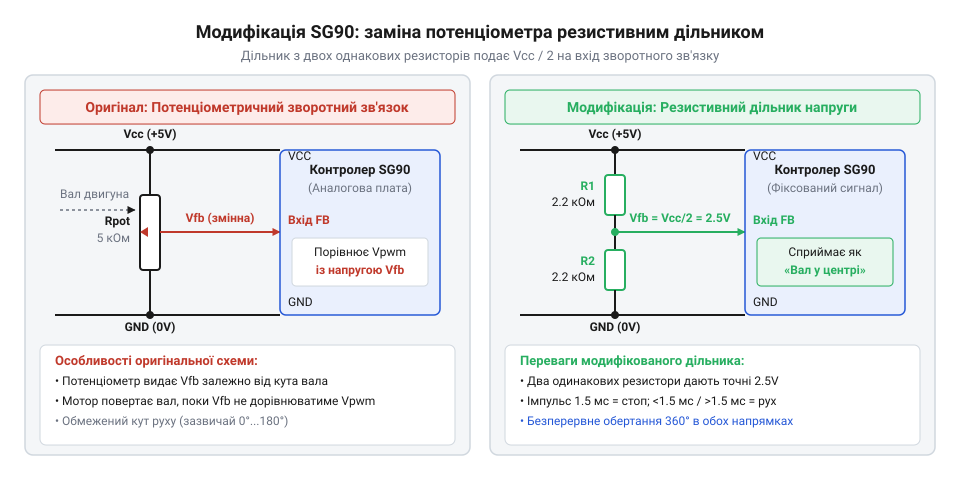
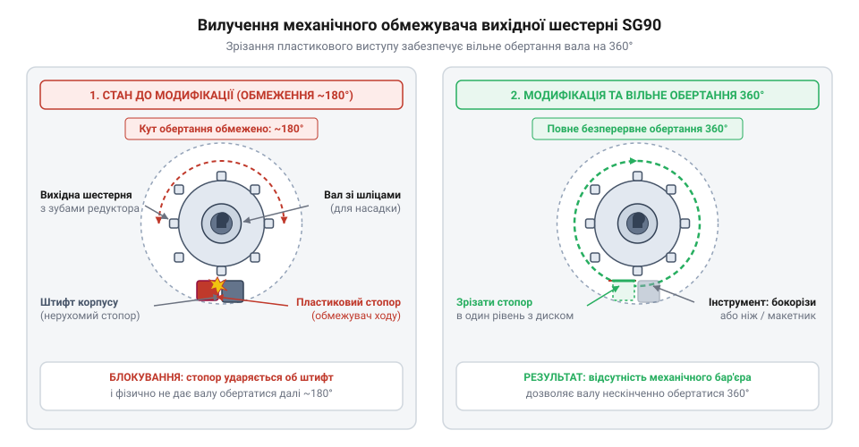
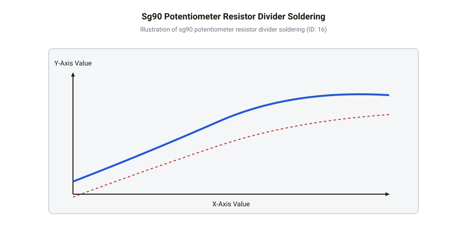
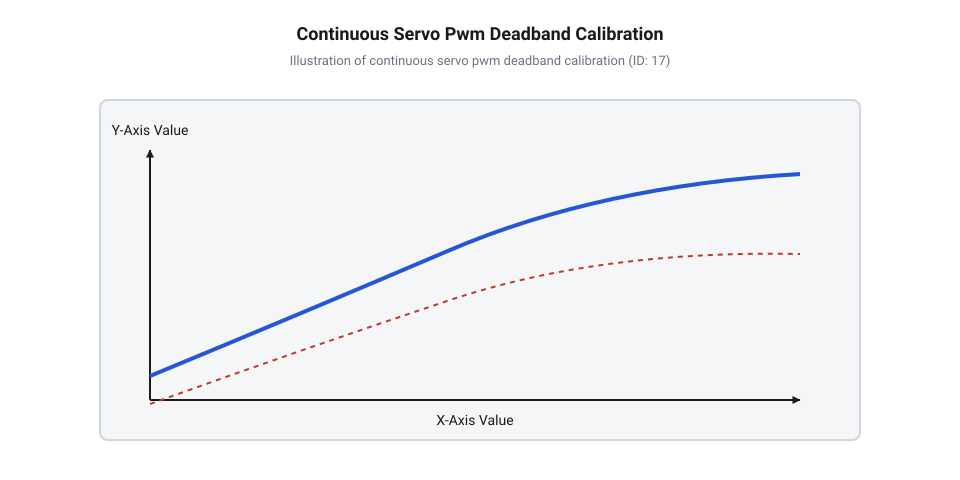

# Практична модифікація стандартного сервопривода SG90 у привід постійного обертання

<preknowlist>
- [Tower Pro SG90 — мікросерво 9g](root:cat-hw-actuators/sg90-servo) — Конструктивні особливості, робоча напруга, розташування висновків та стандартні специфікації привода SG90.
- [Сервоприводи радіокерованих моделей: будова, редуктори та ШІМ-керування](root:cat-hw-actuators/rc-servo-mechanisms-and-control) — Принцип функціонування внутрішньої схеми порівняння, тривалість керуючих імпульсів ШІМ та призначення потенціометра.
</preknowlist>

## Обмеження позиційного сервопривода в робототехніці

Мобільний робот чи колісна платформа вимагають від привода здатності безперервно обертати колеса в обох напрямках із керованою швидкістю. При спробі використати для цього стандартний @@en|servo@@ (від лат. *servus* — слуга) привод розробник одразу стикається з фізичним бар'єром. Конструкція популярних [мікросервоприводів Tower Pro SG90](root:cat-hw-actuators/sg90-servo) розрахована виключно на позиціонування вала в обмеженому кутовому секторі, який зазвичай становить від 0° до 180°. Якщо подати команду на повертання в крайнє положення, вал досягає заданого кута і зупиняється. Будь-які спроби змусити пристрій зробити повний оберт чи працювати як звичайний мотор-редуктор без внутрішнього втручання завершуються невдачею.

Причина такої поведінки криється в роботі системи аналогового замкненого контуру. Всередині корпусу розташована мікросхема керування, яка постійно порівнює зовнішній керуючий @@en|PWM@@ (від @@en|Pulse-Width Modulation@@, лат. *pulsus* — удар, англ. *width* — ширина, лат. *modulatio* — міра) сигнал із внутрішньою напругою аналогового @@en|feedback@@ (від англ. *feed* — живити, *back* — назад). Джерелом сигналу зворотного зв'язку виступає внутрішній @@en|potentiometer@@ (від лат. *potentia* — сила, грецьк. *metron* — міра), вал якого жорстко з'єднаний із вихідною шестернею редуктора. Коли керуючий імпульс тривалістю 1.5 мс задає нейтральну позицію 90°, внутрішня схема очікує напругу з потенціометра, рівну точно половині напруги живлення. Якщо вал відхилений, виникає різниця напруг, яка змушує мостовий драйвер обертати електродвигун. Як тільки вал повертається до потрібної точки, напруга потенціометра збігається з еталонною, помилка позиціонування стає нульовою, і струм на мотор припиняє подаватися.

Для перетворення пристрою на привід безперервного руху необхідно подолати два незалежні бар'єри, кожен із яких унеможливлює кругове обертання:
1. **Механічний бар'єр обертання.** На вихідній пластиковій шестерні редуктора сформовано литий упорний виступ. Під час обертання цей виступ фізично впирається в обмежувальні зуби на верхній кришці корпусу при кутах близько 0° та 180°. Крім того, сам внутрішній потенціометр має власні механічні упори конструкції, які заклинюють при спробі повороту понад 270°. 2. **Електричний бар'єр зворотного зв'язку.** Навіть якщо зрізати пластиковий упор, потенціометр продовжує повертатися разом із шестернею. При досягненні кута, що відповідає ширині вхідного імпульсу, схема зворотного зв'язку зведе помилку до нуля і вимкне мотор. Якщо ж вал вийде за межі робочого сектора потенціометра, ковзний контакт досягне крайнього струмознімального виводу, що призведе до заклинювання або виходу елемента з ладу.

Таким чином, для отримання мотора безперервного руху, де тривалість імпульсу @@en|PWM@@ визначає не кут, а напрямок та швидкість обертання, потрібно одночасно ліквідувати механічне блокування редуктора та трансформувати електричне коло зворотного зв'язку. На відміну від промислових [безколекторних сервоконтролерів з енкодерами](root:cat-hw-actuators/bldc-servo-controller), де позиція обчислюється цифровим процесором, у бюджетних мікросервоприводах це завдання вирішується апаратною доробкою.

## Електрична модифікація кола зворотного зв'язку

Щоб змусити плату керування сервопривода подавати живлення на мотор постійно, необхідно обдурити внутрішній аналоговий компаратор мікросхеми. Для цього коло зворотного зв'язку розривають, знімаючи залежність вихідної напруги від фізичного положення вала. Замість змінного @@en|potentiometer@@ на внутрішні контакти плати підключають штучне джерело опорної напруги, значення якого зафіксоване рівно на рівні серединної нейтралі.

У штатному режимі @@en|potentiometer@@ підключений між лініями живлення `VCC` (за замовчуванням 5 В) та землею `GND`. Ковзний контакт видає напругу `V_pot`, яка лінійно залежить від кута повороту вала. При середньому положенні вала (90°) напруга становить `V_pot` = 2.5 В. При поданні керуючого імпульсу тривалістю 1.5 мс внутрішня схема утворює еталонну порівняльну напругу `V_ref` = 2.5 В. Сигнал помилки `V_error` обчислюється як різниця між еталонною напругою `V_ref` та напругою зворотного зв'язку `V_pot`:

```
V_error = V_ref - V_pot
```

Ця різниця напруг визначає величину та полярність напруги, яка подається мостовим драйвером на обмотки електродвигуна. Коли коло зворотного зв'язку замінюється фіксованим джерелом, яке постійно видає `V_pot` = 2.5 В, поведінка привода кардинально змінюється залежно від тривалості вхідних імпульсів @@en|PWM@@:
- **Нейтральний імпульс (1.5 мс):** Внутрішня еталонна напруга дорівнює `V_ref` = 2.5 В. Сигнал помилки `V_error` = 2.5 В - 2.5 В = 0 В. Мотор залишається нерухомим (стан спокою). - **Імпульс прямого ходу (2.0 мс):** Схема формує еталонну напругу `V_ref` ≈ 3.5 В. Помилка стає позитивною: `V_error` = 3.5 В - 2.5 В = +1.0 В. Оскільки потенціометр більше не обертається і напруга `V_pot` зафіксована на рівні 2.5 В, помилка +1.0 В залишається постійною. Драйвер безперервно обертає мотор за годинниковою стрілкою з максимальною швидкістю. - **Імпульс реверсу (1.0 мс):** Еталонна напруга становить `V_ref` ≈ 1.5 В. Помилка від'ємна: `V_error` = 1.5 В - 2.5 В = -1.0 В. Драйвер безперервно обертає мотор проти годинникової стрілки з максимальною швидкістю. - **Проміжні імпульси (наприклад, 1.7 мс):** Помилка має меншу амплітуду (+0.4 В), тому внутрішній підсилювач подає на мотор знижену ефективну напругу, забезпечуючи пропорційне регулювання швидкості обертання.

Найпростіший спосіб реалізації штучної нейтралі полягає в заміні потенціометра резистивним дільником з двох однакових фіксованих резисторів. Вихідна напруга дільника `V_out` розраховується через напругу живлення `VCC` та опір двох послідовно з'єднаних резисторів `R_1` і `R_2`:

```
V_out = VCC × (R_2 / (R_1 + R_2))
      = VCC × (R / (R + R))      [заміна однакових номіналів R_1 = R_2 = R]
      = VCC / 2                  [скорочення однакового множника R]
```

Отримане співвідношення показує, що при використанні двох резисторів з однаковим опором потенціал виходу завжди дорівнює точно половині напруги живлення незалежно від її поточних коливань.


*Заміна змінноопірного потенціометра двома фіксованими резисторами створює стабільну штучну нейтраль на рівні половини напруги живлення.*

Для монтування дільника використовують @@en|SMD@@ (від @@en|Surface-Mount Device@@, англ. *surface* — поверхня, *mount* — монтаж, *device* — пристрій) резистори типорозміру 0805 або 0603 із номіналом від 2.2 кОм до 4.7 кОм та точністю 1%. Випаявши три контакти штатного @@en|potentiometer@@ з друкованої плати SG90, перший резистор запаюють між майданчиком живлення `VCC` та сигнальним майданчиком @@en|feedback@@, а другий — між сигнальним майданчиком та землею `GND`. Використання прецизійних резисторів суттєво переважає альтернативний спосіб із залишенням і фіксацією клеєм вала штатного потенціометра, детально описаний у розділах про [будову моделей з редукторами](root:cat-hw-actuators/rc-servo-mechanisms-and-control), оскільки фізичний потенціометр піддається температурному дрейфу та механічному зсуву від вібрацій.

## Механічне розбирання та вилучення обмежувачів

Після завершення електричної модифікації необхідно виконати доробку редуктора. Корпус привода SG90 має компактне компонування, тому всі механічні операції вимагають акуратності, щоб не пошкодити крихітні пластикові осі шестерень та посадочні місця.

Процес розбирання та вилучення обмежувачів виконується у такій послідовності:

1. **Демонтаж нижньої кришки та плати.** За допомогою хрестоподібної викрутки PH00 викручують чотири довгі гвинти, які проходять крізь кути корпусу. Знімають нижню пластикову кришку, відкриваючи доступ до друкованої плати та дротів живлення мотора. 2. **Відкриття редукторного відсіку.** Обережно знімають верхню кришку корпусу. Під нею розташований блок шестерень. Перед вилученням деталей рекомендується сфотографувати розташування кожної шестерні, оскільки передаточне число редуктора формується послідовною каскадною системою з кількох ступенів. 3. **Вилучення та модифікація вихідного вала.** Найбільша шестерня, на яку кріпляться зовнішні [запасні серво-роги](root:cat-hw-actuators/servo-horns), є вихідною. На її нижній площині розташований литий пластиковий зуб-стопор. У звичайному приводі цей зуб при повороті впирається у виступи верхньої кришки. За допомогою гострого макетного ножа або кусачок-бокорізів цей упор акуратно зрізають урівень із основою шестерні. Місце зрізу зачищають дрібним надфілем або скальпелем до гладкого стану, щоб не залишалося заудирок.


*Зрізання механічного виступу на вихідній шестерні та роз'єднання її з валом потенціометра звільняє редуктор для безперервного обертання на 360 градусів.*

4. **Роз'єднання з валом потенціометра.** У внутрішньому отворі вихідної шестерні сформовано профільне гніздо (D-подібне або зі шліцами), у яке входить вал @@en|potentiometer@@. Якщо потенціометр повністю випаяний під час електричної доробки, його вал виймають або залишають вільно обертатися. Якщо ж потенціометр залишається в корпусі як механічна вісь, D-подібний отвір у шестерні розсвердлюють свердлом діаметром 2.0–2.5 мм. Шестерня має вільно та без тертя прокручуватися навколо вала на 360°, не передаючи на нього крутний момент. 5. **Очищення, змащування та збирання.** З внутрішньої порожнини корпусу повністю видаляють пластикову стружку та пил. На зубчасті вінці шестерень наносять невелику кількість силіконової або білої літієвої змазки. Збирають каскад шестерень у початковому порядку, перевіряють плавність обертання пальцями, після чого встановлюють верхню й нижню кришки та затягують чотири стяжні гвинти.

Після виконання цих кроків пристрій перетворюється на повноцінний мотор-редуктор безперервного обертання. Він зберігає стандартизоване керування через один дріт @@en|PWM@@, проте замість кута регулює швидкість та напрямок обертання. Для модифікації дорожчих версій з [металевим редуктором MG90S V2](root:cat-hw-actuators/mg90s-servo) застосовується аналогічний підхід, але латунний або сталевий обмежувальний штифт вихідної шестерні спилюють дремелем або зрізають силовими бокорізами. Повна характеристика [родини дев'ятиграмових мікросерво](root:cat-hw-actuators/sg90-mg90-micro-servos-family) дозволяє дібрати оптимальну модель за потужністю та матеріалом шестерень для конкретної колісної платформи.

## Монтаж резистивного дільника на плату

Після вилучення механічних обмежувачів із редуктора та роз'єднання вала потенціометра внутрішнє електронне коло керування втрачає інформацію про поточне положення вала. Якщо залишити висновки потенціометра непідключеними або під'єднати їх до вала, що вільно обертається, аналогова схема порівняння отримуватиме випадковий плаваючий потенціал. У результаті внутрішній підсилювач привода постійно перебуватиме в стані насичення, викликаючи некероване обертання двигуна або його спонтанне заклинювання. Щоб інтегральна мікросхема привода постійно «бачила» вал у фіксованій точці спокою, фізичний потенціометр замінюють симетричним електричним дільником напруги.

На друкованій платі [мікросервопривода Tower Pro SG90](root:cat-hw-actuators/sg90-servo) потенціометр підключається трьома контактними висновками. Два крайні висновки з'єднані з шинами живлення: позитивною напругою `V_cc` (зазвичай `5.0 V`) та спільною землею `GND` (`0 V`). Центральний висновок є сигнальним і подає аналогову напругу зворотного зв'язку безпосередньо на вхід аналогового компаратора контролера.

Для формування стабільної штучної нейтралі замість потенціометра на плату монтують два точні @@en|SMD-резистори@@ (від @@en|Surface Mount Device@@ — пристрій поверхневого монтажу) однаковим опором `2.2 кОм` кожен (типорозмір 0805 або 0603). Напруга в центральній точці такого дільника обчислюється за формулою:

```
U_div = V_cc × R2 / (R1 + R2)
      = 5.0 × 2200 / (2200 + 2200)    [підстановка R1 = R2 = 2.2 кОм]
      = 2.5 V                          [формування штучної нейтралі]
```

Отримана напруга `2.5 V` чітко відповідає середньому положенню потенціометра (куту 90° у стандартній модифікації), що змушує електронну плату вважати привід повністю зупиненим.


*Монтаж двох SMD-резисторів опором 2.2 кОм на контактні майданчики платформи SG90 для створення фіксованого дільника напруги.*

Технологічний процес демонтажу та поверхневого монтажу вимагає акуратності через високу щільність компонентів на платі: Для опанування практичних прийомів відпаювання та припаювання чип-резисторів на щільні плати дивіться [основи поверхневого монтажу SMD-компонентів](root:hw-pcb/smd-soldering-basics).

1. **Від'єднання потенціометра.** За допомогою паяльника з тонким типом та паяльної стрічки для видалення припою повністю знімають припій із трьох контактних майданчиків потенціометра. Висновки потенціометра акуратно відгинають або зрізають мікрокусачками, щоб унеможливити будь-який електричний контакт вала з доріжками друкованої плати. 2. **Монтаж резисторів дільника.** Перший SMD-резистор опором `2.2 кОм` припаюють між майданчиком землі `GND` та центральним сигнальним майданчиком зворотного зв'язку. Другий SMD-резистор `2.2 кОм` монтують між сигнальним майданчиком та шиною живлення `V_cc`. 3. **Контроль та ізоляція.** Проводять візуальну перевірку під лупою на відсутність небажаних містків припою між шинами `V_cc` та `GND`. Зверху на поверхню плати в місці пайки наклеюють шматочок термостійкої каптонової стрічки для запобігання короткому замиканню на металевий корпус електродвигуна. 4. **Збирання корпусу.** Шестерні редуктора зі зрізаним обмежувачем повертають у верхню кришку корпусу, плату вкладають у нижній відсік, проводять трижильний кабель через захисний паз і стягують корпус чотирма гвинтами.

Фізичне збирання модифікованого вузла закінчено: привід перетворено на механічно безперервний мотор-редуктор, електронна плата якого зафіксована у стані штучної нейтралі. Аналогічний підхід застосовують, коли модифікують інші пристрої з [серійних 9-грамових мікросервоприводів](root:cat-hw-actuators/sg90-mg90-micro-servos-family) або міцніший [MG90S з металевим редуктором](root:cat-hw-actuators/mg90s-servo).

## Калібрування нейтралі та керування швидкістю

Заміна потенціометра резистивним дільником кардинально змінює реакцію привода на вхідний сигнал. У класичних [сервоприводах радіокерованих моделей](root:cat-hw-actuators/rc-servo-mechanisms-and-control) тривалість керуючого імпульсу задає кутове положення вала. У модифікованому приводі тривалість імпульсу визначає напрямок та кутову швидкість обертання.

Внутрішній компаратор порівнює задану тривалість імпульсу `t_pulse` із напругою зворотного зв'язку. Коли мікроконтролер подає стандартний нейтральний сигнал тривалістю `1.5 мс` (`1500 мкс`), сформований внутрішній потенціал дорівнює `2.5 V`. Різниця між командою та зворотним зв'язком дорівнює нулю:

```
U_error = U_cmd - U_feedback
        = 2.5 - 2.5                      [при імпульсі нейтралі 1500 мкс]
        = 0.0 V                          [мотор зупинений]
```

Оскільки помилка розсогласування відсутня, внутрішній @@en|H-міст@@ (від англ. *H-bridge* — через схожість схеми з літерою H) залишається закритим, і вал мотор-редуктора перебуває у стані спокою.

Якщо тривалість імпульсу зменшується до `1.0 мс` (`1000 мкс`), керуюча схема формує внутрішнє еталонне значення `1.0 V`. Виникає висока від'ємна помилка розсогласування (`U_error = 1.0 V - 2.5 V = -1.5 V`). Схема подає повну напругу на двигун для обертання проти годинникової стрілки. Оскільки напруга зворотного зв'язку жорстко зафіксована дільником на рівні `2.5 V`, помилка ніколи не зменшується, і вал безперервно обертається з максимальною швидкістю.

При збільшенні імпульсу до `2.0 мс` (`2000 мкс`) виникає позитивна помилка розсогласування, що викликає безперервне обертання вала за годинниковою стрілкою. Проміжні значення (наприклад, `1350 мкс` або `1650 мкс`) створюють меншу напругу помилки, забезпечуючи пропорційне регулювання швидкості.


*Залежність кутової швидкості обертання вала від тривалості ШІМ-імпульсу з виділенням зони нечутливості (Deadband) та зміщення нейтралі (Trim).*

На практиці реальні @@en|SMD-резистори@@ мають допуск опору (±1% або ±5%), а внутрішній компаратор мікросхеми має аналоговий зсув (@@en|Offset@@). Через це реальна напруга нейтралі може становити, наприклад, `2.47 V` замість `2.50 V`. Подача імпульсу `1500 мкс` призведе до появи малої помилки розсогласування, і вал почне повільно дрейфувати. Для усунення дрейфу застосовують двокрокове програмне калібрування:

1. **Програмний зсув нейтралі (@@en|Trim Offset@@).** Зміщення базової тривалості нейтрального імпульсу (наприклад, з `1500 мкс` до `1515 мкс` або `1485 мкс`), поки вал повністю не зупиниться. 2. **Зона нечутливості (@@en|Deadband@@).** Задання часового вікна навколо нейтралі (наприклад, ±20 мкс). Усі команди, які потрапляють у діапазон `[1500 - deadband, 1500 + deadband]`, примусово прирівнюються до каліброваної нейтралі, що усуває фонові шуми таймера.

Для програмної реалізації керування та калібрування застосовують модулі апаратного @@uk|ШІМ@@ (від широтно-імпульсна модуляція; англ. @@en|PWM@@ — @@en|Pulse-Width Modulation@@) на C та C++.

:::tabs
@tab C
:::code proj-servo-continuous-modification-step-by-step/c/include/servo_calibration.h
:::code proj-servo-continuous-modification-step-by-step/c/include/servo_cr_pwm.h
:::code proj-servo-continuous-modification-step-by-step/c/src/servo_calibration.c 40-103
:::code proj-servo-continuous-modification-step-by-step/c/src/servo_cr_pwm.c 73-120
:::code proj-servo-continuous-modification-step-by-step/c/src/main.c 59-108

@tab C++
:::code proj-servo-continuous-modification-step-by-step/cpp/include/pwm_timer.hpp 13-70
:::code proj-servo-continuous-modification-step-by-step/cpp/include/continuous_servo.hpp 10-67
:::code proj-servo-continuous-modification-step-by-step/cpp/src/continuous_servo.cpp 58-116
:::code proj-servo-continuous-modification-step-by-step/cpp/src/main.cpp 38-75
:::

Низькорівневий драйвер на C налаштовує регістри апаратного таймера мікроконтролера: @@en|Prescaler@@ (`PSC`) задає дискретність лічильника в `1 мкс`, а регістр автоперезавантаження @@en|Auto-reload@@ (`ARR`) формує період `20000 мкс` (`50 Гц`). Зміна значення регістра порівняння @@en|CCR1@@ лінійно змінює тривалість керуючого імпульсу.

У C++ реалізації об'єктно-орієнтований клас `ContinuousServo` розраховує тривалість імпульсу у функції `calculatePulseWidthUs`, мапуючи відсотки швидкості `[-100.0%..+100.0%]` у часовий інтервал із урахуванням `trim_offset_us`. Для гарантування безпеки у робототехнічних системах використовують шаблон @@en|RAII@@ (від @@en|Resource Acquisition Is Initialization@@ — отримання ресурсу є ініціалізацією) через обгортку `ServoGuard`. Під час знищення об'єкта `ServoGuard` або при виникненні виняткової ситуації деструктор автоматично викликає метод `stop()`, подаючи імпульс нейтралі та запобігаючи неконтрольованому руху механізму. На відміну від складних [промислових безколекторних сервоконтролерів](root:cat-hw-actuators/bldc-servo-controller), отримана система забезпечує дешеве та надійне керування постійним обертанням без потреби в зовнішніх драйверах моторів.