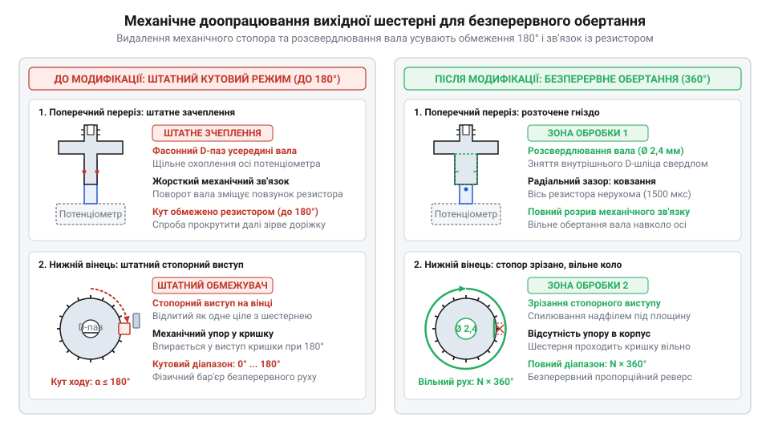
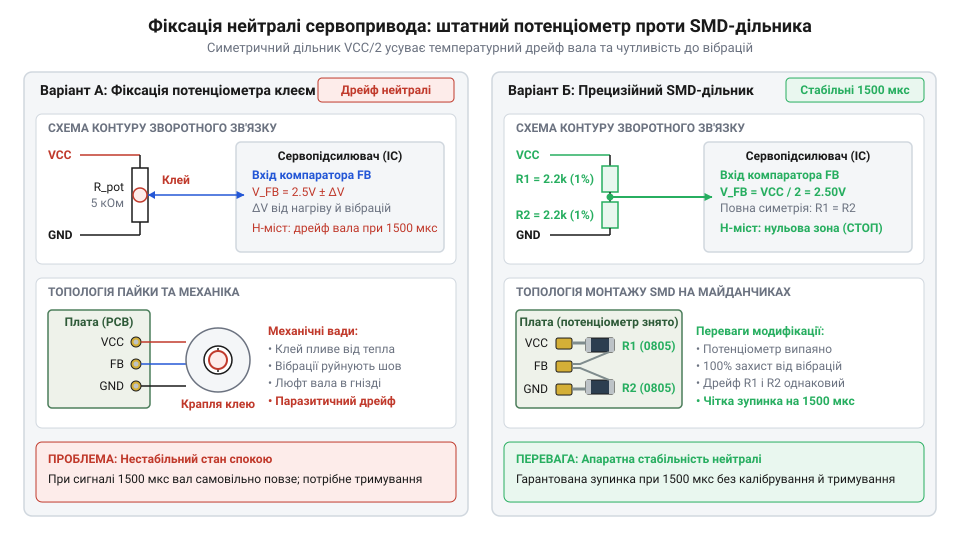

# Практична переробка кутового мікросервопривода на привід постійного обертання

<preknowlist>
- [Tower Pro SG90 — мікросерво 9g](root:cat-hw-actuators/sg90-servo) — Внутрішня будова мікросервопривода з нейлоновим редуктором, призначення трьох провідників кабелю (живлення 5 В, земля, сигнальний ШІМ 1–2 мс) та принцип відпрацювання кутового положення за сигналом зворотного зв'язку з потенціометра
- [MG90S V2 — мікросерво з металевим редуктором](root:cat-hw-actuators/mg90s-servo) — Конструктивні особливості сервоприводів із металевими шестернями (латунь, алюміній), вищі пускові струми під навантаженням та специфіка механічного спилювання стопорного виступу порівняно з пластиком
</preknowlist>

## Пастка кутового обмеження у мікросервоприводах

Для приводу ходових коліс [мобільної колісної платформи](root:cat-hw-actuators/continuous-rotation-servo-mod/proj-continuous-servo-differential-robot.md) чи стрічкового подавача мініатюрні вузли здаються зручним вибором. Доступні [мікросервоприводи SG90](root:cat-hw-actuators/sg90-servo) з нейлоновим редуктором або їхні [металеві аналоги MG90S](root:cat-hw-actuators/mg90s-servo) поєднують в одному компактному дев'ятиграмовому корпусі двигун, багатоступеневий редуктор (англ. @@en|gearbox@@; від лат. @@la|reducere@@ — повертати назад, зменшувати) та схему керування. Проте спроба використати їх для тягового руху негайно виявляє непереборну перешкоду: вихідний вал фізично обмежений кутом близько 180 градусів.

Якщо подати сигнал для виходу за цю межу, вихідна шестерня намертво впирається у внутрішній механічний виступ-стопор. Двигун переходить у режим блокування (англ. @@en|stall condition@@). Оскільки ротор зупинено, протиелектрорушійна сила зникає, а споживаний струм стрибає від 100 мА холостого ходу до 800–1200 мА. За лічені секунди вихідний каскад перегрівається, напруга живлення просідає, а крутний момент загрожує зрізати мініатюрні зубці заклинених шестерень.

Причина цієї аварії полягає в принципі позиційного керування. Вихідний вал жорстко зчеплений з віссю внутрішнього потенціометра (англ. @@en|potentiometer@@; від лат. @@la|potentia@@ — сила та грец. @@grc|μέτρον@@ — міра). Електронна схема неперервно порівнює тривалість вхідного імпульсу з напругою дільника цього резистора. Поки вал не досягне заданого положення, контур зворотного зв'язку (англ. @@en|feedback loop@@) фіксує неусувну кутову помилку й подає на мотор максимальну напругу. Виникає внутрішній конфлікт: електроніка намагається довернути вал, а механічний упор блокує рух.

Щоб подолати цей конфлікт і перетворити позиційне серво на мотор-редуктор постійного обертання, потрібні два послідовні кроки. Спершу механічно зрізають стопорний виступ на вихідній шестерні та розточують її посадковий отвір, усуваючи зачеплення з потенціометром і звільняючи обертання на 360 градусів. Після цього контур зворотного зв'язку електрично фіксують у середній точці, завдяки чому вхідний сигнал керує вже не кутом вала, а швидкістю та напрямком його руху.

## Механічне видалення стопора та розчеплення

Розбирання мікропривода починається з нижньої частини корпусу: чотири довгі стяжні гвинти проходять крізь кути кришок і тримають усю конструкцію. Верхню кришку знімають суворо вертикально вгору, щоб шестерні @@la|редуктора@@ (лат. reductor — той, що зменшує) не зіскочили зі сталевих проміжних осей. Розташування ступенів передачі фотографують перед вийманням коліс, що виключає помилки під час зворотного складання.

Вихідне зубчасте колесо має на нижньому торці виступ-обмежувач, який впирається в упори корпуса й обмежує кут повороту сектора. На пластиковому вінці [мікросервопривода SG90](root:cat-hw-actuators/sg90-servo) цей стопор зрізають урівень із площиною шестерні прецизійними бокорізами або модельним скальпелем. У сервоприводах із [металевим редуктором MG90S](root:cat-hw-actuators/mg90s-servo) латунний зуб спилюють плоским алмазним надфілем, не торкаючись сусідніх вінців, а металевий пил ретельно змивають спиртом.

*Конструктивні зміни вихідного зубчастого колеса: видалення механічного стопора та розсвердлювання центрального отвору забезпечують необмежене обертання вала на 360 градусів без контакту з потенціометром.*

Самого видалення стопора недостатньо: внутрішнє посадкове гніздо вихідного вала має фасонний профіль, який жорстко затискає вісь @@grc|потенціометра@@ (лат. potentia — сила, грец. metron — міра). Без розчеплення безперервне обертання вала скрутить шпиндель резистора й зламає струмознімач. Гніздо розточують ручним свердлом діаметром 2.2–2.5 мм або конічною розгорткою на глибину занурення осі, зрізаючи внутрішні зачепи. Глибину заглиблення інструмента суворо контролюють у межах півтора-двох міліметрів за міткою на свердлі. Вихідний вал шестерні є тонкостінною пустотілою втулкою з осьовим каналом під кріпильний гвинт на зовнішньому торці. Надмірне свердління стоншує стінки зсередини або пробиває перемичку між порожнинами наскрізь. Унаслідок цього зовнішні @@de|шліци@@ (нім. Schlitz — щілина, проріз) для [монтажу серворогів](root:cat-hw-actuators/servo-horns) втрачають радіальну жорсткість основи. Під час затягування кріпильного гвинта чи під робочим навантаженням ослаблені @@de|шліци@@ зминаються, і важіль починає вільно провертатися. Лише за точного контролю глибини вал зберігає механічну міцність і вільно ковзає навколо осі @@grc|потенціометра@@, усуваючи передачу крутного моменту на контур зворотного зв'язку.

## Фіксація нейтралі: потенціометр чи дільник

Після механічного розчеплення вихідний вал вільно обертається, проте під час подачі живлення мотор зривається в некерований рух на максимальній швидкості. Розірваний контур зворотного зв'язку більше не відстежує рух шестерень: внутрішня схема сприймає нерухому вісь @@grc|потенціометра@@ як постійну кутову помилку, і вбудований @@en|H-міст@@ безупинно обертає ротор. Щоб вал завмер у спокої, на вхід @@la|компаратора@@ (лат. comparator — той, що порівнює) має надходити стабільна середня напруга зміщення `VCC / 2`, яка відповідає нейтральному імпульсу шириною 1500 мкс.

Найпростіший спосіб сформувати цей потенціал — механічне центрування штатного резистора. На сервопривід подають нейтральний сигнал 1500 мкс і шліцьовою викруткою повільно повертають вісь @@grc|потенціометра@@ до повної зупинки двигуна, після чого фіксують її краплею ціанокрилату чи термоклею. Однак від вібрацій і нагрівання рухомий контакт зміщується, баланс напруг порушується, і вал знову починає самочинно прокручуватися.

*Електрична фіксація нейтралі сервопідсилювача: механічне юстування штатного потенціометра проти встановлення постійного SMD-дільника на 2.2–4.7 кОм, що формує напругу VCC / 2 і виключає вібраційний дрейф точки спокою.*

Вібростійке рішення полягає у повному випоюванні змінного резистора з плати [мікросервопривода SG90](root:cat-hw-actuators/sg90-servo). На звільнені контактні майданчики встановлюють симетричний дільник із двох прецизійних @@en|SMD@@-резисторів (англ. surface-mount device — прилад для поверхневого монтажу) однакового номіналу від 2.2 до 4.7 кОм із допуском 1%. Перший резистор запаюють між шиною живлення `VCC` та середнім сигнальним входом підсилювача, а другий — між цим входом і землею `GND`. Опір, менший за 2.2 кОм, збільшує наскрізний струм дільника між шиною живлення та землею: схема марно розряджає акумулятор і нагріває мініатюрну плату. Опір, більший за 4.7 кОм, робить сигнальний вузол надто високоомним: вхідний струм витоку @@la|компаратора@@ сервопідсилювача створює відчутне падіння напруги на плечах дільника, спотворює середній потенціал `VCC / 2` і зміщує нейтраль. Крім того, високоомне коло сильніше вловлює комутаційні завади від іскріння щіток двигуна. Номінали 2.2–4.7 кОм обмежують наскрізний струм споживання шини живлення в межах 0.5–1.1 мА й водночас гарантують несприйнятливість схеми до вхідних струмів витоку @@la|компаратора@@. Жорсткий дільник без рухомих деталей усуває паразитичний дрейф нуля, а точний розрахунок похибок напруги розкриває аналіз [температурного коефіцієнта опору](root:cat-hw-actuators/continuous-rotation-servo-mod/math-resistive-divider-drift-and-calibration.md).

## Складання редуктора та контроль зачеплення

Після зрізання стопора та розточування отвору в корпусі неминуче лишаються мікроскопічні частки пластику або металевий опил. Зубці шестерень мають малий модуль зачеплення, тому навіть поодинока порошинка між вінцями викликає заклинювання кінематичного ланцюга та зрізання зубів під навантаженням. Порожнину корпусу, вінці коліс і посадкове гніздо ретельно вимивають м'яким пензлем з ізопропіловим спиртом і продувають повітрям. На очищені зубці наносять тонкий шар силіконового мастила: для пластикових передач [сервопривода SG90](root:cat-hw-actuators/sg90-servo) підходить делікатне нейтральне мастило, а латунні каскади [моделі MG90S](root:cat-hw-actuators/mg90s-servo) потребують густішого покриття для зменшення зношування.

Складання @@la|редуктора@@ виконують послідовно: ступені передачі почергово нанизують на сталеві напрямні осі, починаючи від шестерні вала двигуна до вихідного вала. Після встановлення кожної проміжної пари плавність обертання перевіряють вручну: зубці мають входити в контакт без заїдань і заклинювань, зберігаючи ледь відчутний технологічний @@de|люфт@@ (нім. Luft — зазор, вільний хід). Якщо на вихідний вал тимчасово насадити один із [комплектних серворогів](root:cat-hw-actuators/servo-horns), редуктор має легко прокручуватися пальцями на всі 360 градусів, а його розточене гніздо не повинно тертися об нерухому вісь @@grc|потенціометра@@.

Фінальний етап — закриття корпусу. Верхню кришку опускають суворо перпендикулярно до площини роз'єму, слідкуючи, щоб кінці сталевих осей і шийка вихідного вала точно увійшли у відповідні посадкові втулки без перекосу й надмірного тиску. Чотири довгі корпусні гвинти закручують рівномірно за діагональною схемою: спершу підтягують протилежні кути до легкого торкання, а потім почергово дотискають їх хрест-навхрест з однаковим зусиллям. Однобічне перетягування гвинтів деформує пластиковий корпус, зміщує осі шестерень і призводить до затискання валів, тоді як симетричне діагональне стягування гарантує паралельність осей і бездоганно плавний хід привода.

## Верифікація мертвої зони й дрейфу

Після подачі стандартного сигналу нейтралі 1500 мкс зібраний модифікований привід рідко стоїть нерухомо. Вихідний вал повільно обертається або вібрує й гуде під струмом — виникає самочинне прокручування (англ. @@en|creeping@@). Внутрішня мікросхема порівнює тривалість вхідного імпульсу з потенціалом штучного дільника. Навіть у резисторів із допуском 1% похибка опору створює різницю напруг у десятки мілівольтів. Схема сприймає цей розбаланс як кутову помилку й подає живлення на мотор крізь @@en|H-міст@@. Ситуацію поглиблює температурний @@nl|дрейф@@ (нід. drijven — плавати, гнати): під час нагрівання ключів і обмоток напруга зміщення зміщується додатково.

Для захисту від дрижання поблизу нуля сервопідсилювач має смугу нечутливості — апаратну @@en|мертву зону@@ (англ. deadband: dead — нерухомий, band — смуга) завширшки ±15..30 мкс навколо точки електричної рівноваги. У межах цієї смуги @@la|компаратор@@ вимикає транзистори @@en|H-моста@@, знеструмлюючи обмотки. Якщо ж апаратна нейтраль дільника зміщена сильніше за напівширину мертвої зони, стандартний сигнал 1500 мкс опиняється в зоні активного обертання.

Межі спокою визначають експериментально: мікроконтролер подає імпульси з кроком 1 мкс, фіксуючи поріг старту вперед `T_fwd` та поріг старту назад `T_rev`. Справжню тривалість імпульсу спокою `T_neutral` обчислюють як півсуму виміряних меж початку прямого й зворотного ходу:

    T_neutral
    = (T_fwd + T_rev) ÷ 2    [середина діапазону спокою]

Отримане значення `T_neutral` задає опорну точку зупинки вала. Механічне юстування підстроювального резистора усуває дрейф лише до першої вібрації. Надійний захист дає програмне @@fr|калібрування@@ (фр. calibrer — вимірювати калібр) у драйвері: базову нейтраль зміщують на виміряний зсув, а значення швидкості в межах програмної зони нечутливості примусово приводять до скоригованої нейтралі.

:::tabs
:::code proj-servo-continuous-rotation-conversion/c/continuous_servo.c 172-196
:::code proj-servo-continuous-rotation-conversion/cpp/continuous_rotation_servo.hpp 47-64
:::

## Керування швидкістю та плавний реверс

Відкалібрований привід надійно зупиняється на нейтралі, проте пряма зміна ширини імпульсу під час руху загрожує механічною поломкою. Напрямок обертання залежить від знака відхилення тривалості імпульсу від нейтралі: діапазон 1530–2000 мкс обертає вал за годинниковою стрілкою, а 1000–1470 мкс — проти неї. Передавальна характеристика підсилювача є крутою: мотор виходить на 90% максимальних обертів уже при відхиленні на 100–150 мкс від межі спокою. Математичний зв'язок шпаруватості та обертів розкриває аналіз [передавальної функції підсилювача](root:cat-hw-actuators/continuous-rotation-servo-mod/math-continuous-servo-transfer-function.md).

Якщо на повному ходу колеса миттєво перемкнути імпульс із 2000 мкс на 1000 мкс, мотор різко переполюсовується проти інерції навантаженого вала. Зубці нейлонових шестерень [сервопривода SG90](root:cat-hw-actuators/sg90-servo) або латунного редуктора [моделі MG90S](root:cat-hw-actuators/mg90s-servo) зазнають ударного моменту й зрізаються. Водночас протиелектрорушійна сила ротора підсумовується з напругою живлення, споживаний струм підскакує вище 2 А, шина 5 В просідає, і керувальний контролер перезавантажується.

Механічний та електричний захист забезпечує лінійний @@en|рампінг@@ (англ. ramping від ramp — похила площина, схил). Драйвер обмежує швидкість наростання сигналу кроком `Δω ≤ a_max · Δt`, унеможливлюючи стрибки струму. При зміні знака команди драйвер реалізує безпечний реверс через нуль: спочатку інтенсивно гальмує вал до точки спокою, витримує коротку мікропаузу (англ. @@en|dwell time@@) для виходу шестерень із пружної деформації, і лише тоді починає плавний розгін у зворотному напрямку.

Під час стоянки привід не повинен тримати нейтральний імпульс постійно: шум лінії спричиняє вібрацію двигуна, а обмотки даремно нагріваються. Програмне знеструмлення (англ. @@en|detach@@ — від'єднувати) повністю вимикає генерацію ШІМ на виводі таймера, переводячи @@en|H-міст@@ у високоімпедансний стан зі споживанням менше 10 мА.

:::tabs
:::code proj-servo-continuous-rotation-conversion/c/continuous_servo.c 322-350
:::code proj-servo-continuous-rotation-conversion/cpp/continuous_rotation_servo.cpp 126-153
:::
