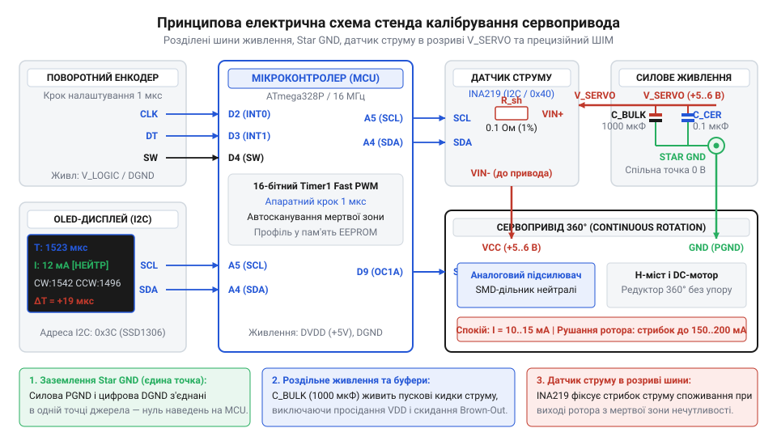
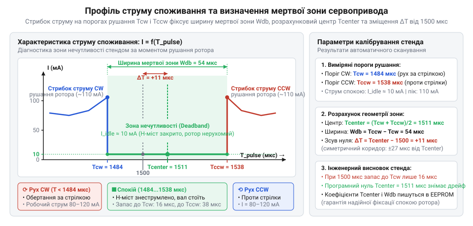

# Інтерактивний програмно-апаратний стенд для калібрування мертвої зони та нейтралі сервоприводів

<preknowlist>
- [Tower Pro SG90 — мікросерво 9g](root:cat-hw-actuators/sg90-servo) — стандартні параметри імпульсного керування сервоприводами (період 20 мс, робочий діапазон 1000–2000 мкс із номінальною нейтраллю 1500 мкс), устрій внутрішнього H-моста та принципи роботи схеми зворотного зв'язку за напругою
- [Серво-роги (запасні)](root:cat-hw-actuators/servo-horns) — механічне закріплення вихідних насадок на шліцьовий вал привода, поняття механічного упору та візуальний контроль кутового руху вала під час тестування
</preknowlist>

## Чому сервопривід постійного обертання дрейфує

Колісний робот або поворотна платформа на базі приводів постійного обертання часто поводиться всупереч очікуванням: після вмикання живлення та подачі стандартного сигналу нейтралі в 1500 мкс апарат не зупиняється на місці, а повільно повзе вбік, дзижчить або смикається. Під час спроби прямолінійного руху колеса обертаються з різною кутовою швидкістю, і шасі неминуче веде з траєкторії. Спроби механічного підстроювання викруткою за допомогою внутрішнього потенціометра дають лише короткочасний результат: від вібрацій редуктора та нагріву двигуна точка спокою швидко збивається знову.

Причина полягає в електрофізичній природі такого пристрою. На відміну від [типового аналогового мікросервопривода](root:cat-hw-actuators/sg90-servo), де положення вала відстежується замкненим контуром зворотного зв'язку, сервопривід (від лат. @@la|servus@@ — слуга) у [модифікації на постійне обертання](root:cat-hw-actuators/continuous-rotation-servo-mod) (@@en|continuous rotation servo@@) має розірваний механічний зв'язок: вихідний вал відокремлений від внутрішнього датчика. Привід перетворюється на пропорційний регулятор швидкості, де умовна точка зупинки визначається виключно балансом напруги на внутрішньому дільнику з фіксованих резисторів або зафіксованому потенціометрі.

Імпульс 1500 мкс відповідає центру спокою лише теоретично. На практиці навіть 1–2% технологічного розкиду номіналів резисторів зміщують напругу балансу, тому справжня точка нерухомості зсувається на десятки мікросекунд від номіналу. Під час роботи силові транзистори мотора нагрівають корпус, і температурний дрейф аналогового таймера сервопідсилювача безперервно зміщує цю рівновагу. До того ж аналоговий компаратор (від лат. @@la|comparare@@ — порівнювати) має внутрішню захисну смугу нечутливості — мертву зону (@@en|deadband@@), покликану запобігати коливанням ротора, проте через нелінійність вхідних напівпровідникових кіл її межі несиметричні відносно центру.

Подача фіксованого імпульсу 1500 мкс ніколи не гарантує нерухомості вала та однакової швидкості коліс. Щоб приборкати паразитичний дрейф і усунути розбіжність між приводами, необхідний спеціалізований вимірювальний стенд, здатний апаратно зафіксувати реальні межі мертвої смуги та розрахувати точне програмне зміщення нуля для кожного окремого пристрою.

## Схемотехніка стенда та роздільне живлення

Спроба живити вимірювальний стенд разом із тестованим [сервоприводом із металевим редуктором](root:cat-hw-actuators/mg90s-servo) від спільного стабілізатора мікроконтролера миттєво порушує роботу схеми. Двигун привода є потужним індуктивним навантаженням. У мить рушання ротора, коли якір ще нерухомий і проти-ЕРС дорівнює нулю, якірний струм підскакує до сотень міліампер. Слабкий вбудований стабілізатор плати керування не здатен видати такий піковий струм, тому напруга логічного живлення глибоко просідає — виникає @@en|voltage sag@@. Щойно шина живлення падає нижче критичної межі, вбудований апаратний детектор мікроконтролера фіксує аварійний стан і викликає скидання за спадом напруги (від англ. @@en|brownout@@ — притьмарення, часткове знеструмлення) — @@en|Brown-Out Reset@@ (@@en|BOR@@). Мікроконтролер перезапускається, знову починає подавати керувальний сигнал і миттєво входить у нескінченну петлю циклічних перезавантажень.

Надійність стенда забезпечує повне фізичне розділення силової та цифрової шин живлення. Логічні вузли — мікроконтролер, дисплей та [інкрементний поворотний енкодер](root:hw-sensing/quadrature-rotary-encoders) (від англ. @@en|encoder@@, де @@en|encode@@ — кодувати) — живляться від власного стабілізатора 3.3 В або 5 В. Сервопривід отримує живлення від окремої силової лінії 5–6 В зі значним запасом струму. Для швидкої віддачі енергії під час пуску безпосередньо біля роз'єму привода встановлюють буферний електролітичний конденсатор ємністю 470–1000 мкФ, а високочастотні комутаційні завади від роботи колекторних щіток та ШІМ придушують керамічним блокувальним конденсатором ємністю 0.1 мкФ.

Обидва контури мусять мати спільний потенціал відліку для проходження імпульсів керування та вимірювання струму. Проте спільний земляний дріт неприпустимий: великий зворотний струм мотора створює на опорі провідника спад напруги, що зсуває рівень логічного нуля мікроконтролера та спотворює покази. Проблему усуває топологія заземлення «зіркою» (@@en|Star GND@@): мінусові провідники цифрової схеми та силове коло двигуна прокладають окремими лініями й з'єднують строго в єдиній фізичній точці на клемах джерела живлення.


*Принципова електрична схема стенда з розділеним живленням логіки й мотора, буферними конденсаторами та заземленням «зіркою».*

## Фіксація моменту рушання датчиком струму

Автоматичне калібрування вимагає безпомилково фіксувати мить, коли сервопривід починає обертатися. Візуальний контроль оператора має запізнення й не помічає вибору люфтів у редукторі. Зовнішні оптичні або магнітні енкодери на валу громіздкі, потребують точного механічного центрування та несумісні з [різноманітними серворогами](root:cat-hw-actuators/servo-horns).

Завдання розв'язує безконтактне спостереження за струмом живлення. Поки керувальний сигнал перебуває всередині @@en|deadband@@, внутрішній H-міст (від англ. @@en|H-bridge@@, де ключі утворюють схему у формі літери H) закрито. Двигун знеструмлено, а привід споживає лише власний струм спокою логіки на рівні 5–15 мА. Щойно тривалість імпульсу виходить за межу нечутливості, транзистори моста відкриваються. Оскільки нерухомий ротор ще не генерує проти-ЕРС, для подолання тертя спокою редуктора струм двигуна стрибкоподібно зростає до 80–200 мА.

Для вимірювання в розрив плюсової лінії живлення сервопривода встановлюють вимірювальний шунт (від англ. @@en|shunt@@ — відгалужувати) або [інтегральний датчик струму](root:cat-hw-sensors/ina219-power-monitor) типу @@en|INA219@@. Завеликий опір шунта краде робочу напругу в мотора: при піковому струмі в 1 А резистор у 1 Ом забирає 1 В і провокує збій логіки сервопривода через просідання живлення. Через це спад напруги на шунті за максимального струму обмежують безпечною межею у 50–100 мВ. Занадто малий опір, навпаки, позбавляє вимірювач чутливості: початковий стрибок рушання у 20 мА на шунті 0.01 Ом створює спад лише в 0.2 мВ. Такий мікровольтний сигнал тоне в шумах і перекриває надто мало кроків квантування вбудованого 12-бітного АЦП мікросхеми. Опір у 0.1 Ом урівноважує ці обмеження: пікове навантаження створює допустимий спад до 100 мВ, а поріг рушання дає виразний стрибок у 2 мВ, що надійно фіксується сотнями відліків АЦП. Проте внутрішній підсилювач привода комутує мотор за допомогою ШІМ, що насичує вимірювання різкими імпульсними завадами. Окреме одиничне вимірювання може випадково потрапити на пік комутації й викликати хибне спрацьовування. Через це мікроконтролер фільтрує покази ковзним середнім (@@en|moving average@@) у вікні з кількох вибірок, згладжуючи високочастотні пульсації.

Момент зриву ротора фіксують за динамічним порогом. Оскільки різні екземпляри приводів мають власний базовий струм спокою, стенд вимірює споживання в точці нерухомості й додає до нього поріг спрацьовування у 20–30 мА. Перевищення цієї межі однозначно свідчить про початок обертання вала в напрямку за (`Tcw`) чи проти (`Tccw`) годинникової стрілки.


*Залежність споживаного струму від тривалості керувального імпульсу зі стрибками рушання на межах мертвої зони та розрахунковою точкою нейтралі.*

## Прецизійний ШІМ-генератор та ручне підстроювання

Спроба сформувати сервосигнал стандартними бібліотечними функціями мікроконтролера спирається на загальні системні таймери або програмні затримки. Їхня дискретність становить лише 4–16 мкс, а обробка інших переривань викликає випадкові затримки фронтів — джитер (від англ. @@en|jitter@@ — тремтіти). У чутливих [мікросервоприводах лінійки Tower Pro](root:cat-hw-actuators/sg90-mg90-micro-servos-family) похибка тривалості навіть у 2 мкс спричиняє зрив ротора й повільне сповзання вала. Для точного калібрування нейтралі @@en|jitter@@ неприпустимий.

Рішенням є апаратний синтез імпульсів за допомогою [16-бітного таймера мікроконтролера](root:hw-arch/hardware-pwm) в режимі швидкої широтно-імпульсної модуляції (від англ. @@en|Pulse-Width Modulation@@) — @@en|Fast PWM@@ із прямим керуванням виводом при збігу (від англ. @@en|compare match@@). Стандартні режими @@en|Fast PWM@@ мають фіксовану розрядність у 8, 9 чи 10 бітів і не дають змоги отримати точний сервоперіод у 20 мс при робочих тактових частотах. Використання ж регістра порівняння `OCR1A` (від англ. @@en|Output Compare Register@@) як верхньої межі підрахунку блокує його пряме призначення: канал A втрачає можливість модулювати ширину вихідного імпульсу. Через це період задають за 16-бітним регістром захоплення входу `ICR1` (від англ. @@en|Input Capture Register@@, де @@en|capture@@ — захоплювати): лічильник скидається до нуля в мить досягнення його значення, що звільняє регістр `OCR1A` суто під тривалість імпульсу. Цю конфігурацію задають у регістрах керування `TCCR1A` та `TCCR1B` (від англ. @@en|Timer/Counter Control Register@@) бітами вибору форми сигналу (від англ. @@en|Waveform Generation Mode@@): біт `WGM11` встановлюють у `TCCR1A`, а біти `WGM12` та `WGM13` — у `TCCR1B`. Апаратне підключення виводу `OC1A` у неінвертованому режимі активує біт `COM1A1` у регістрі `TCCR1A`. Тактову частоту ядра попередньо знижує переддільник (від англ. @@en|prescaler@@, де @@en|scale@@ — масштабувати). Біт вибору тактування `CS11` у регістрі `TCCR1B` задає коефіцієнт ділення `N = 8`. Тривалість одного такту лічильника `t_tick` обчислюють через тактову частоту мікроконтролера `f_clk` та коефіцієнт ділення `N`:

```
t_tick
= N / f_clk              [період одного такту таймера]
= 8 / (16 × 10⁶ Гц)      [підстановка параметрів тактування]
= 0.5 мкс                [дискретність підрахунку]
```

Отримана дискретність у пів мікросекунди формує крок апаратної сітки: зміна значення в регістрі порівняння на 2 такти регулює довжину імпульсу рівно на 1 мкс. Період повторення 20 мс задають верхньою межею лічильника в 40 000 тактів. Логічний рівень виводу виставляється апаратно на початку циклу й скидається під час збігу, забезпечуючи нульовий @@en|jitter@@ без залучення процесорного ядра.

Для оперативного налаштування стенд використовує поворотний енкодер. Квадратурний алгоритм на базі зовнішніх апаратних переривань визначає напрямок обертання за взаємним зсувом фаз A і B, а часова затримка відсікає брязкіт контактів (від англ. @@en|bounce@@ — підстрибувати). У ручному режимі (@@en|Manual Step Mode@@) кожен клік ручки змінює тривалість імпульсу на 1 мкс. Зіставляючи керування з мінімумом струму споживання та відсутністю вібрацій, оператор безпомилково визначає справжню точку спокою привода.

## Алгоритм автоматичного сканування мертвої смуги

Ручне підстроювання зупиняє вал, але знаходить лише випадкову точку всередині смуги нечутливості. У [надлегких мікросервоприводах](root:cat-hw-actuators/hd-1370a-servo) Power HD HD-1370A зона спокою сягає десятків мікросекунд через розкид компонентів компаратора. Якщо точка зупинки лежить біля краю смуги, нагрів схеми миттєво зриває мотор в обертання, а зворотний рух вимагає подолати всю мертву зону. Побудувати симетричне керування швидкістю без визначення обох меж неможливо.

Проблему розв'язує алгоритм автоматичного сканування мертвої зони (від англ. @@en|Auto Deadband Scanner@@, де @@en|scan@@ — пильно оглядати). Процедура стартує з нейтралі 1500 мкс. Стенд витримує паузу 200 мс на релаксацію (від лат. @@la|relaxatio@@ — послаблення) струму й фіксує струм спокою `I_idle`. Далі мікроконтролер покроково нарощує імпульс із кроком 1 мкс і паузою 25 мс для стабілізації відгуку. Щойно датчик фіксує пусковий стрибок струму, фіксується поріг рушання за годинниковою стрілкою `T_cw`. Сигнал повертається в нейтраль, стенд витримує паузу заспокоєння механіки та кроками зменшує імпульс до виявлення порогу рушання проти годинникової стрілки `T_ccw`.

Істинний центр мертвої зони `T_center` обчислюють як середнє арифметичне зафіксованих порогів рушання за годинниковою `T_cw` та проти годинникової `T_ccw` стрілки:

```
T_center
= (T_cw + T_ccw) / 2     [середина зони нечутливості]
```

Знайдена величина є математичним осередком зони спокою, де внутрішній @@en|H-bridge@@ гарантовано знеструмлює мотор. Повну ширину смуги нечутливості `W_db` та апаратне зміщення нуля `ΔT` відносно стандартного імпульсу 1500 мкс визначають різницевими рівняннями:

```
W_db
= T_cw - T_ccw           [ширина мертвої смуги]

ΔT
= T_center - 1500        [зсув відносно стандарту]
```

Різниця відхилень `T_cw - T_center` та `T_center - T_ccw` виявляє внутрішню асиметрію вхідних кіл сервопідсилювача, дозволяючи скомпенсувати її під час розрахунку швидкості.

## Інтерфейс стенда та збереження калібрування

Знайдені пороги лишаються в оперативній пам'яті: без дисплея оператор не бачить асиметрії привода, а після знеструмлення дані втрачаються. Завдання завершує виведення параметрів на екран та збереження профілю привода для прошивки робота.

Графічний дисплей виводить поточний імпульс, миттєвий струм і смугу @@en|deadband@@ із маркером робочої точки, а після сканування показує координати `T_cw`, `T_ccw` та зміщення `ΔT`. Це дозволяє оператору оцінити стан редуктора й симетрію підсилювача без комп'ютера.

Параметри упаковують у структуру калібрувального профілю з ідентифікатором пристрою, порогами `T_cw`, `T_ccw`, центром `T_center` та [контрольною сумою CRC16](root:com-protocol/checksums-crc) (від англ. @@en|Cyclic Redundancy Check@@ — циклічний надлишковий контроль). Її записують в [енергонезалежну пам'ять мікроконтролера](root:hw-arch/mcu-eeprom-storage) — @@en|EEPROM@@ (від англ. @@en|Electrically Erasable Programmable Read-Only Memory@@, де @@en|erasable@@ — стираний). Під час старту керуюча програма перевіряє цілісність профілю, блокуючи роботу при пошкодженні комірок.

У коді робота збережений профіль усуває порожній хід регуляторів. Наївне масштабування замінює кусково-лінійна лінеаризація (від лат. @@la|linearis@@ — лінійний): нульова швидкість транслюється строго в `T_center`, виключаючи сповзання вала. Додатний діапазон розгортається від порогу `T_cw` до 2000 мкс, а від'ємний — від `T_ccw` до 1000 мкс:

:::tabs
```c
struct ServoProfile {
    uint8_t id;
    uint16_t t_cw;
    uint16_t t_ccw;
    uint16_t t_center;
    uint16_t crc;
};

uint16_t speed_to_pulse(const struct ServoProfile *p, int8_t speed) {
    if (speed == 0) return p->t_center;
    if (speed > 0) return p->t_cw + (uint32_t)speed * (2000 - p->t_cw) / 100;
    return p->t_ccw - (uint32_t)(-speed) * (p->t_ccw - 1000) / 100;
}
```
```cpp
struct ServoProfile {
    uint8_t id;
    uint16_t t_cw;
    uint16_t t_ccw;
    uint16_t t_center;
    uint16_t crc;

    uint16_t to_pulse(int8_t speed) const {
        if (speed == 0) return t_center;
        if (speed > 0) return t_cw + static_cast<uint32_t>(speed) * (2000 - t_cw) / 100;
        return t_ccw - static_cast<uint32_t>(-speed) * (t_ccw - 1000) / 100;
    }
};
```
:::
