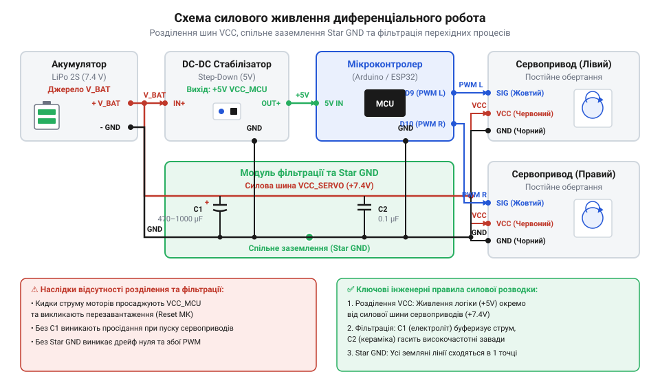
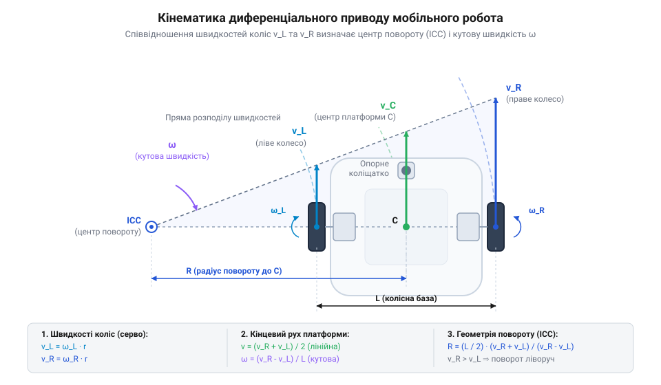

# Побудова двохколісної робоплатформи на сервоприводах постійного обертання з калібруванням нейтралі

<preknowlist>
- [Сервоприводи радіокерованих моделей: будова, редуктори та ШІМ-керування](root:cat-hw-actuators/rc-servo-mechanisms-and-control) — Принципи ШІМ-керування з періодом 20 мс, будову внутрішнього підрядкового потенціометра та роботу H-моста.
- [Серво-роги (запасні)](root:cat-hw-actuators/servo-horns) — Способи механічної фіксації коліс на шпіделі сервопривода за допомогою серво-рогів.
- [Лінійка 9-грамових мікросервоприводів Tower Pro (SG90, SG92R, MG90S, MG90D)](root:cat-hw-actuators/sg90-mg90-micro-servos-family) — Електричні та навантажувальні характеристики популярних мікросерводвигунів і типи їхніх редукторів.
</preknowlist>

## Проблема самовільного дрейфу та перезавантажень

Збираючи двоколісного автономного робота на базі сервоприводів постійного обертання (@@en|continuous rotation servo@@ (англ. *continuous* — безперервний, *rotation* — обертання)), розробник часто стикається з двома критичними збоями одразу після подачі живлення. Перша проблема полягає в тому, що у стані спокою, коли мікроконтролер подає на сигнальний провід еталонний імпульс зупинки, колеса робота продовжують повільно обертатися або дриґатися, викликаючи самовільний дрейф (@@en|drift@@) всієї платформи. Друга проблема проявляється під час спроби різко рушити з місця: у момент подачі команди на рух мікроконтролер раптово вимикається й перезапускається, скидаючи виконане програмне забезпечення у початковий стан і впадаючи у нескінченний цикл перезавантажень.

Причина хаотичних перезавантажень мікроконтролера криється у фізиці роботи електродвигунів постійного струму під навантаженням. У момент пуску ротора з нерухомого стану обмотки двигуна створюють майже повне коротке замикання для джерела живлення, викликаючи пусковий струм (@@en|stall current@@ (англ. *stall* — звалювання, зупинка)). Для стандартних 9-грамових приводів, таких як [сервоприводи Tower Pro SG90](root:cat-hw-actuators/sg90-servo), піковий струм одного двигуна у момент старту досягає 500–700 мА, а для пристроїв із металевим редуктором, як-от [металеві сервоприводи MG90S](root:cat-hw-actuators/mg90s-servo), може перевищувати 1.2 А. Якщо силова частина приводів і логічна схема мікроконтролера заживлені від однієї імпульсної лінії без розв'язки, сумарний пусковий сплеск двох бортів викликає швидкий провал напруги живлення. Коли напруга падає нижче критичного порогу, спрацьовує апаратна схема скидання за зниження напруги (@@en|Brownout Reset@@ або @@en|BOR@@ (англ. *brownout* — просідання напруги, *reset* — скидання)), яка примусово перезапускає процесор.

Самовільний дрейф коліс у стані спокою викликаний іншою фізичною причиною — розбалансуванням внутрішнього підлаштовного потенціометра (@@en|trimmer potentiometer@@ (англ. *trim* — підганяти, *potentiometer* — вимірювач потенціалу)). На відміну від стандартних серводвигунів, де потенціометр жорстко зв'язаний з вихідним валом і відстежує його кут, у модифікованому приводі постійного обертання цей потенціометр від'єднаний від вала й слугує внутрішнім опорним дільником напруги. Внутрішній аналоговий компаратор порівнює ширину вхідного імпульсу керування з внутрішньою часозадавальною ланцюжком, опір якої визначає потенціометр. Подібно до того, як працює [ШІМ-керування сервоприводами](root:cat-hw-actuators/rc-servo-mechanisms-and-control), сигнал із тривалістю імпульсу `t_p = 1500` мкс має відповідати нульовій швидкості. Однак через температурні коливання, механічні вібрації та технологічний розкид опорів реальна точка рівноваги мікросхеми драйвера зсувається. В результаті імпульс тривалістю 1500 мкс сприймається драйвером як команда обертання з малою швидкістю, і мостова схема управління обмотками (@@en|H-bridge@@ (англ. *H-bridge* — міст у формі літери H)) подає напругу на мотор.

Крім того, під час прямолінійного руху обидва серводвигуни мають природний технологічний розкид швидкостей обертання редукторів навіть при отриманні однакових сигналів керування. Через відсутність внутрішнього енкодера зворотного зв'язку це призводить до відхилення робота від прямої лінії. Отже, для створення стабільної двоколісної робоплатформи необхідно послідовно вирішити три завдання: розділити та профільтрувати силове й логічне живлення, провести апаратне тримування (@@en|trimming@@ (англ. *trim* — підганяти, підлаштовувати)) нейтралі кожного сервопривода, та реалізувати програмну компенсацію кінематики.

## Схема живлення та силовий монтаж

Щоб виключити просідання напруги та гарантувати стабільну роботу логіки мікроконтролера під час пікових навантажень двигунів, силову частину робоплатформи розгортають за схемою з розділеними лініями живлення та спільною точкою заземлення (@@en|common ground@@ (англ. *common* — спільний, *ground* — земля)). Для живлення сервоприводів застосовують окремий силовий акумулятор або імпульсний понижувальний перетворювач напруги, здатний віддавати струм не менше 3 А при напрузі 5–6 В. Використовуючи приводи з [родини мікросервоприводів Tower Pro](root:cat-hw-actuators/sg90-mg90-micro-servos-family) або [сервоприводи Power HD](root:cat-hw-actuators/hd-1370a-servo), неприпустимо підключати їхні силові червоні проводи напряму до виводу 5V плати мікроконтролера, оскільки вбудований лінійний стабілізатор мікроконтролера не розрахований на високий пусковий струм і швидко перегрівається.

Ключовим правилом силового монтажу є об'єднання мінусових шин живлення в одній фізичній точці. Силовий мінус серводвигунів і мінус живлення мікроконтролера повинні мати надійне електричне з'єднання. Без спільного заземлення керуючий ШІМ-сигнал, що поступає з цифрового виводу мікроконтролера на сигнальний провід сервопривода, не матиме чіткого опорного потенціалу відносно силового мінуса сервопривода. Це призводить до виникнення паразитних наводок, викривлення ширини імпульсів та непередбачуваної поведінки силових мостів.

Для поглинання високочастотних завад та короткочасних просідань напруги під час пуску двигунів безпосередньо на силових клемах живлення сервоприводів встановлюють фільтруючі конденсатори. Паралельно лінії силового живлення підключають електролітичний конденсатор ємністю `C_1 = 470`–`1000` мкФ із робочою напругою не менше 10 В для компенсації низькочастотних кидків струму, а також керамічний конденсатор `C_2 = 0.1` мкФ для шунтування високочастотних завад від колекторних щіток двигуна.


*Принципова схема розведення силового живлення сервоприводів і логічного живлення мікроконтролера зі спільною точкою заземлення та ємнісною фільтрацією.*

Під час механічного збирання шасі сервоприводи жорстко кріплять до корпусу робоплатформи гвинтами через гумові амортизаційні втулки для гасіння вібрацій. На шпіделі приводів встановлюють комплектні [пластикові серво-роги](root:cat-hw-actuators/servo-horns), які слугують маточинами для фіксації ведучих коліс. Завдяки правильно виконаному силовому монтажу напруга логічної частини лишається стабільною навіть при повному заклинюванні редукторів під навантаженням.

## Апаратне калібрування нейтралі викруткою

Після завершення силового монтажу та перевірки напруги живлення необхідно усунути самовільний дрейф валів сервоприводів у режимі спокою. Оскільки сервопривод постійного обертання позбавлений механічного зворотного зв'язку за кутом обертання, внутрішня мікросхема драйвера визначає напрямок і швидкість руху на основі різниці між тривалістю вхідного ШІМ-імпульсу `t_p` та тривалістю внутрішнього опорного імпульсу `t_ref`, який задається підрядковим потенціометром.

Тривалість керуючого імпульсу ШІМ для сервоприводів стандартизована і змінюється в межах від 1000 мкс до 2000 мкс при періоді повторення кадру `T = 20` мс (частота 50 Гц). Еталонний стан зупинки відповідає імпульсу `t_p = 1500` мкс. Внутрішній драйвер сервопривода має вузьку зону нечутливості (@@en|deadband@@ (англ. *dead* — мертвий, *band* — смуга)) шириною `Δt_db`, зазвичай від 4 мкс до 10 мкс навколо точки `t_ref`. Умова повної зупинки двигуна визначається співвідношенням:

```
|t_p - t_ref| ≤ Δt_db / 2
```

Якщо значення `t_ref`, що задається внутрішнім потенціометром, відхиляється від 1500 мкс і виходить за межі зони нечутливості, драйвер відкриває транзистори @@en|H-bridge@@, викликаючи повільне обертання вихідного вала. На відміну від складних систем із [безколекторними сервоконтролерами](root:cat-hw-actuators/bldc-servo-controller), де нейтраль програмується цифровими реєстрами, у аналогових та цифрових мікросервоприводах калібрування виконується механічно.

Методика апаратного калібрування нейтралі викруткою виконується у такій послідовності:

1. Програмно подати на сигнальні виводи обох сервоприводів точний еталонний ШІМ-сигнал зупинки з тривалістю імпульсу `t_p = 1500` мкс та періодом 20 мс. 2. Закріпити робоплатформу у підвешеному стані, щоб ведучі колеса не торкалися поверхні столу. 3. Через спеціальний технологічний отвір у торцевій або бічній частині корпусу сервопривода вставити тонку викрутку з ізольованою рукояткою у шліц підрядкового потенціометра. 4. Повільно та плавно обертати потенціометр за годинниковою або проти годинникової стрілки, спостерігаючи за обертанням колеса. 5. Знайти положення, у якому колесо повністю припиняє рух. Для точного потрапляння в центр зони нечутливості поворот викрутки продовжують до моменту початку обертання у протилежний бік, після чого повертають шліц рівно посередині між двома точками початку руху.

Після виконання апаратного калібрування обидва сервоприводи зберігають повну нерухомість при подачі сигналу 1500 мкс. Це створює надійну базу для подальшого програмного керування швидкістю та диференціальною кінематикою робота.

## Програмна компенсація нечутливості сервоприводів

Апаратне тримування підрядкового потенціометра виставляє електричний нуль, завдяки чому при ширині імпульсу 1500 мкс двигун залишається нерухомим. Проте спроба зрушити робота з місця на мінімальній швидкості — наприклад, подачею сигналу 1515 мкс — завершується повною тишею: колеса не обертаються. Якщо ж продовжувати повільно збільшувати тривалість імпульсу, шасі раптово ривком стартує вже на помітних обертах.

Така поведінка зумовлена двома фізичними чинниками. По-перше, внутрішній драйвер сервопривода постійного обертання (@@en|continuous rotation servo@@, з англ. *continuous* — безперервний, *rotation* — обертання, *servo* — сервопривід) має апаратну мертву зону (@@en|deadband@@, з англ. *dead* — мертвий, *band* — смуга) — діапазон тривалості імпульсів навколо 1500 мкс (зазвичай ±15...30 мкс), у межах якого внутрішній H-міст (@@en|H-bridge@@) знеструмлений для запобігання брязканню та шумам. По-друге, механічні шестерні редуктора — як у [бюджетних мікросервоприводах SG90](root:cat-hw-actuators/sg90-servo), так і в [моделях із металевим редуктором MG90S](root:cat-hw-actuators/mg90s-servo) — вимагають початкового моменту сили для подолання статичного тертя (@@en|stiction@@, з англ. *static friction* — статичне тертя).

У результаті реальне обертання вала починається лише при досягненні порогових значень імпульсу — наприклад, 1540 мкс для руху вперед і 1460 мкс для руху назад. Проміжок між 1500 мкс та порогом є зоною нечутливості, яка спотворює плавність керування.

Для усунення цього ефекту та лінеаризації керування створюють проміжний програмний шар компенсації нечутливості (@@en|deadband mapping@@). Нормоване значення бажаної швидкості `u` лежить у діапазоні від `-1.0` (максимальний реверс) до `+1.0` (максимальний вперед), де `0.0` відповідає зупинці. Перетворення нормованої швидкості `u` на тривалість управляючого імпульсу `t_pulse` здійснюється за кусочно-лінійною функцією:

```
t_pulse(u) = t_neutral,                                  [при u = 0]
           = t_min_fwd + u × (t_max_fwd - t_min_fwd),    [при 0 < u ≤ 1.0]
           = t_min_rev + u × (t_min_rev - t_max_rev),    [при -1.0 ≤ u < 0]
```

Тут `t_neutral` — відкалібрована тривалість нейтрального імпульсу (1500 мкс), `t_min_fwd` та `t_min_rev` — мінімальні імпульси початку руху (наприклад, 1540 мкс та 1460 мкс), а `t_max_fwd` та `t_max_rev` — межі максимальних обертів (зазвичай 2000 мкс та 1000 мкс).

**Обчислення тривалості імпульсу для прямого ходу на 25% швидкості (u = 0.25):**
```
t_pulse = 1540 + 0.25 × (2000 - 1540)
        = 1540 + 0.25 × 460                        [обчислення активного діапазону]
        = 1540 + 115                                [масштабування швидкості]
        = 1655 мкс                                  [підсумкова тривалість імпульсу]
```

Програмна реалізація компенсувального шару обгортає низькорівневе керування ШІМ-сигналом і забезпечує лінійний відгук обох бортів.

:::tabs
@tab ESP-IDF (C)
:::code proj-two-wheeled-robot-differential-drive/c/esp-idf/servo-speed-to-pulse.c
@tab Arduino (C++)
:::code proj-two-wheeled-robot-differential-drive/cpp/arduino/servocalibration.cpp
:::

## Диференціальна кінематика та вирівнювання ходу

Наявність симетричного відгуку окремих коліс ще не гарантує прямолінійного руху всієї платформи. Якщо подати на обидва борти однакову команду `u = 0.5`, робот поступово відхилятиметься вбік через технологічний розкид параметрів двигунів та внутрішнє тертя в редукторах. Для точного маневрування двоколісним шасі з ролик-опорою (@@en|caster wheel@@, з англ. *caster* — роликова опора) застосовують рівняння диференціальної кінематики (@@en|differential drive kinematics@@, з лат. *differentia* — різниця, відмінність).


*Векторний розподіл лінійних швидкостей коліс та кутової швидкості обертання корпусу робота відносно геометричного центру колісної бази.*

Кінематична модель пов'язує лінійну швидкість центру робота `v` (@@en|linear velocity@@) та його кутову швидкість обертання `ω` (@@en|angular velocity@@) зі швидкостями лівого `v_L` та правого `v_R` коліс. Геометричним параметром системи є ширина колії `B` (@@en|track width@@, з англ. *track* — колія, *width* — ширина) — відстань між точками контакту коліс із поверхнею.

Пряма кінематика визначає рух корпусу за відомими швидкостями бортів:
```
v = (v_R + v_L) / 2                                [лінійна швидкість центру робота]
ω = (v_R - v_L) / B                                [кутова швидкість обертання]
``` Для обчислення поточних координат X, Y та кута орієнтації робота за обчисленими швидкостями бортів застосовують [одометрію двоколісної робоплатформи](root:com-signal/differential-drive-odometry).

Обернена кінематика розраховує необхідні швидкості окремих коліс для досягнення бажаного поступального `v` та кутового `ω` руху:
```
v_L = v - (ω × B / 2)                              [потрібна швидкість лівого борта]
v_R = v + (ω × B / 2)                              [потрібна швидкість правого борта]
```

Окремим випадком є розворот на місці (@@en|in-place turn@@). При `v = 0` та `ω ≠ 0` рівняння описують протилежний напрямок обертання коліс з однаковою за модулем швидкістю:
```
v_L = - (ω × B / 2)
v_R = + (ω × B / 2)
```

Щоб усунути паразитний дрейф при русі по прямій, спричинений різницею коефіцієнтів передачі у [приводах Power HD](root:cat-hw-actuators/powerhd-family) або інших сервомоторах, вводиться програмний трим-коефіцієнт `k_trim` (@@en|trim factor@@, з англ. *trim* — підгонка). Якщо платформа відхиляється праворуч, швидкість лівого борта помножується на значення `k_trim < 1.0`, що вирівнює фактичні швидкості коліс.

:::tabs
@tab ESP-IDF (C)
:::code proj-two-wheeled-robot-differential-drive/c/esp-idf/diff-drive-compute.c
@tab Arduino (C++)
:::code proj-two-wheeled-robot-differential-drive/cpp/arduino/differentialkinematics.cpp
:::

## Профілі плавного прискорення та гальмування

Миттєва зміна сигналу керування від `v = 0` до `v = 1.0` створює механічний та електричний удар. Інерція маси робота (@@en|inertia@@, з лат. *inertia* — бездіяльність) чинить опір миттєвому розгону, через що колеса втрачають зчеплення з підлогою та пробуксовують (@@en|wheel slip@@, з англ. *wheel* — колесо, *slip* — ковзання). У цей же момент зуби пластикових редукторів зазнають пікового навантаження, що прискорює їхній знос.

З боку електроніки різкий пуск спричиняє стрибок струму до рівня струму заклинювання (@@en|stall current@@, з англ. *stall* — заклинювання, *current* — струм). Це створює короткочасне просідання напруги (@@en|voltage sag@@, з англ. *voltage* — напруга, *sag* — просідання) на силовій шині, що може спровокувати незаплановане скидання мікроконтролера (@@en|Brownout Reset@@ / BOR), якщо розв'язка живлення має недостатню ємність.

Для захисту механіки та елементів живлення використовують генератор рампового профілю швидкості (@@en|ramp generator@@ / @@en|slew rate limiter@@, з англ. *slew rate* — швидкість наростання). Замість прямої передачі цільової швидкості в модуль кінематики, поточна швидкість нарощується або зменшується з обмеженим прискоренням `a_max` протягом періодичних інтервалів `Δt`.

Обчислення поточного значення швидкості здійснюється за формулою:
```
Δv_max = a_max × Δt                                [максимальний приріст за один крок]
v_current(t + Δt) = v_current(t) + clamp(v_target - v_current(t), -Δv_max, +Δv_max)
```

**Обчислення поточного значення швидкості при зсуві від 0 до 1.0 з прискоренням a_max = 2.0 1/с та інтервалом таймера Δt = 0.05 с (50 мс):**
```
Δv_max = 2.0 × 0.05 = 0.10                         [максимальний приріст за 50 мс]
v(t=50мс) = 0.0 + 0.10 = 0.10                      [перший крок разгону]
v(t=100мс) = 0.10 + 0.10 = 0.20                    [другий крок разгону]
```

Повний розгін до 100% швидкості відбувається за 10 кроків (0.5 секунди), що забезпечує м'який старт без проковзування коліс та пускових кидків струму.

:::tabs
@tab ESP-IDF (C)
:::code proj-two-wheeled-robot-differential-drive/c/esp-idf/ramp-filter-update.c
@tab Arduino (C++)
:::code proj-two-wheeled-robot-differential-drive/cpp/arduino/rampfilter.cpp
:::