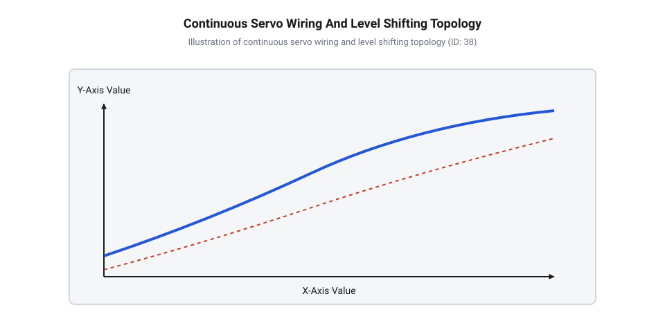
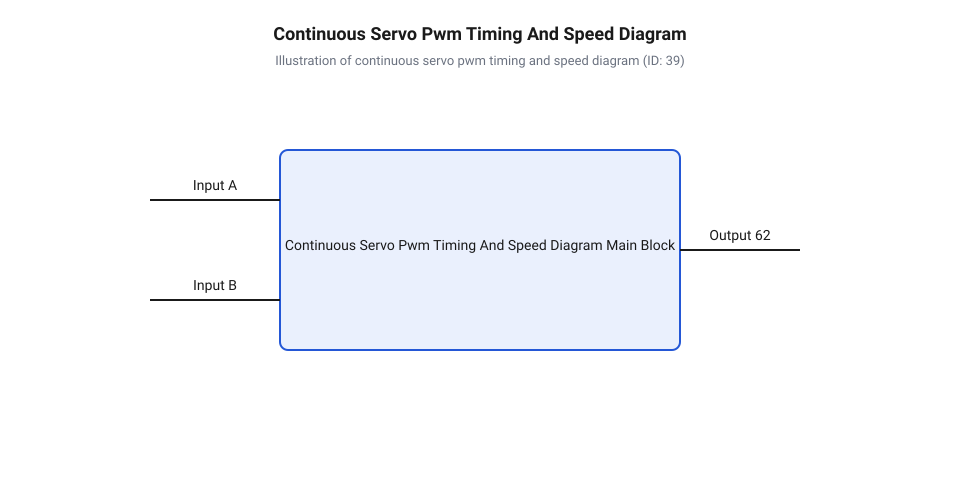

# Апаратний інтерфейс сервоприводів постійного обертання та специфікація ШІМ-сигналу

<preknowlist>
- [Сервоприводи радіокерованих моделей: будова, редуктори та ШІМ-керування](root:cat-hw-actuators/rc-servo-mechanisms-and-control) — базові принципи побудови класичних сервоприводів, кінематичну схему редуктора та стандарт кадрування ШІМ
- [Інтегральні аналогові сервопідсилювачі KC2462 та AA51880](root:cat-hw-actuators/analog-servo-amplifier-ic) — принцип роботи внутрішнього компаратора аналогового сервопідсилювача та мостової схеми мотора
- [Частота оновлення кадрів ШІМ і цикли позиціонування сервоприводів](root:cat-hw-actuators/servo-pwm-frame-rate) — часову специфікацію періоду кадрування 20 мс та вплив нестабільності частоти генерації на роботу приводів
- [Зона нечутливості та дрижання вала сервоприводів](root:cat-hw-actuators/servo-deadband-and-jitter) — фізичну природу зони нечутливості analog/digital сервокомпараторів та причини паразитного посмикування вала
</preknowlist>

## Некероване дрейфування вала та збої живлення

При розробці мобільних робототехнічних платформ та приводів конвеєрних ліній інженери часто стикаються із деструктивною поведінкою систем керування рухом: після подачі команди зупинки вал електроприводу продовжує повільно обертатися, а при спробі різкого реверсу або розгону під навантаженням керуючий мікроконтролер спонтанно перезавантажується або втрачає інтерфейсний зв'язок. Подібний хаотичний дрейф робочого органу й регулярні скидання обчислювального ядра роблять привід повністю непридатним для точного позиціонування та загрожують цілісності механічних вузлів.

Корінь цієї проблеми полягає у помилковому сприйнятті сервоприводів постійного обертання (англ. @@en|Continuous Rotation Servo@@, від лат. *servus* — слуга, підлеглий та лат. *rotatio* — коловий рух) як звичайних колекторних двигунів постійного струму, керування якими намагаються здійснювати без урахування апаратної специфіки трипровідної сигнальної шини та високочастотних імпульсних завад. На відміну від [класичних позиційних сервоприводах](root:cat-hw-actuators/rc-servo-mechanisms-and-control), де внутрішній потенціометр жорстко зв'язаний із вихідним валом і забезпечує відпрацювання конкретного кута, у [модифікованих приводів постійного](root:cat-hw-actuators/continuous-rotation-servo-mod) обертання механічний зворотний зв'язок розірвано. Внутрішній компаратор приводу постійно порівнює тривалість вхідного керуючого імпульсу із внутрішнім часовим еталоном. Якщо цей еталон зміщений або зазнає температурного дрейфу, навіть за відсутності команди на рух силовий міст отримує залишковий струм, що викликає самовільне кочення.

Паралельно з цим внутрішній колекторний двигун під час комутації обмоток та зміни напрямку обертання ґенерує потужні сплески напруги зворотної ЕРС (англ. @@en|back EMF@@, від англ. *back* — зворотний та *electromotive force* — електрорушійна сила). Якщо силові кола мотора та чутливі лінії живлення логіки мікроконтролера підключені до спільної тонкої шини без належного розв'язування, індуктивні викиди струму викликають зсув потенціалу заземлення та падіння напруги нижче порогу скидання через просідання живлення (англ. @@en|brown-out reset@@). Для подолання цих явищ необхідно побудувати чітку трипровідну електричну топологію, забезпечити фільтрацію імпульсних наведень та виконувати правильне апаратне юстування нейтралі.

## Електрична топологія та узгодження логічних рівнів

Фізичний інтерфейс підключення сервоприводів постійного обертання стандартизовано у вигляді трипровідного кабелю зі стандартним кроком роз'єму 2.54 мм. Шина об'єднує три ключові лінії: лінію живлення силового моста та аналогового сервопідсилювача @@en|VCC@@ (від англ. @@en|Voltage at the Common Collector@@ — напруга на спільному колекторі), спільний провідник заземлення @@en|GND@@ (від англ. @@en|Ground@@ — заземлення, спільний дріт) та односпрямовану лінію керування @@en|Signal@@ (від лат. *signum* — знак, сигнальний імпульс). Допустима напруга живлення для більшості стандартних сервоприводів лежить у межах від 4.8 В до 7.2 В постійного струму з номінальними значеннями 5.0 В або 6.0 В, причому підвищення напруги пропорційно збільшує граничну кутову швидкість та вихідний крутний момент.

Динаміка струмоспоживання приводу носить виражений імпульсний характер. У режимі спокою внутрішній сервопідсилювач споживає струм у межах 5–15 мА, при холостому обертанні вала струм зростає до 100–200 мА, однак у момент пуску, різкого реверсу або при повному механічному блокуванні ротора споживаний струм досягає пікового значення заклинювання (англ. @@en|stall current@@, від англ. *stall* — зупинка, застопортування та лат. *currens* — струм, що тече). Для популярних [мікросервоприводів серії Tower](root:cat-hw-actuators/sg90-servo) або [моделей з металевими](root:cat-hw-actuators/mg90s-servo) редукторами струм заклинювання становить від 650 мА до 1.5 А, а для потужних стандартних приводів може перевищувати 3.5 А.

Для запобігання просіданню напруги логічного ядра мікроконтролера забороняється живити сервоприводи безпосередньо від внутрішніх виходів 3.3 В або 5 В системної плати. Слід застосовувати виділене зовнішнє джерело живлення або імпульсний DC-DC перетворювач з обов'язковим об'єднанням мікроконтролерного та силового провідників @@en|GND@@ за топологією «зірка» в одній точці. Для придушення високовольтних сплесків зворотної ЕРС (@@en|back EMF@@), створюваних індуктивністю обмоток двигуна, безпосередньо біля роз'єму сервоприводу паралельно лініям @@en|VCC@@ та @@en|GND@@ встановлюють згладжувальний електролітичний конденсатор ємністю 100–470 мкФ та керамічний шунтувальний конденсатор ємністю 0.1 мкФ.

Сучасні мікроконтролери оперують логічними рівнями 3.3 В CMOS, тоді як вхідні буфери [аналогових сервопідсилювачів компараторного](root:cat-hw-actuators/analog-servo-amplifier-ic) типу розраховані на сумісність із 5 В логікою TTL (англ. @@en|Transistor-Transistor Logic@@, @@en|TTL@@, від англ. *transfer* + *resistor* — перехідний опір). Порогове значення напруги високого рівня TTL становить 2.0 В, що формально дозволяє управляти приводом безпосередньо від виходу 3.3 В. Однак при високому рівні завад на силовій землі запас завадостійкості виявляється критично малим. Для [безпечного керування приводом](#safe-drive-control) та захисту вихідних каскадів контролера від паразитних наведень між виводом ШІМ та лінією @@en|Signal@@ необхідно встановлювати активні двонапрямні або буферні узгоджувачі рівнів на базі MOSFET-транзисторів чи мікросхем серії 74AHCT125.

_Електрична топологія роздільного живлення та узгодження рівнів запобігає просіданню напруги логики та гарантує надійне спрацьовування вхідного буфера сервопідсилювача._

## Часова специфікація ШІМ та регулювання швидкості

Керування сервоприводом постійного обертання здійснюється за допомогою сигналу широтно-імпульсної модуляції (ШІМ, англ. @@en|Pulse Width Modulation@@, @@en|PWM@@, від лат. *pulsus* — поштовх та лат. *modulatio* — розміреність). Стандартний період повторення кадру становить 20 мс, що відповідає частоті оновлення 50 Гц (докладніший аналіз часових інтервалів наведено у статті про вплив [частоти оновлення кадрів](root:cat-hw-actuators/servo-pwm-frame-rate)). Інформативним параметром керуючого сигналу є не коефіцієнт заповнення, а абсолютна тривалість позитивного імпульсу в межах кожного кадру.

На відміну від позиційних сервоприводів, де тривалість імпульсу визначає конкретний кут повороту вала, у сервоприводах постійного обертання керуючий параметр визначає напрямок та кутову швидкість обертання ротора. Робочий діапазон задається [тривалістю імпульсу ШІМ](#pwm-pulse-width) від 1000 мкс до 2000 мкс:

1) Нейтральна точка (1500 мкс): тривалість імпульсу відповідає стану повної зупинки двигуна. Напруга на виході внутрішнього силового моста дорівнює нулю. 2) Обертання проти годинникової стрілки (1000 мкс ≤ t_pulse < 1500 мкс): зменшення тривалості імпульсу нижче 1500 мкс викликає обертання вала в одному напрямку. Чим менша тривалість імпульсу (наближаючись до 1000 мкс), тим вища кутова швидкість обертання. При 1000 мкс досягається максимальна швидкість. 3) Обертання за годинниковою стрілкою (1500 мкс < t_pulse ≤ 2000 мкс): збільшення тривалості імпульсу понад 1500 мкс задає реверсивний напрямок обертання. При наближенні тривалості до 2000 мкс швидкість обертання зростає до максимального значення.

Для запобігання паразитному дрижанню вала поблизу стану спокою внутрішня схема підсилювача формує зону нечутливості (англ. @@en|deadband@@, від англ. *dead* — неактивний та *band* — смуга). Якщо відхилення імпульсу від нейтралі не перевищує ширину зони нечутливості t_db (зазвичай 4–10 мкс), силові транзистори моста залишаються закритими. Залежність кутової швидкості omega від тривалості імпульсу t_pulse описується математичною моделлю:

Для t_pulse > (1500 + t_db):
omega = omega_max × ((t_pulse - 1500 - t_db) ÷ (500 - t_db))    [лінійна характеристика напрямку CW]

Для t_pulse < (1500 - t_db):
omega = -omega_max × ((1500 - t_db - t_pulse) ÷ (500 - t_db))  [лінійна характеристика напрямку CCW]

Для (1500 - t_db) ≤ t_pulse ≤ (1500 + t_db):
omega = 0                                                       [зона нечутливості, зупинка двигуна]

Приклад обчислення кутової швидкості при тривалості імпульсу t_pulse = 1750 мкс, ширині зони нечутливості t_db = 10 мкс та максимальній швидкості приводу omega_max = 60 об/хв:

omega = 60 × ((1750 - 1500 - 10) ÷ (500 - 10))
      = 60 × (240 ÷ 490)                       [розрахунок відносного зміщення]
      ≈ 29.39 об/хв                            [кутова швидкість обертання за годинниковою стрілкою]

_Часова специфікація кадру 20 мс описує пропорційне кодування напрямку та швидкості обертання тривалістю позитивного імпульсу._

Для формування точних часових інтервалів генерування імпульсів ШІМ на мікроконтролерах застосовують апаратні таймери-лічильники. Нижче наведено ідіоматичні приклади конфігурування периферії для систем на базі ESP-IDF та Arduino:

:::tabs
@tab C (ESP-IDF)
:::code api-continuous-servo-hardware-interface/c/esp-idf/snippet-1.c
@tab C++ (Arduino)
:::code api-continuous-servo-hardware-interface/cpp/arduino/setup.cpp
:::

## Апаратне юстування нейтралі підстроювальним потенціометром

Внутрішня схема порівняння аналогового сервопідсилювача ґенерує внутрішній еталонний імпульс t_ref, тривалість якого визначається опором внутрішнього потенціономічного моста (детальніше математичні засади описано у матеріалі про засади [математики потенціометричного зв'язку](root:cat-hw-actuators/servo-feedback-potentiometer)). Компаратор обчислює різницю delta_t = t_pulse - t_ref. Якщо абсолютна величина різниці перевищує ширину зони нечутливості (@@en|deadband@@), відкриваються ключі силового моста, подаючи напругу відповідної полярності на обмотки мотора.

Через технологічний розкид номіналів резисторів, механічні допуски при складанні редуктора та температурний дрейф електричний центр внутрішнього потенціометра часто не відповідає точно тривалості 1500 мкс. Наприклад, якщо потенціометр згенерує t_ref = 1520 мкс, то при подачі з мікроконтролера еталонного імпульсу зупинки t_pulse = 1500 мкс відхилення становитиме delta_t = -20 мкс. Оскільки |-20 мкс| перевищує ширину зони нечутливості (t_db ≈ 8 мкс), привід продовжуватиме повільно повзти, навіть коли програма подає команду повного стопу.

Для усунення цього ефекту на корпусі сервоприводу передбачено технологічний отвір, через який відкривається доступ до шліца [підстроювального тримера потенціометра](#trimmer-potentiometer) (англ. @@en|trimmer potentiometer@@, від англ. *trim* — підганяти, впорядковувати та лат. *potentia* + грец. *metron* — вимірювач потенціалу). Тример являє собою багатооборотний або однооборотний підстроювальний резистор, включений у плече аналогового вимірювального моста. Зміна його опору дозволяє прецизійно зміщувати внутрішню часову нейтраль t_ref безпосередньо в апаратурі приводу.

Процедура апаратного [калібрування точки зупину](#zero-speed-calibration) (англ. @@en|zero-speed calibration@@) виконується у такій послідовності:

1) Підключити сервопривод до джерела живлення та керуючого контролера відповідно до схемотехнічних вимог роздільного живлення та узгодження рівнів. 2) Подати на лінію @@en|Signal@@ стабільний керуючий ШІМ-сигнал з періодом 20 мс та тривалістю імпульсу точно 1500 мкс. 3) Вставити діелектричну (пластикову або керамічну) викрутку у технологічний отвір корпусу до зчеплення зі шліцом підстроювального тримера. 4) Повільно повертати тример убік, протилежний напрямку самовільного обертання вала, до моменту повної зупинки двигуна. 5) Виконати перевірку меж зони нечутливості: подати імпульси 1490 мкс та 1510 мкс для перевірки симетричності початку обертання у зворотному та прямому напрямках, після чого повернути сигнал до 1500 мкс і переконатися у миттєвій зупинці вала.

Апаратне юстування нейтралі за допомогою тримера усуває потребу у програмній компенсації зміщення в коді мікроконтролера, забезпечуючи стабільну роботу системи керування рухом у всьому діапазоні робочих температур.