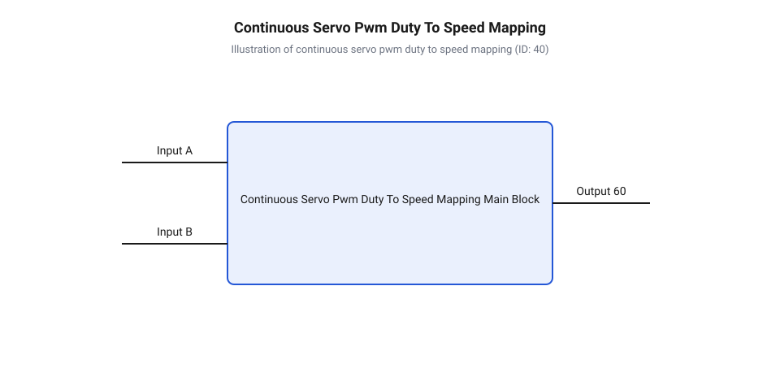
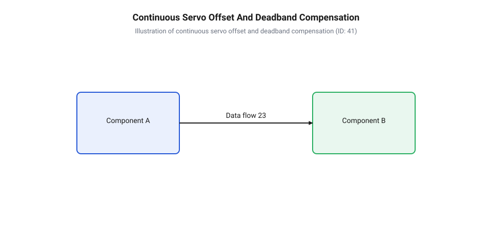

# Програмний інтерфейс керування сервоприводами постійного обертання та налаштування offset

<preknowlist>
- [Сервоприводи постійного обертання](root:cat-hw-actuators/continuous-rotation-servo-mod) — принцип механічного допрацювання потенціометра, вилучення обмежувального стопора редуктора та відмінність безперервного обертання від класичного сервоприводу позиціонування
- [Сервоприводи радіокерованих моделей: будова, редуктори та ШІМ-керування](root:cat-hw-actuators/rc-servo-mechanisms-and-control) — принципи імпульсного керування сервоприводами, часові параметри стандарту RC-ШІМ (50 Гц, 1000–2000 мкс) та внутрішню будову аналогового підсилювача
- [Частота оновлення кадрів ШІМ і цикли позиціонування сервоприводів](root:cat-hw-actuators/servo-pwm-frame-rate) — періодичність формування кадрів керування (стандартні 20 мс) та вплив частоти оновлення сигналу на стабільність генерації імпульсів таймерами
- [Математика потенціометричного зворотного зв'язку сервоприводів](root:cat-hw-actuators/servo-feedback-potentiometer) — лінійність дільника напруги внутрішнього потенціометра, фізичні причини дрейфу опору від температури та механіку виявлення нейтральної точки
- [Зона нечутливості та дрижання вала сервоприводів](root:cat-hw-actuators/servo-deadband-and-jitter) — фізичну природу апаратної зони deadband в аналогових сервоконтролерах та причини виникнення високочастотного дрижання та паразитного повзання вала
</preknowlist>

## Паразитний дрейф та нелінійність керування сервоприводом

Спроба приєднати [приводів постійного обертання](root:cat-hw-actuators/continuous-rotation-servo-mod) (англ. @@en|continuous rotation servo@@, від латинського servo — зберігати, обслуговувати та rotatio — обертання) до роботизованої платформи й задіяти високорівневі виклики на кшталт `servo.write(90)` для зупину або `servo.write(180)` для максимальної швидкості миттєво наражається на апаратне розчарування. Вал сервоприводу замість нерухомого стану починає повільно повзти вбік, видає високочастотне акустичне пищання або обертається з несиметричною кутовою швидкістю при однаковому модулі відхилення від умовної середини. Ця проблема коріниться у фізичній природі внутрішньої електронної схеми аналогового підсилювача та фундаментальній непридатності кутової абстракції для задач регулювання швидкості.

Усередині сервоприводу постійного обертання механічний зв'язок між вихідним валом і потенціометром зворотного зв'язку розірвано, а сам потенціометр замінено фіксованим резистивним дільником або виведено на корпус у вигляді підлаштувального тримера. Внутрішній компаратор аналогової мікросхеми сервоконтролера порівнює тривалість вхідного керуючого імпульсу із часовим інтервалом, що генерується внутрішнім RC-ланцюгом. Якщо тривалість імпульсу становить 1500 мкс і збігається з опорним інтервалом internal RC, напруга на виході силового H-мосту дорівнює нулю. Проте стандартний метод `write(angle)` бібліотеки @@en|Servo library@@ перераховує абстрактні кутові градуси 0–180 у діапазон тривалостей 544–2400 мкс (або 1000–2000 мкс залежно від реалізації). Це створює грубу дискретизацію — приблизно 5.5 мкс на один градус, унеможливлюючи точне налаштування інтервалів близько нейтралі.

Головною причиною паразитних явищ є фізичний та температурний дрейф опору внутрішнього дільника. Опір вуглецевого шару потенціометра змінюється від нагріву силового каскаду, коливання напруги живлення шини VCC переміщують пороги спрацьовування внутрішніх компараторів, а механічні вібрації редуктора спричиняють мікрозсуви контактора. Як наслідок, реальна електрична нейтраль приводу зміщується, наприклад, до позначки 1518 мкс замість еталонних 1500 мкс.

Коли мікроконтролер надсилає стандартизований імпульс 1500 мкс на сервопривод із реальним нулем 1518 мкс, внутрішня схема бачить неусунену розбіжність тривалого інтервалу в 18 мкс. Оскільки ця розбіжність перевищує вузьку апаратну зону нечутливості компаратора (яка в аналогових мікросхемах типу KC2462 становить лише 3–8 мкс), мостовий драйвер починає подавати на обмотки двигуна коротрізкі імпульси струму. Мотор не розвиває повноцінного моменту, але вал починає паразитне повзання, перегріваючи драйвер та марно витрачаючи енергію акумулятора. Для розв'язання цієї проблеми необхідно повністю відмовитися від градусних команд і перейти до прямого мікросекундного таймінгу та алгоритмічної компенсації нуля.

## Механіка перетворення сигналів та мікросекундний інтерфейс

Керування кутовою швидкістю сервоприводу постійного обертання здійснюється шляхом модуляції тривалості активного високоуровневого імпульсу в межах стандартизованого часового кадру. Згідно зі [стандарту радіокерованих моделей](root:cat-hw-actuators/rc-servo-mechanisms-and-control), [частоти оновлення кадрів](root:cat-hw-actuators/servo-pwm-frame-rate) становить 50 Гц, що відповідає періоду кадру T = 20 мс (20 000 мкс). Корисна інформація про напрямок та швидкість обертання закладена виключно в ширині імпульсу, яка стандартно змінюється від 1000 мкс (максимальна швидкість за годинниковою стрілкою) до 2000 мкс (максимальна швидкість проти годинникової стрілки), де 1500 мкс відповідає стану зупину.

Для прямого задання точного часового інтервалу застосовують низькорівневі виклики апаратних таймерів. У середовищі @@en|Arduino@@ для цього використовують метод `writeMicroseconds(us)` об'єкта @@en|Servo library@@, який безпосередньо записує значення у регістр порівняння таймера. У професійному фреймворку @@en|ESP-IDF@@ для мікроконтролерів ESP32 керування реалізують через периферійні модулі @@en|MCPWM@@ (англ. @@en|Motor Control PWM@@, від англійського motor — двигун, control — керування та PWM) або @@en|LEDC@@, де тривалість імпульсу задається в апаратних тиках або мікросекундах через специфічні конфігураційні структури.

Математична модель перетворення нормованого сигналу швидкості v у діапазоні [-1.0, +1.0] (де -1.0 — повний реверс, 0.0 — зупин, +1.0 — повний вперед) у [тривалість керуючого імпульсу](#pulse-duration-control) (англ. @@en|pulse-duration control@@, від англійського pulse — імпульс та duration — тривалість) t_pulse обчислюється на основі базового значення нейтралі t_neutral та напівдіапазону відхилення:

```text
t_pulse = t_neutral + v · (Δt_span / 2)
= 1500 + v · (1000 / 2)                  [підстановка базових значень нейтралі та діапазону]
= 1500 + v · 500                        [спрощення коефіцієнта масштабування]
```

Якщо вхідна величина подається в діапазоні умовних градусів від 0 до 180, перетворення у тривалість [сигналів широтно-імпульсної модуляції](#pulse-width-modulation) (англ. @@en|pulse-width modulation@@, від латинського modulatio — розміреність) описується лінійною інтерполяцією:

```text
t_pulse = t_min + (deg / 180.0) · (t_max - t_min)
= 1000 + (deg / 180.0) · 1000            [підстановка стандартних меж 1000–2000 мкс]
```

Залежність кутової швидкості від тривалості імпульсу представлена на графічній характеристиці нижче:


*Залежність кутової швидкості та напрямку обертання вала сервоприводу постійного обертання від тривалості керуючого імпульсу ШІМ у діапазоні 1000–2000 мкс із центральною нейтральною зоною 1500 мкс.*

Нижче наведено програмні реалізації функції перетворення нормованої швидкості мовами C та C++ для різних платформ:

:::tabs
@tab Arduino C++
```cpp|arduino
#include <Arduino.h>
#include <Servo.h>

// Перетворення нормованої швидкості [-1.0 ... +1.0] у мікросекунди ШІМ
uint16_t speedToPulseUs(float normalizedSpeed) {
    // Обмеження вхідного діапазону для запобігання виходу за межі
    if (normalizedSpeed > 1.0f) normalizedSpeed = 1.0f;
    if (normalizedSpeed < -1.0f) normalizedSpeed = -1.0f;
    
    const uint16_t neutralUs = 1500;
    const uint16_t spanHalfUs = 500;
    
    return static_cast<uint16_t>(neutralUs + lroundf(normalizedSpeed * spanHalfUs));
}
```
@tab ESP-IDF C
```c|esp-idf
#include <stdint.h>
#include <math.h>
#include "driver/mcpwm_prelude.h"

// Розрахунок тривалості імпульсу для драйвера ESP-IDF MCPWM
uint32_t calculate_servo_pulse_us(float speed) {
    if (speed > 1.0f) speed = 1.0f;
    if (speed < -1.0f) speed = -1.0f;

    const uint32_t neutral_us = 1500;
    const uint32_t span_half_us = 500;

    return (uint32_t)(neutral_us + lroundf(speed * span_half_us));
}
```
:::

## Компенсація дрейфу нейтралі та програмна deadband-зона

Ідеальну точність 1500 мкс на реальних приводах, таких як [мікросервоприводів Tower Pro](root:cat-hw-actuators/sg90-servo), практично неможливо зустріти через технологічні допуски. Для забезпечення нерухомості вала та симетрії швидкості необхідно реалізувати два програмних механізми: зсув базового нуля та фільтрацію зони нечутливості.

Перший крок — обчислення [програмного зсуву нейтралі](#software-neutral-offset) (англ. @@en|software neutral offset@@). Якщо практичний виміряний нуль приводу становить t_zero_real, то величину програмного офсету δ_offset визначають за формулою:

```text
δ_offset = t_zero_real - 1500
t_neutral_adj = 1500 + δ_offset = t_zero_real
```

Другий крок — створення програмної [зони нечутливості приводу](#servo-deadband-zone) (англ. @@en|deadband@@, від англійського dead — мертвий та band — смуга). Апаратна зона нечутливості аналогових мікросхем занадто вузька і не здатна компенсувати шуми таймерів. Програмна deadband-зона задає ширину вікна W_db (зазвичай 10–25 мкс) навколо скоригованої нейтралі t_neutral_adj. Будь-який сигнал, що потрапляє у цей інтервал, примусово прирівнюється до t_neutral_adj.

Щоб запобігти стрибку швидкості при виході з зони deadband, застосовують масштабування ефективного діапазону. Замість резкого старту з величини W_db, решту діапазону від W_db до 500 мкс розтягують на повну шкалу від 0.0 до 1.0:

```text
v_effective = sign(v) · ((|v| - v_db) / (1.0 - v_db))     [при |v| > v_db]
v_effective = 0.0                                          [при |v| ≤ v_db]
```

Процес перетворення вхідного сигналу з урахуванням зсуву та відсікання дрижання показано на схемі:


*Схема програмного перетворення вхідного сигналу керування з урахуванням зсуву нейтралі (software offset) та обрізанням дрижання у зоні нечутливості (deadband).*

Методика здійснення [калібрування нуля приводу](#zero-calibration-drive) (англ. @@en|zero calibration drive@@) полягає в плавному покроковому зміщенні тривалості імпульсу від 1500 мкс угору та вниз до моменту фіксації початку обертання вала. Середнє арифметичне між точкою початку руху за годинниковою стрілкою t_cw та проти годинникової стрілки t_ccw визначає реальний нуль t_zero_real:

```text
t_zero_real = (t_cw + t_ccw) / 2
```

Нижче наведено алгоритм обробки нейтралі та зони deadband мовами C та C++:

:::tabs
@tab Arduino C++
:::code api-continuous-servo-software-control/cpp/arduino/servocalibration.cpp
@tab ESP-IDF C
:::code api-continuous-servo-software-control/c/esp-idf/process-servo-deadband.c
:::

## Профілювання швидкості та алгоритми плавного розгону

Стрибкоподібна зміна тривалості імпульсу з 1500 мкс до 2000 мкс викликає миттєве подання повної напруги на якір колекторного двигуна. Оскільки індуктивний опір обмоток у момент пуску мінімальний, виникає пусковий кидок струму (струм короткого замикання, який для мікросервоприводів становить 1.2–2.5 А). Це спричиняє просідання напруги живлення шини, перезавантаження мікроконтролера та створює ударне зсувне навантаження, що призводить до [абразивного зносу шестерень](root:cat-hw-actuators/servo-gear-shear-and-wear) редуктора.

Для виключення апаратних перевантажень застосовують програмне обмеження прискорення (англ. @@en|ramping@@, від англійського ramp — похила площина) та трапецієподібне профілювання, що забезпечує режим [плавного розгону та гальмування](#smooth-acceleration-deceleration) (англ. @@en|smooth acceleration-deceleration@@). Метод полягає в обмеженні максимальної швидкості зміни тривалості імпульсу Δt_step за один такт оновлення таймера Δt_sample.

Максимальний крок зміни імпульсу Δt_step_max розраховується через заданий час повного розгону T_ramp (наприклад, 0.5 с) від зупину до максимуму:

```text
Δt_step_max = (500 / T_ramp) · Δt_sample
```

На кожному ітераційному кроці обробника поточне значення тривалості імпульсу t_current наближається до цільового t_target з обмеженням кроку:

```text
t_diff = t_target - t_current
t_step = min(|t_diff|, Δt_step_max) · sign(t_diff)
t_current = t_current + t_step
```

Нижче наведено неблокуючі реалізації алгоритму профілювання ramping мовами C та C++:

:::tabs
@tab Arduino C++
:::code api-continuous-servo-software-control/cpp/arduino/servoramping.cpp
@tab ESP-IDF C
:::code api-continuous-servo-software-control/c/esp-idf/servo-ramping-init.c
:::

## Проєктування адаптивного C++ драйвера сервоприводів

Об'єднання розглянутих моделей калібрування, фільтрації та розгону в єдиний виробничий драйвер забезпечує надійне [програмне керування швидкістю](#software-speed-control) (англ. @@en|software speed control@@) сервоприводів. Об'єктно-орієнтований C++ клас та відповідна структура мовою C інкапсулюють низькорівневу робототехнічну логіку, гарантуючи апаратну безпеку приводу навіть у разі передачі некоректних команд із верхнього рівня управління.

Драйвер виконує такі захисні функції:
1. Жорстке лімітування тривалості імпульсів у безпечних межах 500–2500 мкс для захисту таймерів та драйвера редуктора, такого як у сервоприводах з [металевим редуктором MG90S](root:cat-hw-actuators/mg90s-servo). 2. Автоматичне застосування програмного зсуву нейтралі та вікна deadband під час кожного оновлення. 3. Неблокуюче трапецієподібне профілювання швидкості. 4. Швидкий аварійний зупин `stop()`, що миттєво повертає сигнал до відкаліброваного нуля.

Нижче подано повноцінний вихідний код виробничого драйвера мовами C++ та C:

:::tabs
@tab Arduino C++
:::code api-continuous-servo-software-control/cpp/arduino/continuousservodriver.cpp
@tab ESP-IDF C
:::code api-continuous-servo-software-control/c/esp-idf/continuous-servo-c-init.c
:::