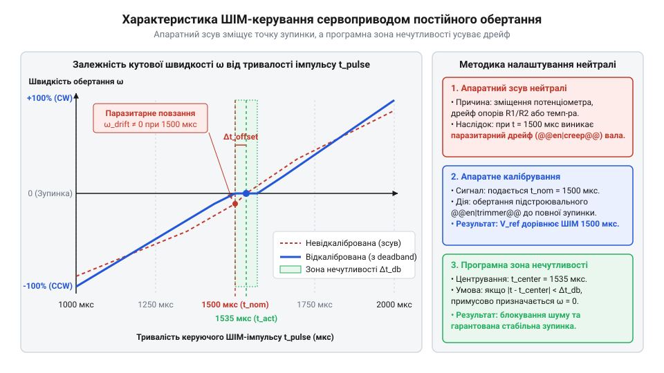
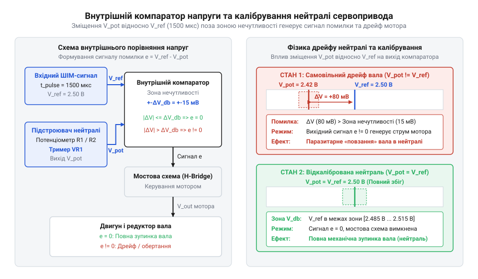
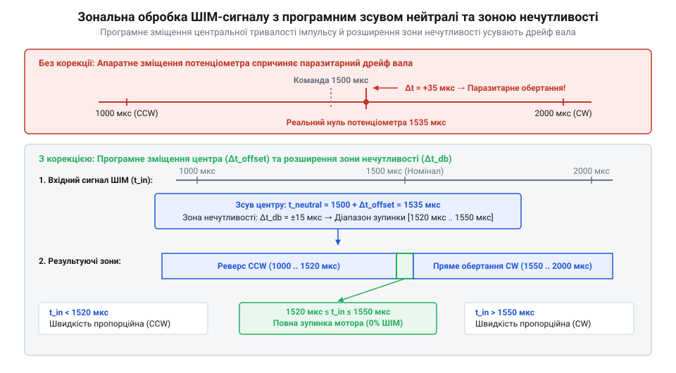
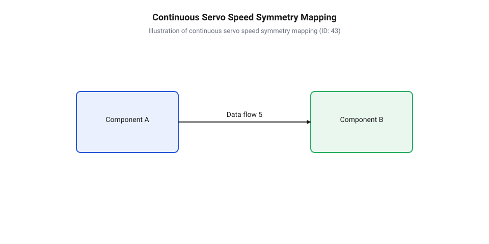

# Налаштування та калібрування нейтралі сервоприводів постійного обертання

<preknowlist>
- [Сервоприводи постійного обертання](root:cat-hw-actuators/continuous-rotation-servo-mod) — концепцію перетворення кута в швидкість та принцип відсутності механічного обмежувача
- [Сервоприводи радіокерованих моделей: будова, редуктори та ШІМ-керування](root:cat-hw-actuators/rc-servo-mechanisms-and-control) — стандартні таймінги ШІМ-імпульсів 1000–2000 мкс та базову будову сервоприводу
- [Математика потенціометричного зворотного зв'язку сервоприводу](root:cat-hw-actuators/servo-feedback-potentiometer) — принцип роботи потенціометричного дільника напруги у внутрішньому контурі порівняння
- [Зона нечутливості та дрижання вала сервоприводів](root:cat-hw-actuators/servo-deadband-and-jitter) — поняття ширини зони нечутливості (deadband) та її вплив на утримання стабільного стану
</preknowlist>

## Паразитарне повзання вала під час зупинки

Уявіть мобільного колісного робота або поворотний механізм, якому мікроконтролер надсилає чітку команду повністю зупинити рух. Для цього керуюча програма формує на виході стандартний електронний сигнал — **@@en|ШІМ@@** (широтно-імпульсна модуляція, англ. @@en|PWM@@ — Pulse-Width Modulation) з тривалістю імпульсу точно 1500 мкс при частоті 50 Гц. Один мотор слухняно завмирає, але другий **@@en|сервопривід постійного обертання@@** (від лат. @@la|servus@@ — слуга та прасл. *voditi — водити) продовжує повільно повертати вал зі швидкістю 1–3 оберти на хвилину. *vodi) продовжує повільно повертати вал зі швидкістю 1–3 оберти на хвилину. У результаті робот не спроможний витримати пряму траєкторію, збивається з курсу в паузах між маневрами, марно витрачає енергію бортового акумулятора та перегріває обмотки двигуна під час вимушеного простою.

Ця проблема відома як **@@en|паразитарне повзання@@** (англ. @@en|parasitic creep@@ — небажаний повільний рух) вала. На відміну від стандартних сервоприводів позиціонування, таких як [мікросерво Tower Pro SG90](root:cat-hw-actuators/sg90-servo) або [модель MG90S V2](root:cat-hw-actuators/mg90s-servo), приводи постійного обертання позбавлені механічного обмежувача кута й кутового зворотного зв'язку за положенням вихідного вала. Внутрішня електронна плата приводу сприймає тривалість вхідного імпульсу не як кут повороту, а як команду напрямку та швидкості обертання.

Історично такі приводи з'явилися як аматорська модифікація звичайних рульових машинок. Як розкрито у матеріалі про [історію еволюції сервоприводів та модифікацію потенціометрів](root:cat-hw-actuators/continuous-servo-potentiometer-tuning/hist-continuous-servo-evolution.md), перші розробники видаляли механічний стопор шестерні та від'єднували вал внутрішнього потенціометра, фіксуючи його в середньому положенні. У сучасних заводських сервоприводах постійного обертання всередині корпусу залишається вбудований підстроювальний **@@en|потенціометр@@** (від лат. @@la|potentia@@ — сила та грец. @@el|μέτρον@@ — міра) або збалансований резистивний дільник, що задає внутрішню опорну напругу.

Електричне сполучення та стандартні таймінги керування описані у специфікації на [апаратний інтерфейс сервоприводів постійного обертання](root:cat-hw-actuators/continuous-servo-potentiometer-tuning/api-continuous-servo-hardware-interface.md):
- Період повторення кадрів: 20 мс (частота 50 Гц). - Діапазон тривалості імпульсів: 1000–2000 мкс. - Тривалість 1000 мкс відповідає максимальній швидкості обертання проти годинникової стрілки. - Тривалість 2000 мкс відповідає максимальній швидкості обертання за годинниковою стрілкою. - Тривалість 1500 мкс вважається теоретичною точкою нейтралі, де мотор має залишатися нерухомим.

Проте подача імпульсу 1500 мкс не забезпечує гарантованої зупинки. Усередині плати приводу кожен вхідний імпульс від таймера мікроконтролера порівнюється з внутрішнім опорним імпульсом, тривалість якого задає аналоговий резистивний дільник на потенціометрі. Якщо через механічне зміщення повзунка або температурний дрейф дільника внутрішня схема сприймає як справжню нейтраль тривалість 1515 мкс, то керуючий сигнал 1500 мкс утворює первинну різницю в -15 мкс. З кожним повторенням кадру **@@en|ШІМ@@** ця мікросекундна розбіжність накопичується у схемі порівняння у вигляді нескомпенсованої напруги помилки. Коли ця різниця перевищує внутрішню **@@en|зону нечутливості@@** (англ. @@en|deadband@@ — мертва зона), електронний підсилювач подає струм на обмотки мотора. У звичайному сервоприводі редуктор негайно повернув би повзунок потенціометра й звів різницю імпульсів до нуля, але в приводі постійного обертання цей механічний зворотний зв'язок розірвано. Оскільки вихідний редуктор більше не обертає вісь **@@en|потенціометра@@**, опорна напруга дільника лишається незмінною, сигнал помилки не зменшується, і вал **@@en|сервопривода@@** обертається нескінченно.

Явище, при якому електрична нейтраль схеми порівняння не збігається з еталонним вхідним імпульсом, називається **@@en|дрейфом нейтралі@@** (від голл. @@nl|drijven@@ — плавати, гнати та лат. @@la|neutralis@@ — нейтральний). 


*Крива передавальної характеристики сервоприводу постійного обертання зі зміщеною нейтральною точкою та ділянкою зони нечутливості.*

На графіку вище виразно видно, що при зміщенні нейтральної точки ділянка спокою зсувається вбік. Якщо вхідний **@@en|ШІМ@@**-сигнал залишається рівним 1500 мкс, точка робочого стану опиняється на похилій ділянці характеристики, викликаючи постійне **@@en|паразитарне повзання@@** вала. Щоб усунути це явище, необхідно домогтися точного електричного балансу внутрішнього контуру порівняння.

## Електричний баланс внутрішньої схеми порівняння

Щоб зрозуміти причину **@@en|дрейфу нейтралі@@**, звернемося до будови внутрішнього сервопідсилювача. У класичних аналогових приводах, де застосовуються [інтегральні аналогові сервопідсилювачі KC2462 та AA51880](root:cat-hw-actuators/analog-servo-amplifier-ic), або в сучасних цифрових контролерах вхідний керуючий **@@en|ШІМ@@**-імпульс порівнюється з опорним імпульсом внутрішньої схеми.

Кожен вхідний імпульс тривалістю `t_PWM` запускає внутрішній **@@en|одновібратор@@** (від лат. @@la|multus@@ — багатий та @@la|vibro@@ — коливаюсь). Тривалість опорного імпульсу `t_ref` формується через вихідний опір `R_pot` внутрішнього **@@en|потенціометра@@** та часзадаючий конденсатор `C_ref`. Внутрішній **@@en|компаратор@@** (від лат. @@la|comparator@@ — порівнювач) визначає різницю тривалостей і генерує напругу помилки:

```
V_err = k · (t_PWM - t_ref)
```
де `V_err` — напруга помилки на виході компаратора, `k` — коефіцієнт підсилення схеми, `t_PWM` — тривалість вхідного керуючого імпульсу, `t_ref` — тривалість внутрішнього опорного імпульсу.

Отриманий сигнал `V_err` надходить у блок порівняння з пороговими напругами **@@en|зони нечутливості@@** `V_db`:
- Якщо `V_err > +V_db`, аналогова плата відкриває відповідні ключі [внутрішньої місткової схеми драйвера](root:cat-hw-actuators/analog-servo-amplifier-ic) (**@@en|H-міст@@**, англ. @@en|H-bridge@@), вмикаючи мотор у напрямку обертання за годинниковою стрілкою. - Якщо `V_err < -V_db`, відкривається протилежна пара ключів **@@en|H-моста@@**, зумовлюючи обертання проти годинникової стрілки. - Якщо `-V_db ≤ V_err ≤ +V_db`, обидві гілки **@@en|H-моста@@** закриті, мотор знеструмлений і вал перебуває у стані механічного спокою.

Виникнення **@@en|дрейфу нейтралі@@** зумовлене чотирма основними фізичними чинниками:

1. **Механічна похибка позиціонування ползунка.** Під час фабричного збирання осьовий движок **@@en|потенціометра@@** або підстроювального резистора встановлюється з точністю до часток міліметра. Відхилення кута всього на 0.5° змінює співвідношення плечей дільника опору, зміщуючи значення `t_ref` на 15–20 мкс від еталонних 1500 мкс. 2. **Температурний дрейф елементів.** Опір графітового доріжкового шару **@@en|потенціометра@@** та ємність керамічного конденсатора `C_ref` залежать від температури навколишнього середовища. При тривалій роботі під навантаженням електроніка всередині [сервоприводів родини Power HD](root:cat-hw-actuators/powerhd-family) або компактних [мікросервоприводів SG92R](root:cat-hw-actuators/sg92r-servo) розігрівається до 50–60 °C. Це спричиняє **@@en|температурний дрейф@@** (від лат. @@la|temperatura@@ — температура та голл. @@nl|drijven@@ — плавати), унаслідок чого нейтральна точка зміщується під час експлуатації. 3. **Нестабільність напруги живлення.** При просіданні або пульсаціях шини живлення логіки змінюються порогові рівні компаратора, що утворює помилковий сигнал неузгодження. 4. **Відхилення тактової частоти мікроконтролера.** Якщо генератор тактових імпульсів керуючого мікроконтролера має похибку частоти в 1%, згенерований імпульс тривалістю 1500 мкс фактично дорівнюватиме 1515 мкс, що виведе привід із **@@en|зони нечутливості@@**.

Детальний математичний аналіз цих залежностей наведено у матеріалі про [математичну модель дрейфу нейтралі та розрахунок зони нечутливості ШІМ](root:cat-hw-actuators/continuous-servo-potentiometer-tuning/math-servo-pwm-neutral-deadband.md). Ширина **@@en|зони нечутливості@@** визначає компроміс між точністю зупинки та плавністю керування. Докладніше про вплив ширини зони на стабільність вала дивіться у статті про [зону нечутливості та дрижання вала сервоприводів](root:cat-hw-actuators/servo-deadband-and-jitter).


*Функціональна схема аналогового компаратора та генератора опорного імпульсу у внутрішньому контурі сервоприводу.*

На наведеній схемі продемонстровано, як саме різниця між тривалістю вхідного імпульсу та опором **@@en|потенціометра@@** перетворюється на вихідну напругу помилки, яка відкриває транзистори **@@en|H-моста@@**.

Під час роботи сервоприводу під навантаженням ключі **@@en|H-моста@@** та обмотки двигуна виділяють тепло, розігріваючи внутрішній простір корпусу. Це виділення тепла безпосередньо змінює параметри часзадаючого RC-ланцюга внутрішнього **@@en|одноразового мультивібратора@@**. Графітове покриття доріжки **@@en|потенціометра@@** змінює опір `R_pot` через температурний коефіцієнт опору (від лат. @@la|coefficiens@@ — той, що сприяє), а в керамічному конденсаторі `C_ref` на основі титанату барію відбувається теплова перебудова доменів **@@en|діелектрика@@** (від грец. @@el|διά@@ — крізь та @@el|ἤλεκτρον@@ — бурштин), що зміщує його ємність. Оскільки тривалість опорного імпульсу пропорційна добутку `t_ref = R_pot · C_ref`, навіть зміна їхніх номіналів на 1 % при нагріванні плати на 20–30 °C зсуває `t_ref` на 15 мкс. При стандартній ширині **@@en|зони нечутливості@@** у 4–8 мкс таке відхилення виводить систему з рівноваги: компаратор фіксує хибну напругу помилки `V_err ≠ 0` і відкриває транзистори, що викликає паразитарний **@@en|дрейф нейтралі@@** та самовільне обертання вала. Докладний [порівняльний аналіз зносостійкості та температурного дрейфу потенціометрів і магнітних енкодерів](root:cat-hw-sensors/servo-feedback-potentiometers-and-magnetic-encoders) допоможе обрати оптимальний тип датчика зворотного зв'язку.

## Апаратне підстроювання нейтральної точки потенціометра

Первинним і найефективнішим способом усунення **@@en|паразитарного повзання@@** є апаратне калібрування внутрішнього **@@en|потенціометра@@** або тримера. Повна практична методика налаштування викладена у [практикумі калібрування сервоприводів постійного обертання](root:cat-hw-actuators/continuous-servo-potentiometer-tuning/proj-servo-trimmer-and-software-calibration.md).

Для виконання процедури апаратного підстроювання підключають **@@en|сервопривід постійного обертання@@** (наприклад, [Power HD HD-1370A](root:cat-hw-actuators/hd-1370a-servo) або модифікований [SG90](root:cat-hw-actuators/sg90-servo)) до стабілізованого джерела живлення напругою 5.0 В та генератора **@@en|ШІМ@@**-сигналу.

Покроковий алгоритм апаратного калібрування:
1. **Подача еталонного сигналу.** Запустіть мікроконтролер і сформуйте на виході таймера стабільний імпульс із тривалістю точно 1500 мкс і частотою 50 Гц. 2. **Доступ до підстроювального елемента.** Знайдіть у корпусі **@@en|сервопривода@@** отвір підстроювального **@@en|тримера@@** (від англ. @@en|trimmer@@ — підлаштовувач). У більшості модельних приводів він розташований на тильній стороні або збоку корпусу. 3. **Механічне регулювання.** Уставте діелектричну (керамічну або пластикову) викрутку в шліц **@@en|тримера@@**. Повільно повертайте викрутку в напрямку, протилежному обертанню вала, доки мотор не сповільниться й повністю не зупиниться. 4. **Визначення меж зони нечутливості.** Знайдіть точку початку обертання за годинниковою стрілкою (поворот праворуч до моменту рушення) та точку початку обертання проти годинникової стрілки (поворот ліворуч). Встановіть шліц **@@en|тримера@@** чітко посередині між цими двома крайніми положеннями. 5. **Перевірка симетрії відгуку.** Подайте імпульс 1000 мкс (максимальна швидкість проти годинникової стрілки), потім 2000 мкс (максимальна швидкість за годинниковою стрілкою) і поверніться до 1500 мкс. Вал має миттєво зупинятися без залишкового гудіння та повзання. 6. **Фіксація положення.** Щоб запобігти зсуву від вібрації під час роботи редуктора та захистити шестерні від [абразивного зносу й зсувних навантажень](root:cat-hw-actuators/servo-gear-shear-and-wear), зафіксуйте шліц **@@en|тримера@@** краплею фіксатора різьби або цапонлаку.

Якщо апаратний доступ до **@@en|потенціометра@@** обмежений герметичним корпусом чи відсутній, або при виникненні температурного дрейфу під час польових випробувань застосовують програмну корекцію. Як описано в довіднику на [програмний інтерфейс керування сервоприводами](root:cat-hw-actuators/continuous-servo-potentiometer-tuning/api-continuous-servo-software-control.md), програмне калібрування полягає у введенні **@@en|зсуву тривалості імпульсу@@** (англ. @@en|pulse width offset@@ — програмна корекція центрального імпульсу).

Нижче наведено приклад реалізації програмного калібрування нейтралі та керування **@@en|сервоприводом постійного обертання@@** з урахуванням **@@en|зони нечутливості@@** двома мовами для різних платформ:

:::tabs
:::code continuous-servo-potentiometer-tuning-d/c/esp-idf/continuous-servo-init.c
:::code continuous-servo-potentiometer-tuning-d/cpp/arduino/continuousservodriver.cpp
:::

Програмний спосіб дозволяє компенсувати відхилення нейтралі окремо для кожного колеса або приводу в системі. Проте оптимальним підходом залишається первинне апаратне налаштування **@@en|тримера@@** з наступним тонким програмним коригуванням **@@en|зсуву@@** під час роботи робота.

## Програмна компенсація зсуву та зона нечутливості

Коли апаратний підстроювальний елемент запаяний, залитий захисним компаундом або недоступний без руйнування корпусу, калібрування в [сервоприводах постійного обертання](root:cat-hw-actuators/continuous-rotation-servo-mod) виконується програмним шляхом у коді @@en|microcontroller@@. Поширеним прикладом такої ситуації є робота з популярними [мікросервоприводами SG90](root:cat-hw-actuators/sg90-servo), де вбудований @@en|potentiometer@@ нерідко зафіксований на заводі клеєм. У таких умовах подача стандартного імпульсу нейтралі тривалістю `1500 мкс` викликає самовільне повільне обертання вала — @@en|drift@@ (від англ. *drift* — відхилення, плавання). Внутрішній компаратор аналогової плати сприймає різницю між опорним сигналом та напругою дільника як команду на рух, подаючи напругу на @@en|H-bridge@@.

Для усунення цього ефекту в програмному забезпеченні вводиться змінна @@en|offset@@ (від англ. *off* — геть, від та *set* — ставити; тобто відхилення від початкової позиції). Опорні електричні параметри та таймінги імпульсів визначає [програмний інтерфейс керування сервоприводами](root:cat-hw-actuators/continuous-servo-potentiometer-tuning/api-continuous-servo-software-control.md), де детально описано роботу з тривалістю сигналів. Корекція полягає у визначенні такої тривалості вхідного імпульсу `t_neutral_eff`, за якої напруга на виході внутрішнього мостового підсилювача падає до нуля. Теоретичний підвалину цього розрахунку містить [математична модель дрейфу нейтралі](root:cat-hw-actuators/continuous-servo-potentiometer-tuning/math-servo-pwm-neutral-deadband.md), а кроки фізичного вимірювання дрейфу розкрито в матеріалі [практикум калібрування сервоприводу](root:cat-hw-actuators/continuous-servo-potentiometer-tuning/proj-servo-trimmer-and-software-calibration.md).

Другим важливим фактором є розширення зони нечутливості — @@en|deadband@@ (від англ. *dead* — неактивний, нечутливий та *band* — смуга, діапазон). Апаратна зона нечутливості внутрішнього підсилювача часто становить лише `±2...4 мкс`. Якщо таймери @@en|microcontroller@@ або нестабільність живлення створюють шуми тривалістю `±5 мкс`, вал приводу буде постійно тремтіти або створювати хаотичний @@en|jitter@@ (від англ. *jitter* — дрижання, десинхронізація). Фізичні причини цього явища пояснює аналіз [зони нечутливості та дрижання](root:cat-hw-actuators/servo-deadband-and-jitter). Програмне розширення зони нечутливості гарантує, що будь-яка команда в околі нейтралі примусово прирівнюється до значення `t_neutral_eff`.


*Функціональна схема цифрової обробки сигналу з усуненням дрейфу нейтралі та розширенням зони нечутливості.*

Математичне перетворення керуючого сигналу в тривалість вихідного імпульсу @@en|pulse width modulation@@ (@@en|PWM@@) виконується за покроковим алгоритмом:

```
t_neutral_eff = t_neutral_nominal + t_offset
= 1500 + 35             [додавання програмного зсуву нейтралі]
= 1535                  [ефективна тривалість імпульсу зупинки в мкс]
```

При отриманні довільного вхідного значення `t_input` програма обчислює відхилення від номінального нуля та застосовує поріг нечутливості `t_deadband`:

```
t_output = t_neutral_eff                      [якщо |t_input - 1500| ≤ t_deadband]
= t_input + t_offset                          [якщо |t_input - 1500| > t_deadband]
```

Нижче наведено практичну реалізацію програмної компенсації для систем на базі @@en|Arduino@@ та @@en|ESP32@@.

:::tabs
@tab C++ (Arduino)
:::code continuous-servo-potentiometer-tuning-d/cpp/arduino/calibratedservo.cpp
@tab C (ESP-IDF)
:::code continuous-servo-potentiometer-tuning-d/c/esp-idf/us-to-duty.c
@tab C++ (ESP-IDF)
:::code continuous-servo-potentiometer-tuning-d/cpp/esp32/esp32calibratedservo.cpp
:::

## Вирівнювання симетрії швидкостей та стійкість зупинки

Навіть після точного налаштування точки зупинки та розширення зони нечутливості робототехнічна система може демонструвати несиметричну поведінку при обертанні за годинниковою та проти годинникової стрілки. При подачі імпульсу `1000 мкс` (максимальне обертання назад) вал може розвивати швидкість 60 об/хв, тоді як при `2000 мкс` (максимальне обертання вперед) швидкість становить лише 48 об/хв. Як свідчить [історія хаку потенціометра](root:cat-hw-actuators/continuous-servo-potentiometer-tuning/hist-continuous-servo-evolution.md), перші аматорські модифікації сервоприводів завжди мали проблему нелінійності через відсутність спеціалізованої схеми узгодження.

Головна причина асиметрії полягає в електричних та механічних відхиленнях елементів приводу. Конструктивні параметри сигналу описує [специфікація ШІМ-сигналу](root:cat-hw-actuators/continuous-servo-potentiometer-tuning/api-continuous-servo-hardware-interface.md), але внутрішня характеристика передачі залишається нелінійною. Несиметрія виникає через різницю порогових напруг відкриття N-канальних та P-канальних транзисторів @@en|MOSFET@@, які встановлені в платах з [аналоговими сервопідсилювачами KC2462](root:cat-hw-actuators/analog-servo-amplifier-ic). Крім того, нелінійність доріжки @@en|potentiometer@@ та механічний люфт шестерень викликають насичення швидкості при різних тривалостях імпульсів для протилежних напрямків. Глибокий аналіз силових ключів та внутрішнього компаратора надає [внутрішня схемотехніка сервоприводу](root:cat-hw-actuators/analog-servo-amplifier-ic).

Для усунення цієї проблеми застосовується двогілкове шматочно-лінійне відображення — @@en|piecewise linear mapping@@ (від англ. *piecewise* — кусочний, *linear* — лінійний, *mapping* — відображення). Замість використання єдиного масштабу для всього діапазону `1000...2000 мкс`, програма вимірює реальні пороги насичення швидкості для кожного напрямку: `t_min_rev` (наприклад, `1080 мкс`) та `t_max_fwd` (наприклад, `1910 мкс`).


*Порівняння несиметричної характеристики аналогового підсилювача та результату її програмної лінеаризації.*

Обчислення тривалості імпульсу для заданої нормованої швидкості `ω ∈ [-1.0, 1.0]` проводиться окремо для позитивного та негативного напрямків руху:

```
t_pwm = t_neutral_eff + ω × Δt_fwd     [для ω > 0, де Δt_fwd = t_max_fwd - t_neutral_eff - t_deadband]
= 1535 + 8 + 0.5 × (1910 - 1543)       [розрахунок для половинної швидкості вперед при ω = 0.5]
= 1543 + 0.5 × 367                     [обчислення активної тривалості]
= 1726.5                               [підсумкова тривалість імпульсу ШІМ в мкс]
```

Для зворотного напрямку (`ω < 0`):

```
t_pwm = t_neutral_eff - t_deadband + ω × Δt_rev     [де Δt_rev = t_neutral_eff - t_deadband - t_min_rev]
```

Для систем високої точності, де потрібна повна стабілізація обертів під змінним навантаженням, використовується [керування за зовнішнім енкодером](root:cat-hw-actuators/continuous-servo-closed-loop-speed-control), яке замикає контур регулювання. Проте для більшості привідних коліс роботів шматочно-лінійне програмне вирівнювання забезпечує достатню симетрію та стійку зупинку.

Нижче наведено програмний модуль вирівнювання швидкостей мовами C та C++.

:::tabs
@tab C++ (Arduino)
:::code continuous-servo-potentiometer-tuning-d/cpp/arduino/symmetriccontinuousservo.cpp
@tab C (ESP-IDF)
:::code continuous-servo-potentiometer-tuning-d/c/esp-idf/us-to-duty-2.c
@tab C++ (ESP-IDF)
:::code continuous-servo-potentiometer-tuning-d/cpp/esp32/esp32symmetricservo.cpp
:::