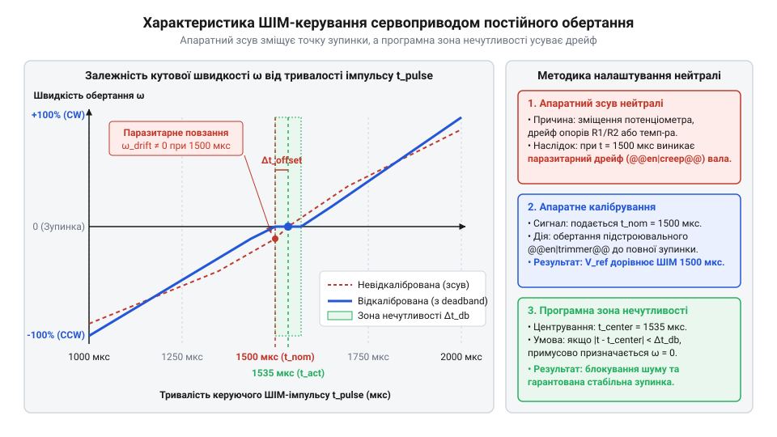
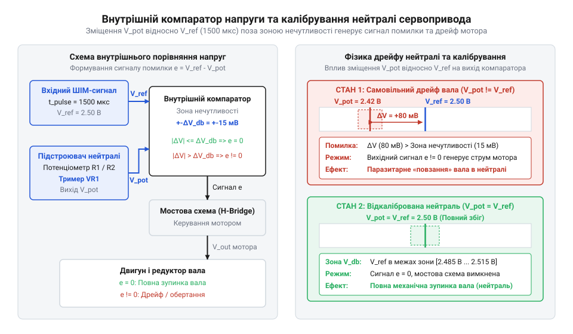
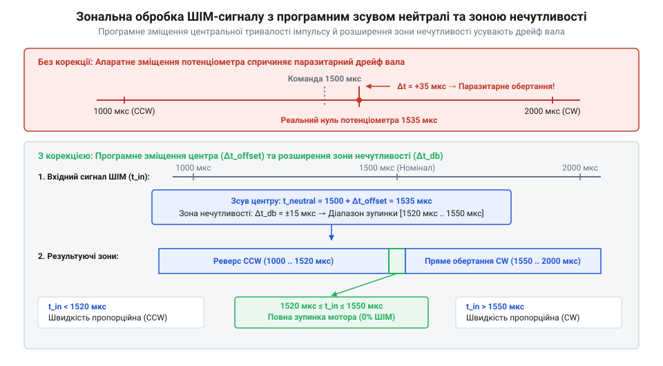
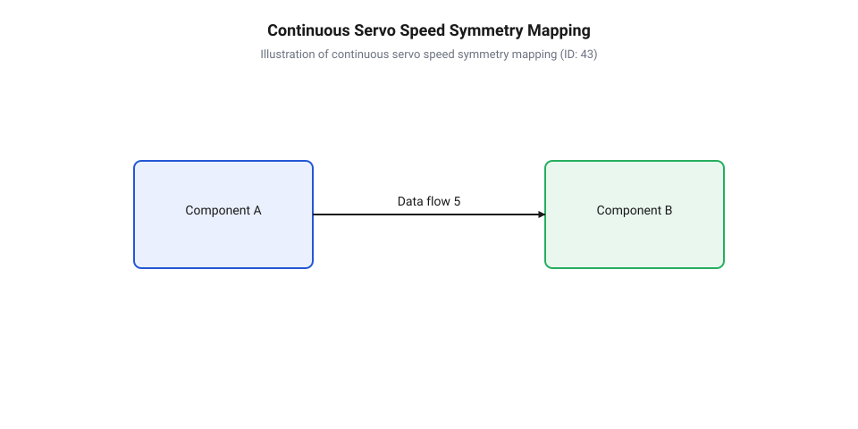

# Налаштування та калібрування нейтралі сервоприводів постійного обертання

<preknowlist>
- [Сервоприводи постійного обертання](root:cat-hw-actuators/continuous-rotation-servo-mod) — концепцію перетворення тривалості імпульсу в швидкість обертання та відсутність механічного обмежувача
- [Сервоприводи радіокерованих моделей: будова, редуктори та ШІМ-керування](root:cat-hw-actuators/rc-servo-mechanisms-and-control) — стандартні таймінги ШІМ-імпульсів 1000–2000 мкс та базову будову сервоприводу
- [Математика потенціометричного зворотного зв'язку сервоприводу](root:cat-hw-actuators/servo-feedback-potentiometer) — принцип роботи потенціометричного дільника напруги у внутрішньому контурі порівняння
- [Зона нечутливості та дрижання вала сервоприводів](root:cat-hw-actuators/servo-deadband-and-jitter) — поняття ширини зони нечутливості та її вплив на утримання стабільного стану
</preknowlist>

## Причини паразитарного повзання вала

Під час керування робототехнічною платформою подача стандартного сигналу зупинки тривалістю 1500 мкс часто викликає повільне обертання коліс. У [сервоприводів постійного обертання](root:cat-hw-actuators/continuous-rotation-servo-mod) (англ. @@en|continuous rotation servo@@) широтно-імпульсна модуляція (ШІМ, англ. @@en|PWM@@) задає не кут, а напрямок і швидкість. Причиною некоректного руху є [паразитарне повзання вала](#parasitic-shaft-creep) (англ. @@en|parasitic creep@@). У класичних приводах вихідний вал фізично звертає рухомий контакт внутрішнього дільника напруги, замикаючи контур зворотного зв'язку. Після модифікації механічний зв'язок розривають, а потенціометр залишають у фіксованому положенні.

Якщо фізична нейтраль потенціометра зміщена і відповідає, наприклад, 1490 мкс, то вхідний сигнал 1500 мкс створює напругу неузгодження. Коли ця різниця виходить за межу [зони нечутливості сервоприводу](root:cat-hw-actuators/servo-deadband-and-jitter) (англ. @@en|deadband@@), внутрішній мостовий драйвер (H-міст, англ. @@en|H-bridge@@) подає живлення на обмотки мотора. Оскільки вал більше не рухає ползунок, схема марно намагається компенсувати помилку, спричиняючи безперервний дрейф робота та перевитрату енергії акумулятора.


*Залежність кутової швидкості обертання вала від тривалості вхідного імпульсу та виникнення паразитарного руху через зсув нейтральної точки.*

## Електричний баланс внутрішньої схеми порівняння

Внутрішня аналогова схема [аналогових сервопідсилювачів](root:cat-hw-actuators/analog-servo-amplifier-ic) будується на основі одновібратора (англ. @@en|monostable multivibrator@@) та аналогового компаратора (від лат. @@la|comparare@@ — порівнювати, англ. @@en|comparator@@). Вхідний ШІМ-імпульс запускає одновібратор, тривалість внутрішнього сигналу якого визначається RC-колами з потенціометром (від лат. @@la|potentia@@ — сила та грецького @@el|metron@@ — міра, англ. @@en|potentiometer@@). Компаратор порівнює тривалість вхідного прямокутного імпульсу з опорним імпульсом одновібратора й формує напругу помилки:

```
U_err = k × (t_in - t_ref)
= k × (1500 мкс - 1490 мкс)    [обчислення різниці тривалостей]
= k × 10 мкс                  [напруга помилки]
```

Якщо величина `U_err` перевищує поріг спрацьовування силового ключа, напруга надходить на силовий H-міст. Електричний баланс нейтралі погіршується температурним дрейфом пасивних елементів та нестабільністю напруги живлення. Зміна температури плати зміщує опір доріжки потенціометра [потенціометричного зворотного зв'язку](root:cat-hw-actuators/servo-feedback-potentiometer) та ємність таймінгового конденсатора, через що опорний інтервал дрейфує на 5–20 мкс навіть при стабільному вхідному коді.


*Формування напруги помилки в аналоговій схемі сервоприводу при відхиленні вхідного сигналу від опорної тривалості.*

## Апаратне підстроювання потенціометра нейтралі

Основним способом усунення паразитарного руху є механічне вирівнювання балансу схеми за допомогою вбудованого тримера (від англ. @@en|trim@@ — підрізати, англ. @@en|trimmer@@). У популярних модифікаціях [сервоприводів SG90](root:cat-hw-actuators/sg90-servo) або [мікросерво з металевим редуктором](root:cat-hw-actuators/mg90s-servo) шліц тримера виводять крізь отвір у корпусі. Для точного налаштування виконують таку послідовність дій:

1. На сервопривід подають еталонний сигнал ШІМ із тривалістю імпульсу 1500 мкс і частотою 50 Гц. 2. Діелектричною викруткою повільно повертають шліц тримера в обидва боки, фіксуючи точки початкового обертання за годинниковою та проти годинникової стрілки. 3. Встановлюють тример суворо посередині між межами спрацьовування мостового драйвера, центруючи нейтральну точку всередині зони нечутливості. 4. Шліц потенціометра фіксують краплею фіксатора різьби або силіконового герметика для захисту від зсуву через вібрацію під час роботи.

## Програмна компенсація зсуву та зони нечутливості

Якщо потенціометр не має зовнішнього тримера або жорстко зафіксований із похибкою, нейтраль компенсують у коді мікроконтролера за допомогою додавання програмного зсуву (англ. @@en|software offset@@). Спочатку експериментально визначають тривалість імпульсу `t_neutral`, за якої вал залишається повністю нерухомим. Зсув обчислюють як `Δt = t_neutral - 1500 мкс`, після чого додають його до кожного розрахованого значення керуючого імпульсу.

Для запобігання дрижанню (англ. @@en|jitter@@) вала через пульсації живлення чи квантування таймера в коді розширюють зону нечутливості `t_deadband`. Якщо різниця між цільовим та нейтральним імпульсом менша за `t_deadband`, на привід подається скоригований сигнал зупинки.


*Графік програмної корекції вхідного ШІМ-сигналу з урахуванням апаратного зсуву нейтральної точки.*

:::tabs
@tab C++ (Arduino)
```cpp|arduino
int calculate_effective_us(int target_us, int offset_us, int deadband_us) {
    int neutral_us = 1500 + offset_us;
    int error_us = target_us - neutral_us;
    if (abs(error_us) <= deadband_us) {
        return neutral_us;
    }
    return target_us;
}
```
@tab C (ESP-IDF)
```c|esp-idf
#include <stdlib.h>
#include <stdint.h>

uint16_t calculate_effective_us(uint16_t target_us, int16_t offset_us, uint16_t deadband_us) {
    int16_t neutral_us = 1500 + offset_us;
    int16_t error_us = (int16_t)target_us - neutral_us;
    if (abs(error_us) <= (int16_t)deadband_us) {
        return (uint16_t)neutral_us;
    }
    return target_us;
}
```
:::

## Програмне вирівнювання симетрії швидкостей обертання

Навіть після усунення повзання вала сервоприводи часто показують асиметрію кутової швидкості: максимальні оберти за годинниковою стрілкою (при 2000 мкс) не збігаються з обертами проти годинникової стрілки (при 1000 мкс). Це викликано несиметричністю внутрішніх транзисторних ключів H-моста та механічним зсувом ползунка щодо центральної осі.

Для забезпечення прямолінійного руху коліс робота застосовують алгоритм двогілкового шматочно-лінійного відображення (англ. @@en|piecewise linear mapping@@). Діапазон швидкостей від -100% до +100% масштабують окремо для кожного напрямку обертання відносно відкаліброваного значення нейтралі та експериментальних крайніх точок `t_cw_min`, `t_cw_max`, `t_ccw_min`, `t_ccw_max`.


*Характеристика перетворення керуючого сигналу для вирівнювання максимальних та проміжних швидкостей обертання вала.*

:::tabs
@tab C++ (Arduino)
```cpp|arduino
int map_continuous_servo(int speed_pct, int neutral_us, int cw_min_us, int cw_max_us, int ccw_min_us, int ccw_max_us) {
    if (speed_pct == 0) {
        return neutral_us;
    } else if (speed_pct > 0) {
        return neutral_us + map(speed_pct, 1, 100, cw_min_us - neutral_us, cw_max_us - neutral_us);
    } else {
        return neutral_us - map(-speed_pct, 1, 100, neutral_us - ccw_min_us, neutral_us - ccw_max_us);
    }
}
```
@tab C (ESP-IDF)
```c|esp-idf
#include <stdint.h>

int16_t map_continuous_servo(int8_t speed_pct, int16_t neutral_us, int16_t cw_min_us, int16_t cw_max_us, int16_t ccw_min_us, int16_t ccw_max_us) {
    if (speed_pct == 0) {
        return neutral_us;
    } else if (speed_pct > 0) {
        int32_t span = cw_max_us - cw_min_us;
        return cw_min_us + (int16_t)((speed_pct - 1) * span / 99);
    } else {
        int32_t span = ccw_min_us - ccw_max_us;
        return ccw_min_us - (int16_t)((-speed_pct - 1) * span / 99);
    }
}
```
:::