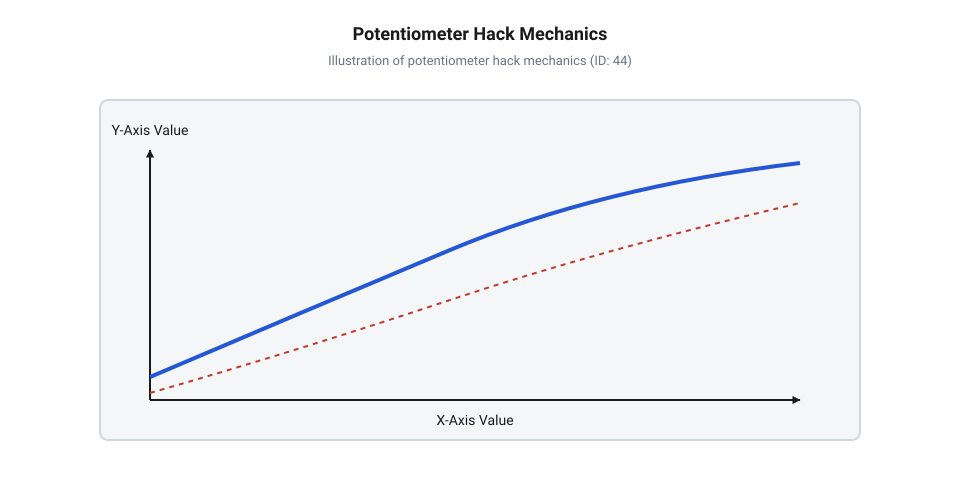
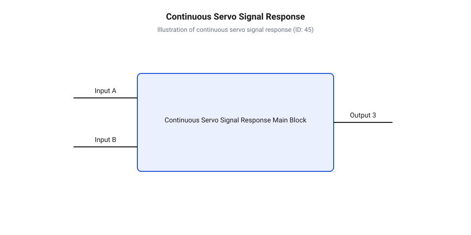

# Еволюція сервоприводів постійного обертання та історія хаку потенціометра

<preknowlist>
- [Сервоприводи радіокерованих моделей: будова, редуктори та ШІМ-керування](root:cat-hw-actuators/rc-servo-mechanisms-and-control) — Принцип побудови класичного пропорційного сервоприводу, керування ШІМ-імпульсами 1-2 мс та функціонування внутрішнього контуру позиціонування.
- [Інтегральні аналогові сервопідсилювачі KC2462 та AA51880](root:cat-hw-actuators/analog-servo-amplifier-ic) — Схемотехніка внутрішнього компаратора та мостового драйвера двигуна в аналогових мікросхемах керування сервоприводів.
- [Зона нечутливості та дрижання вала сервоприводів](root:cat-hw-actuators/servo-deadband-and-jitter) — Механізм формування зони нечутливості та вплив дрейфу параметрів на стабільність утримування нейтралі.
</preknowlist>

## Дефіцит компактних приводів у робототехніці

Наприкінці 1990-х років бурхливий розвиток аматорської, навчальної та мобільної робототехніки — зокрема напрямків @@en|BEAM robotics@@, змагань @@en|Micromouse@@ та ранніх освітніх платформ — наштовхнувся на серйозну апаратну перешкоду. Розробники малогабаритних колісних і гусеничних роботів стикнулися з гострим дефіцитом дешевих, доступних і компактних мотор-редукторів, обладнаних вбудованим силовим електронним драйвером. Класичний підхід до проектирования тягового вузла вимагав застосування звичайного колекторного двигуна (від латинського @@lat|collector@@ — збирач), для якого розробникам доводилося окремо проектувати або підбирати три взаємопов'язані компоненти: силовий мостовий каскад на дискретних MOSFET-транзисторах або перших двоканальних мікросхемах типу L298N і L293D (@@en|H-bridge@@), понижувальний механічний редуктор (від латинського @@lat|reductio@@ — повернення) та зовнішні датчики обертів вала. Таке компонування суттєво збільшувало масагабаритні показники робота, ускладнювало розведення друкованих плат, вимагало додаткових кінематичних кронштейнів і різко підвищувало підсумкову вартість конструкції.

У той самий час на ринку моделізму існували масові та дешеві [сервоприводи радіокерованих моделей](root:cat-hw-actuators/rc-servo-mechanisms-and-control). Вони являли собою надзвичайно елегантне та законсервоване в єдиному корпусі рішення: мікроколекторний мотор постійного струму, багатоступеневий зубчастий редуктор із великим передаточним числом (зазвичай від 1:100 до 1:300), силовий мікроконтролерний або аналоговий драйвер і систему декодування ШІМ-сигналу. Малогабаритні приводи, такі як [мікросервоприводи серії SG90](root:cat-hw-actuators/sg90-servo) або ширша [лінійка 9-грамових мікросервоприводів](root:cat-hw-actuators/sg90-mg90-micro-servos-family), мали високу питому потужність, низьку масу та привабливу ціну. Вони живилися стандартною напругою 4.8–6.0 В і керувалися стандартним імпульсним сигналом з [частоти оновлення кадрів](root:cat-hw-actuators/servo-pwm-frame-rate) 50 Гц (період 20 мс), де тривалість імпульсу від 1.0 мс до 2.0 мс відповідала кутовому положенню від -90° до +90°.

Однак їхня внутрішня кінематика спроектована виключно для пропорційного позиціонування рульових площин або тяг авіамоделей. Технічна суперечність полягала в тому, що спроба використати стандартний пропорційний сервопривід для безперервного обертання коліс мобільного робота призводила до механічного заклинювання та поломки. Усередині редуктора на вихідному валу конструктивно передбачався стопорний штифт, який фізично впирався в обмежувальні виступи корпусу, а вал потенціометра був жорстко зв'язаний з вихідною шестернею. При спробі примусового обертання вала понад допустимий кут виникав екстремальний струмовий перевантаж і прискорений [знос і стирання шестерень](root:cat-hw-actuators/servo-gear-shear-and-wear), що призводило до виходу з ладу силових H-мостів або зрізання пластикових зубців. Потреба робототехніків у компактному та дешевому ходовому приводі змусила ентузіастів шукати спосіб обходу цих обмежень, що й породило концепцію @@en|continuous rotation servo@@ на основі кустарної модифікації стандартних актюаторів.

## Механічний хак та розрив зв'язку

Сутність кустарної модифікації, яка у спільноті DIY-розробників отримала назву @@en|potentiometer servo mod@@, полягала у послідовному виконанні двох ключових операцій: фізичному усуненні механічного обмежувача повороту та розриві кінематичного контуру зворотного зв'язку за положенням. На першому етапі розбирають верхню частину корпусу приводу та демонтують вихідну шестерню багатоступеневого редуктора. На її нижній площині або внутрішньому вінці розташований литий пластиковий штифт (або латунний стопорний виступ, якщо це [металевий редуктор MG90S](root:cat-hw-actuators/mg90s-servo)), який акуратно зрізають скальпелем або спилюють надфілем врівень із поверхнею шестерні. Це звільняє вихідний вал від фізичних упорів і дозволяє йому безперешкодно обертатися на 360 градусів у будь-якому напрямку.

Другий етап вимагає ліквідації впливу потенціометра (від латинського @@lat|potentia@@ — сила та грецького @@el|metron@@ — міра). У заводській конструкції вал потенціометра входить у D-подібний паз або шліцеве сопло вихідного вала редуктора, пропорційно змінюючи вихідну напругу відповідно до того, як діє [математика потенціометричного зв'язку](root:cat-hw-actuators/servo-feedback-potentiometer). Для розриву цієї кінематичної пари вал потенціометра повністю від'єднують від шестерні — спилюють шліци зчеплення або висвердлюють посадкові отвори у шестерні, щоб вихідний вал приводу вільно обертався навколо зафіксованого вала потенціометра.


*Механічна модифікація вихідного ступеня редуктора: видалення стопорного виступу та ізоляція потенціометра для розриву кінематичного зворотного зв'язку.*

Після механічного від'єднання виникає потреба створити штучний нульовий сигнал для внутрішньої плати керування. Для цього застосовують один із двох основних схемотехнічних методів:
1. Механічне центрування потенціометра: вал штатного потенціометра вручну повертають у строго середнє положення, де опір між центральним повзунком і крайніми виводами є однаковим (наприклад, по 2.5 кОм для потенціометра з повним опором 5 кОм), після чого вал жорстко фіксують краплею ціанокрилатної смоли або епоксидного клею в каверні корпусу. 2. Електричне заміщення дільником: штатний потенціометр повністю випаюють із друкованої плати, а замість нього впаюють постійний резистивний дільник із двох прецизійних СМД-резисторів (зазвичай металоплівкових з допуском 1% і опором по 2.2 кОм або 4.7 кОм), підключених послідовно між шинами живлення `V_CC` і `GND`.

Заміщення потенціометра постійними металоплівковими резисторами виявилося значно надійнішим рішенням, оскільки вуглецевий шар штатного потенціометра піддавався сильному температурному дрейфу та вібраційному зсуву. У результаті модифікації мікросхема керування сервоприводом (від латинського @@lat|servus@@ — слуга) постійно зчитує з плати фіксовану напругу, яка строго відповідає ідеально нейтральному (нульовому) положенню вала.

## Схемотехнічна трансформація керування шириною імпульсу

Фіксація потенціометра або встановлення резистивного дільника докорінно змінює алгоритм функціонування внутрішнього підсилювача приводу. У класичних [аналогових сервопідсилювачах KC2462](root:cat-hw-actuators/analog-servo-amplifier-ic) (або їхніх аналогах AA51880 та NE544) внутрішній чекаючий мультивібратор генерує порівняльний опорний імпульс тривалістю `t_ref`, яка прямо пропорційна напрузі, знятій з потенціометра. Оскільки напруга тепер штучно зафіксована у середній точці дільника, тривалість опорного імпульсу постійно дорівнює `1.5 мс` (`1500 мкс`).

Коли зовнішній мікроконтролер подає на вхід ШІМ-імпульс тривалістю `t_in`, внутрішній компаратор мікросхеми (@@en|servo amplifier IC@@) розраховує часову тривалість помилки позиціонування:

```
Δt = t_in - t_ref      [обчислення тривалості помилки позиціонування]
```

Якщо тривалість вхідного імпульсу становить строго `t_in = 1.5 мс`, різниця `Δt = 0 мс`, що сприймається схемою як нульова помилка положення (@@en|zero position error@@). Силовий H-міст знеструмлює обмотки колекторного двигуна, і вихідний вал залишається повністю нерухомим.


*Залежність напрямку та кутової швидкості обертання модифікованого приводу від тривалості керуючого імпульсу ШІМ.*

При зміні ширини вхідного імпульсу (наприклад, `t_in = 1.0 мс` або `t_in = 2.0 мс`) виникає розсув імпульсів `Δt != 0`. У немодифікованому сервоприводі мотор обертав би потенціометр доти, доки `t_ref` не зрівняється з `t_in`, зводячи `Δt` до нуля. Однак у модифікованому приводі зворотний зв'язок розірвано, тому `t_ref` залишається незмінним незалежно від обертання ротора. Через високий коефіцієнт підсилення внутрішнього підсилювача помилки будь-яке відхилення `|Δt|`, що перевищує [параметри зони нечутливості](root:cat-hw-actuators/servo-deadband-and-jitter) (близько `4..8 мкс`), вводить внутрішній регулятор у режим повного насичення. Силовий міст подає повну напругу живлення на мотор, змушуючи його безперервно обертатися за годинниковою стрілкою (при `t_in < 1.5 мс`) або проти неї (при `t_in > 1.5 мс`).

Вузький діапазон пропорційного регулювання швидкості існує лише в межах мінімальних відхилень `1.45 мс <= t_in <= 1.55 мс`, де пропорційний режим драйвера формує мостову ШІМ-напругу низької duty cycle. Поза цим вузьким вікном кутова швидкість обертання вихідного вала миттєво досягає максимальних обертів редуктора. Таким чином, привід перетворюється з замкненої системи позиціонування на розімкнений регулятор кутової швидкості та напрямку обертання.

Згодом цей кустарний хак оцінили промислові бренди. Оскільки кустарні DIY-модифікації страждали від температурного дрейфу опору резисторів і нестабільності напруги живлення, що викликало самовільний повзучий рух мотора при поданні нейтрального імпульсу 1.5 мс, розробники випустили спеціалізовані серійні [сервоприводи постійного обертання](root:cat-hw-actuators/continuous-rotation-servo-mod). У продукції провідних [виробників серійних сервомодулів](root:cat-hw-actuators/powerhd-family) підстроювальний потенціометр (@@en|potentiometer trimmer@@) вивели безпосередньо під технологічний отвір у тильній або бічній частині корпусу. Це дозволило оперативно калібрувати "чистий нуль" за допомогою мініатюрної викрутки без розбирання приводу.

Попри високу популярність рішення, серед розробників поширені дві основні технічні омани щодо модифікованих актюаторів. Перша — помилкове уявлення про збереження замкненого контуру керування за швидкістю. Насправді без додавання зовнішніх оптичних чи магнітних енкодерів модифікований привід є абсолютно розімкненим і не здатен підтримувати стабільні оберти під змінним механічним навантаженням, на відміну від того, як працюють сучасні [безколекторні сервоконтролери нового](root:cat-hw-actuators/bldc-servo-controller) покоління. Друга омана — помилкове приписування авторства цієї технології фабричним брендам, тоді як насправді серійні модельні ряди стали лише комерціалізацією вдалого хаку DIY-спільноти.

## Промислова адаптація та серійний випуск

Швидке поширення аматорських модифікацій наприкінці 1990-х років викрило незадоволений попит ринку на надкомпактні приводи коліс для навчальних і робототехнічних платформ. Самостійний @@en|potentiometer servo mod@@ вимагав розбирання пластикового корпусу, зрізання механічних стопорів вихідної шестерні та прецизійного паяння двох резисторів або фіксації вала потенціометра клеєм. Для масового використання в освітніх проєктах, таких як @@en|BEAM robotics@@ або змагання @@en|Micromouse@@, це створювало високий поріг входження та ризик пошкодження тендітних зубів редуктора. Першими потенціал кустарного хаку осягнули компанії, що виробляли навчальні конструктори для шкіл та університетів.

На початку 2000-х років компанія Parallax у партнерстві з японським виробником Futaba випустила серійний привод @@en|Parallax Continuous Rotation Servo@@, створений на базі популярного позиційного сервоприводу @@en|Futaba S148@@. Головною технічною відмінністю фабричної адаптації від аматорських доробок була відмова від впаювання постійних резисторів на користь однооборотного підстроювального тримера (англ. @@en|potentiometer trimmer@@, від англ. *trim* — підрізати, підлаштовувати). Виробник розмістив цей підстроювальний тример безпосередньо на внутрішній друкованій платі, зробивши в нижній або бічній кришці корпусу наскрізний отвір під шліц викрутки.

Таке конструктивне рішення зняло головну проблему модифікованих приводів — відсутність точного регулювання нейтральної точки. Шляхом обертання викрутки крізь технологічний отвір користувач міг змінювати опір плечей дільника аналогового підсилювача без розбирання приводу. Це дозволило швидко проводити калібрування центровки [зони нечутливості](root:cat-hw-actuators/servo-deadband-and-jitter) під конкретний генератор ШІМ-сигналу інженерного контролера, виставляючи повну зупинку двигуна при подачі імпульсу 1500 мкс.

Серійне виробництво усунуло й механічні вади модифікованих приводів. Замість кустарного спилювання штифтів на прес-формах вихідних шестерень почали виготовляти гладкі шестерні без стопорних виступів. Кінематичну розв'язку з потенціометром реалізували через зняття передавальної шестерні потенціометра або застосування потенціометрів із вільним обертанням вала на 360 градусів. Незабаром такі бренди, як SpringRC (модель @@en|SpringRC SM-S4303R@@) та FEETECH (модель @@en|FEETECH FS90R@@), розробили власні лінійки приводів постійного обертання у стандартних і мікроформатах, взявши за основу корпус [сервоприводів Tower Pro](root:cat-hw-actuators/sg90-mg90-micro-servos-family).

Завдяки комерціалізації DIY-рішення [сервоприводи постійного обертання](root:cat-hw-actuators/continuous-rotation-servo-mod) перетворилися на окремий стандартний клас виконавчих механізмів. Інтеграція силового H-мосту та аналогового драйвера в єдиному корпусі з редуктором виключила потребу у зовнішніх мотор-драйверах, зробивши ці приводи найдешевшим інструментом для побудови двоколісних мобільних роботів. Проте масовий випуск висвітлив схемотехнічні обмеження приводу, які випливали з його аналогового походження.

## Розвінчання міфів та обмеження дрейфу

Широке впровадження серійних моделей постійного обертання створило низку стійких технічних оман серед розробників-початківців. Найбільш поширеним є міф про збереження замкненого контуру керування (англ. @@en|closed-loop control@@) за швидкістю або кутом після видалення зворотного зв'язку. У стандартних [сервоприводах радіокерованих моделей](root:cat-hw-actuators/rc-servo-mechanisms-and-control) мікросхема аналогового підсилювача формує вихідну напругу на двигуні пропорційно помилці позиціонування — різниці між тривалістю вхідного ШІМ-імпульсу та внутрішнім опитувальним імпульсом потенціометра.

Після заміни потенціометра на фіксований дільник або його декупелювання внутрішній зворотний зв'язок розривається. Привід перетворюється на розімкнену систему керування (англ. @@en|open-loop control@@, від англ. *loop* — контур, петля). Оскільки штучний потенціометр завжди генерує імпульс тривалістю 1500 мкс, будь-яка зміна вхідного сигналу (наприклад, подача 1600 мкс або 1400 мкс) викликає постійну неусувну помилку. Помилка позиціонування (англ. @@en|zero position error@@) миттєво насичує вихідний каскад аналогового підсилювача (англ. @@en|servo amplifier IC@@), подаючи на двигун 100% напруги живлення.

Таким чином, керуючий ШІМ-сигнал регулює не кутову швидкість вала у замкненому контурі, а середню напругу на мостовому драйвері (англ. @@en|H-bridge@@) лише у вузькій зоні пропорційності поблизу 1500 мкс. За межами цієї вузької смуги (зазвичай ±20...40 мкс від нейтралі) привід працює у режимі повного насичення. У разі зміни зовнішнього механічного навантаження на колесо кутова швидкість обертання істотно падає, оскільки привід позбавлений тахометра чи енкодера для компенсації просідання обертів.

Другим міфом є атрибуція створення сервоприводів постійного обертання промисловим брендам. Комерційні виробники лише стандартизували й масштабували технічне рішення, створене спільнотою аматорської робототехніки. Патентування чи привласнення авторства окремими фірмами не мало підґрунтя, оскільки фундаментальна схемотехніка аналогових драйверів залишалася незмінною з 1970-х років.

Фундаментальною технічною пасткою приводів із фіксованим дільником є часова та середовищна нестабільність нейтральної точки. Вона обумовлена двома фізичними факторами:
1. Температурний дрейф (англ. @@en|thermal drift@@, від англ. *drift* — відхилення, зсув). Опір резисторів дільника та підстроювального тримера змінюється відповідно до їхнього температурного коефіцієнта опору (англ. @@en|temperature coefficient of resistance@@). Під час тривалої роботи нагрівання двигуна та силових транзисторів H-мосту передається на плату підсилювача, зміщуючи точку балансу дільника. Привід, відкалібрований при 20 °C на стоянку при 1500 мкс, при нагріванні до 45 °C починає самовільно обертатися. Додатковий внесок робить зсув параметрів вбудованого в мікросхему генератора порівняльного імпульсу, що детально описується в аналізі [теплової моделі приводу](root:cat-hw-actuators/servo-thermal-protection). 2. Напруговий дрейф (англ. @@en|voltage drift@@). У дешевих аналогових підсилювачах опорна напруга порівняння не має високопрецизійного параметричного стабілізатора. Під час розряджання акумуляторної батареї робототехнічної платформи (наприклад, просідання напруги з 6.0 В до 4.8 В) внутрішній поріг спрацьовування компаратора зміщується. Це призводить до зсуву зони стопу на кілька мікросекунд.

Через ці обмеження розробник має свідомо оцінювати компроміс: використовувати дешеві модифіковані сервоприводи для базових навчальних шасі чи переходити на крокові двигуни та сервомодулі на [безколекторних інтегральних контролерах](root:cat-hw-actuators/bldc-servo-controller) із цифровими енкодерами, де контур швидкості та позиції замикається програмно.