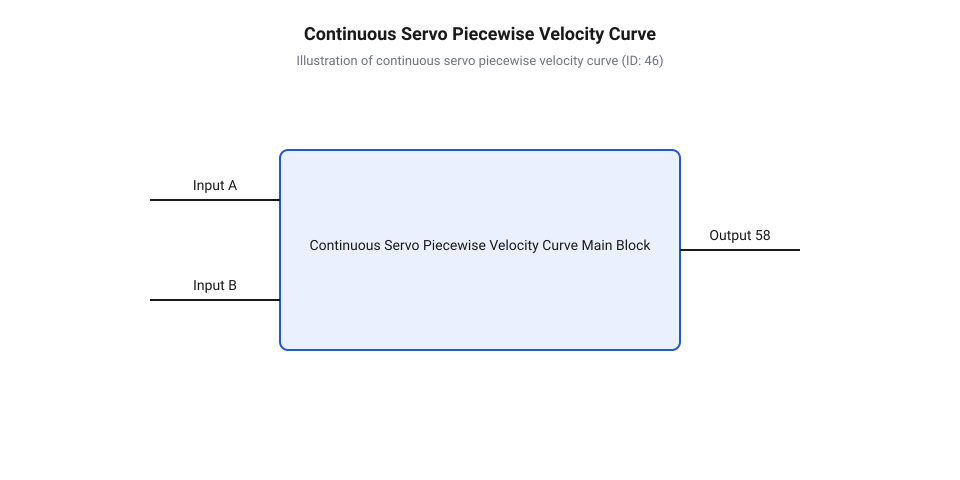
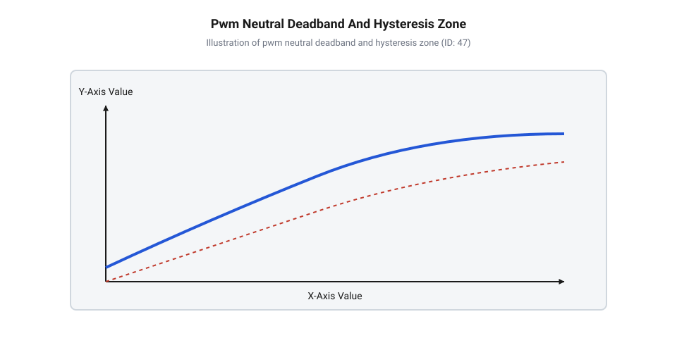

# Математична модель дрейфу нейтралі та розрахунок зони нечутливості ШІМ

<preknowlist>
- [Сервоприводи постійного обертання](root:cat-hw-actuators/continuous-rotation-servo-mod) — конструктивні особливості вилучення механічних обмежувачів та розімкнення зворотного зв'язку
- [Інтегральні аналогові сервопідсилювачі](root:cat-hw-actuators/analog-servo-amplifier-ic) — внутрішню схемотехніку порівняння тривалості імпульсів та керування силовим мостом
- [Математика потенціометричного зворотного зв'язку](root:cat-hw-actuators/servo-feedback-potentiometer) — розрахунок напруги резистивного дільника та залежність потенціалу від положення струмознімача
- [Частота оновлення кадрів ШІМ](root:cat-hw-actuators/servo-pwm-frame-rate) — часові параметри стандартного сигналу 50 Гц та форму кадрових імпульсів
</preknowlist>

## Чому безперервний сервопривод самовільно повзе

При розробці робототехнічних систем та колісних платформ інженери часто стикаються з критичною нестабільністю: сервопривід безперервного обертання (англ. @@en|continuous rotation servo@@) при поданні фіксованого керуючого сигналу з тривалістю імпульсу `1500 мкс` починає самовільно обертати вихідний вал із низькою кутовою швидкістю або створювати високочастотне дрижання силових транзисторів драйвера. На початковому етапі налагодження виникає хибне уявлення, ніби фіксована тривалість імпульсу широтно-імпульсної модуляції (англ. @@en|pulse-width modulation@@, @@en|PWM@@) гарантує повну зупинку електродвигуна, а паразитарний рух зумовлений нестабільністю таймера мікроконтролера або програмною помилкою генерації кадрового сигналу. Проте реальна фізична причина полягає в глибокій трансформації внутрішньої структури аналогово-механічного контуру регулювання.

У класичних позиційних сервоприводах, таких як [популярних сервоприводах SG90](root:cat-hw-actuators/sg90-servo) або модифікаціях [сервоприводах серії MG90S](root:cat-hw-actuators/mg90s-servo), вал внутрішнього змінного резистора жорстко з'єднаний із вихідним редуктором. Це створює замкнений негативний зворотний зв'язок за кутовим положенням. Внутрішня електронна схема порівнює тривалість вхідного керуючого імпульсу ШІМ із тривалістю опорного імпульсу, який генерується внутрішнім однобратором. Тривалість опорного імпульсу напряму залежить від опору потенціометра (англ. @@en|potentiometer@@, від латинського potentia — сила та грецького @@gr|metreo@@ — вимірювати). Якщо кут повороту редуктора відповідає заданій тривалості імпульсу (наприклад, `1500 мкс` відповідає серединному положенню `90°`), різниця тривалостей дорівнює нулю, вихідна напруга помилки відсутня, а силовий H-міст перебуває в знеструмленому стані.

При конвертації виробу в сервопривід [безперервного обертання сервоприводів](root:cat-hw-actuators/continuous-rotation-servo-mod) механічний обмежувач кута повороту видаляють, а кінематичний зв'язок між редуктором і валом потенціометра повністю розривають. Потенціометр фіксують у геометричному центрі його робочого ходу або замінюють підлаштовним резистивним дільником. Внаслідок цього контур регулювання перетворюється з замкненого позиційного на розімкнений контур керування швидкістю. Внутрішній [аналоговими сервопідсилювачами на платі](root:cat-hw-actuators/analog-servo-amplifier-ic) втрачає можливість компенсувати розсогласування через фізичне переміщення вала.

За таких умов серединне значення опору потенціометра має точно відповідати тривалості внутрішнього порівняльного імпульсу `1500 мкс`. Якщо через механічну розкаліброваність струмознімача (англ. @@en|wiper@@) або омічний відхил резистивної доріжки потенціальний дільник видає напругу, що відповідає, наприклад, `1512 мкс`, то при поданні з мікроконтролера еталонного імпульсу `1500 мкс` на внутрішньому схемному компараторі (англ. @@en|comparator@@, від латинського comparare — порівнювати) виникає постійна різниця тривалостей `Δt_err = 12 мкс`. Сервопідсилювач сприймає це розсогласування як помилку положення й безперервно подає напругу керування на колекторний мотор. Оскільки вал потенціометра більше не обертається разом із редуктором, ця напруга помилки ніколи не зменшується до нуля, що й зумовлює постійне самовільне повзання вала. Для запобігання неконтрольованому руху постає потреба формалізувати математичну модель передавальної функції приводу.

## Математична модель кутової швидкості та зсуву

Математичний опис динаміки сервоприводу безперервного обертання базується на розрахунку вихідної кутової швидкості `ω` як функції від тривалості керуючого імпульсу `t_pulse` та внутрішнього напругового чи часового зсуву нейтралі `Δt_offset`. У реальному аналоговому сервоконтролері внутрішній задавальний генератор формує опорний часовий інтервал `t_ref`, який визначається величиною напруги, знятої з опорного потенціометра:

`t_ref = t_neutral + Δt_offset`

тут `t_neutral = 1500 мкс` — номінальна серединна тривалість керуючого сигналу стандарту ШІМ при [кадрової частоти ШІМ](root:cat-hw-actuators/servo-pwm-frame-rate) `50 Гц`, а `Δt_offset` — часовий еквівалент відхилення потенціалу струмознімача від ідеального балансу дільника.

Різниця тривалостей між вхідним імпульсом `t_pulse` та внутрішнім опорним імпульсом `t_ref` визначає імпульсну напругу помилки `V_err`, що подається на інтегратор та широтно-імпульсний каскад керування мостом:

`Δt_err = t_pulse - t_ref`
`= t_pulse - 1500 - Δt_offset`

Передавальна характеристика відгуку кутової швидкості `ω(t_pulse)` має кусково-лінійний (англ. @@en|piecewise-linear@@) характер із трьома чітко вираженими областями: зоною нечутливості (англ. @@en|deadband@@), пропорційною зоною регулювання та областю насичення (англ. @@en|saturation region@@).


*Кусково-лінійна крива відгуку кутової швидкості ω(t_pulse) при наявності позитивного зсуву потенціометра Δt_offset, що зміщує точку нульового обертання від номінальних 1500 мкс.*

Математично залежність кутової швидкості `ω` від різниці тривалостей `Δt_err` у пропорційній зоні описується крутизною характеристики `K_v` (вимірюється в об/хв/мкс або рад/(с·мкс)):

`ω(t_pulse) = 0`      [при |Δt_err| ≤ t_db]
`ω(t_pulse) = K_v · (Δt_err - t_db)`      [при Δt_err > t_db та |ω| < ω_max]
`ω(t_pulse) = K_v · (Δt_err + t_db)`      [при Δt_err < -t_db та |ω| < ω_max]
`ω(t_pulse) = +ω_max`      [при Δt_err > Δt_sat_pos]
`ω(t_pulse) = -ω_max`      [при Δt_err < -Δt_sat_neg]

де `t_db` — половина ширини внутрішньої апаратної зони нечутливості компаратора, `ω_max` — максимальна кутова швидкість приводу при повному відкритті транзисторів H-моста, а `Δt_sat` — межа насичення регулятора (зазвичай при відхиленні на `±50…100 мкс` від нейтралі).

Точка теоретичної нульової швидкості `t_zero`, при якій мотор повністю зупиняється, обчислюється з умови рівності нулю імпульсної помилки:

`t_zero = t_neutral + Δt_offset = 1500 + Δt_offset`

Якщо зсув потенціометра `Δt_offset` становить, наприклад, `+18 мкс`, то для повної зупинки двигуна мікроконтролер повинен подавати імпульси тривалістю `1518 мкс`. Подання стандартного значення `1500 мкс` призводить до появи результуючої від'ємної помилки `Δt_err = -18 мкс`, що викликає обертання вала проти годинникової стрілки.

**Розрахунок кутової швидкості при внутрішньому часовому зсуві потенціометра:**
```
Δt_err = t_pulse - (t_neutral + Δt_offset)
       = 1500 - (1500 + 15)                [t_pulse = 1500 мкс, Δt_offset = +15 мкс]
       = -15 мкс                           [відхилення тривалості від внутрішньої нейтралі]

ω = K_v · (Δt_err + t_db)
  = 12.5 · (-15 + 4)                       [K_v = 12.5 об/хв/мкс, t_db = 4 мкс]
  = 12.5 · (-11)                           [ефективна різниця тривалостей поза зоною нечутливості]
  = -137.5 об/хв                           [самовільне обертання вала проти годинникової стрілки]
```

Отримане значення свідчить, що навіть незначний часовий зсув у `15 мкс` при вузькій зоні нечутливості `4 мкс` зумовлює високу кутову швидкість паразитарного обертання `-137.5 об/хв`. Це робить стабільність внутрішньої нейтральної точки критичним параметром робототехнічної системи.

## Фізичні чинники температурного та напругового дрейфу

Навіть після ідеального механічного налаштування потенціометра в точне нульове положення точка нейтралі не залишається стаціонарною. Визначення фізико-електричних причин дрейфу нейтральної точки (англ. @@en|neutral drift@@) показує, що вона зазнає постійного зсуву під впливом зовнішніх та внутрішніх дестабілізуючих чинників. Основними джерелами паразитарної нестабільності є температурні коливання, флуктуації напруги живлення шини та омічний знос резистивного елемента.

Першим ключовим чинником є температурний коефіцієнт опору (англ. @@en|temperature coefficient of resistance@@, @@en|TCR@@) матеріалу резистивної доріжки потенціометра та напівпровідникових елементів внутрішнього одновібратора. При зміні температури навколишнього середовища `T` або самонагріванні приводу під час роботи опір пліч резистивного дільника змінюється згідно з формулою:

`R(T) = R_0 · (1 + TCR · ΔT)`

Якщо верхнє та нижнє плече потенціометра мають навіть незначну технологічну асиметрію за значеннями @@en|TCR@@ (`ΔTCR = TCR_1 - TCR_2`), вихідний потенціал середньої точки зміщується. Це змінює тривалість внутрішнього опорного імпульсу `t_ref` пропорційно температурному градієнту `ΔT`.

Другим чинником є нестабільність опорної напруги (англ. @@en|reference voltage@@) внутрішніх компараторів та просідання силової напруги живлення `V_CC` під навантаженням. При різкому зростанні пускового струму електродвигуна на провідниках живлення виникає падіння напруги `ΔV_CC`. Оскільки внутрішній генератор порівняння використовує зарядний RC-ланцюг, де поріг спрацьовування компаратора зафіксовано відносно шини живлення, дрижання `V_CC` призводить до прямих флуктуацій порогу порівняння тривалості імпульсів.

Третім чинником є механічний знос та оксидація контактного вузла струмознімача. Вібрації редуктора, такі як у малогабаритних [сервоприводах Power HD HD-1370A](root:cat-hw-actuators/hd-1370a-servo), викликають мікрозсуви контактної групи та зміну перехідного опору, що трансформується у випадкові флуктуації напруги зсуву.


*Часова діаграма зони нечутливості навколо нейтрального значення 1500 мкс з аналізом гістерезису внутрішнього компаратора та реакції струму споживання H-моста.*

Математична оцінка сумарного часового зсуву нейтралі `Δt_drift` враховує адитивний внесок температурної та напругової складових:

`Δt_drift = Δt_temp + Δt_supply`
`= t_ref · ΔT · ΔTCR + t_ref · K_vcc · (ΔV_CC / V_CC)`

де `K_vcc` — коефіцієнт чутливості внутрішнього генератора до падіння живлення (типово `0.03…0.08`).

**Обчислення часового зсуву нейтралі під впливом температурного градієнта та нестабільності живлення:**
```
Δt_temp = t_ref · ΔT · ΔTCR
        = 1500 · 30 · (50 · 10⁻⁶)           [t_ref = 1500 мкс, ΔT = 30 K, ΔTCR = 50 ppm/K]
        = 1500 · 30 · 0.00005
        = 2.25 мкс                          [температурна складова дрейфу]

Δt_supply = t_ref · K_vcc · (ΔV_CC / V_CC)
          = 1500 · 0.05 · (0.6 / 5.0)       [K_vcc = 0.05, падіння напруги з 5.0 В до 4.4 В]
          = 1500 · 0.05 · 0.12
          = 9.00 мкс                         [напругова складова дрейфу]

Δt_drift = Δt_temp + Δt_supply
         = 2.25 + 9.00                      [сумарний зсув порівняльного імпульсу]
         = 11.25 мкс                        [абсолютна амплітуда дрейфу нейтралі]
```

Розрахований сумарний дрейф у `11.25 мкс` перевищує стандартну ширину апаратної зони нечутливості дешевих сервопідсилювачів (яка становить близько `4…6 мкс`). Це доводить неможливість забезпечення повної зупинки двигуна виключно апаратним калібруванням потенціометра. Для усунення самовільного повзання та механічного дрижання вала виникає неминуча потреба математично обчислити й програмно реалізувати розширену зону нечутливості в алгоритмах мікроконтролера.

## Розрахунок зони нечутливості та струмів

При розрахунку контуру керування сервоприводом безперервної дії ключовим завданням інженера є визначення порогу відсікання, за якого ключові транзистори силового моста переходять у повністю закритий стан. На практиці наявність часового дрейфу нейтралі призводить до того, що апаратна зона нечутливості (англ. @@en|deadband@@, від @@en|dead@@ — мертвий та @@en|band@@ — смуга) аналогового компаратора виявляється завузькою. Якщо сумарна амплітуда дрейфу перевищує внутрішній поріг спрацьовування, силова схема залишається у відкритому стані навіть при вихідному імпульсі `1500 мкс`. Визначення розрахункового значення зони нечутливості базується на алгебраїчному додаванні максимального часового зсуву нейтралі та внутрішнього гістерезису (грец. @@gr|hysteresis@@, від @@gr|ὕстеρος@@ — запізнілий) схемного порівнювача. Для приводів на кшталт [бюджетних сервоприводах SG90](root:cat-hw-actuators/sg90-servo) аналіз схемотехніки [аналогових сервопідсилювачів керування](root:cat-hw-actuators/analog-servo-amplifier-ic) показує, що власна апаратна зона нечутливості становить лише `4…6 мкс`, тоді як сумарний температурний та напруговий зсув сягає `11…15 мкс`. Це робить розрахунок розширеного часового порогу неминучим етапом проектирування.

Математична модель розрахунку захисного інтервалу передбачає обчислення півширини зони нечутливості `t_db_half`, яка додається та віднімається від номінального серединного значення `1500 мкс`. Для забезпечення гарантованої зупинки двигуна у всьому діапазоні робочих температур та флуктуацій живлення половина ширини зони нечутливості має задовольняти нерівності:

`t_db_half ≥ Δt_drift_max + (Δt_hyst / 2) + t_margin`

тут `Δt_drift_max` — максимальний розрахований часовий зсув нейтралі під впливом температурного коефіцієнта опору та просідання напруги, `Δt_hyst` — ширина вікна гістерезису внутрішнього компаратора (англ. @@en|comparator@@), а `t_margin` — інженерний запас міцності (типово `2…3 мкс`), який компенсує дрижання (англ. @@en|jitter@@) фронтів імпульсу мікроконтролера.

Загальна ширина зони нечутливості `t_db_total` охоплює відхилення в обидва боки від нейтральної точки й обчислюється як подвоєний півширинний інтервал:

`t_db_total = 2 · t_db_half`

Для вираження зони нечутливості у відсотках `Deadband_%` від активного робочого діапазону ШІМ-імпульсів (англ. @@en|pulse-width modulation@@, @@en|PWM@@), який для стандартних приводів складає `T_active = 2000 - 1000 = 1000 мкс`, застосовують співвідношення:

`Deadband_% = (t_db_total / T_active) · 100%`

Передбачивши амплітуду дрейфу нейтралі `Δt_drift_max = 11.25 мкс` та гістерезис компаратора `Δt_hyst = 4.0 мкс`, проведемо покроковий розрахунок граничних параметрів зони нечутливості.

**Розрахунок ширини зони нечутливості з урахуванням дрейфу та гістерезису компаратора:**
```
t_db_half = Δt_drift_max + (Δt_hyst / 2) + t_margin
          = 11.25 + (4.0 / 2) + 2.75           [додавання дрейфу 11.25 мкс, півгістерезису 2.0 мкс та запасу 2.75 мкс]
          = 11.25 + 2.00 + 2.75                [проміжне додавання складових порогу]
          = 16.00 мкс                          [мінімально припустима півширина зони нечутливості]

t_db_total = 2 · t_db_half
           = 2 · 16.00                         [множення півширини на симетричні боки нейтралі]
           = 32.00 мкс                         [повна часова ширина зони нечутливості ШІМ]

Deadband_% = (t_db_total / T_active) · 100%
           = (32.00 / 1000.0) · 100%           [відношення до активного діапазону T_active = 1000 мкс]
           = 0.032 · 100%                      [переведення відносного значення у відсотки]
           = 3.20%                             [ширина зони нечутливості у відсотках робочого ходу]
```

Отриманий результат показує, що для надійного блокування вихідного каскаду драйвера ширина зони нечутливості повинна становити не менше `32.00 мкс`, або `3.20%` від повного робочого діапазону.

Обчислення граничних струмів мостового драйвера (англ. @@en|H-bridge@@, від @@en|H-shaped@@ — H-подібний та @@en|bridge@@ — міст) дозволяє оцінити енергетичну ефективність та температурний режим сервоприводу при роботі в околі нейтралі. Коли тривалість керуючого імпульсу перебуває в межах розрахованої зони нечутливості `|t_pulse - 1500| ≤ t_db_half`, ключові мостові транзистори (англ. @@en|MOSFET@@) закриті, а вихідний каскад знеструмлений. Струм споживання приводу дорівнює струму спокою (англ. @@en|quiescent current@@, від латинського quiescens — той, що перебуває в спокої) внутрішньої мікросхеми драйвера `I_standby ≈ 3…8 мА`.

Якщо ж ширина нечутливості вибрана недостатньою і керуючий сигнал виходить за її межі на величину `Δt_exceed = Δt_err - t_db_half`, компаратор починає формувати імпульси відкриття транзисторів із робочою свердловиною (англ. @@en|duty cycle@@):

`D_motor = Δt_exceed / Δt_sat`

тут `Δt_sat` — часовий інтервал повного насичення підсилювача (типово `50…100 мкс`).

Напруга, що прикладається до обмоток мотора, дорівнює `V_avg = D_motor · V_CC`, а середній струм обмотки обчислюється через активний опір ротора `R_winding`:

`I_motor = V_avg / R_winding = (D_motor · V_CC) / R_winding`

Розглянемо випадок, коли привузька зона нечутливості `t_db_half = 4.0 мкс` пропускає часове відхилення `Δt_err = 18.0 мкс`, викликаючи неконтрольований протік струму через мотор із опором обмотки `R_winding = 8.5 Ом` при напрузі живлення `V_CC = 5.0 В`.

**Розрахунок струму споживання та теплових втрат H-моста поза зоною нечутливості:**
```
Δt_exceed = Δt_err - t_db_half
          = 18.0 - 4.0                         [похибка 18 мкс при недостатньому порозі 4 мкс]
          = 14.0 мкс                           [величина часового пробиття зони нечутливості]

D_motor = Δt_exceed / Δt_sat
        = 14.0 / 80.0                          [свердловина ШІМ мотора при Δt_sat = 80 мкс]
        = 0.175                                [коефіцієнт заповнення мостового каскаду 17.5%]

V_avg = D_motor · V_CC
      = 0.175 · 5.0                            [прикладена напруга живлення V_CC = 5.0 В]
      = 0.875 В                                [середнє значення напруги на обмоткам ротора]

I_motor = V_avg / R_winding
        = 0.875 / 8.5                          [обчислення струму через опір R_winding = 8.5 Ом]
        = 0.1029 А                             [середній струм обмотки двигуна]
        = 102.9 мА                             [паразитарний струм мотора в режимі утримання]

P_heat = I_motor² · R_winding
       = (0.1029)² · 8.5                       [обчислення потужності джоулевого нагріву]
       = 0.01059 · 8.5
       = 0.090 Вт                              [теплова потужність розсіювання на обмоткам]
```

Порівняння отриманого паразитарного струму `102.9 мА` зі струмом спокою `5.0 мА` показує зростання енергоспоживання у `20 разів`. Супутнє теплове розсіювання `0.090 Вт` викликає локальне нагрівання обмоток та прискорює температурний дрейф. Систематичне дослідження явища [зони нечутливості приводу](root:cat-hw-actuators/servo-deadband-and-jitter) підтверджує, що недопущення такого стану запобігає передчасному спрацьовуванню [теплового захисту двигуна](root:cat-hw-actuators/servo-thermal-protection) та мінімізує механічний знос.

## Механічне калібрування та програмна нейтралізація

Повне усунення паразитарного обертання та механічного повзання (англ. @@en|creep@@) досягається послідовним поєднанням двох етапів: механіко-електричного калібрування (англ. @@en|zero-tuning@@, від @@en|zero@@ — нуль та @@en|tuning@@ — налаштування) внутрішнього потенціометра та програмної нейтралізації в мікроконтролері (англ. @@en|microcontroller@@, від грецького μικρός — малий та англійського controller — контролер). Лише механічне виставлення вала резистора у фізичний нуль не здательне компенсувати майбутні температурні та напругові зсуви. Натомість суто програмна відсічка без попереднього механічного налаштування звужує симетричний робочий діапазон керування швидкостями. При моделюванні [сервоприводів постійного обертання](root:cat-hw-actuators/continuous-rotation-servo-mod) інженер виконує нуль-калібрування, спираючись на [математику потенціометричного зв'язку](root:cat-hw-actuators/servo-feedback-potentiometer), що забезпечує симетрію передавальної функції відносно номінальної тривалості `1500 мкс`.

Алгоритм механіко-електричного налаштування zero-tuning складається з трьох послідовних кроків:
1. **Подача еталонного сигналу:** Від мікроконтролера подається стабільна меандерена серія керуючих імпульсів із тривалістю точно `1500.0 мкс` при стандартній [частоту оновлення кадрів](root:cat-hw-actuators/servo-pwm-frame-rate) `50 Гц`. 2. **Апаратне обнулення струмознімача:** Використовуючи діелектричну викрутку, плавно обертають вал підлаштовного потенціометра сервоприводу до моменту повної зупинки ротора електродвигуна. У [приводах із металоредуктором](root:cat-hw-actuators/mg90s-servo) момент зупинки визначають за зникненням характерного акустичного гулу й вібрацій силових шестерень. 3. **Електрична верифікація:** Мультиметром вимірюють потенціал на струмознімачі (англ. @@en|wiper@@). Для симетрично відкаліброваної схеми напруга має відповідати рівно половині напруги живлення дільника `V_wiper = V_CC / 2 ± 0.005 В`.

Після завершення апаратного налаштування в алгоритм керування мікроконтролера впроваджують математичну функцію відсікання та масштабування. Її призначення полягає в тому, щоб усередині інтервалу `[1500 - t_db_half, 1500 + t_db_half]` примусово встановлювати вихідний сигнал рівним `1500 мкс`, а поза його межами — лінійно масштабувати залишок тривалості, зберігаючи повний динамічний діапазон регулювання швидкості `1000…2000 мкс`.

Математично перетворення вхідної тривалості `t_in` у вихідну скориговану тривалість `t_out` описується кусковою функцією:

`t_out = 1500`      [при |t_in - 1500| ≤ t_db_half]

`t_out = 1500 + ((t_in - 1500 - t_db_half) · 500) / (500 - t_db_half)`      [при t_in > 1500 + t_db_half]

`t_out = 1500 + ((t_in - 1500 + t_db_half) · 500) / (500 - t_db_half)`      [при t_in < 1500 - t_db_half]

Проведемо розрахунок вихідної тривалості `t_out` для вхідного сигналу `t_in = 1540 мкс` при розрахованій півширині зони нечутливості `t_db_half = 16 мкс`.

**Розрахунок масштабованої тривалості ШІМ-імпульсу поза зоною нечутливості:**
```
Δt_input = t_in - 1500
         = 1540 - 1500                         [вхідне відхилення керуючого сигналу від нейтралі]
         = 40 мкс                              [позитивний зсув сигналу керування]

Δt_active_in = Δt_input - t_db_half
             = 40 - 16                         [віднімання півширини нечутливості]
             = 24 мкс                          [ефективне робоче відхилення сигналу]

K_scale = 500 / (500 - t_db_half)
        = 500 / (500 - 16)                     [обчислення коефіцієнта масштабування діапазону]
        = 500 / 484
        = 1.033057                             [коефіцієнт компенсації втраченого інтервалу]

Δt_scaled = Δt_active_in · K_scale
          = 24 · 1.033057                      [масштабування ефективного відхилення]
          = 24.79 мкс                          [результуючий зсув вихідного імпульсу]

t_out = 1500 + Δt_scaled
      = 1500 + 24.79                           [додавання масштабованого зсуву до нейтралі]
      = 1524.79 мкс                            [підсумкова тривалість імпульсу для драйвера]
```

Отриманий розрахунок показує, що завдяки масштабуванню привід плавно нарощує кутову швидкість від нуля відразу за межею зони нечутливості, забезпечуючи лінійний відгук без ступенчатого стрибка швидкості.

Двомовна реалізація програмного алгоритму zero-tuning та відсікання deadband забезпечує переношуваність між різними вбудованими платформами.

:::tabs
@tab c|esp-idf
:::code math-servo-pwm-neutral-deadband/c/esp-idf/calculate-servo-deadband-pwm.c
@tab cpp|arduino
:::code math-servo-pwm-neutral-deadband/cpp/arduino/continuousservocontroller.cpp
:::

Практичне застосування поданої математичної моделі та програмного алгоритму повністю ліквідує самовільне повзання вала й механічне дрижання силового моста при збереженні максимальної плавності керування кутовою швидкістю сервоприводу.