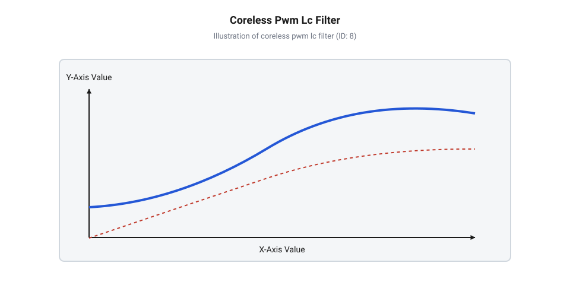
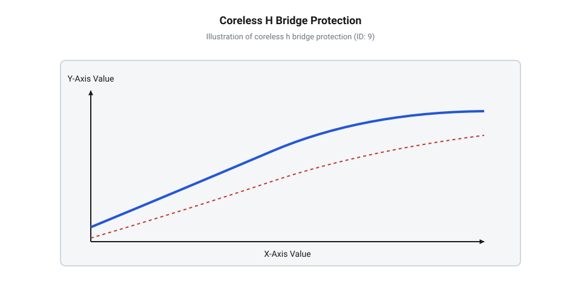

# Схема підключення, залізна обв'язка та електричний інтерфейс безсердечникового двигуна

<preknowlist>
- [Колекторний двигун типорозміру 130](root:cat-hw-actuators/dc-motor-130) — Базовий принцип роботи колекторного вузла, комутація обмоток та залежність обертів від прикладеної напруги
- [N20 мікромотор з редуктором](root:cat-hw-actuators/n20-motor) — Конструкція малогабаритних моторів та поняття струму заклинювання під механічним навантаженням
</preknowlist>

## Ризики прямого підключення безсердечникового мотора

Коли розробник намагається підключити @@en|безсердечниковий двигун@@ (англ. *coreless DC motor*, від *core* — осердя, *less* — без) до звичайної плати керування, розрахованої на [колекторний двигун типорозміру 130](root:cat-hw-actuators/dc-motor-130) або стандартний [мотор-редуктор 6 В](root:cat-hw-actuators/gearmotor-6v), пристрій часто виходить з ладу за кілька секунд. Двигун миттєво розігрівається до критичної температури, а силові транзистори драйвера пробиваються перенапругою. Причина цієї катастрофічної поведінки полягає в кардинальній відмінності внутрішньої конструкції ротора, яка вимагає принципово іншого підходу до залізобетонної обв'язки та силового інтерфейсу.

У класичних моторах постійного струму обмотка намотана на масивне залізне осердя. Цей залізний пакет виконує дві важливі захисні функції: він створює високу індуктивність обмотки (від 500 мкГн до кількох мілігенрі) та має значну @@en|теплоємність@@ (англ. *heat capacity*). На противагу цьому, @@en|кошиковий ротор@@ (англ. *basket rotor*, від *basket* — кошик) безсердечникового мотора являє собою порожнистий циліндр, сплетений з мідного дроту без жодного залізного осердя всередині. Відсутність феромагнітного матеріалу зменшує власну індуктивність обмотки `L_m` до мікрогенрієвого рівня (типово 10–50 мкГн), а маса міді вимірюється частками грама.

Через мікрогенрієву індуктивність електрична часова константа кола `τ_e = L_m / R_m` становить лише кілька мікросекунд, тоді як @@en|механічна часова константа@@ (англ. *mechanical time constant*, від *mechanical* — механічний і *time* — час) `τ_m`, яка визначає інерційність ротора, вимірюється мілісекундами. Через співвідношення `τ_e « τ_m` механічна система не здатна реагувати на високочастотні імпульси, тому ротор обертається плавно відповідно до середнього значення напруги. Проте електрична система реагує практично миттєво: якщо подати на такий мотор звичайний сигнал @@en|широтно-імпульсної модуляції@@ (англ. *pulse-width modulation*, скорочено @@en|ШІМ@@) із низькою частотою 1–5 кГц, струм в обмотці встигає зрости до максимального пікового значення `I_peak = V_in / R_m` під час кожного імпульсу та повністю впасти до нуля під час паузи. Виникають колосальні пульсації струму `ΔI`, через які середньоквадратичний струм `I_rms` виявляється набагато вищим за корисний середній струм `I_avg`. Перевищення пікового струму завдає подвійного удару по надійності приводу. З одного боку, регулярні стрибки до `I_peak` викликають інтенсивний @@en|електроерозійний знос@@ (англ. *electroerosive wear*, від *electro-* — електро та *erosion* — руйнування) механічного колекторного вузла: під час комутації секцій розмикання контактів при максимальному струмі супроводжується мікродуговим іскрінням, підгорянням мідних ламелей та прискореною деградацією витончених пелюсткових щіток. З іншого боку, оскільки теплові втрати в міді пропорційні квадрату струму:

        P_heat = I_rms² × R_m      [закон Джоуля-Ленца]

мізерна теплоємність безкаркасної котушки призводить до її вибухового термічного розігріву, плавлення ізоляційного лаку дроту та остаточного міжвиткового короткого замикання.

        P_heat = I_rms² × R_m      [закон Джоуля-Ленца]

мізерна теплоємність безкаркасної котушки призводить до її вибухового термічного розігріву. Емалева ізоляція дроту плавиться, виникає міжвиткове коротке замикання, а колекторні щітки руйнуються через іскріння.

## Обмеження струму та частота ШІМ

Щоб запобігти руйнівному розігріву обмотки та стабілізувати робочий струм, амплітуду пульсацій `ΔI` необхідно обмежити на рівні не більше 5–10% від номінального струму мотора. Для цього силове коло має працювати в режимі безперервного проходження струму. Амплітуда пульсацій струму при ШІМ-керуванні залежить від робочої напруги `V_in`, індуктивності обмотки `L_m`, частоти комутації `f_pwm` та коефіцієнта заповнення `D`:

        ΔI = (V_in × D × (1 - D)) ÷ (L_m × f_pwm)      [амплітуда пульсацій струму]

Найгірший випадок пульсацій спостерігається при коефіцієнті заповнення `D = 0.5`. З цієї залежності виводиться формула для мінімально припустимої частоти комутації ключа `f_pwm_min`:

        f_pwm_min = V_in ÷ (4 × L_m × ΔI_max)         [критерій мінімальної частоти ШІМ]

Для безсердечникового мотора з індуктивністю `L_m = 20 мкГн` та напругою живлення `V_in = 12 В` мінімальна частота ШІМ становить від 50 кГц до 100 кГц, що значно перевищує стандартні частоти комутації для звичайних двигунів.

Якщо мікроконтролер або силовий драйвер не здатний генерувати ШІМ високої частоти без значних динамічних втрат на транзисторах, у силове коло послідовно з мотором вмикають додатковий @@en|послідовний дросель@@ (англ. *series inductor*) `L_ext` або будують диференціальний @@en|згладжувальний LC-фільтр@@ (англ. *LC smoothing filter*, від літер L — індуктивність, C — ємність). Серійний дросель штучно збільшує загальну індуктивність кола `L_total = L_m + L_ext`, зменшуючи амплітуду пульсацій струму до безпечного рівня навіть при частотах 10–20 кГц. Схема згладжувального LC-фільтра перетворює імпульсну напругу ШІМ на гладкий постійний рівень напруги безпосередньо на клемах двигуна, повністю знімаючи високочастотне струмове навантаження з ротора.

*Схема підключення силового транзисторного ключа з LC-фільтром та порівняння форми струму обмотки безсердечникового мотора при різній частоті ШІМ.*

## Захист силових ключів від викидів

Незважаючи на малу величину індуктивності `L_m`, обмотка безсердечникового двигуна залишається індуктивним накопичувачем енергії. При кожному розмиканні силового транзистора струм в індуктивності не може змінитися миттєво. Згідно з законом електромагнітної індукції Фарадея, на клемах мотора виникає @@en|індуктивний викид@@ (англ. *inductive spike*) — сплеск зворотної ЕРС:

        V_spike = -L_m × (dI ÷ dt)                   [напруга самоіндукції]

Оскільки швидкість закривання сучасного MOSFET-транзистора вимірюється десятками наносекунд (`dt → 0`), величина `V_spike` може досягати сотень вольт. Це призводить до лавинного пробою (англ. *avalanche breakdown*) силового ключа та руйнування його напівпровідникової структури.

Для гасіння індуктивних сплесків паралельно обмотці мотора або силовим ключам встановлюють @@en|зворотний діод@@ (англ. *freewheeling diode*). Для безсердечникових моторів звичайні кремнієві діоди є непридатними через тривалий час зворотного відновлення (`t_rr > 100 нс`). Необхідно використовувати @@en|діод Шотткі@@ (англ. *Schottky diode*, на честь В. Шотткі), який володіє малим прямим падінням напруги (V_F ≈ 0.3–0.4 В) та миттєвим перемиканням (t_rr < 10 нс). Шотткі), який володіє малим прямим падінням напруги (`V_F ≈ 0.3–0.4 В`) та миттєвим перемиканням (`t_rr < 10 нс`).

Для поглинання високочастотних коливань, спричинених паразитною ємністю монтажу та індуктивністю підвідних проводів, паралельно ключам розраховують швидкодіючий @@en|RC-снабер@@ (англ. *RC snubber*, від *snub* — гасити). Ємність снаберного конденсатора `C_snub` вибирають у 3–4 рази більшою за вихідну ємність транзистора `C_oss`, а опір резистора `R_snub` підбирають рівним хвильовому опору паразитного контуру:

        R_snub = √(L_m ÷ C_snub)                      [хвильове узгодження снабера]

Потужність розсіювання снаберного резистора розраховують за частотою ШІМ:

        P_snub = C_snub × V_in² × f_pwm               [потужність розсіювання снабера]

Це гарантує повне зрізання високочастотних піків напруги без надмірного паразитного нагріву плати.

## Схема Н-моста та реверсування живлення

Для керування напрямком обертання вала та забезпечення активного гальмування застосовують силовий @@en|Н-міст@@ (англ. *H-bridge*, через графічну схожість із літерою H). Схема складається з чотирьох силових MOSFET-транзисторів: двох верхніх плечей (High-Side) та двох нижніх плечей (Low-Side). Діагональне вмикання ключів змінює напрямок проходження струму через обмотку мотора, на відміну від однонаправлених схем підключення, які застосовують для таких пристроїв, як [5V безколекторні вентилятори](root:cat-hw-actuators/fan-5v) або [водяна помпа RS-360SH](root:cat-hw-actuators/water-pump-rs360sh).

Критичною вимогою при керуванні Н-мостом для безсердечникового двигуна є чітке дотримання часових пауз між комутаціями, які називаються @@en|мертвим часом@@ (англ. *dead-time*). Через високі частоти ШІМ (50–100 кГц) найменша затримка закривання одного з транзисторів при відкриванні іншого транзистора в тому ж напівмості спричиняє @@en|наскрізний струм@@ (англ. *shoot-through current*) безпосередньо від шини живлення `VCC` на землю `GND`. Для безсердечникового мотора мертвий час має вибиратися з урахуванням часу затримки драйвера затворів та становить типово 100–300 нс. Окрім реверсу, Н-міст дозволяє реалізувати режим @@en|активного гальмування@@ (англ. *active braking*), коли обидва нижні або обидва верхні ключі замкнені: обмотка мотора коротиться сама на себе, і зворотна ЕРС ротора створює потужний гальмівний момент.

*Принципова електрична схема Н-моста з захисними діодами Шотткі, струмовим шунтом у колі заземлення та підключеним безсердечниковим мотором.*

## Теплові допуски та захист заклинювання

Під час роботи в механічних вузлах може виникнути блокування вала. У режимі заклинювання (англ. *stall condition*) ротор зупиняється, проти-ЕРС `V_b` падає до нуля, і струм через мотор обмежується виключно омічним опором мідного дроту `R_m`. Для безсердечникового мотора @@en|струм заклинювання@@ (англ. *stall current*) обчислюється за законом Ома:

        I_stall = V_in ÷ R_m                          [струм заклинювання мотора]

Оскільки опір `R_m` становить одиниці Ольм, струм `I_stall` може в 5–10 разів перевищувати номінальний робочий струм. Зважаючи на мізерну масу мідного ротора та відсутність металевого осердя для відводу тепла, швидкість наростання температури обмотки розраховується за формулою:

        dT ÷ dt = (I_stall² × R_m) ÷ C_th             [темп теплового розгону ротора]

Де `C_th` — питома теплоємність мідного кошика ротора. За кілька десятків мілісекунд температура ротора перевищує гранично припустимі 130–150 °C, що призводить до негайного вигоряння міжвиткової ізоляції. Така швидка деградація відрізняє безсердечникові мотори від масивних приводів, таких як [N20 мікромотор з редуктором](root:cat-hw-actuators/n20-motor) або [28BYJ-48 — кроковий мотор (5V)](root:cat-hw-actuators/28byj-48-stepper).

Для відстеження струмового стану в нижнє плече Н-моста послідовно вмикають прецизійний низькоомний @@en|вимірювальний шунт@@ (англ. *current sense resistor*) `R_shunt`. Падіння напруги на шунті `V_sense = I_motor × R_shunt` подається на аналоговий компаратор або підсилювач струму.

Схема захисту повинна реалізовувати апаратне @@en|поциклове обмеження струму@@ (англ. *cycle-by-cycle current limiting*): як тільки струм перевищує заданий поріг `I_max`, компаратор негайно вимикає ШІМ-сигнал поточного циклу, не чекаючи реакції програмного забезпечення мікроконтролера. Для надійного захисту також налаштовують аварійне програмне відключення пристрою, якщо режим обмеження струму триває понад 50–100 мс. Це гарантує цілісність безкаркасного ротора та силових транзисторів за будь-яких аварійних блокувань механіки.