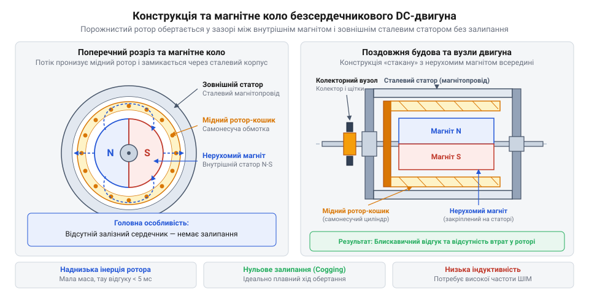
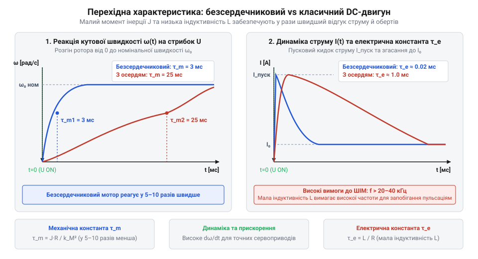
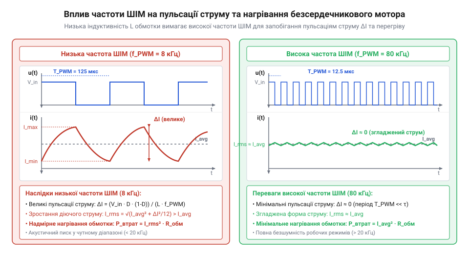
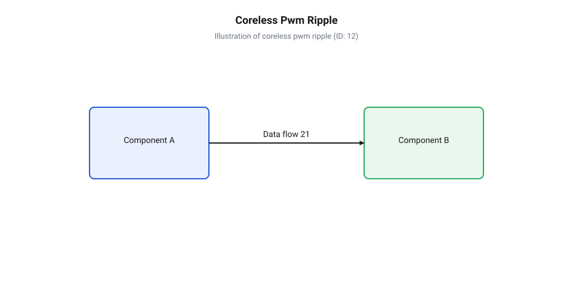
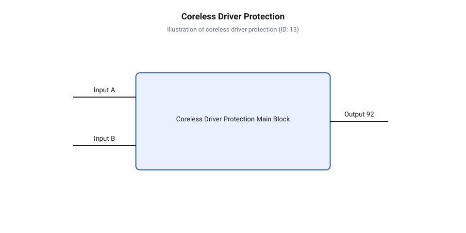

# Безсердечникові колекторні двигуни

<preknowlist>
- [Колекторний двигун типорозміру 130](root:cat-hw-actuators/dc-motor-130) — Принцип дії класичного колекторного мотора постійного струму, будова щітково-колекторного вузла та взаємодія обмоток ротора з магнітним полем статора.
</preknowlist>

## Проблема інерції та магнітного залипання

При проектуванні швидкісних робототехнічних маніпуляторів, мініатюрних квадрокоптерів чи систем оптичної стабілізації інженер негайно зіштовхується з фізичним обмеженням традиційних електродвигунів. Класичні мотори — такі як поширений [колекторний двигун 130](root:cat-hw-actuators/dc-motor-130) або промисловий [мотор-редуктор 6 В](root:cat-hw-actuators/gearmotor-6v) — використовують якорі, зібрані з листової електротехнічної сталі.

Чому наявність сталі в рухомій частині стає вузьким місцем? У класичному двигуні ізольований мідний дріт вкладають у поздовжні пази масивного залізного ротора. Сталь обирають через її високу магнітну проникність, яка ефективно проводитиме та концентруватиме магнітний потік від зовнішніх магнітів. Проте залізне осердя має високу густину (близько 7800 кг/м³).

Опір тіла зміні швидкості обертання визначається його @@en|moment of inertia@@ (від лат. *inertia* — бездіяльність, нерухомість) `J`, який для суцільного циліндра розраховується через його масу `m` та радіус `r`:

```
J = 0.5 · m · r²
```

Коли на ротор подається напруга, електромагнітний момент `M` повинен спершу подолати цей момент інерції, щоб надати масивному залізному циліндру кутове прискорення:

```
dω/dt = M ÷ J
```

У результаті класичний ротор із залізним осердям має великий @@en|moment of inertia@@. Йому потрібні десятки або й сотні мілісекунд лише для того, щоб розігнатися до робочих обертів або змінити напрямок обертання. Для механізму, який повинен коригувати положення пропелера мікродрона сотні разів на секунду, така механічна затримка є неприпустимою.

Друга суттєва фізична проблема залізного ротора — @@en|cogging torque@@ (від англ. *cog* — зубець шестерні, реактивний момент залипання). Феромагнітні зубці залізного осердя прагнуть зайняти положення з найменшим магнітним опором відносно нерухомих полюсів постійного магніту. Під час обертання кожен зубець відчуває притягання до магніту, через що ротор «залипає» у дискретних точках по колу. Щоб вивести зубець із цієї точки, мотор мусить подолати додатковий енергетичний бар'єр.

Це явище спричиняє нерівномірність обертання на низьких швидкостях, пульсації моменту та мікродискретність руху. У прецизійному приладобудуванні, де мотор повинен плавно обертатися зі швидкістю у частки оберту на секунду, реактивний момент залипання повністю руйнує точність позиціонування.

Нарешті, швидке обертання залізного осердя у постійному магнітному полі викликає постійне перемагнічування сталі та виникнення вихрових струмів. Ці @@en|iron losses@@ (втрати у залізі) перетворюють частину електричної енергії на паразитне тепло й різко знижують @@en|efficiency@@ (коефіцієнт корисної дії) на високих обертах.

Отже, для створення наддинамічних та надточних приводів виникла неминуча потреба повністю вилучити важке залізне осердя з рухомої частини двигуна, принципово змінивши його геометрію.

## Конструкція ротора та внутрішнього магніту

Розв'язанням проблеми масивного залізного ротора стало кардинальне переосмислення топології магнітної системи. Замість того щоб розміщувати магніти зовні, а важку залізну котушку всередині, конструкцію інвертували: постійний магніт закріпили нерухомо в самому центрі двигуна, а ротор створили у вигляді легкого порожнистого циліндра, що обертається навколо цього магніту.

Серцем @@en|coreless DC motor@@ (від англ. *core* — осердя та *-less* — без) є стаціонарний центральний магніт циліндричної форми, виготовлений із висококоерцитивних матеріалів (неодим-залізо-бор @@en|NdFeB@@ або самарій-кобальт @@en|SmCo@@). Цей магніт є частиною статора (від лат. *stator* — той, що стоїть) і залишається повністю нерухомим разом із центральною віссю.

Навколо центрального магніту обертається @@en|rotor@@ (від лат. *rotare* — обертатися) у формі самонесучого порожнистого мідного кошика. У цій конструкції немає жодного залізного каркаса чи зубців. Кошик сформований виключно із самоспекального мідного емальдроту, намотаного за спеціальною геометрією.

Щоб порожниста мідна гільза з товщиною стінки всього 0.3–0.8 мм зберегла ідеальну циліндричну форму та механічну жорсткість під дією відцентрових сил на швидкостях у десятки тисяч обертів на хвилину, застосовують косу намотку (@@en|skewed winding@@). Дроти складаються під кутом до поздовжньої осі двигуна, утворюючи міцну ромбічну або шестикутну сітку. Після гарячого запікання термопластичний шар емалі спікає сусідні витки в єдиний монолітний самонесучий каркас.

Дно мідного кошика з'єднане з легким пластиковим або алюмінієвим диском-павуком, який закріплений на вихідному валу двигуна. На цьому ж диску розміщено мікромініатюрний щітково-колекторний вузол. Оскільки струми ротора відносно невеликі, у безсердечникових моторах часто використовують колекторні пластини та щітки з дорогоцінних металів (золото, срібло, платина), що забезпечує мінімальне електричне та механічне тертя.

Для замикання магнітного потоку зовні мідного ротора розміщують тонкостінний сталевий циліндр — зовнішній магнітопровід (@@en|yoke@@). Важливо зауважити, що цей зовнішній корпус не обертається; він закріплений нерухомо відносно центрального магніту. Магнітний потік виходить із центрального магніту, радіально пронизує повітряний зазор разом із мідним ротором, замикається через зовнішню сталеву гільзу та повертається до протилежного полюса магніту.


*Конструкція безсердечникового двигуна в розрізі, що демонструє нерухомий внутрішній магніт, беззалізний мідний ротор-кошик та зовнішній корпус-магнітопровід.*

Оскільки ротор позбавлений феромагнітних зубців, магнітний опір повітряного зазору є абсолютно однаковим у будь-якому кутовому положенні ротора. У результаті @@en|cogging torque@@ повністю відсутній. Двигун обертається бездоганно плавно навіть при струмах у частки міліампера, дозволяючи будувати надпрецизійні системи керування.

Винайдення цієї революційної конструкції пов'язане з іменем німецького інженера Фріца Фаульхабера (@@de|Dr. Fritz Faulhaber@@), який у 1958 році запатентував технологію косої самонесучої намотки мідного ротора. До цього створення мініатюрних приводів стримувалося неможливістю зменшити залізне осердя без втрати ефективності та появою величезного моменту залипання. Поява безсердечникового мотора Фаульхабера зробила технологічний прорив: вона відкрила шлях до створення прецизійного медичного обладнання, сервоприводів авіакосмічної техніки, вібромоторів для мобільних телефонів та сучасних швидкісних мікроквадрокоптерів, де кожен грам маси та кожна мілісекунда затримки є критичними.

## Динамічний відгук та індуктивність обмотки

Вилучення заліза з ротора радикально змінює як механічні, так і електричні параметри двигуна. Оскільки маса мідного кошика вимірюється грамами або частками грама, а вся маса зосереджена близько до центральної осі, @@en|moment of inertia@@ безсердечникового двигуна у 10–50 разів менший, ніж у класичного мотора з однаковим зовнішнім діаметром.

Основним показником швидкодії мотора є механічна часова константа (@@en|mechanical time constant@@) `τ_m` — час, за який мотор досягає 63.2% своєї швидкості холостого ходу після стрибкоподібної зміни напруги:

```
τ_m = (J · R) ÷ (k_e · k_t)
```

де `J` — момент інерції ротора, `R` — активний опір обмотки, `k_e` — коефіцієнт проти-ЕРС, `k_t` — коефіцієнт моменту.

Для стандартних моторів із залізним осердям (зокрема [колекторні двигуни постійного струму](root:cat-hw-actuators/brushed-dc-motors-overview)) значення `τ_m` зазвичай становить 15–40 мілісекунд. У безсердечникових моторах завдяки мізерному `J` величина `τ_m` становить всього 1–3 мілісекунди. Це забезпечує фактично миттєве розганяння та блискавичний відгук на найменші зміни керуючої напруги.


*Реакція класичного та безсердечникового двигунів на прямокутний імпульс напруги: безсердечникова конструкція демонструє миттєве зростання обертів без затримки.*

Водночас відсутність заліза всередині котушок створює специфічний електричний ефект. Магнітна проникність повітря та міді дорівнює одиниці, тоді як електротехнічна сталь має відносну проникність у кілька тисяч. Як наслідок, індуктивність `L` обмотки безсердечникового мотора вимірюється в мікрогенрі, що в сотні разів менше за індуктивність класичного залізного ротора.

Низька індуктивність означає, що електрична часова константа `τ_e = L ÷ R` є надзвичайно малою. Струм в обмотці наростає й спадає практично миттєво.

Ця особливість створює серйозну пастку при керуванні двигуном за допомогою широтно-імпульсної модуляції (@@en|pulse-width modulation@@, ШІМ). Якщо подавати на мотор ШІМ-сигнал зі стандартною частотою (наприклад, 1–5 кГц, яка зазвичай використовується для звичайних [H-місткових силових каскадів](root:cat-hw-drivers/h-bridge-motor-driver-circuits)), струм в обмотці встигає повністю зрости до пікового значення та впасти до нуля за один період перемикання.

Амплітуда пульсацій струму `ΔI` для ШІМ з коефіцієнтом заповнення `D` та частотою `f_pwm` описується виразом:

```
ΔI = (U_in · (1 - D) · D) ÷ (L · f_pwm)
```

де `U_in` — напруга живлення, `D` — коефіцієнт заповнення ШІМ, `L` — індуктивність обмотки, `f_pwm` — частота ШІМ.

З огляду на мізерну індуктивність `L` у знаменнику, при стандартних частотах ШІМ пульсації струму `ΔI` стають величезними. Струм набуває пилоподібної форми з високими піками.

Чому це небезпечно? Обертовий момент двигуна визначається середнім значенням струму `I_avg`, тоді як теплові втрати в мідній обмотці визначаються середньоквадратичним струмом `I_rms`. При високих пульсаціях `I_rms` набагато перевищує `I_avg`. Вся «зайва» енергія пилоподібного струму перетворюється на Джоулеве тепло (`P = I_rms² · R`), не створюючи жодного корисного моменту!


*Порівняння струмових пульсацій при низькій і високій частотах ШІМ: при низькій частоті струм переривається, спричиняючи паразитне нагрівання ротора.*

Щоб згладити пульсації струму до безпечного рівня (< 10%), необхідно кардинально підвищувати частоту ШІМ — до 50–100 кГц. Вимоги до силових транзисторів описує окрема тема про [частоти ШІМ та пульсацій](root:hw-motion/pwm-frequency-selection).

Друга пастка безсердечникового ротора — його вкрай обмежена теплоємність. Оскільки мідний кошик левітує в повітряному зазорі й не має прямого металевого контакту з корпусом чи залізним масивом, тепловідвід від обмотки відбувається виключно через випромінювання та конвекцію повітря у вузькому зазорі. Якщо через низьку частоту ШІМ або тривале перевантаження температура обмотки перевищить 100–120 °C, термопластичний лак спікання розм'якшується. Ротор втрачає жорсткість, деформується від відцентрових сил та терпляче заклинює в зазорі між магнітом і корпусом, що призводить до остаточного згоряння двигуна.

Для практичного розрахунку перехідних процесів та теплових режимів використовуйте [динаміку безсердечникового двигуна](root:cat-hw-actuators/coreless-dc-motors/math-coreless-motor-dynamics.md). Детальні схеми захисту та побудови силових каскадів наведені у матеріалі про побудову [високочастотного ШІМ-драйвера](root:cat-hw-actuators/coreless-dc-motors/proj-high-frequency-coreless-driver.md) та описі [залізної обв'язки двигуна](root:cat-hw-actuators/coreless-dc-motors/api-coreless-dc-motor-hardware.md).

## Вимоги до ШІМ та теплові обмеження

Спроба підключити @@en|безсердечниковий двигун@@ до стандартного @@en|драйвер@@ (англ. *driver* — керуючий вузол), який використовують із [класичними двигунами 130](root:cat-hw-actuators/dc-motor-130) із залізним осердям, майже завжди закінчується швидким перегрівом приводу та термічним руйнуванням його обмотки. Проблема полягає не у величині робочої напруги, а в принциповій відмінності електромагнітних властивостей беззалізового ротора, який реагує на широтно-імпульсну модуляцію зовсім інакше, ніж масивний залізний якорь.

У класичному моторі залізні зубці ротора створюють значну індуктивність обмотки `L`, яка зазвичай становить від `500 мкГн` до `2000 мкГн`. Ця індуктивність працює як природний електричний маховик, що згладжує пульсації струму під час перемикання транзисторів. Натомість @@en|ротор-кошик@@ (англ. *basket rotor* — від *basket* (кошик), через порожнисту циліндричну форму) позбавлений феромагнітного матеріалу всередині котушок, тому його індуктивність `L` є мізерною — всього `5–50 мкГн`.

Швидкість зміни струму в обмотці при поданні напруги визначається реактивними параметрами кола. Співвідношення індуктивності `L` та активного опору `R` задає часову характеристику електричних процесів.

Розрахунок електричної часової константи `τ_e` здійснюється через співвідношення індуктивності та активного опору обмотки:

```
τ_e = L / R
```

Оскільки індуктивність `L` ротора-кошика є мізерно малою, величина `τ_e` становить лише `10–50 мкс`, що вимагає відповідного скорочення періоду керуючого сигналу.

Коли керування виконується за допомогою @@en|ШІМ@@ (англ. *Pulse-Width Modulation* — широтно-імпульсна модуляція, від *pulse* — пульс, *width* — ширина, *modulation* — зміна) з низькою частотою (наприклад, `1–5 кГц`, що є стандартом для багатьох мікроконтролерів), період модуляції `T_PWM = 1 / f_PWM` становить `200–1000 мкс`. Це значно перевищує електричну часову константу ротора (`T_PWM >> τ_e`). В результаті за кожен один такт ШІМ струм в обмотці встигає миттєво зрости до максимального пікового значення `I_max ≈ U_in / R` під час увімкненого стану транзистора і повністю впасти до нуля під час паузи.

Виникає масштабна @@en|пульсація струму@@ `ΔI` (англ. *ripple current*), яка має трикутну форму з амплітудою від піку до піку.

Максимальне значення пульсацій струму `ΔI_max` досягається при коефіцієнті заповнення `D = 0.5` і визначається за формулою:

```
ΔI_max = U_in / (4 · L · f_PWM)
```

З виразу видно, що амплітуда пульсацій обернено пропорційна частоті модуляції `f_PWM`, тому збільшення частоти є єдиним способом утримати пульсації в безпечних межах без додавання зовнішніх дроселів.

Головна пастка високих пульсацій полягає у розбіжності між корисним механічним моментом та тепловими втратами. Корисний обертовий момент двигуна пропорційний середньому значенню струму `I_avg`. Проте електричні втрати на @@en|Джоулів нагрів@@ (від імені фізика Джеймса Джоуля, англ. *Joule heating*) в мідному дроті визначаються квадратним діючим значенням струму `I_rms` (англ. *Root Mean Square* — діюче значення):

```
P_loss = (I_rms)² · R
```

Для трикутної форми пульсацій струму діюче значення пов'язане із середнім струмом та амплітудою пульсацій `ΔI` наступним співвідношенням:

```
(I_rms)² = (I_avg)² + ((ΔI)² / 12)
```

Додаткова теплова потужність `P_loss`, яка розсіюється в обмотці через трикутну форму пульсацій струму, розраховується через діюче значення змінної складової:

```
P_loss = ((ΔI)² / 12) · R
```

Оскільки втрати пропорційні квадрату амплітуди пульсацій `(ΔI)²`, навіть незначні низькочастотні пульсації призводять до експоненційного зростання температури ротора.


*Порівняння форми струму в роторі-кошику при низькій та високій частотах модуляції.*

Теплова вразливість ротора-кошика посилюється його конструктивними особливостями. У традиційному моторові мідний дріт покладено в пази залізного сердечника, який має велику масу та високу теплопровідність. Залізо слугує потужним буфером, що акумулює тепло й передає його на зовнішній корпус.

У безсердечниковому двигуні мідний циліндр висить у повітряному зазорі. Він складається лише з тонких провідників та компаунда (епоксидної смоли). Його маса мізерна, а єдиним шляхом відводу тепла є випромінювання та конвекція через вузькі повітряні зазори до внутрішнього магніту й зовнішнього @@en|магнітопровід@@ (англ. *yoke* — від давньоангл. *geoc* (хомут, що з'єднує й замикає магнітні лінії)). Через це @@en|теплова часова константа@@ `τ_th` ротора є надзвичайно малою. При локальному перегріві понад `100–120 °C` епоксидний сполучний матеріал розм'якшується, центробіжні сили розширюють ротор, дріт торкається стінок магнітопроводу і мотор миттєво заклинює.

Визначення мінімальної безпечної частоти ШІМ `f_PWM` для заданого рівня пульсацій виконується шляхом перетворення попереднього рівняння:

```
f_PWM = U_in / (4 · L · ΔI_max)
```

Ця залежність дає змогу розрахувати поріг частоти, за якого додаткові теплові втрати в мідному кошику не перевищують допустимих норм. Вони розраховуються за правилами [вибору частоти ШІМ](root:hw-motion/pwm-frequency-selection), а детальний аналіз перехідних процесів подано у матеріалі [динаміки струмових пульсацій](root:cat-hw-actuators/coreless-dc-motors/math-coreless-motor-dynamics.md).

**Обчислення теплових втрат на прикладі мікродвигуна**
Умови: напруга живлення `U_in = 3.7 В`, активний опір `R = 1.2 Ом`, індуктивність `L = 20 мкГн`, середній робочий струм `I_avg = 0.5 А`. Порівняємо режими керування при частотах ШІМ `5 кГц` та `80 кГц`.

```
[Крок 1. Амплітуда пульсацій при 5 кГц]
ΔI_5kHz = 3.7 / (4 · 20 × 10⁻⁶ · 5000)
        = 3.7 / 0.4
        = 9.25 А             [без урахування опору R]

[Крок 2. Реальна амплітуда з урахуванням опору R]
ΔI_real = 3.7 / 1.2
        = 3.08 А             [струм повністю наростає до максимуму]

[Крок 3. Додаткові втрати при 5 кГц]
P_loss_5kHz = ((3.08)² / 12) · 1.2
            = (9.48 / 12) · 1.2
            = 0.95 Вт         [критичний надлишковий нагрів]

[Крок 4. Амплітуда пульсацій при 80 кГц]
ΔI_80kHz = 3.7 / (4 · 20 × 10⁻⁶ · 80000)
         = 3.7 / 6.4
         = 0.578 А           [безпечна амплітуда пульсацій]

[Крок 5. Додаткові втрати при 80 кГц]
P_loss_80kHz = ((0.578)² / 12) · 1.2
             = (0.334 / 12) · 1.2
             = 0.033 Вт       [втрати знижено у 29 разів]
```

Висновок: підвищення частоти ШІМ з `5 кГц` до `80 кГц` зменшує додаткові паразитичні втрати в роторі з `0.95 Вт` до `0.033 Вт`, захищаючи компаунд від термічного розкладу. Для запобігання надзвичайним ситуаціям при заклинюванні застосовують методики, описувані в концепції [теплового розгону](root:hw-motion/motor-dynamic-thermal-model).

Щоб сформувати високу частоту ШІМ на мікроконтролері, необхідно налаштувати відповідний апаратний таймер.

:::tabs
@tab C (ESP-IDF)
:::code coreless-dc-motors-d/c/init-coreless-pwm.c
@tab C++ (Arduino / AVR)
:::code coreless-dc-motors-d/cpp/corelessmotordriver.cpp
:::

## Критерії вибору та сфери застосування

Підбір електродвигуна для високодинамічної системи завжди вимагає компромісу між прискоренням, плавністю ходу, складністю керування та ресурсом. Порівняно з компактними [мікромоторами N20](root:cat-hw-actuators/n20-motor) та традиційними колекторними приводами, безсердечниковий мотор володіє унікальною динамікою, однак поступається безколекторним рішенням у тривалості служби.

Головною перевагою безсердечникового двигуна є наднизька @@en|механічна часова константа@@ `τ_m` (англ. *mechanical time constant*), яка становить від `1` до `3 мс` проти `15–40 мс` у двигунів із залізним ротором. Відсутність залізного осердя усуває реактивний момент залипання (@@en|магнітне залипання@@, англ. *cogging torque* — від *cog* (зуб шестерні)), забезпечуючи абсолютну плавність обертання на будь-яких обертах без ривків.

| Критерій порівняння | Класичний колекторний (напр. N20) | Безсердечниковий колекторний | Безколекторний (BLDC) |
| :--- | :--- | :--- | :--- |
| **Момент інерції ротора** | Високий (залізне осердя) | Наднизький (порожниста мідна котушка) | Середній/високий (магнітний ротор) |
| **Реактивне залипання (Cogging)** | Присутнє (зубці заліза) | Відсутнє (0 N·m) | Присутнє (у більшості моделей) |
| **Часова константа `τ_m`** | `15–40 мс` | `1–3 мс` | `2–10 мс` |
| **Складність драйвера** | Низька (простий ключовий каскад) | Середня (потрібен високочастотний ШІМ) | Висока (3-фазний інвертор + датчики/алгоритми) |
| **Знос та ресурс** | Обмежений щітками (`500–1500 год`) | Обмежений щітками (`500–3000 год`) | Високий (`10000+ год`, знос лише підшипників) |
| **Перевантажувальна здатність** | Висока (теплоємне залізо) | Наднизька (ризик розплавлення кошика) | Висока |

У порівнянні з тим, як влаштовані [безколекторними двигунами](root:cat-hw-actuators/bldc-motor-module), безсердечниковий мотор виграє в простоті силого каскаду: він підключається двома проводами через стандартні [H-місткові силові каскади](root:cat-hw-drivers/h-bridge-motor-driver-circuits) (@@en|H-міст@@, англ. *H-bridge* — через схожість схеми чотирьох транзисторів із літерою H) і не вимагає складних алгоритмів фазової комутації чи векторного керування.

Завдяки поєднанню високого прискорення, малої ваги та відсутності залипань безсердечникові двигуни зайняли чіткі ніші в сучасній техніці:

1. **Мікродрони та надлегкі квадрокоптери.** Мотори типорозмірів 6×15 мм, 7×20 мм та 8×20 мм виступають прямими приводами пропелерів. Наднизький момент інерції дає змогу контуру автопілота коригувати тягу з частотою у сотні Hertz, забезпечуючи стабільну стабілізацію польоту апаратів вагою до `50 г`. 2. **Швидкісні сервоприводи та мікроробототехніка.** Використовуються у маніпуляторах, системах оптичної стабілізації зображення (OIS), касетних затворах та тактильних пристроях (haptic feedback). Відсутність залипання дає змогу позиціонувати вал із високою прецизійністю без крокової переривчастості. 3. **Медична техніка та портативні дозатори.** Інсулінові мікропомпи, портативні хірургічні інструменти, безшумні дозуючі пристрої та висококласні тату-машини. Тут критичними є високий ККД (до 85–90%), безшумність та плавний пуск від невеликої батареї.

Низька індуктивність та чутливість ротора висувають специфічні вимоги до електричної обв'язки силового каскаду.


*Схема обв'язки силового каскаду для захисту безсердечникового ротора від індуктивних сплесків та струмового перевантаження.*

При перемиканні транзисторів стрімка зміна струму `di/dt` створює короткі індуктивні сплески напруги. Звичайні випрямні діоди не здатні швидко відкриватися, тому в силовому каскаді обов'язково застосовують @@en|діод Шотткі@@ (від імені фізика Вальтера Шотткі, англ. *Schottky diode*) з малим часом відновлення зворотного опору, або реалізують @@en|активне синхронне спрямлення@@ (англ. *active synchronous rectification*) за допомогою ключових @@en|MOSFET@@ (англ. *Metal-Oxide-Semiconductor Field-Effect Transistor*).

Для гасіння високовольтних піків паралельно виводам двигуна встановлюють @@en|TVS-діод@@ (англ. *Transient Voltage Suppressor* — від *transient* (перехідний), *suppress* (пригнічувати)). Крім того, оскільки аварійне заклинювання вала призводить до згоряння ротора за `100–300 мс`, драйвер повинен мати апаратний захист від перевантаження по струму (струмовий шунт та швидкий компаратор). Повний опис структури схеми подано у описі [схеми залізної обв'язки](root:cat-hw-actuators/coreless-dc-motors/api-coreless-dc-motor-hardware.md), а практичний проект зібрання подано у описі [високочастотного ШІМ-драйвера](root:cat-hw-actuators/coreless-dc-motors/proj-high-frequency-coreless-driver.md).