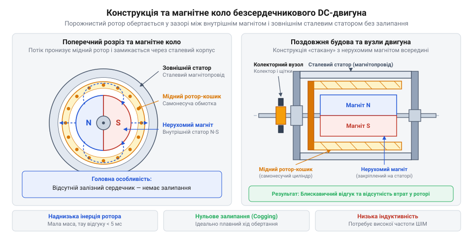
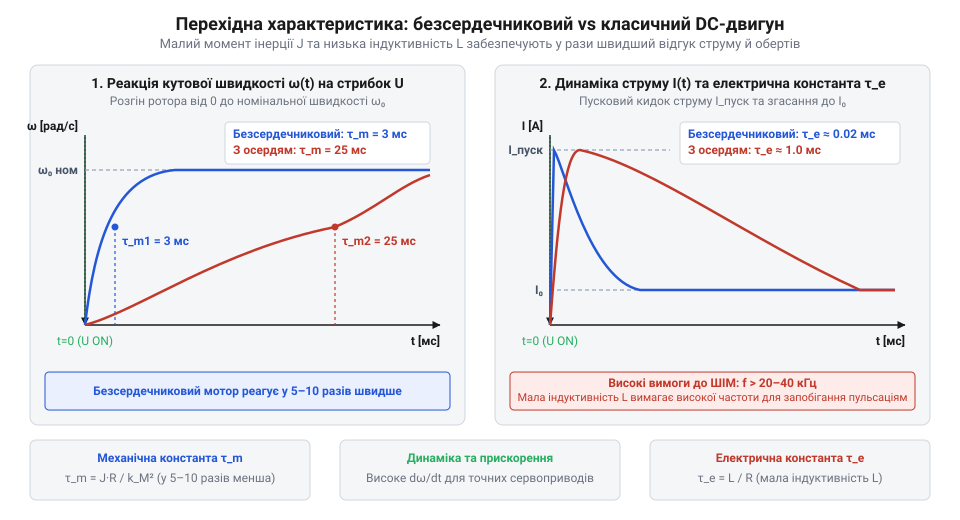
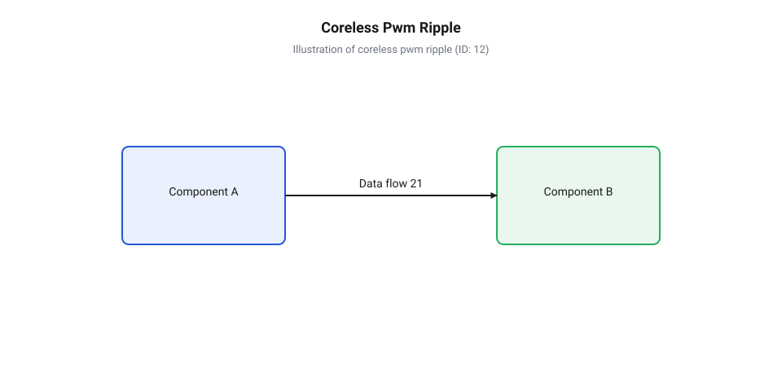
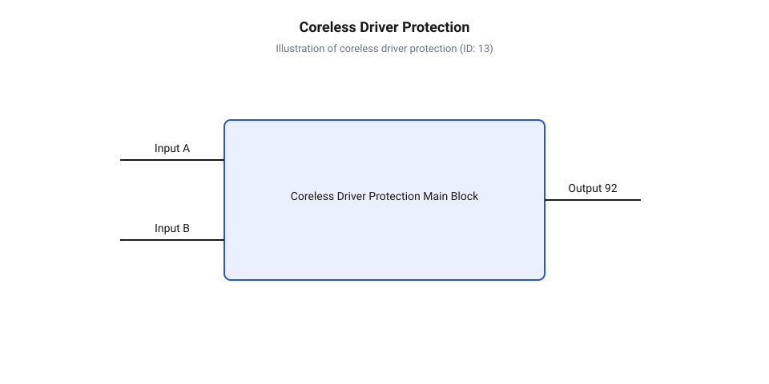

# Безсердечникові колекторні двигуни

<preknowlist>
- [Колекторний двигун типорозміру 130](root:cat-hw-actuators/dc-motor-130) — Принцип дії класичного колекторного мотора постійного струму, будова щітково-колекторного вузла та взаємодія обмоток ротора з магнітним полем статора
</preknowlist>

## Проблема інерції та магнітного залипання

Під час розробки компактних систем автоматики та мікродронів розробники стикаються з неприємним ефектом: звичайний [колекторний двигун 130](root:cat-hw-actuators/dc-motor-130) типорозміру розганяється із помітною затримкою в десятки мілісекунд і дрижить під час обертання на низьких частотах. Причина полягає в будові рухомої частини — @@en|ротор@@ (від лат. @@la|rotare@@ — обертатися) класичного мотора містить масивний якір із пакета електротехнічної сталі з мідними обмотками. Велика маса й висока густина феромагнітного матеріалу створюють значний @@en|момент інерції@@ (від лат. @@la|inertia@@ — нерухомість), який чинить опір будь-якій зміні швидкості.

Окрім інерційного запізнення, виникає явище, відоме як @@en|реактивний момент залипання@@ (або @@en|cogging torque@@). Виражені сталеві зубці осердя ротора притягуються до нерухомих постійних магнітів, якими оснащений @@en|статор@@ (від лат. @@la|stator@@ — той, що стоїть). Коли ротор обертається, ці зубці почергово долають магнітний опір зазору, створюючи пульсуюче гальмівне зусилля. Для досягнення блискавично швидкого відгуку та ідеальної плавності ходу стає фізично неминучим повне вилучення заліза з рухомого елемента приводу.

## Конструкція ротора та внутрішнього магніту

Щоб позбутися масивного залізного осердя й зберегти високу щільність магнітного потоку, інженери змінили топологію двигуна навпаки, створивши @@en|безсердечниковий двигун@@ (або @@en|coreless motor@@). У цій архітектурі потужний циліндричний постійний магніт закріплено непорушно по центру всередині корпусу. Зовнішня сталева циліндрична оболонка слугує нерухомим @@en|магнітопроводом@@, що замикає лінії магнітного поля.


*Конструкція ротора-кошика без феромагнітного осердя в безсердечниковому двигуні.*

Сам рухомий @@en|ротор@@ виготовляють у вигляді тонкостінного порожнистого циліндра, що обертається у вузькому повітряному зазорі між внутрішнім магнітом і зовнішнім магнітопроводом. Його утворює @@en|самонесуча обмотка@@ (або @@en|basket winding@@) з косо намотаного мідного емальдроту, спеченого спеціальним компаундом. Оскільки у повітряному зазорі відсутні феромагнітні зубці, @@en|реактивний момент залипання@@ повністю зникає, а маса ротора зменшується у кілька разів порівняно з класичними приводами на кшталт [мотор-редукторів на 6 В](root:cat-hw-actuators/gearmotor-6v).

## Динамічний відгук та індуктивність обмотки

Кардинальне зниження маси ротора безпосередньо впливає на динаміку мотора, скорочуючи його часові параметри. Ключовою характеристикою швидкодії є @@en|механічна часова константа@@, позначувана як `τ_m`, яка визначає час досягнення `63.2%` від номінальних обертів після подачі напруги.


*Перехідний процес розгону: безсердечниковий мотор досягає робочих обертів майже миттєво.*

Значення `τ_m` розраховують з моменту інерції ротора `J`, активного опору обмотки `R`, конструктивної сталої протиелектрорушійної сили `k_e` та коефіцієнта крутного моменту `k_t`:

```
τ_m = (J · R) ÷ (k_e · k_t)      [визначення механічної часової константи]
```

Оскільки @@en|момент інерції@@ `J` безсердечникового ротора у 5–10 разів менший, ніж у масивних приводах на зразок [N20 мікромотора з редуктором](root:cat-hw-actuators/n20-motor), значення `τ_m` зменшується від десятків мілісекунд до вражаючих `1–3 мс`.

Водночас відсутність заліза знижує @@en|індуктивність@@ (від лат. @@la|inductio@@ — наведення) обмотки `L` від мілігенрі до мікрогенрі (`10–50 мкГн`). Через це @@en|електрична часова константа@@ `τ_e` скорочується до мікросекунд:

```
τ_e = L ÷ R                      [визначення електричної часової константи]
```

Це робить струм в обмотці надзвичайно чутливим до будь-яких швидких коливань напруги живлення.

## Вимоги до ШІМ та теплові обмеження

Мізерна @@en|індуктивність@@ ротора створює серйозний виклик під час керування швидкістю за допомогою модуляції напруги. Звичайна @@en|широтно-імпульсна модуляція@@ (або @@en|ШІМ@@) низької частоти (порядок `1–5 кГц`) спричиняє стрімкі скачки струму в обмотці на кожному такті перемикання ключа.


*Пульсації струму: низька частота ШІМ викликає високі піки струму, а висока частота згладжує його.*

Сильні @@en|пульсації струму@@ (або @@en|current ripple@@) викликають додатковий паразитний @@en|джоулів нагрів@@ (або @@en|Joule heating@@). Оскільки тонкостінний мідний ротор-кошик має мінімальну теплоємність і позбавлений залізного осердя для відводу тепла, його температура зростає за лічені секунди. Для захисту обмотки від перегріву частоту ШІМ підвищують до `40–100 кГц`.


*Схемотехнічний захист драйвера безсердечникового мотора від перегріву та пікових струмів.*

Крім підвищеної частоти, силовий каскад керування доповнюють швидкодіючими елементами. Для замикання струму самоіндукції під час пауз ШІМ застосовують швидкодіючий @@en|діод Шотткі@@ (або @@en|Schottky diode@@). Також силову схему обладнують блоком апаратного обмеження струму, адже під час аварійного заклинювання ротора струм короткого замикання може миттєво розплавити мідну обмотку.