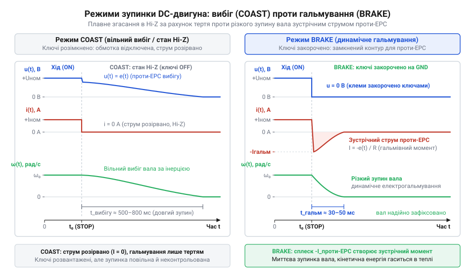
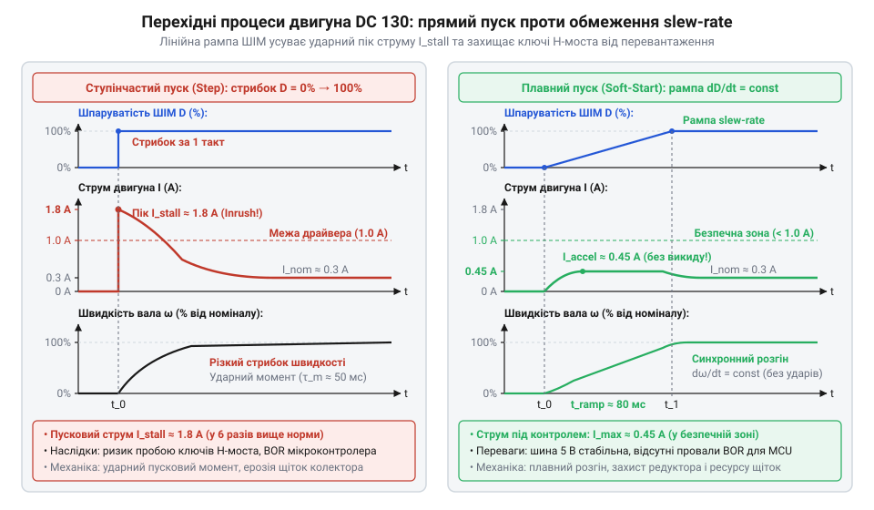

# Програмний інтерфейс драйвера (C/C++) керування двигуном постійного струму через H-міст

<preknowlist>
- [Мотор-редуктор 6 В (100 і 600 об/хв)](root:cat-hw-actuators/gearmotor-6v) — апаратна топологія H-моста на чотирьох ключах, реверс полярності напруги живлення для зміни напрямку обертання та виникнення зустрічної ЕРС (проти-ЕРС) у рухомому якорі.
- [N20 мікромотор з редуктором](root:cat-hw-actuators/n20-motor) — електродинамічні характеристики колекторного двигуна під навантаженням: залежність робочого струму від моменту на валу, кратність пускового струму та небезпека перегріву обмоток при механічному заклинюванні (stall).
</preknowlist>

## Небезпеки прямого керування та архітектура драйвера

Пряме перемикання цифрових виводів та запис у регістри таймерів для керування H-мостом колекторного приводу оманливо прості, доки не стається перша відмова. Наївне «смикання пінів» ігнорує перехідні процеси в напівпровідникових ключах та індуктивності обмоток. Силовий міст складається з двох стійок (плечей): верхній ключ з'єднаний із шиною живлення, а нижній — із землею. Якщо керувальний код миттєво перемикає напрямок руху [колекторного мікромотора з редуктором](root:cat-hw-actuators/n20-motor), затримка закриття силового транзистора призводить до одночасного відмикання обох ключів одного плеча. Виникає наскрізний струм короткого замикання (англ. *shoot-through current*; @@en|shoot-through current@@), який замикає живлення на землю й пропалює силові кристали.

Друга небезпека криється у динаміці струму: ступінчаста подача напруги на нерухомий ротор породжує пусковий кидок струму заклинювання, що різко просаджує живлення логіки й спричиняє апаратне скидання мікроконтролера через просідання живлення (англ. *brownout reset*; @@en|brownout reset@@). Нарешті, наївна спроба зупинити [колекторний двигун постійного струму](root:cat-hw-actuators/gearmotor-6v) простим обнуленням сигналу керування відмикає всі ключі моста, переводячи виходи у високоімпедансний стан (від лат. *impedire* — «перешкоджати»; @@en|Hi-Z@@). Замість активної фіксації вала мотор переходить у вільний вибіг (англ. *coast* — «рух накатом»; @@en|coast@@), продовжуючи котитися за інерцією.

Запобігає аваріям модульний драйвер (англ. *driver* від *drive* — «вести, рухати»; @@en|driver@@). Його основою є дескриптор приводу (від лат. *descriptor* — «описувач»; @@en|descriptor@@) — структура, що інкапсулює апаратні ресурси, калібрувальні ліміти та поточний динамічний стан каскаду. Зміну режимів регламентує детермінований скінченний автомат станів (англ. *finite state machine*; @@en|finite state machine@@, FSM): `Ready` (каскад знеструмлено), `Forward` і `Reverse` (рух), `Brake` (динамічне гальмування закорочуванням клем через нижні ключі; від грец. *dynamis* — «сила»; @@en|dynamic braking@@), `Coast` (вільний вибіг) та `Fault` (захисне блокування при аварії). Автомат станів ізолює прикладну логіку від регістрів мікроконтролера й контролює виконання часових інтервалів між перемиканнями.

## Конфігурація периферії та безпечна ініціалізація

Зв'язок драйвера з апаратурою мікроконтролера описує конфігураційна структура. Вона визначає прив'язку ліній: канал таймера широтно-імпульсної модуляції (англ. *pulse-width modulation*; @@en|pulse-width modulation@@, ШІМ) для регулювання напруги, цифрові виводи вибору напрямку та аналоговий канал вимірювання струму якоря. Базову частоту ШІМ обирають в ультразвуковому діапазоні понад 20 кГц. Це повністю усуває чутний писк обмоток і забезпечує неперервний струм через індуктивність якоря: струм не встигає спасти до нуля за період комутації, що згладжує пульсації крутного моменту, зменшує нагрів і підвищує енергоефективність приводу.

Під час перезавантаження мікроконтролера цифрові виводи перебувають у стані плаваючого входу або випадкових підтяжок, що здатне відкрити ключі моста й смикнути вал до старту керівної програми. Безпечний запуск покладено на функцію `motor_init()`. Спершу функція валідує вхідні параметри: перевіряє коректність номерів виводів, доступність таймера та межі частоти. Далі периферія налаштовується із примусовим записом нульових рівнів на всі ключі каскаду, що унеможливлює випадковий рух вала. Лише після переведення моста в гарантовано пасивний стан дескриптор переходить у стан `Ready`, а функція повертає код успіху `MOTOR_OK`.

:::tabs
:::code api-brushed-dc-motor-control/c/snippet-1.c
:::code api-brushed-dc-motor-control/cpp/motorstatus.cpp
:::

## Керування швидкістю, реверсом і мертвий час

Пряме завдання швидкості записом у регістри таймера прив'язує код до розрядності ШІМ і змушує окремо контролювати лінії напрямку. Неузгоджене оновлення виводів спричиняє ривки вала або коротке замикання плеча. Драйвер абстрагує керування викликом `motor_set_speed()`, що приймає нормалізоване значення зі знаком `speed` від `-1.0` до `+1.0`. Знак задає полярність обертання, а модуль — швидкість.

На малих швидкостях двигун не рушає: електромагнітний момент не долає статичне тертя щіток і редуктора. Утворюється нечутлива мертва зона (англ. *deadband*; @@en|deadband@@), де мала шпаруватість (англ. *duty cycle*; @@en|duty cycle@@) лише нагріває якір. Драйвер компенсує її програмно: ненульову швидкість лінійно масштабують від порогу рушання `duty_min` до одиниці: `duty = duty_min + |speed| · (1.0 - duty_min)`. За нульової швидкості напруга вимикається.

Найнебезпечніший процес — реверс. Транзистори закриваються не миттєво: розряд ємностей затворів і розсмоктування носіїв заряду потребують часток мікросекунди. Якщо відкрити протилежний ключ до повного закриття попереднього, виникне наскрізний струм (@@en|shoot-through current@@), який пропалює кристали. Тому `motor_set_speed()` при зміні знака спочатку обнуляє ШІМ, переводячи ключі у високоімпедансний стан (@@en|Hi-Z@@) на захисний інтервал мертвого часу (англ. *dead-time*; @@en|dead-time@@), і лише після повного закриття перемикає напрямок. Необхідну тривалість цієї паузи розраховують за динамічними параметрами перемикання силових транзисторів із паспорта виробника. Повне вимикання закритого ключа визначають час затримки вимикання `t_d(off)` і час спаду струму `t_f`, тоді як зустрічний ключ починає проводити струм уже через час затримки вмикання `t_d(on)`. Щоб виключити спільну провідність плеча, мінімальний мертвий час `t_dead` обчислюють як різницю між інтервалом вимикання та затримкою вмикання з додаванням захисного часового запасу `t_margin` на технологічний і температурний розкид:

**Розрахунок тривалості мертвого часу для польових транзисторів моста за параметрами t_d(off) = 60 нс, t_f = 40 нс, t_d(on) = 25 нс та запасом t_margin = 125 нс:**

```
t_dead
= (t_d(off) + t_f - t_d(on)) + t_margin             [умова безпечного рознесення фаз комутації]
= (60 · 10⁻⁹ + 40 · 10⁻⁹ - 25 · 10⁻⁹) + 125 · 10⁻⁹ [підстановка параметрів із паспорта]
= 75 · 10⁻⁹ + 125 · 10⁻⁹                            [різниця часу закриття та відкриття ключів]
= 200 · 10⁻⁹ с                                      [мінімальна тривалість мертвого часу]
= 0.20 мкс                                          [переведення величини в мікросекунди]
```

Отримані `0.20` мкс задають нижню межу захисної паузи драйвера. Запас `t_margin` у 100–150 нс є обов'язковим: нагрівання кристала під навантаженням уповільнює розряд затвора й затягує спад струму на 20–40%, що без запасу спричиняє раптовий наскрізний пробій. Водночас надмірне збільшення мертвого часу спотворює середню напругу ШІМ і розширює нечутливу мертву зону на малих швидкостях, тому паузу обирають мінімально достатньою для надійного закриття ключів.

## Режими зупинки: вибіг проти активного гальмування

Обнулення шпаруватості не зупиняє механізм миттєво. Ротор накопичує кінетичну енергію, і спосіб її розсіювання визначає поведінку вала. Функція `motor_stop()` реалізує два режими: вільний вибіг `MOTOR_COAST` та активне динамічне гальмування `MOTOR_BRAKE`.

У режимі вільного вибігу (@@en|coast@@) драйвер розмикає всі ключі моста у високоімпедансний стан (@@en|Hi-Z@@). Коло розривається, струм якоря спадає до нуля, а вал крутиться за інерцією. Енергія згасає лише від тертя в підшипниках і зубцях [колекторного мотор-редуктора](root:cat-hw-actuators/gearmotor-6v). Вибіг усуває нагрів обмоток, проте зумовлює відчутний перебіг цільової позиції.

Для фіксації вала застосовують активне динамічне гальмування (@@en|dynamic braking@@) `MOTOR_BRAKE`. Драйвер відмикає верхні ключі від живлення й замикає обидва нижні, закорочуючи клеми двигуна на землю. Обертовий ротор стає генератором: рух індукує у витках зустрічну електрорушійну силу — проти-ЕРС (англ. *counter-electromotive force*, back-EMF; @@en|back-EMF@@). У замкненому контурі виникає потужний зворотний струм. За законом Ампера він взаємодіє з магнітним полем статора, створюючи зустрічний гальмівний момент.


*Часові діаграми в режимах вибігу та гальмування: закорочування виводів викликає сплеск струму проти-ЕРС і форсовано зупиняє вал.*

Кінетична енергія ротора перетворюється на джоулеве тепло на активному опорі обмоток. Гальмування миттєво зупиняє вал, але часті циклічні зупини масивного навантаження перегрівають привід. Тому вибіг обирають для пасивного простою, а гальмування — для точного позиціонування та екстреного зупину.

:::tabs
```c
typedef enum {
    MOTOR_STOP_COAST = 0,   // Вільний вибіг
    MOTOR_STOP_BRAKE        // Активне динамічне гальмування
} motor_stop_mode_t;

motor_status_t motor_set_speed(motor_t *dev, float speed);
motor_status_t motor_stop(motor_t *dev, motor_stop_mode_t mode);
```
```cpp
enum class StopMode {
    Coast = 0,  // Вільний вибіг
    Brake       // Активне динамічне гальмування
};

class MotorDriver {
public:
    MotorStatus setSpeed(float speed);
    MotorStatus stop(StopMode mode = StopMode::Brake);
};
```
:::

## Плавний пуск і темпове обмеження прискорення

Миттєве стрибкоподібне перемикання шпаруватості (@@en|duty cycle@@) від нуля до максимуму подає повну напругу живлення на нерухомий якір. За нульової швидкості зустрічна проти-ЕРС (@@en|back-EMF@@) дорівнює нулю, тому струм обмежується лише мізерним активним опором обмотки. Виникає пусковий пік струму, який у кілька разів перевищує номінальний, різко просаджує шину живлення та породжує ударний крутний момент. В актуаторах із редуктором, як-от [мотор-редуктор 6 В](root:cat-hw-actuators/gearmotor-6v), ударне прискорення здатне зрізати зубці шестерень.

Для захисту силового кола й механіки застосовують плавний пуск (англ. *soft-start*; @@en|soft-start@@) і темпове обмеження (англ. *slew-rate limiter* від *slew* — «повертати»; @@en|slew-rate limiter@@). Замість ступінчастого переходу драйвер веде шпаруватість до цільового значення вздовж похилої лінії — лінійної рампи (від фр. *rampe* — «похила площина»; @@en|ramp@@). Цю задачу виконує неблокуюча функція обслуговування `motor_update()`, яку періодично викликають із диспетчера задач або переривання системного таймера з фіксованим кроком у часі `dt`. За кожен виклик поточна шпаруватість зміщується в напрямку цілі на крок `step = slew_rate · dt`, обмежуючи темп наростання (@@en|slew-rate@@).


*Графіки перехідного процесу швидкості та струму: керована рампа шпаруватості зрізає пусковий пік струму й запобігає ударному навантаженню на редуктор.*

## Струмовий захист, блокування ротора та відновлення

Навіть за плавного пуску привод залишається вразливим до механічних перешкод. Якщо робочий орган заклинить, обертання припиняється, проти-ЕРС зникає, а струм різко підскакує до граничного струму блокування (англ. *stall current* від *stall* — «глушити, зупиняти»; @@en|stall current@@). Безперервне протікання надструму спричиняє термічне руйнування ізоляції обмоток [мікромотора з редуктором](root:cat-hw-actuators/n20-motor) і тепловий пробій транзисторів моста.

Драйвер контролює навантаження через аналогове зчитування струмового датчика за допомогою АЦП або лінію аварії інтегрального каскаду. Комутація ключів породжує перешкоди, а заряд ємностей викликає імпульсні викиди струму. Щоб уникнути хибних спрацьовувань, драйвер ігнорує вимірювання впродовж вікна бланкування (англ. *blanking time* від *blank* — «заглушувати»; @@en|blanking time@@) після кожного перемикання ШІМ і фільтрує відліки.

Якщо виміряний струм утримується вище порогу блокування довше за часовий таймаут, драйвер автоматично переходить у стан аварії (англ. *fault*; @@en|fault@@) `MOTOR_FAULT`. Генерація ШІМ негайно вимикається з переведенням виходів у високоімпедансний стан (@@en|Hi-Z@@), а нові команди руху блокуються. Відновлення роботи вимагає усунення причини заклинювання та явного виклику функції `motor_reset_fault()`, яка перевіряє нульовий струм, скидає прапорець помилки й повертає автомат у стан готовності `Ready`.

:::tabs
```c
typedef struct {
    float max_slew_rate;        // Темп наростання шпаруватості (1/с)
    uint16_t stall_current_ma;  // Поріг струму заклинювання (мА)
    uint16_t stall_timeout_ms;  // Час до фіксації блокування (мс)
} motor_protection_t;

motor_status_t motor_update(motor_t *dev, uint32_t dt_ms);
motor_status_t motor_reset_fault(motor_t *dev);
```
```cpp
struct ProtectionConfig {
    float maxSlewRate{2.0f};       // Темп наростання шпаруватості (1/с)
    uint16_t stallCurrentMa{1500}; // Поріг струму заклинювання (мА)
    uint16_t stallTimeoutMs{200};  // Час до фіксації блокування (мс)
};

class MotorDriver {
public:
    MotorStatus update(uint32_t dtMs);
    MotorStatus resetFault();
    bool isFault() const;
};
```
:::
