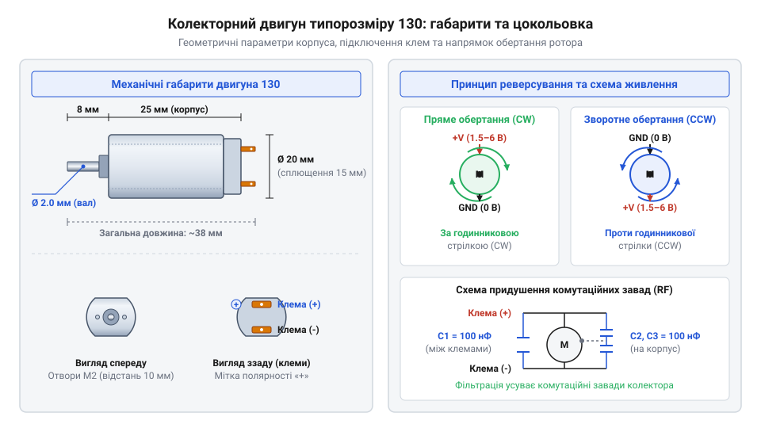
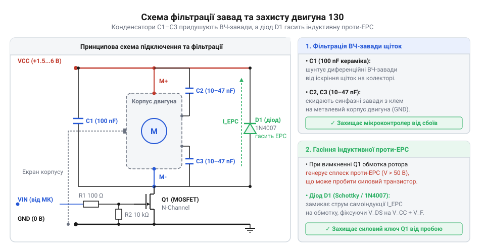

# Апаратний інтерфейс колекторного двигуна типорозміру 130: габарити, полярність, електричні та механічні граничні параметри

## Неконтрольовані завади та струмові кидки

Пряме підключення компактного двигуна постійного струму до спільних шин живлення мікроконтролерної системи часто призводить до раптових перезавантажень обчислювального ядра, спотворення цифрових сигналів периферії або миттєвого теплового пробою силових транзисторних ключів. У момент замикання контактів двигун поводиться не як лінійний активний опір, а як складне динамічне навантаження, що поєднує низький статичний опір мідного дроту, індуктивність обмоток та періодичне розривання електричного контакту механічними щітками. Якщо розробник сприймає мотор як простий двополюсник, шина живлення мікроконтролера зазнає глибоких просідань напруги нижче порогу виявлення аварійного живлення (коричневого скидання), а цифрові лінії зв'язку заповнюються високочастотним імпульсним шумом.

Фізична причина такої поведінки полягає у двох незалежних явищах: пуск із нерухомого стану та комутаційні перехідні процеси у щеточно-колекторному вузлі. Конструктивно @@la|колекторний двигун@@ (від лат. *collector* — збирач, збирати струм) містить нерухомий @@la|статор@@ (від лат. *stator* — той, що стоїть) з постійними магнітами та обертовий @@la|ротор@@ (від лат. *rotare* — обертатися) з мідними обмотками. Коли ротор не рухомий, у його обмотках відсутня електрорушійна сила обертання, яка під час руху протидіє прикладеній зовнішній напрузі. Через це в перші мілісекунди після подачі живлення струм у колі обмежений лише низьким омічним опором мідного дроту. Виникає потужний пусковий кидок струму, який у кілька разів перевищує робоче споживання. Якщо внутрішній опір джерела живлення чи акумулятора є відчутним, цей кидок спричиняє падіння напруги на шині VCC, викликаючи скидання мікроконтролера за порогом brown-out reset.

Паралельно з цим під час обертання ротора металеві або графітові щітки безперервно ковзають по пластинах, з яких складається @@la|колектор@@ (від лат. *collector* — збирач). Кожного разу, коли щітка переходить з однієї ламелі колектора на іншу, струм в індуктивній обмотці ротора раптово розривається. Накопичена в магнітному полі обмотки енергія породжує високочастотну @@la|ЕРС самоіндукції@@ (від лат. *inductio* — наведення), що має вигляд коротких сплесків напруги протилежної полярності високої амплітуди. Ці високовольтні індуктивні імпульси проникають у кола керування через спільну шину заземлення та паразитичні ємності монтажу, викличучи хибні спрацьовування переривань та збої в інтерфейсах I2C чи SPI.

Паразитичні індуктивності з'єднувальних провідників додатково погіршують ситуацію: швидка зміна струму `dI/dt` під час перемикання створює локальні сплески потенціалу на заземлюючому провіднику, розриваючи єдину опорну точку для цифрових логічних рівнів. Для побудови стабільного пристрою неможливо обмежитися лише програмними затримками чи підключенням довільного силового ключа. Необхідно чітко розраховувати геометричні межі установки компонента, знати його паспортизовані електричні межі та застосовувати спеціалізовані схемотехнічні фільтри й елементи розв'язки.

## Геометрія корпусу та полярність живлення

Колекторний двигун типорозміру 130 є одним із найпоширеніших стандартних виконань малопотужних актуаторів у циліндричному металевому корпусі. Стандартизоване позначення «130» визначає базові механічні габарити корпусу: зовнішній діаметр циліндра становить 20 мм (із двома зрізаними плоскими боковинами, що зменшують ширину корпусу до 15 мм), а довжина металевої частини корпусу без урахування вала та виводів становить 25 мм. Вихідний сталевий вал має нормований діаметр 2.0 мм та довжину вильоту від 8 до 9 мм, що дозволяє використовувати стандартні запресовані пластикові шестерні, шківи та насадні муфти.


*Геометричні габарити корпусу типорозміру 130, діаметр вала та зв'язок полярності живлення напрямку руху.*

У задній пластиковій кришці двигуна розташовано дві пласкі металеві клеми живлення з отворами під пайку. Полярність підключення напруги постійного струму до цих клем безпосередньо визначає напрямок створення механічного моменту та напрямок обертання ротора. Коли до клеми з позначкою «плюс» (або промаркованої тисненням чи кольоровою крапкою) підключають позитивний потенціал джерела, а до протилежної клеми — заземлення, вектор струму створює магнітне поле ротора, яке взаємодіє з постійними магнітами статора й викликає обертання вала за годинниковою стрілкою (якщо дивитися з боку вихідного вала).

При зміні полярності підключення живлення (подачі позитивного потенціалу на другу клему) напрямок струму в обмотках ротора змінюється на протилежний. Внаслідок зміни векторів магнітної індукції ротор починає обертатися проти годинникової стрілки. Така властивість дозволяє здійснювати повний реверс напрямку руху шляхом перемикання силових ключів.

Під час монтажу та пайки дротів до клем необхідно суворо дотримуватися температурного режиму: перегрів клем понад 300 °C тривалістю понад 3 секунди призводить до розм'якшення пластикової задньої кришки, зміщення внутрішніх щеточних контактів та незворотного псування двигуна. Опорами вала слугують бронзові втулки ковзання, які розраховані переважно на радіальні навантаження і не здатні витримувати значні осьові зусилля. Через низький власний момент на валу та високі робочі оберти (до 10000–15000 об/хв при напрузі 3–6 В) мотор 130 рідко застосовують у прямому приводі безперервно навантажених механізмів. Найчастіше його інтегрують у складніші вузли: для передачі великого крутного моменту використовують [мотор-редуктор 6 В](root:cat-hw-actuators/gearmotor-6v), де частота обертання знижується зубчастою передачею, а у компактних пристроях застосовують [N20 мікромотор з редуктором](root:cat-hw-actuators/n20-motor) зі схожими електричними принципами.

## Електричні параметри та режими навантаження

Паспортизований робочий діапазон напруги постійного струму для класичного мотора типорозміру 130 становить від 1.5 В до 6.0 В DC при номінальній робочій напрузі 3.0 В або 4.5 В. Залежність напруги та обертів описується фундаментальним рівнянням електричного балансу ротора:

```
V_in
= I_rot × R_rot + E_emf    [рівняння напруги для кола ротора]
= I_rot × R_rot + k_e × ω   [заміна проти-ЕРС через конструктивний коефіцієнт k_e та кутову швидкість ω]
```

Зі збільшенням напруги `V_in` зростає кутова швидкість обертання `ω`, проте одночасно збільшується струмове навантаження на щеточний вузол і прискорюється його механічний знос.

Для розрахунку кіл живлення та вибору силових транзисторів необхідно враховувати чотири ключові електричні параметри мотора:

1. **Опір обмоток ротора** (`R_rot`) — статичний омічний опір послідовно з'єднаних котушок між клемами мотора у нерухомому стані. Для типових моторів 130 він становить від 2.0 Ом до 4.0 Ом. 2. **Струм холостого ходу** (`I_idle`, або `@@en|no-load current@@`) — струм, який споживає мотор при номінальній напрузі у стані вільного обертання вала без зовнішнього механічного навантаження. Складові цього струму витрачаються лише на подолання тертя в підшипниках та в щеточному вузлі (зазвичай від 70 мА до 150 мА при 3 В). 3. **Номінальний робочий струм** (`I_nom`) — струм споживання при роботі з розрахованим механічним навантаженням на валу (зазвичай від 200 мА до 450 мА). 4. **Струм блокування вала** (`I_stall`, або `@@en|струм блокування@@`) — піковий струм, який виникає при повній зупинці (заклинюванні) вала під навантаженням або у найперший момент пуску, коли `ω = 0` і проти-ЕРС `E_emf = 0`.

Розрахуємо електричні та теплові режими мотора при прикладеній напрузі 5.0 В та опорі обмотки 2.5 Ом.

**Розрахунок пускового струму блокування та теплових втрат при заклинюванні вала**

```
I_stall
= V_in ÷ R_rot            [закон Ома для нерухомого ротора з відсутньою проти-ЕРС]
= 5.0 ÷ 2.5               [підстановка значення напруги 5 В та опору 2.5 Ом]
= 2.0 А                   [піковий струм у момент пуску або заклинювання]
```

```
P_heat
= V_in × I_stall          [електрична потужність, що виділяється у вигляді тепла]
= 5.0 × 2.0               [підстановка напруги та струму блокування]
= 10.0 Вт                 [теплова потужність, що розсіюється на обмотці ротора]
```

Механічна характеристика двигуна показує лінійне зменшення обертів від максимальних значення `ω_max` до нуля при зростанні механічного моменту на валу до пікового значення моменту заклинювання `T_stall`. Обчислення свідчать, що при блокуванні вала струм зростає до 2.0 А, а теплова потужність у 10 Вт миттєво розігріває обмотки й пластиковий корпус. Якщо такий режим триває більше кількох секунд, ізоляційний лак дротів плавиться, виникає міжвиткове коротке замикання, а щеточний вузол незворотно руйнується.

Силове джерело живлення має розраховуватися виходячи із забезпечення струму `I_supply >= 1.2 × I_stall` без просідання напруги шини. На відміну від статичних навантажень, де працюють [5V безколекторні вентилятори](root:cat-hw-actuators/fan-5v) з вбудованим електронним захистом, або пристроїв на кшталт [водяна помпа RS-360SH](root:cat-hw-actuators/water-pump-rs360sh) з фіксованим гідравлічним опором, колекторний мотор 130 створює динамічні кидки споживання. Порівняно з іншими актуаторами, такими як [кроковий мотор 28BYJ-48](root:cat-hw-actuators/28byj-48-stepper) з дискретним фазним керуванням або високоефективний [безколекторний мотор](root:cat-hw-actuators/bldc-motor-module), мотор 130 потребує значно більшого запасу по струму силових транзисторних ключів.

## Придушення завад і захист кіл

Фізичний механізм виникнення високочастотних імпульсних завад від колекторного двигуна пов'язаний з іскрінням у щеточному вузлі. У момент перемикання щіток між ламелями колектора виникає електрична мікродуга, яка генерує широкий спектр радіочастотних завад (від сотень кілогерц до десятків мегагерц). Цей шум поширюється як у вигляді випромінювання від дротів живлення, так і у вигляді наведених струмів у металевому корпусі мотора.

Для придушення високочастотних завад безпосередньо на клеми двигуна встановлюють фільтруючі керамічні конденсатори з мінімальною довжиною виводів:

1. Один диференціальний @@la|конденсатор@@ (від лат. *condensare* — згущувати) ємністю 0.1 мкФ (100 нФ) приєднують паралельно між силовими клемами мотора. Він шунтує високочастотні імпульси між провідниками живлення. 2. Два синфазних конденсатори ємністю по 0.01–0.1 мкФ приєднують від кожної з клем безпосередньо на металевий корпус двигуна. Вони скидають синфазний шум та статичний заряд з корпусу на заземлення.

Паралельно силовому транзистору або клемам двигуна обов'язково встановлюють @@en|демпферний діод@@ (від нім. *Dämpfer* — глушник та грец. *diodos* — двоелектродний шлях), увімкнений у зворотному напрямку відносно напруги живлення. Для цієї ролі обирають швидкодіючі діоди Шотткі (наприклад, 1N5819 або SS14) із малим часом зворотного відновлення та низьким прямим падінням напруги. У момент розмикання силового ключа @@la|індуктивність@@ (від лат. *inductio* — наведення) обмоток прагне зберегти струм, створюючи сплеск ЕРС самоіндукції. Захисний діод відкривається і замикає струм самоіндукції у контурі обмотки мотора, обмежуючи напругу на колі на рівні прямого падіння на діоді (близько 0.4 В).


*Схемотехнічне обв'язування колекторного двигуна для придушення комутаційних завад та захисту силового ключа.*

Для повного захисту кіл керування від заклинювання вала в кола живлення мотора послідовно впаюють самовідновлювальні запобіжники (PTC-термістори), які при зростанні струму до рівня `I_stall` нагріваються й різко збільшують свій опір. Для керування напрямком та швидкістю обертання мотор підключають через спеціалізований [H-мостовий драйвер](root:cat-hw-drivers/h-bridge-motor-driver-circuits), який забезпечує апаратне перемикання полярності та вбудований захист від короткого замикання. Для плавного регулювання потужності та обмеження пускових струмів застосовують [PWM-керування моторами](root:hw-motion/pwm-motor-speed-control), що регулює середнє значення напруги на клемах мотора.