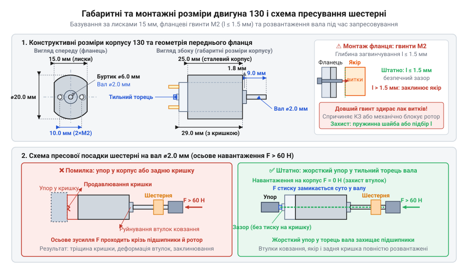

# Залізний інтерфейс та електромеханічна специфікація двигуна типорозміру 130

## Пастки інтеграції мініатюрного колекторного привода

Спроба під'єднати мініатюрний колекторний двигун (колектор від лат. @@la|collector@@ — збирач, англ. @@en|brushed DC motor@@) типорозміру 130 безпосередньо до виводу мікроконтролера або лінійного стабілізатора гарантовано виводить схему з ладу. У момент пуску нерухомий якір не генерує зустрічної напруги, тому низький активний опір мідної обмотки викликає кидок струму заклинювання (англ. @@en|stall current@@) до 2.5 А. Слабке джерело живлення зазнає падіння напруги нижче критичного порогу, спричиняючи циклічне перезавантаження керуючої логіки (англ. @@en|brownout reset@@), а вихідні ключі плати згоряють від перевантаження.

Механічний монтаж без урахування конструкції мотора призводить до фатальних деформацій. Спроба запресувати насадку на вал звичайним натисканням зміщує ротор (лат. @@la|rotare@@ — обертатися), вибиває тильний підшипник і руйнує внутрішній щітковий вузол. Водночас перегрів контактів паяльником понад три секунди розплавляє тонкий пластиковий щіткотримач задньої кришки. Надійна інтеграція привода вимагає суворого розрахунку струмового бюджету, фіксації корпусу за його штатними базами та безперегрівного підключення.

## Геометрія корпусу та монтажні розміри

Сталевий корпус двигуна 130 має комбіновану циліндричну форму зі зрізаними паралельними гранями: діаметр дугоподібних ділянок становить 20.0 мм, ширина між плоскими щоками — 15.0 мм, а довжина металевої частини — 25.0 мм. Плоскі грані утворюють опорні монтажні бази: вони затискаються в ложементі шасі або охоплюються скобою, повністю блокуючи реактивний крутний момент від провертання мотора під навантаженням.

Передній металевий фланець містить циліндричний центрувальний буртик підшипника діаметром 6.0 мм і висотою 1.8 мм, що забезпечує співвісність вала з посадковим місцем редуктора. Симетрично буртика виконано два нарізні отвори М2 з міжосьовою відстанню 10.0 мм. Глибина загвинчування кріпильних гвинтів усередину корпусу жорстко обмежена величиною 1.5 мм. Відстань від передньої стінки до витків ротора мінімальна: довший гвинт впирається в мідний дріт якоря, здирає ізоляційний лак і викликає коротке замикання або механічно блокує обертання.

Вихідний вал двигуна діаметром 2.0 мм розрахований на гарячу або пресову посадку деталей із натягом близько 0.05 мм. На нього запресовують ведучі шестерні чи шківи, або використовують готовий [мотор-редуктор 6 В](root:cat-hw-actuators/gearmotor-6v) зі встановленим передавальним механізмом. Запресовування вимагає осьового зусилля понад 60 Н, яке заборонено передавати через корпус: опорні втулки ковзання (англ. @@en|sleeve bearing@@) змістяться, і задній торець ротора проломить кришку. Посадку шестерні виконують струбциною лише з жорстким упором у задній торець самого сталевого вала, завдяки чому стискальне навантаження замикається суто всередині осі.


*Монтажні бази корпусу двигуна 130, обмеження довжини гвинтів М2 до 1.5 мм та схема розвантаження підшипників упором у задній торець вала.*

## Контактні пелюстки, реверсування та паяння

Живлення підводиться до двигуна через дві вигнуті латунні пелюстки на задній торцевій кришці корпусу. Напрямок обертання вала визначається полярністю напруги: пряме підключення обертає @@la|ротор@@ за годинниковою стрілкою, а зміна знаків живлення — @@la|реверсування@@ (лат. *revertor* — повертатися) — змушує його крутитися проти неї. Для автоматичної зміни полярності використовують @@en|H-міст@@ (англ. *H-bridge*, схема зв'язку у формі літери H) — інтегральний [драйвер H-моста](root:hw-motion/h-bridge-drivers), який комутує клеми чотирма транзисторними ключами.

Задня кришка одночасно править за пластиковий щіткотримач, у якому зафіксовано пружні контакти, що ковзають по @@fr|ламелях@@ (лат. *lamella* — тонка пластинка) колектора. Тривалий контакт із гарячим паяльником понад 2–3 секунди або температура жала понад 280 °C розм'якшують термопластик. Посадкове гніздо пливе, пружні щітки перекошуються, втрачають контакт із @@fr|ламелями@@, і мотор остаточно перестає працювати. Щоб зберегти вузол, провідники заздалегідь зачищають, лудять нейтральним флюсом і припаюють до пелюсток коротким дотиком.

На відміну від систем, де [безколекторний мотор](root:cat-hw-actuators/bldc-motor-module) обходиться без ковзних контактів, тертя металевих щіток об ламелі створює постійне іскріння та високовольтні завади в лініях живлення. Для їх пригнічення безпосередньо на виводах розпаюють три керамічні конденсатори ємністю 10–100 нФ: один між пелюстками та два між кожною пелюсткою і металевим статором.


*Підключення двигуна через транзисторний H-міст із захистом від індуктивних викидів та триконденсаторним пригніченням високочастотних іскрових завад колектора.*

## Робоча напруга та струм заклинювання

Двигун 130 розрахований на номінальну напругу 3.0 В, але працює в діапазоні від 1.5 до 6.0 В. Нижче 1.5 В пусковий момент надто малий, щоб подолати тертя спокою ротора, а вище 6.0 В колектор надмірно іскрить і швидко руйнується. Якщо приводу потрібна вища напруга чи тяга без деградації щіток, застосовують [мотор-редуктор 6 В](root:cat-hw-actuators/gearmotor-6v).

На холостому ходу мотор споживає 70–150 мА. Струм утримується низьким тому, що обертання котушок у магнітному полі породжує зустрічну напругу — @@en|проти-ЕРС@@ (англ. *back-EMF*, проти-електрорушійна сила), яка віднімається від напруги живлення. Під механічним навантаженням оберти спадають, @@en|проти-ЕРС@@ зменшується, а робочий струм зростає до 300–600 мА.

Якщо вал повністю зупинити зовнішнім навантаженням, ротор не обертається і @@en|проти-ЕРС@@ падає до нуля. Тоді струм крізь обмотки обмежується лише напругою живлення `U` та активним омичним опором мідного дроту котушок `R`. Піковий @@en|струм заклинювання@@ `I_stall` знаходять за законом Ома:

```
I_stall
= U / R         [закон Ома за нульової проти-ЕРС]
= 3.0 / 1.2     [номінальна напруга 3.0 В та активний опір обмотки 1.2 Ом]
= 2.5 А         [піковий струм заклинювання]
```

За напруги 3.0 В та опору котушок 1.2 Ом струм сягає 2.5 А, створюючи пікову потужність 7.5 Вт. Джерело живлення та ключі комутації повинні витримувати цей пік без просідання напруги, щоб запобігти скиданню керівного мікроконтролера під час кожного пуску.

## Навантаження на втулки та перегрів

Посадка важкого колеса або туго натягнутого паса безпосередньо на вал 2.0 мм руйнує опорні вузли двигуна 130. Вал спирається не на кулькові підшипники, а на пористі бронзові втулки ковзання, насичені мастилом. Бічна сила — @@la|радіальне навантаження@@ (лат. *radius* — промінь, англ. @@en|radial load@@) — створює згинальне плече відносно передньої втулки. Якщо це зусилля перевищує 1.0–1.5 Н, мастильна плівка витискається, починається сухе тертя, бронза зношується овалом і виникає перекіс осі. @@la|Ротор@@ торкається статора й заклинює. Поздовжня сила — @@en|осьове навантаження@@ (англ. @@en|axial load@@) — обмежена величиною 0.5 Н, інакше внутрішня упорна шайба прорізає пластик задньої кришки. Для довговічності колеса встановлюють на окремі опорні осі або застосовують [мікромотор із редуктором](root:cat-hw-actuators/n20-motor), де радіальні сили сприймають зовнішні пластини передавального вузла.

Друга загроза — відсутність внутрішньої крильчатки охолодження в глухому металевому корпусі. За номінального обертання коефіцієнт корисної дії не перевищує 50%, а під час гальмування чи заклинювання вся електрична потужність до 7.5 Вт перетворюється на тепло обмоток. Тепловідвід відбувається лише конвекцією через тонкі стінки корпусу та крізь передній фланець. Критичною точкою є задня торцева кришка: її температура не повинна перевищувати 70 °C. Вище цього порогу термопластик пливе, пружні щітки перекошуються і назавжди втрачають контакт із @@fr|ламелями@@. При тривалій роботі зі струмом понад 0.5 А двигун потребує повітряного обдування або тепловідвідної скоби для збереження температури нижче 70 °C.

## Силові ключі, H-міст та фільтрація

Для комутації живлення та реверсу двигуна 130 застосовують ключі на польових транзисторах (англ. @@en|MOSFET@@) або готові інтегральні схеми @@en|H-моста@@. Ключі зобов'язані витримувати піковий @@en|струм заклинювання@@ від 2.5 А з запасом. Поширений біполярний міст L298N для напруги 3.0 В непридатний: спад напруги на внутрішніх переходах сягає 2.0 В, відбираючи дві третини енергії джерела. Сучасні драйвери DRV8833 або TC1508 на польових транзисторах мають опір каналу в соті частки ома й передають мотору повну напругу. Оскільки котушки мають @@la|індуктивність@@ (лат. *inductio* — наведення, англ. @@en|inductance@@), розмикання ключів викликає сплески самоіндукції амплітудою в десятки вольт. Транзистори захищають швидкодіючими [зворотними діодами](root:hw-components/flyback-inductive-spike) (англ. @@en|flyback diode@@), які скидають індуктивний струм назад у лінію живлення.

Обертання якоря супроводжується іскрінням щіток на @@fr|ламелях@@ колектора під час розриву струму. Ці мікродуги породжують потужні @@en|електромагнітні завади@@ (англ. @@en|electromagnetic interference@@, EMI), які наводяться на шину живлення й спричиняють перезавантаження цифрових мікроконтролерів. Завади глушать триконденсаторним фільтром на керамічних конденсаторах ємністю 0.1 мкФ. Один конденсатор припаюють між контактними пелюстками для пригнічення диференціальних викидів напруги між клемами. Ще два конденсатори з'єднують від кожної пелюстки на сталевий корпус: вони скидають синфазні високочастотні коливання на метал, перетворюючи корпус на заземлений захисний екран.
