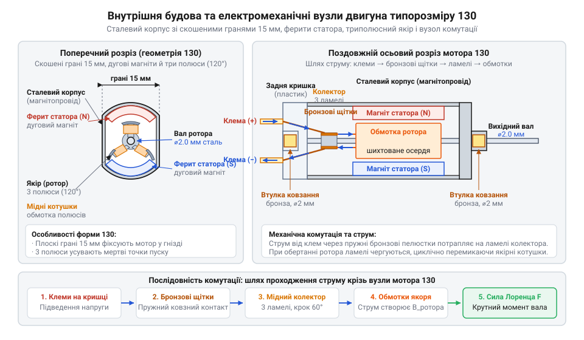
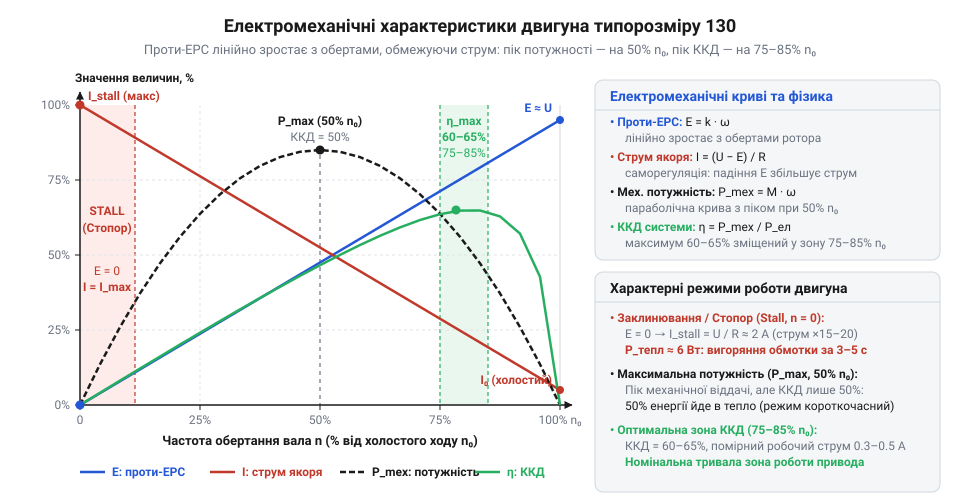
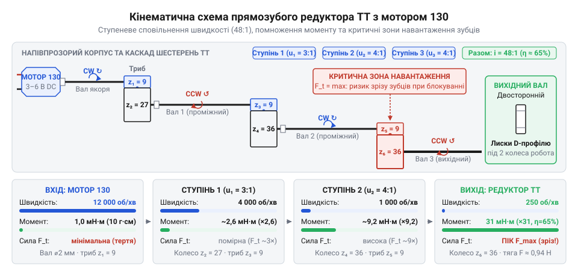
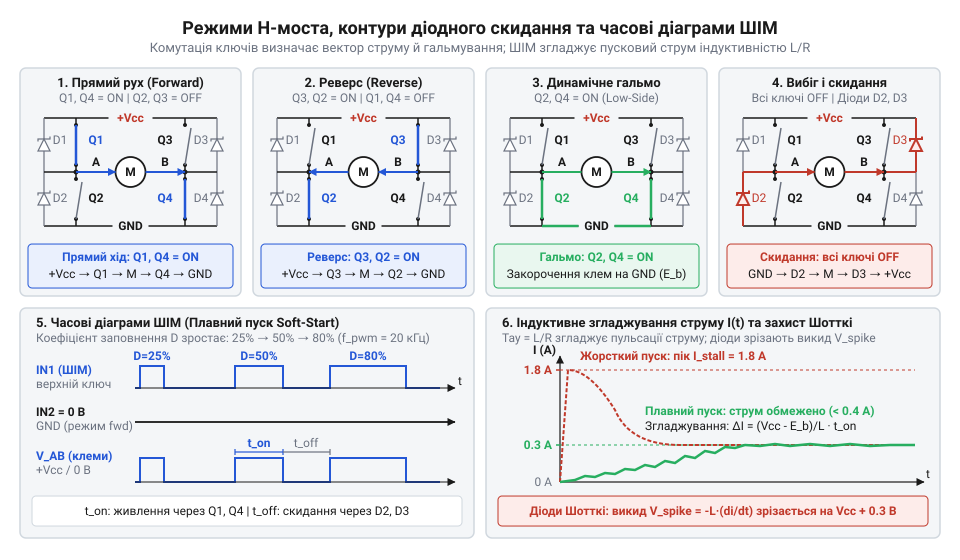
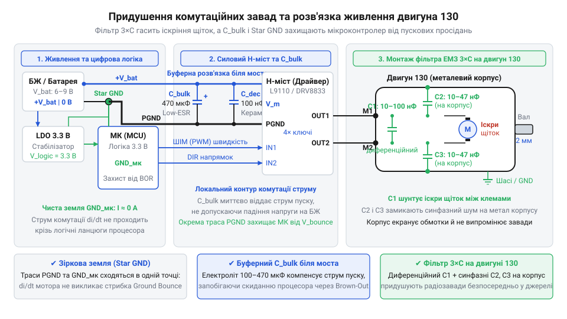

# Колекторний двигун типорозміру 130

## Пастка прямого приводу та надвисоких обертів

Під час створення саморобного колісного шасі, рухомої іграшки або мініатюрного маніпулятора природним здається найпростіший крок: взяти поширений мікромотор і насадити колесо безпосередньо на його сталевий вихідний вал діаметром 2 мм. Таке з'єднання виглядає привабливим прямим приводом (англ. @@en|direct drive@@): конструкція позбавлена проміжних зубчастих коліс, пасових передач чи додаткових опор. Проте подача на клеми живлення напругою 3–6 В перетворює цей задум на миттєвий інженерний провал. Мотор видає різкий пронизливий вереск, відчутно вібрує та розганяється до 10 000–15 000 обертів на хвилину. Та варто опустити колесо на підлогу або злегка торкнутися його пальцем, як рух намертво припиняється.

Причина полягає у фундаментальній суперечності між кутовою швидкістю та механічною силою. Вільний ротор (від лат. *rotare* — обертатися) розвиває колосальну частоту обертання, але вихідний вал створює мізерний крутний момент (від лат. *torquere* — скручувати; англ. @@en|torque@@). За [паспортними параметрами типорозміру 130](root:cat-hw-actuators/dc-motor-130/api-dc-motor-130-hardware.md) пусковий момент становить менше 10–15 г·см, тобто ледь сягає 0.001–0.0015 Н·м, а в режимі обертання він у кілька разів менший. Якщо на вал радіусом 1 мм посадити колесо діаметром хоча б 30 мм, плече сили зростає у 15 разів. Штовхальне тягове зусилля на ободі колеса пропорційно зменшується до часток грама. Цього мізерного зусилля недостатньо для подолання опору тертя кочення та інерції навіть невагомого пластикового корпусу, тому ротор зупиняється від найменшого опору.

Механічна зупинка вала миттєво викликає аварійний стан в електричному колі. Під час вільного обертання на холостому ходу споживання струму становить лише 70–150 мА. Обертання мідних витків у магнітному полі статора (від лат. *stator* — нерухомий) генерує внутрішню проти-електрорушійну силу (проти-ЕРС, або англ. @@en|back-EMF@@), яка спрямована назустріч напрузі живлення та самостійно обмежує якірний струм. Щойно вал під навантаженням зупиняється, настає аварійний режим заклинювання (англ. @@en|stall@@ — застрягати, втрачати рух). Проти-ЕРС миттєво зникає, і єдиним обмежувачем струму залишається низький активний опір мідного дроту обмоток якоря (близько 1.5–3.5 Ом). Струм лавиноподібно злітає у десятки разів — виникає струм блокування (англ. @@en|stall current@@) силою до 1.5–2.5 А. Такий стрибок просаджує напругу батареї, викликає циклічне апаратне скидання мікроконтролера через детектор зниження напруги (англ. @@en|Brown-Out Reset@@), а надлишкове джоулеве тепло за кілька секунд плавить пластикову задню кришку мотора та руйнує лакову ізоляцію котушок.

Ця непридатність до прямої передачі зусилля зумовлена історією виникнення мотора. Типорозмір 130 створила японська компанія @@ja|Mabuchi@@ наприкінці 1950-х років для заміни ненадійних пружинних механізмів у масових дитячих іграшках та швидкісних автомоделях, про що розповідає [еволюція мініатюрних двигунів 130](root:cat-hw-actuators/dc-motor-130/hist-dc-motor-130-origins.md). Заради наднизької собівартості виробник застосував гранично спрощену конструкцію: триполюсний якір спирається на прості втулки ковзання, а струм підводять пружні бронзові пелюстки замість зносостійких вугільних щіток. Така будова мінімізує внутрішнє тертя й дозволяє мотору розвивати надвисокі оберти без зайвих витрат матеріалу, проте ніколи не розраховувалася на безпосередній рух вантажу без зовнішнього сповільнення.

Спроба застосувати швидкохідний мікромотор як @@en|direct drive@@ — глухий кут. Колекторний двигун (від лат. *collector* — збирач) типорозміру 130 є не кінцевим рушієм, а джерелом високої механічної швидкості. Щоб отримати від нього корисну роботу, захистити електроніку від пікового струму заклинювання та придушити іскрові завади, розробник мусить спиратися на електродинамічну модель. Практичне використання вимагає розуміння того, як влаштований щітково-колекторний вузол, чому формується проти-ЕРС і якими засобами [основи будови колекторних машин](root:hw-motion/brushed-dc-motor) узгоджуються з механічними редукторами та напівпровідниковими ключами.

## Анатомія мотора 130 та механічна комутація

Зовні мотор типорозміру 130 сприймається як монолітна металева гільза з вихідним валом і парою контактних клем на задній кришці. Проте всередині ця конструкція містить повний замкнений механізм електромеханічного перетворення. Корпус двигуна виштамповано з низьковуглецевої сталі, а його бічні грані зрізано до двох паралельних площин завширшки 15 мм. Ця форма не лише забезпечує жорстку фіксацію у пластикових посадкових гніздах без ризику провертання, як передбачають [паспортні розміри корпусу 130](root:cat-hw-actuators/dc-motor-130/api-dc-motor-130-hardware.md). Сталеві стінки корпусу одночасно слугують магнітопроводом статора: вони замикають зовнішні магнітні лінії між двома постійними феритовими (від лат. *ferrum* — залізо) магнітами дугоподібної форми, закріпленими зсередини. Ферити створюють нерухоме двополюсне магнітне поле, спрямоване крізь внутрішній простір двигуна.


*Конструкція мотора 130: просторове розміщення статора, триполюсного ротора та вузла механічної комутації струму.*

У робочому магнітному зазорі між феритами обертається якір (англ. @@en|armature@@, від лат. *armatura* — озброєння) — рухомий ротор з обмотками. Його осердя не можна виготовляти із суцільного шматка сталі: у масивному провіднику, який перетинає магнітні лінії на швидкості 15 000 об/хв, виникали б потужні вихрові струми (струми Фуко), що перетворювали б усю енергію на паразитне тепло. Тому якір збирають із пакета тонких пластин електротехнічної сталі, ізольованих лаком або оксидною плівкою. Таке шихтоване осердя (від нім. *Schicht* — шар) розриває контури паразитних струмів, зберігаючи магнітну проникність заліза. Осердя має форму трьох пелюсткових полюсів із поздовжніми пазами, у які вкладено котушки з ізольованого мідного дроту.

Вибір саме трьох полюсів якоря розв'язує задачу надійного запуску. У двополюсному роторі між двополюсними магнітами статора існували б дві симетричні мертві точки (англ. @@en|dead center@@): кутові положення, де магнітні полюси ротора й статора лежать на одній лінії. У такій позиції результуючий пусковий обертальний момент дорівнює нулю — струм нагріває обмотки, але ротор залишається нерухомим і потребує механічного поштовху. Три полюси якоря розташовані з кутовим зміщенням 120°. Коли один із полюсів проходить поздовжню лінію магніту статора, два інші полюси неминуче опиняються під кутом у зоні сильного магнітного поля статора. На них діє максимальна тангенціальна сила Лоренца, тому триполюсний двигун самостійно й гарантовано рушає з будь-якого вихідного положення.

Щоб обертання тривало неперервно, напрямок струму в котушках якоря мусить циклічно перемикатися під час руху від одного полюса статора до іншого. Цю комутацію виконує контактний вузол на задньому кінці вала. На вал напресовано циліндричний колектор, розділений уздовж осі на три мідні пластини — ламелі (від лат. *lamella* — пластинка). До кожної ламелі підведено кінці сусідніх якірних котушок. До зовнішньої поверхні колектора притискаються дві нерухомі пелюсткові щітки (англ. @@en|brushes@@), електрично з'єднані з клемами живлення на задній кришці. У типорозмірі 130 та споріднених приводах, які представляють [мотори родини Mabuchi 100](root:cat-hw-actuators/mabuchi-100-series-dc-motors), щітки виконано у вигляді пружних пелюсток із фосфористої бронзи без застосування дорогих вугільних вставок. Під час обертання ротора бронзові пелюстки почергово переходять із ламелі на ламель, змінюючи полярність котушок кожні 60° повороту вала та підтримуючи постійний обертальний момент.

Опорою для загартованого сталевого вала діаметром 2 мм слугують дві бронзові втулки ковзання (англ. @@en|sleeve bushings@@), запресовані в передній металевий фланець і задню пластикову кришку. Втулки ковзання мають мінімальний власний опір руху на високих обертах і гранично дешеві у виробництві, проте швидко розбиваються при радіальних перекосах вала. Водночас постійне тертя пружних пелюсток об мідні ламелі викликає швидке механічне стирання бронзи, а мікроіскри від розриву струму в індуктивних обмотках спричиняють електроерозійний знос контактів. Цей процес обмежує термін служби мотора 130 сотнями годин і вимагає обов'язкового [придушення комутаційних завад](root:hw-analog/brush-dc-noise-suppression) під час роботи поруч із чутливою цифровою схемотехнікою.

## Проти-ЕРС, навантаження та струм блокування

Якщо виміряти опір котушок двигуна 130 звичайним мультиметром на клемах, прилад покаже лише 1.5–3.5 Ом. За законом Ома під час подачі робочої напруги 3 В струм мав би сягати 1–2 А, миттєво розжарюючи мініатюрний якір. Проте на холостому ходу мотор вільно обертається, споживаючи всього 70–150 мА. Річ у тім, що ротор працює не як пасивний нагрівач, а як електрогенератор. Під час обертання мідних витків у магнітному полі статора виникає індукційна проти-електрорушійна сила (проти-ЕРС), яка за правилом Ленца спрямована назустріч напрузі живлення.

Рівновагу напруг у замкненому якірному колі визначає другий закон Кірхгофа: прикладена напруга джерела `U` врівноважується внутрішньою проти-ЕРС `E` та омічним падінням напруги від якірного струму `I` на активному опорі мідного дроту `R`:

```
U
= E + I · R                      [другий закон Кірхгофа для якірного кола]
```

Звідси струм якоря `I = (U - E) / R` безпосередньо залежить від різниці `U - E`. Оскільки згенерована проти-ЕРС прямо пропорційна швидкості перетинання магнітних ліній `E = k · ω`, де `k` — конструктивна стала двигуна, а `ω` — кутова швидкість ротора, двигун діє як динамічна система з фізичним механізмом саморегуляції (від лат. *regulare* — упорядковувати).

У режимі холостого ходу (англ. @@en|no-load@@) мотор долає лише власне тертя у втулках ковзання та аеродинамічний опір повітря. Ротор швидко розганяється до максимальних обертів, за яких проти-ЕРС майже зрівнюється з живильною напругою `U`. Різниця між ними скорочується до часток вольта, утримуючи споживання струму на рівні 70–150 мА. Щойно на вал лягає зовнішній механічний опір, ротор сповільнюється. Згенерована проти-ЕРС спадає, різниця `U - E` зростає, і струм у котушках автоматично збільшується, генеруючи додатковий обертальний момент для врівноваження навантаження. Повний математичний зв'язок напруги, частоти обертання та моменту наводять [робочі характеристики двигуна](root:cat-hw-actuators/dc-motor-130/math-dc-motor-electromechanical-characteristics.md).


*Електромеханічні характеристики двигуна 130: лінійне зростання проти-ЕРС з обертами, спадання струму та пік механічної потужності на середині холостого ходу.*

Зі сповільненням ротора струм зростає лінійно, але вихідна механічна потужність змінюється за параболою. Точка максимальної потужності (англ. @@en|maximum power point@@) припадає рівно на 50% холостих обертів, де якірний струм сягає половини максимального значення. Проте тривала робота в цьому режимі небезпечна: коефіцієнт корисної дії (ККД) тут становить лише 50%, а решта підведеної енергії перетворюється на тепло. Оптимальна робоча зона лежить у діапазоні 75–85% холостої швидкості, де ККД сягає свого максимуму (60–65%), а джоулів нагрів залишається помірним.

Якщо зовнішній гальмівний момент перевищує можливості двигуна, вал зупиняється — виникає режим заклинювання. При нульовій швидкості котушки не перетинають магнітне поле, тому проти-ЕРС зникає: `E = 0`. Єдиним обмежувачем струму залишається омічний опір мідного дроту обмоток:

```
I_stall
= (U - 0) / R                    [підстановка нульової проти-ЕРС]
= U / R                          [струм блокування за законом Ома]
```

За напруги 3 В та опору котушок 1.5 Ом струм блокування сягає 2 А. Квадратичне зростання сили струму перетворює джоулеві втрати (англ. @@en|Joule losses@@) на тепловий удар за законом Джоуля — Ленца:

```
P
= I_stall² · R                   [закон Джоуля — Ленца для потужності нагріву]
= 2.0² · 1.5                     [обчислення для струму 2 А та опору 1.5 Ом]
= 6.0 Вт                         [теплові втрати в заблокованому якорі]
```

Теплова потужність у 6 Вт виділяється в кількох грамах міді за повної відсутності охолодження від обертання ротора. За 3–5 секунд обмотка нагрівається понад 150 °C: лакова ізоляція витків обвуглюється, виникає міжвиткове коротке замикання, а задня пластикова кришка плавиться біля щіткотримачів. Розрахунок граничного часу безпечного блокування вала наводить [тепловий розрахунок нагріву](root:cat-hw-actuators/dc-motor-130/math-dc-motor-thermal-and-stall-limits.md).

## Узгодження навантаження та редуктори типу TT

Двигун типорозміру 130 розвиває шалену частоту обертання 10 000–15 000 об/хв, проте його вал створює мізерний крутний момент — лише 10–15 г·см. Спроба безпосередньо обертати колесо платформи натикається на брак сили: ротор миттєво зупиняється, а струм у нерухомих обмотках злітає до небезпечного струму блокування. Щоб перетворити надлишкову кутову швидкість на корисну механічну силу, між валом мотора та навантаженням встановлюють редуктор (від лат. *reducere* — відводити назад, зменшувати; англ. @@en|gearbox@@) — механічну передачу зі східчастим зубчастим зачепленням.

Для двигунів 130 стандартом колісних платформ стали двовісні [пластикові мотор-редуктори типу TT](root:cat-hw-actuators/gearmotor-6v) у напівпрозорому або жовтому корпусі. Їхнє посадкове гніздо точно повторює форму сталевого статора: дві паралельні плоскі грані завширшки 15 мм щільно входять у пластиковий паз і фіксуються засувкою без жодних кріпильних гвинтів. На вал якоря діаметром 2 мм із натягом напресовується мала тягова шестерня — триб (від нім. *Trieb* — рушійна сила; англ. @@en|pinion@@). Через каскад проміжних прямозубих шестерень обертання передається на двосторонній вихідний вал із лисками під посадку коліс.


*Кінематика прямозубого редуктора TT: східчасте зниження швидкості ротора від 12 000 до 100–250 об/хв із помноженням крутного моменту.*

Кінематичне перетворення задає передавальне число (англ. @@en|gear ratio@@) `i`, що показує відношення частоти обертання ротора мотора `n_in` до частоти вихідного вала `n_out`. Для редукторів TT типовими є співвідношення `i = 48` (швидкісна конфігурація для легких колісних роботів) та `i = 120` (тягова версія для важчих платформ чи маніпуляторів). Вони сповільнюють оберти вала до керованих 100–250 об/хв. Водночас вихідний момент зростає в `i` разів за вирахуванням втрат на тертя зубців та осей у пластикових гніздах. Механічний коефіцієнт корисної дії `η` пластикових шестерень редуктора TT становить 60–75% (0.60–0.75). Результуючий крутний момент `M_out` на вихідному валу визначають за формулою:

```
M_out
= M_in · i · η                   [помноження моменту з урахуванням ККД передачі]
```

Якщо взяти робочий момент мотора 130 під помірним навантаженням `M_in = 0.001 Н·м` (близько 10 г·см), то для редуктора з `i = 48` та середнім ККД `η = 0.65` вихідний момент сягає `M_out ≈ 0.031 Н·м` (понад 310 г·см). Для типового робототехнічного колеса радіусом `r = 0.033 м` (зовнішній діаметр 66 мм) корисне тягове зусилля `F_pull` на ободі колеса становить:

```
F_pull
= M_out / r                      [тягове зусилля на радіусі колеса]
= 0.031 / 0.033                  [розрахунок для моменту 0.031 Н·м та радіуса 33 мм]
≈ 0.94 Н                         [тяга одного колісного рушія]
```

Тяга близько 0.94 Н (еквівалент ваги 95 г) від кожного з двох моторів дозволяє платформі масою 300–500 г долати опір тертя кочення й невеликі ухили без падіння швидкості ротора в аварійну зону заклинювання. Докладний баланс сил прискорення та опору руху наводить [силовий розрахунок трансмісії](root:cat-hw-actuators/dc-motor-130/math-dc-motor-gear-and-load-matching.md).

Використання недорогих штампованих деталей із термопластів накладає жорсткі межі міцності. Шестерні редуктора TT виготовляють із нейлону або поліоксиметилену, а їхні осі тримаються безпосередньо у пластикових отворах корпусу. Під час різкого зіткнення рухомого робота з твердою перешкодою або ударної зупинки вихідного вала інерція ротора й зчеплення коліс створюють динамічний пік навантаження, який зрізає дрібні пластикові зубці триба чи першого проміжного колеса. Крім того, зазори між прямозубими вінцями утворюють мертвий хід — люфт (від нім. *Luft* — повітря; англ. @@en|backlash@@), який на вихідному валу становить 3–5°, ускладнюючи точне керування курсом за колісними енкодерами. Якщо ж колеса застрягнуть у перешкоді, редуктор не рятує мотор від катастрофічного нагріву — захистити котушки й пластикові зуби дозволяє [колісна платформа з апаратним захистом](root:cat-hw-actuators/dc-motor-130/proj-tt-gear-platform-stall-protection.md), що миттєво відключає живлення при стрибку споживаного струму.

## Керування швидкістю, реверсом та індуктивні викиди

Колекторний двигун неможливо під'єднати безпосередньо до логічного виводу мікроконтролера — лінії введення-виведення загального призначення (англ. @@en|GPIO@@, *General-Purpose Input/Output*). Логічні виходи розраховані на струм не більше 10–20 мА, тоді як навіть на холостому ходу двигун 130 споживає 70–150 мА, а пусковий ривок або заклинювання ротора спричиняє стрибок до 2.5 А. Спроба прямого підключення миттєво випалює вихідний каскад мікросхеми. Крім того, обмотки якоря є котушками індуктивності, що накопичують енергію магнітного поля `W = 0.5 · L · I²`. При раптовому розмиканні кола струм не може зникнути миттєво; швидке спадання магнітного потоку породжує високовольтний сплеск самоіндукції — індуктивний викид (англ. @@en|inductive kick@@). Амплітуда цієї зворотної напруги досягає десятків і сотень вольт, що гарантовано пробиває кремнієві напівпровідникові структури процесора.

Для безпечного обертання вала в один бік використовують низькосторонній силовий ключ на польовому транзисторі (англ. @@en|MOSFET@@, *Metal-Oxide-Semiconductor Field-Effect Transistor*), встановлений між мінусовою клемою мотора та землею. Щоб знешкодити індуктивні викиди при закритті транзистора, паралельно клемам двигуна підключають демпферний діод (від нім. *dämpfen* — глушити, гасити; англ. @@en|flyback diode@@, від *fly back* — зворотний відскок струму). Катод діода під'єднують до плюса джерела живлення, а анод — до стоку транзистора. Коли ключ розмикає коло, замкнений струм індуктивності підхоплюється діодом і безперешкодно циркулює контуром «обмотка — діод», де накопичена магнітна енергія безпечно розсіюється у вигляді тепла на активному омічному опорі мідного дроту. Для цієї ролі обирають швидкодіючі діоди Шотткі (англ. @@en|Schottky diode@@, за ім'ям фізика Вальтера Шотткі): вони відрізняються малим прямим падінням напруги (0.3–0.4 В) та практично нульовим часом зворотного відновлення.

Для двоспрямованого руху та керованої зупинки чотири силові ключі об'єднують у мостову схему — @@en|H-міст@@ (англ. *H-bridge*, за схожістю форми чотирьох ключів із навантаженням у центральній діагоналі на літеру «H»). Така топологія забезпечує чотири базові робочі конфігурації:
- *Прямий рух*: відкриваються верхній лівий і нижній правий транзистори, спрямовуючи струм через якір зліва направо.
- *Реверс*: відкриваються верхній правий і нижній лівий транзистори, змінюючи напрямок струму в обмотках на протилежний, що змушує вал обертатися у зворотний бік.
- *Вільний вибіг* (англ. @@en|coast@@): усі чотири ключі одночасно розмикаються; струм котушок швидко згасає через внутрішні захисні діоди ключів у шину живлення, а ротор плавно зупиняється виключно за рахунок сил механічного тертя в редукторі та втулках ковзання.
- *Активне динамічне гальмування* (англ. @@en|dynamic braking@@): обидва нижні або обидва верхні ключі одночасно замикаються, наглухо закорочуючи клеми двигуна між собою. Ротор, що продовжує обертатися за інерцією, перетворюється на електрогенератор і виробляє проти-ЕРС. Утворений короткозамкнений контур викликає потужний зворотний гальмівний струм, який створює протидіючий електромагнітний момент і майже миттєво спиняє вал.

Збирання моста на дискретних елементах потребує складної обв'язки керування верхніми затворами, тому в компактних пристроях застосовують інтегральні [транзисторні H-мости для керування](root:hw-motion/h-bridge) постійним струмом (драйвери DRV8833, TB6612FNG чи L9110S). Вони містять інтегровані польові транзистори з низьким опором відкритого каналу, вбудовані захисні діоди та вхідні логічні каскади, узгоджені зі стандартними рівнями мікроконтролерів 3.3 В і 5 В.


*Керування чотириквадрантним H-мостом: комутаційні стани ключів для реверсу й активного гальмування та часові діаграми ШІМ із захистом від наскрізних струмів.*

Регулювання швидкості обертання якоря реалізують за допомогою широтно-імпульсної модуляції (англ. @@en|PWM@@, *Pulse-Width Modulation*; укр. @@uk|ШІМ@@). Замість неефективного лінійного гасіння надлишкової напруги на нагрів, живлення подають прямокутними імпульсами постійної амплітуди. Середнє значення напруги на двигуні визначає шпаруватість (англ. @@en|duty cycle@@) `D` — відношення часу відкритого стану ключа `t_on` до загального періоду імпульсу `T`:

```
U_avg
= D · U_supply                       [середня напруга за шпаруватістю ШІМ]
= (t_on / T) · U_supply              [визначення через тривалість імпульсу та період]
```

Завдяки власній індуктивності обмоток якір згладжує стрибки напруги, перетворюючи їх на майже неперервний струм. Робоча частота ШІМ вимагає чіткого розрахунку:
- Частоти нижче 8 кГц викликають резонансні коливання витків і магнітопроводу в чутному діапазоні, змушуючи мотор гучно пищати й дзижчати.
- Частоти понад 20 кГц лежать за межею людського слуху, проте різко збільшують динамічні комутаційні втрати на перезаряджання ємностей затворів силових транзисторів, спричиняючи перегрів мікросхеми драйвера. Для двигунів 130 оптимальним балансом є діапазон 8–20 кГц.

Під час перемикання транзисторів в одній стійці H-моста виникає небезпека короткого замикання живлення на землю через різну швидкість відмикання та замикання напівпровідникових переходів. Якщо верхній ключ ще не встиг закритися, а нижній уже відкрився, між шиною живлення та землею протікає нищівний аварійний імпульс — наскрізний струм (англ. @@en|shoot-through current@@). Для захисту кристала апаратні таймери формують мертвий час (англ. @@en|dead time@@) — захисну паузу тривалістю 100–500 нс, під час якої обидва ключі одного плеча гарантовано вимкнені.

Крім того, миттєве ввімкнення 100% шпаруватості ШІМ на нерухомий двигун подає повну напругу за нульової проти-ЕРС, викликаючи пусковий удар струму до 2.5 А. Цей ривок навантажує зубці редуктора й просаджує батарею живлення. Щоб обмежити навантаження, застосовують плавний пуск (англ. @@en|soft-start@@) — алгоритмічне нарощування шпаруватості від нуля до робочої точки за 50–200 мс. Програмну реалізацію таймінгів мертвого часу, реверсу та рампи розгону надає готовий [програмний інтерфейс драйвера](root:cat-hw-actuators/dc-motor-130/api-brushed-dc-motor-control.md) для вбудованих систем.

## Придушення завад, розв'язка живлення та ресурс

Під час випробувань мобільної платформи розробники нерідко стикаються з незрозумілою поведінкою системи: мікроконтролер несподівано перезавантажується під час старту привода, цифрові датчики на шині I2C втрачають зв'язок або повертають сміття, а покази аналогових входів стрибають. Джерелом цих аномалій є сам колекторний вузол. Під час обертання триполюсного якоря пружні бронзові щітки безперервно переходять із однієї мідної ламелі на іншу. У момент розриву контакту струм у котушці не може спасти миттєво через власну індуктивність. Енергія магнітного поля пробиває повітряний зазор, запалюючи мікроскопічну електричну дугу — комутаційне іскріння (англ. @@en|arcing@@). Кожна така іскра працює як мініатюрний іскровий радіопередавач, генеруючи потужні широкосмугові @@en|електромагнітні завади@@ (англ. @@en|EMI@@, *Electromagnetic Interference*) в діапазоні від сотень кілогерців до сотень мегагерців. Дроти живлення діють як антени, випромінюючи ці завади в ефір і наводячи наносекундні високовольтні імпульси безпосередньо в лінії живлення та керування.

Намагатися фільтрувати цей шум на стороні плати керування запізно: заваду необхідно придушити безпосередньо в точці її виникнення. Надійне [придушення електромагнітних завад](root:hw-analog/brush-dc-noise-suppression) забезпечує триконденсаторний керамічний фільтр, змонтований прямо на виводах мотора 130 з мінімальною довжиною виводів:
- *Диференціальний конденсатор* (англ. @@en|differential-mode capacitor@@) ємністю 10–100 нФ (типово 100 нФ, багатошарова кераміка X7R або NP0) припаюють паралельно клемам двигуна. Він створює низький опір для високочастотних складових струму, шунтуючи диференціальні викиди безпосередньо між контактами щіток.
- *Два синфазні конденсатори* (англ. @@en|common-mode capacitors@@) ємністю 10–47 нФ з'єднують кожну клему із зачищеною від оксидів ділянкою сталевого корпусу статора. У результаті корпус перетворюється на електростатичний екран, що замикає синфазні ємнісні струми витоку всередині металевого екрана та не дає їм випромінюватися в простір.

Повний покроковий монтаж цього вузла розглядає [триконденсаторний фільтр завад](root:cat-hw-actuators/dc-motor-130/proj-dc-motor-hbridge-filtering-driver.md).


*Фільтрація ЕМЗ та топологія живлення: триконденсаторний керамічний бар'єр на корпусі, зіркове з'єднання земель і буферний конденсатор для безперебійної роботи цифрової логіки.*

Окрім високочастотного іскріння, двигун 130 загрожує стабільності електроніки низькочастотними просіданнями напруги. У момент пуску ротора за нульової проти-ЕРС споживання струму підскакує до 2.5 А. Через внутрішній опір джерела живлення та омічний опір сполучних дротів напруга живлення різко падає нижче мінімального робочого порога мікроконтролера, що призводить до апаратного скидання процесора — @@en|Brown-out Reset@@. Для усунення цієї проблеми проєктують спеціальну топологію живлення:
- *Розділення шин*: живлення логіки та силових каскадів розводять незалежними гілками, виконуючи ізольоване [розділення шин живлення логіки](root:hw-power/power-rail-isolation-for-motors). Двигуни живляться безпосередньо від батареї або потужного імпульсного перетворювача, а мікроконтролер — через окремий лінійний стабілізатор із вхідним блокувальним діодом, який запобігає зворотному відтоку заряду при просіданні батареї.
- *Зіркове заземлення* (англ. @@en|Star GND@@): мінусові шини живлення мотора та сигнальні землі процесора об'єднуються лише в одній фізичній точці — на мінусовій клемі джерела живлення. Це гарантує, що амперні зворотні струми мотора не протікають через земляні полігони плати керування й не створюють паразитного зсуву потенціалу землі для цифрових сигналів.
- *Буферний конденсатор* (англ. @@en|bulk capacitor@@): поруч із силовими виводами H-моста встановлюють електролітичний конденсатор великої ємності (470–1000 мкФ) із низьким еквівалентним послідовним опором (Low-ESR). Він слугує локальним резервуаром енергії, згладжуючи короткочасні імпульсні просідання напруги під час пуску.

Навіть за умови бездоганної фільтрації та стабільного живлення колекторний привід вимагає контролю теплових і механічних меж. Задня кришка двигуна 130 відлита з легкоплавкого термопласту (полістиролу або капрону), у пазах якого утримуються пружні бронзові пелюстки щіток. Критичний температурний поріг для кришки становить усього 70 °C. Під час перегріву пластик розм'якшується, пружні щіткотримачі вигинаються й перекошують щітки на ламелях колектора або намертво вплавляються в основу. Цей вузол легко пошкодити ще під час монтажу: контакти клем передають тепло паяльника прямо в пластикові посадки щіток. Прогрівання виводу довше 2–3 секунд необоротно деформує внутрішні гнізда кришки, що вимагає особливої обережності, про яку нагадує [залізний інтерфейс двигуна](root:cat-hw-actuators/dc-motor-130/api-dc-motor-130-hardware.md).

В аварійному режимі заклинювання ротора в обмотках виділяється до 6–10 Вт тепла, і за кілька секунд температура міді перевищує критичні пороги, як описує [розрахунок критичного часу блокування](root:cat-hw-actuators/dc-motor-130/math-dc-motor-thermal-and-stall-limits.md). Щоб уникнути пожежі та вигорання котушок, у мінусове коло H-моста встановлюють низькоомний струмовимірювальний шунт (англ. @@en|current shunt@@) номіналом 0.1–0.22 Ом. Мікроконтролер вимірює падіння напруги на шунті через АЦП, і щойно струм перевищує допустимий робочий поріг, програмно відключає ШІМ; цей механізм безпеки реалізує [колісна платформа з апаратним захистом](root:cat-hw-actuators/dc-motor-130/proj-tt-gear-platform-stall-protection.md).

Останній фактор — природний механічний ресурс (англ. @@en|service life@@). На відміну від промислових моторів, двигун 130 має листові бронзові щітки без графітових наконечників, які ковзають безпосередньо по міді, а його вал спирається на прості втулки ковзання без підшипників кочення. Через інтенсивне тертя й дугову ерозію ресурс мотора становить лише 50–100 годин безперервної роботи під навантаженням. Після вичерпання цього терміну бронзові пелюстки перетираються або втрачають пружність, через що двигун 130 розглядають як витратний компонент із регулярною плановою заміною.
