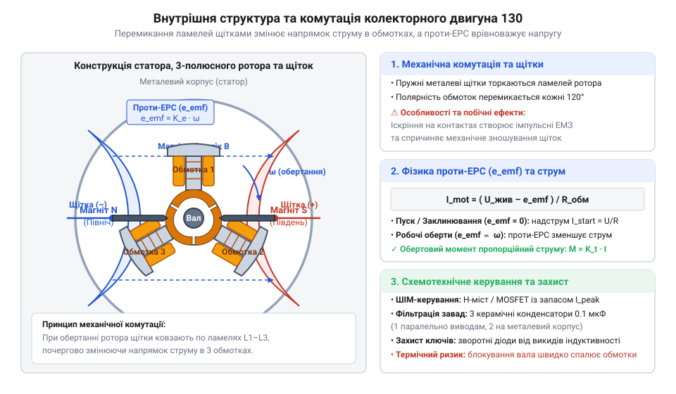
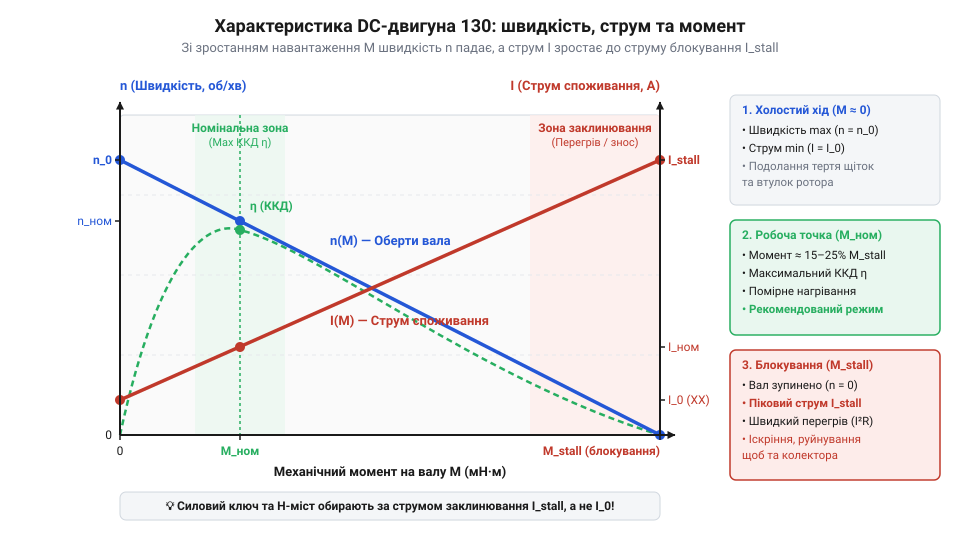
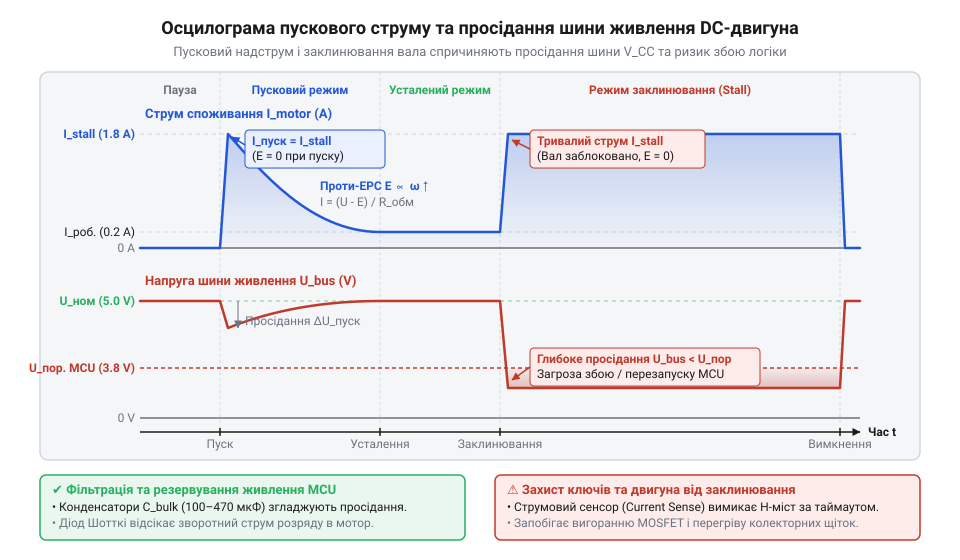
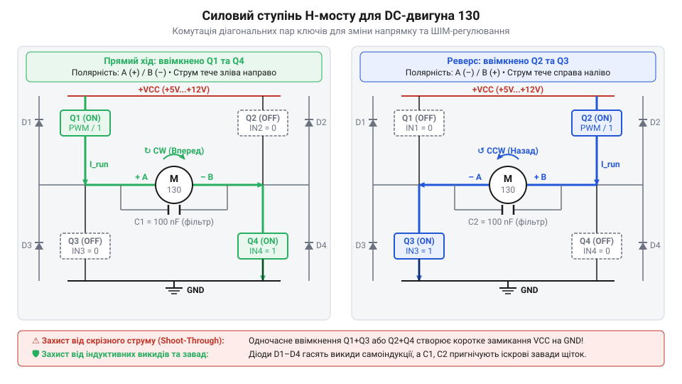
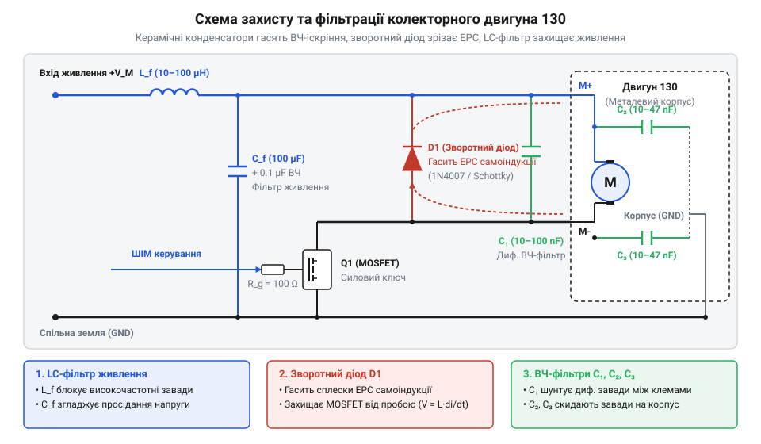

# Колекторний двигун типорозміру 130

## Чому пряме живлення мотора перезавантажує мікроконтролер

Спроба підключити мініатюрний колекторний двигун типорозміру 130 безпосередньо до цифрового виводу або шини живлення, від якої живиться @@en|мікроконтролер@@ (від @@en|microcontroller@@), майже завжди завершується негайним апаратним збоєм. Вихідний сигнал керування переходить у високий стан, проте замість упевненого розгону вала двигун лише ледь здригається, після чого @@en|мікроконтролер@@ раптово перезавантажується або скидає з'єднання по послідовному інтерфейсу.

Початківці часто розглядають колекторний двигун як звичайне статичне резистивне навантаження — подібне до світлодіода чи нагрівального елемента. Взявши мультиметр і вимірявши статичний опір мідної обмотки двигуна 130 у нерухомому стані, можна виявити дуже мале значення — порядку `1.5`–`3.0 Ом`. Якщо застосувати закон Ома для стандартної напруги живлення `5 В`, розрахований статичний струм здається суттєвим:

```
I_stat = U ÷ R_m
= 5 ÷ 2.0                [напруга живлення 5 В і опір обмотки 2 Ом]
= 2.5 А                  [статичний струм споживання]
```

Стандартний цифровий вивід @@en|мікроконтролера@@ (наприклад, у платформі @@en|Arduino@@ чи @@en|ESP32@@) здатний безпечно віддавати струм лише в межах `20`–`40 мА`. Спроба пропустити `2.5 А` безпосередньо через вихідні транзистори кремнієвого виводу викликає спрацьовування внутрішніх захисних структур або термічну деструкцію кристала.

Навіть якщо приєднати двигун не до логічного виводу, а до силової шини `5 В`, від якої отримує живлення сам @@en|мікроконтролер@@, проблему перезавантаження це не усуває. У момент подачі напруги (`t = 0`) @@la|ротор@@ (від @@la|rotare@@ — обертатися) перебуває в стані спокою. Через механічну інерцію ротора та під'єднаного механізму вал не може набрати оберти миттєво. Оскільки @@la|індуктивність@@ (від @@la|inductio@@ — наведення) мідних обмоток `L ≈ 100`–`500 мкГн` стримує наростання струму лише впродовж перших мікросекунд, струм у колі стрімко досягає пікового пускового значення `I_stall ≈ 2.5 А`.

Цей потужний пусковий надструм протікає через внутрішній опір джерела живлення, контактні з'єднання та паразитичний опір провідників друкованої плати. Виникає падіння напруги на джерелі живлення, яке описується виразом:

```
ΔV = I_stall × (R_src + R_line)
= 2.5 × (0.8 + 0.4)      [пусковий струм 2.5 А та сумарний опір ліній 1.2 Ом]
= 3.0 В                  [амплітуда просідання шини живлення]
```

У результаті напруга на шині живлення @@en|мікроконтролера@@ миттєво падає з `5.0 В` до `2.0 В`. Схема скидання при зниженні напруги (@@en|Brown-Out Reset@@, @@en|BOR@@) фіксує падіння напруги нижче критичного порогу (зазвичай `2.7 В`) і примусово переводить @@en|мікроконтролер@@ у стан скидання для запобігання пошкодженню пам'яті.

Багато початківців намагаються вирішити проблему просідання живлення додаванням звичайного керамічного конденсатора ємністю `100 нФ` або електролітичного конденсатора `10 мкФ` паралельно виводам живлення @@en|мікроконтролера@@. Проте елементарний розрахунок накопиченого заряду показує недієвість такого заходу проти пускового струму `2.5 А`:

```
dt = (C × ΔV) ÷ I
= (10⁻⁵ × 0.3) ÷ 2.5     [ємність 10 мкФ, припустиме падіння 0.3 В та струм 2.5 А]
= 1.2 мкс                [час розряджання конденсатора]
```

Конденсатор ємністю `10 мкФ` повністю розряджається всього за `1.2 мікросекунди`, тоді як механічний розгін ротора 130 до появи проти-ЕРС триває від `10` до `50 мілісекунд`. Для надійної стабілізації логіки необхідно застосовувати роздільні шини живлення — з окремим силовим джерелом для двигуна та розв'язувальним діодом із баком ємностей для логічного @@en|мікроконтролера@@.

Додатковим руйнівним чинником є високовольтні індуктивні сплески. Обмотка ротора зберігає магнітну енергію `W_m = 0.5 × L × I²`. У момент розмикання силового ключа чи втрати механічного контакту щіток швидкість зміни струму стає від'ємною і дуже великою (`di ÷ dt → ∞`). Відповідно до закону самоіндукції, на клемах двигуна виникає негативний індуктивний викид напруги:

```
V_ind = -L × (di ÷ dt)   [напруга самоіндукції при швидкості розмикання]
```

Амплітуда цього викиду може досягати десятків і сотень вольт. Проникаючи через паразитичні ємності друкованих провідників або захисні @@en|ESD@@-діоди виводів @@en|мікроконтролера@@, цей імпульс спричиняє защіпання (@@en|latch-up@@) напівпровідникової структури або збій регістрів тактування.

Окреме місце в історії мікроприводів посідає еволюція колекторних двигунів типорозміру 130: від іграшкових моторчиків до стандарту масової мікроробототехніки. Розроблені у середині XX століття компанією @@en|Mabuchi Motor@@ як гранично дешеві приводи для механічних іграшок, мотори 130-го габариту (діаметр корпуса `20 мм`, довжина `25 мм`, діаметр вала `2 мм`) поєднували штампований сталевий корпус, феритові магніти та простий триполюсний якір. Масове виселення штампованих деталей та автоматизоване намотування перетворили мотор 130 на найдоступніший електропривод у світі. Початково в них застосовувалися найпростіші бронзові пелюсткові щітки, які швидко зношувалися та створювали сильне дугове іскріння. Згодом виробники впровадили інтегровані кільцеві варистори, змонтовані безпосередньо на колекторній шайбі для пригнічення дугових сплесків, а також металографітові щіткові вузли у стандартизованих пластикових кришках. Це дозволило двигуну 130 вийти за межі іграшок та стати базовим стандартом у масовій побутовій техніці, автомобільній електроніці та DIY-робототехніці.

Для надійної ізоляції мікроконтролера від струмових сплесків застосовують спеціальні силові [мостові драйвери двигунів](root:hw-motion/h-bridge-drivers), які приймають слабострумні логічні сигнали й перемикають силовий струм від окремого джерела. Повний перелік граничних електричних параметрів, допустимих струмів та геометричних прив'язок містить [апаратний інтерфейс приводу](root:cat-hw-actuators/dc-motor-130/api-dc-motor-130-hardware-interface.md), який слугує довідником при виборі компонентів. А для захисту кіл від індуктивних сплесків та високочастотних завад будують схемотехнічне [пригнічення електромагнітних завад](root:hw-power/emi-filtering-and-snubber-circuits), що усуває імпульсні просідання шини живлення.

З'ясувати, чому струм споживання двигуна під час обертання стрімко падає від пускових `2.5 А` до робочих `150–200 мА`, можна лише розібравшись із внутрішньою генерацією @@la|проти-ЕРС@@ (від @@la|electromotio@@ — електрорушійна сила), що виникає при обертанні ротора в магнітному полі статора.

## Внутрішній електромеханічний устрій триполюсного ротора

Для розуміння фізичної природи пускових струмів та механізму обмеження струму при розгоні необхідно детально розглянути внутрішню конструкцію колекторного двигуна 130-го типорозміру. Його електромеханічна система складається з двох ключових компонентів: нерухомого @@la|статора@@ (від @@la|stare@@ — стояти) та обертового @@la|ротора@@.


*Внутрішній устрій двигуна 130: струм через щітки й ламелі колектора створює магнітне поле в полюсах ротора, викликаючи обертання у постійному полі статора.*

@@la|Статор@@ являє собою тонкостінний сталевий циліндричний корпус, який виконує роль зовнішнього магнітопроводу (магнітного ярма). На внутрішній стінці корпуса протилежно закріплено два дугоподібні постійні @@la|феритові@@ (від @@la|ferrum@@ — залізо) магніти. Вони утворюють у внутрішньому повітряному зазорі двополюсне постійне магнічне поле з індукцією `B`.

@@la|Ротор@@ (якоря) змонтовано на сталевому валу. Його сердечник набрано з ізольованих пластин електротехнічної сталі (шихтований сердечник), що знижує втрати на вихрові струми Фуко. Сердечник має три Т-подібні полюси, на кожен з яких намотано мідну обмотку. Обмотки з'єднані між собою, а їхні виводи підключені до трьох ізольованих мідних пластин — @@la|ламелей@@ (від @@la|lamella@@ — тонка пластинка), які утворюють циліндричний @@la|колектор@@ (від @@la|collector@@ — збирач). До зовнішніх клем двигуна під'єднано дві пружні металеві пластинчасті щітки, які ковзають по поверхні обертового @@la|колектора@@.

Використання саме трьох полюсів на роторі є принциповим рішенням для забезпечення самозапуску. Двополюсний @@la|ротор@@ при зупинці під кутом `90°` до поля статора потрапляє в «мертву точку», де вектор магнітного моменту паралельний полю статора, і створюваний обертальний момент дорівнює нулю. Триполюсний @@la|ротор@@ гарантує, що при будь-якій кутовій позиції вала принаймні одна з обмоток підключена до клем живлення під кутом, який створює відмінний від нуля пусковий момент.

При підключенні напруги живлення `U` струм `I` протікає через щітки й @@la|ламелі@@ @@la|колектора@@ в обмотку ротора. Згідно з законом Ампера, на провідники зі струмом, розташовані в магнітному полі статора, діє механічна сила Лоренца. Сумарний електромагнітний обертальний момент `T` пропорційний струму ротора:

```
T = k_T × I              [залежність електромагнітного моменту від струму]
```

де `k_T` — конструктивна стала моменту двигуна, яка залежить від кількості витків обмотки, геометрії якоря та магнітного потоку феритових магнітів.

Під дією моменту `T` @@la|ротор@@ починає обертатися. Проте при обертанні мідні провідники обмоток перетинають силові лінії постійного магнітного поля статора. Згідно з законом електромагнітної індукції Фарадея, у рухомому провіднику наводиться електрорушійна сила. За правилом Ленца, ця наведена напруга спрямована протилежно до зовнішньої напруги живлення `U` і називається @@la|проти-ЕРС@@ `E`:

```
E = k_e × ω              [проти-ЕРС як функція кутової швидкості]
```

де `k_e` — коефіцієнт @@la|проти-ЕРС@@ двигуна (у системі SI `k_e = k_T`), а `ω` — кутова швидкість обертання вала в радіанах за секунду.

Електричний стан кола ротора описується рівнянням Кирхгофа для послідовного контуру з джерелом живлення, обмотоковим опором та генератором @@la|проти-ЕРС@@:

```
U = E + I × R_m
= k_e × ω + I × R_m      [рівняння балансу напруг у колі ротора]
```

Виразивши струм споживання `I`, дістаємо фундаментальне рівняння електромеханічного стану двигуна 130:

```
I = (U - E) ÷ R_m
= (U - k_e × ω) ÷ R_m    [струм ротора залежно від швидкості обертання]
```

Цей вираз описує фізику роботи двигуна в чотирьох основних механічних режимах:

1. **Режим пуску (`ω = 0`):** Вал нерухомий, тому @@la|проти-ЕРС@@ дорівнює нулю (`E = 0`). Напруга на опорі обмоток максимальна і дорівнює `U`. Струм досягає пікового пускового значення `I_stall = U ÷ R_m` (близько `2.5 А` при `5 В`). 2. **Режим холостого ходу (`ω → ω_max`):** У міру розгону вала кутова швидкість `ω` зростає, а напруга @@la|проти-ЕРС@@ `E` наближається до напруги живлення `U`. Різниця `U - E` стрімко зменшується. Струм споживання падає до мінімального рівня `I_0 ≈ 100`–`150 мА`, необхідного лише для подолання тертя у втулках ковзання. 3. **Режим робочого навантаження:** При появі механічного опору на валу швидкість обертання `ω` трохи падає. Величина @@la|проти-ЕРС@@ `E` зменшується, що викликає зростання різниці `U - E` та збільшення струму `I`. Струм зростає рівно настільки, щоб обертальний момент `T = k_T × I` зрівноважив гальмівний момент навантаження. 4. **Режим блокування вала (`ω = 0` під навантаженням):** Якщо зовнішнє навантаження повністю зупиняє вал, @@la|проти-ЕРС@@ падає до нуля (`E = 0`). Струм знову зростає до `I_stall`. Оскільки корисна механічна потужність `P_mech = T × ω` дорівнює нулю, 100% споживаної електричної потужності `P_elec = U × I_stall` перетворюється на Джоулеве тепло в мідному провіднику (`P_heat = I² × R_m`). Через малу теплоємність ротора температура обмоток за `3`–`5 секунд` перевищує `150 °C`, що викликає міжвиткове коротке замикання та відпалювання пелюсткових щіток.


*Механічна та струмова характеристика двигуна 130: лінійне зниження обертів і зростання струму споживання до максимального пускового значення при зупинці вала.*

Крім струмових навантажень, механічний контакт між обертовими @@la|ламелями@@ @@la|колектора@@ та нерухомими щітками створює постійний процес механічного перемикання (@@la|комутації@@) обмоток. У момент, коли щітка переходить з однієї @@la|ламелі@@ на іншу, струм в індуктивній обмотці має миттєво змінити свій напрямок. Через накопичену індуктивну енергію `W = 0.5 × L × I²` розрив контакту супроводжується сильним дуговим іскрінням на @@la|колекторі@@.

Додаткова складність комутації полягає в тому, що під час обертання пластинчаста щітка на певний кутовий інтервал перекриває одразу дві сусідні @@la|ламелі@@ @@la|колектора@@, коротко замикаючи одну з обмоток ротора. Якщо в цей момент обмотка перебуває не у фізично нейтральній магнітній зоні (де індукція `B ≈ 0`), у короткозамкненому контурі за законом індукції генеруються потужні паразитні струми комутації. Ці струми додатково розігрівають мідні ламелі та викликають нерівномірний знос поверхні колектора.

Окрім дугового іскріння, на високих обертах (понад `10000 об/хв`) виникає деградація контакту через механічний відскок пелюсткових щіток від @@la|ламелей@@ під дією мікронерівностей поверхні. Сукупність дугових розрядів та відскоків контактів створює широкосмугові електромагнітні завади (@@en|EMI@@), які випромінюються як антеною через дріт живлення.

У порівнянні з іншими типами приводів каталогу — такими як [мікромотор з редуктором](root:cat-hw-actuators/n20-motor) або [безколекторний мотор](root:cat-hw-actuators/bldc-motor-module) — прямий колекторний двигун 130 відрізняється дуже високою швидкістю обертання (до `12000`–`15000 об/хв`) при відносно малому механічному моменті, що вимагає використання зовнішніх знижувальних редукторів у робототехнічних застосуваннях.

Повний математичний апарат із диференціальними рівняннями розкриває [електромеханічна модель приводу](root:cat-hw-actuators/dc-motor-130/math-dc-motor-electromechanics.md). Для ефективного керування швидкістю за допомогою імпульсів застосовують [ШІМ-регулювання колекторних двигунів](root:hw-motion/pwm-motor-speed-control). При використанні двигуна в замкнених системах точного позиціонування застосовують [квадратурні енкодери](root:hw-sensing/quadrature-rotary-encoders), що відстежують оберти вала. А для відсікання аварійних пускових струмів реалізують [захист від перегріву](root:hw-motion/motor-dynamic-thermal-model), який вимикає силове живлення при тривалому заклинюванні.

## Пускові струми та режим блокування вала

При поданні живлення на нерухомий колекторний двигун у колі виникає короткочасний струм, який у багатьох разів перевищує його робоче номінальне значення. Такий самий сплеск спостерігається і в момент, коли вал силоміць зупиняють під навантаженням. Щоб зрозуміти фізичну природу цього явища, необхідно проаналізувати чинники, які обмежують проходження електричного струму крізь обмотки ротора.

Електричний стан обмотки якоря описується рівнянням балансу напруг:

`U = E + I_a · R_a`

де `U` — зовнішня напруга живлення, прикладена до клем двигуна, `E` — проти-ЕРС (протилежна електрорушійна сила), що індукується в обмотках якоря при його обертанні у магнітному полі статора, `I_a` — струм обмотки якоря, а `R_a` — активний омічний опір мідного дроту обмоток ротора.

Величина зворотної ЕРС, відома як @@en|back-EMF@@ (від англ. @@en|back electromotive force@@ — протилежна електрорушійна сила), прямо пропорційна кутовій швидкості обертання ротора `ω` та електромеханічній сталій двигуна `k_e`:

`E = k_e · ω`

У момент пуску двигуна з місця, а також у режимі повного механічного заклинювання вала, коли зовнішнє гальмівне зусилля блокує ротор, кутова швидкість обертання дорівнює нулю (`ω = 0`). Оскільки ротор залишається нерухомим, електромагнітна індукція в його рамкових котушках не виникає, тому проти-ЕРС стає точно рівною нулю (`E = 0`).

За цих граничних умов протидіюча напруга повністю зникає з рівняння балансу. Струм якоря починає обмежуватися виключно власнішим омічним опором тонкого мідного дроту обмотки ротора `R_a`:

```
I_stall
= (U - E) ÷ R_a      [закон Ома для кола з ЕРС]
= (U - 0) ÷ R_a      [умова нерухомого вала E = 0]
= U ÷ R_a            [граничний струм заклинювання]
```

Цей граничний струм, що споживається двигуном при нульовій швидкості обертання, називається @@en|stall current@@ (від англ. @@en|stall@@ — зупиняти через перевантаження). У початковий момент рушення з місця цей самий струм називають @@en|inrush current@@ (від англ. @@en|inrush@@ — раптовий приплив, кидок).

Для стандартного малогабаритного двигуна 130-го типорозміру, розрахованого на номінальну напругу `U = 3 V`, опір обмоток якоря `R_a` зазвичай становить від 1.5 Ом до 3.5 Ом. Проведемо розрахунок струму заклинювання для мотора з опором `R_a = 2.0 Ом` при живленні від напруги `U = 3 V`:

**Розрахунок пускового струму для двигуна 130 при напрузі 3 В**
```
I_stall
= 3.0 V ÷ 2.0 Ω      [закон Ома при E = 0]
= 1.5 A              [пікове значення струму]
```

Для порівняння, під час усталеного обертання на холостому ході проти-ЕРС `E` зростає майже до 2.8 В, завдяки чому струм споживання `I_0` знижується до скромних 0.07 А (70 мА). При номінальному механічному навантаженні робочий струм `I_nom` становить близько 0.25 А–0.3 А. Отже, струм заклинювання `I_stall = 1.5 A` перевищує робочий струм у 5–20 разів.

При звичайному запуску двигуна цей піковий пусковий струм триває лише впродовж кількох десятків мілісекунд (зазвичай від 20 до 80 мс), поки ротор долає власну механічну інерцію та розганяється. У міру зростання швидкості величина `E` збільшується, а струм спадає до номінального рівня. Проте якщо вал двигуна заклинило механічною перешкодою, проти-ЕРС залишається рівною нулю, і величезний струм заклинювання продовжує безперервно протікати крізь коло.

Тривале протікання струму заклинювання призводить до двох катастрофічних наслідків: просідання шини живлення та термічного руйнування двигуна.

По-перше, джерело живлення та підвідні провідники мають власний внутрішній опір `R_src`. При проходженні великого струму `I_stall` на внутрішньому опорі виникає спад напруги `ΔU = I_stall · R_src`. У результаті напруга `V_bus` на спільній шині живлення сильно знижується:

```
V_bus
= U_src - (I_stall × R_src)      [напруга на спільній шині]
```

Якщо напруга `V_bus` падає нижче порога спрацьовування системи контролю живлення мікроконтролера, відбувається так зване @@en|brown-out reset@@ (від англ. @@en|brown-out reset@@ — скидання при падінні напруги напівпровідникового приладу). Мікроконтролер перезавантажується, що зриває виконання програми щоразу при спробі ввімкнути мотор або при його найменшому пригальмовуванні.


*Осцилограма переходних процесів струму та напруги живлення: пусковий кидок струму при ввімкненні двигуна та заклинюванні вала спричиняє глибоке просідання напруги шини нижче порогу скидання мікроконтролера.*

По-друге, усередині компактного корпусу двигуна 130 вся електрична потужність при заклинюванні перетворюється на теплоту в обмотках ротора та щітковому вузлі. Потужність теплових втрат `P_heat` визначається квадратом струму:

```
P_heat
= I_stall² × R_a      [закон Джоуля-Ленца]
= (1.5 A)² × 2.0 Ω    [підстановка параметрів]
= 4.5 W               [теплова потужність у заклиненому роторі]
```

Виділення 4.5 Вт теплової потужності у корпусі масою всього 15 грамів викликає критичний перегрів. Мідний дріт обмотки ротора діаметром 0.1 мм має мізерну теплоємність. В адіабатичному режимі температура міді зростає зі швидкістю десятків градусів за секунду.

Визначимо допустимий час `t_max`, протягом якого температура обмотки досягне гранично допустимої температури ізоляції `T_max` (зазвичай 120 °C) від початкової температури `T_0` (25 °C):

```
t_max
= (m_Cu × c_Cu × (T_max - T_0)) ÷ P_heat      [час теплового розігріву]
```
де `m_Cu` — маса міді обмоток ротора (приблизно 0.0015 кг), `c_Cu` — питома теплоємність міді (385 Дж/(кг·К)), `T_max - T_0 = 95 K` — приріст температури, а `P_heat` — потужність теплових втрат.

**Розрахунок допустимого часу блокування вала**
```
t_max
= (0.0015 kg × 385 J/(kg·K) × 95 K) ÷ 4.5 W      [підстановка фізичних величин]
= 54.86 J ÷ 4.5 W                                [теплова енергія та потужність]
= 12.19 s                                        [теоретична межа перегріву]
```

Хоча теоретичний розрахунок дає межу витривалості обмотки близько 12 секунд, локальне перегрівання щіткового вузла знищує двигун значно швидше. Двигун 130-го типорозміру оснащений тонкими пружними пелюстковими щітками з мідного сплаву, які ковзають по ламелях колектора.

У точці мікроконтакту щітки з колектором протікання струму 1.5 А створює величезну густину струму. Від локального нагріву пелюсткова щітка відпалюється, втрачає пружність, після чого виникає дуговий розряд і розплавлення контакту. Щітковий вузол виходить з ладу впродовж **0.5–2 секунд** заклинювання.

Оцінка цих граничних струмів є критичною для вибору силових елементів керування. Детальні електричні та механічні граничні параметри наведено у [паспортному довіднику пристрою](root:cat-hw-actuators/dc-motor-130/api-dc-motor-130-hardware-interface.md), а розрахунок механічних характеристик розгорнуто в [моделі електроприводу 130](root:cat-hw-actuators/dc-motor-130/math-dc-motor-electromechanics.md). Для захисту від термічного руйнування при заклинюванні застосовують [тепловий розрахунок ключів](root:hw-motion/motor-dynamic-thermal-model).

## Вибір силових ключів та H-мостів

Оскільки піковий струм заклинювання двигуна 130-го типорозміру сягає 1.5 А–3.0 А, вихідний вивід @@en|microcontroller@@ (від англ. @@en|microcontroller@@ — мікроконтролер), здатний віддавати не більше 20 мА, не може керувати мотором напряму. Для узгодження низькострумового логічного сигналу з потужним навантаженням застосовують силові напівпровідникові ключі.

Для однонапрямного керування швидкістю достатньо одного польового транзистора, увімкненого як @@en|low-side switch@@ (від англ. @@en|low-side switch@@ — ключ нижнього плеча). Проте в робототехніці та автоматиці необхідне реверсування — зміна напрямку обертання вала. Для реверсу потрібно змінювати полярність напруги, прикладеної до виводів обмотки двигуна.

Цю задачу вирішує схемотехнічна топологія під назвою @@en|H-bridge@@ (від англ. @@en|H-bridge@@ — Н-подібний міст), яка складається з чотирьох силових ключів, утворюючи букву H навколо навантаження.


*Схема силового містка H-мосту для двонаправленого керування колекторним двигуном 130 з можливістю ШІМ-регулювання швидкості та діагонального перемикання ключів.*

У силовому ступені H-мосту використовуються чотири транзистори: два у верхньому плечі, підключені до шини живлення `VCC`, і два у нижньому плечі, підключені до спільного проводу `GND`. Сучасні мости будують на @@en|MOSFET@@ (від англ. @@en|metal-oxide-semiconductor field-effect transistor@@ — польовий транзистор зі структурою метал-оксид-напівпровідник) транзисторах через їхній низький опір у відкритому стані.

Топологія H-мосту забезпечує чотири базові режими роботи:

1. **Пряме обертання (Forward):** Відкриті верхній лівий ключ Q1 та нижній правий ключ Q4. Струм тече від `VCC` через Q1, зліва направо крізь мотор, через Q4 до `GND`. 2. **Зворотне обертання (Reverse):** Відкриті верхній правий ключ Q2 та нижній лівий ключ Q3. Струм тече справа наліво крізь мотор. 3. **Динамічне гальмування (@@en|dynamic braking@@):** Відкриті обидва нижні ключі Q3 та Q4 (або обидва верхні), а протилежна пара закрита. Обмотка обертального ротора коротко замикається сама на себе, і генерована проти-ЕРС створює потужний електромагнітний гальмівний момент, що миттєво зупиняє вал. 4. **Вільний вибіг (@@en|freewheeling@@):** Усі чотири ключі закриті. Мотор повністю відключений від кола і зупиняється виключно під дією механічного тертя.

Для регулювання швидкості обертання на керуючі входи ключів подають високочастотний широтно-імпульсний сигнал. Регулювання швидкості забезпечується через @@en|PWM@@ (від англ. @@en|pulse-width modulation@@ — широтно-імпульсна модуляція). Ефективна напруга на моторі визначається коефіцієнтом заповнення @@en|duty cycle@@ `D`:

`U_eff = D · VCC`

При виборі транзисторів або готовість мікросхем H-мостів необхідно враховувати п'ять ключових критеріїв:

**1. Допустимий піковий та тривалий струм стоку (`I_D`):**
Номінальний тривалий струм стоку MOSFET `I_D` повинен перевищувати робочий струм двигуна, а його пікове значення `I_DM` має перекривати струм заклинювання `I_stall` із коефіцієнтом запасу `k_safe ≥ 2`:

`I_D(max) ≥ k_safe · I_stall`

Для двигуна 130 зі струмом заклинювання 1.5 А транзистор повинен безнебезпечно витримувати імпульсний струм не менше 3.0 А–5.0 А.

**2. Опір відкритого каналу (`R_DS(on)`):**
Втрати потужності на нагрів транзистора визначаються опором відкритого каналу `R_DS(on)`:

`P_cond = I_a² · R_DS(on)`

В H-мості струм одночасно проходить крізь два транзистори (один у верхньому плечі і один у нижньому). Сумарні втрати провідності в містку становлять:

`P_bridge = 2 · I_a² · R_DS(on)`

Щоб уникнути встановлення радіаторів, опір `R_DS(on)` для ключів повинен бути не більшим за 0.1–0.2 Ом.

**3. Порогова напруга затвора та керування логічним рівнем (`V_GS(th)`):**
Стандартні MOSFET-транзистори потребують напруги затвор-витік `V_GS = 10 V` для повного відкриття каналу. При підключенні до мікроконтролера з логічним рівнем 3.3 В або 5 В стандартний транзистор відкриється лише частково і працюватиме у лінійній області. Це призведе до величезного опору каналу та миттєвого згоряння транзистора від перегріву. Необхідно обирати @@en|logic-level MOSFET@@ (наприклад, AO3400 для N-каналу або AO3401 для P-каналу), які повністю насичуються при `V_GS = 2.5 V` або `3.3 V`.

**4. Запобігання наскрізним струмам (@@en|shoot-through@@) та мертвий час (@@en|dead time@@):**
Якщо верхній ключ Q1 і нижній ключ Q3 однієї стійки відкриються одночасно, шина живлення `VCC` замкнеться напряму на `GND`. Виникне наскрізний струм пробою @@en|shoot-through@@, який за декілька мікросекунд виведе з ладу силові транзистори. Щоб уникнути цього, керуюча схема або програма повинна формувати паузу затримки — @@en|dead time@@ (зазвичай від 100 до 500 нс) між закриттям одного ключа та відкриттям протилежного ключа тієї ж стійки.

**5. Порівняння дискретних ключів та інтегрованих драйверів:**
Застарілі мікросхеми драйверів (наприклад, L298N або L293D) побудовані на біполярних транзисторах Дарлінгтона. Вони мають великий спад напруги насичення колектор-емітер (`V_sat ≈ 1.8 V – 2.5 V`). При живленні мотора 130 від напруги 5 В мікросхема L298N забирає на себе близько 2 В, залишаючи мотору лише 3 В і виділяючи надлишкове тепло.

Сучасні CMOS-драйвери (наприклад, DRV8833, TB6612FNG або L9110S) виготовлені за технологією MOSFET із низьким опором `R_DS(on)` (близько 0.2 Ом на ключ). Вони мають вбудоване формування мертвого часу, захист від перевантаження за струмом та перегріву, забезпечуючи високий ККД (до 90%) при живленні 3 В–6 В.

Принципи побудови мостових топологій детально описано в [схем силового перемикання](root:hw-motion/h-bridge-drivers). Електромеханіку ШІМ-регулювання розкрито у [імпульсному регулюванні швидкості](root:hw-motion/pwm-motor-speed-control). Практична реалізація мостового драйвера з мікроконтролерним керуванням наведено у [проєкті розробки драйвера](root:cat-hw-actuators/dc-motor-130/proj-dc-motor-hbridge-control.md), а математичний розрахунок завад та вибір частоти ШІМ розгорнуто в [математичному розрахунку ШІМ](root:cat-hw-actuators/dc-motor-130/math-dc-motor-noise-and-pwm.md).

Нижче наведено практичний приклад коду керування H-мостом (на базі мікросхем DRV8833 або L9110S) з використанням двох ШІМ-виводів мікроконтролера для регулювання швидкості, реверсу та активного гальмування:

:::tabs
@tab C (ESP-IDF)
:::code dc-motor-130-d/c/esp-idf/motor-init.c
@tab C++ (Arduino)
:::code dc-motor-130-d/cpp/arduino/setup.cpp
:::

## Пригнічення завад та захист живлення

Пряме підключення колекторного двигуна 130-го типорозміру до спільної шини живлення з мікроконтролером майже завжди призводить до хаотичних збоїв в роботі цифрової системи: мікроконтролер самочинно перезавантажується, послідовні інтерфейси втрачають пакети даних, а показання аналогово-цифрових перетворювачів стають нестабільними. Навіть коли силова частина повністю розрахована за струмом і напругою, механічна комутація обмоток та реактивні властивості ротора породжують два принципово різні типи електричних завад: високочастотне дугове іскріння на щітковому вузлі та високовольтні імпульси самоіндукції під час перемикання ключів. Без спеціально спроєктованих кіл фільтрації та схемотехнічного захисту ці завади поширюються провідниками живлення й випромінюються в довкілля як електромагнітні хвилі.

Фізична природа першого типу завад пов'язана з процесом комутації обмоток ротора. Під час обертання вала пружні пелюсткові щітки @@en|brush@@ (від англ. @@en|brush@@ — щітка, контактна пелюстка) ковзають по поверхні колектора @@en|commutator@@ (від лат. @@en|muto@@ — змінювати, перемикати), почергово подаючи напругу на три секції якоря. У момент переходу щітки з однієї ламелі на іншу електричний контакт механічно розмикається. Оскільки обмотка ротора має власну індуктивність `L_a`, струм `I_a`, що протікає крізь неї, не може припинитися миттєво. На розімкненому повітряному зазорі виникає сплеск зворотної напруги самоіндукції `v_sp`:

```
v_sp
= L_a × (di ÷ dt)    [високовольтний імпульс розмикання]
```

Цього спалаху напруги амплітудою у десятки або сотні вольт достатньо для іонізації та електричного пробою повітряного проміжку між щіткою та ламеллю. Виникає мікроскопічна електрична дуга — іскріння @@en|sparking@@ (від англ. @@en|sparking@@ — іскріння). Кожна така іскра створює надзвичайно короткий імпульс струму з крутим фронтом наростання, що генерує широкосмугові електромагнітні завади @@en|EMI@@ (від англ. @@en|electromagnetic interference@@ — електромагнітні завади) у діапазоні від 100 кГц до кількох сотень мегагерц. Ці завади діляться на кондуктивні завади @@en|conducted emissions@@ (від англ. @@en|conducted emissions@@ — кондуктивне випромінювання), які проникають безпосередньо у доріжки друкованої плати через лінії живлення, та випромінювані завади @@en|radiated emissions@@ (від англ. @@en|radiated emissions@@ — радіовипромінювання), де підвідні дроти двигуна працюють як ефективні антени.

Для ефективного пригнічення високочастотного іскріння безпосередньо біля джерела його виникнення застосовують триконденсаторну схему фільтрації. Безпосередньо на виводи та металевий корпус двигуна монтують керамічні конденсатори:

- Диференціальний конденсатор `C_diff` номіналом від 10 нФ до 100 нФ підключають паралельно між двома клемами живлення двигуна. Він створює низькоімпедансний шлях для струмів диференціальної завади @@en|differential mode noise@@ (від англ. @@en|differential mode noise@@ — диференціальна завада), шунтуючи високочастотні імпульси струму між клемами. - Два синфазні конденсатори `C_cm1` та `C_cm2` номіналом від 10 нФ до 47 нФ кожен підключають від кожної з двох клем двигуна на його суцільнометалевий штампований корпус. Вони пригнічують синфазну заваду @@en|common mode noise@@ (від англ. @@en|common mode noise@@ — синфазна завада), замикаючи високочастотний потенціал з дротів живлення на корпус, який починає виконувати роль екранованої камери.

У цих колах критично важливо використовувати саме багатошарові керамічні конденсатори @@en|MLCC@@ (від англ. @@en|multi-layer ceramic capacitor@@ — багатошаровий керамічний конденсатор), оскільки вони мають мінімальний еквівалентний послідовний опір @@en|ESR@@ (від англ. @@en|equivalent series resistance@@ — еквівалентний послідовний опір) та низьку паразитну індуктивність @@en|ESL@@ (від англ. @@en|equivalent series inductance@@ — еквівалентна послідовна індуктивність). Звичайні електролітичні конденсатори на частотах понад 1 МГц втрачають ємнісні властивості через власну індуктивність і стають неефективними. Виводи конденсаторів слід припаювати з найкоротшою довжиною безпосередньо до пелюсток та корпусу мотора. Загальні правила електричного підключення клем мотора та його механічні габарити наведено в [апаратному інтерфейсі колекторного двигуна](root:cat-hw-actuators/dc-motor-130/api-dc-motor-130-hardware-interface.md) 130-го типорозміру.

Другим небезпечним фактором є індуктивні викиди зворотної напруги @@en|flyback voltage pulse@@ (від англ. @@en|flyback voltage pulse@@ — імпульс зворотної ЕРС), що виникають під час імпульсного ШІМ-регулювання або вимкнення силових транзисторних ключів. Коли силовий ключ раптово розмикає коло, енергія, накопичена у магнітному полі обмотки ротора, підтримує протікання струму у попередньому напрямку. На закритому транзисторі виникає високовольтний пік напруги, що здатний викликати лавинний пробій напівпровідникового переходу та фізично зруйнувати MOSFET.

Для захисту силових ключів паралельно навантаженню або транзисторам вмикають зворотний діод гасіння @@en|flyback diode@@ (від англ. @@en|flyback diode@@ — зворотний діод гасіння), також відомий як вільноходовий діод @@en|freewheeling diode@@ (від англ. @@en|freewheeling diode@@ — вільноходовий діод). У момент закриття ключа цей діод відкривається і пропускає індуктивний струм по замкненому контуру обмотки, обмежуючи пікову напругу `V_max` на рівні напруги живлення плюс прямий спад на діоді:

```
V_max
= V_cc + V_f         [затискання напруги зворотним діодом]
```

Як зворотні діоди необхідно застосовувати діоди Шотткі @@en|Schottky diode@@ (від прізвища німецького фізика Вальтера Шотткі), наприклад 1N5819 або SS14. Вони характеризуються малим прямим спадом напруги `V_f ≈ 0.3 V` та практично нульовим часом зворотного відновлення @@en|reverse recovery time@@ (від англ. @@en|reverse recovery time@@ — час зворотного відновлення). Звичайні випрямні діоди серії 1N4007 є занадто повільними: під час ШІМ-перемикання вони не встигають закриватися і викликають короткочасні наскрізні струми коротким замиканням шини живлення. У сучасних напівпровідникових мікросхемах захист вбудованими антипаралельними діодами реалізовано всередині [мостових драйверів колекторних моторів](root:hw-motion/h-bridge-drivers) для запобігання пробою ключів. Додаткове згладжування високочастотних коливань забезпечує демпфувальний ланцюг @@en|snubber circuit@@ (від англ. @@en|snubber@@ — демпфер, глушник). Точний розрахунок параметрів демпфувальних RC-ланок детально розглядає [пригнічення електромагнітних завад](root:hw-power/emi-filtering-and-snubber-circuits) у силовому імпульсному керуванні.


*Принципова схемотехнічна організація фільтрації завад та захисту шини живлення колекторного двигуна 130.*

Навіть за умови повного усунення іскріння та індуктивних сплесків, високі пускові струми двигуна 130 викликають імпульсні просідання напруги на внутрішньому опорі джерела живлення. Якщо цифровий мікроконтролер підключено до тієї ж шини без розв'язки, зниження напруги нижче критичного порогу викликає небажане аварійне скидання мікроконтролера @@en|brownout reset@@ (від англ. @@en|brownout reset@@ — скидання при просіданні живлення).

Для захисту керуючої логіки від просідань та високовольтних завад будують трирівневу систему розв'язки кіл живлення:

1. Фізичне розділення заземлення. Силові струми двигуна повинні повертатися до мінусової клеми джерела живлення через окремий сильний провідник силового заземлення @@en|power ground@@. З'єднання силової та цифрової логічної землі @@en|signal ground@@ виконується лише в одній точці безпосередньо біля клем джерела живлення за схемою зіркоподібного заземлення @@en|star grounding@@ (від англ. @@en|star grounding@@ — зіркоподібне заземлення). Це унеможливлює протікання силових імпульсних струмів через чутливі доріжки заземлення мікроконтролера. 2. Встановлення накопичувального силового конденсатора. Паралельно шині живлення двигуна безпосередньо біля H-мосту встановлюють електролітичний конденсатор ємністю від 100 мкФ до 470 мкФ із низьким рівнем @@en|ESR@@. Цей конденсатор працює як локальний буфер енергії, що компенсує сплески споживання під час пуску двигуна та згладжує низькочастотні просідання напруги. 3. Впровадження розв'язувального LC-фільтра логіки. Вхід живлення мікроконтролера відокремлюють від спільної силової шини послідовним ввімкненням індуктивного елемента — дроселя номіналом від 10 мкГн до 100 мкГн або феритової намистини @@en|ferrite bead@@ (від англ. @@en|ferrite bead@@ — феритова намистина), після якого паралельно лінії живлення логіки встановлюють керамічний конденсатор 100 нФ та електролітичний конденсатор 10–47 мкФ.

Утворений низькочастотний П-подібний фільтр @@en|pi-filter@@ (від назви грецької літери @@en|pi@@ — П-подібний фільтр) має частоту зрізу `f_c`:

```
f_c
= 1 ÷ (2 × π × √(L_filt × C_logic))    [частота зрізу П-подібного LC-фільтра]
```

де `L_filt` — індуктивність дроселя фільтра, а `C_logic` — сумарна ємність розв'язувальних конденсаторів шини живлення логіки. Усі високочастотні завади з частотами, що перевищують `f_c`, затримуються індуктивністю `L_filt` та закорочуються на землю ємністю `C_logic`. Для запобігання разряджанню ємності `C_logic` у силове коло під час глибоких просідань напруги, у шину логіки послідовно вбудовують ізолюючий діод Шотткі.

Повний математичний розрахунок частоти зрізу та параметрів елементів містить [математичний розрахунок завадопригнічувальних фільтрів](root:cat-hw-actuators/dc-motor-130/math-dc-motor-noise-and-pwm.md) для силового приводу, а практичну збірку та тестування кіл пригнічення на лабораторному стенді описано у [практичному модулі фільтрації](root:cat-hw-actuators/dc-motor-130/proj-dc-motor-emi-suppression-bench.md) електромагнітних завад.

Комплексне застосування керамічних конденсаторів на корпусі мотора, швидких діодов Шотткі на ключах, зіркоподібного заземлення та LC-фільтрації шини живлення перетворює колекторний двигун 130 з джерела агресивних електромагнітних завад на безпечний та передбачуваний виконавчий елемент робототехнічної системи.