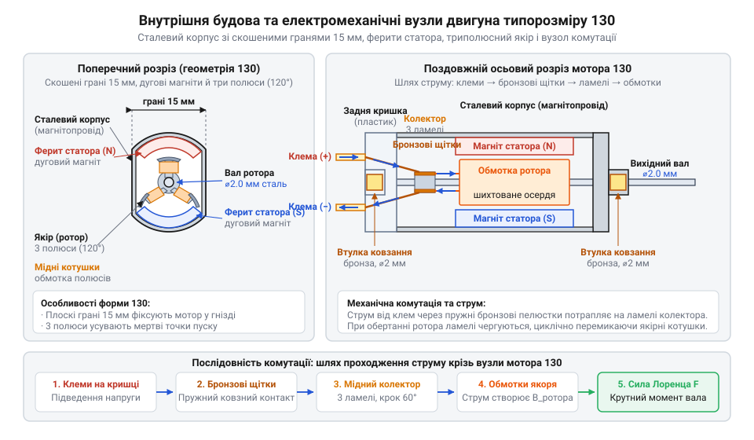
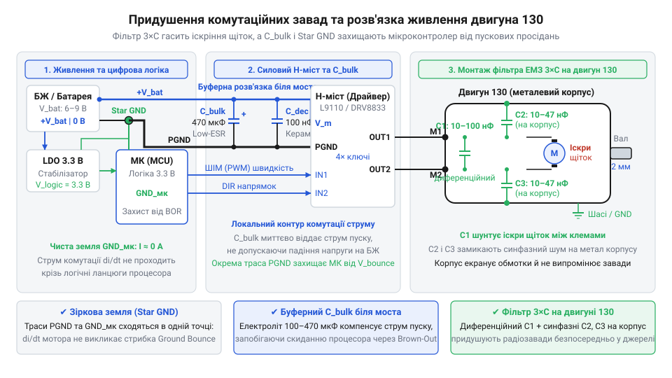

# Колекторний двигун типорозміру 130

## Пастка прямого приводу та надвисоких обертів

Спроба закріпити колесо безпосередньо на валу двигуна 130 призводить до миттєвої зупинки. Мотор розраховано на швидкість понад 10 000 об/хв, проте його пусковий момент становить мізерні частки міліньютон-метра: рушію бракує сили зрушити з місця навіть легку колісну платформу.

Секрет роботи криється в електричній саморегуляції. Коли якір обертається в полі статора, у витках виникає зустрічна проти-ЕРС (протиелектрорушійна сила, від англ. @@en|back-EMF@@). Вона протидіє напрузі живлення, обмежуючи струм холостого ходу до безпечних 70–150 мА.

Якщо навантаження блокує вал, проти-ЕРС зникає. Струм стрибає до величини блокування (від англ. @@en|stall current@@) у 2–2.5 А, обмеженої лише малим опіром дроту (1.5–3 Ом). Цей сплеск спричиняє просідання живлення та [аварійне перезавантаження процесора](root:hw-arch/brown-out-reset-detector). За законом Джоуля — Ленца енергія йде в тепло: за лічені секунди ізоляція обмоток згорає, а пластикова кришка мотора плавиться.

## Будова мотора та редуктори типу TT

Штампований сталевий корпус двигуна 130 слугує магнітопроводом. До нього притиснуто двополюсний статор (від лат. @@la|stare@@ — стояти нерухомо) із постійних феритів. Усередині обертається триполюсний якір із шихтованої електротехнічної сталі, чиї тонкі ізольовані пластини блокують вихрові струми.

Струм надходить крізь бронзові щітки на трисегментний колектор (від лат. @@la|colligere@@ — збирати), що механічно комутує котушки під час руху. Непарна триполюсна геометрія якоря запобігає мертвим точкам: магнітні полюси ротора ніколи не збігаються з віссю статора, забезпечуючи пуск із будь-якого положення.

*Анатомія двигуна 130: сталевий корпус замикає поле феритів статора, а трисегментний колектор комутує обмотки якоря без мертвих точок.*

Швидкісний вал узгоджують із навантаженням прямозубим редуктором (від лат. @@la|reducere@@ — зменшувати) типу @@en|TT@@ із передавальним числом 1:48 або 1:120. Він розмінює оберти на крутний момент з урахуванням втрат на тертя (ККД 60–70 %). Проте пластикові шестерні бояться ударів: зупинка колеса зрізає дрібні зубці, а бічний проміжок створює кутовий люфт (від англ. @@en|backlash@@ — мертвий хід). Для важких навантажень пластик замінюють на [надійний суцільнометалевий мікромотор](root:cat-hw-actuators/n20-motor).

## Керування H-мостом, фільтрація та захист

Індуктивні обмотки двигуна не можна підключати напряму до портів мікроконтролера: струм перевищує можливості кристала, а при вимкненні ЕРС самоіндукції породжує високовольтний викид у десятки вольт. Для його поглинання паралельно обмоткам ставлять демпферні діоди Шотткі (від англ. @@en|flyback diode@@). Механізм виникнення індуктивного викиду та критерії вибору діодів Шотткі для безпечної комутації ключів детально розглядають [демпферні діоди для захисту індуктивних навантажень](root:hw-components/flyback-inductive-spike).

Реверс та активне гальмування реалізує чотириквадрантний @@en|H-міст@@ (від англ. @@en|H-bridge@@). Діагональне вмикання ключів змінює полярність, а замикання обох нижніх транзисторів створює динамічне гальмування проти-ЕРС. Швидкість регулюють широтно-імпульсною модуляцією (ШІМ), застосовуючи апаратний мертвий час (від англ. @@en|dead time@@) проти наскрізного струму та плавний пуск (від англ. @@en|soft start@@) для захисту шестерень. Принцип роботи транзисторних ключів у чотирьох квадрантах, динамічне гальмування та захист від наскрізних струмів комутації детально розглядає [керування двигуном постійного струму за допомогою H-моста](root:hw-motion/h-bridge).

*Схема захисту двигуна 130: триконденсаторний фільтр гасить іскрові шуми щіток, а роздільні лінії живлення запобігають збоям мікроконтролера.*

Іскріння щіток об колектор придушує триконденсаторний фільтр: конденсатор на 100 нФ між клемами та два по 10–47 нФ від клем на корпус. Від просідань живлення схему захищають електролітом на 470–1000 мкФ і розведенням ліній живлення за схемою «зірка».

Пластикова задня кришка двигуна витримує лише 70 °C, тому контакти паяють за 1–2 секунди, уникаючи розплавлення щіткотримачів. Для захисту від заклинювання застосовують струмовий шунт, пам'ятаючи про ресурс бронзових щіток у 50–100 годин.
