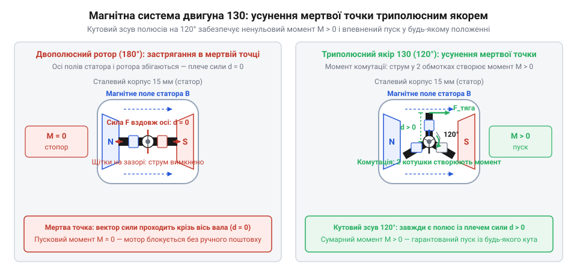
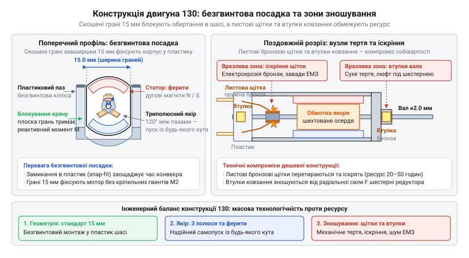

# Виникнення типорозміру 130 та еволюція мініатюрних колекторних двигунів

<preknowlist>
- [Мотор-редуктор 6 В (100 і 600 об/хв)](root:cat-hw-actuators/gearmotor-6v) — Базове розуміння будови привода навчальних колісних роботів (жовтий TT-мотор на базі двигуна 130): поєднання швидкісного колекторного мікромотора з редуктором, робочі напруги та залежність струму від навантаження на валу.
</preknowlist>

## Криза механічного привода повоєнних іграшок

У повоєнній індустрії 1950-х років виробники масових механічних іграшок зіткнулися з глухим кутом: рухомі жерстяні автомобілі, поїзди й катери потребували автономного джерела руху, проте жоден доступний рушій не міг забезпечити тривалу й надійну роботу за прийнятну ціну.

Основою тогочасних автономних іграшок був пружинний завод (англ. @@en|clockwork mechanism@@; механізм від грец. @@grc|mechane@@ — пристрій). Спіральна стрічка із загартованої вуглецевої сталі накопичувала енергію ручного заведення ключем і передавала її на колеса крізь набір штампованих шестерень. Проте пружинний рушій мав критичні вади: накопичена енергія вивільнялася нерівномірно — машинка робила різкий ривок на початку, а за 15–30 секунд уповільнювалася до повної зупинки. Через утому металу сталеві стрічки швидко втрачали пружність, а при надмірному зусиллі заводу розривалися або зрізали зуби храповика, перетворюючи іграшку на нерухомий брухт.

Заміна пружини на електричний двигун здавалася логічним кроком, але тогочасні мікромотори спиралися на схему [двигунів з електромагнітним збудженням](root:hw-motion/wound-field-dc-motor). Магнітне поле статора (від лат. @@la|stator@@ — нерухомий) у них створювали масивні котушки з мідного дроту на залізних осердях. Доступні тоді постійні магніти зі сплаву @@en|Alnico@@ (алюміній-нікель-кобальт) вимагали дефіцитного кобальту, були занадто дорогими й важкими в механічній обробці.

Статорні котушки електромагнітного збудження споживали великий струм навіть на холостому ходу, розсіюючи енергію на марне нагрівання. Через це мотор вимагав громіздких батарей напругою 4.5–6 В і виснажував їх за лічені хвилини. До того ж витрати міді на подвійний набір обмоток робили такий двигун дорожчим за саму жерстяну іграшку.

Спроби виробників здешевити конструкцію за рахунок спрощення каркаса не рятували ситуацію: фізика магнітних втрат лишалася незмінною. Масовий ринок потребував принципово іншого розв'язку, скутого жорсткими вимогами: копійчана собівартість деталей, живлення від одного доступного [вугільно-цинкового гальванічного елемента](root:hw-power/zinc-carbon-battery) (1.5 В; від імені дослідника Луїджі Гальвані, італ. @@it|Luigi Galvani@@) і безумовний самозапуск без підштовхування коліс рукою.

## Феритовий статор і триполюсний якір Мабучі

Цю інженерну кризу розв'язав японський винахідник Кен’їті Мабучі (яп. @@ja|Ken'ichi Mabuchi@@), заснувавши компанію @@ja|Mabuchi Motor@@. Його підхід поєднав два нововведення, що кардинально змінили будову мікромотора.

Першим проривом стала відмова від обмоток збудження на користь керамічних магнітів на основі барієвого фериту (@@en|barium ferrite@@; ферит від лат. @@la|ferrum@@ — залізо). Барієвий ферит спікався з дешевих оксидів заліза й барію, легко набував потрібної дугоподібної форми й мав високу стійкість до розмагнічування. Два постійні феритові магніти утворили статор із нульовим власним енергоспоживанням, повністю усунувши коштовну мідь зі статорного вузла та в рази знизивши розряд батареї.

Проте заміна статора виявила іншу проблему: двополюсний ротор (від лат. @@la|rotare@@ — обертатися) класичних моторів регулярно застрягав у положенні, де магнітні поля статора та якоря (від нім. @@de|Anker@@ — якір) збігалися за віссю. У цій точці плече сили дорівнювало нулю, а щітки потрапляли на ізоляційні проміжки колектора (від лат. @@la|collector@@ — збирач). Ця «мертва точка» (англ. @@en|dead center@@) блокувала пуск: двигун гудів під напругою, але не міг рушити без механічного підштовхування вала пальцем.

Мабучі подолав цю ваду за допомогою симетричного триполюсного якоря з трьома Т-подібними пелюстками осердя, рознесеними на 120°, та трисекційного колектора.

*Кутовий зсув полюсів трисекційного якоря на 120° усуває мертву точку двополюсної схеми й створює ненульовий пусковий крутний момент за будь-якої орієнтації ротора.*

Завдяки непарній кількості полюсів за будь-якого кутового положення вала струм протікає щонайменше крізь дві секції обмотки. Вектори магнітного тяжіння й відштовхування виявляються зсунутими відносно осі статорного поля, тому пусковий крутний момент (від лат. @@la|momentum@@ — рушійна сила) ніколи не спадає до нуля. Двигун отримав здатність самостійно рушати з місця від одного елемента 1.5 В під штатним навантаженням.

Поєднання копійчаного феритового статора з триполюсним якорем усунуло головні статті витрат і започаткувало глобальне масове виробництво надійних автономних мікромоторів.

## Стандартизація типорозміру 130 і компроміси собівартості

Конвеєрне збирання масових іграшок виключало застосування гвинтів, окремих хомутів і тривалого ручного закріплення моторів. Компанія @@ja|Mabuchi Motor@@ помістила магніти та якір у штампований сталевий корпус, зрізавши дві протилежні бічні грані до ширини 15 мм. Ця форма розв'язала дві виробничі проблеми водночас: плоский мотор миттєво замикався у пластикове гніздо без інструментів, а прямі бічні грані блокували його провертання від реактивного моменту. Конструкція закріпилася як промисловий типорозмір 130 (англ. @@en|type 130@@; типорозмір від грец. @@grc|typos@@ — зразок).

*Зрізані бічні грані корпусу фіксують мотор у пластиковому гнізді без гвинтів, а пелюсткові щітки та втулки ковзання зменшують собівартість ціною іскріння й швидкого зношування.*

Разом із монтажем виробництво вимагало копійчаної ціни внутрішніх вузлів, тому конструктори замінили точні деталі штампованими замінниками. Замість кулькопідшипників вал якоря обперли на прості бронзові втулки ковзання (англ. @@en|sleeve bushings@@). Традиційні підпружинені вугільні щітки у напрямних гільзах замінили тонкими смужками з фосфористої бронзи — пелюстковими щітками (англ. @@en|leaf brushes@@), які терлися безпосередньо об ламелі колектора. Механічні втрати, граничні радіальні навантаження та специфіку зношування сухих бронзових вузлів порівняно з підшипниками кочення детально розкриває огляд [втулки ковзання проти кулькопідшипників у мікроприводах](root:hw-motion/sleeve-and-ball-bearings).

Таке спрощення дозволило двигуну легко розганятися до 10 000–15 000 об/хв за мізерного моменту, що вимагало передачі обертання через [понижувальний редуктор](root:cat-hw-actuators/gearmotor-6v). Проте здешевлення визначило його вади під навантаженням. На високих обертах гнучкі пелюстки вібрують і підстрибують на стиках колектора, породжуючи безперервне іскріння та потужний електричний шум (англ. @@en|electrical noise@@). Механічне тертя сточує бронзові контакти за 20–50 годин, радіальні зусилля перегрівають сухі втулки, а зупинка вала під напругою спричиняє різкий стрибок струму, який за лічені секунди спалює тонку обмотку якоря. Причини виникнення іскрових завад на колекторі та розрахунок фільтрувальних конденсаторів і дроселів для мікромоторів детально розглядає [придушення завад колекторних двигунів](root:hw-analog/brush-dc-noise-suppression).

## Слоткари, Tamiya Mini 4WD та міфи

На початку 1960-х років шалену популярність здобули перегони мініатюрних автомоделей на електрифікованих треках із напрямними пазами — слоткари (англ. @@en|slot cars@@; слот від англ. @@en|slot@@ — паз, щілина). Щоб легка машинка в масштабі 1:32 не переверталася на віражах, їй був потрібен двигун із гранично низьким центром мас і високою швидкістю. Плоский сталевий корпус типорозміру 130 зі зрізаними до 15 мм гранями вписався в цю вимогу ідеально: він замикався в пластикове шасі біля самої поверхні траси й живився через струмознімачі від рейок.

Проте заводського моменту й обертів для перемоги не вистачало. Прагнення вичавити максимальну швидкість породило культуру аматорського тюнінгу (англ. @@en|tuning@@; від англ. @@en|tune@@ — налаштовувати). Моделісти розкривали корпус і вручну перемотували якір: фабричний дріт замінювали товстішим із меншою кількістю витків. Опір обмотки падав, струм зростав, а швидкість вала сягала 30 000–40 000 об/хв. За таких режимів бронзові щітки розжарювалися, іскріння проплавляло пластиковий щит колектора, а втулки ковзання заклинювали через перегрів. Утім для перегонів ресурс у 15–30 хвилин вважався прийнятним: мотори сприймали як витратний вузол для заміни між заїздами. Розрахунок перерізу дроту й кількості витків якоря, вплив на крутний момент і струм та температурні обмеження щіткових вузлів описує [перемотування та форсування колекторних мікромоторів](root:hw-motion/dc-motor-tuning-and-rewinding).

У 1982 році японська компанія @@ja|Tamiya@@ спричинила новий сплеск попиту, представивши трекові повноприводні шасі @@en|Mini 4WD@@ (від англ. @@en|four-wheel drive@@ — повний привод). Автономні моделі мчали замкненим пластиковим треком без дистанційного керування, тому час проходження кола залежав лише від механічного налаштування шасі та віддачі мотора. Типорозмір 130 став базовим серцем цієї дисципліни: компанія випускала серії форсованих двигунів із потужнішими феритами чи вугільними щітками, а ентузіасти організовували світові чемпіонати, змагаючись у майстерності ручного балансування якорів.

Шалений успіх серії породив міф, ніби типорозмір 130 створила саме @@ja|Tamiya@@. Насправді модельний бренд не розробляв формфактор: шасі проєктували під готовий двигун, який компанія @@ja|Mabuchi Motor@@ серійно випускала ще з кінця 1950-х років. Модельні бренди лише замовляли на заводах @@ja|Mabuchi@@ готові партії зі зміненою обмоткою, сильнішими магнітами та фірмовими наліпками. Оцінювати надійність побутових моторів 130 за спортивними версіями — помилка маркетингу: навіть дорогі хобійні модифікації лишаються форсованими іграшковими приводами для коротких спринтів, а не для тривалої роботи.

## Побутова техніка та спадщина в робототехніці

Мільйонні тиражі на заводах @@ja|Mabuchi Motor@@ та азійських фабриках-клонах збили собівартість типорозміру 130 до копійчаного рівня. За такої доступності розробники споживчої техніки впроваджували його всюди, де вимагалася проста механічна дія без точного позиціонування. Двигун став стандартом у приводах лотків CD та DVD, стрічкопротяжках аудіомагнітофонів, автомобільних дзеркалах, дверних замках і дозаторах рідкого мила. У цих приладах мотор працює імпульсно — по 1–3 секунди за цикл, тому за роки служби сумарне напрацювання не перевищує десятка годин, що цілком укладається в ресурс бронзових щіток.

Коли в 2000-х роках розвинулася навчальна робототехніка на платах @@en|Arduino@@, виникла потреба в найдешевшому рушії для колісних шасі. Інженерним розв'язком стало поєднання мотора 130 із пластиковими шестернями в монолітному жовтому корпусі — так з'явився масовий [навчальний мотор-редуктор](root:cat-hw-actuators/gearmotor-6v) (відомий як TT-мотор; англ. @@en|TT motor@@, від англ. @@en|track@@ — колія та @@en|transmission@@ — передача). Завдяки іграшковій оптимізації цей вузол відкрив мільйонам початківців доступне макетування мобільних роботів. Будову пластикового редуктора 1:48, аналіз шестерень, люфти та причини нерівномірності швидкості при низькій собівартості детально розкриває [конструкція та кінематика навчального мотор-редуктора TT](root:cat-hw-actuators/tt-gearmotor-internals).

Проте застосування такого рушія поза межами макета наражається на вроджені фізичні обмеження, які часто плутають із браком:
- Розкид швидкості між двома колесами робота сягає 15–20% через штамповані допуски статора й нерівномірне намагнічування феритів.
- Безперервний рух протягом кількох годин стирає тонкі щітки й перегріває втулки, що вимагає переходу на [довговічний мікромотор N20](root:cat-hw-actuators/n20-motor) із графітовими контактами або [безколекторний мотор](root:cat-hw-actuators/bldc-motor-module).
- Вібрація пелюсткових щіток на колекторі створює потужний електричний шум, здатний перезавантажувати процесор робота, якщо на клеми не припаяти керамічний конденсатор ємністю 100 нФ.
- Зупинка колеса перешкодою викликає струм заблокованого ротора (англ. @@en|stall current@@; від англ. @@en|stall@@ — глушити, зупиняти), через що за лічені секунди пластиковий колекторний щит плавиться, а обмотка згорає.

Типорозмір 130 лишається зручним рішенням для швидкого навчання й макетування, якщо конструктор тверезо оцінює його іграшкове походження й не очікує ресурсу промислового привода.
