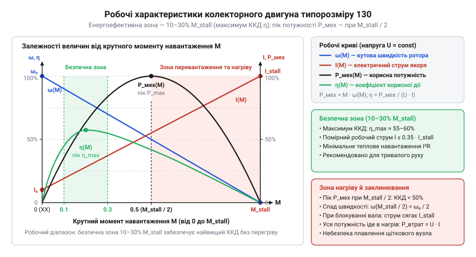

# Електромеханічна модель та робочі характеристики колекторного двигуна

<preknowlist>
- [Мотор-редуктор 6 В (100 і 600 об/хв)](root:cat-hw-actuators/gearmotor-6v) — Базові принципи функціонування колекторного електродвигуна від джерела постійної напруги, поведінка споживаного струму під механічним навантаженням та фізичне поняття заклинювання ротора.
- [N20 мікромотор з редуктором](root:cat-hw-actuators/n20-motor) — Конструктивна будова щітково-колекторного вузла мініатюрних двигунів постійного струму, наявність омічного опору мідних обмоток якоря та небезпека перегріву при зупинці вала.
</preknowlist>

## Пастка закону Ома та просідання живлення

Під час випробування на столі мініатюрний @@la|колекторний двигун@@ (від лат. *collector* — збирач) типорозміру 130 без механічного навантаження споживає 100–150 мА від джерела 5 В. Якщо розрахувати опір за законом Ома, мотор здається звичайним пасивним резистором на 30–50 Ом. Проте щойно цей двигун установлюють у [мотор-редуктор колісного шасі](root:cat-hw-actuators/gearmotor-6v), найменший механічний опір сповільнює вал, і струм раптово злітає в 10–15 разів — до 1.5–2.5 А.

Через надмірний струм лінія живлення зазнає глибокого просідання напруги. Якщо цифрове ядро живиться від цієї ж шини, мікроконтролер циклічно перезавантажується через апаратне скидання (англ. @@en|Brown-out Reset@@, BOR; від *brownout* — просідання живлення та *reset* — скидання), а силові транзистори драйвера стрімко перегріваються. Закон Ома для нерухомого провідника не пояснює цей стрибок: омічний опір мідних обмоток не змінювався. Збільшення ємності конденсаторів чи номіналу запобіжника лише маскує наслідки аварії. Електричний струм двигуна прямо пов'язаний зі швидкістю обертання @@la|ротора@@ (від лат. *rotare* — обертатися; @@la|ротор@@), тому розрахунок надійної схеми вимагає повноцінної електромеханічної моделі.

## Електричний баланс якоря та проти-ЕРС

Еквівалентна схема кола @@de|якоря@@ (від нім. *Anker* — якір) містить три послідовні елементи: активний опір мідного дроту `R` (типово 1.5–3.5 Ом для двигуна 130), власну @@la|індуктивність@@ (від лат. *inductio* — наведення) обмоток `L` та внутрішній генератор напруги — @@en|проти-ЕРС@@ (від лат. *electromotio* — рух електрики; англ. @@en|back-EMF@@).

Кутова швидкість @@la|ротора@@ `ω` (у радіанах за секунду, рад/с) та стала швидкості двигуна `Ke` (у вольт-секундах на радіан, В·с/рад) визначають внутрішню проти-електрорушійну силу `e` (у вольтах, В) за законом електромагнітної індукції Фарадея:

```
e = Ke · ω                                [закон електромагнітної індукції Фарадея]
```

Ця наведена напруга виникає в обмотках під час перетину магнітного поля @@la|статора@@ (від лат. *stare* — стояти; @@la|статор@@) і за правилом Ленца діє строго назустріч живильній напрузі `U`.

Миттєвий електричний баланс напруг у контурі @@de|якірного кола@@ з живильною напругою `U`, струмом @@de|якоря@@ `I`, активним опором обмотки `R` та власною @@la|індуктивністю@@ витків `L` (у генрі, Гн) задає другий закон Кірхгофа:

```
U = I · R + L · (dI ÷ dt) + e             [другий закон Кірхгофа для якірного кола]
  = I · R + L · (dI ÷ dt) + Ke · ω        [підстановка проти-ЕРС через кутову швидкість]
```

Зовнішня напруга джерела витрачається на подолання активного омічного опору дроту, подолання @@la|індуктивності@@ під час зміни струму та компенсацію зустрічної @@en|проти-ЕРС@@.

Для усталеного руху швидкість і струм незмінні, тому похідною струму нехтують: `dI ÷ dt = 0`. Математичне обґрунтування нехтування цим членом під час механічного руху спирається на співвідношення електричної та механічної сталих часу. Швидкість перехідних процесів в обмотці задає електрична стала часу якірного кола `τ_e = L ÷ R`. Для двигуна 130 з індуктивністю в частки мілігенрі та опором `R = 1.5–3.5 Ом` вона становить лише 0.1–0.3 мс. Натомість зміну кутової швидкості стримує механічна інерція @@la|ротора@@, яку характеризує механічна стала часу привода `τ_m` тривалістю 10–50 мс. Оскільки електрична стала на два порядки менша за механічну, струм в обмотці практично миттєво підлаштовується під обертання вала. Спад напруги на @@la|індуктивності@@ виявляється нехтовно малим порівняно з омічним спадом `I · R` та @@en|проти-ЕРС@@, що підтверджує точність наближення `dI ÷ dt ≈ 0`. Знаходимо усталений струм @@de|якоря@@ `I` у квазістаціонарному наближенні (від лат. *quasi* — майже та *stationarius* — нерухомий; @@la|квазістаціонарне наближення@@):

```
I = (U - e) ÷ R                           [закон Ома для кола з проти-ЕРС при dI ÷ dt = 0]
  = (U - Ke · ω) ÷ R                      [підстановка виразу проти-ЕРС через швидкість]
```

Отриманий вираз пояснює аварійний стрибок струму під навантаженням: у вільному русі швидка @@en|проти-ЕРС@@ майже зрівнюється з живильною напругою `U`, утримуючи малий струм холостого ходу. Якщо ж механічний опір зупиняє вал до `ω = 0`, зустрічна @@en|проти-ЕРС@@ зникає, і через обмотку тече максимальний пусковий струм `U ÷ R`, обмежений лише омічним опором дроту.

## Електромеханічні сталі та граничні режими

Струм обмотки @@de|якоря@@ у магнітному полі @@la|статора@@ зазнає дії @@fr|сили Ампера@@. На плечі радіуса @@la|ротора@@ ці сили утворюють електромагнітний @@la|крутний момент@@ (від лат. *momentum* — рушійна сила; @@la|крутний момент@@) `M` (у ньютон-метрах, Н·м), пропорційний силі струму `I` через сталу крутного моменту `Kt` (у ньютон-метрах на ампер, Н·м/А):

```
M = Kt · I                                [електромагнітний крутний момент якоря]
```

Під час електромеханічного перетворення споживана електрична потужність `e · I` повністю переходить у корисну механічну потужність `M · ω`. Співвідношення потужностей визначає зв'язок коефіцієнтів двигуна:

```
Ke · ω · I = e · I                        [електрична потужність перетворення]
           = M · ω                        [баланс потужності без втрат]
           = Kt · I · ω                   [підстановка крутного моменту]
```

Скоротивши спільний добуток `ω · I`, дістаємо тотожність `Ke = Kt`. Одиниця вимірювання сталої швидкості `1 В·с/рад` тотожна `1 Н·м/А`, оскільки `1 В = 1 (Н·м) ÷ (А·с)`. Один і той самий коефіцієнт описує як генераторну @@en|проти-ЕРС@@, так і тяговий @@la|крутний момент@@.

Цей баланс задає два граничні фізичні стани при сталій напрузі живлення `U`. В ідеальному режимі холостого ходу вал ненавантажений (`M = 0`), а ротор розганяється до повної компенсації напруги проти-ЕРС (`e ≈ U`):

```
ω₀ = U ÷ Ke                               [кутова швидкість ідеального холостого ходу]
```

У реальному моторі 130 тертя щіток і підшипників створює струм холостого ходу `I₀` близько 100–150 мА, тож реальна швидкість трохи нижча за `ω₀`.

Аварійною межею є @@en|режим заблокованого ротора@@ (англ. @@en|stall@@ — заклинювання вала). Якщо навантаження зупиняє вал (`ω = 0`), наведена @@en|проти-ЕРС@@ зникає (`e = 0`), а струм обмежується омічним опором якірного дроту `R`:

```
I_stall = U ÷ R                           [закон Ома для нерухомого якоря при e = 0]
```

За цього пікового струму двигун розвиває граничний пусковий момент заклинювання:

```
M_stall = Kt · I_stall                    [електромагнітний момент за струму блокування]
        = Kt · (U ÷ R)                    [підстановка струму I_stall]
```

Вал не обертається, тож уся споживана потужність `U · I_stall` виділяється теплом в обмотках, спричиняючи критичний перегрів і глибоке просідання напруги живлення.

## Лінійна електромеханічна характеристика під навантаженням

Зв'язок кутової швидкості `ω` з навантаженням на валу знаходять підстановкою струму `I = M ÷ Kt` у квазістаціонарне рівняння балансу напруг:

```
ω(M) = (U - I · R) ÷ Ke                   [вираження швидкості з балансу напруг]
     = (U ÷ Ke) - (R ÷ (Ke · Kt)) · M     [підстановка струму якоря I = M ÷ Kt]
     = ω₀ · (1 - M ÷ M_stall)             [лінійне рівняння механічної характеристики]
```

Ця спадна пряма між точками `(0, ω₀)` та `(M_stall, 0)` є @@gr|механічною характеристикою@@ (від грец. *charakter* — прикмета, ознака; @@gr|механічна характеристика@@) мотора. Її нахил задає електромеханічна жорсткість `β = (Ke · Kt) ÷ R`. Через відчутний опір якірного дроту `R = 1.5–3.5 Ом` мотор 130 має м'яку характеристику: швидкість істотно падає зі зростанням моменту.

Для зміни швидкості обертання регулюють напругу живлення `U`. Конструктивні сталі `Ke`, `Kt` та опір дроту @@de|якоря@@ `R` визначаються будовою мотора і від напруги не залежать, тому електромеханічна жорсткість `β` залишається незмінною. Зміна напруги пропорційно зсуває швидкість холостого ходу `ω₀ = U ÷ Ke` та момент у @@en|режимі заблокованого ротора@@ `M_stall = Kt · (U ÷ R)`. Оскільки нахил `1 ÷ β` залишається сталим, регулювання `U` зміщує пряму `ω(M)` паралельно до самої себе. Утворюється сімейство паралельних @@gr|механічних характеристик@@: спад кутової швидкості під дією заданого @@la|крутного моменту@@ `Δω = M ÷ β` залишається однаковим за будь-якої напруги живлення.

Стійкість обертання підтримує внутрішній @@en|від'ємний зворотний зв'язок@@ (англ. @@en|negative feedback@@) за @@en|проти-ЕРС@@. Коли зовнішній опір сповільнює вал, наведена напруга `e = Ke · ω` падає. Різниця `U - e` зростає, струм у контурі збільшується, і мотор автоматично нарощує @@la|крутний момент@@ до зрівноваження навантаження без зовнішніх давачів.

Точка перетину прямої `ω(M)` із характеристикою навантаження визначає сталу @@en|робочу точку@@ (англ. @@en|operating point@@) привода. Наприклад, на валу [водяної помпи](root:cat-hw-actuators/water-pump-rs360sh) швидкість і струм фіксуються в точці, де електромагнітний @@la|крутний момент@@ двигуна точно зрівноважує гідродинамічний опір крильчатки.

## Крива ККД та безпечна точка

Корисна механічна потужність `P_мех` (у ватах, Вт) дорівнює добутку розвиваного @@la|крутного моменту@@ `M` на кутову швидкість `ω`:

```
P_мех(M) = M · ω(M)                       [визначення корисної механічної потужності]
         = M · ω₀ · (1 - M ÷ M_stall)     [підстановка лінійної швидкості ω(M)]
```

Залежність має форму параболи з нулями на холостому ході (`M = 0`) та за повної зупинки вала (`M = M_stall`). Її максимум лежить посередині діапазону навантаження — за `M = M_stall ÷ 2` та швидкості `ω = ω₀ ÷ 2`.

Споживана електрична потужність `P_ел = U · I` витрачається на механічний рух та теплові втрати Джоуля `P_втрат = I² · R` в обмотці @@de|якоря@@. Їхнє відношення визначає @@la|коефіцієнт корисної дії@@ (від лат. *coefficiens* — той, що сприяє; @@la|ККД@@) `η`:

```
η(M) = P_мех ÷ P_ел                       [визначення коефіцієнта корисної дії]
     = (M · ω) ÷ (U · I)                  [співвідношення механічної та електричної потужності]
```

У точці пікової механічної потужності струм сягає `I_stall ÷ 2`, а @@la|ККД@@ не перевищує 50%: рівно половина енергії перетворюється на тепло на опорі `R`. Через тертя холостого ходу реальний пік @@la|ККД@@ зміщується в зону 15–25% від моменту блокування `M_stall`.


*Робочі характеристики мотора 130 з максимумом ККД ліворуч від піка механічної потужності.*

Робота поблизу максимуму потужності спричиняє перегрів обмоток та глибоке просідання напруги живлення. Енергоефективну й термічно безпечну тривалу @@en|робочу точку@@ обирають у межах 10–30% від моменту блокування. Якщо навантаженню потрібен більший момент, його узгоджують через [зовнішній мотор-редуктор](root:cat-hw-actuators/gearmotor-6v). Нестаціонарний [динамічний нагрів обмоток](root:hw-motion/motor-dynamic-thermal-model) за тривалого блокування вала описує окрема теплова модель.
