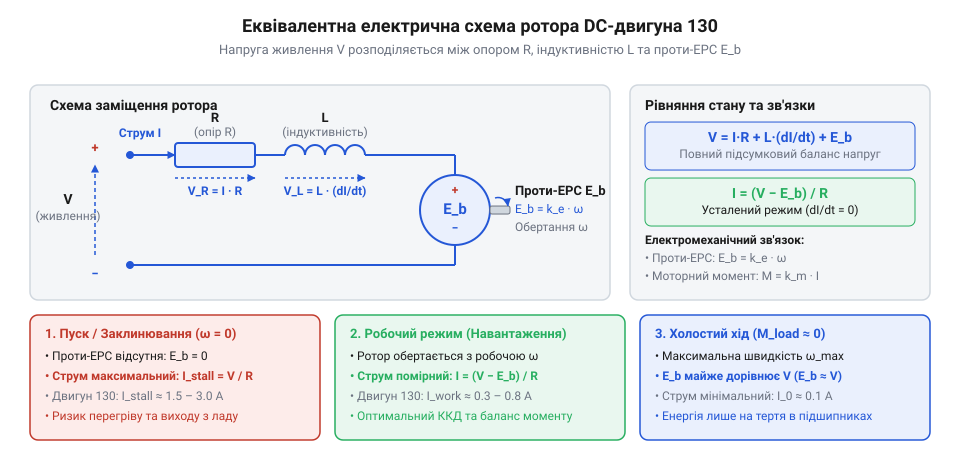
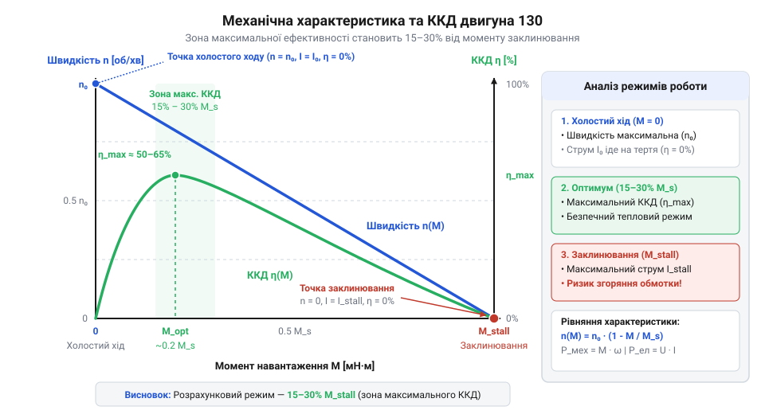
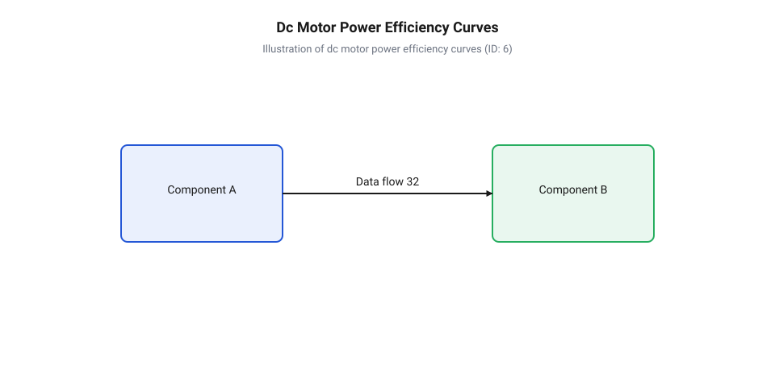
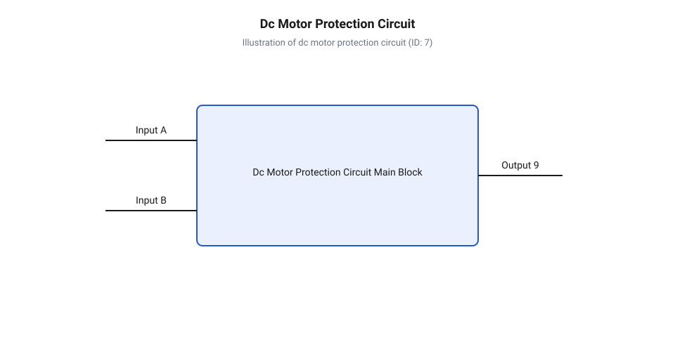

# Електромеханічна модель двигуна 130: проти-ЕРС, механічна характеристика та пускові струми

## Чому пуск двигуна перезавантажує контролер

Підключення невеликого колекторного двигуна (DC motor, @@en|DC motor@@) 130-го типорозміру до мікроконтролерної плати нерідко закінчується раптовим перезавантаженням контролера в момент подачі живлення або при механічному блокуванні вала. Проблема здається парадоксальною: вимірявши статичний опір обмотки ротора (лат. *rotare* — обертатися, @@en|rotor@@) мультиметром, ми отримуємо значення близько `R_a = 2` Ом. При живленні від джерела з напругою `V_s = 3` В стаціонарний струм під час вільних обертів становить лише `0.15` А, що легко витримує невелике джерело та силовий ключ. Проте під час старту мікроконтролер фіксує аварійне падіння напруги (Brownout Reset, @@en|Brownout Reset@@), а транзистор керування сильно нагрівається.

Якщо обчислити струм споживання за простим омічним опором нерухомої обмотки `R_a`, використавши закон Ома:

```
I_stall = V_s ÷ R_a
        = 3.0 ÷ 2.0             [закон Ома для нерухомого ротора]
        = 1.5                   [струм у амперах]
```

Отриманий пусковий струм `I_stall = 1.5` А в 10 разів перевищує робочий струм холостого ходу `I_0 = 0.15` А. Таке короткочасне або тривале споживання створює високий сплеск струму (inrush current, @@en|inrush current@@) або струм заклинювання (stall current, @@en|stall current@@). Оскільки омічний опір мідного провідника обмотки залишається незмінним під час обертання, стаціонарний опір ротора не пояснює, чому струм падає в 10 разів, як тільки вал набирає оберти.

Для подібних навантажень, як у [мікромоторі N20 з редуктором](root:cat-hw-actuators/n20-motor) чи [водяній помпі RS-360SH](root:cat-hw-actuators/water-pump-rs360sh), таке падіння струму є фундаментальною властивістю обертового ротора. Очевидно, у системі з'являється додатковий внутрішній чинник, який залежить від швидкості обертання і протидіє зовнішній напрузі живлення. Звичайної моделі у вигляді статичного резистора недостатньо — для проектування надійних схем потрібна повна електромеханічна модель двигуна.

## Фізика проти-ЕРС та електрична схема

Причиною спаду струму під час обертання ротора є явище електромагнітної індукції (лат. *inductio* — наведення, @@en|electromagnetic induction@@). Усередині статора (лат. *stare* — стояти, @@en|stator@@) двигуна 130 розміщені постійні магніти, які створюють постійне магнітне поле. Обмотки ротора, з'єднані через колектор (лат. *collector* — збирач, @@en|commutator@@) та графітові або металеві щітки, обертаються у цьому полі. Детальний аналіз фізики перемикання секцій ротора, виникнення іскріння та високочастотних завад дивіться у статті про [комутацію та хвильові процеси в колекторному вузлі двигуна 130](root:hw-motion/dc-motor-brush-commutation).

Згідно з законом електромагнітної індукції Фарадея (@@en|Faraday's law of induction@@), коли провідник перетинає магнітні лінії зі швидкістю, у ньому індукується електрорушійна сила (ЕРС). За правилом Ленца (@@en|Lenz's law@@), напрямок цієї індукованої напруги завжди протидіє причині, яка її викликала, тобто зовнішній напрузі живлення `V_s`. Через це індуковане значення називають проти-електрорушійною силою або проти-ЕРС (back electromotive force, @@en|back-EMF@@), яку позначають `E_b`.

Величина проти-ЕРС прямо пропорційна кутовій швидкості обертання ротора `ω` (вимірюється в радіанах за секунду, рад/с):

```
E_b = K_e · ω                   [залежність проти-ЕРС від кутової швидкості]
```

де `K_e` — коефіцієнт проти-ЕРС (@@en|back-EMF constant@@), який характеризує конструктивні параметри двигуна: кількість витків обмотки, площу рамки та магнітний потік статора. Одиницею вимірювання `K_e` у системі СІ (@@en|International System of Units@@) є вольт-секунда на радіан, `В/(рад/с)`.

Щоб розрахувати струм у будь-якому режимі, складемо еквівалентну електричну схему ротора. Вона складається з трьох послідовно з'єднаних елементів: активного опору обмотки `R_a`, її власної індуктивності `L_a` та еквівалентного джерела проти-ЕРС `E_b`, підключених до напруги живлення `V_s`.


*Еквівалентна електрична схема ротора колекторного двигуна постійного струму з послідовно увімкненими опором обмотки R, індуктивністю L та джерелом проти-ЕРС Eb.*

За другим законом Кірхгофа (@@en|Kirchhoff's circuit laws@@), повне рівняння напруг у роторі має вигляд:

```
V_s = I_a · R_a + L_a · (dI_a ÷ dt) + E_b    [рівняння балансу напруг ротора]
```

У стаціонарному режимі обертання, коли струм та швидкість не змінюються у часі (`dI_a / dt = 0`), похідна дорівнює нулю, і падіння напруги на індуктивності зникає. Тоді рівняння спрощується до стаціонарного електричного балансу:

```
V_s = I_a · R_a + E_b            [стаціонарне рівняння балансу напруг]
```

Висловимо струм ротора `I_a` через напругу живлення та проти-ЕРС:

```
I_a = (V_s - E_b) ÷ R_a
    = (V_s - K_e · ω) ÷ R_a     [залежність струму від кутової швидкості]
```

З цього рівняння чітко видно механізм саморегуляції колекторного двигуна (@@en|DC motor@@):
1. **При пуску (`ω = 0`):** Проти-ЕРС дорівнює нулю (`E_b = 0`), тому струм обмежений лише омічним опором `R_a`: `I_stall = V_s / R_a`. 2. **Під час розгону (`ω` зростає):** Проти-ЕРС `E_b` збільшується, зменшуючи різницю напруг `V_s - E_b`. Як наслідок, струм ротора `I_a` стрімко падає. 3. **На холостому ході (`ω = ω_0`):** Проти-ЕРС майже досягає напруги живлення (`E_b ≈ V_s`), а струм знижується до мінімального значення `I_0`, необхідного лише для подолання сили тертя у підшипниках та щітках.

На відміну від систем без саморегуляції, таких як [кроковий мотор 28BYJ-48](root:cat-hw-actuators/28byj-48-stepper) чи [безколекторний мотор](root:cat-hw-actuators/bldc-motor-module), у колекторному двигуні 130 проти-ЕРС працює як природний зворотний зв'язок: чим швидше обертається вал, тим менше струму він споживає від джерела.

## Механічна характеристика та зв'язок моментів

Електричний струм у роторі безпосередньо генерує механічну силу. Згідно з законом Ампера, на кожен провідник зі струмом `I_a`, розміщений у магнітному полі статора, діє механічна сила. Сумарний електромагнітний крутний момент (torque, @@en|torque@@) `T_e`, який повертає вал двигуна, прямо пропорційний струму ротора:

```
T_e = K_t · I_a                 [електромагнітний крутний момент]
```

де `K_t` — коефіцієнт крутного моменту (@@en|torque constant@@), вимірюваний у ньютон-метрах на ампер, `Н·м/А`.

Між коефіцієнтом проти-ЕРС `K_e` та коефіцієнтом моменту `K_t` існує фундаментальний зв'язок. У системі СІ електромагнітна потужність, яка перетворюється з електричної форми у механічну, дорівнює добутку проти-ЕРС на струм `P_em = E_b · I_a`. З іншого боку, ця ж механічна потужність дорівнює добутку моменту на кутову швидкість `P_mech = T_e · ω`. Нехтуючи внутрішніми втратами на перемагнічування та тертя, прирівняємо ці потужності:

```
P_em = P_mech
E_b · I_a = T_e · ω               [рівність електричної та механічної потужностей]
(K_e · ω) · I_a = (K_t · I_a) · ω   [підстановка проти-ЕРС та моменту]
K_e = K_t                         [співвідношення коефіцієнтів у СІ]
```

У міжнародній системі одиниць СІ коефіцієнт проти-ЕРС `K_e` у `В/(рад/с)` і коефіцієнт моменту `K_t` у `Н·м/А` числово абсолютно рівні (`K_e = K_t`). Це спрощує аналіз електромеханічної моделі, оскільки вимірявши один із цих коефіцієнтів, ми одразу знаємо інший.

Об'єднаємо рівняння електричного балансу та рівняння моменту, щоб вивести механічну характеристику — залежність кутової швидкості `ω` від моменту навантаження `T_e`.

Почнемо з виразу для струму `I_a = T_e / K_t` і підставимо його у стаціонарне електричне рівняння:

```
V_s = (T_e ÷ K_t) · R_a + K_e · ω    [рівняння балансу через момент]
K_e · ω = V_s - (T_e · R_a) ÷ K_t    [виділення члена з кутовою швидкістю]
ω = (V_s ÷ K_e) - (R_a ÷ (K_e · K_t)) · T_e   [залежність кутової швидкості від моменту]
```

Визначимо два крайніх режими роботи двигуна:
1. **Режим холостого ходу (`T_e = 0`):** Вал обертається без зовнішнього навантаження. Швидкість досягає теоретичного максимуму `ω_0`:
   ```
   ω_0 = V_s ÷ K_e               [кутова швидкість холостого ходу]
   ```
2. **Режим заклинювання або пуску (`ω = 0`):** Вал зупинено зовнішнім навантаженням. Момент досягає максимального пускового значення `T_stall`:
   ```
   T_stall = (K_t · V_s) ÷ R_a   [пусковий момент заклинювання]
   ```

Підставивши `ω_0` та `T_stall` у рівняння кутової швидкості, отримуємо канонічну лінійну форму механічної характеристики:

```
ω = ω_0 · (1 - T_e ÷ T_stall)    [лінійна механічна характеристика]
```

Ця залежність показує, що зі зростанням механічного навантаження `T_e` кутова швидкість `ω` зменшується за строго лінійним законом від `ω_0` до нуля.


*Механічна характеристика колекторного двигуна постійного струму 130: лінійне падіння кутової швидкості ω зі зростанням моменту навантаження T та параболічний розподіл ККД η.*

Для наочності виконаємо покроковий розрахунок параметрів для типового двигуна 130.

**Розрахунок параметрів двигуна 130 при напрузі 3 В:**
Вихідні дані: напруга живлення `V_s = 3.0` В, опір обмотки `R_a = 2.0` Ом, коефіцієнт моменту та проти-ЕРС `K_t = K_e = 0.003` Н·м/А (або В/(рад/с)).

```
ω_0 = V_s ÷ K_e
    = 3.0 ÷ 0.003                 [обчислення швидкості холостого ходу]
    = 1000                        [кутова швидкість у рад/с, близько 9550 об/хв]

T_stall = (K_t · V_s) ÷ R_a
        = (0.003 · 3.0) ÷ 2.0     [обчислення моменту заклинювання]
        = 0.0045                  [момент у Н·м, або 4.5 мН·м]

I_stall = V_s ÷ R_a
        = 3.0 ÷ 2.0               [обчислення струму заклинювання]
        = 1.5                     [пусковий струм у амперах]
```

Якщо до вала прикласти робоче навантаження `T_e = 1.5` мН·м (`0.0015` Н·м), тобто третину від пускового моменту:

```
ω = ω_0 · (1 - T_e ÷ T_stall)
  = 1000 · (1 - 0.0015 ÷ 0.0045)  [підстановка робочого моменту]
  = 1000 · (2 ÷ 3)               [розрахунок частки швидкості]
  ≈ 666.7                         [робоча кутова швидкість у рад/с, ~6366 об/хв]

I_a = T_e ÷ K_t
    = 0.0015 ÷ 0.003              [обчислення робочого струму]
    = 0.5                         [робочий струм у амперах]
```

З цього розрахунку видно, як лінійна механічна характеристика дозволяє точно обчислити робочу швидкість і струм для будь-якого механічного навантаження. На відміну від потужніших систем, як у [5V безколекторних вентиляторах](root:cat-hw-actuators/fan-5v) чи [мотор-редукторах 6 В](root:cat-hw-actuators/gearmotor-6v), двигун 130 без редуктора має малий крутний момент і високу швидкість обертання, тому вимагає ретельного розрахунку робочої точки для уникнення перегріву та просадок напруги живлення.

## Енергетичний баланс та ККД двигуна

Під час підключення колекторного двигуна 130 до джерела живлення електрична потужність, яка надходить на його клеми, не перетворюється повністю на механічне обертання вала. Частина цієї енергії неминуче перетворюється на тепло всередині обмоток ротора. Без чіткого розуміння розподілу енергетичних потоків виникає пастка: спроба отримати від маленького двигуна максимальний обертовий момент призводить до його стрімкого перегріву та марного витрачання зарядів батареї.

Вхідна електрична потужність двигуна `Pₑₗ` обчислюється як добуток прикладеної напруги `U` на споживаний струм `I`. Якщо помножити стаціонарне рівняння балансу напруг ротора `U = E_b + I · Rₐ` на повний струм `I`, дістаємо фундаментальне рівняння енергетичного балансу двигуна.

```
Pₑₗ = U · I
    = (E_b + I · Rₐ) · I     [підстановка балансу напруг U = E_b + I · Rₐ]
    = E_b · I + I² · Rₐ      [розкриття дужок]
```

Перший доданок `E_b · I` являє собою внутрішню електромагнітну потужність, яка перетворюється на корисну механічну потужність `Pₘₑ꜀ₕ`. Завдяки тотожності коефіцієнтів проти-ЕРС та крутного моменту `Kₑ = Kₜ` у системі СІ, цей доданок дорівнює добутку моменту на кутову швидкість: `(Kₑ · ω) · (T / Kₜ) = T · ω`. Другий доданок `I² · Rₐ` описує незворотні теплові втрати Джоуля (від @@en|Joule heating@@) на активному опорі обмотки ротора `Rₐ`.

Залежність корисної механічної потужності від моменту навантаження `T` отримується підстановкою лінійної механічної характеристики `ω(T) = ω₀ · (1 - T / Tₛₜₐₗₗ)` у формулу `Pₘₑ꜀ₕ = T · ω`.

```
Pₘₑ꜀ₕ(T) = T · ω(T)
        = T · ω₀ · (1 - T / Tₛₜₐₗₗ)           [підстановка механічної характеристики ω(T)]
        = ω₀ · T - (ω₀ / Tₛₜₐₗₗ) · T²          [розкриття дужок]
```

Отриманий вираз є параболою з вітками, спрямованими донизу. Корисна механічна потужність дорівнює нулю у двох крайніх точках: при холостому ході (`T = 0`), коли двигун обертається з максимальною швидкістю `ω₀`, але не виконує механічної роботи, та в режимі заклинювання (`T = Tₛₜₐₗₗ`), коли вал нерухомий (`ω = 0`). Вершина цієї параболи відповідає максимальній корисній потужності `Pₘₑ꜀ₕ,max`, яка досягається рівно посередині діапазону навантаження при моменті `T = 0.5 · Tₛₜₐₗₗ` та швидкості `ω = 0.5 · ω₀`.

```
Pₘₑ꜀ₕ,max = Tₛₜₐₗₗ · ω₀ / 4
```

Коефіцієнт корисної дії (від @@en|efficiency@@) `η` визначається як відношення корисної механічної потужності `Pₘₑ꜀ₕ` до повної електричної потужності `Pₑₗ`.

```
η(T) = Pₘₑ꜀ₕ / Pₑₗ
     = (T · ω) / (U · I)     [визначення ККД через механічну та електричну потужність]
```

Криві корисної потужності та ККД мають суттєво різні максимуми. Точка максимального ККД `ηₘₐₓ` ніколи не збігається з точкою максимальної потужності `Pₘₑ꜀ₕ,max`. Оскільки струм `I` зростає лінійно зі збільшенням моменту `T`, теплові втрати `I² · Rₐ` зростають квадратично. При високих моментах втрати на нагрівання починають домінувати над корисною роботою. Через це максимум ККД зміщений у область малих навантажень (зазвичай 10–20% від `Tₛₜₐₗₗ`), де швидкість становить 80–90% від швидкості холостого ходу `ω₀`.


*Крива корисної потужності досягає максимуму при половині моменту заклинювання, тоді як максимальний ККД зміщений у область малих навантажень через квадратичне зростання теплових втрат.*

**Умови розрахунку:** колекторний двигун 130 живленням `U = 3.0 В` має опір обмотки `Rₐ = 1.5 Ом`, швидкість холостого ходу `ω₀ = 1200 рад/с` (~11460 об/хв) та момент заклинювання `Tₛₜₐₗₗ = 0.0010 Н·м` (10 г·см). Розрахуємо максимальну корисну потужність та ККД у точці `T = 0.5 · Tₛₜₐₗₗ`.

```
Pₘₑ꜀ₕ,max = (0.0010 · 1200) / 4
          = 0.30 Вт                   [обчислення максимальної механічної потужності]

I(0.5 · Tₛₜₐₗₗ) = 0.5 · Iₛₜₐₗₗ
                = 0.5 · (3.0 / 1.5)   [підстановка закону Ома для пускового струму]
                = 1.0 А               [струм при половинному навантаженні]

Pₑₗ = 3.0 · 1.0
    = 3.0 Вт                          [споживана електрична потужність]

η = 0.30 / 3.0
  = 0.10                              [ККД у точці максимальної потужності: 10%]
```

У точці максимальної потужності двигун 130 віддає `0.30 Вт` механічної роботи, але перетворює на тепло `2.70 Вт` усередині крихітного корпусу, маючи ККД лише `10%`. Для тривалої високоефективної роботи з великим моментом навантаження двигун 130 поєднують з механічними редукторами, як у модулях [N20 мікромотор з редуктором](root:cat-hw-actuators/n20-motor) та [Мотор-редуктор 6 В (100 і 600 об/хв)](root:cat-hw-actuators/gearmotor-6v), що дає змогу ротору обертатися у зоні високої швидкості та максимального ККД. У системах без редуктора, наприклад для охолодження, використовують [5V безколекторні вентилятори](root:cat-hw-actuators/fan-5v), де навантаження від імпелера природно перебуває в області високих обертів.

## Обмеження заклинювання та розрахунок захисту

Найбільш небезпечним режимом для колекторного двигуна 130 є механічне заклинювання вала (від @@en|stall@@, @@en|Stall Current@@). Коли зовнішнє навантаження перевищує граничний момент `Tₛₜₐₗₗ`, кутова швидкість ротора падає до нуля (`ω = 0`). Оскільки швидкість обертання дорівнює нулю, проти-ЕРС (від @@en|back-EMF@@) повністю зникає (`E_b = 0`). У цей момент еквівалентна схема ротора перетворюється на звичайний резистор з дуже малим опором `Rₐ` та послідовною індуктивністю `Lₐ`.

Струм заклинювання `Iₛₜₐₗₗ` обмежується виключно статичним опором обмотки й розраховується за законом Ома: `Iₛₜₐₗₗ = U / Rₐ`. Для типового двигуна 130 з опором `Rₐ = 1.5 Ом` при напрузі `U = 3.0 В` цей струм сягає `2.0 А`, що в 5–10 разів перевищує його номінальний робочий струм.

Енергетичні наслідки заклинювання є катастрофічними. Оскільки `ω = 0`, корисна механічна потужність дорівнює нулю (`Pₘₑ꜀ₕ = 0`). Уся вхідна електрична потужність `Pₑₗ = U² / Rₐ` стовідсотково перетворюється на тепло всередині мідних обмоток. Завдяки низькій масі ротора температура мідного дроту зростає зі швидкістю десятків градусів за секунду, що призводить до оплавлення лакової ізоляції, міжвиткового короткого замикання та незворотного виходу двигуна з ладу.

Окрім термічної загрози самому двигуну, заклинювання викликає електричну деградацію усієї системи. Різкий стрибок струму викликає просадку напруги джерела живлення, що спричиняє перезавантаження мікроконтролерів (від @@en|Brownout Reset@@).

У перехідних процесах — під час ввімкнення або швидкої зміни навантаження — виявляється дія індуктивності обмоток ротора `Lₐ`. Струм у колі не може змінитися миттєво й наростає за експоненційним законом із електричною сталою часу `τₑ = Lₐ / Rₐ`.

```
i(t) = Iₛₜₐₗₗ · (1 - e^(-t / τₑ))
```

Коли силовий транзистор перериває струм у колі двигуна, індуктивність обмотки `Lₐ` протидіє зникненню струму й генерує високовольтний індуктивний викид напруги `u_L = Lₐ · (di / dt)`. Полярність цього викиду протилежна до робочої напруги живлення, що здатне миттєво пробити проміжок сток-витік польового транзистора (від @@en|MOSFET@@).

Для безпечної експлуатації двигуна 130 схема керування повинна містити три обов'язкових рівні захисту.

Перший рівень — захист від індуктивних викидів за допомогою зворотного діода (від @@en|flyback diode@@), який підключається паралельно клем двигуна у зворотному напрямку. У момент вимкнення транзистора струм індуктивності замикається через діод, обмежуючи напругу на ключі рівнем `U + V_f` (де `V_f ≈ 0.7 В` — пряме падіння напруги на діоді).

Другий рівень — вибір силового ключа. Польовий транзистор має витримувати не номінальний струм, а повний струм заклинювання з технічним запасом `I_D > 1.5 · Iₛₜₐₗₗ` та мати опір відкритого каналу `R_DS(on)`, достатньо малий для запобігання перегріву самого ключа.

Третій рівень — захист від тривалого перевантаження за допомогою самовідновлюваного полімерного запобіжника (від @@en|PTC fuse@@) або програмного обмеження струму через широтно-імпульсну модуляцію ([Керування двигуном за допомогою ШІМ](root:hw-motion/pwm-motor-speed-control)).


*Ключ MOSFET керує двигуном, зворотний діод гасить індуктивні викиди, а PTC-запобіжник захищає від тривалого струму заклинювання.*

**Умови розрахунку:** розрахуємо параметри захисту для двигуна 130 з напругою живлення `U = 3.0 В` та опором обмотки `Rₐ = 1.5 Ом`.

```
Iₛₜₐₗₗ = U / Rₐ
       = 3.0 / 1.5                   [обчислення пускового струму заклинювання]
       = 2.0 А                       [граничний струм через ротор]

I_D,min = 1.5 · Iₛₜₐₗₗ
        = 1.5 · 2.0                  [урахування коефіцієнта запасу 1.5]
        = 3.0 А                      [мінімальний допустимий струм стоку MOSFET]

I_diode,peak = Iₛₜₐₗₗ
             = 2.0 А                 [імпульсний струм зворотного діода]
```

За результатами розрахунку для даного двигуна слід обрати N-канальний @@en|MOSFET@@ із допустимим постійним струмом стоку не менше `3.0 А` (наприклад, IRLML2502) та зворотний діод Шотткі з імпульсним струмом не менше `2.0 А` (наприклад, SS14). Для запобігання просадці напруги та перезавантаженню контролера паралельно шині живлення встановлюють електролітичний конденсатор ємністю `100–470 мкФ`. На відміну від безколекторних систем, таких як [Безколекторний мотор (модуль)](root:cat-hw-actuators/bldc-motor-module), де захист вбудовано в електронний контролер швидкості, у звичайному двигуні 130 захист повністю покладається на зовнішнє схемотехнічне рішення. У пристроях зі складними умовами роботи, як-от [Водяна помпа RS-360SH](root:cat-hw-actuators/water-pump-rs360sh), де заклинювання ротора через забруднення є поширеним явищем, встановлення PTC-запобіжника є обов'язковою умовою надійності.