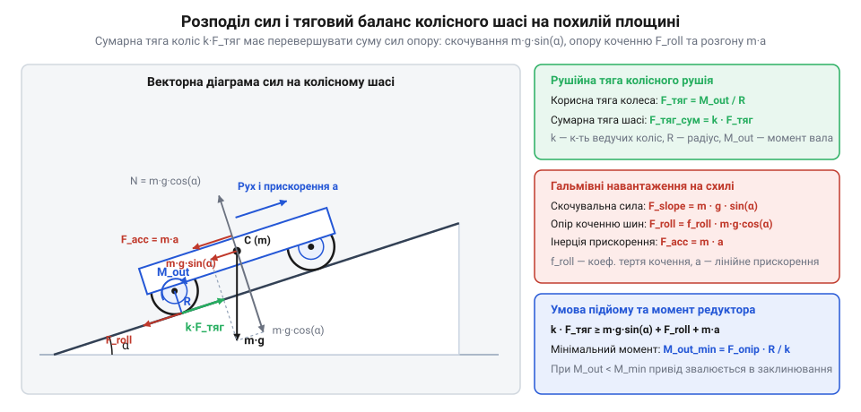

# Кінематичний і силовий розрахунок узгодження швидкохідного двигуна з навантаженням через редуктор

<preknowlist>
- [Мотор-редуктор 6 В (100 і 600 об/хв)](root:cat-hw-actuators/gearmotor-6v) — Загальні електромеханічні властивості колекторного двигуна постійного струму: залежність частоти обертання від навантаження на валу, призначення понижувального редуктора для підвищення крутного моменту та небезпека режиму аварійного блокування ротора.
- [N20 мікромотор з редуктором](root:cat-hw-actuators/n20-motor) — Базові кінематичні принципи багатоступеневої прямозубої зубчастої передачі: взаємозв'язок кількості зубців шестерень із передавальним числом і напрямком обертання та наявність механічного опору тертя в зачепленнях і втулках.
</preknowlist>

## Провал прямого приводу без редуктора

Спроба встановити ходове колесо мобільної платформи безпосередньо на вихідний вал колекторного двигуна типорозміру 130 — прямий привод (англ. @@en|direct drive@@) — завершується повною нерухомістю шасі. Двигун 130 розрахований на високу частоту обертання: без навантаження його ротор (лат. @@la|rotare@@ — обертати) розвиває 10 000–12 000 об/хв, проте має мізерний пусковий крутний момент `M_start = 1.0–1.5 мН·м`.

Для типового колеса діаметром `D = 65 мм` (радіусом `R = 0.0325 м`) корисна сила тяги `F_тяг` на контактній плямі обода дорівнює відношенню пускового моменту до радіуса:

```
F_тяг
= M_start / R                    [перетворення крутного моменту в силу тяги]
= (1.5 · 10⁻³) / 0.0325          [підстановка моменту M_start = 1.5 мН·м та радіуса R = 0.0325 м]
≈ 0.046 Н                        [корисна тяга колеса на контактній поверхні]
```

Отримана сила `0.046 Н` еквівалентна вазі тягарця масою менше 5 грамів. Цього замало для подолання опору спокою коліс платформи масою 200–400 грамів. Вал миттєво зупиняється опором поверхні й переходить у режим аварійного заклинювання (англ. @@en|stall@@). Без обертання протиелектрорушійна сила зникає, і струм обмоток обмежується лише їхнім активним опором, підскакуючи до 2 А. За лічені секунди цей струм спричиняє [теплове заклинювання обмоток](root:hw-motion/motor-dynamic-thermal-model) через деструкцію лакової ізоляції. Регулювання напруги не допомагає: електромагнітний момент прямо пропорційний струму, тому зниження напруги зменшує струм і остаточно знесилює рушій. Щоб рушити з місця, необхідно обміняти надлишкову швидкість обертання на силу за допомогою механічного вузла — [понижувального редуктора](root:cat-hw-actuators/gearmotor-6v) (лат. @@la|reducere@@ — зменшувати, повертати назад).

## Кінематика та силове перетворення редуктора

Механічне узгодження швидкості й навантаження реалізують за допомогою зубчастих коліс. У циліндричній прямозубій передачі без проковзування колові швидкості поверхонь зачеплення збігаються. Через це передавальне число (англ. @@en|gear ratio@@) `i` одного зубчастого ступеня дорівнює відношенню кількості зубців веденого колеса `z_out` до тягового ведучого `z_in`:

```
i = z_out / z_in                 [кінематичне відношення числа зубців]
```

Одинарний ступінь рідко забезпечує зниження частоти понад 5:1 через обмеження за габаритами механізму. Тому передачі послідовно об'єднують у каскад (фр. @@fr|cascade@@ — спадний потік) із кількох ступенів. Підсумкове передавальне число `i_total` визначається добутком передавальних чисел усіх `k` ступенів:

```
i_total = ∏ₖ i_k                 [сумарне передавальне число послідовного каскаду]
```

У пластикових передачах TT та [металевих мікроредукторах](root:cat-hw-actuators/n20-motor) такий @@fr|каскад@@ дає редукцію 1:48 або 1:120.

За законом збереження потужності `P = M · ω` ідеальний редуктор при уповільненні вала в `i_total` разів пропорційно примножує крутний момент. Проте в реальному вузлі виникають трибологічні втрати (грец. @@el|tribos@@ — тертя) через ковзання профілів зубців і тертя осей у цапфах (нім. @@de|Zapfen@@ — шийка вала). Їх враховує коефіцієнт корисної дії (лат. @@la|coefficiens@@ — сприяючий; @@la|ККД@@). Через послідовну передачу руху сумарний @@la|ККД@@ `η_total` є мультиплікативним:

```
η_total = (η_stage)ᵏ             [мультиплікативний ККД каскаду k однакових ступенів]
```

Для чотириступеневого пластикового редуктора (`k = 4`) за типового ККД ступеня `η_stage = 0.90` підсумкова величина дорівнює `η_total = (0.90)⁴ ≈ 0.656` (60–75%).

Дійсний крутний момент `M_out` на вихідному валу редуктора з урахуванням передавального числа та втрат на тертя набуває вигляду:

```
M_out
= M_in · i_total · η_total       [дійсний крутний момент із трибологічними втратами]
= (1.5 · 10⁻³) · 48 · 0.656      [підстановка параметрів мотора 130 і передачі 1:48]
≈ 47.2 · 10⁻³ Н·м                [реальний момент на вихідному валу: 47.2 мН·м]
```

Редукція збільшує крутний момент у 31 раз, утримуючи мотор у безпечній зоні навантаження.

## Важільний зв'язок радіуса колеса й тяги

Вихідний вал редуктора має крутний момент `M_out` і кутову швидкість `ω_out`, проте шасі потребує поступального руху. Колесо працює як важіль із плечем, рівним радіусу обода `R`. За відсутності проковзування лінійна швидкість `v` осі пропорційна радіусу:

```
v = ω_out · R                    [лінійна швидкість через радіус колеса]
```

Зі зростанням радіуса колеса лінійна швидкість шасі збільшується за незмінних обертів приводу. Зв'язок швидкостей окремих коліс із загальним поступальним і кутовим рухом двоколісної платформи з пасивною опорою детально описує [кінематика та динаміка колісного шасі з диференціальним приводом](root:sys-dron/differential-drive-kinematics).

Зв'язок моменту та поздовжнього зусилля підпорядкований зворотному правилу важеля. Плече `R` перетворює обертальний момент вала в корисну силу тяги (лат. @@la|tractio@@ — волочіння; @@la|тяга@@) `F_тяг` на контактній плямі обода з поверхнею:

```
F_тяг = M_out / R                [корисне тягове зусилля на ободі колеса]
```

Збільшення радіуса колеса знижує силу тяги обернено пропорційно плечу. Більший радіус забезпечує вищу швидкість, але пропорційно зменшує тягу.

**Порівняння тяги коліс для моменту редуктора `M_out = 47.2 мН·м`:**

Для малого колеса діаметром `D₁ = 42 мм` (радіус `R₁ = 0.021 м`):

```
F_тяг1
= M_out / R₁                     [тяга малого колеса]
= 0.0472 / 0.021                 [підстановка моменту 47.2 мН·м і радіуса 0.021 м]
≈ 2.25 Н                         [корисне зусилля на ободі]
```

Для стандартного колеса [мотор-редукторів на 6 В](root:cat-hw-actuators/gearmotor-6v) діаметром `D₂ = 65 мм` (радіус `R₂ = 0.0325 м`):

```
F_тяг2
= M_out / R₂                     [тяга стандартного колеса]
= 0.0472 / 0.0325                [підстановка моменту 47.2 мН·м і радіуса 0.0325 м]
≈ 1.45 Н                         [корисне зусилля на ободі]
```

Збільшення діаметра з 42 мм до 65 мм додає платформі 55% швидкості, проте знижує силу тяги на 35%.

## Рівняння силового балансу колісного шасі

Під час руху шасі похилою площиною з кутом нахилу `α` колісні рушії долають сукупність зовнішніх навантажень.


*Механічна рівновага рушійної тяги коліс і сил зовнішнього опору під час руху робота вгору площиною з кутом нахилу α.*

Гальмівне навантаження на платформу повною масою `m` формують три фізичні сили. Перша — опір коченню коліс (англ. @@en|rolling resistance@@) `F_roll`, викликаний деформацією матеріалу шини під дією нормальної реакції опори. На горизонтальній поверхні нормальна сила дорівнює повній вазі `m · g`. На схилі з кутом нахилу `α` нормальний складник зменшується до `m · g · cos(α)`. Центр мас платформи піднятий над площиною кочення. Нахил площини зміщує лінію дії сили тяжіння вздовж поздовжньої бази шасі. У результаті нормальна сила опори перерозподіляється між осями: колеса внизу схилу приймають підвищене навантаження, а колеса вгорі розвантажуються. Для платформи з роздільними ведучими та пасивними колесами такий перерозподіл стає вирішальним. Якщо ведучі колеса опиняються вгорі схилу, нормальна сила під ними стрімко падає: рушії втрачають зчеплення й починають проковзувати, а пасивні опори марно несуть основну вагу. Розташування ведучої осі внизу схилу, навпаки, навантажує її більшою нормальною силою та забезпечує надійний контакт із поверхнею. Сумарний опір коченню всього шасі задає повна нормальна сила опори всіх точок контакту:

```
F_roll = f_roll · m · g · cos(α) [сила опору коченню коліс]
```

Тут `f_roll` — безрозмірний коефіцієнт опору коченню, а `g ≈ 9.81 м/с²` — гравітаційне прискорення вільного падіння. Фізичну природу деформаційних втрат у контактній плямі та методи визначення коефіцієнта f_roll для різних матеріалів шини й ґрунту детально розкривають [фізичні основи та розрахунок опору коченню](root:ph-mechanics/rolling-resistance).

Друга складова — скочувальна сила тяжіння `F_slope`, спрямована вздовж схилу вниз:

```
F_slope = m · g · sin(α)         [гравітаційна скочувальна сила на ухилі]
```

Третя складова — інерційний опір (лат. @@la|inertia@@ — бездіяльність; @@la|інерція@@) `F_acc`, який протидіє лінійному розгону шасі з прискоренням `a`:

```
F_acc = m · a                    [інерційний опір прискореного руху]
```

Для руху шасі вгору сумарна тяга `k` активних коліс має перевершувати суму всіх зовнішніх сил опору:

```
k · F_тяг ≥ F_roll + F_slope + F_acc [умова динамічного силового балансу шасі]
```

Підставивши вираз тяги через радіус колеса `R`, визначаємо мінімально необхідний крутний момент `M_out_min` на вихідному валу кожного з `k` мотор-редукторів:

```
M_out_min
= (F_roll + F_slope + F_acc) · R / k [мінімальний момент вихідного вала редуктора]
```

Якщо дійсний крутний момент приводу менший за `M_out_min`, платформа зупиняється на підйомі, а двигуни переходять в аварійне заклинювання.

## Межі зчеплення та робоча точка

Навіть за достатнього моменту редуктора рух платформи обмежений контактом колеса з опорною поверхнею. Граничне зусилля без проковзування визначає кулонівська межа зчеплення (англ. @@en|grip@@) `F_grip`:

```
F_grip = μ · m_grip · g · cos(α)    [гранична сила зчеплення за Кулоном]
```

Тут `μ` — безрозмірний коефіцієнт тертя спокою протектора об ґрунт, `m_grip` — маса шасі на ведучих колесах, `g ≈ 9.81 м/с²` — гравітаційне прискорення, а `α` — кут нахилу площини. Якщо потрібна тяга перевищує границю (`F_тяг > F_grip`), колеса зриваються в буксування (англ. @@en|wheel slip@@), марно обертаючись на місці. Кулонівське тертя в зоні контакту, залежність коефіцієнта зчеплення від матеріалу протектора та динаміку зриву кочення в буксування детально розкриває [механіка зчеплення та буксування колісних рушіїв](root:ph-mechanics/coulomb-friction-model).

Друге обмеження задає електромагнітна природа двигуна 130. Для передачі вихідного моменту `M_out` через редуктор із передавальним числом `i` та ККД `η_total` ротор долає приведений момент навантаження `M_in`:

```
M_in = M_out / (i · η_total)        [момент навантаження на валу ротора]
```

Зі зростанням моменту `M_in` частота обертання лінійно падає, а якірний струм зростає, як описує [електромеханічна характеристика двигуна](root:hw-motion/motor-torque-speed-curve). Щоб запобігти падінню ККД і термічному руйнуванню щіткового вузла, робоча точка (англ. @@en|operating point@@) ротора має залишатися в зоні стабільного навантаження:

```
M_in ≤ 0.25 · M_stall               [умова тривалої стабільності робочої точки]
```

Навантаження понад 25–30% від моменту блокування `M_stall` спричиняє лавинне нагрівання обмоток і звалювання приводу в аварійне заклинювання.

## Алгоритм вибору редуктора й коліс

Проєктування трансмісії узгоджує технічні вимоги — масу шасі `m`, цільову швидкість `v` та кут ухилу `α` — з можливостями двигуна 130 за чотири послідовні кроки:

1. **Розрахунок тяги та перевірка зчеплення.** За силовим балансом знаходять потрібну силу тяги `F_тяг`. Якщо `F_тяг > F_grip`, шасі буксуватиме; проблему усувають зміщенням центру ваги на тягові колеса або вибором протектора з більшим коефіцієнтом `μ`.
2. **Обчислення оптимального передавального числа.** Мотор 130 найефективніший при роботі на 70–80% холостих обертів `ω_0`. Прийнявши `ω_mot = 0.75 · ω_0` та швидкість колеса `ω_wheel = v / R`, визначають оптимальне передавальне число `i_opt`:

```
i_opt
= ω_mot / ω_wheel                   [відношення кутових швидкостей]
= (0.75 · ω_0 · R) / v              [узгодження передачі за лінійною швидкістю]
```

3. **Перевірка запасу за моментом.** Обчислюють момент на роторі `M_in`. Коефіцієнт безпеки за моментом блокування (англ. @@en|safety factor@@) `k_safe` повинен гарантувати запас:

```
k_safe = M_stall / M_in ≥ 3         [запас за моментом проти заклинювання]
```

У приводах на базі [мотор-редукторів на 6 В](root:cat-hw-actuators/gearmotor-6v) зі стандартними колесами діаметром 65 мм найчастіше обирають між передачами TT 1:48 та 1:120. Редуктор 1:48 розвиває вищу швидкість на рівній поверхні, але на крутому підйомі запас падає нижче `k_safe = 3`, спричиняючи перегрів мотора. Каскад 1:120 зменшує швидкість у 2.5 раза, проте потроює момент на колесах і гарантує запас `k_safe ≥ 3` навіть на важких схилах.
