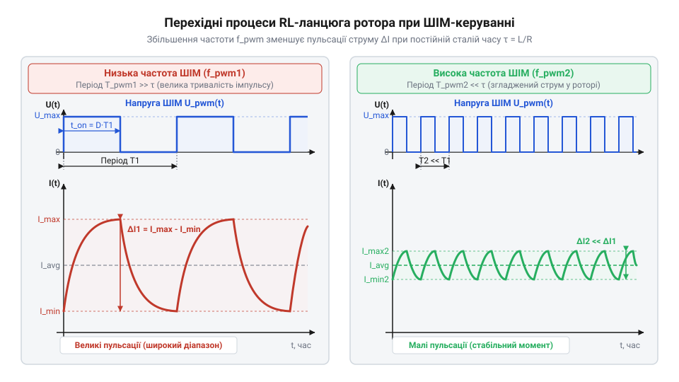
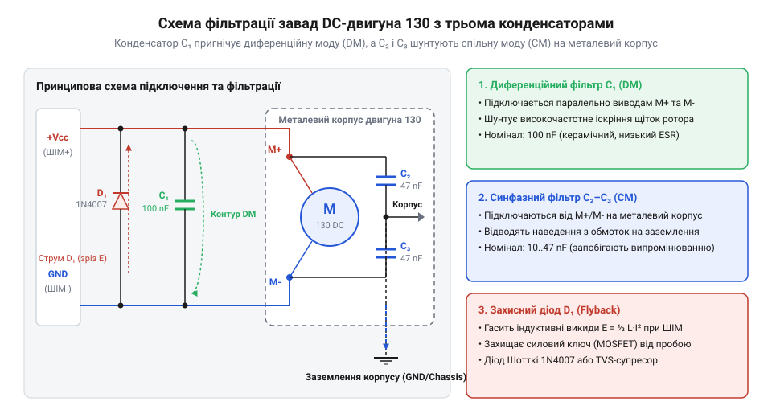

# Математичний розрахунок завадопригнічувальних фільтрів та ШІМ-керування двигуном 130

<preknowlist>
- [N20 мікромотор з редуктором](root:cat-hw-actuators/n20-motor) — базовий принцип роботи колекторного DC-двигуна, конструкція щеточно-колекторного вузла та поява зворотної ЕРС.
</preknowlist>

## Збої мікроконтролера при керуванні мотором

Уявіть поширену практичну ситуацію: ви розробляєте мікроконтролерну систему керування рухом — робототехнічну платформу або автоматизований привід, де силовим виконавчим елементом виступає стандартний колекторний двигун постійного струму типу 130 @@en|DC motor 130@@ (від англ. *Direct Current motor size 130* — колекторний двигун постійного струму типорозміру 130). Для регулювання швидкості ви підключаєте двигун через силовий транзисторний ключ @@en|MOSFET switch@@ (від англ. *Metal-Oxide-Semiconductor Field-Effect Transistor* — польовий транзистор із ізольованим затвором) і подаєте на затвор транзистора сигнал широтно-імпульсної модуляції @@en|PWM@@ (від англ. *Pulse-Width Modulation* — широтно-імпульсна модуляція) з цифрового виводу мікроконтролера. Проте під час першого ж запуску схема поводиться нестабільно: мікроконтролер довільно перезавантажується, сенсори на шині @@en|I2C@@ (від англ. *Inter-Integrated Circuit* — міжмікросхемна шина зв'язку) втрачають зв'язок, а цифрові входи фіксують хибні спрацьовування.

Причина такої поведінки полягає в тому, що колекторний двигун є складним електромеханічним генератором високочастотних та високовольтних завад. На відміну від безконтактних двигунів, таких як [безколекторний мотор (модуль)](root:cat-hw-actuators/bldc-motor-module) або [кроковий мотор (5V)](root:cat-hw-actuators/28byj-48-stepper), у двигуні 130 переключення струму в обмотках ротора здійснюється механічним щеточно-колекторним вузлом. Базові принципи фізичної будови ротора та появу зворотної ЕРС детально розглянуто в статті про [N20 мікромотор з редуктором](root:cat-hw-actuators/n20-motor). У процесі обертання металеві щітки ковзають по мідних ламелях колектора, що супроводжується трьома деструктивними фізичними явищами:

1. **Високочастотне колекторне іскріння @@en|spark noise@@:** Під час розмикання щітки від ламелі струм в індуктивній обмотці ротора намагається зберегти своє значення. Це призводить до виникнення мікроскопічних електричних дуг (іскріння) з надзвичайно високою швидкістю зміни струму `di / dt`. Іскровий розряд генерує широкосмуговий спектр електромагнітних завад @@en|EMI@@ (від англ. *Electromagnetic Interference* — електромагнітні завади) у діапазоні від 10 МГц до 200 МГц. Через паразитну ємність між обмоткою та металевим корпусом ці завади проникають на шину заземлення @@en|GND@@ (від англ. *Ground* — спільний провідник заземлення) та наведеннями збивають тактування мікроконтролера. 2. **Індуктивні викиди самоіндукції @@en|back-EMF spikes@@:** Обмотка ротора має власну індуктивність `L_rotor`. Під час кожного вимкнення силового транзистора в режимі @@en|PWM@@ струм в індуктивності не може змінитися миттєво. Згідно з законом електромагнітної індукції Фарадея, на виводах мотора виникає високовольтний сплеск напруги зворотної полярності `V = L × (di / dt)`. Цей сплеск досягає десятків вольт, що спричиняє пробій силового ключа та імпульсні кидки напруги в колі живлення. 3. **Просідання напруги живлення @@en|brownout reset@@:** Пусковий струм і струм заклинювання мотора 130 досягають 1.5–3.0 А. При імпульсному ввімкненні @@en|PWM@@ стрімкі кидки струму викликають падіння напруги на внутрішньому опорі джерела живлення та провідниках друкованої плати. Це просідання падає нижче порогу спрацьовування детектора зниження напруги @@en|BOD@@ (від англ. *Brown-Out Detector* — детектор критичного зниження напруги живлення), перезапускаючи контролер.

Спроба вирішити проблему «наосліп» — шляхом встановлення випадкового конденсатора або збільшення ємності на шині живлення — зазвичай не дає результату або призводить до перегріву деталей. Щоб забезпечити стабільну та електромагнітно сумісну роботу схеми керування @@en|EMC@@ (від англ. *Electromagnetic Compatibility* — електромагнітна сумісність), необхідно побудувати строгу математичну модель імпульсного режиму живлення, розрахувати пульсації струму від частоти @@en|PWM@@, визначити енергію індуктивного викиду та обґрунтувати номінали завадопригнічувального фільтра.

## Математика ШІМ та пульсації струму

Для математичного опису процесів у двигуні 130 представимо його ротор як послідовне коло, що складається з активного опору обмоток `R_rotor`, індуктивності ротора `L_rotor` та джерела зворотної електрорушійної сили @@en|back-EMF@@ `E_b` (від англ. *Back Electromotive Force* — зворотна електрорушійна сила, пропорційна кутовій швидкості обертання `E_b = K_e × ω`).

При регулюванні швидкості за допомогою @@en|PWM@@ на мотор подаються прямокутні імпульси напруги амплітудою `U_s` (напруга джерела живлення) із періодом `T_pwm = 1 ÷ f_pwm`, де `f_pwm` — частота @@en|PWM@@. Тривалість включеного стану становить `t_on = D × T_pwm`, а виключеного — `t_off = (1 - D) × T_pwm`, де `D` — коефіцієнт заповнення @@en|duty cycle@@ (від англ. *Duty Cycle* — відношення тривалості імпульсу до періоду, `0 ≤ D ≤ 1`).

Середня напруга `U_avg`, яка визначає механічну швидкість обертання ротора, обчислюється як інтеграл напруги за період:

```text
U_avg = D × U_s
```

Проте теплова потужність, яка виділяється на активному опорі ротора `R_rotor`, визначається не середньою, а ефективною (квадратичною) напругою @@en|RMS voltage@@ `U_eff` (від англ. *Root Mean Square voltage* — середньоквадратична напруга):

```text
U_eff = √(D) × U_s
```

Різниця між `U_eff` та `U_avg` показує, що при імпульсному живленні з малим коефіцієнтом заповнення `D` нагрів обмоток вищий, ніж при живленні еквівалентною постійною напругою `U_avg`.

Знайдемо амплітуду пульсацій струму `ΔI` (різницю між максимальним `I_max` та мінімальним `I_min` струмом за період @@en|PWM@@). Упродовж інтервалу `t_on`, коли транзистор відкритий, диференціальне рівняння кола ротора має вигляд:

```text
L_rotor × (di / dt) + R_rotor × i(t) + E_b = U_s
```

Якщо частота @@en|PWM@@ `f_pwm` достатньо висока, період комутації `T_pwm` значно менший за електричну сталу часу ротора `τ_L = L_rotor ÷ R_rotor`. У цьому разі спад напруги `R_rotor × i(t)` можна вважати постійним і рівним `R_rotor × I_avg`, а струм зростає практично лінійно. Тоді швидкість наростання струму становить:

```text
di / dt ≈ (U_s - E_b - I_avg × R_rotor) ÷ L_rotor
```

У сталого режимі роботи середня проти-ЕРС дорівнює `E_b ≈ D × U_s - I_avg × R_rotor`. Підставляючи це значення, отримуємо вирази для швидкості наростання струму та амплітуди пульсацій `ΔI`:

```text
ΔI = (U_s - D × U_s) × t_on ÷ L_rotor
   = U_s × (1 - D) × (D × T_pwm) ÷ L_rotor     [підстановка t_on = D × T_pwm]
   = U_s × D × (1 - D) ÷ (f_pwm × L_rotor)     [підстановка T_pwm = 1 / f_pwm]
```

Отриманий математичний вираз для пульсацій струму узагальнюється у вигляді підсумкового розрахункового співвідношення:

```text
ΔI = U_s × D × (1 - D) ÷ (f_pwm × L_rotor)
```

З аналізу функції `f(D) = D × (1 - D)` випливає, що максимальна амплітуда пульсацій струму досягається при коефіцієнті заповнення `D = 0.5` (`50%`):

```text
ΔI_max = U_s ÷ (4 × f_pwm × L_rotor)
```

Для забезпечення стабільної роботи приводу режим проходження струму має бути безперервним @@en|continuous current mode@@ `CCM` (від англ. *Continuous Conduction Mode* — безперервний режим провідності струму). Якщо пульсація `ΔI` перевищує подвійний середній струм `2 × I_avg`, струм ротора спадає до нуля до закінчення періоду, і система переходить у переривчастий режим @@en|discontinuous current mode@@ `DCM` (від англ. *Discontinuous Conduction Mode* — переривчастий режим провідності струму). Це спричиняє додатковий розігрів обмоток та виражений акустичний шум. Мінімальна частота @@en|PWM@@ `f_min`, яка гарантує режим `CCM`, дорівнює:

```text
f_min = U_s ÷ (4 × ΔI_allowable × L_rotor)
```

Проілюструємо застосування виведених формул на числовому прикладі розрахунку для двигуна 130.

**Умова розрахунку:** Колекторний двигун типу 130 має індуктивність обмотки ротора `L_rotor = 250 мкГн` (`0.00025 Гн`), опір `R_rotor = 2.0 Ом` і живиться від джерела напруги `U_s = 6.0 В` при коефіцієнті заповнення @@en|duty cycle@@ `D = 0.5` (`50%`). Необхідно розрахувати амплітуду пульсацій струму `ΔI` для двох частот комутації: `f_pwm1 = 1 кГц` (`1000 Гц`) та `f_pwm2 = 20 кГц` (`20000 Гц`).

1. Розрахунок пульсацій струму для низької частоти `f_pwm1 = 1 кГц`:
   ```text
   ΔI_1 = U_s × D × (1 - D) ÷ (f_pwm1 × L_rotor)
        = 6.0 В × 0.5 × (1 - 0.5) ÷ (1000 Гц × 0.00025 Гн) [підстановка параметрів]
        = 1.5 В ÷ 0.25 Гн/с                                [обчислення числівника та знаменника]
        = 6.0 А                                           [амплітуда пульсацій струму]
   ```
   Висновок: Значення пульсації `6.0 А` значно перевищує граничний струм двигуна 130. Струм має глибоко переривчастий характер, спричиняє сильні ударні механічні навантаження, акустичний свист та інтенсивне нагрівання обмоток.

2. Розрахунок пульсацій струму для високої частоти `f_pwm2 = 20 кГц`:
   ```text
   ΔI_2 = U_s × D × (1 - D) ÷ (f_pwm2 × L_rotor)
        = 6.0 В × 0.5 × (1 - 0.5) ÷ (20000 Гц × 0.00025 Гн) [підстановка частоти 20 кГц]
        = 1.5 В ÷ 5.0 Гн/с                                  [обчислення знаменника]
        = 0.30 А                                            [300 мА пульсацій струму]
   ```
   Висновок: Збільшення частоти @@en|PWM@@ до 20 кГц зменшує пульсації струму в 20 разів — до `0.30 А` (`300 мА`). Струм ротора стає безперервним, а частота комутації виходить за межі чутливості людського слуху (понад 18 кГц), усуваючи неприємний акустичний піск.

Залежність форми струму ротора від частоти комутації наведено на осцилограмі.


*Графік напруги ШІМ та часової зміни струму в роторі мотора 130: порівняння великих пульсацій на низькій частоті комутації 1 кГц із згладженим струмом на частоті 20 кГц.*

Отже, підвищення частоти @@en|PWM@@ є ефективним математичним та інженерним способом стабілізації струму в індуктивності ротора.

## Енергія індуктивного викиду та захист

Коли струм протікає через обмотку ротора, у її магнітному полі накопичується потенційна енергія. У момент закриття силового транзистора цей струм не може миттєво припинитися, що створює високовольтний індуктивний викид.

Математично накопичена магнітна енергія `E_L` у роторі з індуктивністю `L_rotor` при піковому струмі `I_peak` обчислюється за формулою:

```text
E_L = 0.5 × L_rotor × I_peak²
```

Якщо не забезпечити шлях для безпечного розряджання цієї енергії, напруга на стоку транзистора зростає до рівня аварійного пробою. При повторній комутації в режимі @@en|PWM@@ з частотою `f_pwm` середня потужність індуктивних викидів `P_spike`, яка підлягає розсіюванню захисними компонентами, становить:

```text
P_spike = E_L × f_pwm
```

Розглянемо практичний покроковий розрахунок енергії та потужності індуктивного викиду для мотора 130.

**Умова розрахунку:** При розмиканні силового транзистора через ротор мотора 130 з індуктивністю `L_rotor = 250 мкГн` (`0.00025 Гн`) протікав піковий струм `I_peak = 1.2 А`. Необхідно розрахувати енергію індуктивного викиду `E_L` та теплову потужність `P_spike`, що розсіюється у схемах захисту при частоті @@en|PWM@@ `f_pwm = 20 кГц`.

1. Обчислення накопиченої магнітної енергії `E_L`:
   ```text
   E_L = 0.5 × L_rotor × I_peak²
       = 0.5 × 0.00025 Гн × (1.2 А)²                      [підстановка індуктивності та струму]
       = 0.000125 Гн × 1.44 А²                            [піднесення струму до квадрата]
       = 0.00018 Дж                                       [обчислення енергії]
       = 0.18 мДж                                         [переведення у міліджоулі]
   ```

2. Обчислення розсіюваної потужності `P_spike` при комутації з частотою 20 кГц:
   ```text
   P_spike = E_L × f_pwm
           = 0.00018 Дж × 20000 Гц                        [підстановка енергії та частоти]
           = 3.6 Вт                                       [обчислення потужності викидів]
   ```

Для замикання цього індуктивного струму паралельно обмотці мотора підключають зворотний діод @@en|flyback diode@@ (від англ. *Flyback Diode* — шунтувальний діод для замикання струму самоіндукції). Для індуктивних навантажень принципово обирати діод Шотткі @@en|Schottky diode@@ (від прізвища нім. фізика *Walter H. Schottky* — напівпровідниковий діод із малим спадом напруги, наприклад `1N5819` або `SS14`). На відміну від стандартних випрямних діодів, діод Шотткі має малий прямий спад напруги (`V_F ≈ 0.3–0.4 В`) та ультракороткий час зворотного відновлення @@en|reverse recovery time@@ `t_rr < 10 нс` (від англ. *reverse recovery time* — час зворотного відновлення p-n переходу). Стандартні діоди (як-от `1N4007`) мають `t_rr ≈ 2 мкс`, що призводить до пропускання високовольтного імпульсу на транзистор до моменту відкриття діода. У потужніших приводах, таких як [мотор-редуктор 6 В](root:cat-hw-actuators/gearmotor-6v) або [водяна помпа RS-360SH](root:cat-hw-actuators/water-pump-rs360sh), для захисту від перенапруг додатково застосовують захисні супресори @@en|TVS suppressor@@ (від англ. *Transient Voltage Suppressor* — напівпровідниковий обмежувач тимчасових перенапруг).

Проте шунтувальний діод вирішує лише проблему низькочастотних індуктивних викидів. Високочастотне колекторне іскріння (10–100 МГц) вільно проходить через паразитну ємність діода. Для приглушення цього спектра застосовують фільтруючу трійку керамічних конденсаторів (`C_1`, `C_2`, `C_3`).

Топологія трійки конденсаторів включає:
- Конденсатор `C_1`: підключається безпосередньо між силовими виводами мотора `M+` та `M-`. Він зрізає диференціальну заваду @@en|differential mode noise@@ (від англ. *differential mode noise* — диференціальна завада між силовими провідниками) між щітками. - Конденсатор `C_2`: підключається між виводом `M+` та металевим корпусом мотора. - Конденсатор `C_3`: підключається між виводом `M-` та металевим корпусом мотора.

Конденсатори `C_2` та `C_3` відводять синфазну заваду @@en|common mode noise@@ (від англ. *common mode noise* — синфазна завада відносно землі та корпусу) на металевий корпус, перетворюючи його на екрануючий кожух.

Математичне обґрунтування вибору ємності спирається на розрахунок реактивного опору конденсатора `X_C`:

```text
X_C = 1 ÷ (2 × π × f × C)
```

Для конденсатора `C_1 = 100 нФ` (`100 × 10⁻⁹ Ф`) обчислимо реактивний опір на частоті @@en|PWM@@ `f_pwm = 20 кГц` та на частоті іскріння `f_spark = 30 МГц`:

1. Опір на частоті @@en|PWM@@ `20 кГц`:
   ```text
   X_C1_pwm = 1 ÷ (2 × π × f_pwm × C_1)
            = 1 ÷ (2 × 3.14159 × 20000 Гц × 100 × 10⁻⁹ Ф) [підстановка значень]
            = 1 ÷ 0.012566 Ом⁻¹                         [розрахунок знаменника]
            ≈ 79.6 Ом                                   [високий опір для ШІМ]
   ```
   Опір `79.6 Ом` достатньо високий, щоб не шунтувати силовий сигнал @@en|PWM@@ і не створювати додаткового навантаження на ключі.

2. Опір на частоті іскрових завад `30 МГц`:
   ```text
   X_C1_spark = 1 ÷ (2 × π × f_spark × C_1)
              = 1 ÷ (2 × 3.14159 × 30000000 Гц × 100 × 10⁻⁹ Ф) [підстановка 30 МГц]
              = 1 ÷ 18.8495 Ом⁻¹                              [розрахунок знаменника]
              ≈ 0.053 Ом                                      [коротке замикання для ВЧ-завад]
   ```
   Опір `0.053 Ом` діє як коротке замикання для високочастотного іскрового шуму, повністю закорочуючи його на виводах мотора.

Для двигуна 130 рекомендовано використовувати такі номінали:
- `C_1 = 100 нФ` (керамічний MLCC, X7R, 50 В). - `C_2 = C_3 = 10 нФ ... 47 нФ` (керамічні, 50 В), припаяні з мінімальною довжиною виводів безпосередньо до металевого корпусу мотора.

Усі три конденсатори та шунтувальний діод утворюють повну схему захисту та фільтрації, зображену на принциповій схемі.


*Принципова схема завадопригнічувального фільтра двигуна 130: диференціальний конденсатор C1, синфазні конденсатори C2 і C3 на металевий корпус та діод Шотткі для замикання струму самоіндукції.*

Критично важливо мінімізувати довжину виводів конденсаторів при монтажі. Паразитна індуктивність виводів `L_lead` утворює послідовний резонансний контур із частотою `f_0 = 1 ÷ (2 × π × √(L_lead × C))`. На частотах вище `f_0` конденсатор втрачає ємнісні властивості й стає індуктивністю, припиняючи фільтрацію завад. Пайка безпосередньо на корпусі мотора гарантує ефективну роботу фільтра у всьому діапазоні ВЧ-завад.

## Джерела іскрового високочастотного шуму колектора

Навіть після встановлення захисного діода Шотткі або TVS-супресора, які гасять низькочастотні високовольтні сплески самоіндукції при вимкненні транзистора, система керування двигуном 130 часто продовжує потерпати від довільних перезавантажень мікроконтролера та збоїв передачі даних. Причина полягає у високочастотному радіозавадовому випромінюванні, джерелом якого є механічний щеточно-колекторний вузол.

Під час обертання ротора пружні металеві щітки послідовно ковзають по мідних пластинах колектора — ламелях @@en|lamellas@@ (від лат. *lamella* — пластинка, тонка луска). У момент, коли щітка розриває контакт із ламеллю, струм у відповідній секції обмотки ротора не може миттєво зникнути. Оскільки ця окрема секція володіє індуктивністю розсіювання @@en|leakage inductance@@ `L_leak` (від англ. @@en|leakage@@ — витік, розсіювання та @@en|inductance@@ — індуктивність, що описує магнітний потік, який не зчеплений з іншими обмотками), на розмиканих контактах виникає високий стрибок напруги `V = L_leak × (di / dt)`.

Оскільки зазор між щіткою та ламеллю в момент відриву є мікроскопічним, напруженість електричного поля перевищує поріг пробою повітря. Це призводить до виникнення електричних мікродуг — колекторного іскріння @@en|spark micro-arcs@@ (від англ. @@en|spark@@ — іскра та @@en|micro-arc@@ — мікродуга). Оскільки розрив і згасання мікродуги відбувається за частки наносекунд (`dt ≈ 1 ÷ 10 нс`), швидкість зміни струму `di / dt` досягає величезних значень. В результаті колекторний вузол стає генератором широкосмугового спектра завад @@en|broadband EMI spectrum@@ (від англ. @@en|broadband@@ — широкосмуговий, @@en|EMI@@ — електромагнітна завада та @@en|spectrum@@ — спектр), який охоплює діапазон частот від сотень кілогерц до 200–300 МГц. На відміну від пристроїв з електронним перемиканням обмоток, таких як [5V безколекторні вентилятори](root:cat-hw-actuators/fan-5v), де механічний контакт відсутній, деструктивні іскрові процеси виникають у будь-яких приводах із механічним колектором, зокрема в пристроях на кшталт [водяна помпа RS-360SH](root:cat-hw-actuators/water-pump-rs360sh) або [мотор-редуктор 6 В](root:cat-hw-actuators/gearmotor-6v) (100 і 600 об/хв).

Завади, які генеруються колектором, розповсюджуються двома шляхами:

1. **Диференційна завада @@en|differential mode noise@@ (`DM`):** Високочастотна змінна напруга, яка виникає безпосередньо між двома силовими виводами двигуна `(+)` та `(-)`. Струм @@en|differential mode noise@@ протікає по виводах мотора в протилежних напрямках. 2. **Спільна завада @@en|common mode noise@@ (`CM`):** Високочастотна напруга, яка виникає одночасно на обох виводах мотора відносно спільного провідника заземлення `GND` або металевого корпусу.

Механізм виникнення @@en|common mode noise@@ зумовлений наявністю паразитної ємності ротора @@en|stray capacitance@@ `C_stray` (від англ. @@en|stray@@ — блукаючий, розсіяний та @@en|capacitance@@ — ємність). Між внутрішніми мідними обмотками ротора та зовнішнім металевим корпусом двигуна 130 існує паразитна ємність величиною `C_stray ≈ 10 ÷ 50 пФ`. Швидкі перепади напруги `dv / dt` під час іскріння перезаряджають ємність `C_stray`, проганяючи високочастотні струми через металевий корпус двигуна. Якщо корпус мотора електрично незаземлений, він починає працювати як ефективна передавальна антена, випромінюючи радіохвилі в простір та наводячи високочастотні імпульси на чутливі лінії мікроконтролера.

Для ліквідації цього випромінювання завади необхідно локалізувати та замкнути на коротких контурах безпосередньо біля джерела — на корпусі двигуна.

## Розрахунок трійки завадопригнічувальних керамічних конденсаторів

Для пригнічення як диференційних, так і спільних завад безпосередньо на виводах двигуна 130 застосовується симетричний фільтр із трьох керамічних конденсаторів `C1`, `C2` та `C3`.


*Схема підключення трійки фільтруючих керамічних конденсаторів C1, C2, C3 до металевого корпусу двигуна 130, що замикає високочастотні струми завад на коротких контурах.*

У цій схемі фільтрації кожен елемент виконує чітко визначену фізичну роль:
* Конденсатор `C1` вмикається паралельно виводам двигуна `(+)` та `(-)` і шунтує диференційну заваду @@en|differential mode noise@@ `DM`. * Конденсатори `C2` та `C3` підключаються від кожного з виводів двигуна на його металевий корпус. Вони створюють низькоімпедансний шлях для високочастотних струмів спільної завади @@en|common mode noise@@ `CM`, замикаючи їх на металеву оболонку мотора і не даючи їм поширюватися по силових проводах живлення.

Математичний розрахунок номіналів трійки конденсаторів базується на двох критеріях: обмеженні реактивного опору на частоті комутації @@en|PWM@@ та забезпеченні резонансу на частоті радіозавад.

**1. Розрахунок міжвиводного конденсатора `C1`:**
Конденсатор `C1` повинен мати малий реактивний опір @@en|reactive impedance@@ `Z_C1` (від англ. @@en|reactive@@ — реактивний та @@en|impedance@@ — повний опір) для високочастотного іскрового шуму (понад 100 кГц), але достатньо великий опір на робочій частоті @@en|PWM@@ `f_pwm`, щоб не коротити силові імпульси живлення та не перевантажувати ключі струмами перезаряджання.

Реактивний опір конденсатора обчислюється за формулою:

```text
Z_C = 1 ÷ (2 × π × f × C)
```

Щоб втрати на частоті @@en|PWM@@ `f_pwm` були нехтовно малими, опір `Z_C1` на частоті `f_pwm` має перевищувати мінімальне допустиме значення `Z_min` (зазвичай `Z_min ≥ 80 ÷ 100 Ом`). Звідси отримуємо граничну умову для вибору максимальної ємності `C1`:

```text
C1 ≤ 1 ÷ (2 × π × f_pwm × Z_min)
```

**2. Розрахунок корпусних конденсаторів `C2` та `C3`:**
Реальний керамічний конденсатор володіє паразитною еквівалентною послідовною індуктивністю виводів @@en|ESL@@ `L_lead` (від англ. *Equivalent Series Inductance* — еквівалентна послідовна індуктивність, для дискових та Chip-конденсаторів `L_lead ≈ 1 ÷ 5 нГн`). Внаслідок цього конденсатор має власну резонансну частоту @@en|self-resonant frequency@@ `f_res` (від англ. @@en|self-resonant frequency@@ — власна резонансна частота):

```text
f_res = 1 ÷ (2 × π × √(L_lead × C))
```

На частоті `f_res` реактивний опір конденсатора стає рівним нулю, а його повний імпеданс падає до мінімального еквівалентного послідовного опору @@en|ESR@@ (від англ. *Equivalent Series Resistance* — еквівалентний послідовний опір). На частотах, вищих за `f_res`, конденсатор втрачає ємнісні властивості й поводиться як індуктивність. Тому ємності `C2` та `C3` обираються так, щоб їхня власна резонансна частота `f_res` збігалася з піковою частотою спектра колекторного іскріння `f_noise` (діапазон 20–50 МГц). Через вимогу симетрії схеми номінали беруть однаковими: `C2 = C3`.

Проілюструємо застосування математичних критеріїв на числовому прикладі.

**Умова розрахунку:** Для двигуна 130, який керується @@en|PWM@@ з частотою `f_pwm = 20 кГц`, необхідно розрахувати номінали фільтра `C1, C2, C3`. Мінімально припустимий реактивний опір на частоті @@en|PWM@@ `Z_min = 80 Ом`. Максимум спектра іскрових завад лежить на частоті `f_noise = 30 МГц`, а паразитна індуктивність виводів конденсатора становить `L_lead = 3.0 нГн` (`3.0 × 10⁻⁹ Гн`).

1. Розрахунок максимальної ємності міжвиводного конденсатора `C1`:
   ```text
   C1_max = 1 ÷ (2 × π × f_pwm × Z_min)
          = 1 ÷ (2 × 3.1416 × 20000 Гц × 80 Ом)      [підстановка параметрів]
          = 1 ÷ 10053096 Гц·Ом                        [обчислення знаменника]
          ≈ 9.947 × 10⁻⁸ Ф                            [обчислення граничної ємності]
          ≈ 99.5 нФ
   ```
   Висновок: Значення `C1` має не перевищувати `99.5 нФ`. Обираємо стандартний керамічний конденсатор номіналом `C1 = 100 нФ` (або `47 нФ`). На частоті 1 МГц його реактивний опір становить `Z_C1 = 1 ÷ (2 × π × 10⁶ Гц × 100×10⁻⁹ Ф) ≈ 1.59 Ом`, що ефективно коротко замикає диференційні завади.

2. Розрахунок ємності корпусних конденсаторів `C2` та `C3` для резонансу на 30 МГц:
   ```text
   f_res = 1 ÷ (2 × π × √(L_lead × C2))
   f_res² = 1 ÷ (4 × π² × L_lead × C2)                [піднесення обох частин до квадрата]
   C2 = 1 ÷ (4 × π² × f_noise² × L_lead)              [вираження шуканої ємності C2]
      = 1 ÷ (4 × 9.8696 × (30×10⁶ Гц)² × 3.0×10⁻⁹ Гн)   [підстановка частоти та індуктивності]
      = 1 ÷ (39.4784 × 9×10¹⁴ Гц² × 3.0×10⁻⁹ Гн)
      = 1 ÷ 1.0659 × 10⁸ Гн/с²                        [обчислення знаменника]
      ≈ 9.38 × 10⁻⁹ Ф                                 [результат обчислення]
      ≈ 9.4 нФ
   ```
   Висновок: Обираємо стандартний керамічний номінал `C2 = C3 = 10 нФ` (або `4.7 нФ`). Власна резонансна частота цієї ємності з індуктивністю виводів досягає `f_res ≈ 29.06 МГц`, створюючи ідеальний короткозамкнений дренаж для високочастотних струмів спільної моди безпосередньо на корпус двигуна.

Правильний розрахунок та монтаж трійки керамічних конденсаторів з мінімальною довжиною виводів ліквідує джерело радіозавад, забезпечуючи повну електромагнітну сумісність приводу з мікроконтролерною системою.