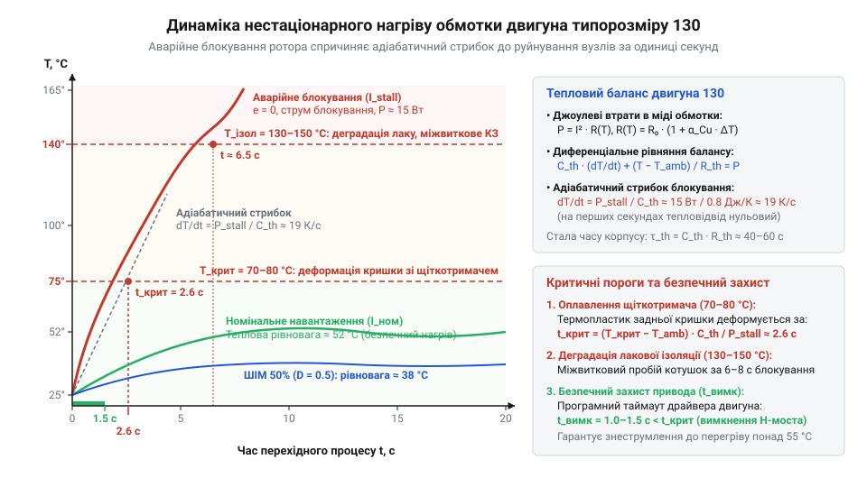

# Тепловий розрахунок втрат та обмеження критичного часу блокування вала

<preknowlist>
- [Мотор-редуктор 6 В (100 і 600 об/хв)](root:cat-hw-actuators/gearmotor-6v) — Електромеханічна будова колекторного двигуна постійного струму, природа проти-ЕРС якоря, виникнення стрибка струму при зупинці вала та формула джоулевих втрат в активному опорі обмотки.
</preknowlist>

## Термічна катастрофа при заклинюванні вала

Коли мобільний робот на базі [мотор-редуктора 6 В](root:cat-hw-actuators/gearmotor-6v) натрапляє на перешкоду, ротор колекторного двигуна 130 раптово зупиняється. Зовні здається, що це звичайна втрата швидкості, проте за кілька секунд з корпусу йде їдкий дим, задня пластикова кришка плавиться, а бронзові щітки перекошуються і створюють коротке замикання.

Причина катастрофи полягає у зникненні проти-електрорушійної сили — проти-ЕРС (англ. @@en|back-EMF@@, від англ. *back* — зворотний та лат. @@la|electromotor@@ — рушій). Під час обертання ротора згідно з [електромеханічними характеристиками двигуна](root:hw-motion/motor-torque-speed-curve) вона спрямована проти напруги живлення `U` і обмежує струм обмотки. У стані заклинювання (англ. @@en|stall@@ — зупинка) кутова швидкість дорівнює нулю, тому проти-ЕРС зникає. До котушок з активним опором `R` прикладена повна напруга джерела, і пусковий струм блокування сягає:
```
I_stall = U / R
```
Цей струм у 5–10 разів перевищує номінальний. Разом із ротором зупиняється й циркуляція повітря, що охолоджувала колектор (лат. @@la|collector@@ — збирач). Уся потужність `U² / R` виділяється в мізерній масі мідного дроту (близько двох грамів).


*Динаміка нагріву обмотки двигуна 130: при блокуванні вала температура стрімко зростає через відсутність обдуву та стрибок струму, перетинаючи пороги оплавлення кришки щіткотримача (70–80 °C) та руйнування ізоляції (130–150 °C) за лічені секунди.*

Температура міді стрімко зростає. При 70–80 °C пластикова кришка щіткотримача розм'якшується і перекошує щітки. За 130–150 °C руйнується лакова ізоляція котушок, спричиняючи міжвиткове замикання (англ. @@en|inter-turn short circuit@@) та незворотну смерть привода.

## Джоулеві втрати та середньоквадратичний струм

Нерідко теплові втрати оцінюють за середнім струмом `I_avg`, виміряним мультиметром. Проте при регулюванні швидкості широтно-імпульсною модуляцією (англ. @@en|Pulse-Width Modulation@@, ШІМ) струм якірних котушок безперервно пульсує.

Закон Джоуля–Ленца (англ. @@en|Joule–Lenz law@@) визначає, що миттєва теплова потужність на активному опорі `R` пропорційна квадрату миттєвого струму `i(t)`: `p(t) = i²(t) · R`. Середня теплова потужність `P_loss` за період модуляції `T` дорівнює:
```
P_loss
= (1 / T) · ∫₀ᵀ i²(t) · R dt     [визначення середньої потужності за період T]
= R · ((1 / T) · ∫₀ᵀ i²(t) dt)   [винесення сталого опору R за інтеграл]
= I_RMS² · R                    [означення середньоквадратичного струму I_RMS]
```
де нагрів визначає середньоквадратичний струм (англ. @@en|root mean square@@, `I_RMS`):
```
I_RMS = √( (1 / T) · ∫₀ᵀ i²(t) dt )
```

Розкладемо струм на постійну складову `I_avg` та змінну пульсацію `i_ac(t)`. Оскільки середнє значення пульсації за період дорівнює нулю, квадрат діючого струму дорівнює сумі їхніх квадратів:
```
I_RMS² = I_avg² + I_ac_RMS²
```
Звідси повна теплова потужність у міді становить:
```
P_loss = (I_avg² + I_ac_RMS²) · R
```
Оскільки амплітуда пульсацій `I_ac_RMS² ≥ 0`, діючий струм завжди більший за постійну складову: `I_RMS ≥ I_avg`. Розрахунок за середнім струмом неминуче занижує нагрів. Наприклад, для прямокутних імпульсів з коефіцієнтом заповнення (англ. @@en|duty cycle@@) `D` середньоквадратичний струм дорівнює `I_RMS = √D · I_peak`, а середній — лише `I_avg = D · I_peak`. При `D = 0.25` розрахунок за постійною складовою `I_avg² · R` дає учетверо менше значення, ніж реальні втрати `P_loss`.

## Стрибок потужності за нульової проти-ЕРС

Коли механічне навантаження зупиняє вал двигуна, кутова швидкість ротора падає до нуля. Разом зі швидкістю миттєво зникає проти-ЕРС якоря: `e = 0`. Без апаратного обмеження струму в [драйвері двигуна](root:cat-hw-actuators/dc-motor-130/proj-dc-motor-hbridge-filtering-driver.md) до якірного кола прикладається повна напруга живлення `U`. Струм котушок стрибає до величини заклинювання `I_stall = U / R`, обмеженої лише малим омічним опором міді `R`. Одночасно ротор припиняє перемішувати повітря всередині закритого сталевого корпусу: конвективне тепловідведення практично вимикається.

Потужність теплових втрат блокування `P_stall` визначаємо через прикладену напругу `U` та активний опір котушок ротора `R`:
```
P_stall = U² / R
```
Для двигуна типорозміру 130 з опором у кілька ом це тепловиділення у десятки разів перевищує втрати робочого ходу.

Виділене тепло розігріває провід, змінюючи опір міді. Залежність опору від нагріву визначаємо за початковою температурою `T₀`, початковим опором `R₀`, поточною температурою `T` та температурним коефіцієнтом опору (англ. @@en|temperature coefficient of resistance@@, від лат. @@la|coefficiens@@ — спільний чинник) міді `α_Cu ≈ 0.00393 K⁻¹`:
```
R(T) = R₀ · (1 + α_Cu · (T - T₀))
```
Зі зростанням температури електричний опір металу лінійно зростає через коливання вузлів кристалічної ґратки.

Підсумкову потужність теплових втрат заклиненого ротора `P_stall(T)` за стабільної напруги живлення `U` знаходимо підстановкою температурного опору:
```
P_stall(T)
= U² / R(T)
= U² / (R₀ · (1 + α_Cu · (T - T₀)))    [підстановка лінійної залежності R(T)]
```
З формули видно, що нагрівання котушок дещо знижує струм блокування, проте цього спаду замало: у замкненому просторі продовжують виділятися десятки ватів.

## Диференціальний нагрів та адіабатичний стрибок

Потужність аварійних втрат відома, проте для побудови захисту вирішальним є темп зростання температури в часі.

Рівняння нестаціонарного теплового балансу якірного вузла пов'язує втрати `P_stall` із накопиченням енергії в теплоємності (англ. @@en|heat capacity@@, від лат. @@la|capacitas@@ — місткість) міді `C_th` через похідну температури за часом `dT / dt` та конвективним розсіюванням через тепловий опір (англ. @@en|thermal resistance@@) корпусу `R_th` за поточної температури котушок `T(t)` і температури довкілля `T_amb`:
```
P_stall = C_th · (dT / dt) + (T(t) - T_amb) / R_th
```
Розв'язок цього рівняння описує експоненційний нагрів із тепловою сталою часу (англ. @@en|thermal time constant@@) `τ_th = C_th · R_th`, яка для закритого мотора без обдуву сягає десятків секунд.

У перші секунди аварії (`t ≪ τ_th`) різниця температур мала, і тепловий потік не встигає дістатися корпусу. Розсіюванням тепла `(T(t) - T_amb) / R_th` нехтують, тому процес стає адіабатичним (грец. @@grc|adiabatos@@ — непрохідний).

Швидкість адіабатичного нагріву котушок `dT / dt` визначаємо з рівняння балансу за нульового тепловідведення:
```
dT / dt
= P_stall / C_th    [адіабатичне наближення за t ≪ τ_th]
```
На перших секундах температура міді зростає строго лінійно за часом. Для якірних котушок двигуна 130 масою два грами (`C_th ≈ 0.8` Дж/К) за аварійної потужності `P_stall = 15` Вт темп росту `dT / dt` сягає 19 К/с. За такої швидкості кришка щіткотримача плавиться вже за дві секунди, що вимагає негайного вимкнення живлення в [алгоритмах керування приводом](root:cat-hw-actuators/dc-motor-130/api-brushed-dc-motor-control.md).

## Кумулятивний перегрів у циклічних режимах

Під час частих розгонів, зупинок та реверсів мобільного робота на [мотор-редукторах 6 В](root:cat-hw-actuators/gearmotor-6v) при [узгодженні редуктора з навантаженням](root:cat-hw-actuators/dc-motor-130/math-dc-motor-gear-and-load-matching.md) двигун працює в повторно-короткочасному режимі (англ. @@en|intermittent periodic duty@@). Робочий інтервал `t_on` розігріває якірні котушки, а наступна пауза `t_off` є набагато меншою за час повного охолодження мотора (який перевищує три теплові сталі часу `3·τ_th`).

Через брак часу надлишкове тепло не встигає розсіятися крізь корпус у довкілля з температурою `T_amb`. Кожен наступний робочий цикл починається з вищої початкової температури: виникає кумулятивний нагрів (від лат. @@la|cumulatio@@ — накопичення).

Період комутації становить `T_c = t_on + t_off`, а частку активної роботи задає коефіцієнт завантаження циклу `D_c = t_on / T_c`. За постійного струму робочого інтервалу `I_on` еквівалентний середньоквадратичний струм циклу `I_RMS_c` знаходимо інтегруванням квадрата струму за період:
```
I_RMS_c
= √( (1 / T_c) · ∫₀^(T_c) i²(t) dt )
= √( (1 / T_c) · I_on² · t_on )         [струм дорівнює нулю під час паузи t_off]
= I_on · √D_c                          [підстановка коефіцієнта завантаження D_c = t_on / T_c]
```
Середня теплова потужність циклу пропорційна квадрату цього струму: `P_avg = I_RMS_c² · R = D_c · P_on`.

Середній стаціонарний перегрів якірного вузла становить `ΔT_avg = P_avg · R_th`. Щоб запобігти повільному тепловому розгону (англ. @@en|thermal runaway@@) понад граничний приріст температури `ΔT_max = T_max - T_amb`, коефіцієнт завантаження циклу `D_max` обмежують з умови теплової рівноваги:
```
D_max
= ΔT_max / (P_on · R_th)
= (T_max - T_amb) / (I_on² · R · R_th)    [границя стаціонарного теплового балансу]
```
Коли фактичний коефіцієнт перевищує розраховану межу (`D_c > D_max`), залишкова теплота накопичується з кожним циклом, спричиняючи незворотний перегрів двигуна.

## Критичний час та алгоритм захисту

Під час повного заклинювання ротора повільне накопичення тепла змінюється стрімким адіабатичним стрибком.

Матеріали двигуна типорозміру 130 мають два температурні пороги деградації. Першим настає розм'якшення термопластикової кришки при 70–80 °C: напрямні деформуються, щітковий вузол перекошується і створює коротке замикання. Другим бар'єром є руйнування лакової ізоляції мідного дроту при 130–150 °C з міжвитковим пробоєм. Оскільки пластик плавиться значно раніше, поріг 70–80 °C є критичною межею аварії.

Критичний час блокування `t_crit` до досягнення граничної температури `T_crit` обчислюємо через швидкість адіабатичного нагріву `dT / dt`:
```
t_crit
= (T_crit - T_amb) / (dT / dt)
= (T_crit - T_amb) · C_th / P_stall    [інтегрування за постійної потужності блокування]
= (T_crit - T_amb) · C_th · R / U²      [підстановка потужності заклинювання P_stall = U² / R]
```
Для напруги живлення 6 В, активного опору 2.4 Ом (`P_stall = 15` Вт), теплоємності `C_th ≈ 0.8` Дж/К та температури довкілля `T_amb = 25` °C час розігріву до розм'якшення кришки (`T_crit = 75` °C) триває лише 2.7 с.

Захист мотора будують дворівневим. В апаратному колі послідовно з [драйвером двигуна](root:cat-hw-actuators/dc-motor-130/proj-dc-motor-hbridge-filtering-driver.md) встановлюють низькоомний струмовий шунт (англ. @@en|current shunt@@, від англ. *shunt* — відгалужувати) та самовідновний запобіжник PTC (англ. @@en|polymeric positive temperature coefficient@@, від лат. @@la|positivus@@ — додатний). Запобіжник розмикає живлення при нагріві полімерної матриці, проте має завелику затримку спрацьовування (3–5 с). Тепловий баланс полімерного позистора, методику розрахунку струмів утримання і спрацьовування та час розмикання кола живлення детально розкриває [розрахунок та вибір самовідновних запобіжників PTC](root:hw-components/ptc-fuse).

Швидке реагування забезпечує програма в [інтерфейсі керування приводом](root:cat-hw-actuators/dc-motor-130/api-brushed-dc-motor-control.md): контролер фіксує перевищення струмового порогу `I_trip ≈ 0.7 · I_stall` і запускає аварійний таймер. Якщо блокування триває довше за таймаут (англ. @@en|timeout@@) `t_trip = 1–2` с (що гарантовано менше за `t_crit`), програма знімає ШІМ і знеструмлює H-міст, рятуючи щітковий вузол та якірну обмотку.
