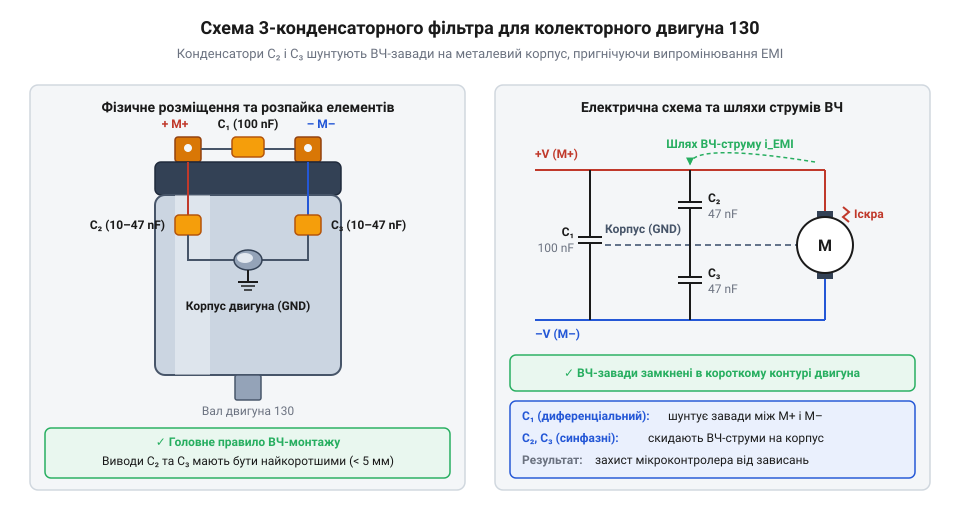
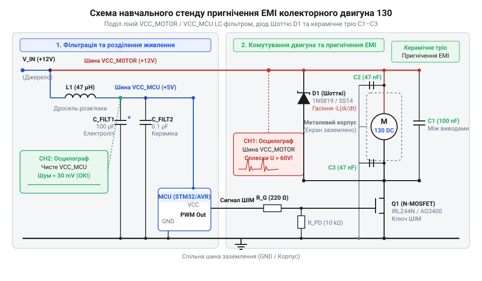

# Схемотехнічна фільтрація EMI-завад та захист кіл живлення двигуна 130

<preknowlist>
- [N20 мікромотор з редуктором](root:cat-hw-actuators/n20-motor) — принципи комутації колекторних двигунів постійного струму та робочі характеристики індуктивного навантаження
</preknowlist>

## Спонтанні перезавантаження мікроконтролера силовим двигуном

Уявіть типову ситуацію при розробці робототехнічного пристрою або системи автоматики: мікроконтролер керує силовим @@en|колекторним двигуном 130@@ (від лат. *collector* — збирач) через @@en|транзисторний ключ@@ (від англ. *transistor*: *transfer* + *resistor*). Обидва вузли живляться від спільного джерела 5 В. Під час тестування окремого коду мікроконтролер працює бездоганно, проте щойно програма подає сигнал на увімкнення мотора або змінює широтну-імпульсну модуляцію, система починає поводитися непередбачувано. Мікроконтролер раптово перезавантажується, дисплей замирає зі сміттям на екрані, а послідовне з'єднання з комп'ютером обривається.

Спроби виправити проблему в коді — додати затримки чи програмне фільтрування сигналів — виявляються марними. Причина криється не у програмних помилках, а у фізичній природі індуктивного навантаження. На відміну від резистивних компонентів або світлодіодів, @@en|колекторний двигун 130@@ накопичує енергію в магнітному полі своїх обмоток. У момент комутації ключ розмикає коло, і накопичена енергія шукає шлях для розряду, створюючи потужні імпульси напруги та високочастотний іскровий шум.

Коли пристрої з'єднані спільними шинами живлення та заземлення, ці імпульси проникають до цифрових кіл. Невелике падіння напруги нижче порогу скидання (@@en|Brown-out Reset@@) викликає перезавантаження процесора, а високочастотні наводки на виводах скидання (@@en|RESET@@) або тактового генератора призводять до фатального зависання ядра. Так само, як при [комутації N20 мікромоторів](root:cat-hw-actuators/n20-motor) або [роботі мотор-редукторів 6 В](root:cat-hw-actuators/gearmotor-6v), ігнорування силових завад унеможливлює стабільну роботу електронної системи.

Щоб повернути системі передбачуваність, недостатньо збільшити ємність вхідного електролітичного конденсатора біля мікроконтролера. Необхідно локалізувати джерело завад безпосередньо біля двигуна та перекрити шляхи їхнього поширення до чутливої цифрової логіки.

## Фізика виникнення та шляхи EMI-завад

Пригнічення завад вимагає чіткого розуміння фізичних процесів, які відбуваються всередині двигуна під час його роботи. Завади, що виникають у колах @@en|колекторного двигуна 130@@, мають дві принципово різні фізичні природи: низькочастотні комутаційні сплески та високочастотне іскріння на колекторі.

Перший механізм обумовлений @@la|індуктивністю@@ (від лат. *inductio* — наведення) обмоток ротора. Обмотка двигуна описується як послідовне з'єднання активного опору та індуктивності `L`. Енергія `E`, збережена в магнітному полі обмотки при проходженні струму `I`, визначається виразом:

```
E = (L × I²) / 2
```

Коли @@en|транзисторний ключ@@ миттєво розмикається, струм прагне змінити своє значення за дуже короткий проміжок часу `dt`. Відповідно до закону електромагнітної індукції Фарадея, в індуктивності виникає @@la|ЕРС самоіндукції@@ (від лат. *inductio*), що протидіє зміні струму:

```
V_ind = -L × (di / dt)
```

Оскільки час вимкнення транзистора `dt` становить одиниці мікросекунд або наносекунд, похідна `di / dt` набуває величезних значень. В результаті на терміналах двигуна формується короткий імпульс зворотної полярності з амплітудою в десятки й сотні вольт. Цей високовольтний сплеск легко пробиває перехід комутуючого транзистора та створює негативний стрибок напруги на шині живлення.

Другий механізм — це електромагнітне випромінювання та іскровий шум, спричинений механічним комутатором. Під час обертання ротора підпружинені щітки перескочують з однієї ламелі колектора на іншу. У момент розриву контакту між щіткою та ламеллю виникають мікроскопічні електричні дуги (іскріння). Вони генерують високочастотний шум у широкому спектрі частот — від десятків кілогерц до сотень мегагерц. На відміну від безконтактних пристроїв, таких як [безколекторні 5V вентилятори](root:cat-hw-actuators/fan-5v), механічний колектор є безперервним джерелом @@en|EMI@@ (від англ. *Electromagnetic Interference* — електромагнітні завади).

За шляхами розповсюдження ці завади поділяються на дві категорії:
1. @@en|Диференційна завада@@ (від лат. *differentia* — різниця): струм завади протікає в протилежних напрямках по силових провідниках живлення. Виникає безпосередньо через імпульсне споживання струму та сплески @@la|ЕРС самоіндукції@@. 2. @@en|Синфазна завада@@ (від англ. *common-mode noise*): струми завади протікають в одному напрямку по обох провідниках живлення відносно заземлення або металевого корпусу через @@en|паразитні ємності@@ (від грец. *parasitos* — нахлібник) між обмотками та статором.

Окрім провідникового шляху по дротах живлення, високочастотний іскровий шум випромінюється у простір. Силові дроти двигуна працюють як ефективні передавальні антени. Якщо навантаження є високоіндуктивним, як-от [водяна помпа RS-360SH](root:cat-hw-actuators/water-pump-rs360sh), випромінюване поле наводить паразитичні струми безпосередньо в друковані доріжки плати мікроконтролера.

Тому жоден поодинокий фільтрувальний елемент не здатний вирішити проблему повністю: захисний діод ефективний лише проти низькочастотних диференційних сплесків @@la|ЕРС самоіндукції@@, але абсолютно прозорий для високочастотного випромінювання іскріння. Для повного захисту потрібен комплексний підхід.

## Пригнічення високочастотних завад керамічним тріодом

Найефективніший спосіб боротьби з високочастотним @@en|EMI@@ шумом — це його пригнічення безпосередньо в точці виникнення, до того, як випромінювання потрапить у силові дроти живлення. Для @@en|колекторного двигуна 130@@ стандартним та найбільш дієвим схемотехнічним рішенням є встановлення трійки керамічних конденсаторів, яку часто називають керамічним тріодом.

Конструктивно @@en|колекторний двигун 130@@ має два силові термінали та суцільнометалевий сталевий корпус (шасі). Схема пригнічення складається з трьох конденсаторів:


*Схема розпаювання трьох керамічних конденсаторів між силовими терміналами та металевим корпусом двигуна 130, що створює локальний контур замикання високочастотних завад.*

Схема працює наступним чином:
Перший @@en|керамічний конденсатор@@ (від грец. *keramos* — глина та лат. *condensare* — згущувати) ємністю 100 nF (позначення `C1`) впаюється безпосередньо між позитивним та негативним терміналами двигуна. Він створює низькоімпедансний шлях для високочастотної складової @@en|диференційної завади@@. Для високочастотних гармонік іскріння опір конденсатора `Z_C = 1 / (2 × π × f × C)` виявляється значно меншим за опір підвідних дротів, завдяки чому високочастотний струм замикається всередині контуру терміналів і не виходить у зовнішню мережу.

Другий та третій керамічні конденсатори ємністю від 10 nF до 47 nF (позначення `C2` та `C3`) підключаються від кожного з терміналів двигуна до його металевого корпусу. Їхня задача — гасіння @@en|синфазної завади@@. Обмотки ротора мають паразитичну ємність відносно статора та металевого корпусу. Коли щітки іскрять, виникає високочастотне потенційне коливання корпусу відносно землі. Конденсатори `C2` та `C3` заземлюють високочастотні струми на корпус двигуна, перетворюючи металевий кожух на екранувальний щит.

При монтажі керамічного тріоду необхідно дотримуватися суворих практичних правил:
1. Довжина виводів конденсаторів має бути мінімальною (не більше 2–3 мм). Кожен міліметр виводу додає приблизно 1 nH паразитичної індуктивності, що на частотах понад 50 MHz різко знижує ефективність фільтрації. 2. Металевий корпус двигуна 130 часто покритий лаком або оксидною плівкою. Перед паянням виводів `C2` та `C3` ділянку корпусу слід ретельно зачистити скальпелем або наждачним папером та залудити із застосуванням активного флюсу. 3. Використовувати слід саме багатошарові керамічні конденсатори (типу MLCC), оскільки вони мають найнижчий власний послідовний опір (ESR) та індуктивність (ESL). Плівкові чи електролітичні конденсатори для цієї задачі непридатні.

Правильно розпаяний керамічний тріод усуває випромінювальний шум на 20–30 dB, перетворюючи звичайні дроти живлення з антен-випромінювачів на чисті лінії постачання енергії.

## Гасіння індуктивних сплесків діодом Шотткі

Розмикання транзисторного ключа, який керує колекторним двигуном 130, викликає миттєвий стрибок напруги, здатний пробити напівпровідникову структуру транзистора та вивести з ладу суміжні мікросхеми. Коли транзисторний ключ раптово припиняє подачу струму через [колекторний двигун](root:cat-hw-actuators/n20-motor), струм в обмотках не може зникнути безперервно через індуктивний характер навантаження. Накопичена в магнітному полі енергія прагне підтримувати проходження струму в тому ж напрямку. На виводах обмотки виникає високовольтний імпульс протилежної полярності — @@en|ЕРС самоіндукції@@ (від лат. *inductio* — наведення), величина якого описується виразом `V = -L × (di/dt)`. Оскільки швидкість вимикання транзистора дуже висока, значення `di/dt` прямує до безкінечності, утворюючи короткий сплеск амплітудою в десятки чи навіть сотні volt. Цей викид підсумовується з напругою джерела живлення, створюючи перенапругу на стоці або колекторі силового ключа.

Для безпечного скидання накопиченої магнітної енергії паралельно індуктивному навантаженню підключають @@en|зворотний діод@@ (англ. *flyback diode*, від *fly* — летіти, *back* — назад). Його вмикають у зворотному напрямку відносно напруги живлення: катод під'єднують до позитивної шини VCC, а анод — до точки з'єднання обмотки двигуна та стоку комутаційного транзистора. При відкритому транзисторі діод закритий і не впливає на роботу кола. У момент закривання транзистора ЕРС самоіндукції змінює полярність на виводах обмотки: потенціал на аноді діода стає вищим за напругу VCC. Діод відкривається і створює замкнений контур для струму самоіндукції, дозволяючи йому циркулювати через обмотку двигуна та діод до повного розсіювання енергії на активному опорі дротів.

Енергія, накопичена в магнітному полі індуктивності перед вимкненням, розраховується за класичним виразом:

```
E_L
= (1 / 2) × L × I²      [формула накопиченої магнітної енергії індуктивності]
```

Тут `E_L` — накопичена енергія в джоулях (Дж), `L` — індуктивність обмоток двигуна в генрі (Гн), `I` — струм, що протікав через двигун безпосередньо перед розмиканням ключа в амперах (А). Сама ця енергія `E_L` повністю перетворюється на тепловий сок на внутрішньому опорі обмотки та напівпровідниковому переході діода під час проходження циркуляційного струму.

Ззвичайний випрямний силіконовий p-n діод (наприклад, серії 1N4007) погано підходить для пригнічення високочастотних імпульсних сплесків через тривалий @@en|час зворотного відновлення@@ (англ. *reverse recovery time*, `t_rr`). У момент вимкнення ключів p-n перехід залишається провідним протягом мікросекунд, що дозволяє високовольтному піку безперешкодно проникнути в шину живлення. Замість нього застосовують @@en|діод Шотткі@@ (англ. *Schottky diode*, на честь фізика Вальтера Шотткі). Завдяки бар'єру метал-напівпровідник діод Шотткі не має накопичення неосновних носіїв заряду, а його час зворотного відновлення становить менше ніж 10 nanoseconds (`t_rr < 10 ns`). Крім того, @@en|пряме падіння напруги@@ (англ. *forward voltage drop*, `V_f`) на діоді Шотткі становить лише 0.2–0.4 V проти 0.7–1.1 V у кремнієвих p-n діодів. Це забезпечує миттєве зрізання індуктивного викиду на рівні `VCC + V_f` та зменшує теплове розсіювання на захисному компоненті. Для розрахунку граничних струмів та напруг захисного напівпровідника скористайтеся інструкцією з [вибору гасійного діода для індуктивних навантажень](root:hw-components/flyback-diode-selection).

## Розділення шин живлення LC-фільтром

Навіть після зрізання індуктивних сплесків діодом Шотткі та пригнічення іскріння керамічними конденсаторами на корпусі двигуна, силова лінія залишається джерелом високочастотних завад і пульсацій струму. Під час пуску або різкої зміни навантаження двигун споживає значний струм, викликаючи локальні просідання напруги живлення. Якщо мікроконтролер підключено до тієї ж шини, ці просідання призводять до хибних спрацьовувань компараторів, збоїв тактування або повного перезавантаження процесора за сигналом @@en|скидання при просіданні живлення@@ (англ. *Brown-out Reset*, BOR). Подібна ситуація виникає під час запуску будь-яких силових вузлів, таких як [малогабаритний мотор-редуктор](root:cat-hw-actuators/gearmotor-6v) або [мініатюрна водяна помпа](root:cat-hw-actuators/water-pump-rs360sh). Для надійного захисту обчислювального ядра силову лінію двигуна та логічну шину мікроконтролера необхідно фізично й схемотехнічно ізолювати.

Ефективним інструментом розділення шин живлення є @@en|розв'язувальний LC-фільтр@@ (англ. *decoupling LC filter*, від лат. *copula* — зв'язок). Вона складається з послідовно ввімкненого в лінію живлення мікроконтролера @@de|дроселя@@ (нім. *Drossel* — обмежувач, звуження) або індуктивності `L`, та паралельно підключеного ємнісного резервуара з @@en|електролітичного конденсатора@@ (англ. *electrolytic capacitor*) `C` великої ємності поруч із керамічним розв'язувальним конденсатором другорядного номіналу. Дросель має малий опір для постійного струму живлення, але створює високий реактивний опір (імпеданс) `Z_L = 2 × π × f × L` для високочастотних завад `f`, блокуючи їхнє проникнення від двигуна до логіки. Конденсатор `C`, навпаки, створює низький опір для високочастотних шумів `Z_C = 1 / (2 × π × f × C)`, шунтуючи завади на спільний дріт заземлення, та слугує локальним джерелом струму під час короткочасних просідань напруги.

Частота зрізу низькочастотного LC-фільтра `f_c` визначає межу, вище якої всі імпульсні завади пригнічуються зі швидкістю 40 dB на декаду. Розрахунок частоти зрізу виконується за виразом:

```
f_c
= 1 / (2 × π × √(L × C))      [формула частоти зрізу LC-фільтра]
= 1 / (2 × 3.14159 × √(100 × 10⁻⁶ × 100 × 10⁻⁶))      [підстановка номіналів L = 100 мкГн, C = 100 мкФ]
= 1 / (2 × 3.14159 × 10⁻⁴)    [обчислення добутку індуктивності та ємності]
≈ 1591.55 Гц                  [підсумкова частота зрізу в герцах]
```

У цій формулі `f_c` — частота зрізу в герцах (Гц), `L` — індуктивність дроселя в генрі (Гн), `C` — ємність конденсатора в фарадах (Ф), а `π ≈ 3.14159`. При використанні дроселя номіналом 100 мкГн та конденсатора ємністю 100 мкФ фільтр повністю відсікає високочастотні завади колектора, частота яких вимірюється десятками й сотнями кілогерц.

Об'єднання всіх трьох рівнів захисту — керамічного тріоду на корпусі мотора, зворотного діода Шотткі та розв'язувального LC-фільтра — створює закінчену завадостійку структуру стенду живлення та комутації.


*Принципова схема стенду фільтрації, що демонструє трирівневий захист: керамічний тріод на двигуні, зворотний діод Шотткі та розв'язувальний LC-фільтр між силовою й логічною шинами.*

На принциповій схемі силовий струм двигуна 130 проходить безпосередньо від джерела живлення через транзисторний ключ, не зачіпаючи фільтроване коло мікроконтролера. Зворотний діод Шотткі встановлено безпосередньо біля контактора двигуна, що мінімізує довжину контуру високовольтного струму самоіндукції, а LC-ланцюг відокремлює вхід живлення логічного контролера від будь-якіх сплесків на силовій шині. Для поглибленого вивчення схемотехнічних методів запобігання наведенню завад через спільні шини заземлення дивіться матеріал про [заземлювальні контури та їхній вплив на завадостійкість](root:hw-pcb/ground-loops).

## Осцилографічна оцінка ефективності пригнічення завад

Перевірка ефективності збудованих фільтрів вимагає інструментального аналізу сигналу на шинах живлення за допомогою @@lat|осцилографа@@ (від лат. *oscillare* — коливатися та грец. *grapho* — писати). Щоб отримати достовірні результати та уникнути наведення додаткових завад через щуп осцилографа, затискач заземлення («крокодил») підключають якомога ближче до точок заземлення мікроконтролера та джерела живлення, мінімізуючи площу вимірювального контуру. На відміну від безколекторних вузлів, якими є [комп'ютерні вентилятори 5V](root:cat-hw-actuators/fan-5v), колекторний двигун 130 ґенерує широкий спектр завад. Режим входу осцилографа перемикають у закритий стан (@@en|закритий вхід@@, AC coupling), що дозволяє прибрати постійну складову напруги живлення (наприклад, 5 V) та спостерігати лише імпульсні шумівки й сплески в масштабі 10–100 mV на поділ.

Основним кількісним показником рівнів шумів є @@en|розмах пікової напруги@@ (англ. *peak-to-peak voltage*, `V_pp` або `V_p-p`) — абсолютна різниця між найвищим позитивним піком шумів та найглибшим від'ємним просіданням. Вимірювання проводять покроково на кожному етапі побудови фільтруючої системи:

1. **Нефільтрований двигун:** При прямому підключенні двигуна 130 до шини живлення без елементів фільтрації осцилограф фіксує інтенсивний високочастотний шум із розмахом `V_pp` від 15 до 30 V, а в момент вимкнення ключа — індуктивні піки заввишки понад 50 V. 2. **Встановлення керамічного тріоду:** Підключення трійки керамічних конденсаторів 100 nF на виводи та корпус двигуна зрізає високочастотні іскрові шуми колектора, зменшуючи амплітуду шуму на шині живлення до `V_pp ≈ 1.5–2 V`. 3. **Додавання діода Шотткі:** Паралельне ввімкнення діода Шотткі повністю усуває високовольтні індуктивні викиди `V = -L × (di/dt)` при розмиканні ключа, обмежуючи максимальну напругу на рівні `VCC + V_f` (близько 5.3 V). 4. **Ввімкнення LC-фільтра:** Після розв'язувального LC-ланцюга на логічній шині живлення мікроконтролера амплітуда завад падає до `V_pp < 50 mV`, що забезпечує стабільну роботу цифрових кіл без ризику хибного скидання.

Кількісна оцінка ефективності пригнічення завад розраховується як коефіцієнт послаблення завади в децибелах (dB) за співвідношенням розмаху пікових напруг до та після фільтрації:

```
A_dB
= 20 × log₁₀(V_pp_before / V_pp_after)      [формула розрахунку пригнічення завади в децибелах]
= 20 × log₁₀(20 / 0.05)                    [підстановка виміряних значень V_pp до 20 В та після 0.05 В]
= 20 × log₁₀(400)                          [обчислення співвідношення амплітуд]
≈ 52.04 дБ                                 [підсумковий рівень послаблення EMI-шуму]
```

У цій формулі `A_dB` — коефіцієнт послаблення в децибелах (дБ), `V_pp_before` — розмах пікової напруги завади в вольтах (В) на нефільтрованій шині (наприклад, 20 В), `V_pp_after` — розмах пікової напруги після проходження трьохступеневого фільтра (наприклад, 0.05 В або 50 мВ). Рівень послаблення понад 50 dB свідчить про високу ефективність комплексного EMI-захисту, який гарантує надійність системи в промислових умовах.