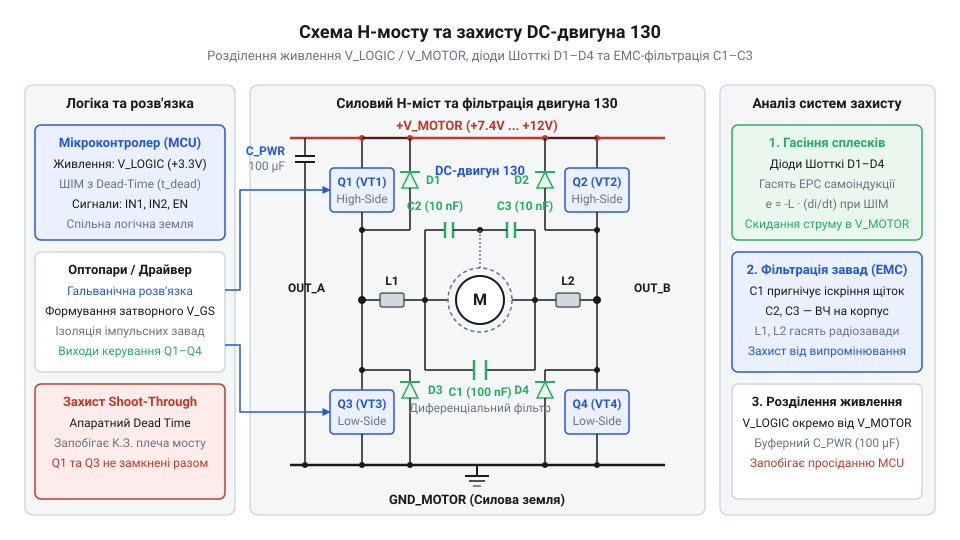
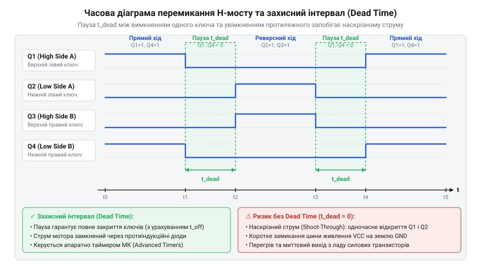

# Розробка драйвера колекторного двигуна 130 на H-мості з ШІМ-регулюванням швидкості на мікроконтролері

<preknowlist>
- [N20 мікромотор з редуктором](root:cat-hw-actuators/n20-motor) — принципи роботи колекторного двигуна постійного струму та залежність струму від механічного навантаження.
- [Мотор-редуктор 6 В (100 і 600 об/хв)](root:cat-hw-actuators/gearmotor-6v) — характеристики живлення та особливості пускових струмів колекторних моторів.
</preknowlist>

## Спроба прямого підключення мотора

Припустимо, розробник-початківець вирішує запустити компактний @@en|DC motor@@ (від англ. *Direct Current motor* — двигун постійного струму, лат. *directus*, прямий) 130-го типорозміру найпростішим шляхом: підключає один вивід двигуна до цифрової ніжки @@en|GPIO@@ (від англ. *General-Purpose Input/Output* — вивід загального призначення) мікроконтролера @@en|MCU@@ (від англ. *Microcontroller Unit* — мікроконтролерний модуль), другий — до спільного проводу землі `GND`, та подає логічну одиницю `HIGH`. Замість бажаного обертання ротора відбувається апаратна аварія: мікроконтролер миттєво перезавантажується, зациклюється у циклі скидання або цифрова ніжка чіпа назавжди виходить з ладу.

Чому пряме керування силовим навантаженням від логічних виводів чіпа є принципово неможливим? Причина полягає у двох незалежних фізичних явищах: статичному струмовому перевантаженні цифрових транзисторів та динамічному сплеску ЕРС самоіндукції (від лат. *inductio* — наведення).

Перша проблема — фізична обмеженість вихідного струму цифрового логічного вентиля. Ніжка @@en|GPIO@@ мікроконтролера розрахована на керування логічними входами інших мікросхем або світлодіодами. Внутрішній вихідний каскад @@en|Push-Pull@@ (від англ. *push-pull* — двотактний вихід) виготовляється з мініатюрних польових транзисторів, граничний допустимий струм яких `I_max` зазвичай становить від `20` до `40 mA`. 

Водночас колекторний (від лат. *collector* — збирач) двигун 130-го типорозміру має обмотку ротора з низьким активним опором `R_coil`, який у стані спокою становить лише від `3` до `6 Ом`. У момент подачі напруги живлення `V_CC = 5 V`, поки ротор ще не почав обертатися й відсутня проти-ЕРС (від англ. *back EMF*, *ElectroMotive Force* — проти-електрорушійна сила), виникає пусковий струм заклинювання `I_stall`, який обчислюється за законом Ома:

```
I_stall = V_CC / R_coil
        = 5 / 4                 [підстановка напруги живлення 5 В та опору обмотки 4 Ом]
        = 1.25                  [значення пускового струму в амперах]
```

Порівняємо це значення з граничним струмом цифрового виводу `I_max = 0.02 A`:

```
I_ratio = I_stall / I_max
        = 1.25 / 0.02           [співвідношення пускового струму та граничного струму GPIO]
        = 62.5                  [кратність перевищення допустимого навантаження]
```

Пусковий струм перевищує допустимий ліміт виводу у понад 60 разів! Такий надмірний струм викликає миттєве падіння напруги на внутрішньому силіцієвому кристалі чіпа, що призводить до спрацювання схеми захисту від зниження напруги @@en|UVLO@@ (від англ. *Under-Voltage Lockout* — блокування при зниженій напрузі) та перезавантаження мікроконтролера. Це явище проявляється щоразу, коли [використовують маленькі колекторні](root:cat-hw-actuators/n20-motor) двигуни без силових розв'язок.

Друга, ще небезпечніша проблема — реактивний індуктивний сплеск напруги під час вимкнення. Обмотка ротора двигуна є фізичною індуктивністю `L`. Згідно з законом Фарадея, напруга на індуктивності `V_L` пропорційна швидкості зміни струму `di / dt`. Коли цифрова ніжка мікроконтролера змінює стан з `HIGH` (5 В) на `LOW` (0 В), вихідний транзистор закривається, і струм у колі намагається миттєво зменшитися до нуля (`di / dt -> -∞`). Магнітне поле, накопичене в обмотці мотора, розпадається й генерує імпульс ЕРС самоіндукції з зворотною полярністю:

```
V_L = L · (di / dt)             [формула напруги ЕРС самоіндукції на обмотці]
```

Оскільки струм в індуктивності не може змінитися миттєво, на закритому виводі @@en|GPIO@@ виникає високовольтний сплеск напруги `V_pin = V_CC + V_L`, який може досягати десятків і сотень вольт. Ця напруга значно перевищує пробійний поріг внутрішніх захисних діодів силіцієвого кристала, викликаючи лавинний пробій p-n переходу й фізичне руйнування цифрового виводу. Подібний апаратний збій виникає й тоді, коли [заживлюють компактні мотор-редуктори](root:cat-hw-actuators/gearmotor-6v) напряму від логічних мікросхем.

Аналіз цих фізичних причин дозволяє сформулювати чіткі вимоги до проміжного силового каскаду:
1. **Розділене живлення (Power Separation):** Повна гальванічна або електрична розв'язка кола живлення логіки `V_MCU` (3.3/5 В) та силого кола мотора `V_MOT` (5–12 В). 2. **Силові комутаційні ключі (Power Switches):** Використання зовнішніх потужних транзисторів, здатних витримувати пускові струми до 2–3 А. 3. **Захист від самоіндукції (Inductive Clamping):** Наявність швидких зворотних діодів для безпечного скидання енергії індуктивного сплеску в шину живлення. 4. **Фільтрація завад (EMI Suppression):** Пригнічення високочастотного щіткового іскріння керамічними конденсаторами безпосередньо на виводах мотора.

## Силова схема H-мосту та захист

Сформулювавши вимоги до силового каскаду, розберемо, як організувати не лише безпечне подання живлення, а й реверс (від лат. *reversus* — повернений назад) напрямку обертання вала мотора.

Для зміни напрямку обертання ротора колекторного двигуна необхідно змінити напрямок проходження струму через його обмотку. Найефективнішим апаратним рішенням цього завдання є @@en|H-bridge@@ (від англ. *H-bridge*, H-міст — через схожість схеми з латинською літерою «H»).

Схема H-мосту складається з чотирьох силових ключів (найчастіше польових транзисторів @@en|MOSFET@@, від англ. *Metal-Oxide-Semiconductor Field-Effect Transistor* — метал-оксид-напівпровідниковий польовий транзистор), об'єднаних у два вертикальних плеча. Двигун 130 підключається у горизонтальну перемичку між лівим і правим плечем.


*Принципова силова схема H-мосту із захисними діодами гасіння індуктивності та керамічним фільтром завад для двигуна 130.*

Розглянемо режими роботи H-мосту:
1. **Пряме обертання (Forward):** Замкнено верхній лівий ключ Q1 та нижній правий ключ Q4. Ключі Q2 та Q3 розімкнені. Струм протікає від шини `V_MOT` через Q1, двигун (зліва направо) та Q4 в `GND`. 2. **Зворотне обертання (Reverse):** Замкнено верхній правий ключ Q3 та нижній лівий ключ Q2. Ключі Q1 та Q4 розімкнені. Струм протікає через двигун у зворотному напрямку (справа наліво). 3. **Інерційний вибіг (Coast / High-Z):** Усі чотири ключі Q1..Q4 розімкнені. Двигун відключений від джерела живлення, і його вал вільно обертається по інерції до повної зупинки. 4. **Активне гальмування (Brake):** Замкнено обидва нижніх ключі Q2 та Q4 (або обидва верхніх Q1 і Q3). Виводи мотора коротко замикаються між собою через спільну шину.

Коли двигун обертається, він накопичує кінетичну енергію ротора та магнітну енергію в індуктивності обмоток. У момент вимкнення транзисторів індуктивність намагається підтримувати проходження струму. Щоб цей струм не зруйнував закриті транзистори високовольтним сплеском, паралельно кожному ключу Q1..Q4 у зворотному включенні встановлюються захисні діоди гасіння самоіндукції — так звані @@en|Flyback Diodes@@ (від англ. *flyback diode* — зворотно-захисний діод).

Найкращі результати забезпечують діоди Шотткі (названі на честь фізика Вальтера Шотткі), які мають мале пряме падіння напруги `V_F ≈ 0.3 V` та надшвидкий час відновлення `t_rr < 10 ns`. Під час вимкнення ключів індуктивний струм замкненого мотора безпечно скидається через діоди назад у шину живлення `V_MOT`. Для детального вивчення фізики перехідних процесів гасіння ЕРС та вибору напівпровідникових компонентів перегляньте керівництво про [захист індуктивних навантажень зворотними діодами](root:hw-power/flyback-diodes-protection).

Окрім індуктивних сплесків ЕРС, колекторний двигун 130 генерує потужні високочастотні електромагнітні завади @@en|EMI@@ (від англ. *Electromagnetic Interference* — електромагнітні завади). Вони виникають через механічне іскріння вугільних або металевих щіток об колекторні пластини під час обертання ротора. Ці завади проникають у кола живлення мікроконтролера й можуть викликати збої у виконанні програмного коду.

Для пригнічення щіткового іскріння застосовують триконденсаторну схему фільтрації безпосередньо на виводах мотора 130:
- Конденсатор `C1` ємністю `10–100 nF` підключається паралельно між обома силовими виводами мотора. Він шунтує диференціальні високочастотні імпульси напруги між обмотками. - Конденсатори `C2` та `C3` ємністю `10–47 nF` підключаються від кожного виводу мотора на його металевий корпус, який з'єднують із заземленням `GND`. Вони пригнічують синфазні завади відносно землі.

Завдяки поєднанню силового H-мосту, зворотних діодів Шотткі та триконденсаторного фільтра створюється безпечна схема узгодження силової та цифрової частин пристрою.

## Перемикання плечей та захисний інтервал

Спроектувавши силову схему H-мосту, розробник стикається з критичною апаратною небезпекою, яка виникає під час динамічної зміни напрямку обертання мотора або при ШІМ-регулюванні (від англ. *Pulse-Width Modulation*, @@en|PWM@@ — широтно-імпульсна модуляція). Ця небезпека має назву наскрізного струму короткого замикання або @@en|Shoot-Through@@ (від англ. *shoot-through* — наскрізний пробій).

Фізика виникнення наскрізного струму полягає у неідеальності напівпровідникових ключів. Будь-який реальний транзистор @@en|MOSFET@@ замикається й розмикається не миттєво: перехідний процес забирає час, потрібний для перезарядки ємності затвора `Q_g`. Причому час вимкнення транзистора `t_off` майже завжди більший за час його ввімкнення `t_on`.

Уявимо ситуацію: двигун обертався у напрямку `FORWARD` (відкриті ключі Q1 і Q4). Мікроконтролер отримує команду змінити напрямок на `REVERSE`. Якщо керуюча програма одночасно подасть сигнал на закриття верхнього ключа Q1 та відкриття нижнього ключа Q2 у лівому плечі мосту, виникає катастрофічний стан. Нижній транзистор Q2 відкривається дуже швидко, а верхній транзистор Q1 ще перебуває у процесі закриття через затримку розрядки затвора.

У результаті протягом короткого часового проміжку (`Δt ≈ 100 ns – 5 μs`) обидва транзистори Q1 та Q2 лівого плеча H-мосту виявляються відкритими одночасно! Це створює прямий безпосередній короткий контур між шиною живлення `V_MOT` та землею `GND`. Наскрізний струм `I_shoot` обмежується лише внутрішнім опором відкритих каналів `R_DS(on)`:

```
I_shoot = V_MOT / (R_DS(on)1 + R_DS(on)2)
        = 12 / (0.05 + 0.05)    [підстановка напруги 12 В та опорів каналів MOSFET по 0.05 Ом]
        = 120                   [амперний пік наскрізного струму]
```

Короткочасний імпульс струму силою у 120 А викликає миттєвий локальний перегрів силіцієвого кристала транзисторів, просідання шини живлення та термічне руйнування ключів H-мосту. Докладніше про фізику комутаційних процесів, причини виникнення аварійного струму та засоби апаратного захисту розказано у матеріалі про [наскрізний струм у силових ключах H-мосту](root:hw-power/h-bridge-shoot-through).

Для запобігання виникненню наскрізних струмів у керуючий алгоритм обов'язково вводиться захисна часова затримка — @@en|Dead Time@@ (від англ. *dead time* — «мертвий час», захисний інтервал безструмової паузи).


*Часова діаграма сигналів керування H-мостом з обов'язковим захисним інтервалом Dead Time при переході з прямого ходу на реверс.*

Суть алгоритму Dead Time полягає у примусовому розмиканні всіх ключів H-мосту на гарантований інтервал часу перед будь-якою зміною стану плеча:
1. Запит на зміну напрямку: вимикаються всі активні ключі H-мосту (сигнали керування переводяться у `LOW`, ШІМ = 0%). 2. Витримується захисна затримка `t_dead`, під час якої всі транзистори гарантовано переходять у повністю закритий стан. 3. Вмикаються ключі нового напрямку руху, після чого відновлюється подача ШІМ-сигналу.

Мінімально необхідна тривалість Dead Time обчислюється на основі паспортних параметрів транзисторів з урахуванням технологічного запасу:

```
t_dead_min = t_off_max + t_margin
           = 150 + 50            [додавання максимального часу вимкнення MOSFET 150 нс та запасу 50 нс]
           = 200                 [мінімально необхідний захисний інтервал у наносекундах]
```

У низькорівневих C/C++ драйверах реалізація Dead Time вимагає чіткої послідовності скидання регістрів GPIO та виклику функцій точної затримки. 

Розглянемо реалізацію алгоритму захисної паузи в C-драйвері:

:::code proj-dc-motor-hbridge-control/c/src/dc_motor_130.c 20-35

У C++ драйвері ця ж логіка інкапсулюється у приватний метод класу:

:::code proj-dc-motor-hbridge-control/cpp/src/dc130_motor_driver.cpp 103-110

Дотримання часових інтервалів Dead Time є запорукою надійної та долговічної роботи силового H-мосту при керуванні колекторними двигунами 130-го типорозміру.

## ШІМ-регулювання швидкості та режими гальмування

Пряме підключення постійної напруги до колекторного мотора змушує його вал обертатися на максимальних обертах, але для робототехнічних систем необхідне плавне варіювання швидкості. Зменшення напруги за допомогою послідовних лінійних резисторів призводить до величезних втрат теплової енергії на ключах та падіння обертального моменту. Щоб ефективно керувати моментом і швидкістю без неефективного розсіювання потужності, використовують @@en|PWM@@ (від англ. @@en|Pulse-Width Modulation@@ — широтно-імпульсна модуляція).

Суть ШІМ полягає у подачі на мотор прямокутних імпульсів живлення з постійною частотою, але змінною тривалістю активного стану. Середнє значення напруги на обмотуванні формується за рахунок високої частоти перемикання ключа та визначається параметром @@en|Duty Cycle@@ (від англ. @@en|duty cycle@@ — коефіцієнт заповнення), який вимірюється у відсотках.

Для колекторного двигуна 130-го типорозміру вибір частоти ШІМ є компромісом між акустичним шумом та тепловими втратами. При частотах нижче 15 кГц обмотки мотора починають резонувати й видавати неприємний високочастотний писк, який чути людським вухом. При частотах вище 30 кГц зростають динамічні втрати на затворах силових @@en|MOSFET@@ (від англ. @@en|metal-oxide-semiconductor field-effect transistor@@ — польовий транзистор зі структурою метал-оксид-напівпровідник) транзисторів H-моста через постійне перезаряджання їхньої вхідної ємності. Оптимальним вибором для мікроконтролерного керування є діапазон від 15 до 25 кГц (зазвичай 20 кГц).

Для налаштування апаратного таймера мікроконтролера (наприклад, із тактовою частотою 72 МГц) задається значення регістру автоматичного перезавантаження @@en|ARR@@ (від англ. @@en|Auto-Reload Register@@ — регістр автоматичного перезавантаження), що визначає дискретність ШІМ (наприклад, 999 відліків для точності в 0.1%), після чого обчислюється дільник частоти @@en|PSC@@ (від англ. @@en|Prescaler@@ — попередній дільник):

F_pwm = SystemClock / ((PSC + 1) × (ARR + 1))
= 72 000 000 / ((3 + 1) × (999 + 1))       [підстановка системної частоти 72 МГц]
= 20 000 Гц                                 [розрахована частота ШІМ 20 кГц]

У колекторних моторах 130 існує поріг тертя спокою щіток і підшипників: при значеннях @@en|Duty Cycle@@ менше 10–12% енергії імпульсів недостатньо для зрушення ротора з місця, і струм лише марно нагріває обмотки. Програмний драйвер повинен враховувати цей поріг, відсікаючи недопустимо малі значення заповнення.

Коли виникає потреба зупинити обертання, силовий H-міст може реалізувати два принципово різних фізичних режими:

1. **Інерційний вибіг** (режим @@en|COAST@@ або @@en|Fast Decay@@): усі чотири ключі H-моста розмикаються, переводячи виходи у високоімпедансний стан @@en|High-Z@@ (від англ. @@en|high impedance@@ — високий імпеданс). Струм обмоток швидко спадає через захисні зворотні діоди Шотткі у шину живлення, а вал продовжує вільно обертатися за рахунок накопиченої кінетичної енергії. Це схоже на те, як поводиться [мотор-редуктор 6 В](root:cat-hw-actuators/gearmotor-6v) при відключенні живлення без механічного заклинювання. 2. **Активне електродинамічне гальмування** (режим @@en|BRAKE@@ або @@en|Slow Decay@@): нижні (або верхні) ключі H-моста замкнені одночасно, коротко замикаючи обидва виводи обмотки мотора між собою. Ротор, що продовжує обертатися в магнітному полі статора, перетворюється на генератор. Згенерована проти-ЕРС @@en|Back-EMF@@ (від англ. @@en|back electromotive force@@ — проти-електрорушійна сила) викликає потужний струм короткого замикання в замкненому контурі ключів, створюючи протидіючий електромагнітний момент, який миттєво зупиняє вал.

## Розробка драйвера мотора C та C++

Перехід від теоретичної таблиці станів моста до надійного програмного забезпечення вимагає створення модульної архітектури. Драйвер повинен ізолювати низькорівневу периферію мікроконтролера, забезпечувати захист від помилкових конфігурацій та гарантувати витримання мікросекундної паузи @@en|Dead Time@@ (від англ. @@en|dead time@@ — мертвий час) для відсікання наскрізних струмів короткого замикання @@en|Shoot-Through@@ (від англ. @@en|shoot-through@@ — наскрізний струм).

У C-реалізації драйвер будується на абстракції дескриптора мотора та структури конфігурації. Низькорівневе маніпулювання виводами @@en|GPIO@@ (від англ. @@en|General-Purpose Input/Output@@ — вхід/вихід загального призначення) та апаратним таймером винесено в окремий модуль:

:::code proj-dc-motor-hbridge-control/c/include/dc_motor_130.h 56-77

Перед будь-якою зміною напрямку обертання з прямого на реверсний функція `dc_motor_set_direction()` примусово активує захисний інтервал `apply_dead_time()`. Вона переводить виводи керування силового мосту в логічний нуль і зупиняє ШІМ на розрахований час `dead_time_us`, виключаючи ймовірність одночасного відкриття транзисторів одного плеча:

:::code proj-dc-motor-hbridge-control/c/src/dc_motor_130.c 20-35

Для створення сучасних об'єктно-орієнтованих прошивок C++ надає інкапсуляцію апаратних ресурсів у клас `embedded::DC130MotorDriver`. Замість передачі вказівників на структури всі внутрішні стани, виклики периферійного таймера `PwmTimer` та обробка порогів мінімальної швидкості ховаються всередині об'єкта:

:::code proj-dc-motor-hbridge-control/cpp/include/dc130_motor_driver.hpp 44-95

Особливу небезпеку в робототехніці становлять раптові збої програми або виняткові ситуації, коли мотор залишається включеним на високій швидкості. Для вирішення цієї проблеми застосовується паттерн @@en|RAII@@ (від англ. @@en|Resource Acquisition Is Initialization@@ — отримання ресурсу є ініціалізацією) у вигляді обгортки `MotorGuard`. Під час створення об'єкта захисник прив'язується до драйвера двигуна, а при виході з області видимості його деструктор автоматично викликає безпечну зупинку у режимі `coast()` або `brake()`:

:::code proj-dc-motor-hbridge-control/cpp/src/dc130_motor_driver.cpp 122-135

Завдяки такій двоуровневій архітектурі C та C++ розробник отримує стабільне API, яке повністю захищає силову частину H-моста від програмних помилок і гарантує передбачувану поведінку приводу в будь-якому робочому режимі.