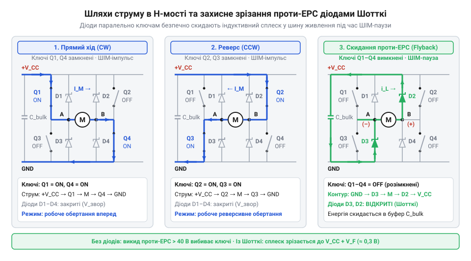

# Силовий драйвер двигуна 130 на H-мості з триконденсаторним придушенням іскрових завад

<preknowlist>
- [N20 мікромотор з редуктором](root:cat-hw-actuators/n20-motor) — електрофізичні параметри колекторних двигунів постійного струму, наявність проти-ЕРС та явище пускових перевантажень
- [Мотор-редуктор 6 В (100 і 600 об/хв)](root:cat-hw-actuators/gearmotor-6v) — залежність споживання струму від навантаження на валу та стрибки напруги при механічній комутації щіток
</preknowlist>

## Чому колекторний мотор скидає мікроконтролер

Пряме підключення колекторного двигуна типорозміру 130 до цифрової схеми через звичайний польовий транзистор зазвичай закінчується збоєм: щойно на затвор надходить логічна одиниця, мікроконтролер зависає або впадає в циклічне перезавантаження. Колекторний вузол (лат. *collector* — збирач) перетворює звичайний електропривод на потужне джерело трьох руйнівних апаратних впливів.

Перший чинник — пускове просідання напруги живлення. У момент подачі живлення якір нерухомий, тому проти-ЕРС (зворотна електрорушійна сила, англ. @@en|Back-EMF@@) дорівнює нулю. Струм якоря обмежується лише активним опором мідної обмотки. Пусковий струм якоря `I_stall` визначають із закону Ома за напруги живлення `U` та активного опору обмотки якоря `R`:

```
I_stall
= U / R
= 5.0 / 1.67            [підстановка параметрів двигуна 130]
≈ 3.0 А                 [закон Ома для нерухомого ротора]
```

Отриманий ударний струм у 10–12 разів перевищує струм холостого ходу. На внутрішньому опорі джерела живлення та тонких провідниках виникає падіння напруги. Якщо цифрова шина просідає нижче критичного порогу, спрацьовує [апаратний детектор brownout-скидання](root:hw-arch/mcu-brownout-reset) (англ. @@en|Brown-Out Reset@@, англ. *brownout* — спад напруги, *reset* — скидання). Процесор скидається, закриває транзистор, напруга відновлюється, після чого програма знову запускає мотор — виникає нескінченний цикл рестартів. Схожі просідання характерні для будь-яких колекторних вузлів під навантаженням, таких як [мотор-редуктор на 6 В](root:cat-hw-actuators/gearmotor-6v).

Другий чинник — індуктивні викиди перенапруги. Обмотки якоря мають власну індуктивність `L`. Під час кожного вимикання транзистора або в паузах ШІМ струм різко обривається. За законом електромагнітної індукції Фарадея виникає імпульс протилежної полярності з амплітудою в десятки вольтів. Без захисного діода цей сплеск пробиває напівпровідниковий перехід транзистора або проникає через захисні діоди портів мікроконтролера.

Третій чинник — комутаційне іскріння щіток. Струм подається на обмотки ротора (лат. *rotor*, від *rotare* — обертатися) через пружні металеві щітки, які ковзають по мідних пластинах — ламелях (лат. *lamella* — пластинка). У момент розриву контакту між щіткою та ламеллю виникає мікроскопічна електрична дуга. Це іскріння генерує високочастотний електромагнітний шум у діапазоні від сотень кілогерців до сотень мегагерців. Провідники живлення мотора діють як антени, наводячи перешкоди на лінії тактового генератора та цифрові шини зв'язку. Подібне явище спостерігається і в менших приводах, зокрема в [мікромоторах N20](root:cat-hw-actuators/n20-motor).

Пусковий струм та індуктивні викиди гасять на рівні плати драйвера за допомогою софт-старту та зворотних діодів. Проте радіочастотне іскріння щіток необхідно глушити безпосередньо в точці його генерації.

## Триконденсаторний фільтр для придушення іскріння

Високочастотний шум щіткового вузла поширюється двома різними шляхами, створюючи [диференціальні та синфазні завади](root:hw-analog/common-mode-noise). Диференціальна завада (англ. @@en|differential-mode noise@@; лат. *differentia* — різниця) циркулює замкненим контуром між двома живильними клемами мотора. Синфазна завада (англ. @@en|common-mode noise@@) поширюється одночасно в одному напрямку по обох проводах і стікає через паразитну ємність обмоток на заземлений металевий корпус статора (лат. *stator* — нерухомий).

Для повного придушення обох компонентів застосовують триконденсаторний фільтр із керамічних конденсаторів ємністю від 10 до 100 нФ. Кераміка має вкрай низький власний послідовний опір та індуктивність на високих частотах. Реактивний опір конденсатора `X_C` для високочастотного шуму визначають через частоту іскріння `f` та ємність `C`:

```
X_C
= 1 / (2 · π · f · C)
= 1 / (2 · 3.1416 · 10⁷ · 10⁻⁷)   [підстановка f = 10 МГц та C = 100 нФ]
≈ 0.16 Ом                         [формула реактивного опору ємності]
```

Опір 0.16 Ом перетворює конденсатор на коротке замикання для частоти 10 МГц. Перший конденсатор `C₁` ємністю 100 нФ встановлюють паралельно клемам двигуна: він замикає диференціальний шум щіток локально, не випускаючи його в лінію живлення. Ще два однакові конденсатори `C₂` та `C₃` ємністю по 10–47 нФ підключають між кожною клемою та металевим корпусом статора: вони скидають синфазний струм на корпус, який виконує роль екрана Фарадея.


*Схема та просторове розміщення триконденсаторного фільтра на двигуні 130: міжкаскадна ємність гасить диференціальний шум між полюсами, а пара симетричних ємностей замикає синфазні завади на зачищений корпус статора.*

Просторове розміщення фільтра вирішує результат захисту. Кожен міліметр виводу конденсатора додає близько 1 нГн паразитної індуктивності. На частотах понад 30 МГц індуктивний опір довгих ніжок блокує роботу фільтра. Тому монтаж на макетній платі чи платі драйвера не працює: дроти до мотора встигають спрацювати як випромінювальні антени.

Фільтр монтують безпосередньо на корпусі мотора за чіткою послідовністю:
1. Зачищення корпусу: захисний лак або оксидну плівку на сталевому статорі між виводами зчищають надфілем або лезом до блискучого металу й залуджують активним флюсом.
2. Формування виводів: виводи керамічних конденсаторів укорочують до довжини 2–3 мм для мінімізації паразитної індуктивності.
3. Паяння: конденсатор `C₁` припаюють напряму між пелюстками живлення мотора, а конденсатори `C₂` і `C₃` припаюють від пелюсток до залудженої ділянки статора зі збереженням найкоротших трас.

Такий монтаж локалізує високочастотний струм іскріння всередині металевого екрана двигуна, усуваючи збої мікроконтролера ще до входу сигналу в силовий каскад.

## Схемотехніка H-моста та діоди Шотткі

Екранування корпусу та керамічна фільтрація глушать радіозавади щіток, але для керування приводом потрібна керована зміна швидкості й реверс. Зміна полярності напруги на клемах без механічних перемикачів здійснюється схемотехнічною топологією з чотирьох транзисторних ключів, відомою як [схемотехнічний H-міст](root:hw-motion/h-bridge) (англ. @@en|H-bridge@@, названий за візуальною схожістю схеми з латинською літерою H). Двигун вмикають у центральну діагональ між двома вертикальними напівмостами.

Комбінація відкритих ключів задає чотири стани силового каскаду:
1. Прямий хід (англ. @@en|forward@@): відкриті верхній лівий та нижній правий ключі, струм тече крізь обмотку зліва направо, обертаючи вал за годинниковою стрілкою.
2. Реверс (англ. @@en|reverse@@; лат. *reversus* — повернений назад): відкрита протилежна пара ключів, струм тече у зворотному напрямку, змінюючи вектор електромагнітного моменту.
3. Вільний вибіг (англ. @@en|coast@@; стан високого імпедансу, англ. @@en|Hi-Z@@, від англ. *high impedance* — високий повний опір): усі чотири ключі розімкнені, живлення обірване, а якір плавно сповільнюється виключно механічним тертям.
4. Динамічне гальмування (англ. @@en|dynamic braking@@; грец. *dynamis* — сила): одночасне відкриття двох нижніх або двох верхніх ключів закорочує виводи двигуна між собою. Обертовий ротор під дією залишкового моменту працює як генератор, а його проти-ЕРС створює потужний замкнений струм через транзистори. Цей струм генерує зустрічний електродинамічний момент, викликаючи різку зупинку вала, необхідну в таких приводах, як [мотор-редуктор на 6 В](root:cat-hw-actuators/gearmotor-6v).

Для плавного регулювання швидкості використовують широтно-імпульсну модуляцію (англ. @@en|PWM@@, @@en|Pulse-Width Modulation@@ — широтно-імпульсна модуляція). Під час ШІМ ключі перемикаються десятки тисяч разів на секунду. Власна індуктивність обмотки якоря `L` протидіє миттєвому розриву струму. За законом самоіндукції Фарадея на клемах виникає сплеск напруги зворотної полярності `U_L = -L · (di / dt)`. За відсутності безпечного шляху цей викид сягає сотні вольтів і пробиває переходи закритих транзисторів.

Для безпечного скидання індуктивної енергії паралельно кожному ключу у зворотному напрямку підключають захисні зворотні діоди (англ. @@en|flyback diode@@). У моменти закриття ключів струм самоіндукції обмотки безперешкодно стікає крізь діоди в шину живлення або підтягується з шини заземлення.

Звичайні випрямні діоди та паразитні діоди польових транзисторів (англ. @@en|body diode@@) не витримують частот ШІМ: їхній час зворотного відновлення (англ. @@en|reverse recovery time@@, `t_rr`) сягає 200–500 нс, спричиняючи коротке замикання стійки моста в момент відкриття зустрічного ключа. Тому застосовують [діоди з бар'єром Шотткі](root:hw-components/schottky-barrier-diode) (англ. @@en|Schottky diode@@, названі на честь фізика Вальтера Шотткі): контакт метал-напівпровідник забезпечує практично нульовий час відновлення (`t_rr < 10 нс`) та мале пряме падіння напруги `U_F ≈ 0.3–0.4 В` проти `0.8–1.1 В` у стандартних кремнієвих переходів.

Потужність теплових втрат на захисному діоді `P_d` розраховують за прямим струмом скидання `I` та прямим падінням напруги `U_F`:

```
P_d
= I · U_F
= 2.0 · 0.35              [підстановка струму 2.0 А та прямого падіння на діоді Шотткі]
= 0.70 Вт                 [розрахунок потужності розсіювання діода Шотткі]
```

Для порівняння, на кремнієвому діоді з падінням `0.95 В` виділяється `2.0 · 0.95 = 1.90 Вт`, що призводить до перегріву плати. Граничну зворотну напругу діода `U_R` обирають із півторакратним запасом `U_R ≥ 1.5 · U_cc`, а допустимий імпульсний струм `I_F` розраховують на максимальний пусковий струм мотора 130 (до 3 А).


*Принципова електрична схема H-моста із захисними діодами Шотткі: індуктивні викиди обмотки скидаються у шини живлення в моменти закриття ключів, унеможливлюючи пробій транзисторів.*

## Розділення живлення та зіркова земля

Правильно зібраний H-міст із діодами Шотткі все одно може спричиняти зависання мікроконтролера, якщо силова та цифрова частини з'єднані спільними земляними доріжками довільної форми.

Мідні провідники мають власний активний опір `R_trace` та паразитну індуктивність `L_trace`. Коли силовий міст і мікроконтролер підключені до мінуса живлення послідовно однією лінією, імпульсний струм мотора `I_motor` створює на спільній ділянці падіння напруги `ΔU_gnd = I_motor · R_trace + L_trace · (di / dt)`. Цей стрибок потенціалу називають [підстрибуванням потенціалу землі](root:hw-pcb/ground-bounce) (англ. @@en|ground bounce@@; англ. *bounce* — відскік). Зсув потенціалу навіть на 0.3–0.4 В відносно мінуса живлення спотворює логічні рівні сигналів керування, викликає збої читання регістрів і провокує апаратне перезавантаження процесора.

Для захисту від взаємних наведень застосовують [топологію заземлення зіркою](root:hw-pcb/star-ground-topology) (англ. @@en|star ground@@). Силове заземлення моста (англ. @@en|Power GND@@) і сигнальну землю логіки (англ. @@en|Signal GND@@) розводять фізично незалежними трасами. Вони сходяться лише в одній точці — безпосередньо на мінусовій клемі джерела живлення. Завдяки цьому важкі пускові струми мотора замикаються у своєму контурі й не створюють паразитних падінь напруги на сигнальних провідниках.

Позитивні шини живлення також розділяють: мікроконтролер живлять через лінійний стабілізатор або розв'язувальний дросель, а безпосередньо біля силових ключів моста встановлюють буферний електролітичний конденсатор (англ. @@en|bulk capacitor@@; англ. *bulk* — об'ємний, накопичувальний). Він забезпечує струм для подолання пускових піків і поглинає енергію рекуперації, яку повертають діоди Шотткі під час гальмування.

Мінімальну ємність буферного конденсатора `C_bulk` розраховують за пусковим струмом мотора `I_stall`, часом затримки реакції джерела `Δt` та допустимим просіданням напруги живлення `ΔU`:

```
C_bulk
≥ (I_stall · Δt) / ΔU
= (2.0 · 100 · 10⁻⁶) / 0.4    [підстановка струму 2.0 А, затримки 100 мкс та просідання 0.4 В]
= 5.0 · 10⁻⁴ Ф                [розрахунок мінімальної ємності накопичувача]
= 500 мкФ                     [переведення в мікрофаради]
```

Поруч із силовими ключами встановлюють електролітичний конденсатор із низьким послідовним опором (англ. @@en|Low-ESR@@, @@en|Equivalent Series Resistance@@ — еквівалентний послідовний опір) номіналом 470–1000 мкФ, зашунтований керамічним конденсатором на 100 нФ для фільтрації високочастотних комутаційних сплесків.

## Програмне керування та плавний розгін

Під час перемикання плечей H-моста транзистори не закриваються миттєво через затримку розряду ємностей затворів. Якщо відкрити зустрічну пару ключів без захисної паузи, обидва транзистори вертикальної стійки на частки мікросекунди одночасно опиняються у провідному стані. Виникає [руйнівний наскрізний струм](root:hw-power/h-bridge-dead-time-hardware) (англ. @@en|shoot-through@@; англ. *shoot through* — прострілити наскрізь) — пряме коротке замикання між шиною живлення і землею, яке миттєво випалює кристали силових ключів. Для гарантованого захисту мікроконтролер програмно формує захисний інтервал мертвого часу (англ. @@en|dead-time@@; англ. *dead* — неактивний): спочатку повністю знімає керування з усіх ключів, переводить виходи в стан вільного вибігу, витримує паузу 5 мс і лише після цього комутує потрібну діагональ.

Друга небезпека — пусковий удар струму мотора 130 (`I_stall ≈ 1.8–2.0 А`), коли на нерухомий якір за нульової проти-ЕРС раптово подають повну напругу. Для усунення просідань живлення застосовують алгоритм плавного розгону (англ. @@en|soft-start@@; англ. *soft* — м'який), який поступово збільшує шпаруватість із фіксованим темпом наростання (англ. @@en|slew rate@@; англ. *slew* — повертати).

Максимальний приріст шпаруватості `ΔD` за один крок дискретизації знаходять із темпу лінійного прискорення `a_rate` та інтервалу виклику таймера `Δt`:

```
ΔD
= a_rate · Δt
= 2.5 · 0.010              [підстановка темпу 2.5 с⁻¹ та кроку оновлення 10 мс]
= 0.025                    [розрахунок граничного приросту шпаруватості за крок]
```

Приріст 0.025 обмежує зміну шпаруватості кроком у 2.5% кожні 10 мс: якір плавно набирає оберти за 0.4 с, проти-ЕРС наростає разом зі швидкістю, а робочий струм не перевищує 0.42 А. Плавний темп запобігає апаратному скиданню мікроконтролера та убезпечує шестерні [мотор-редуктора на 6 В](root:cat-hw-actuators/gearmotor-6v) від зрізання зубців.

При зміні знака цільової швидкості кінцевий автомат не перемикає лінії моста одразу. Алгоритм спочатку лінійно зменшує шпаруватість до нуля, витримує захисну паузу dead-time для повного згасання індуктивного струму, і лише тоді починає розгін у зворотному напрямку. Динамічне гальмування активують аналогічно: після витримки dead-time обидва виводи обмотки замикають на землю через відкриття нижніх ключів, викликаючи різку зупинку вала зустрічним струмом проти-ЕРС.

Конфігураційні структури та типи станів інкапсулюють часові параметри перемикання:

:::tabs
:::code proj-dc-motor-hbridge-filtering-driver/c/dc_motor_130.h
:::code proj-dc-motor-hbridge-filtering-driver/cpp/dc_motor_130.hpp
:::

Неблокувальний скінченний автомат реалізує переходи станів, відлік інтервалів dead-time і лінійну рампу софт-старту:

:::tabs
:::code proj-dc-motor-hbridge-filtering-driver/c/dc_motor_130.c
:::code proj-dc-motor-hbridge-filtering-driver/cpp/dc_motor_130.cpp
:::

Головна програма налаштовує таймер на частоту ШІМ 20 кГц і виконує сценарії розгону, реверсу та гальмування в неблокувальному суперциклі:

:::tabs
:::code proj-dc-motor-hbridge-filtering-driver/c/main.c
:::code proj-dc-motor-hbridge-filtering-driver/cpp/main.cpp
:::
