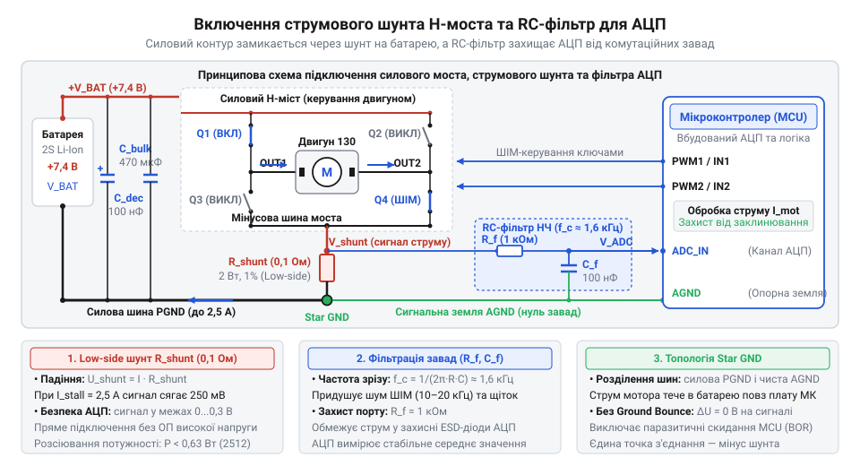
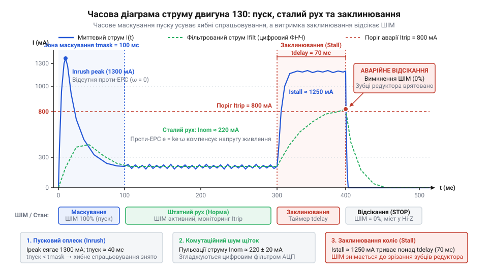

# Колісна платформа на базі привода TT з апаратним струмовим захистом від заклинювання

<preknowlist>
- [Мотор-редуктор 6 В (100 і 600 об/хв)](root:cat-hw-actuators/gearmotor-6v) — принцип роботи колекторного двигуна постійного струму з понижувальним редуктором, поняття проти-ЕРС, струму холостого ходу та залежність споживання струму від механічного навантаження на валу.
</preknowlist>

## Небезпека блокування коліс мобільної платформи

Двоколісна платформа на приводах TT впевнено рухається кімнатою, доки одне з коліс не впирається в перешкоду. Платформа раптово завмирає, але керуючий мікроконтролер продовжує подавати максимальний сигнал тяги. За лічені секунди редуктор видає тріск від зрізання зубців, обмотки ротора розігріваються до руйнування ізоляції, а комутаційні транзистори драйвера зазнають теплового пробою.

Причиною є електродинаміка, за якою працює [мотор-редуктор з колекторним двигуном](root:cat-hw-actuators/gearmotor-6v) серії 130. Під час обертання ротора в магнітному полі статора у витках виникає зустрічна електрорушійна сила — @@uk|проти-ЕРС@@ (протиелектрорушійна сила, від грец. @@grc|ἤλεκτρον@@ — бурштин та лат. @@la|motor@@ — рушій; англ. @@en|back-EMF@@). Величина @@uk|проти-ЕРС@@ `e_b` лінійно залежить від кутової швидкості ротора `ω`: вона спрямована проти напруги живлення `U` і обмежує струм.

Струм кола ротора `I` визначається балансом прикладеної напруги `U`, зустрічної @@uk|проти-ЕРС@@ `e_b` та активного опору обмоток `R_m`:

```text
I
= (U - e_b) / R_m                        [закон Ома для кола ротора]
```

У сталому русі швидкість ротора висока, @@uk|проти-ЕРС@@ `e_b` майже врівноважує напругу `U`, а споживання струму двигуном 130 становить лише 0.12–0.18 А.

Коли колесо заклинює, ротор зупиняється: `ω = 0`. Оскільки витки не перетинають магнітне поле статора, генерація @@uk|проти-ЕРС@@ зникає (`e_b = 0`). Струм обмежується виключно омічним опором дроту, і настає стан заклинювання (англ. @@en|stall@@):

```text
I_stall
= U / R_m                                [струм заклинювання при нульовій проти-ЕРС]
```

За напруги живлення `U = 5.0 В` та активного опору обмоток `R_m ≈ 4.0 Ом` струм заклинювання зростає до 1.25 А на кожен двигун, а для двох заблокованих коліс платформи сумарний струм сягає 2.5 А.

Цей стрибок спричиняє потрійне руйнування привода. По-перше, теплова потужність на обмотках за законом Джоуля–Ленца зростає квадратично від струму: виділення 6–8 Вт розігріває мідь понад 130 °C, плавлячи лакову ізоляцію. По-друге, обертовий момент двигуна зростає пропорційно струму, а понижувальний редуктор TT з коефіцієнтом 1:48 багаторазово підсилює це зусилля, зрізаючи тонкі пластикові зубці шестерень. По-третє, ключі драйвера виходять з ладу від перегріву.

Керувати платформою без контролю навантаження небезпечно: система повинна безперервно вимірювати фактичний струм у реальному часі, щоб зняти керування до руйнування механіки та електроніки.

## Схемотехніка струмового шунта та живлення

Для контролю струму платформи в коло вмикають вимірювальний @@de|шунт@@ (від англ. @@en|shunt@@ — відгалужувати, пускати в обхід) — низькоомний резистор. Його ставлять між мінусовим виводом живлення силового [інтегрального H-моста](root:hw-motion/h-bridge-drivers) (від англ. @@en|H-bridge@@ — за конфігурацією чотирьох ключів) та мінусом джерела живлення. Таке низькостороннє включення (англ. @@en|low-side sensing@@) формує напругу `U_shunt = I · R_shunt` відносно землі, яку вимірює вбудований @@uk|АЦП@@ (аналого-цифровий перетворювач, від лат. @@la|analogus@@ — відповідний та @@la|digitus@@ — лічба; англ. @@en|ADC@@) мікроконтролера.

Струм моторів зміщує потенціал силової землі моста `PGND` відносно сигнальної землі контролера на величину `U_shunt`. Щоб зміщення не перевищувало 0.3–0.5 В і не порушувало відкриття ключів @@en|H-моста@@, опір @@de|шунта@@ `R_shunt` обирають у межах 0.1–0.33 Ом під динамічний діапазон опорної напруги @@uk|АЦП@@.

Пікову теплову потужність розсіювання `P_shunt` на шунті `R_shunt = 0.22 Ом` при заклинюванні двох двигунів (`I_max = 2.5 А`) знаходять за законом Джоуля–Ленца:

```text
P_shunt
= I_max² · R_shunt                       [закон Джоуля–Ленца]
= 2.5² · 0.22                            [підстановка струму заклинювання 2.5 А та опору 0.22 Ом]
= 6.25 · 0.22                            [проміжне піднесення до квадрата]
= 1.375 Вт                               [пікова потужність розсіювання]
```

Цей розрахунок вимагає застосування потужного резистора номіналом не менше 2 Вт, інакше вимірювальний елемент швидко вигорить від перегріву.

Іскріння щіток та широтно-імпульсна модуляція (@@uk|ШІМ@@, англ. @@en|PWM@@, від @@en|pulse-width modulation@@) на частотах 1–20 кГц створюють круті імпульсні викиди. Щоб запобігти хибним спрацьовуванням @@uk|АЦП@@, між @@de|шунтом@@ і аналоговим входом ставлять пасивний фільтр низьких частот (@@uk|ФНЧ@@, від лат. @@la|filtrum@@ — повсть; англ. @@en|low-pass filter@@) з резистора `R_f` і конденсатора `C_f`.

Частоту зрізу фільтра `f_c` розраховують за співвідношенням:

```text
f_c
= 1 / (2 · π · R_f · C_f)                [частота зрізу пасивного RC-фільтра]
= 1 / (2 · 3.1416 · 1000 · 1.0 · 10⁻⁶)   [підстановка номіналів R_f = 1 кОм та C_f = 1 мкФ]
≈ 159 Гц                                 [гранична частота пропускання]
```

Частота зрізу 159 Гц лежить значно нижче частоти комутації @@uk|ШІМ@@, тому фільтр згладжує пульсації струму до стабільного середнього значення. При цьому стала часу ланцюга `τ = R_f · C_f = 1 мс` дозволяє мікроконтролеру зафіксувати аварійний стрибок струму практично миттєво.


*Принципова електрична схема включення вимірювального шунта в мінусову лінію H-моста з підключенням до АЦП через пасивний RC-фільтр для придушення комутаційного шуму.*

Платформу живлять від літієвого акумулятора (3.7–7.4 В). Для придушення просідань напруги біля клем живлення @@en|H-моста@@ встановлюють електролітичний конденсатор на 470–1000 мкФ з низьким послідовним опором (англ. @@en|Low-ESR@@, від @@en|Equivalent Series Resistance@@, лат. @@la|resistere@@ — чинити опір). Під час пуску або заклинювання приводів струм двигунів різко підскакує, і напруга батареї імпульсно просідає. Якщо цифрова частина під'єднана до спільної шини напряму, буферний конденсатор контролера негайно розряджається назад у моторне коло. Низький опір обмоток вичерпує накопичений заряд за мікросекунди, напруга живлення логіки падає нижче робочої межі, і мікроконтролер аварійно перезавантажується. Щоб розв'язати силову й цифрову гілки живлення, у плюсове коло мікроконтролера перед його буферним конденсатором послідовно вмикають діод Шотткі (названий на честь німецького фізика Вальтера Шотткі, нім. @@de|Walter Schottky@@; діод — від грец. @@el|δίς@@ — двічі та @@el|ὁδός@@ — шлях; англ. @@en|Schottky diode@@). Коли напруга батареї просідає нижче напруги на конденсаторі логіки, діод зазнає зворотного зміщення і миттєво запирається. Він блокує зворотний витік струму в моторну шину, змушуючи буферний конденсатор живити виключно схему керування. Звичайний кремнієвий діод тут непридатний через великий прямий спад близько 0.7 В: при живленні від однієї літієвої банки на 3.7 В залишкової напруги бракує для стабілізатора логіки на 3.3 В. Контакт метал–напівпровідник у діоді Шотткі зменшує це падіння до 0.2–0.3 В, зберігаючи необхідний запас живлення. Платою за таку розв'язку стає неминуча втрата цих 0.2–0.3 В робочої напруги батареї та підвищений зворотний струм витоку бар'єра під час нагрівання. Крім того, апаратне розділення захищає лише короткочасно: у разі затяжного заклинювання запас заряду буферного конденсатора вичерпується, і процесор усе одно скидається, тому діод лише дає час для спрацьовування програмного захисту. Заземлення розводять за топологією «зірка»: силова земля мотора `PGND` з'єднується з сигнальною землею мікроконтролера строго в одній точці — на нижньому контакті @@de|шунта@@ біля мінуса батареї.

## Оцифрування напруги шунта та фільтрація

Напруга на вимірювальному @@de|шунті@@ становить лічені десятки чи сотні мілівольт: при типовому опорі `R_shunt = 0.22 Ом` струм холостого ходу двох моторів 0.3 А формує спад лише 66 мВ, а критичний струм заклинювання 2.5 А досягає 550 мВ. Вбудований @@uk|АЦП@@ мікроконтролера перетворює цю напругу на цифровий код, проте пряме зчитування спотворюється апаратними вадами. Падіння потенціалу на монтажних доріжках плати, контактний опір роз'ємів і внутрішня асиметрія вхідного каскаду @@uk|АЦП@@ викликають статичну похибку — зміщення нуля (англ. @@en|zero-offset@@, від @@en|offset@@ — зсув). Без його усунення мікроконтролер хибно оцінюватиме струм навіть у стані спокою. Для компенсації контролер під час ініціалізації вимірює напругу спокою на знеструмленому @@en|H-мості@@ та фіксує калібрувальне значення `D_offset`.

Корисний код `D` знаходять відніманням калібрувального зміщення від поточного виміру `D_raw`: `D = D_raw - D_offset`. Значення струму `I` обчислюють за опорною напругою перетворювача `U_ref`, його розрядністю `N` біт та опором @@de|шунта@@ `R_shunt`:

```text
I
= (D · U_ref) / (2ᴺ · R_shunt)              [перетворення коду АЦП у струм]
```

Щоб контролер не виконував ресурсомістке ділення з рухомою комою у кожному циклі опитування, сталі параметри схеми заздалегідь згортають у масштабний коефіцієнт `k_I`:

```text
k_I
= U_ref / (2ᴺ · R_shunt)                    [ціна одного кванта АЦП у струмі]
= 3.3 / (1024 · 0.22)                       [підстановка U_ref = 3.3 В, N = 10 біт, R_shunt = 0.22 Ом]
= 3.3 / 225.28                              [множення у знаменнику]
≈ 0.01465 А/код                             [масштаб перерахунку]
```

Множення різниці відліків `D` на `k_I` визначає миттєвий струм `I = D · k_I` з роздільною здатністю близько 14.6 мА на квант.

Аналоговий RC-фільтр зрізає високочастотну носійну частоту @@uk|ШІМ@@, але не усуває перешкод від механічного іскріння. На відміну від систем, де [безколекторний моторний модуль](root:cat-hw-actuators/bldc-motor-module) перемикає фази напівпровідниковими ключами, дешевий щітковий вузол двигуна 130 постійно генерує мікророзриви кола під час тертя пелюсток об ламелі колектора. Це породжує хаотичні сплески амплітудою в кілька десятків міліампер, здатні спричинити хибну тривогу. Програмне згладжування реалізує [алгоритм ковзного середнього](root:com-signal/moving-average) (англ. @@en|moving average@@, від лат. @@la|movere@@ — рухати), обчислюючи середнє значення за вікном із `M` останніх вимірів:

```text
I_filt[n]
= I_filt[n-1] + (I[n] - I[n-M]) / M         [рекурсивне ковзне середнє у кільцевому буфері]
```

Розмір вікна `M = 8` при частоті вибірки 1 кГц ефективно фільтрує щітковий шум і додає затримку відгуку лише 4 мс, що не перешкоджає своєчасному захисту редуктора.

## Алгоритм розрізнення пуску й заклинювання

Просте порівняння струму з фіксованим порогом `I > I_limit` блокує роботу платформи: робот не здатний рушити з місця. У момент увімкнення моторів ротор нерухомий, @@uk|проти-ЕРС@@ дорівнює нулю, а струм стрибає до величини заклинювання — виникає пусковий струм (англ. @@en|inrush current@@, від @@en|inrush@@ — навальний приплив). Хоча пусковий сплеск і аварійне заклинювання однакові за амплітудою (до 1.5 А на двигун), вони мають принципово різну часову динаміку. Під час старту ротор швидко розганяється, з'являється проти-ЕРС, і споживання за 40–80 мс спадає до робочих 0.25–0.35 А. У разі заклинювання коліс ротор заблокований, проти-ЕРС не виникає, і надструм утримується безперервно.


*Часова діаграма споживання струму: пусковий сплеск ігнорується у вікні часового маскування, а тривале перевищення порогу заклинювання призводить до вимкнення ШІМ.*

Надійний захист реалізує двоетапну часову фільтрацію, поєднуючи маскування пуску з накопичувальним таймером аварії.

Під час подачі напруги контролер відкриває вікно маскування пуску (англ. @@en|blanking time@@, від давньофр. @@fro|blanc@@ — білий, чистий) тривалістю `t_blank = 80–100 мс`. Упродовж цього інтервалу перевірка струмового порогу примусово ігнорується, що дає мотору змогу подолати інерцію спокою коліс без скидання тяги. Проте фіксована тривалість такого вікна надійна лише за стабільної напруги живлення. У міру розряду акумулятора напруга на його клемах просідає. Зниження напруги зменшує пусковий крутний момент, тому ротор повільніше розганяє шестерні редуктора й колеса. Через затяжний розгін @@uk|проти-ЕРС@@ наростає із запізненням, і спадання пускового струму затягується до 130–150 мс. Якщо час `t_blank` залишається незмінним, маскування завершується до спадання струму, і система помилково сприймає пуск за блокування вала. Завищувати ж постійне вікно із запасом небезпечно: за повного заряду батареї справжнє заклинювання на старті надто довго утримуватиме надструм, перегріваючи якірні обмотки та перевантажуючи шестерні. Тому тривалість маскування коригують динамічно: контролер вимірює напругу живлення перед стартом і розраховує `t_blank`, подовжуючи вікно для розрядженого акумулятора та скорочуючи його на свіжому заряді.

Після завершення вікна маскування система переходить у режим безперервного моніторингу. Якщо відфільтрований струм `I_filt` перевищує аварійний поріг `I_trip` (наприклад, 1.0 А для двох двигунів під навантаженням), запускається таймер аварійного спрацьовування (англ. @@en|trip delay@@, від @@en|trip@@ — розмикання). Якщо перевантаження утримується безперервно понад `t_trip = 120–150 мс`, контролер класифікує подію як @@en|stall@@ і скидає шпаруватість @@uk|ШІМ@@ до нуля (`PWM = 0`).

Таке поєднання параметрів відсікає механічні удари тривалістю понад 200 мс, гарантуючи, що пластикові шестерні редуктора не зазнають граничного крутного моменту, а якірні обмотки не встигнуть прогрітися до температури деградації лаку. Для відновлення руху керуюча програма вичікує паузу охолодження та виконує плавний повторний запуск або сигналізує системі вищого рівня про необхідність маневру об'їзду.

## Складання платформи та налаштування захисту

Налагоджені на столі плата й алгоритм поводяться бездоганно без механічного навантаження, але на рухомому шасі умови різко змінюються. Вага батареї, тертя коліс об підлогу та маневри розвороту підвищують робоче споживання двох моторів TT із холостих 0.3 А до 0.6–0.7 А. Якщо захисний поріг встановити без урахування цих натурних факторів, робот або хибно зупинятиметься на килимі, або зламає редуктор під час першої ж реальної аварії.

Пастка спільного низькостороннього @@de|шунта@@ полягає в тому, що він вимірює сумарний струм обох моторів. Під час наїзду на перешкоду під кутом зупиняється лише одне колесо, тоді як друге продовжує обертатися під навантаженням. Струм заблокованого мотора підскакує до стану @@en|stall@@ (`I_stall ≈ 1.25 А`), а вільний привід споживає близько 0.35 А. Їхній спільний струм сягає лише 1.6 А. Якщо поріг аварійного вимкнення розрахувати на синхронне заклинювання обох коліс (понад 2.0 А), захист не зреагує, і заблокований редуктор швидко зріже пластикові шестерні.

Щоб надійно зафіксувати аварію за будь-якого кута наїзду, поріг спрацьовування (англ. @@en|trip threshold@@, від @@en|threshold@@ — межа) `I_trip` обирають посередині між максимальним струмом розвороту `I_turn` та сумарним струмом блокування одного колеса `I_single_stall`:

```text
I_trip
= (I_turn + I_single_stall) / 2              [середина захисного інтервалу]
= (0.7 + 1.6) / 2                            [підстановка струму розвороту 0.7 А та блокування 1.6 А]
= 1.15 А                                     [калібрований поріг спрацьовування]
```

Величина 1.15 А створює запас понад 0.4 А від хибних спрацьовувань під час поворотів на шорсткому покритті й гарантує відсікання тяги в разі блокування навіть одного привода.

Під час ходових випробувань платформу спрямовують у жорстку перешкоду. На старті вікно @@en|blanking time@@ успішно маскує пусковий сплеск, даючи платформі рушити з місця. У момент упору в стіну відфільтрований струм перевищує 1.15 А, накопичувальний таймер @@en|trip delay@@ відраховує 120 мс, і мікроконтролер скидає шпаруватість @@uk|ШІМ@@ до нуля (`PWM = 0`). Привід знеструмлюється до того, як пластикові зубці шестерень зазнають руйнування або перегріються обмотки ротора. Після спрацьовування керуюча програма витримує коротку паузу на охолодження та вмикає реверс для відкату від перешкоди.
