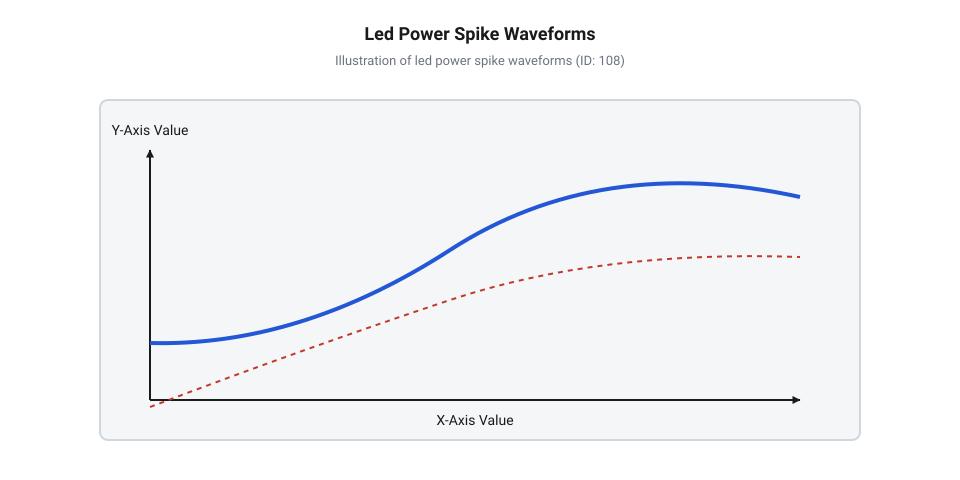
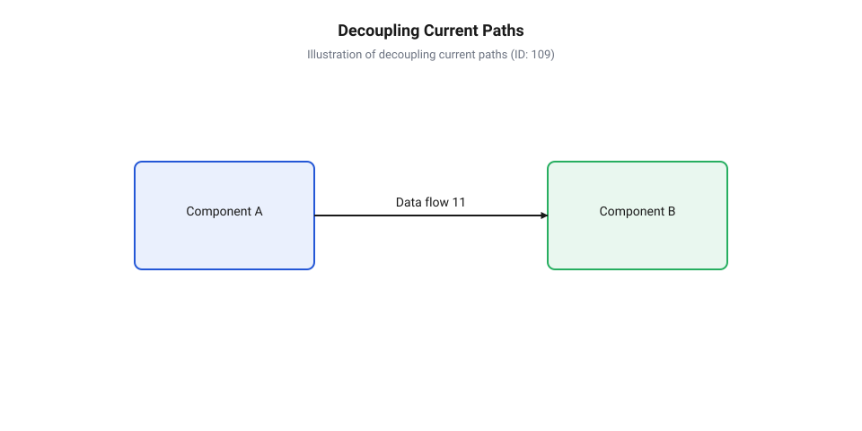
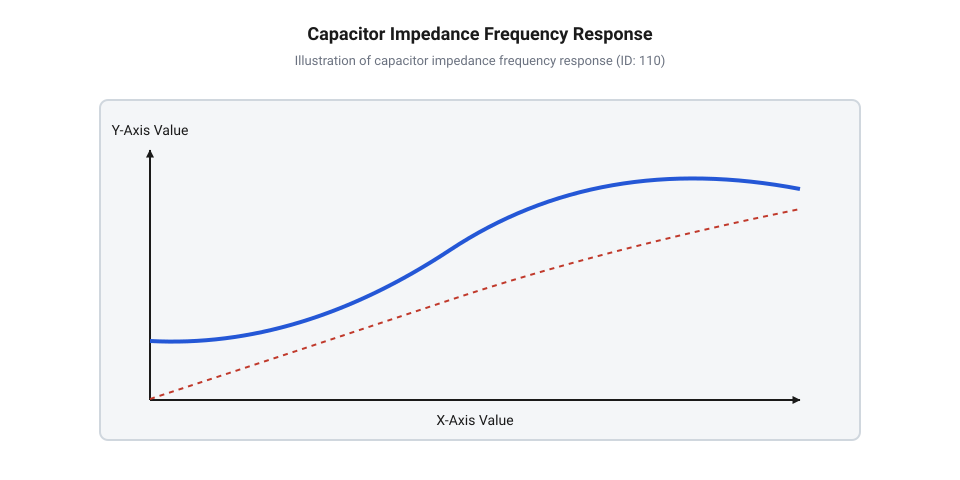
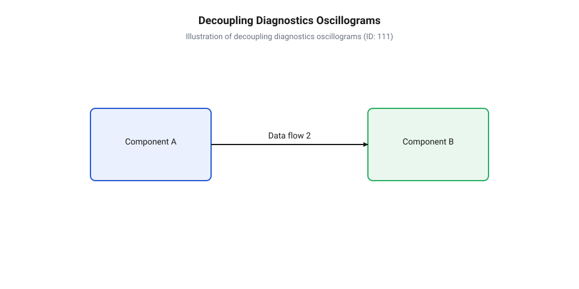
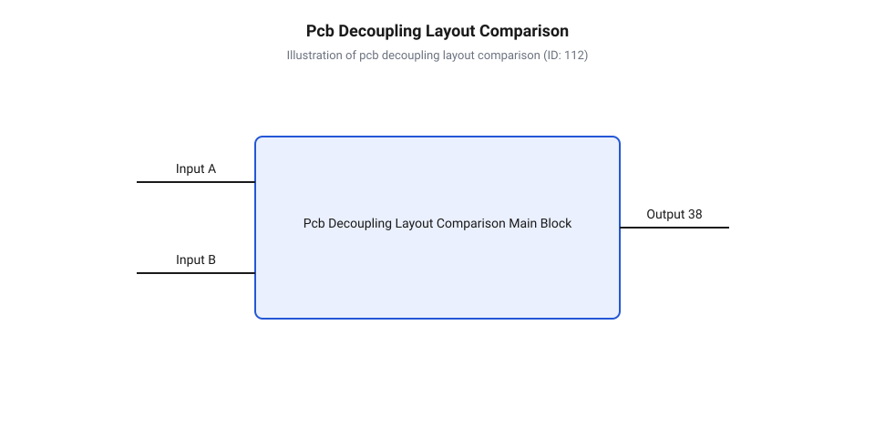

# Блокувальні конденсатори в лініях живлення LED

<preknowlist>
- [WS2812B — адресний RGB-світлодіод (5050)](root:cat-hw-actuators/ws2812b-led) — Принцип внутрішнього ШІМ-керування трьома каналами та висока чутливість вбудованого контролера до просідань напруги VCC.
- [KY-009 — RGB SMD-модуль](root:cat-hw-actuators/ky-009-rgb-smd) — Організація спільних шин живлення для триканальних світлодіодів та ефекти взаємного наведення завад при перемиканні.
- [Інжекція живлення світлодіодних стрічок](root:cat-hw-actuators/ws2812b-power-injection) — Природа паразитного індуктивного та омічного опору довгих шин живлення у світлодіодних системах.
</preknowlist>

## Природа динамічних завад у LED-колах

Робота світлодіода в реальних електронних схемах часто помилково сприймається як просте стаціонарне навантаження з постійним струмом споживання. Однак у реальних пристроях ця картина докорінно змінюється, оскільки світлодіоди працюють у динамічних високочастотних режимах. Для гнучкого регулювання яскравості, змішування кольорів RGB та зменшення теплових втрат на силових ключах використовують швидке перемикання напівпровідникового переходу за допомогою @@en|pulse-width modulation@@ (широтно-імпульсна модуляція, ШІМ; від лат. *modulatio* — розміреність; @@en|PWM@@). Крім того, сучасна адресована світлодіодна техніка, наприклад [адресний світлодіод WS2812B](root:cat-hw-actuators/ws2812b-led), містить всередині кожного мікрокорпусу вбудований цифровий контролер та триканальний ШІМ-генератор з власною тактовою частотою.

Під час кожного відкривання й закривання силового транзистора струм споживання світлодіодного вузла стрибкоподібно змінюється від нульового чи мінімального рівня до повного робочого значення. Для поодинокого кристала цей струм становить десятки міліампер, а для потужних світлодіодних модулів, матриць або стрічок — одиниці чи десятки ампер. Оскільки сучасні MOSFET-транзистори та інтегральні ключі мають час перемикання в кілька наносекунд, зміна струму відбувається з колосальною швидкістю. Відношення зміни величини струму до проміжку часу перемикання визначає швидкість наростання струму — @@en|slew rate@@ (від англ. *slew* — повертати, та *rate* — швидкість), яка в математичній формі позначається як часова похідна струму `dI/dt`.

Головна фізична причина виникнення завад полягає в тому, що з'єднувальні провідники друкованої плати, монтажні шлейфи та дроти живлення не є ідеальними провідниками з нульовим опором. Будь-який реальний провідник має власний омічний опір `R_line` та [паразитну індуктивність провідників](root:hw-pcb/parasitic-inductance-pcb) `L_line` (індуктивність; від лат. *inductio* — наведення; @@en|parasitic inductance@@). Фізична природа паразитної індуктивності зумовлена виникненням вихрового магнітного поля навколо провідника, в якому протікає струм. Навіть прямий провідник друкованої плати завдовжки 10 см і завширшки 0.5 мм володіє індуктивністю порядку 100 nH, а гнучкі дрітові шлейфи та кабелі живлення мають паразитну індуктивність від сотень наногенрі до кількох мікрогенрі.

Згідно із законом електромагнітної індукції Фарадея, будь-яка часова зміна електричного струму, що протікає через індуктивність провідника, викликає в ньому напругу самоіндукції `u_L(t)`. Ця напруга спрямована протилежно до напрямку зміни струму і чинить опір миттєвому зростанню чи спаданню струму від джерела живлення:

u_L(t)
= L_line · (dI / dt)      [закон електромагнітної індукції Фарадея]

де `u_L(t)` — спад напруги на паразитичній індуктивності у вольтах, `L_line` — паразитна індуктивність лінії живлення в генрі, `dI/dt` — швидкість зміни струму в амперах за секунду.

Паралельно з індуктивною ЕРС самоіндукції на провіднику виникає омічний спад напруги `ΔV_R`, пропорційний статичному опору провідника `R_line` та величині струму `I`. Сумарне імпульсне просідання напруги `ΔV_total` на виводах живлення світлодіодного модуля під час стрімкого фронту перемикання визначається додаванням обох складових:

ΔV_total
= ΔV_R + u_L(t)           [сума омічного та індуктивного спадів напруги]
= I · R_line + L_line · (dI / dt) [підстановка виразів для опору та індуктивності]

де `ΔV_total` — сумарне амплітудне просідання напруги живлення у вольтах, `I` — амплітуда струму світлодіода в амперах, `R_line` — омічний опір провідників у омах.

Оскільки швидкість наростання струму `dI/dt` під час ШІМ-перемикання досягає мільйонів ампер за секунду, значення індуктивної складової `u_L(t)` у момент фронту в сотні разів перевищує статичний омічний спад `ΔV_R`. Ситуація додатково ускладнюється у багаторазових світлодіодних модулях, де кілька каналів перемикаються одночасно. У цьому разі швидкості наростання струму окремих каналів додаються за принципом суперпозиції `dI_total/dt = ∑ (dI_k/dt)`, створюючи гігантські струмові кидки.

**Розрахунок амплітуди індуктивного просідання напруги під час перемикання SMD-модуля:**
Розглянемо практичний приклад, у якому триканальний світлодіодний модуль [KY-009](root:cat-hw-actuators/ky-009-rgb-smd) вмикає три канали загальним струмом `I = 60 mA` (`0.06 A`) за час перемикання `dt = 10 ns` (`10⁻⁸ s`). Модуль підключений через шлейф живлення завдовжки 15 см із паразитною індуктивністю `L_line = 150 nH` (`1.5 × 10⁻⁷ H`) та омічним опором `R_line = 0.1 Ω`.

dI / dt
= 0.06 A ÷ 10⁻⁸ s
= 6 000 000 A/s          [обчислення швидкості наростання струму]

u_L
= 1.5 × 10⁻⁷ H × 6 000 000 A/s
= 0.9 V                  [амплітуда індуктивної проти-ЕРС]

ΔV_total
= 0.06 A × 0.1 Ω + 0.9 V
= 0.006 V + 0.9 V
= 0.906 V                [сумарне імпульсне просідання напруги]

Висновок: миттєве індуктивне просідання напруги становить 0.906 В. Для шини живлення з номіналом 5 В це означає падіння робочої напруги до 4.094 В тривалістю в десятки наносекунд.


*Підпис: Осцилограма перехідного процесу в лінії живлення світлодіода без декуплювання: миттєве зростання струму dI/dt призводить до глибокого просідання напруги VCC через паразитну індуктивність провідників.*

Глибокі імпульсні просідання напруги на шині `V_CC` створюють безпосередню загрозу для стабільності всієї електронної системи. Якщо від тієї ж шини живлення отримує енергію керуючий мікроконтролер або внутрішній цифровий автомат адресованого світлодіода, короткочасний спад напруги нижче порогу логічної одиниці викликає збої у регістрах пам'яті. У момент просідання напруги вбудована схема спостереження мікроконтролера фіксує небезпечний рівень живлення, що активує [захист мікроконтролерів від просідань живлення](root:hw-arch/microcontroller-brownout-reset) та спричиняє раптове хибне скидання пристрою — @@en|brownout reset@@ (від англ. *brownout* — часткове знеструмлення, та *reset* — скидання; @@en|BOR@@).

Крім просідання напруги під час увімкнення, в момент вимкнення світлодіода відбувається зворотне явище: енергія магнітного поля `E_L = 0.5 · L_line · I²`, накопичена в паразитичній індуктивності лінії, вивільняється у вигляді позитивного індуктивного сплеску напруги (перенапруги). Ці високочастотні імпульсні викиди поширюються шинами живлення і випромінюються провідниками як антенами, створюючи потужні електромагнітні завади. Фізика таких перехідних процесів та методи боротьби з ними висвітлені у матеріалі про [перехідні процеси та пригнічення електромагнітних завад](root:hw-pcb/pwm-current-spikes-and-emi-suppression) (від англ. *electromagnetic interference*; @@en|EMI@@). Як показує [еволюцію методів розв'язування](root:cat-hw-actuators/decoupling-capacitors-led/hist-led-power-decoupling.md) ліній живлення, ускладнення світлодіодних систем та зростання частот ШІМ перетворило проблему індуктивних сплесків з другорядного фактора на критичний бар'єр надійності пристроїв.

## Принцип локальної буферизації та декуплювання

Оскільки первинне джерело живлення знаходиться на фізичній відстані від світлодіодного навантаження, а з'єднувальні провідники мають неминучу паразитну індуктивність, джерело фізично не здатне миттєво поставити необхідний заряд під час швидкого перемикання ключа. Єдиним технічним розв'язанням цієї проблеми є створення локального буфера енергії безпосередньо біля споживача — поруч із виводами живлення світлодіода або його драйверної мікросхеми.

Роль такого локального резервуара виконує @@en|decoupling capacitor@@ (блокувальний або розв'язувальний конденсатор; від лат. *condensare* — згущувати, ущільнювати, та англ. *decoupling* — розв'язування, від лат. *copula* — зв'язок). Накопичуючи електричну енергію в своєму електричному полі `E_C = 0.5 · C · V²` під час стаціонарного стану, блокувальний конденсатор миттєво віддає накопичений заряд `dq = C · dV` у навантаження протягом перших наносекунд перехідного процесу. Завдяки цьому він виступає в ролі локального джерела живлення з вкрай низьким внутрішнім імпедансом.

З точки зору теоретичної електротехніки та спектрального аналізу, струм споживання світлодіода під час ШІМ-регулювання розкладається на дві принципово різні складові:
1. Постійна складова `I_DC` — середнє значення струму навантаження, яке визначається коефіцієнтом заповнення ШІМ і відповідає за постійне оптичне випромінювання світлодіода. 2. Змінна складова `i_AC(t)` — високочастотні імпульсні сплески струму з крутими фронтами, які відповідають моментам відмикання та замикання напівпровідникового ключа.

Головне призначення блокувального конденсатора полягає у фізичному розділенні шляхів протікання цих двох складових струму. Конденсатор створює для високочастотного струму `i_AC(t)` замкнений локальний контур із мінімальною довжиною провідників та мізерною індуктивністю. У результаті весь високочастотний струм перемикання циркулює виключно у короткій петлі між виводами світлодіода та конденсатором. Зовнішня лінія живлення, що йде від первинного джерела, розвантажується від високочастотних кидків і проводить лише плавну постійну складову `I_DC`.


*Підпис: Схема розподілу струмів у лінії живлення LED: накопичувальний або блокувальний конденсатор локально живить високочастотні імпульси i_AC(t), обмежуючи струм від первинного джерела до постійної складової I_DC.*

Крім стабілізації напруги, мінімізація площі локального контуру високочастотного струму має вирішальне значення для електромагнітної сумісності. Згідно з теорією випромінювання, інтенсивність електромагнітних завад пропорційна амплітуді струму, квадрату частоти та площі контуру, охопленого змінним струмом. Розміщення блокувального конденсатора безпосередньо біля виводів VCC і GND світлодіода зменшує площу контуру струму `i_AC(t)` практично до нуля, пригнічуючи паразитна випромінювання завад.

Сукупність джерела живлення, з'єднувальних провідників та декуплювальних конденсаторів утворює мережу розповсюдження живлення — @@en|power distribution network@@ (від англ. *power distribution network*; @@en|PDN@@). Фундаментальною метою [проєктування мереж розповсюдження живлення](root:hw-power/power-bus-impedance-and-pdn-design) є забезпечення мінімального комплексного імпедансу шини живлення `Z_PDN(f)` (від лат. *impedio* — перешкоджаю; @@en|impedance@@) у всьому робочому діапазоні частот.

На високих частотах перемикання реактивний індуктивний опір довгого провідника `Z_line(f)` зростає прямо пропорційно частоті гармонік сигналів `f`:

Z_line(f)
= 2 × π × f × L_line     [реактивний індуктивний опір провідника]

де `Z_line(f)` — індуктивний імпеданс лінії живлення в омах, `f` — частота гармонійної складової в герцах, `L_line` — індуктивність провідників у генрі.

Натомість реактивний ємнісний опір блокувального конденсатора `Z_C(f)` є обернено пропорційним до частоти:

Z_C(f)
= 1 / (2 × π × f × C)    [реактивний ємнісний опір конденсатора]

де `Z_C(f)` — ємнісний імпеданс у омах, `C` — ємність блокувального конденсатора в фарадах.

При паралельному підключенні блокувального конденсатора паралельно навантаженню еквівалентний імпеданс мережі живлення `Z_PDN(f)` на високих частотах суттєво зменшується, оскільки струм обирає гілку з найменшим опором:

Z_PDN(f)
= (Z_line(f) × Z_C(f)) ÷ √(Z_line(f)² + Z_C(f)²) [паралельне з'єднання імпедансів]

де `Z_PDN(f)` — результуючий комплексний імпеданс шини живлення для навантаження.

**Розрахунок зниження імпедансу шини живлення за допомогою блокувального конденсатора:**
Обчислимо еквівалентний імпеданс шини живлення на частоті високої гармоніки ШІМ-сигналу `f = 10 MHz` (`10⁷ Hz`) для лінії з індуктивністю `L_line = 100 nH` (`10⁻⁷ H`) без блокувального конденсатора та після підключення керамічного конденсатора ємністю `C = 100 nF` (`10⁻⁷ F`).

Z_line(10 MHz)
= 2 × π × 10⁷ Hz × 10⁻⁷ H
= 6.283 Ω                [реактивний індуктивний опір лінії без декуплювання]

Z_C(10 MHz)
= 1 ÷ (2 × π × 10⁷ Hz × 10⁻⁷ F)
= 0.159 Ω                [реактивний ємнісний опір блокувального конденсатора]

Z_PDN(10 MHz)
= (6.283 Ω × 0.159 Ω) ÷ √((6.283 Ω)² + (0.159 Ω)²)
= 0.999 ÷ 6.285
= 0.159 Ω                [результуючий імпеданс шини живлення]

Висновок: встановлення керамічного блокувального конденсатора ємністю 100 нФ безпосередньо біля навантаження зменшує імпеданс шини живлення на частоті 10 МГц у 39.5 раза (з 6.283 Ом до 0.159 Ом). Це гарантує пригнічення високочастотних завад і стабілізацію напруги на виводах живлення.

Точний розрахунок величини блокувальної ємності для забезпечення заданого рівня пульсацій напруги викладено в матеріалі про [розрахунок необхідної ємності](root:cat-hw-actuators/decoupling-capacitors-led/math-decoupling-capacitance-calculation.md) блокувальних конденсаторів. Окрім ідеальної ємності, реальні конденсатори володіють паразитичним опором та індуктивністю (ESR та ESL), вплив яких на резонансні графіки імпедансу детально розглянуто в публікації про можливість [обчислювати частотну залежність](root:cat-hw-actuators/decoupling-capacitors-led/math-impedance-esr-esl-resonance.md) імпедансу та точок власного резонансу. У масштабних світлодіодних системах локальні керамічні ємності поєднуються з електролітичними накопичувачами та такими топологічними рішеннями, як [інжекція живлення](root:cat-hw-actuators/ws2812b-power-injection), що дозволяє підтримувати низький імпеданс шини живлення по всій довжині мережі.

## Паразитичні параметри та частотний імпеданс

У класичній теорії електричних кіл конденсатор розглядається як ідеальний елемент із чистою ємністю `C`, опір якого безперервно зменшується зі зростанням частоти. Проте реальні фізичні компоненти обмежені конструкцією обкладок, геометричними розмірами виводів та властивостями діелектричного матеріалу. Під час швидкого перемикання світлодіодного навантаження високочастотні струми виявляють реальну структуру конденсатора, яка суттєво відрізняється від ідеальної моделі.

Реальний `@@en|блокувальний конденсатор@@` (англ. @@en|decoupling capacitor@@, від лат. @@en|copula@@ — зв'язок) у схемах живлення описується послідовною еквівалентною схемою заміщення, що складається з трьох ключових компонентів:
1. Ідеальної ємності `C`. 2. `@@en|еквівалентного послідовного опору@@` (англ. @@en|equivalent series resistance@@, від лат. @@en|aequus@@ — рівний та @@en|series@@ — ряд) — `@@en|ESR@@`, який визначає сумарні омічні втрати у виводах, обкладках та діелектрику. 3. `@@en|еквівалентної послідовної індуктивності@@` (англ. @@en|equivalent series inductance@@, від лат. @@en|inductio@@ — наведення) — `@@en|ESL@@`, яка виникає через індуктивність внутрішнього струмового контуру корпусу та контактних площадок.

Розуміння цієї паразитної триади розвивалося в міру підвищення швидкодії напівпровідникових приладів, про що можна прочитати в огляді про [еволюцію методів блокування](root:cat-hw-actuators/decoupling-capacitors-led/hist-led-power-decoupling.md).

Вхідний комплексний `@@en|імпеданс@@` (англ. @@en|impedance@@, від лат. @@en|impedire@@ — перешкоджати) `Z(f)` реального конденсатора на заданій частоті `f` обчислюється як геометрична сума активного опору `@@en|ESR@@` та реактивних опорів ємності й індуктивності.

```
Z(f) = √( ESR² + (X_L - X_C)² )
= √( ESR² + (2·π·f·ESL - 1 / (2·π·f·C))² )    [підстановка реактивних опорів]
```

При низьких частотах значення реактивного опору ємності `1 / (2·π·f·C)` значно перевищує індуктивний опір `2·π·f·ESL`. У цьому діапазоні імпеданс монотонно зменшується зі зростанням частоти, і компонент поводиться як ідеальна ємність. Зі збільшенням частоти реактивний опір індуктивності `@@en|ESL@@` зростає, тоді як опір ємності спадає. На певній частоті обидва реактивні опори стають рівними за модулем і повністю компенсують один одного.

Частота, на якій відбувається ця компенсація, називається `@@en|частотою власного резонансу@@` (англ. @@en|self-resonant frequency@@, від лат. @@en|resonare@@ — відгукуватися) — `@@en|SRF@@` або `f₀`. Вона обчислюється шляхом прирівнювання реактивних опорів ємності та індуктивності.

```
2·π·f₀·ESL = 1 / (2·π·f₀·C)
⇒ (2·π·f₀)² = 1 / (C·ESL)                     [множення обох частин на f₀ та ділення на ESL]
⇒ f₀ = 1 / (2·π·√(C·ESL))                      [добування квадратного кореня]
```

На частоті власного резонансу `f₀` реактивна складова імпедансу дорівнює нулю, а мінімальний опір конденсатора визначається виключно значенням `@@en|ESR@@`. На частотах, вищих за `f₀`, індуктивний опір `2·π·f·ESL` починає домінувати. Конденсатор втрачає ємнісні властивості та поводиться як індуктивність, опір якої зростає пропорційно частоті.


*Підпис: Залежність комплексного імпедансу від частоти для різних типів діелектриків із виділенням точок власного резонансу.*

Частотна характеристика імпедансу суттєво залежить від типу діелектрика (від грец. @@en|dia-@@ — через та @@en|elektron@@ — бурштин) та конструкції компонента:

- `@@en|керамічні конденсатори@@` (від грец. @@en|keramos@@ — глина) класу `@@en|C0G@@`/`@@en|NP0@@` володіють виключно низьким `@@en|ESR@@` та високою стабільністю, але їхня ємність обмежена діапазоном від пікофарад до кількох нанофарад. Вони мають резонансну частоту `f₀` у сотні мегагерц і пригнічують ультрависокочастотні завади. - `@@en|керамічні конденсатори@@` класу `@@en|X7R@@` та `@@en|X5R@@` на основі титанату барію забезпечують високу питому ємність (до десятків мікрофарад) у компактних `@@en|SMD@@`-корпусах (англ. @@en|surface-mount device@@). Вони мають низький `@@en|ESR@@` (одиниці міліом) та `@@en|ESL@@` (0.5–1 нГн для корпусів 0603 та 0805). Проте вони проявляють `@@en|залежність ємності від напруги@@` (англ. @@en|DC bias effect@@), втрачаючи до 30–60% номінальної ємності при робочій напрузі, близькій до граничної. - `@@en|танталові конденсатори@@` (від імені міфічного Тантала) та `@@en|полімерні конденсатори@@` надають високу ємність (десятки та сотні мікрофарад) і стабільний `@@en|ESR@@`, який не залежить від прикладеної постійної напруги. Проте їхня індуктивність `@@en|ESL@@` вища, ніж у кераміки. - `@@en|алюмінієві електролітичні конденсатори@@` (від грец. @@en|lytos@@ — розчинний) забезпечують найбільші об'єми накопичувальної ємності (сотні та тисячі мікрофарад), але мають значний `@@en|ESR@@` (від десятків міліом до кількох ом) та індуктивність `@@en|ESL@@` (5–20 нГн). Через це їхня частота `f₀` лежить у низькочастотному діапазоні (одиниці–десятки кілогерц).

Для створення низького імпедансу у широкій смузі частот (англ. @@en|bandwidth@@) в `@@en|мережі розповсюдження живлення@@` (англ. @@en|power distribution network@@, @@en|PDN@@) застосовують паралельне з'єднання конденсаторів різних типів. Наприклад, паралельне включення `@@en|накопичувального конденсатора@@` (англ. @@en|bulk capacitor@@, від нідерл. @@en|bulke@@ — об'єм) ємністю 100 мкФ та керамічного шунта ємністю 100 нФ дозволяє перекрити як низькочастотні пульсації струму, так і високочастотні голки.

Проте при паралельному з'єднанні виникає `@@en|антирезонанс@@` (англ. @@en|anti-resonance@@, від грец. @@en|anti-@@ — проти): індуктивність `@@en|ESL@@` великого конденсатора та ємність `C` малого керамічного конденсатора утворюють паралельний `@@en|LC-контур@@`. На частоті антирезонансу імпеданс шини живлення різко зростає, створюючи високий пік опору.

Контрольований опір `@@en|ESR@@` накопичувального конденсатора виконує роль демпфера (від нім. @@en|dämpfen@@ — глушити). Він знижує `@@en|добротність@@` (англ. @@en|Q-factor@@, @@en|quality factor@@) паралельного контуру, згладжуючи антирезонансний пік та запобігаючи виникненню дзвінків напруги. Математичний апарат аналізу імпедансу викладено у матеріалі про [обчислення комплексного імпедансу](root:cat-hw-actuators/decoupling-capacitors-led/math-impedance-esr-esl-resonance.md).

Паразитні параметри конденсатора працюють у зв'язці з топологією плати, оскільки [паразитну індуктивність провідників](root:hw-pcb/parasitic-inductance-pcb) додають до власного `@@en|ESL@@`, погіршуючи загальний [імпеданс шини живлення](root:hw-power/power-bus-impedance-and-pdn-design).

## Розрахунок та вибір блокувальних ємностей

Розрахунок ємностей для захисту ліній живлення світлодіодів базується на розділенні функцій блокування на два рівні: високочастотне шунтування наносекундних перехідних процесів та накопичувальна компенсація тривалих імпульсів струму.

Високочастотний керамічний шунт забезпечує струм у моменти перемикання світлодіодних ключів, коли швидкість наростання струму `dI/dt` створює високовольтні індуктивні спади. Ємність керамічного шунта `C_ceramic` обчислюється з відношення імпульсного заряду, що споживається навантаженням за час наростання фронту `Δt`, до максимально припустимого просідання напруги `ΔV_max`.

```
C_ceramic = I_peak · Δt / ΔV_max
= 0.6 A · 20·10⁻⁹ s / 0.05 V      [підстановка параметрів імпульсу навантаження]
= 0.24·10⁻⁶ F                      [обчислення ємності в фарадах]
= 240 nF                           [переведення в нанофаради]
```

Отримане значення `240 nF` є теоретичним мінімумом. Оскільки кераміка `@@en|X7R@@` під дією постійної робочої напруги `5 V` втрачає частину ємності через `@@en|DC bias effect@@`, розраховану величину множать на коефіцієнт запасу 1.5–2.0. У результаті вибирають стандартний номінал `470 nF` або `1 мкФ` у корпусі 0603 чи 0805 із мінімальним `@@en|ESL@@`.

Накопичувальний конденсатор `C_bulk` призначений для компенсації просідання напруги під час відносно тривалих імпульсів споживання, таких як одночасне вмикання всіх каналів світлодіодної матриці. Через індуктивність підвідних ліній основне джерело живлення не здатне миттєво наростити струм, тому вся енергія протягом часу `t_pulse` має віддаватися з локального накопичувача.

Необхідна накопичувальна ємність `C_bulk` розраховується на основі сумарного струму навантаження `I_total`, тривалості інтервалу реакції джерела `t_pulse` та припустимого спаду живлення `ΔV`.

```
C_bulk = I_total · t_pulse / ΔV
= 1.5 A · 100·10⁻⁶ s / 0.15 V      [підстановка сумарного струму та часу реакції джерела]
= 0.001 F                          [обчислення ємності]
= 1000 µF                          [переведення у мікрофаради]
```

Окрім величини ємності `C_bulk`, критичним параметром є граничний опір `@@en|ESR_max@@`. Якщо `@@en|ESR@@` накопичувача занадто великий, скачок струму `I_step` створить омічний спад напруги `ΔV_spike = I_step · ESR`, який здебільшого знецінить наявність ємності.

Максимально допустимий опір `ESR_max` накопичувального конденсатора обчислюється як відношення допустимого імпульсного спаду напруги `ΔV_spike` до амплітуди скачка струму `I_step`.

```
ESR_max = ΔV_spike / I_step
= 0.1 V / 1.5 A                   [підстановка граничного спаду та крок струму]
= 0.0667 Ω                        [обчислення опору]
= 66.7 mΩ                         [переведення в міліоми]
```

Отримані розрахунки дозволяють вибрати конденсатор (наприклад, низькоімпедансний алюмінієвий електроліт або полімерний конденсатор) з `@@en|ESR@@` нижче `66.7 мОм`. Це запобігає зниженню живлення нижче порогу, при якому виникає небезпека для мікроконтролера та спрацьовує схема [захисту від скидань](root:hw-arch/microcontroller-brownout-reset) (англ. @@en|brownout reset@@, @@en|BOR@@).

Повний математичний алгоритм вибору ємностей подано у матеріалі про [розрахунок необхідної ємності](root:cat-hw-actuators/decoupling-capacitors-led/math-decoupling-capacitance-calculation.md).


*Підпис: Порівняльні осцилограми пульсацій напруги на шині VCC для некоректно розрахованого та оптимального декуплювання.*

Практичний вибір компонентів залежить від архітектури світлодіодної системи:

- У ланцюгах [адресних світлодіодів WS2812B](root:cat-hw-actuators/ws2812b-led) внутрішнє `@@en|ШІМ@@`-регулювання (англ. @@en|pulse-width modulation@@, @@en|PWM@@) трьох каналів створює асинхронні високочастотні струмові голки. Біля кожного корпусу 5050 ставлять керамічний шунт ємністю `100 нФ`, а на вході секції стрічки — накопичувальний конденсатор `470–1000 мкФ`. Деталі висвітлено у проєкті [системи живлення стрічок](root:cat-hw-actuators/decoupling-capacitors-led/proj-addressable-led-strip-decoupling.md) та інструкції з [інжекції живлення стрічок](root:cat-hw-actuators/ws2812b-power-injection). - У триканальних `@@en|SMD@@`-модулях [модулів KY-009](root:cat-hw-actuators/ky-009-rgb-smd) комутація струмів через спільну шину VCC викликає взаємні завади між каналами, які усуваються локальним керамічним розв'язуванням. - При керуванні потужними світлодіодами (1–10 Вт) через зовнішні транзисторні ключі високочастотні [імпульсних завад ШІМ](root:hw-pcb/pwm-current-spikes-and-emi-suppression) вимагають застосування керамічних батарей із наднизьким `@@en|ESR@@`, що деталізовано у проєкті [проектування ШІМ-драйвера](root:cat-hw-actuators/decoupling-capacitors-led/proj-pwm-led-driver-decoupling-board.md).

Правила фізичного розташування розрахованих ємностей на платі та схема з'єднань наведені у залізному описі про [розведення блокувальних конденсаторів](root:cat-hw-actuators/decoupling-capacitors-led/api-led-decoupling-schematic-pcb-layout.md).

## Топологія та трасування друкованих плат

Правильний розрахунок номіналів блокувальних ємностей є лише першою половиною завдання під час проєктування системи живлення. Навіть конденсатор із найменшим еквівалентним послідовним опором повністю втрачає ефективність, якщо його підключено до навантаження через довші або вузькі провідники друкованої плати. Фізична геометрія провідників визначає @@en|parasitic inductance@@ (англ. *parasitic inductance* — паразитна індуктивність, паразитне значення індуктивності провідника), яка перетворює низькоімпедансний буфер енергії на високоімпедансну перешкоду для високочастотних імпульсних струмів.

Будь-який провідник на @@en|PCB@@ (англ. *printed circuit board* — друкована плата) має власну індуктивність, пропорційну його довжині та площі струмової петлі, яку він утворює разом із зворотним провідником. Коли ШІМ-контролер або [адресований світлодіод](root:cat-hw-actuators/ws2812b-led) стрімко перемикає свій вихідний транзистор, швидкість зміни струму `dI / dt` досягає значень у сотні ампер на мікросекунду. За такої швидкості наростання навіть незначна індуктивність провідника `L_line` величиною в кілька наногенрі викликає помітне просідання та викид напруги живлення:

```
u_L(t) = L_line · (dI / dt)
```

Щоб зменшити це просідання, необхідно звести до мінімуму величину `L_line`. Для цього використовують фізичне наближення блокувальної ємності до споживача струму. Керамічний @@en|decoupling capacitor@@ (англ. *decoupling capacitor* — розв'язувальний або блокувальний конденсатор) номіналом 0.1 мкФ у малогабаритному @@en|SMD@@-корпусі 0402 або 0603 має розташовуватися безпосередньо біля контактних виводів `VCC` та `GND` світлодіода чи мікросхеми драйвера. Що коротша відстань між виводом живлення компонента та обкладкою конденсатора, то меншою є [паразитна індуктивність провідників](root:hw-pcb/parasitic-inductance-pcb) у контурі локальної буферизації.

Крім відстані, вирішальну роль відіграє конфігурація підключення струмопровідних доріжок. Поширеною помилкою є приєднання конденсатора через тупикове відгалуження (відгалужувальну лінію), коли основний провідник живлення прямує від джерела безпосередньо до виводу мікросхеми, а конденсатор підключається окремим боковим провідником. За такого трасування високочастотний струм `i_AC(t)` прямує шляхом найменшого індуктивного опору, огинаючи бокове відгалуження з конденсатором, через що ємність майже не бере участі в пригніченні наносекундних піків. Правильне трасування вимагає послідовного проходження струму через контактні майданчики конденсатора: лінія від джерела живлення спочатку підходить до обкладки конденсатора, і лише після неї продовжується до виводу `VCC` навантаження.


*Топологічні варіанти трасування блокувальних конденсаторів біля виводів світлодіодного модуля.*

Трасування зворотного провідника `GND` підпорядковується тим самим вимогам. Зворотний струм має повертатися від виводу заземлення компонента до обкладки конденсатора найкоротшим шляхом з мінімальною площею охопленої петлі. На двошарових платах провідник `GND` слід проводити паралельно лінії `VCC` безпосередньо під нею або поруч із нею. У багатошарових платах із суцільною площиною заземлення @@en|ground plane@@ (англ. *ground plane* — суцільний шар заземлення) мінімізація індуктивності досягається за рахунок того, що зворотний струм автоматично протікає в шарі заземлення прямо під сигнальним провідником, повторюючи його геометрію.

Окремої уваги потребує підключення блокувальних конденсаторів до внутрішніх шарів живлення та заземлення за допомогою перехідних отворів @@en|via@@ (англ. *via* — прохідний отвір у друкованій платі). Кожен перехідний отвір додає в коло послідовну індуктивність порядку 0.5–1.2 нГн залежно від його діаметра та глибини. Якщо перехідний отвір розташовано між обкладкою конденсатора та виводом мікросхеми, його індуктивність опиняється всередині високочастотного контуру і погіршує розв'язування. Перехідні отвори слід розміщувати безпосередньо з зовнішнього боку контактних майданчиків конденсатора або використовувати пари паралельних отворів для зниження еквівалентної індуктивності з'єднання.

Усі геометричні схеми включення та правила розміщення провідників підсумовано у матеріалі, де описано [залізний інтерфейс розведення](root:cat-hw-actuators/decoupling-capacitors-led/api-led-decoupling-schematic-pcb-layout.md) блокувальних ємностей. Практичну реалізацію цих принципів для потужних світлодіодних систем висвітлено в ході розробки та випробування [проектування плати ШІМ-драйвера](root:cat-hw-actuators/decoupling-capacitors-led/proj-pwm-led-driver-decoupling-board.md), де правильне поєднання керамічного шунта та накопичувального конденсатора забезпечує мінімальний рівень завад на шині.

## Діагностика та усунення аномалій живлення

Недостатнє або неправильно виконане розв'язування шин живлення світлодіодного навантаження виявляється у вигляді різноманітних аномалій під час роботи електронного вузла. До типових симптомів належать спонтанне мерехтіння [трьохканальних світлодіодних модулів](root:cat-hw-actuators/ky-009-rgb-smd), спотворення кольорів та хаотичні збої передачі даних у послідовних ланцюгах адресувальних світлодіодів, а також раптові перезавантаження керуючого мікроконтролера. Розпізнавання фізичної природи цих збоїв дозволяє цілеспрямовано усувати їх на рівні топології та схемотехніки.

Основною причиною хаотичних перезапусків керуючих мікросхем є імпульсне просідання напруги `VCC` нижче порогового рівня спрацьовування систем скидання. Коли світлодіодний масив одночасно вмикає декілька каналів, піковий струм споживання швидко виснажує локальний заряд шини, викликаючи спад напруги `ΔV_dip`. Якщо рівень живлення падає нижче критичної межі, вбудований у мікроконтролер модуль утворює сигнал скидання, що вимагає впровадження спеціального [захист від просідань живлення](root:hw-arch/microcontroller-brownout-reset) для запобігання втраті керування.

Для точної локалізації джерела завад застосовують двохканальний @@en|oscilloscope@@ (англ. *oscilloscope* — осцилограф) з шириною смуги пропускання не менше 100 МГц. Застосування стандартного кабелю заземлення щупа типу «крокодил» завдовжки 10–15 см створює паразитний контур великої площі, який вносить власні індуктивні наводки і спотворює реальну картину високочастотних шумів. Для об'єктивного вимірювання завад на шині живлення слід використовувати щуп @@en|probe@@ (англ. *probe* — вимірювальний щуп) із мінімальною пружинною насадкою заземлення (пружинним контактом), яка підключається безпосередньо між обкладками блокувального конденсатора.

Аналіз виміряної осцилограми напруги дозволяє класифікувати тип проблеми та сформувати алгоритм усунення аномалії:

1. **Низькочастотне просідання напруги тривалістю в десятки мікросекунд.** Проявляється у вигляді широкого провалу напруги під час усієї тривалості імпульсу ввімкнення світлодіодів. Це свідчить про недостатню загальну ємність накопичувачів на шині живлення. Усунення полягає у встановленні додаткового ємного конденсатора @@en|bulk capacitor@@ (англ. *bulk capacitor* — об'ємний накопичувальний конденсатор) номіналом 47–470 мкФ (електролітичного або танталового) безпосередньо в точці підведення живлення до світлодіодного модуля.

2. **Високочастотний дзвін та перерегулювання.** Проявляється у вигляді загасаючих високочастотних коливань @@en|ringing@@ (англ. *ringing* — високочастотний дзвін/осциляція) та викидів @@en|overshoot@@ (англ. *overshoot* — викид напруги) під час фронтів перемикання ШІМ. Вказує на наявність паразитного резонансу між індуктивністю провідників `L_line` та ємністю конденсаторів, або на завищений еквівалентний послідовний опір @@en|ESR@@ (англ. *Equivalent Series Resistance*) накопичувальної ємності. Усувається додаванням керамічних конденсаторів з низьким @@en|ESL@@ (англ. *Equivalent Series Inductance*) та малим номіналом (10–100 нФ) поруч із виводами навантаження, а також оптимізацією розрахунку, де застосовано [обчислення комплексного імпедансу](root:cat-hw-actuators/decoupling-capacitors-led/math-impedance-esr-esl-resonance.md) для уникнення антирезонансних піків.

3. **Локальні збої даних у довгих світлодіодних стрічках.** У довгих лініях адресувальних світлодіодів омічний та індуктивний опір гнучкої плати призводить до того, що останні елементи ланцюга отримують занижену напругу `VCC`, а їхній потенціал `GND` зміщується вгору відносно контролера. Це спричиняє помилки зчитування цифрового сигналу. Для усунення цього ефекту розв'язувальні конденсатори на кожному світлодіоді доповнюють розподіленим підведенням живлення через рівні проміжки, виконуючи [інжекцію живлення стрічок](root:cat-hw-actuators/ws2812b-power-injection).

Практичні аспекти проєктування та налагодження таких розподілених мереж розкрито у матеріалі про [системи живлення адресувальних стрічок](root:cat-hw-actuators/decoupling-capacitors-led/proj-addressable-led-strip-decoupling.md). Крім того, розуміння того, як змінювалися підходи до фільтрації живлення від простих лінійних схем до сучасних високочастотних матриць, дає перегляд матеріалу про [еволюцію методів розв'язування](root:cat-hw-actuators/decoupling-capacitors-led/hist-led-power-decoupling.md) ліній живлення. Точний розрахунок мінімальних ємностей для запобігання просіданням напруги виконується згідно з методикою, де наведено [розрахунок необхідної ємності](root:cat-hw-actuators/decoupling-capacitors-led/math-decoupling-capacitance-calculation.md) для імпульсних навантажень.

Загальні засади проєктування розподільних мереж живлення та зменшення завад викладено в матеріалах про [мінімізацію імпедансу PDN](root:hw-power/power-bus-impedance-and-pdn-design), а також про [пригнічення імпульсних завад](root:hw-pcb/pwm-current-spikes-and-emi-suppression) при роботі з силовими ключами.