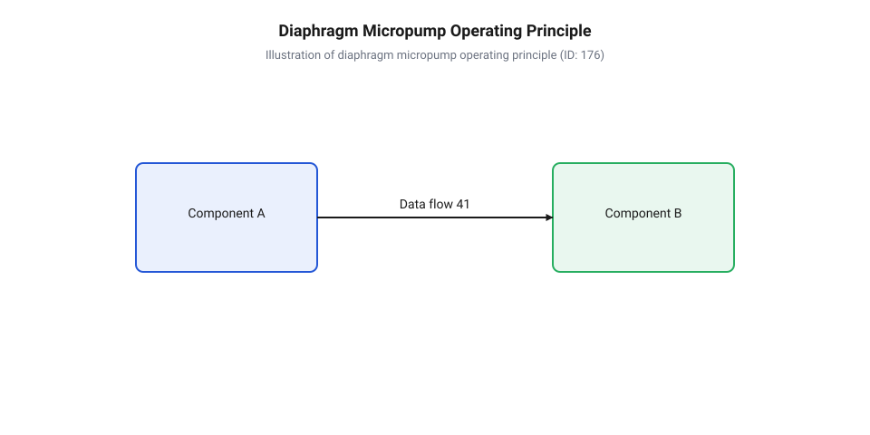
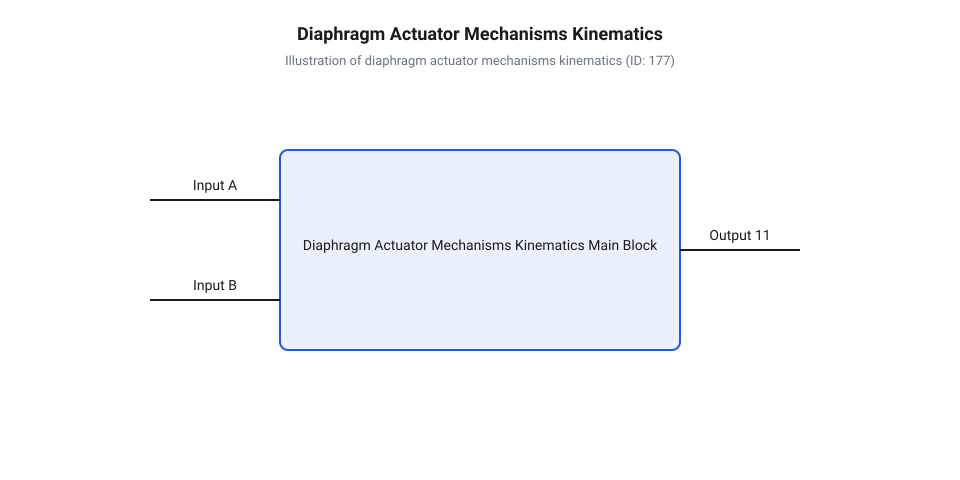
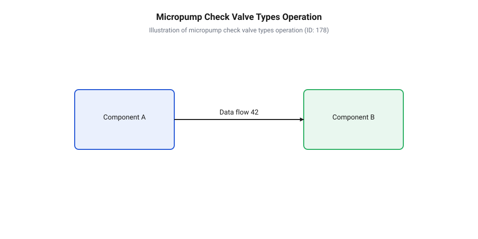
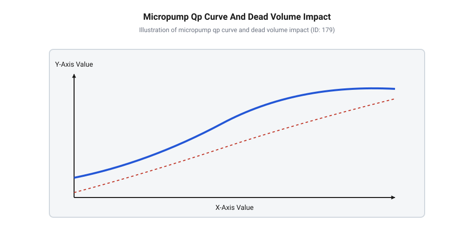
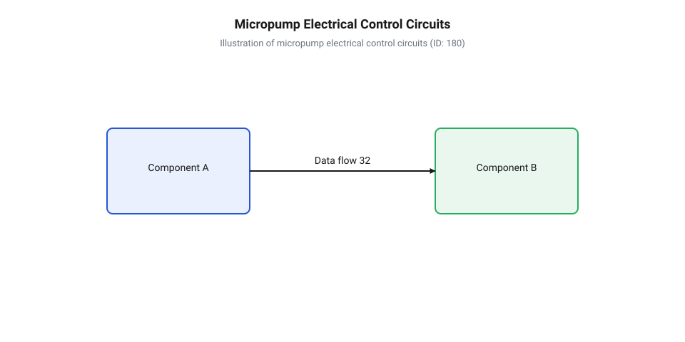
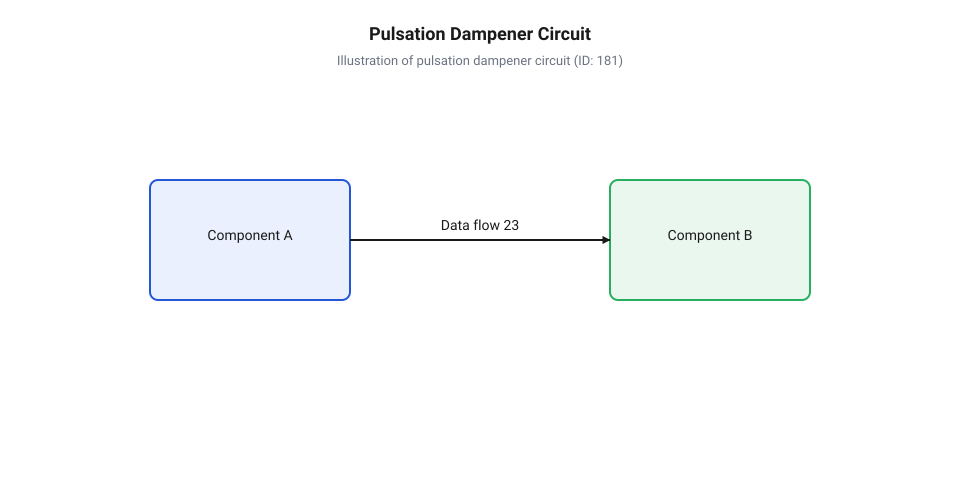

# Мембранні мікропомпи

<preknowlist>
- [Відцентрові насоси](root:cat-hw-actuators/centrifugal-pumps) — принципи створення гідродинамічного напору за рахунок відцентрової сили та причини відсутності сухого самовсмоктування у динамічних гідравлічних машинах
- [Перистальтичні насоси](root:cat-hw-actuators/peristaltic-pumps) — принципи об'ємного витіснення рідини в гнучких трубах та способи забезпечення ізоляції перекачуваного середовища від механізмів приводу
</preknowlist>

## Чому звичайні насоси розгерметизовуються і завоздушуються

Розробка компактних медичних приладів, аналітичних систем та мікрофлюїдних пристроїв завжди впирається у проблему надійного перекачування рідких і газоподібних середовищ. Коли інженер намагається застосувати [традиційні відцентрові насоси](root:cat-hw-actuators/centrifugal-pumps), він швидко постає перед двома фундаментальними фізичними бар'єрами: втратою герметичності через деградацію ущільнень та катастрофічною втратою продуктивності при попаданні повітря.

Перша проблема криється у самій конструкції динамічних гідравлічних машин. Щоб передати обертальний момент від зовнішнього електродвигуна до робочого колеса, вал має пройти крізь стінку насосної камери. На межі рухомого вала та нерухомого корпусу встановлюють @@en|сальник вала@@ (від ущільнення салом) або торцеве @@en|динамічне ущільнення@@. Під час обертання вала в зоні контакту неминуче виникає механічне тертя, яке призводить до зносу ущільнювальних матеріалів, мікротріщин та теплового розширення. Для чистої води це загрожує незначним протіканням, але при роботі з хімічно агресивними реактивами, біологічними рідинами чи токсичними газами найменша розгерметизація руйнує прилад, отруює довкілля або забруднює перекачуване середовище мастилом і зовнішнім повітрям.

Друга проблема — це @@en|завоздушення@@ (від нім. @@de|Lufteinschluss@@ — утворення повітряної пробки) та відсутність @@en|сухого самовсмоктування@@ (від англ. @@en|dry self-priming@@). Динамічні насоси створюють перепад тиску за рахунок кінетичної енергії, яка передається рідині від швидкісних лопатей робочого колеса. Густина газу приблизно у тисячу разів менша за густину рідини. Якщо в підвідний трубопровід заповненого рідиною відцентрового насоса потрапляє бульбашка повітря, робоче колесо починає обертатися в газовому середовищі. Через малу масу газу згенерований відцентровий напір падає у сотні разів і стає неспроможним подолати протитиск системи. Насос «заповітрюється», припиняє всмоктування і в сухому стані взагалі не здатний підняти рідину з нижнього резервуара, оскільки розрядження у сухій камері прямує до нуля.

Принциповим виходом із цього глухого кута є перехід до гідравлічних та пневматичних машин об'ємної дії. На відміну від того, як працюють [об'ємні перистальтичні насоси](root:cat-hw-actuators/peristaltic-pumps), де рідина проштовхується роликами крізь гнучку трубу, @@en|мембранна мікропомпа@@ (від нім. @@de|Membran@@, з латин. @@la|membrana@@ — перетинка) використовує герметично затиснуту еластичну діафрагму (від грец. @@el|діафрагма@@ — перегородка), яка повністю відокремлює @@en|робочу камеру@@ від механізму приводу. Конструктивно периметр мембрани нерухомо затискається між корпусом камери та фланцем приводу. У такій системі немає жодного рухомого ущільнення вала, що виключає витоки середовища назовні чи проникнення зовнішніх забруднень у внутрішній об'єм.

Фізичний принцип дії мембранної камери полягає в циклічній вимушеній зміні її геометричного об'єму. Коли привід відтягує центр мембрани назад, об'єм ізольованої камери збільшується від мінімального значення `V_min` до максимального `V_max`. Відповідно до закону Бойля-Маріотта та рівняння стану, розширення замкненого об'єму спричиняє падіння внутрішнього тиску нижче за атмосферний тиск навколишнього середовища:

```
P_chamber = P_init × (V_min / V_max)
```

Створений перепад тиску `ΔP = P_env - P_chamber` змушує газоподібне або рідке середовище із зовнішнього трубопроводу самостійно заповнювати камеру. Саме ця властивість забезпечує повноцінне сухе самовсмоктування: помпа здатна відкачати повітря з порожньої підвідної лінії, створити вакуум і підняти стовп рідини без попереднього заливання камери. При зворотному русі приводу діафрагма прогинається всередину камери, зменшуючи її об'єм до `V_min`, що створює надлишковий тиск і виштовхує середовище в напірну лінію.

Еволюція мембранних мікропомп пройшла шлях від великогабаритних промислових діафрагмових агрегатів середини XX століття до сучасних мікрофлюїдних пристроїв. Переломним моментом стало створення високоефективних еластомерних матеріалів (таких як фтореластомери та силікони) і поява мініатюрних колекторних двигунів постійного струму, що дозволило зменшити габарити насосного вузла до кількох сантиметрів. У 1980-х роках впровадження п'єзокерамічних актюаторів відкрило можливість високовольтного мікропереміщення мембран із частотами у сотні герц. Згодом технології мікрообробки кремнію (@@en|MEMS@@ від англ. @@en|Micro-Electro-Mechanical Systems@@ — мікроелектромеханічні системи) дозволили інтегрувати гнучку діафрагму та мікроклапани безпосередньо в єдину кремнієво-скляну структуру чипа для високоточних медичних та лабораторних застосувань.

Теоретична циклова подача такої системи визначається циклічним робочим об'ємом `V_s = V_max - V_min` та частотою коливань `f`. Обчислення ідеальної об'ємної витрати задається співвідношенням:

```
Q_th = V_s × f
```

де `Q_th` — теоретична об'ємна витрата середовища, `V_s` — цикловий хід об'єму камери, а `f` — частота зворотно-поступальних рухів мембрани. Повний розрахунок реальної продуктивності з урахуванням стисливості середовища та гідродинамічного опору викладено у [математичному моделюванні гідродинаміки](root:cat-hw-actuators/diaphragm-micro-pumps/math-micropump-fluid-dynamics.md) мембранної камери.


*Схема двох послідовних фаз роботи мембранної камери, з якої видно відкриття вхідного клапана під дією розрядження при русі мембрани вниз та виштовхування середовища через вихідний клапан при стисненні камери.*

Зрозумівши фундаментальні переваги герметичності та здатність до самовсмоктування, інженер стикається з наступною задачею: як перетворити обертовий або лінійний рух електричного приводу у точні, довговічні та високочастотні коливання гнучкої діафрагми.

## Конструкція та механізми приводу мембрани

Перетворення електричної енергії у циклову деформацію мембрани визначає габарити, продуктивність, рівень шуму та ресурс всієї мікропомпи. Конструктор має забезпечити зворотно-поступальне переміщення центру діафрагми з амплітудою ходу `h` та частотою `f`, зберігши при цьому стійкість матеріалу до втомного руйнування. Залежно від вимог до сили, частоти та розмірів застосовують три основні типи приводів: моторні кривошипно-шатунні вузли, п'єзоактюатори та лінійні соленоїди.

Найбільш поширеним у загальнопромислових та побутових приладах є @@en|ексцентриковий кривошипно-шатунний механізм@@ (від лат. @@la|excentricus@@ — поза центром). У цій схемі вал колекторного або безколекторного мотора постійного струму обертає детально розрахований @@en|ексцентрик@@ з радіусом зміщення `r`. З ексцентриком з'єднана головка шатуна (від нім. @@de|Schubstange@@ — штовхальний шток), другий кінець якого жорстко або шарнірно закріплений у центральному штифті діафрагми.

Під час обертання вала мотора з кутовою швидкістю `ω = 2π f` обертальний рух перетворюється на гармонічні лінійні коливання штока. Опишемо відновлення положення центру мембрани `x(t)` залежно від часу `t`:

```
x(t) = r × (1 - cos(2π f t))
```

де `x(t)` — поточне лінійне зміщення центру мембрани від точки максимального відтягування, `r` — ексцентриситет вала (радіус кривошипа), а `f` — частота обертання ротора в герцах. Повний механічний хід центру мембрани складає `h = 2 × r`. 

Основними перевагами кривошипно-шатунного приводу є велика амплітуда ходу `h` (від 0.5 до 3 мм) та високе зусилля, що дозволяє створювати значні протитиски. Проте наявність рухомих підшипників, механічний знос щеток у колекторних моторах та пульсуючі бічні навантаження на шток обмежують робочу частоту діапазоном 20–150 Гц і створюють помітну вібрацію.

Альтернативою для високоточних, безшумних та ультракомпактних систем є @@en|п'єзоактюатор@@ (від грец. @@el|piezein@@ — тиснути та лат. @@la|actuator@@ — привід). Робота приводу базується на зворотному п'єзоелектричному ефекті в монолітному або багатошаровому кристалі п'єзокераміки (наприклад, цирконату-титанату свинцю, @@en|PZT@@). П'єзоелемент виконують у вигляді пластини-биморфа (від лат. @@la|bi-@@ — подвійний та грец. @@el|morphe@@ — форма), яка наклеюється безпосередньо на поверхню мембрани або виконує роль самої мембрани.

При подачі електричного потенціалу `U` поперек шарів п'єзокераміки в матеріалі виникає внутрішня механічна деформація зсуву. Пластина згинається куполом, змінюючи об'єм робочої камери. Лінійний хід п'єзоактюатора є дуже малим (а амплітуда `h` зазвичай становить від 5 до 50 мікрометрів), проте п'єзоелементи здатні працювати на високих частотах від сотень герц до десятків кілогерц. Відсутність будь-яких механічних частин, що труться, забезпечує практично безмежний механічний ресурс та абсолютну безшумність. Для забезпечення високовольтного живлення п'єзоелементів висуваються специфічні вимоги, які враховує [специфікація апаратного інтерфейсу](root:cat-hw-actuators/diaphragm-micro-pumps/api-diaphragm-micropump-hardware-interface.md) підключення та обв'язки.

Третій тип — @@en|лінійний соленоїд@@ (від грец. @@el|solenodeis@@ — трубкоподібний). Електромагнітна котушка при подачі імпульсу струму втягує феромагнітний сердечник (шток), що долає опір поворотної пружини і зміщує мембрану. Соленоїдні приводи забезпечують швидке, ударне зміщення з високим початковим зусиллям, але мають обмежений КПД через нагрівання котушки та фіксовану амплітуду, що визначається механічними упорами.


*Кінематична схема ексцентрикового кривошипно-шатунного механізму, соленоїдного штока та п'єзоелектричного биморфа, яка показує залежність амплітуди ходу мембрани від типу приводу та механічного плеча.*

Геометрична форма деформованої круглої мембрани радіуса `R`, затиснутої по контуру, під дією центрального зміщення `h` описується осьосиметричним прогином. Знайдемо локальне зміщення `w(r)` на радіальній відстані `r` від центру:

```
w(r) = h × (1 - (r / R)²)²
```

де `w(r)` — прогин мембрани в точці з радіусом `r`, `h` — максимальний хід у центрі, а `R` — робочий радіус мембрани. Проінтегрувавши цей профіль по площі круга, знайдемо витіснений цикловий об'єм камери `V_s`:

```
V_s = ∫₀ᴿ 2π r w(r) dr
    = 2π h ∫₀ᴿ (r - 2 r³ / R² + r⁵ / R⁴) dr
    = π × R² × h / 3
```

Отримана формула висвітлює фундаментальний геометричний зв'язок: цикловий об'єм камери прямо пропорційний центральному ходу штока `h` та квадрату робочого радіуса мембрани `R`.

Тривала циклічна деформація створює в матеріалі діафрагми змінні механічні напруження. Якщо амплітуда прогину занадто велика, в еластомері накопичуються мікроструктурні дефекти, що призводить до явищ @@en|втомного зносу@@ та розриву мембрани. Для забезпечення ресурсу у сотні мільйонів циклів застосовують спеціалізовані формовані мембрани з концентричними гофрами (зморшками), які перерозподіляють згинальні напруження по площі діафрагми.

Перетворення коливального руху мембрани у безперервний потік вимагає наявності автоматичних швидкодіючих елементів, які б регулювали напрямок руху середовища на вході та виході камери.

## Зворотні клапани та формування односпрямованого потоку

Сам по собі зворотно-поступальний рух діафрагми лише періодично стискає та розширює середовище всередині камери. Якщо залишити відкритими обидва отвори камери, рідина чи газ під час всмоктування буде затягуватися з обох патрубків, а під час нагнітання — виштовхуватися назад. Щоб сформувати односпрямований транзитний потік, робочу камеру оснащують двома автоматичними замикаючими пристроями — вхідним та вихідним @@en|зворотними клапанами@@.

Динаміка роботи клапанного вузла повністю керується перепадом тиску `ΔP` між робочою камерою та зовнішніми магістралями. 

Під час фази всмоктування привід збільшує об'єм камери, і тиск `P_chamber` падає нижче тиску у підвідному патрубку `P_in`. На вхідному клапані виникає позитивна різниця тисків `ΔP_in = P_in - P_chamber > 0`. Коли ця різниця перевищує фізичний @@en|тиск відкривання@@ клапана `P_crack` (від англ. @@en|cracking pressure@@), запірний елемент відгинається від свого сідла, і середовище заповнює камеру. У цей же момент тиск у напірній магістралі `P_out` є вищим за `P_chamber`, що створює зворотний перепад `ΔP_out = P_chamber - P_out < 0`, який щільно притискає замикаючий елемент вихідного клапана до сідла, блокуючи зворотний витік.

Під час фази нагнітання діафрагма зменшує об'єм камери, тиск `P_chamber` різко зростає. Співвідношення тисків змінюється на протилежне: `P_chamber > P_out` примушує відкритися вихідний клапан, а перепад `P_chamber > P_in` надійно запирає вхідний клапан.

В залежності від фізичних властивостей середовища (в'язкість, агресивність, наявність суспензій) та робочого діапазону частот у мембранних мікропомпах застосовують три основні конструктивні типи зворотних клапанів:

1. @@en|Пелюстковий клапан@@ (від англ. @@en|flapper valve@@ або @@en|reed valve@@). Замикаючим елементом є тонка еластична пелюстка з полімеру або тонколистової пружинної сталі, закріплена одним краєм над прохідним отвором сідла. Пелюсткові клапани мають мінімальну масу та інерційність, що забезпечує надзвичайно малий тиск відкривання `P_crack` (менше 1–2 кПа) і високу швидкодію. Вони ідеально підходять для пневматичних мікропомп та роботи з газами. 2. @@en|Кульковий клапан@@ (від англ. @@en|ball check valve@@). Складається з прецизійної кульки (із пресованого скла, сапфіру, кераміки чи нержавіючої сталі) та конічного або сферичного сідла. Під дією прямого перепаду тиску кулька відпливає від сідла, а при зворотному тоці під дією сили тяжіння або притискної пружини повертається в сідло. Кулькові клапани забезпечують найвищу герметичність при високих протитисках та відмінну хімічну стійкість, але через масу кульки мають підвищену інерційність, що обмежує робочу частоту до 30–50 Гц. 3. @@en|Зонтичний клапан@@ (від англ. @@en|umbrella valve@@). Суцільнолитий еластомерний елемент купольної форми із центральною ніжкою-анкером. Гнучкий край «парасольки» перекриває кілька кругових отворів у сідлі. При прямому потоці край зонтика легко відгинається по всьому периметру, забезпечуючи велику площу проходу при малих габаритах, а при зворотному тиску купол розправляється і герметично глушить отвори.


*Перерізи пелюсткового, кулькового та зонтичного зворотних клапанів у відкритому й закритому положеннях, які демонструють щільність прилягання замикаючого елемента до сідла та шляхи проходження робочого середовища.*

Надійна робота клапанного вузла визначена відсутністю механічних дефектів та забруднень. Головними фізичними причинами відмов клапанної системи є:

* @@en|Забруднення механічними частками@@. Якщо між сідлом та замикаючим елементом потрапляє твердинка розміром у кілька мікрон, клапан втрачає герметичність. Виникає зворотний перетік середовища, через що помпа втрачає здатність створювати вакуум та напір. * @@en|Залипання клапана@@ (від англ. @@en|valve sticking@@). При перекачуванні рідин із високим поверхневим натягом або розчинів, що здатні висихати, тонка пелюстка клапана може прилипнути до сідла. Тиску розрядження камери стає недостатньо для відриву клапана, і помпа припиняє прокачування. * @@en|Інерційне запізнення@@ (від англ. @@en|valve response lag@@). На високих частотах коливань мембрани `f` замикаючий елемент не встигає повністю сісти на сідло до моменту зміни напрямку руху штока. Виникає фазове запізнення, і частина циклового об'єму виштовхується у зворотний бік, що різко знижує об'ємний ККД системи.

З урахуванням цих особливостей розробляється практична [система точного дозування](root:cat-hw-actuators/diaphragm-micro-pumps/proj-microfluidic-dosing-system.md) для мікрофлюїдних застосувань, де стабільність закриття клапанів визначає точність подачі мікрооб'ємів. У медичній техніці такий принцип забезпечує надійний [пневматичний модуль тонометра](root:cat-hw-actuators/diaphragm-micro-pumps/proj-automated-tonometer-pump-control.md) під час швидкого накачування маншети. Для точного вибору алгоритмів керування електроприводом та компенсації гідродинамічних затримок використовується спеціалізований [програмний драйвер керування](root:cat-hw-actuators/diaphragm-micro-pumps/api-micropump-control driver-lib.md) помпою.

## Робочі характеристики та фізичні обмеження мікропомп

Розробка пневматичних та гідравлічних систем на основі мембранних мікропомп вимагає від інженера розуміння поведінки пристрою у реальних умовах навантаження. Зі збільшенням опору магістралі реальна подача пристрою швидко зменшується, а при спробі відкачати повітря із замкненого об'єму з'ясовується, що мікропомпа володіє чіткою межею мінімального абсолютного тиску. Ці особливості обумовлені фундаментальними фізичними процесами стискання газу, пружної деформації діафрагми та наявністю технологічних зазорів камери.

Головною функціональною залежністю будь-якої мікропомпи є @@en|Q-P характеристика@@ (від англ. @@en|flow-pressure characteristic@@) — графік залежності реальної об'ємної витрати `Q` від протитиску `P`, що створюється напірною магістраллю.

При нульовому протитиску `P = 0` (робота на вільний вилив або вихід в атмосферу) помпа забезпечує максимальну подачу `Q_0`, яка теоретично прямує до циклового об'єму, помноженого на частоту коливань: `Q_0 ≈ V_s × f`. Проте щойно тиск на виході `P_out` починає перевищувати тиск на вході `P_in`, виникає протитиск `P = P_out - P_in`.

Зростання протитиску зменшує продуктивність через три основні фізичні фактори:
1. **Зворотний витік крізь зворотні клапани.** Під дією високого тиску нагнітання замикаючий елемент вихідного клапана сідає на сідло з деяким фазовим запізненням, під час якого частина середовища встигає перетекти назад у робочу камеру. 2. **Пружна деформація еластомерної мембрани.** При високому внутрішньому тиску мембрана під час фази стиснення вигинається куполом у бік приводу, збільшуючи фактичний мінімальний об'єм камери `V_min` і зменшуючи робочий хід `V_s`. 3. **Стисливість робочого середовища.** При перекачуванні газів стиснення повітря всередині камери вимагає досягнення тиску, вищого за `P_out`, перш ніж вихідний клапан взагалі почне відкриватися.

Для більшості мембранних мікропомп Q-P характеристика описується лінійним або близьким до лінійного співвідношенням:

```
Q(P) = Q_0 × (1 - P / P_max)
```

де `Q(P)` — реальна об'ємна витрата при протитиску `P`, `Q_0` — подача при відсутності опору (вільний потік), а `P_max` — @@en|максимальний протитиск@@ (від англ. @@en|maximum backpressure@@), при досягненні якого подача середовища повністю припиняється.

У разі перекачування краплинних рідин на витрату додатково впливає в'язкість середовища та гідравлічний опір вузьких каналів. Детальні формули розрахунку гідродинамічних втрат та стисливості наведено в матеріалі про [обчислення гідравлічних і пневматичних параметрів](root:cat-hw-actuators/diaphragm-micro-pumps/math-micropump-fluid-dynamics.md) мембранної камери.

При роботі в пневматичному режимі (відкачування газу чи створення вакууму) виникає друге суттєве обмеження — нездатність створення абсолютного розрядження. Фізичною причиною цього є існування незміщуваного залишкового об'єму камери.

Під час руху мембрани у крайнє переднє положення вона не може ідеально прилягти до внутрішніх стінок камери та площини клапанів. Зазори навколо замикаючих елементів клапанів, канавок та мікрощілин формують @@en|мертвий об'єм@@ (від англ. @@en|dead volume@@ або @@en|unswept volume@@) — мінімальний об'єм камери `V_min = V_dead`, який залишається невитісненим при максимальному ході штока.

Співвідношення максимального об'єму камери `V_max = V_s + V_dead` до мертвого об'єму `V_dead` визначає @@en|коефіцієнт стиснення камери@@ `ε` (від англ. @@en|compression ratio@@):

```
ε = V_max / V_min
  = (V_s + V_dead) / V_dead
  = 1 + V_s / V_dead
```

Розглянемо фазу всмоктування під час відкачування повітря із замкненої посудини. На початку фази всмоктування у мертвому об'ємі `V_dead` перебуває газ під тиском нагнітання `P_out` (зазвичай рівним атмосферному тиску `P_env`). Коли привід відтягує мембрану, цей залишковий газ починає розширюватися до об'єму `V_max`. За законами газодинаміки тиск всередині камери `P_chamber` після повного розширення становитиме:

```
P_chamber = P_out / ε
          = P_out / (1 + V_s / V_dead)
```

Щоб вхідний клапан зміг відкритися, тиск у камері `P_chamber` має впасти нижче тиску у всмоктувальному вакуумованому об'ємі `P_in`. Якщо тиск `P_in` зрівнюється з `P_chamber`, перепад тиску на вхідному клапані стає нульовим, і клапан припиняє відкриватися. Таким чином створюється @@en|граничний вакуум@@ (від англ. @@en|ultimate vacuum@@) — мінімальний абсолютний тиск `P_vac_min`, який здатна забезпечити помпа:

```
P_vac_min = P_out / (1 + V_s / V_dead)
```

З отриманої формули видно: що більшим є мертвий об'єм `V_dead` відносно робочого ходу `V_s`, то вищим є мінімальний абсолютний тиск `P_vac_min`, і тим слабший вакуум здатна створити помпа.

Оскільки витіснення середовища здійснюється дискретними порціями, у напірній та всмоктувальній магістралях виникає явище, що має назву @@en|пульсація тиску@@ (від англ. @@en|pressure pulsation@@). У рідинних магістралях через нестисливість рідини високочастотні імпульси тиску можуть викликати гідравлічні удари, вібрацію трубопроводів та брязкіт клапанів. Для згладжування імпульсів у пневмогідравлічну обв'язку інтегрують @@en|гідравлічний демпфер@@ (від нім. @@de|Dämpfer@@, з латин. @@la|damper@@ — пом'якшувач) — пружну ємність із повітряною подушкою або гнучкою мембраною, яка акумулює надлишок об'єму під час фази нагнітання та віддає його у магістраль під час фази всмоктування.

Тривала циклічна деформація мембрани під високим протитиском призводить до накопичення втомних мікропошкоджень в еластомері. Це супроводжується поступовим зниженням пружності матеріалу, залишковим розтягуванням діафрагми та внаслідок цього — зниженням @@en|об'ємного ККД@@ (від англ. @@en|volumetric efficiency@@) системи.


*Характеристична крива залежності об'ємної витрати від протитиску та фізичний механізм обмеження граничного вакууму через наявність мертвого об'єму в робочій камері.*

Оцінивши робочі характеристики, протитиски та пульсації, інженер переходить до задачі керування електроприводом помпи для точної стабілізації потоку чи тиску.

## Електропривід та мікроконтролерне керування помпою

Ефективна робота мембранної мікропомпи у складі приладу вимагає не лише механічної узгодженості камери, а й точної електронної регуляції параметрів живлення приводу. Залежно від застосованого актюатора — колекторного мотора, безколекторного мотора постійного струму чи п'єзоелемента — інженер має спроєктувати силовий каскад та реалізувати мікроконтролерні алгоритми керування швидкістю, тиском і споживаною потужністю.

Для мікропомп з кривошипно-шатунним приводом від колекторного двигуна постійного струму об'ємна витрата `Q` прямо пропорційна частоті обертання вала `f`, яка регулюється величиною поданої напруги. Найтиповішим методом цифрового регулювання є @@en|ШІМ-регулювання@@ (широтно-імпульсна модуляція, від англ. @@en|PWM@@, @@en|Pulse-Width Modulation@@).

Силова схема підключення мотора базується на застосуванні @@en|силового транзисторного ключа@@ (від англ. @@en|power transistor switch@@), роль якого зазвичай виконує N-канальний польовий транзистор (MOSFET). Транзистор перемикається мікроконтролером із частотою від 5 до 20 кГц. Оскільки обмотка електродвигуна володіє суттєвою індуктивністю `L`, у моменти закриття транзисторного ключа виникає високовольтний сплеск електрорушійної сили самоіндукції `e = -L × (di / dt)`. Для захисту напівпровідникового ключа від пробою паралельно обмоткам мотора обов'язково встановлюється @@en|зворотний діод@@ (від англ. @@en|flyback diode@@ або @@en|freewheeling diode@@), який замикає на себе струм самоіндукції.

Для приводів на базі @@en|безколекторних моторів постійного струму@@ (від англ. @@en|brushless DC motor@@, @@en|BLDC@@) застосовують трифазний міст з шести MOSFET-транзисторів та спеціалізований драйвер із бездатчиковою (за зворотною ЕРС) або датчиковою (на базі елементів Холла) комутацією обмоток. Це дозволяє позбутися механічних щіток, підвищити ККД та суттєво подовжити термін служби приводу.

Зовсім інший підхід вимагає @@en|високовольтний драйвер п'єзоактюатора@@ (від англ. @@en|high-voltage piezo driver@@). П'єзокерамічний биморф є реактивним ємнісним навантаженням `C_piezo` (від 10 до 100 нФ) і вимагає амплітуди напруги від 60 до 300 В. Керування п'єзоелементом здійснюється шляхом генерації двополярних або синусоїдальних імпульсів високої напруги за допомогою спеціалізованих мікросхем із підвищувальними DC-DC перетворювачами та мостовими каскадами. Драйвер повинен забезпечувати обмеження швидкості наростання напруги `dU / dt`, оскільки надто різкі фронти викликають механічний удар у кераміці й розшарування п'єзоелемента. Детальні електричні схеми з'єднання наведено у [довіднику апаратного підключення](root:cat-hw-actuators/diaphragm-micro-pumps/api-diaphragm-micropump-hardware-interface.md) мікропомп.


*Принципова блок-схема силових каскадів керування електродвигунами через ШІМ-ключі та високовольтним двополярним драйвером п'єзоактюатора.*

Під час роботи приладу протитиск у магістралі може змінюватися (наприклад, при затисканні трубки або засміченні фільтра). Якщо помпа працює на граничному тиску `P_max`, мотор гальмується, що призводить до різкого зростання струму споживання та небезпечного перегріву обмоток. Для запобігання аварійним режимам у силовий ланцюг вбудовують @@en|зворотний зв'язок за струмом@@ (від англ. @@en|current feedback@@) на базі вимірювального шунта `R_shunt`. При перевищенні порогового струму система автоматично зменшує коефіціент заповнення ШІМ або вимикає привід.

Для точних приладів реалізують @@en|зворотний зв'язок за тиском@@ (від англ. @@en|pressure feedback@@), підключаючи аналоговий або цифровий датчик тиску. ПІД-регулятор мікроконтролера адаптивно змінює частоту коливань або коефіцієнт заповнення ШІМ, підтримуючи заданий тиск у напірній камері незалежно від коливань опору магістралі.

Нижче наведено ідіоматичні приклади програмної реалізації регулювання продуктивності мікропомпи з плавною зміною ШІМ, контролем струму захисту та зчитуванням датчика тиску.

:::tabs
:::code diaphragm-micro-pumps-d/c/esp-idf/init-pump-control.c

:::code diaphragm-micro-pumps-d/cpp/arduino/setup.cpp
:::

Повний опис низькорівневих викликів та функцій керування міститься у [програмній API бібліотеці керування](root:cat-hw-actuators/diaphragm-micro-pumps/api-micropump-control-driver-lib.md). Наведені апаратно-програмні рішення становлять основу для проєктування як автоматизованого [пневматичного модуля тонометра](root:cat-hw-actuators/diaphragm-micro-pumps/proj-automated-tonometer-pump-control.md) у медичній техніці, так і високоточної [мікрофлюїдної системи дозування](root:cat-hw-actuators/diaphragm-micro-pumps/proj-microfluidic-dosing-system.md) для лабораторних досліджень.

## Обв'язка систем демпфування та діагностика несправностей

Робота мембранної мікропомпи ґрунтується на циклічному зсуві еластомеру, через що рідина або газ подаються у флюїдну лінію дискретними порціями. Під час фази всмоктування тиск у магістралі різко падає, а у фазі нагнітання виникає піковий стрибок швидкості й тиску. На відміну від безперервного потоку, який дають [відцентрові насоси](root:cat-hw-actuators/centrifugal-pumps), або згладженого витіснення, яке забезпечують [перистальтичні насоси](root:cat-hw-actuators/peristaltic-pumps), дискретне виштовхування створює високочастотні пульсації тиску. Ці пульсації викликають вібрацію трубних з'єднань, гідравлічні удари, акустичний шум та прискорене руйнування чутливих датчиків. У мікрофлюїдиці пульсуючий потік руйнує ламінарний режим перемішування реагентів, а в медичних приладах призводить до суттєвих похибок вимірювання.

Для перетворення переривчастого імпульсного руху середовища на стабільний квазістаціонарний потік застосовується @@en|пневматична обв'язка@@ або @@en|гідравлічна обв'язка@@ з інтегрованими елементами накопичення енергії. Головним вузлом згладжування виступає @@en|демпфер пульсацій@@ (від нім. *Dämpfer* — глушник), який у пневматичних магістралях реалізується у вигляді жорсткої ємнісної судини — @@en|ресивера@@ (від лат. *recipio* — приймати, вміщувати). Під час фази нагнітання мікропомпа виштовхує в об'єм ресивера надлишковий цикловий об'єм середовища. Стисливе повітря в ресивері працює як пружина: воно акумулює потенціальну енергію тиску, стримуючи пікове зростання @@en|протитиску@@ в системі. У фазі всмоктування, коли вихідний клапан помпи зачинений, стиснуте в ресивері повітря розширюється й продовжує виштовхувати рідину або газ у вихідну магістраль, підтримуючи постійну витрату.

Для рідких середовищ, де краплинна рідина є практично нестисливою, використовують двокамерні демпфери з еластомерною мембраною або повітряною подушкою. Розрахунок мінімального об'єму демпфуючої камери `V_d` спирається на цикловий робочий об'єм помпи `V_s` та допустимий коефіціент відносного коливання тиску `δ`. Для пневматичної системи необхідний об'єм ресивера визначається з ізотермічного рівняння стану газу:

```
V_d = V_s / δ      [рівняння балансу стиснення газу]
= V_s / ((P_max - P_min) / P_avg)      [заміна відносного перепаду тиску]
```

Де `V_s` — цикловий об'єм робочої камери помпи, `δ` — безрозмірний коефіцієнт пульсацій тиску, `P_max` та `P_min` — максимальне та мінімальне значення тиску в магістралі, а `P_avg` — середній робочий тиск системи. Зі збільшенням об'єму `V_d` амплітуда пульсацій падає зворотно пропорційно, проте зростає час виходу системи на стаціонарний режим тиску при запуску.


*Схема підключення демпфера пульсацій та вхідного фільтра для згладжування тиску в гідравлічній магістралі.*

Окрім пульсацій, критичною загрозою для надійності мікропомпи є @@en|механічне забруднення@@ робочого середовища. Циклічне відкривання та зачинення зворотних клапанів вимагає ідеального прилягання еластомерної пелюстки або кульки до поверхні, якою є @@en|сідло клапана@@. Якщо під час фази всмоктування у робочу камеру потрапляє тверда частка пилу чи суспензії розміром понад 5–10 мкм, вона заклинює між пелюсткою й сідлом. У фазі нагнітання нещільно зачинений вхідний клапан пропускає рідину назад у вхідну лінію, що спричиняє миттєву @@en|втрату вакууму@@ та падіння об'ємного ККД до нуля. Для запобігання цьому на вхідному патрубку обов'язково встановлюється @@en|вхідний фільтр@@ із пористістю сітки, меншою за мінімальний робочий зазор клапанного вузла.

Вибір конфігурації обв'язки визначається специфікою кінцевого пристрою. У високоточних [мікрофлюїдних системах дозування](root:cat-hw-actuators/diaphragm-micro-pumps/proj-microfluidic-dosing-system.md) послідовно з демпфером встановлюють мікрокапілярний @@en|дросель@@ (від нім. *Drossel* — звуження), який створює керований гідравлічний опір і перетворює залишок пульсацій на ламінарний потік. У приладах медичного призначення, таких як [автоматизовані тонометри з регулюванням](root:cat-hw-actuators/diaphragm-micro-pumps/proj-automated-tonometer-pump-control.md), пневмолінія доповнюється електромеханічним пропорційним клапаном для точного контрольованого скидання тиску з вимірювальної маншети. Точний розрахунок динамічних втрат тиску та гідравлічного опору обв'язки описується через [математичне моделювання флюїдних характеристик](root:cat-hw-actuators/diaphragm-micro-pumps/math-micropump-fluid-dynamics.md). Фізичне під'єднання штуцерів, вибір діаметрів гнучких трубок та захист від витікання викладені в [специфікації апаратного підключення](root:cat-hw-actuators/diaphragm-micro-pumps/api-diaphragm-micropump-hardware-interface.md).

У процесі тривалої експлуатації флюїдні системи зазнають зносу та відмов. Для швидкого встановлення причин несправності застосовують систематичний алгоритм діагностики:

1. **Відсутність прокачування при працюючому приводі:** Якщо мотор обертається або соленоїд здійснює клацання, але потік відсутній, першопричиною є @@en|залипання клапана@@ через висихання залишкового флюїду або попадання сторонньої частки на @@en|сідло клапана@@. Діагностика виконується подачею невеликого надтиску чистим повітрям або промиванням камери нейтральним розчинником. 2. **Поступове зменшення продуктивності й вакууму:** Якщо витрата зменшується протягом сотень годин роботи при стабільній напрузі живлення, відбувається @@en|деградація діафрагми@@. Еластомер зазнає втомних мікророзривів або втрачає пружність через @@en|втомний знос@@ (від діючого хімічного впливу перекачуваного середовища). Вузлова заміна еластомерної мембрани відновлює номінальні параметри. 3. **Аномальний перегрів двигуна й зростання струму:** Підвищене споживання струму приводом виникає тоді, коли помпа працює в режимі перевантаження через зачеплення вихідної лінії або занадто малий переріз магістралі. Для запобігання згорянню обмоток у софтверних алгоритмах керування реалізують захист, спираючись на [бібліотеку програмування мікроконтролера](root:cat-hw-actuators/diaphragm-micro-pumps/api-micropump-control-driver-lib.md), яка автоматично зменшує частоту ШІМ або вимикає привід при перевищенні порогового струму.

Систематичне обслуговування вхідного фільтра, правильний вибір об'єму демпфера та своєчасна заміна еластомерних елементів забезпечують надійну роботу мембранної мікропомпи впродовж усього розрахункового ресурсу пристрою.