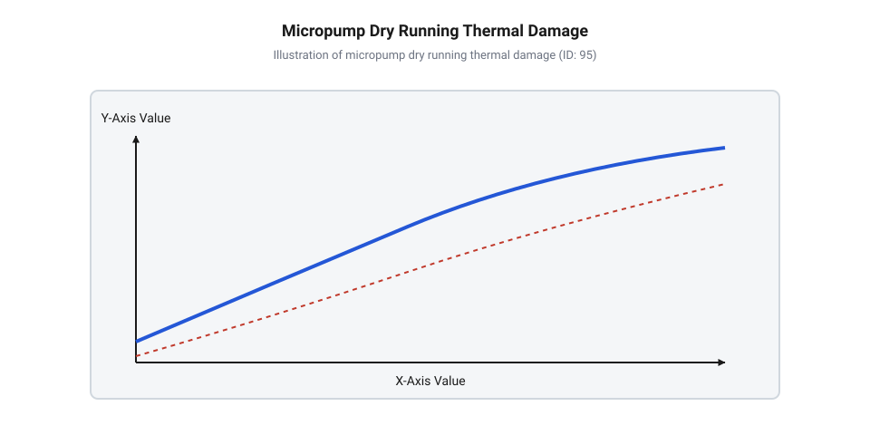
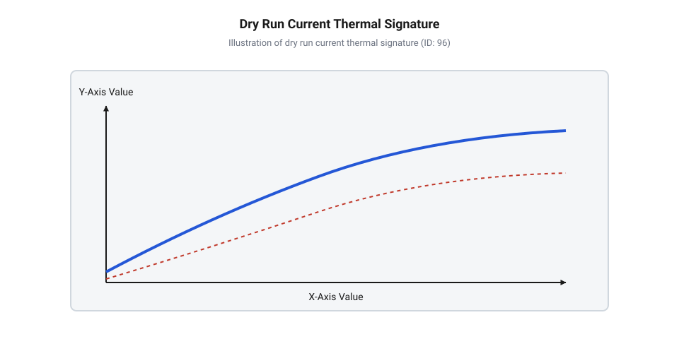
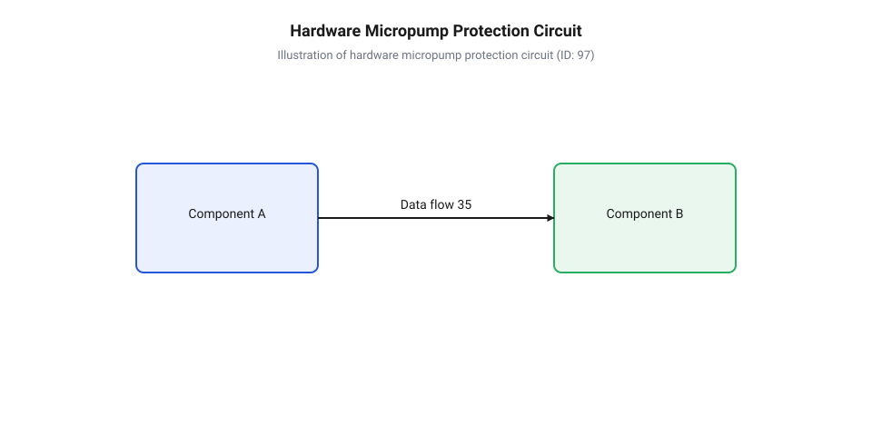
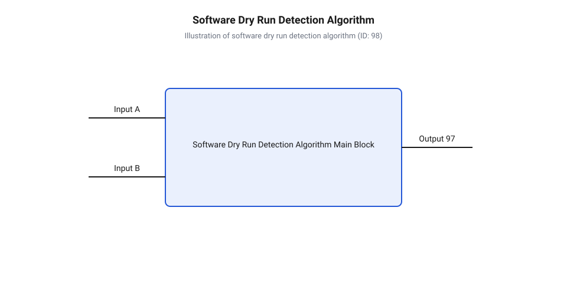
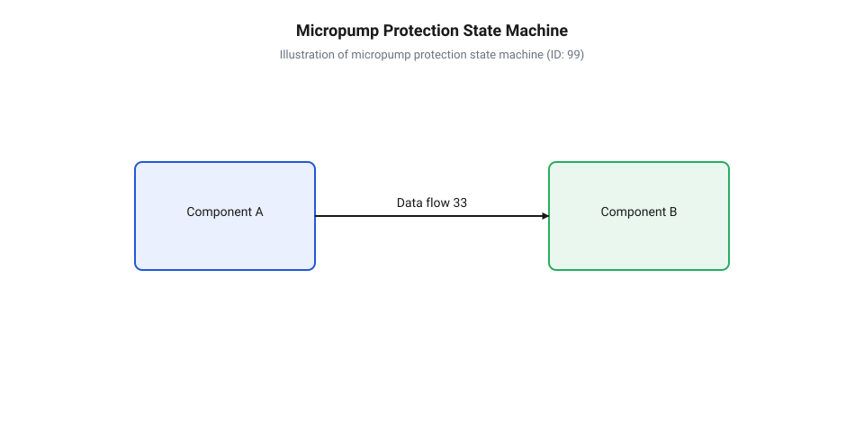
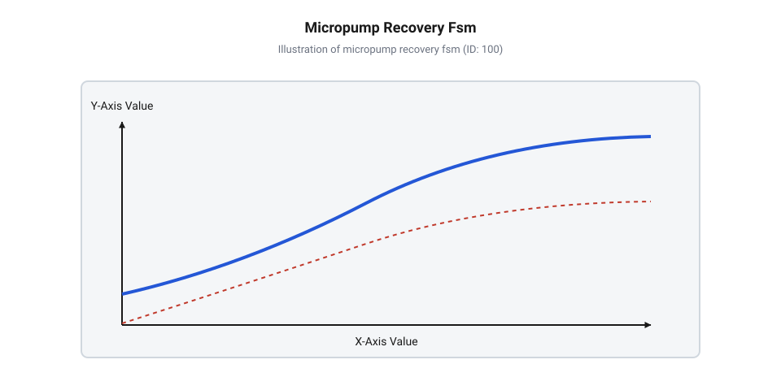

# Механізми захисту від сухого ходу та теплового перегріву мікропомп

<preknowlist>
- [Порівняльний аналіз перистальтичних, відцентрових та діафрагмових помп для малого габариту](root:cat-hw-actuators/peristaltic-and-centrifugal-pumps-comparison) — орієнтуватися у конструктивних відмінностях, механіці робочих органів та гідродинамічних характеристиках основних типів мікропомп
</preknowlist>

## Фізичні механізми руйнування без рідини

У мікрофлюїдних пристроях, вимірювальних аналізаторах та медичних дозаторах робоче середовище, що перекачується мікропомпою, виконує три критичні функції, про які часто забувають під час проектування схем керування: воно транспортує масу, забезпечує безперервне @@la|гідродинамичне змащення@@ (грец. *hydor* — вода, *dynamis* — сила) рухомих ущільнень і відводить теплову енергію від активної зони приводу. Коли канал подачі виснажується або в системі утворюється повітряний затор, рідка фаза миттєво зникає з робочого об'єму. Пристрій переходить у режим @@en|сухий хід@@ (англ. *dry running*), який за лічені секунди змінює механіку тертя у вузлах помпи й запускає ланцюгову реакцію термічного та механічного руйнування.

Першим під удар потрапляє контактна зона між рухомими елементами та нерухомими ущільненнями камери. У нормальному режимі між стінкою камери й еластомірною деталлю існує тонка рідка плівка, яка підтримує режим рідинного або граничного змащення з малим коефіцієнтом тертя `μ ≈ 0.02 - 0.05`. Видалення рідини спричиняє миттєвий перехід до сухого тертя, де коефіцієнт зростає в десятки разів — до `μ ≈ 0.6 - 1.2`. Вся механічна робота тертя перетворюється на теплову потужність, яка виділяється у вкрай малому контактному об'ємі матеріалів @@gr|еластомер@@ (грец. *elastos* — пружний, *meros* — частка).

Матеріали на основі силікону, фтореластомерів (FKM) або етилен-пропіленового каучуку (EPDM) володіють низьким коефіцієнтом теплопровідності `λ ≈ 0.15 - 0.25 Вт/(м·К)`. Потужність сухого тертя не встигає відводитися в масив корпусу, через що температура в мікроскопічних точках фактичного контакту зростає зі швидкістю понад 50-100 °C на секунду.

Перед обчисленням виділення тепла в зоні сухого тертя визначимо фізичні величини: `P_fric` — потужність тертя (Вт), `μ_dry` — коефіцієнт сухого тертя, `F_n` — нормальна сила притискання ущільнення (Н), `v_slide` — швидкість ковзання елемента (м/с).

P_fric = μ_dry · F_n · v_slide

Отримана теплова потужність локалізується в тонкому приповерхневому шарі. Динаміка локального зростання температури `T_contact` описується рівновагою між генеруванням тепла тертям та його кондуктивним відведенням у глибину еластомеру, де `λ_elast` — теплопровідність еластомеру, `S_cont` — площа контактного плями, `m_cont` — маса контактного шару, `c_elast` — питома теплоємність матеріалу:

dT_contact / dt = (P_fric - λ_elast · S_cont · (dT / dx)) / (m_cont · c_elast)

При досягненні критичної температури (близько 180-200 °C для силікону) в матеріалі починаються незворотні процеси термічної @@la|деградація@@ (лат. *degradatio* — зниження): деструкція полімерних ланцюгів, втрата еластичності, поверхневе осклування та мікрозварювання. Під дією зсувних напружень поверхневий шар еластомеру стирається, залишаючи дрібнодисперсні частки зносу. Це призводить до миттєвої розгерметизації камери, падіння вакууму та повної втрати здатності помпи самовсмоктувати рідину навіть після відновлення її подачі.

Другим вразливим вузлом є зворотні клапани (пелюсткові або кулькові). У нормальному режимі рідина між пелюсткою та сідлом утворює витискувальний рідкий шар, який за рахунок в'язкого опору працює як гідравлічний демпфер: він ефективно дисипує кінетичну енергію рухомого елемента, знижуючи @@la|коефіцієнт відновлення@@ (лат. *restitutio* — відновлення) імпульсу під час зіткнення до `k_r ≈ 0.05 - 0.1`. Під час роботи насухо рідкий прошарок зникає, і коефіцієнт відновлення імпульсу стрибкоподібно зростає до `k_r ≈ 0.6 - 0.8`, перетворюючи посадку клапана на майже пружний механічний удар. Повна кінетична енергія пелюстки гаситься на жорсткому контакті за малі частки мікросекунди, через що динамічне контактне напруження в зоні прилягання багаторазово перевищує границю плинності матеріалу. Кожен такий нездемпований удар викликає локальну циклічну пластичну деформацію та наклеп приповерхневого шару. У мікроструктурі сідла та кромок ущільнення зароджуються втомні мікротріщини, які під дією подальших ударних навантажень розростаються й призводять до викришування матеріалу, незворотної деформації кромок та повної втрати герметичності клапанного вузла.

Окрім механічного зносу робочої камери, @@en|сухий хід@@ створює загрозу термічного знищення самого електромагнітного або п'єзоелектричного приводу. У нормальному режимі потік рідини через помпу або омивання її внутрішніх каналів забезпечує конвективний відвід тепла від обмоток двигуна чи п'єзоелемента. Потужність, що виділяється в обмотках через омічні втрати `P_cu = I² · R`, розсіюється в протікаючу рідину. При зникненні потоку конвекційне охолодження падає майже до нуля, лишаючи лише повільне розсіювання через повітря та корпус.

Температура обмоток `T_wind` починає експоненціально зростати. Емалева @@la|ізоляція@@ (лат. *insula* — острів) мідного дроту має визначений термічний клас (наприклад, клас A до 105 °C або клас F до 155 °C). Згідно з законом Арреніуса, кожне перевищення робочої температури на 10 °C скорочує термін служби ізоляції вдвічі. При перевищенні ліміту емаль розм'якшується й обвуглюється, спричиняючи міжвиткове замикання. Струм споживання приводу різко зростає, що призводить до остаточного вигорання ключових транзисторів драйвера або розплавлення пластикового корпусу помпи.


*Локалізація теплових навантажень та точок сухого тертя в робочій камері мікропомпи за відсутності охолоджувального потоку рідини.*

Аналізуючи інженерний досвід, огляд [систем аварійного захисту](root:cat-hw-actuators/dry-running-and-thermal-protection-of-micro-pumps/hist-micropump-protection-evolution.md) розкриває еволюцію від громіздких зовнішніх давачів протоку до інтегрованих алгоритмів аналізу електричних параметрів. Математичний апарат [обчислення теплового балансу](root:cat-hw-actuators/dry-running-and-thermal-protection-of-micro-pumps/math-micropump-thermal-dynamics.md) детально описує накопичення теплової енергії в конструктивній матриці пристрою. Зіставляючи фізику руйнування, стає зрозуміло, що вразливість вузлів суттєво різниться залежно від кінематики: під час порівняння [різних типів мікропомп](root:cat-hw-actuators/peristaltic-and-centrifugal-pumps-comparison) видно, що перистальтичні системи найшвидше втрачають гнучкі трубки через здирання сухою поверхнею роликів, тоді як у мембранних конструкціях першими виходять з ладу пелюсткові клапани.

## Електричні й термічні сигнатури аномалій

Щоб запобігти термічній та механічній деструкції мікропомпи, система керування повинна виявити факт зникання рідини за мілісекунди або секунди до того, як температура контактних зон досягне критичної межі. Оскільки пряме вимірювання температури всередині герметичної мікрокамери чи встановлення давача потоку часто є технічно неможливим, єдиним надійним джерелом інформації стають непрямі фізичні величини — перш за все, динамічна @@en|струмова сигнатура@@ (англ. *current signature*, лат. *signatura* — позначка) живлення приводу та зовнішній температурний дрейф корпусу.

Механічний момент `M_motor`, який мусить розвивати привід мікропомпи, складається з двох основних компонентів: моменту опору тертя в механіці `M_fric` та гідродинамічного моменту `M_hydro`, необхідного для подолання в'язкісного опору рідини та створення перепаду тиску. У постійних двигунах прямого та змінного струму споживаний струм прямо пропорційний розвиваному моменту на валу: `M_motor = k_t · I`, де `k_t` — коефіцієнт моменту приводу.

Перед записом рівняння струмового балансу визначимо параметри: `I_nom` — номінальний струм під навантаженням рідиною (А), `I_dry` — струм у режимі сухого ходу (А), `M_hydro` — гідродинамічний момент опору рідини (Н·м), `M_fric_wet` — момент тертя за наявності змащення (Н·м), `M_fric_dry` — момент тертя насухо (Н·м).

I_nom = (M_hydro + M_fric_wet) / k_t

Коли рідина виходить із камери й замінюється повітрям, в'язкісний опір `M_hydro` падає практично до нуля, оскільки в'язкість повітря приблизно у 50-100 разів менша за в'язкість води. Попри те, що момент сухого тертя `M_fric_dry` дещо зростає через відсутність змащення, втрата гідродинамічної складової переважає. У результаті загальний споживаний струм приводу в режимі @@en|сухий хід@@ знижується:

I_dry = M_fric_dry / k_t
I_dry < I_nom

Падіння середнього споживаного струму `I_avg` складає від 15% до 60% від номінального значення залежно від типу помпи та робочого тиску. Це створює виразну електричну сигнатуру, яку легко зафіксувати за допомогою вимірювального шунта.

Окрім зміни середнього значення струму `I_avg`, @@en|сухий хід@@ корінним чином змінює змінну складову струму — амплітуду й форму пульсацій `ΔI_p-p`. У нормальному режимі перекачування рідини кожен робочий хід мембрани або проходження ролика перистальтичного приводу супроводжується стисканням нестисливої рідини та подоланням інерції рідинного стовпа в магістралі. Це створює чіткі, високоамплітудні пульсації струму на частоті робочих циклів.

У режимі сухого ходу повітря в камері поводиться як стисливий газ. Опір стисканню повітря є мізерним, тому періодичні піки навантаження зникають. Амплітуда низькочастотних пульсацій струму `ΔI_p-p` зменшується в 3-8 разів. Водночас у вищих гармоніках струмового спектра з'являються високочастотні шуми, спричинені дрижанням незнефлегмованих клапанів та мікроударями в сухих підшипниках.

Термічна сигнатура виявляється повільніше за електричну, але слугує надійним підтвердженням аварійного стану. Температура корпусу помпи `T_body` описується диференціальним рівнянням теплового балансу. Перед виведенням виразу визначимо позначення: `C_th` — теплоємність корпусу помпи (Дж/К), `P_loss` — електричні й механічні втрати в помпі (Вт), `k_cool_wet` — коефіціент тепловіддачі з потоком рідини (Вт/К), `k_cool_dry` — коефіцієнт тепловіддачі в навколишнє повітря (Вт/К), `T_amb` — температура довкілля (K).

Динаміка температури у вологому режимі:

dT_body / dt = (P_loss - k_cool_wet · (T_body - T_amb)) / C_th

Оскільки `k_cool_wet` є високим завдяки протіканню рідини, усталена температура перевищує `T_amb` лише на кілька градусів. У режимі сухого ходу коефіціент охолодження падає до `k_cool_dry << k_cool_wet`, а втрати `P_loss` залишаються високими. Динаміка переходить у сухий режим:

dT_body / dt = (P_loss - k_cool_dry · (T_body - T_amb)) / C_th

Це спричиняє стрімкий кутовий нахил кривої `dT_body/dt` на початковому етапі аномалії, після чого температура прямує до небезпечного усталеного значення, яке часто перевищує максимально допустиму температуру матеріалів помпи.


*Часові діаграми вимірюваних параметрів: падіння середнього струму, загасання пульсацій та наростання температури корпусу після вичерпання рідини.*

У спеціалізованих пристроях, де застосовуються [п'єзоелектричні мікропомпи](root:cat-hw-actuators/piezoelectric-micropumps-control), сигнатура сухого ходу проявляється через зміну комплексного електричного імпедансу `Z(f)` матеріалу залежно від частоти `f` @@la|імпеданс@@ (лат. *impedire* — перешкоджати). Електромеханічну поведінку п'єзокристала поблизу резонансу описує еквівалентна @@en|схема Батерворта — Ван-Дайка@@ (англ. *Butterworth–Van Dyke model*), у якій паралельно до статичної ємності обкладок `C_0` підключено послідовне моційне коло з моційної індуктивності `L_m`, моційної ємності `C_m` та моційного опору `R_m`. Тверде тіло й рідина у мікрокамері формують єдину коливальну систему: моційна індуктивність `L_m` відповідає еквівалентній масі п'єзомембрани та приєднаній масі рідини, моційна ємність `C_m` визначається механічною гнучкістю конструкції, а моційний опір `R_m` описує втрати енергії. Опір `R_m` прямо пропорційний сумарному демпфуванню `R_m = k_m · (γ_mech + γ_hydro)`, де `k_m` — коефіцієнт електромеханічного зв'язку, `γ_mech` — коефіцієнт внутрішнього механічного тертя матеріалу, а `γ_hydro` — коефіцієнт гідродинамічного демпфування рідини @@de|демпфування@@ (нім. *dämpfen* — глушити). Перед розрахунком добротності визначимо параметри: `ω_r` — колова резонансна частота, `Q` — механічна добротність @@en|добротність@@ (англ. *quality factor*). Рівняння добротності моційної гілки має вигляд:

```
Q = (ω_r · L_m) / R_m
= (ω_r · L_m) / (k_m · (γ_mech + γ_hydro))      [підстановка моційного опору через коефіцієнти демпфування]
```

Коли рідина виходить із мікрокамери, демпфування з боку рідини зникає (`γ_hydro → 0`), через що моційний опір `R_m` падає до мінімального рівня `R_m = k_m · γ_mech`. Одночасно втрата приєднаної маси рідини зменшує індуктивність `L_m`, через що резонансна частота п'єзоактуатора `f_r = 1 / (2 · π · √(L_m · C_m))` зміщується вбік вищих частот. Оскільки падіння опору `R_m` суттєво переважає зміну індуктивності `L_m`, добротність `Q` механічного резонансу зростає у 5–20 разів, перетворюючи широку резонансну криву вологого стану на вузький високий пік, що дозволяє системі керування фіксувати сухий хід за стрибком амплітуди й зміною фази струму збудження.

Поріг спрацьовування системи алгоритмічного захисту розраховують на основі [моделі електричної сигнатури](root:cat-hw-actuators/dry-running-and-thermal-protection-of-micro-pumps/math-dry-run-current-signature.md) сухого ходу. Практичні реалізації алгоритмів обробки спираються на [аналіз струмового профілю](root:cat-hw-actuators/current-signature-fault-diagnostics), що дозволяє чітко розрізнити сухий хід та механічне заклинювання двигуна. При цьому в [перистальтичних та мембранних помпах](root:cat-hw-actuators/peristaltic-and-diaphragm-micropumps) амплітудний спектр пульсацій має власний характерний розподіл гармонік, що вимагає відповідного налаштування цифрових фільтрів у мікроконтролері.

## Апаратні засоби виявлення та відсічки

Коли в мікрофлюїдному контурі раптово зникає рідина, прокачування робочого середовища припиняється, а гідродинамічне змащування ущільнень та охолодження приводу повністю зникає. Якщо розробник повністю покладається лише на програмне забезпечення мікроконтролера, виникає критична точка відмови: завісання програмного коду, збій у виконанні переривання або затримка ініціалізації АЦП під час перезавантаження залишають привід під повною напругою живлення. У мікропомпах із малою теплоємністю конструктивних елементів температура робочої камери може досягти руйнівних `120–150 °C` за лічені секунди, проплавляючи @@en|еластомер@@ мембран та перетворюючи клапани на суцільну масу. Щоб запобігти такій катастрофі незалежно від стану керуючої обчислювальної системи, у коло живлення приводу вбудовують апаратні бар'єри захисту, які розривають електричне коло або обмежують струм виключно на основі фізичних законів провідності й теплообміну.

Першим рубежем апаратного захисту є пасивні термочутливі компоненти, встановлені безпосередньо на корпусі або обмотці мікропомпи. Самовідновлюваний @@en|PTC-термістор@@ (від англійського *Positive Temperature Coefficient* — позитивний температурний коефіцієнт опору) являє собою напівпровідникову чи полімерну структуру, опір якої різко зростає при досягненні порогової температури фазового переходу. При нормальній робочій температурі опір @@de|PTC-термістора@@ становить частки Ом, і він практично не впливає на споживаний струм. Проте коли виникає @@en|сухий хід@@, локальний перегрів приводу передається на термістор, викликаючи стрибок його опору на `3–4` порядки. Це самочинно обмежує струм живлення до безпечного мікроамперного рівня без будь-якої участі мікроконтролера. Для безаварійного знеструмлення в критичних медичних чи промислових пристроях послідовно з приводом також встановлюють одноразовий @@de|термозапобіжник@@ (від німецького *Schmelzsicherung*, де *schmelzen* — плавити, *Sicherung* — захист). Всередині @@de|термозапобіжника@@ міститься сплав із чіткою температурою плавлення `T_melt`. При досягненні граничної температури корпус приводу розплавляє цей сплав, і пружинний механізм незворотно розмикає контактор, запобігаючи займанню пристрою. Детальніше інженерні методи вибору та схемотехніку таких елементів висвітлює [термісторний та плавкий захист мікроприводів](root:cat-hw-actuators/micropump-ptc-thermal-protection).

Динаміка зростання температури апаратного давача визначається швидкістю передачі тепла від гарячої обмотки або камери помпи через тепловий контакт. Оцінимо часовий профіль нагріву давача `T(t)` залежно від початкової температури `T_0`, виділюваної теплової потужності `P_heat`, теплового опору `R_th` між приводом і давачем та термічної сталої часу `τ_th`.

Перед формулою: обчислимо температурний відгук давача захисту `T(t)` під дією постійного теплового потоку втрат приводу.

```
T(t) = T_0 + P_heat · R_th · (1 - e^(-t / τ_th))
= T_0 + P_heat · R_th · (1 - e^(-t / (R_th · C_th)))      [заміна сталої часу τ_th = R_th · C_th]
```

Після формули: у наведеному виразі `T_0` позначає початкову температуру навколишнього середовища в градусах Цельсія, `P_heat` — потужність теплових втрат приводу у Ватах, `R_th` — тепловий опір теплового переходу в Кельвінах на Ват, а `C_th` — теплоємність сенсора в Джоулях на Кельвін. З цього виразу випливає критичний інженерний висновок: якщо термічний контакт між обмоткою приводу та @@de|PTC-термістором@@ має високий опір `R_th`, або сенсор володіє великою теплоємністю `C_th`, сталого часу `τ_th` буде недостатньо для вчасного спрацьовування. Як показано в [моделі теплової динаміки](root:cat-hw-actuators/dry-running-and-thermal-protection-of-micro-pumps/math-micropump-thermal-dynamics.md), поки давач нагріється до температури розмикання, внутрішня ізоляція обмотки вже зазнає необоротної термічної @@en|деградації@@. Якісна інкапсуляція термістора теплопровідним компаундом є обов'язковою умовою надійного захисту.

Апаратний захист від перегріву запобігає термічному руйнуванню, але не рятує від прискореного механічного зносу, адже навіть при безпечній температурі сухе тертя руйнує клапани й трубки. Щоб виявити відсутність рідини миттєво — ще до підняття температури — в системний контур інтегрують зовнішні первинні перетворювачі. Калориметричні давачі протоку вимірюють знімання тепла рухомим потоком рідини від мікронагрівача, а оптичні й мікродиференційні давачі тиску фіксують наявність рідинного стовпа. Як детально відображено в [історії розвитку засобів захисту](root:cat-hw-actuators/dry-running-and-thermal-protection-of-micro-pumps/hist-micropump-protection-evolution.md) мікропомп, перші покоління мікрофлюїдних систем покладалися виключно на такі громіздкі фізичні давачі, що забезпечувало найвищу надійність, проте суттєво збільшувало габарити пристрою. Фізичні принципи вимірювання витрати за допомогою мікронагрівачів детально розглядають [калориметричні давачі протоку в мікрофлюїдиці](root:cat-hw-actuators/calorimetric-flow-sensors-in-microfluidics).

Оскільки використання зовнішніх гідравлічних давачів не завжди можливе через обмеження за розмірами чи хімічною сумісністю, апаратне виявлення аварійних режимів реалізують електричним шляхом через моніторинг струму приводу. У шину живлення нижнього плеча вмикають малоомний @@en|струмовий шунт@@ (від англійського *shunt* — відхиляти, пускати в обхід) із опором `R_shunt`. Падіння напруги на шунті `U_shunt = I · R_shunt` пропорційне струму, що протікає через обмотку чи п'єзоелемент.

Сигнал із шунта подається на @@la|аналоговий компаратор@@ (від латинського *comparare* — порівнювати), який порівнює `U_shunt` із опорною напругою `V_ref`. Якщо виникає @@en|сухий хід@@, @@en|гідродинамічний момент@@ опору зникає, струм помпи осідає нижче критичної позначки `I_dry`, і напруга `U_shunt` стає меншою за `V_ref_low`. @@la|Аналоговий компаратор@@ миттєво змінює логічний стан свого виходу, вимикаючи силовий транзистор MOSFET у колі живлення помпи. Щоб уникнути хибних спрацьовувань від шумів та короткочасних пульсацій, у схему компаратора вводять позитивний зворотний зв'язок, що формує @@el|гістерезис@@ (від грецького *hysteresis* — запізнення, відставання) за напругою.


*Принципова схема вузла апаратного захисту мікропомпи: PTC-термістор у колі живлення обмежує струм при перегріві, а аналоговий компаратор миттєво знеструмлює привід при виході струму шунта за безпечні межі.*

Деталізовано в [інтерфейсі апаратного захисту](root:cat-hw-actuators/dry-running-and-thermal-protection-of-micro-pumps/api-micropump-protection-hw-interface.md), поєднання аналогового компаратора та термістора створює повністю автономну дволанкову систему безпеки. Повна принципова схема включає в себе RC-фільтр низьких частот між шунтом та входом компаратора для зрізання високочастотного ШІМ-шуму приводу. Порівнюючи з реакцією програмних алгоритмів, час спрацьовування аналогової схеми вимірюється мікросекундами, що повністю виключає ризик локального перегріву тонких елементів. З іншого боку, особливості [різних типів мікропомп](root:cat-hw-actuators/peristaltic-and-centrifugal-pumps-comparison) визначають необхідність ретельного вибору опорної напруги `V_ref`: у відцентрових помпах струм при сухому ході падає на `40–60 %`, тоді як у перистальтичних приводах сухе тертя роликів може, навпаки, викликати локальні сплески струму, що вимагає використання двопорогового віконного компаратора.

## Програмний аналіз струму та імпедансу

Хоча апаратні давачі та аналогові компаратори забезпечують автономну безпеку, вони вимагають додаткової площі на друкованій платі, підвищують собівартість пристрою та ускладнюють компоновку мікрофлюїдного чипа. Прагнення до мініатюризації привело до розвитку бездатчикового моніторингу, де сам привід мікропомпи виступає в ролі первинного сенсора. Оскільки механічне навантаження на валу або мембрані безпосередньо впливає на зворотну ЕРС, а температура обмотки змінює її активний опір, оцифрування електричних параметрів приводу за допомогою мікроконтролера дозволяє програмно виявити відсутність рідини та загрозу перегріву без жодних додаткових фізичних датчиків.

Для реалізації програмного діагностування мікроконтролер опитує @@en|струмовий шунт@@ через @@en|аналого-цифровий перетворювач@@ (від англійського *Analog-to-Digital Converter*, скорочено @@en|АЦП@@) з частотою дискретизації, що у кілька разів перевищує частоту пульсацій помпи. Оцифровані миттєві значення струму `I[k]` містять високий рівень шумів від комутації обмоток та гидродинамічних вирів збурення. Для отримання стабільної оцінки навантаження застосовують цифровий фільтр @@en|ковзне середнє@@ (від англійського *moving average*) або розраховують середньоквадратичне значення (RMS).

Перед формулою: обчислимо середньоквадратичний струм приводу `I_rms` за вікном із `N` послідовних оцифрованих відліків `I[k]`.

```
I_rms = √( (1 / N) · ∑_{k=0}^{N-1} (I[k])² )
= √( (1 / N) · (I[0]² + I[1]² + ... + I[N-1]²) )      [розгортання суми відліків]
```

Після формули: у цій формулі `N` позначає довжину вибірки в буфері оцифровки, а `I[k]` — значення струму на кроці дискретизації `k` в амперах. З розрахованого значення `I_rms` програмний модуль віднімає струм холостого ходу та порівнює результат із порогом `I_dry_thresh`. Як описано в [розрахунку струмової сигнатури](root:cat-hw-actuators/dry-running-and-thermal-protection-of-micro-pumps/math-dry-run-current-signature.md), при зникненні рідини з робочої камери густина перекачуваного середовища падає в тисячі разів, що призводить до стрімкого зниження `I_rms` нижче каліброваного порогу.


*Алгоритм обробки сигналу струмового шунта: оцифрування АЦП, цифрове фільтрування ковзним середнім, розрахунок амплітуди пульсацій та компарування з порогами сухого ходу та заклинення.*

Поряд із середнім значенням струму критично важливу інформацію несе спектральний аналіз пульсацій та електричного імпедансу. У [мембранних мікропомпах](root:cat-hw-actuators/peristaltic-and-diaphragm-micropumps), де перекачування супроводжується циклічним стисканням камери, кожен хід поршня чи мембрани формує характерний пік струму. При зникненні рідини або появі великих повітряних бульбашок амплітуда пульсацій `ΔI = I_max - I_min` різко падає, а високі гармоніки в спектрі затухають. За аналогічним принципом алгоритми [аналізу струмового профілю](root:cat-hw-actuators/current-signature-fault-diagnostics) виявляють відхилення в роботі електродвигунів.

Одночасно мікроконтролер оцінює внутрішню температуру двигуна шляхом вимірювання електричного @@la|імпедансу@@ (від латинського *impedire* — перешкоджати) обмотки. В постійній складовій напруги й струму опір обмотки `R_coil` прямо залежить від температури мідного провідника: `R_coil(T) = R_0 · (1 + α · (T - T_0))`, де `α ≈ 0.00393 K⁻¹` — температурний коефіцієнт опору міді. Вимірюючи падіння напруги при фіксованому струмі або аналізуючи постійне зміщення під час паузи ШІМ, програма розраховує поточну температуру обмотки `T_est`. Якщо `T_est` перевищує допустиму межу (наприклад, `85 °C`), контролер ініціює програмне обмеження потужності або безаварійну зупинку. За цими ж принципами працюють алгоритми для [п'єзоелектричних приводів](root:cat-hw-actuators/piezoelectric-micropumps-control), де контроль ємності та активного імпедансу п'єзоелемента дає змогу відстежувати наявність рідини у мікроканалах.


*Скінченний автомат захисту мікропомпи: перехід із нормального стану в режим виявлення аномалії при виході струму за межі, аварійне відсікання, пауза на охолодження та спроба повторного запуску.*

Керування режимами захисту організовано у вигляді скінченного @@en|автомата станів@@ (від англійського *finite state machine*, де *state* — стан, *machine* — механізм). Автомат запобігає хибним спрацьовуванням під час пускових кидків струму та забезпечує алгоритми автоматичного відновлення після усунення аварії. Основні стани включають ініціалізацію `STATE_INIT`, пусковий режим `STATE_STARTUP` із маскуванням небезпек на час розгону, штатне помпування `STATE_NORMAL`, підтвердження відхилення `STATE_DEBOUNCE`, аварійну зупинку `STATE_FAULT` та витримку часової паузи `STATE_COOLDOWN` для охолодження приводу.

Як показано в [розробці модуля захисту](root:cat-hw-actuators/dry-running-and-thermal-protection-of-micro-pumps/proj-micropump-protection-controller.md), така структура коду дозволяє гнучко налаштовувати часові затримки та межі спрацьовування під конкретне гідравлічне навантаження. Загальні алгоритми можна оформити у [програмній бібліотеці захисту](root:cat-hw-actuators/dry-running-and-thermal-protection-of-micro-pumps/api-micropump-protection-sw-lib.md), де зібрано API для ініціалізації порогів, реєстрації зворотновикликаних функцій та опитування прапорців діагностики.

Нижче наведено вичерпну реалізацію драйвера програмного моніторингу струму та температури мікропомпи. Приклад розкриває оцифрування шунта, ковзне оновлення RMS, алгоритми перевірки порогів та повноцінний автомат станів.

:::tabs
=== C (ESP-IDF)
:::code dry-running-and-thermal-protection-of-micro-pumps-d/c/esp-idf/micropump-hw-init.c
=== C++ (Arduino)
:::code dry-running-and-thermal-protection-of-micro-pumps-d/cpp/arduino/micropumpprotectiondriver.cpp
:::

## Стратегії безаварійного керування та відновлення

Миттєве відключення приводу при першому відхиленні струму здається найпростішим рішенням для захисту мікропомпи. Однак у реальних мікрофлюїдних трактах така спрощена реакція викликає часті хибні спрацьовування. Поодинокі мікробульбашки газу, проходячи крізь робочу камеру, створюють короткочасне падіння гідродинамічного опору, що проявляється як миттєвий провал споживаного струму. Якщо система керування сприйме цей імпульс тривалістю в десятки мілісекунд за фатальний @@en|dry running@@ (від англ. dry running — режим роботи помпи за відсутності робочої рідини) і повністю вимкне живлення, безперервність технологічного чи медичного процесу буде безповоротно порушена. Водночас ігнорування тривалого провалу навантаження призводить до розігріву тертьових поверхонь, деградації матеріалу, яким є @@gr|еластомер@@ (від грец. elastos — пружний та meros — частина), і міжвиткового замикання обмоток приводу. Щоб збалансувати надійність збереження обладнання та безперервність роботи, мікроконтролер має реалізувати логіку адаптивного керування, яка розрізняє тимчасові обурення та аварійні стани.

Основною відмінністю короткочасної повітряної пробки (від англ. @@en|air lock@@ — локальна газова каверна в рідинному каналі) від повного осушення системи є часова сигнатура та динаміка зміни навантаження. Проходження газу супроводжується різкими високочастотними пульсаціями струму з швидким відновленням середнього значення, тоді як повна відсутність рідини дає стабільний низький рівень споживання зі зміщенням фази. Алгоритм контролера застосовує затримувальну часову фільтрацію, яку забезпечує @@en|debounce@@ (від англ. debounce — часова фільтрація перехідних процесів), та цифровий @@gr|гістерезис@@ (від грец. hysteresis — запізнення) для запобігання хаотичним перемиканням. Якщо струм падає нижче критичної межі, привід не вимикається миттєво, а переходить у стан підтвердження аномалії. Тривалість цього інтервалу вибирається з урахуванням об'єму робочої камери та швидкості потоку, що дозволяє @@en|air lock@@ безперешкодно залишити помпу без зупинки технологічного циклу.


*Граф станів керуючого автомата, що демонструє переходи між штатним режимом, верифікацією аномалії, імпульсним заповненням та термічним витримуванням.*

Для впорядкування реакцій системи керування розробляється скінченний автомат станів (від англ. @@en|Finite State Machine@@, FSM — обчислювальна модель із фіксованим набором станів та переходів). Архітектура @@en|Finite State Machine@@ містить шість базних станів:

1. `STATE_IDLE` — привід знеструмлений, алгоритм очікує зовнішньої команди пуску. 2. `STATE_RUNNING` — штатна прокачуваність, активний бездатчиковий моніторинг струму та температури. 3. `STATE_VERIFYING` — виявлено відхилення струму або температури; активовано таймер часового фільтра. Якщо за час `t_verify` параметр повертається в норму, відновлюється `STATE_RUNNING`. 4. `STATE_RETRY_PULSE` — підтверджено @@en|dry running@@; запускається алгоритм повторного запуску (від англ. @@en|retry logic@@ — послідовність дозованих спроб відновлення). Привід працює в імпульсному режимі для безпечного заповнення системи (від англ. @@en|priming@@ — витіснення повітря рідиною під час запуску). 5. `STATE_THERMAL_COOLING` — перевищено температурну межу або вичерпано кількість спроб запуску; привід зупинено для охолодження. 6. `STATE_FAULT_LOCKOUT` — фатальний аварійний стан; привід блокується до отримання сигналу скидання від зовнішнього контролера верхнього рівня.

Коли привід потрапляє в режим виявленого @@en|dry running@@, тривале безперервне обертання призводить до швидкого локального перегріву. Щоб відновити подачу рідини без ризику термічного пошкодження ущільнень, застосовують дозовані повторні спроби. Замість постійної подачі напруги контролер генерує серію коротких імпульсів роботи з тривалими паузами. Під час імпульсу створюється розрідження, необхідне для всмоктування рідини, а під час паузи виділене тепло розсіюється в корпус пристрою. Використання [порівняльного аналізу помп](root:cat-hw-actuators/peristaltic-and-centrifugal-pumps-comparison) підтверджує, що для [мембранних мікропомп](root:cat-hw-actuators/peristaltic-and-diaphragm-micropumps) такий імпульсний запуск є наиболее ефективним завдяки наявності самовсмоктувальних клапанів.

Якщо серія спроб @@en|priming@@ не привела до появи рідини, або якщо розрахована температура обмоток досягла граничного значення, система здійснює примусове термічне витримування. Тривалість паузи охолодження `t_cool` розраховується на основі теплової сталої приводу `τ_th`. Для розрахунку часу, необхідного для зниження температури від аварійного значення `T_fault` до безпечного рівня `T_safe` за температури навколишнього середовища `T_ambient`, використовується експоненційна модель згасання тепла, де величина `t_cool` визначається виразом:

t_cool = τ_th × ln( (T_fault - T_ambient) ÷ (T_safe - T_ambient) )    [інверсія рівняння теплового згасання]

Значення теплової сталої `τ_th` описується узгодженою [математичною моделлю теплообміну](root:cat-hw-actuators/dry-running-and-thermal-protection-of-micro-pumps/math-micropump-thermal-dynamics.md), що враховує коефіцієнт тепловіддачі корпусу мікропомпи. Розрахована тривалість паузи гарантує, що привід не розпочне наступний цикл спроб до відновлення безпечної температури ізоляції обмоток.

Нижче наведено практичну реалізацію автомата станів захисту та відновлення для мікроконтролерів. Програма реалізує вимірювання струму, обробку таймерів без блокування основного потоку виконання та керування силовим ключем приводу через [програмний інтерфейс драйвера](root:cat-hw-actuators/dry-running-and-thermal-protection-of-micro-pumps/api-micropump-protection-sw-lib.md) та інтегрований [модуль апаратного захисту](root:cat-hw-actuators/dry-running-and-thermal-protection-of-micro-pumps/proj-micropump-protection-controller.md).

:::tabs

@tab C (ESP-IDF / Bare-Metal)

:::code dry-running-and-thermal-protection-of-micro-pumps-d/c/esp-idf/hw-read-current-ma.c

@tab C++ (Arduino / General)

:::code dry-running-and-thermal-protection-of-micro-pumps-d/cpp/arduino/pumpstate.cpp

:::

Поєднання апаратної реакції з алгоритмічною підтримкою @@en|retry logic@@ створює багаторівневу захисну парадигму. Вона усуває передчасні зупинки обладнання при поодиноких бульбашках, одночасно гарантуючи запобігання термічній руйнації ущільнень і обмоток у випадку справді фатальної втрати рідини. Докладніше про специфіку розпізнавання відхилень струмових профілів у приводах різного типу викладено в матеріалі щодо [діагностики за струмовим профілем](root:cat-hw-actuators/current-signature-fault-diagnostics), а тонкощі керування приводами з [п'єзоелектричними приводами](root:cat-hw-actuators/piezoelectric-micropumps-control) розглядаються у відповідній статті каталогу.