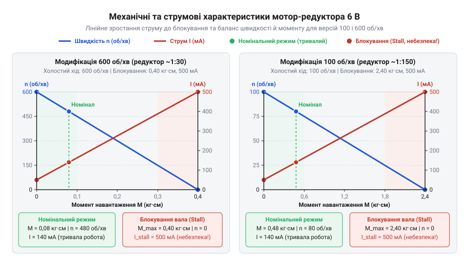
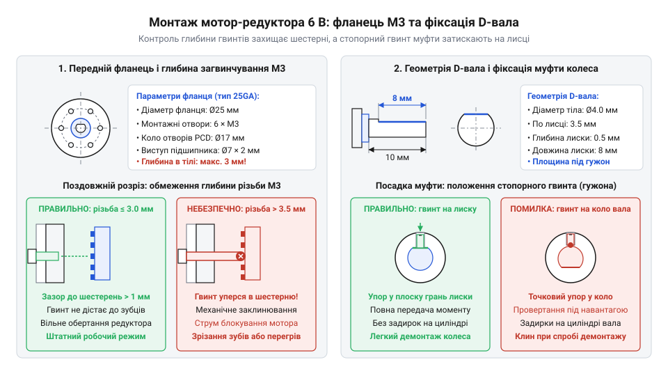
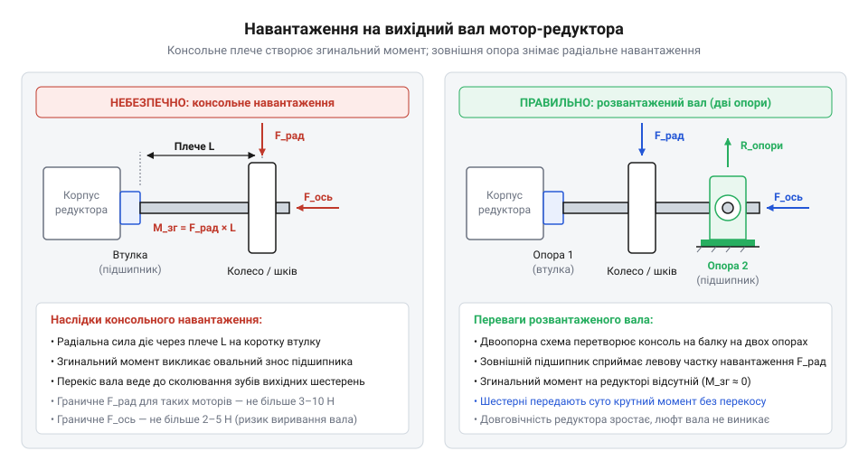
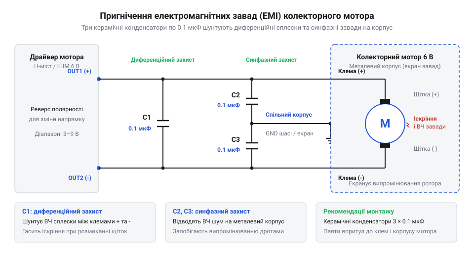

# Мотор-редуктор 6 В (100 і 600 об/хв)

## Проблема прямого приводу та призначення редуктора

Спроба закріпити ходове колесо двоколісного візка або важіль поворотного маніпулятора безпосередньо на вихідному валу мініатюрного колекторного двигуна постійного струму (англ. @@en|brushed DC motor@@; колектор від лат. @@la|collector@@ — збирач) одразу демонструє непридатність прямого підключення. Двигун видає глухий гул, вал лишається нерухомим, а металевий корпус за кілька десятків секунд нагрівається до небезпечної температури.

Причина криється у внутрішній механіці безредукторного двигуна. Ротор (лат. @@la|rotare@@ — обертатися) малогабаритного мотора розрахований на високу швидкість холостого обертання: від 6000 до 12000 об/хв (обертів за хвилину, англ. @@en|RPM@@; від лат. @@la|rotatio@@ — обертання). Механічна потужність (англ. @@en|mechanical power@@; ват, Вт) обертового тіла дорівнює добутку крутного моменту на кутову швидкість:

```
P_mech
= M · ω                  [механічна потужність як добуток моменту та кутової швидкості]
= M · (2 · π · n / 60)   [вираження кутової швидкості в рад/с через оберти за хвилину n]
```

Оскільки корисна електрична потужність такого мотора становить лише 1–3 Вт, надвисока кутова швидкість `ω` (понад 600–1200 рад/с) означає, що власний крутний момент (лат. @@la|momentum@@ — рушійна сила) вала вимірюється десятими частками міліньютон-метра (0.5–1.5 мН·м).

Якщо закріпити на такому валу звичайне колесо радіусом 3 см, лінійне тягове зусилля на ободі виявиться мізерним:

```
F
= M / r                  [лінійне зусилля на радіусі важеля або колеса]
= 0.001 / 0.03           [підстановка власного моменту 1 мН·м та радіуса 30 мм]
≈ 0.033 Н                [тягове зусилля, еквівалентне вазі всього 3.4 грама]
```

Сила статичного тертя гуми об підлогу, опір коченню та маса самого джерела живлення багаторазово перевищують ці тридцять міліньютонів. Навантаження миттєво перевищує пусковий момент, і ротор зупиняється — настає стан заклинювання (блокування вала, англ. @@en|stall condition@@).

У заклиненому стані двигун потрапляє в аварійний електричний режим. Під час вільного обертання мідні витки якоря (нім. @@de|Anker@@ — якір) перетинають силові лінії постійних магнітів статора (лат. @@la|stator@@ — нерухомий), генеруючи зустрічну напругу — [проти-ЕРС](root:hw-motion/back-emf) (протиелектрорушійна сила, англ. @@en|back-EMF@@; грец. @@el|ἤλεκτρον@@ — бурштин та лат. @@la|motio@@ — рух):

```
E
= k_e · ω                [проти-ЕРС, пропорційна швидкості обертання]
```

Струм в обмотці визначається різницею прикладеної напруги та проти-ЕРС:

```
I
= (U - E) / R            [закон Ома для рухомого якоря з опором витків R]
```

Коли вал заблоковано, швидкість дорівнює нулю (`ω = 0`), тому проти-ЕРС зникає (`E = 0`). Весь струм обмежується лише омічним опором тонкого мідного дроту обмотки та щіткового контакту:

```
I_stall
= U / R                  [струм блокування за нульової швидкості]
```

Цей струм у 5–8 разів перевищує робочий струм мотора. За законом Джоуля-Ленца потужність теплових втрат зростає пропорційно квадрату струму:

```
P_heat
= I_stall² · R           [теплові втрати в замкнених витках якоря]
```

Уся підведена електрична енергія перетворюється на тепло всередині малого об'єму якоря. Оскільки мотор стоїть, крильчатка самоохолодження не працює. За кілька десятків секунд ізоляційний лак на витках плавиться, виникає міжвиткове коротке замикання, і двигун назавжди згоряє.

Розв'язанням цієї несумісності є циліндричний зубчастий редуктор (англ. @@en|spur gearbox@@; лат. @@la|reducere@@ — відводити назад, зменшувати). Редуктор працює як механічний трансформатор: він знижує кутову швидкість вихідного вала в `i` разів ([передатне число](root:hw-motion/gears-transmission), лат. @@la|relatio@@ — відношення), пропорційно збільшуючи крутний момент за вирахуванням механічних втрат на тертя зубців і втулок:

```
n_out
= n_in / i               [зниження частоти обертання вихідного вала]
```

```
M_out
= M_in · i · η           [збільшення крутного моменту з урахуванням ККД η]
```

Тут `η` (грец. @@el|η@@ — ета) — коефіцієнт корисної дії (ККД; лат. @@la|coefficiens@@ — той, що сприяє) редуктора, який для багатоступеневих циліндричних зубчастих передач становить від 0.60 до 0.75 через послідовне зачеплення кількох пар шестерень. Знизивши швидкість із 10000 до 100 об/хв (передатне число `i ≈ 100`), вузол збільшує вихідний крутний момент у 60–75 разів. Двигун отримує змогу обертатися на високих робочих обертах, де проти-ЕРС утримує споживання струму на безпечному рівні, а вихідний вал редуктора розвиває достатнє зусилля для руху навантаженої колісної бази.

> 🔧 **Навіщо це.**
> Узгодження механічного опору навантаження з робочими характеристиками ротора захищає двигун від критичного струму блокування і теплового руйнування. Редуктор зміщує робочу точку в зону високої енергетичної ефективності, трансформуючи надлишкові непридатні для прямого приводу оберти на корисне тягове зусилля.

Для мініатюрних приводів з номінальною напругою 6 В найпоширенішими є дві заводські модифікації циліндричного редуктора, які за однакового внутрішнього двигуна мають різне передатне число зубчастого механізму:

1. Модифікація на 100 об/хв (високе передатне число):
   Редуктор містить 4–5 ступенів редукції. Вихідний вал обертається з кутовою швидкістю близько 10.5 рад/с при 6 В. Робочий крутний момент досягає 0.5–0.8 кгс·см (50–80 мН·м), а короткочасний пусковий момент сягає 1.5–2.0 кгс·см (150–200 мН·м). Ця версія призначена для силових завдань: привід коліс важких мобільних платформ масою до 2–3 кг, подолання підйомів і порогів, гусеничні шасі, шарніри маніпуляторів, захоплювачі та тягові лебідки.
2. Модифікація на 600 об/хв (низьке передатне число):
   Редуктор містить 2–3 ступені редукції. Вихідний вал забезпечує кутову швидкість близько 62.8 рад/с при 6 В. Проте крутний момент у 5–6 разів менший: робоче значення становить лише 0.08–0.12 кгс·см (8–12 мН·м), а момент блокування — до 0.35 кгс·см (35 мН·м). Ця модифікація орієнтована на швидкісні легкі пристрої: швидкісні роботи для руху по лінії (англ. @@en|line followers@@), маневрові платформи на гладкій поверхні, механізми подачі легких предметів або розгортки сенсорів.

Для ще компактніших конструкцій з масою до кількох десятків грамів застосовують подібний за будовою [N20 мікромотор з редуктором](root:cat-hw-actuators/n20-motor), проте його граничний момент у рази нижчий через малий розмір шестерень.

**Обчислення тягового зусилля та лінійної швидкості для колеса діаметром 65 мм:**

```
D = 0.065 м; r = 0.0325 м; n₁₀₀ = 100 об/хв; n₆₀₀ = 600 об/хв

# Розрахунок версії на 100 об/хв (робочий момент M₁₀₀ ≈ 0.06 Н·м):
v₁₀₀ = (2 · π · n₁₀₀ / 60) · r
     = (2 · 3.1416 · 100 / 60) · 0.0325  [переведення обертів у рад/с та множення на радіус]
     = 10.47 · 0.0325                    [кутова швидкість на радіусі колеса]
     ≈ 0.34 м/с                          [лінійна швидкість руху платформи: 1.22 км/год]

F₁₀₀ = M₁₀₀ / r
     = 0.06 / 0.0325                     [тягове зусилля на ободі одного колеса]
     ≈ 1.85 Н                            [тяга одного мотора; пара коліс створює 3.7 Н]

# Розрахунок версії на 600 об/хв (робочий момент M₆₀₀ ≈ 0.01 Н·м):
v₆₀₀ = (2 · π · n₆₀₀ / 60) · r
     = (2 · 3.1416 · 600 / 60) · 0.0325  [переведення обертів у рад/с та множення на радіус]
     = 62.83 · 0.0325                    [кутова швидкість на радіусі колеса]
     ≈ 2.04 м/с                          [лінійна швидкість руху платформи: 7.35 км/год]

F₆₀₀ = M₆₀₀ / r
     = 0.01 / 0.0325                     [тягове зусилля на ободі одного колеса]
     ≈ 0.31 Н                            [тяга одного мотора; пара коліс створює лише 0.62 Н]
```

Порівняння показує: версія на 600 об/хв забезпечує платформі високу швидкість понад два метри на секунду, проте сумарна тяга двох моторів (0.62 Н) не здатна подолати опір ворсистого килима або втримати підйом під вагою акумулятора. Версія на 100 об/хв розвиває швидкість 0.34 м/с, натомість створює вшестеро більше тягове зусилля (3.7 Н на пару коліс), що гарантує впевнений рух шасі з корисним навантаженням і подолання підйомів без перегріву двигуна.

## Електричний інтерфейс живлення та реверсування напрямку обертання

Апаратний інтерфейс мотор-редуктора гранично лаконічний: конструктивно він містить лише два металеві силові виводи (клеми; нім. @@de|Klemme@@ — затискач), розташовані на задній торцевій кришці двигуна. Пристрій позбавлений вбудованих мікросхем, логічних ліній дозволу роботи (англ. @@en|enable@@) або шин зворотного зв'язку. Усі динамічні стани приводу — швидкість обертання, крутний момент і напрямок руху вихідного вала — задаються виключно амплітудою та знаком різниці електричних потенціалів між цими двома контактами.

Номінальна напруга живлення двигуна становить 6 В. Це паспортна точка рівноваги, під яку розраховано переріз мідного дроту якоря, щільність магнітного потоку статорних магнітів і тепловий баланс закритого корпусу. Проте фізично мотор зберігає працездатність у діапазоні від 3 до 9 В, демонструючи чітку залежність механічних характеристик від прикладеної напруги:

- Зниження напруги до 3–5 В:
  Швидкість холостого обертання вала прямо пропорційна величині живильної напруги:
  ```
  ω
  ≈ (U - I · R) / k_e      [залежність швидкості від напруги за сталого магнітного потоку]
  ```
  При живленні напругою 3 В частота обертання знижується рівно вдвічі (до ~50 об/хв або ~300 об/хв відповідно). Одночасно падає і пусковий момент, оскільки граничний струм зменшується пропорційно напрузі:
  ```
  M_stall
  = k_m · (U / R)          [момент блокування, пропорційний прикладеній напрузі]
  ```
  За напруги 3 В крутний момент падає на 50%. Двигун працює тихо, не перегрівається навіть при зупинці вала (тепловиділення становить лише чверть від номінального), проте різко втрачає здатність долати зовнішній опір і може зупинитися на незначній нерівності покриття.

- Підвищення напруги понад 6 В (до 9 В):
  Швидкість вихідного вала зростає у півтора раза, а пусковий момент пропорційно збільшується. Проте тривала робота при 9 В призводить до швидкої деградації вузлів:
  1. Ерозія та знос щіткового вузла: Колектор складається з мідних сегментів — ламелей (лат. @@la|lamella@@ — платівка), між якими перемикаються пелюсткові щітки. Оскільки обмотки якоря мають власну індуктивність `L` (лат. @@la|inductio@@ — наведення), розрив контакту щітки з ламеллю супроводжується викидом ЕРС самоіндукції:
     ```
     E_self
     = -L · (di / dt)      [ЕРС самоіндукції при розмиканні струмового контуру витка]
     ```
     При 9 В струм комутації та швидкість розмикання вищі, тому спалахує інтенсивна електрична дуга (іскріння, англ. @@en|arcing@@). Дугові розряди випалюють поверхню мідних ламелей, утворюють нагар, стоншують пелюстки щіток і генерують потужні імпульсні завади в колі живлення.
  2. Термічне перевантаження ізоляції: Потужність нагріву зростає квадратично відносно напруги. При 9 В теплові втрати в обмотці більші за номінальні у `(9/6)² = 2.25` раза (на 125% більше тепла). В умовах закритого корпусу температура обмотки швидко перевищує допустимий ліміт ізоляційного лаку (105–120 °C).
  3. Знос шестерень і підшипників: Висока кутова швидкість якоря (до 15000–18000 об/хв) багаторазово прискорює абразивний знос зубців редуктора та бронзових втулок ковзання, які позбавлені примусового мастила.

  Подача напруги 9 В допустима виключно як короткочасний форсований режим (імпульси тривалістю не більше 1–2 секунд) за умови подальшого природного охолодження.

> 🔧 **Навіщо це.**
> Розуміння допустимих меж напруги дозволяє коректно узгодити мотор-редуктор з джерелами живлення. Наприклад, акумуляторні збірки 2S Li-Ion з напругою 7.4–8.4 В потребують обов'язкового обмеження середньої напруги за допомогою ШІМ, щоб запобігти прискореному вигоранню щіток і термічному руйнуванню ізоляції приводу на 6 В.

Напрямок обертання вихідного вала змінюється виключно зміною полярності (лат. @@la|polus@@ — полюс; грец. @@el|πόλος@@ — вісь) прикладеної напруги. Фізичну основу цього процесу становить електромагнітна сила Лоренца:

```
F
= I · (l × B)            [електромагнітна сила взаємодії струму I з полем статора B]
```

Постійні магніти статора створюють нерухоме магнітне поле з фіксованим вектором магнітної індукції `B` (тесла, Тл; лат. @@la|inductio@@). Тому просторовий напрямок механічної сили `F`, яка обертає пази якоря, залежить виключно від знака струму `I` у провідниках:
- Пряма полярність: клема 1 підключена до плюса джерела (`+`), клема 2 — до мінуса (`-`). Струм тече від клеми 1 до клеми 2, ротор обертається за годинниковою стрілкою (англ. @@en|clockwise, CW@@).
- Зворотна полярність: клема 1 підключена до мінуса (`-`), клема 2 — до плюса (`+`). Напрямок вектора струму в обмотках інвертується, сила `F` змінює вектор на протилежний, і вал обертається проти годинникової стрілки (англ. @@en|counter-clockwise, CCW@@).

Для безконтактного електронного перемикання полярності використовують транзисторні мостові схеми керування — [H-міст](root:hw-motion/h-bridge) (англ. @@en|H-bridge@@), які за допомогою чотирьох ключів змінюють напрямок протікання струму крізь індуктивне навантаження.

Небезпечною експлуатаційною помилкою є реверс напруги без зупинки вала — динамічний реверс «на льоту». Коли ротор обертається на повній швидкості, якір працює як електрогенератор, виробляючи власну проти-ЕРС, спрямовану назустріч первинній напрузі живлення (`E ≈ +5.5 В`). Якщо в цей момент миттєво під'єднати живлення зворотної полярності `-6 В`, обидві різниці потенціалів складаються:

```
U_eff
= U_supply + E           [сумарна напруга на активному опорі якоря під час реверсу]
= 6.0 + 5.5              [додавання напруги живлення та генераторної проти-ЕРС]
= 11.5 В                 [миттєва різниця потенціалів на обмотці]
```

Сплеск струму в момент перемикання сягає подвоєного струму блокування:

```
I_rev
= U_eff / R              [піковий струм динамічного реверсу]
≈ 2 · I_stall            [подвійне перевантаження щіток і силових транзисторів]
```

Такий стрибок струму здатен вивести з ладу силові транзистори драйвера, спричинити потужну електричну дугу на щітках та завдати жорсткого механічного удару по зубцях редуктора через люфт (нім. @@de|Luft@@ — зазор, вільний хід) у зачепленнях, що нерідко спричиняє сколювання перших латунних шестерень. Надійний інженерний алгоритм вимагає спершу зняти напругу живлення і дочекатися повної зупинки ротора (або виконати плавне динамічне гальмування), і лише після цього подавати живлення зворотної полярності.

**Обчислення теплових втрат в обмотці за різних напруг живлення:**

```
R = 4.0 Ом; U_nom = 6.0 В; U_over = 9.0 В; U_under = 3.0 В

P_heat_nom
= U_nom² / R                             [теплова потужність блокування за номіналу 6 В]
= 6.0² / 4.0                             [підстановка номінальної напруги та опору обмотки]
= 9.0 Вт                                 [тепловиділення заблокованого якоря при 6 В]

P_heat_over
= U_over² / R                            [теплова потужність блокування при перевищенні до 9 В]
= 9.0² / 4.0                             [підстановка підвищеної напруги та опору обмотки]
= 20.25 Вт                               [зростання тепловиділення на 125% понад номінал]

P_heat_under
= U_under² / R                           [теплова потужність блокування при зниженні до 3 В]
= 3.0² / 4.0                             [підстановка зниженої напруги та опору обмотки]
= 2.25 Вт                                [тепловиділення становить лише 25% від номіналу]
```

Порівняння показує: навіть короткочасне перевищення робочої напруги до 9 В під навантаженням або під час старту виділяє понад 20 ват тепла в закритому двигуні малих розмірів. Якщо механічний опір зупинить вихідний вал при 9 В, термічний пробій ізоляції настане менш ніж за дві секунди, тоді як при напрузі 3 В двигун здатний витримувати заклинювання без руйнування значно довше.

## Струмові характеристики та розрахунок бюджету живлення

Підключення електродвигуна до джерела живлення часто створює оманливе враження низького енергоспоживання: мультиметр на лабораторному столі фіксує лише кілька десятків міліампер, доки вал вільно обертається в повітрі. Проте щойно привід стикається з реальним механічним навантаженням або натикається на перешкоду, споживання струму стрибає майже на порядок. Силова лінія зазнає раптового просідання напруги, керуючий мікроконтролер несподівано перезавантажується, а силові транзистори нагріваються за лічені секунди. Щоб побудувати надійний вузол руху, необхідно точно розраховувати струмові межі мотора в трьох фізичних станах — під час вільного обертання, у сталому робочому режимі та при повному заклинюванні вала.

### Фізична природа струму якоря та виникнення проти-ЕРС

З погляду електричного кола колекторний мотор постійного струму являє собою послідовне з'єднання трьох елементів: активного омічного опору мідного дроту обмоток якоря `R_я`, їхньої індуктивності `L_я` (від лат. *inductio* — наведення) та джерела внутрішньої напруги, що генерується під час руху.

Коли ротор (від лат. *rotare* — обертатися; рухома частина двигуна з обмотками якоря) починає обертатися у постійному магнітному полі статора (від лат. *stator* — той, що стоїть нерухомо; корпус із постійними магнітами), провідники обмотки перетинають лінії магнітної індукції. За законом Фарадея в котушках якоря наводиться власна електрорушійна сила. За правилом Ленца ця напруга спрямована строго проти прикладеної зовнішньої напруги живлення, тому її називають протидійною електрорушійною силою, або проти-ЕРС (від лат. *electrum* + *motor*, @@en|back-EMF@@).

Величина проти-ЕРС прямо пропорційна кутовій швидкості обертання ротора `ω` та константі двигуна `k_e`:

```
E_проти = k_e · ω
```

Струм якоря у сталому стані визначається різницею між напругою джерела живлення `U` та згенерованою проти-ЕРС, поділеною на активний опір обмотки:

```
I = (U - E_проти) / R_я
```

Коли мотор не обертається (`ω = 0`), проти-ЕРС дорівнює нулю (`E_проти = 0`). У цей момент єдиною перепоною для протікання струму залишається малий опір мідного дроту котушок і перехідний контакт вугільних чи металевих щіток на колекторі (від лат. *collector* — збирач).

### Три режими споживання: холостий хід, робочий діапазон та заклинювання

Поведінка 6-вольтового мотор-редуктора чітко розділяється на три характерні режими, які визначають навантаження на систему живлення.

**1. Холостий хід (@@en|no-load current@@ `I₀`).**  
Вал мотора вільний від зовнішнього навантаження і розвиває максимальну швидкість. Проти-ЕРС якоря сягає значення, дуже близького до живильної напруги `U`. Різниця `U - E_проти` мінімальна, тому струм споживання падає до базового рівня, необхідного лише для подолання внутрішнього тертя у вузлі колекторних щіток, підшипниках та зубчастих зачепленнях редуктора (від лат. *reductor* — той, що зменшує, відводить назад).

Споживання без навантаження суттєво різниться між модифікаціями:
- Модифікація 600 об/хв має редуктор із малим передатним числом (менше ступенів шестерень). Втрати на механічне тертя в зачепленнях мінімальні, тому струм холостого ходу становить лише 50–80 мА при напрузі 6 В.
- Модифікація 100 об/хв містить багатоступеневий редуктор із великим коефіцієнтом редукції. Додаткові пари зубчастих коліс створюють вищий опір обертанню, тому струм холостого ходу зростає до 100–120 мА при 6 В.

**2. Робочий режим під навантаженням (@@en|rated operating current@@ `I_ном`).**  
Коли вихідний вал редуктора долає корисний опір (рух колісного шасі, підйом вантажу маніпулятором), механічне навантаження сповільнює обертання ротора на 15–25% відносно швидкості холостого ходу. Внаслідок зменшення кутової швидкості `ω` пропорційно падає проти-ЕРС `E_проти`. Різниця `U - E_проти` зростає, спричиняючи збільшення струму через обмотки. Зростання струму створює необхідний електромагнітний крутний момент (від лат. *momentum* — рушійна сила), що врівноважує механічний опір.

Для обох швидкісних версій типовий робочий струм під помірним тривалим навантаженням становить 200–300 мА при 6 В. Проте корисна дія суттєво відрізняється: версія 100 об/хв за того самого споживання струму віддає на вихідному валу у 6 разів більший крутний момент, ніж версія 600 об/хв, коштом пропорційно нижчої швидкості. Порівняно з компактнішим приводом [N20 мікромотор з редуктором](root:cat-hw-actuators/n20-motor), цей мотор забезпечує значно стабільнішу тягу на тривалих інтервалах.

**3. Блокування вала (струм заклинювання, @@en|stall current@@ `I_блок`).**  
Якщо крутний момент зовнішнього опору перевищує можливості мотора або вихідний вал механічно заклинено стороннім предметом, ротор повністю зупиняється (`ω = 0`). Проти-ЕРС миттєво зникає. Струм у колі сягає абсолютної фізичної межі, зумовленої суто омічним опором обмотки якоря та щіткового вузла:

```
I_блок = U / R_я
```

Для типових колекторних моторів даного класу активний опір обмотки якоря при кімнатній температурі становить 5.0–7.5 Ом. Відповідно, при номінальній напрузі 6 В струм блокування сягає значень від 0.8 до 1.2 А:

```
I_блок
= U / R_я                      [закон Ома для нерухомого якоря при відсутності проти-ЕРС]
= 6.0 / 5.5                    [підстановка напруги 6.0 В та типового опору якоря 5.5 Ом]
≈ 1.09 А                       [струм блокування вала]
```

Тривале перебування у стані блокування є критичною загрозою для приводу з двох причин:
1. **Теплове руйнування:** уся підведена електрична потужність `P = U · I_блок ≈ 6.0 В · 1.1 А = 6.6 Вт` перетворюється виключно на тепло у замкненому об'ємі мотора. Через малу масу ротора мідний дріт нагрівається зі швидкістю понад 20–30 °C за секунду. Уже за 3–5 секунд температура перевищує допустиму межу ізоляційного лаку (130–155 °C), що спричиняє міжвиткове коротке замикання, деградацію неодимових або феритових магнітів статора та відпаювання виводів обмоток від колекторних пластин.
2. **Зрізання зубців редуктора:** у стані блокування редуктор зазнає дії пікового крутного моменту. Якщо вихідний вал зупинено жорстко, інерція шестерень передає ударне навантаження на перші найтонші зубчасті колеса швидкісного ступеня, зрізаючи їхні зубці ще до спрацьовування теплового захисту.

### Пусковий стрибок струму (inrush current)

Кожне вмикання мотора з нерухомого стану фізично є короткочасним режимом блокування. У нульовий момент часу якір ще стоїть на місці, отже `E_проти = 0`. Доки ротор не розігнався до сталої швидкості, крізь обмотки тече повний пусковий струм (@@en|inrush current@@, від англ. *inrush* — раптовий наплив, уривання), амплітуда якого точно дорівнює струму блокування `I_блок` (від 0.8 до 1.2 А).

Тривалість пускового стрибка визначається сумарним моментом інерції ротора, редуктора й приєднаного навантаження, а також електричною сталою часу обмотки `L_я / R_я`. Для мотор-редукторів цього типу розгін без зовнішнього опору триває 15–40 мс. Проте під навантаженням важким колесом чи гусеницею стрибок затягується до 80–120 мс.

Особливо руйнівним є реверсування напрямку обертання «на ходу» без проміжної зупинки. Якщо подати на клеми протилежну полярність під час обертання на повній швидкості, напруга джерела додасться до ще наявної проти-ЕРС:

```
U_сумарна = U - (-E_проти) = U + E_проти ≈ 2 · U
```

У цей момент амплітуда зворотного струмового сплеску може сягнути майже подвійного струму блокування — до 1.8–2.2 А, що здатне миттєво знищити силові ключі керування.

### Механічні та електричні характеристики під навантаженням

Зв'язок між механічним опором на валу, струмом споживання та вихідною швидкістю описується лінійними електромеханічними характеристиками.


*Електромеханічні характеристики мотор-редуктора при напрузі 6 В: лінійне зростання струму від холостого ходу до струму заклинювання та спад частоти обертання до нуля під навантаженням для модифікацій 100 та 600 об/хв.*

Графік наочно демонструє ключові закономірності роботи приводу:
- **Лінійність струму:** струм зростає строго пропорційно моменту навантаження від початкової точки холостого ходу `I₀` (50–120 мА) до максимальної точки заклинювання `I_блок` (0.8–1.2 А).
- **Спад швидкості:** частота обертання лінійно зменшується від номінальних обертів холостого ходу (100 або 600 об/хв) до повної зупинки вала при досягненні моменту блокування.
- **Номінальна робоча зона:** оптимальна точка тривалої експлуатації лежить у діапазоні струмів 200–300 мА. У цій області двигун демонструє високий коефіцієнт корисної дії, а виділення тепла повністю розсіюється корпусом без ризику термічного руйнування. На відміну від крокових моторів, як-от [28BYJ-48 — кроковий мотор (5V)](root:cat-hw-actuators/28byj-48-stepper), які споживають максимальний струм навіть у стані спокою для утримання позиції, колекторний привід споживає енергію пропорційно лише реальному механічному опору.

### Розрахунок бюджету живлення та захист від скидання керування

Типова помилка проєктування полягає у підборі джерела живлення лише за номінальним робочим струмом двигунів (наприклад, 2 × 250 мА = 500 мА для двоколісного робота). Такий підхід робить систему непрацездатною за першої ж спроби рушити з місця.

Під час одночасного старту двох приводів сумарний пусковий струм сягає 1.8–2.4 А. Якщо внутрішній опір акумулятора чи вихідний опір стабілізатора завеликий, напруга на шині живлення зазнає глибокого просідання. Коли напруга падає нижче порогового значення вбудованого апаратного детектора мікроконтролера (@@en|Brown-out Reset@@, BOR, від англ. *brown-out* — падіння напруги в мережі), процесор виконує аварійне скидання. Після рестарту програма знову намагається запустити мотори, напруга знову просідає, і пристрій потрапляє у нескінченний цикл перезавантажень.

Щоб усунути просідання напруги, дотримуються трьох правил:
1. **Розрахунок пікового струму джерела:** максимальний вихідний струм джерела живлення повинен повністю перекривати сумарний струм блокування всіх підімкнених моторів плюс струм цифрової частини з запасом 20–30%.
2. **Буферна ємність:** безпосередньо біля клем живлення силового каскаду встановлюють електролітичний або танталовий конденсатор ємністю 470–1000 мкФ з низьким еквівалентним послідовним опором (@@en|low-ESR@@). Він віддає накопичену енергію протягом перших 20–50 мс пуску, беручи на себе верхівку імпульсу струму.
3. **Розділення силової та сигнальної ліній:** живлення моторів та логіки мікроконтролера розводять окремими провідниками від спільних клем джерела, запобігаючи передаванню імпульсних просідань на цифрову лінію.

### Вибір ключів силового драйвера та двократний запас

Керування швидкістю та реверсом колекторного мотора виконує силовий комутатор — [силовий H-міст](root:hw-motion/h-bridge) (@@en|H-bridge@@, від латинської літери H за схемою розташування транзисторів). Для вимірювання струму споживання та програмного виявлення блокування вала в нижнє плече моста встановлюють [струмовимірювальний шунт](root:hw-motion/motor-current-sense).

Головний критерій вибору комутаційних ключів (дискретних польових транзисторів або інтегральних мікросхем драйверів) — граничний піковий струм. Якщо обрати мікросхему з максимальним струмом 1.0 А для мотора зі струмом заклинювання 1.1 А, перший же пусковий імпульс або механічне затискання вала виведе транзистори з ладу через локальний тепловий пробій кристала.

> **Інженерне правило надійності:**  
> Піковий допустимий струм силового ключа або каналу інтегрального драйвера повинен мати щонайменше **двократний запас** відносно струму блокування вала:  
> `I_ключ_пік ≥ 2 · I_блок`

Для мотор-редуктора зі струмом заклинювання 1.0–1.2 А силова частина повинна гарантовано витримувати імпульси до 2.0–2.4 А на канал, а тривалий робочий струм драйвера має становити не менше 0.8–1.0 А без перегріву.

**Розрахунок струмового бюджету та силового каскаду для мобільного шасі**

Розглянемо платформу на базі двох 6-вольтових мотор-редукторів версії 100 об/хв. За паспортом кожен привід має активний опір якоря 5.5 Ом, робочий струм 250 мА та струм блокування 1.1 А при напрузі 6 В. Цифрова частина споживає 150 мА.

```
I_блок_сумарний
= 2 × I_блок                   [одночасне заклинювання обох колісних приводів]
= 2 × 1.1 А                    [підстановка паспортного струму блокування 1.1 А]
= 2.2 А                        [сумарний піковий струм приводів]

I_джерело_мін
= I_блок_сумарний + I_логіка    [загальний струмовий бюджет системи]
= 2.2 А + 0.15 А               [додавання струму споживання мікроконтролера та давачів]
= 2.35 А                       [мінімальний струм, який мусить віддавати джерело]

I_драйвер_пік
= 2 × I_блок                   [правило двократного запасу за струмом заклинювання]
= 2 × 1.1 А                    [розрахунок для одного силового каналу]
= 2.2 А                        [мінімальний допустимий імпульсний струм каналу драйвера]
```

За результатами розрахунку джерело живлення (акумуляторний блок або стабілізатор) повинно забезпечувати струм не менше ніж 2.5–3.0 А у піку. Силовий H-міст повинен мати допустимий імпульсний струм щонайменше 2.2 А на кожен моторний канал, а постійний робочий струм — не менше ніж 0.5–0.6 А.

> 🔧 **Навіщо це.**  
> Знання струму блокування вала дає єдиний надійний орієнтир для вибору елементної бази всієї системи руху. Якщо розрахувати джерело й силові транзистори за робочим струмом, система працюватиме лише на холостому ходу й вийде з ладу під час першого реального маневру чи упору в стіну. Двократний запас за струмом блокування запобігає апаратним аваріям ключів, рятує систему керування від незрозумілих циклічних перезавантажень та дає змогу реалізувати захисне аварійне вимкнення живлення раніше, ніж розплавиться ізоляція обмоток двигуна.

## Механічний монтаж корпусу, геометрія переднього фланця та вихідного вала

Під час закріплення приводу на шасі природне бажання новачка — взяти довші гвинти, аби «триматися міцніше», і затягнути їх до упору. У мініатюрних мотор-редукторах це майже гарантовано призводить до поломки приводу ще до першого ввімкнення. Механічний інтерфейс редуктора скомпоновано надзвичайно щільно: за тонкою передньою стінкою корпусу одразу починаються рухомі шестерні зубчастої передачі. Гвинт, що зайшов у корпус глибше дозволеного, впирається вістрям у вінці шестерень першого ступеня. Якщо такий двигун увімкнути, ротор рушить на повній потужності й миттєво зріже або зігне металеві зубці об затиснутий гвинт.

Передній торець циліндричного редуктора діаметром 25 мм утворює монтажний фланець (від нім. @@de|Flansch@@). По центру фланця виступає циліндричний буртик діаметром 7.0 мм і висотою 2.0 мм. Цей буртик захищає підшипниковий вузол і слугує центрувальною посадкою: він входить у відповідний отвір на кронштейні шасі, центрує вісь обертання та бере на себе значну частку поперечних зміщень. Навколо буртика по колу діаметром 17.0 мм рівномірно розташовано шість нарізних отворів із метричною наріззю M3 (кутовий крок між отворами становить 60°). Для стандартної фіксації достатньо задіяти два або чотири діаметрально протилежні отвори.

Товщина металу передньої кришки редуктора в зоні нарізних отворів становить лише 2.5–3.0 мм. Одразу за внутрішньою стінкою, на відстані менше ніж 0.5 мм, обертаються шестерні зубчастого ряду. Нарізні отвори у фланці є наскрізними, проте простір за ними — це активна зона механізму. Через це діє суворе конструктивне обмеження: робоча глибина закручування гвинта M3 у фланець не повинна перевищувати 2.5–3.0 мм.

Щоб правильно дібрати довжину кріпильного гвинта, необхідно враховувати товщину стінки кронштейна та товщину шайб.

**Розрахунок допустимої довжини монтажного гвинта M3 для кронштейна товщиною 2.0 мм з пласкою шайбою:**

```
L[гвинта]
= t[кронштейна] + t[шайби] + L[входу]    [баланс довжини нарізної частини]
= 2.0 + 0.5 + 2.5                        [стінка кронштейна 2.0 мм, шайба 0.5 мм, ліміт входу 2.5 мм]
= 5.0 мм                                 [максимально допустима довжина гвинта M3]
```

Якщо за такої самої товщини стінки без шайби використати поширений гвинт M3×8 мм, його заглиблення виявиться неприпустимим:

```
L[виступу]
= L[гвинта] - t[кронштейна]              [глибина проникнення всередину корпусу]
= 8.0 - 2.0                              [гвинт 8.0 мм крізь пластину 2.0 мм]
= 6.0 мм                                 [перевищення ліміту на 3.0–3.5 мм: упор у шестерні]
```

Надлишок довжини у 3.5 мм намертво заклинить зубчасту передачу або деформує вісь першого проміжного зубчастого колеса. Якщо гвинтів потрібної довжини немає під рукою, надлишок вильоту компенсують набором шайб під головку гвинта зовні кронштейна, а не затягуванням у корпус.

Вихідний вал редуктора діаметром 4.0 мм має циліндричну форму з поздовжнім зрізом — так званий D-подібний вал (англ. @@en|D-shaft@@). Плоский зріз на циліндричній поверхні називається лискою. Загальна довжина вильоту вала становить 10–12 мм, з яких лиска займає близько 7–8 мм від краю. У зоні зрізу товщина вала зменшується з 4.0 мм до 3.5 мм (глибина зрізу дорівнює 0.5 мм). Лиска призначена для створення жорсткого геометричного замикання з навантаженням.

Для передачі крутного моменту на колеса, шківи або [механічні муфти](root:hw-motion/shaft-couplers-mechanics) використовують проміжні маточини (англ. @@en|hub@@) з радіальним нарізним отвором під стопорний гвинт — гужон (від франц. @@fr|goujon@@ — штифт, різьбовий стопорний штифт без головки з внутрішнім шестигранником).

Фіксація маточини вимагає дотримання двох правил:

1. **Затискання строго на плоску поверхню лиски.** Якщо загвинтити гужон у круглу частину вала, фіксація триматиметься лише на точковому терті вістря об загартовану сталь. Під час різкого старту або блокування колеса вістря гвинта проковзне, провернеться по колу та видряпає задирки металу. Ці задирки збільшать зовнішній габарит вала, через що маточину заклинить намертво, і зняти її без пошкодження вала стане неможливо. Коли ж гужон закручено перпендикулярно до плоскої лиски, плоский торець гвинта опирається на площину зрізу. Обертання стає неможливим завдяки прямому геометричному упору, навіть якщо крутний момент досягає межі блокування двигуна.
2. **Захист від вібраційного самовідкручування.** Під час руху колісного шасі постійна вібрація неминуче послаблює посадку нарізі. Стопорні гужони обов'язково монтують із застосуванням краплі рознімного анаеробного фіксатора нарізі середньої міцності (синього кольору). Фіксатор полімеризується у вузькому зазорі нарізі без доступу повітря та запобігає випаданню гужона від ударів і трясіння, водночас залишаючи можливість демонтувати вузол звичайним шестигранним ключем.

> 🔧 **Навіщо це.**
> Помилка в довжині кріпильного гвинта всього на 1 мм знищує внутрішні шестерні ще до старту приводу. Контроль вильоту гвинтів за формулою балансу товщини та посадка гужонів на площину лиски гарантують, що редуктор збереже вільний легкий хід, а колеса не провернуться і не злетять під максимальним навантаженням.


*Габаритне складальне креслення переднього фланця з отворами M3, обмеженням глибини закручування гвинтів та посадкою маточини на D-подібний вал із фіксацією гужона на плоскій лисці.*

## Механічні обмеження: радіальні й осьові сили на валу та збереження шестерень редуктора

Металевий корпус і сталеві шестерні створюють оманливе враження, ніби редуктор здатен витримати будь-яке механічне зусилля. Часто на вихідний вал напряму насаджують масивне колесо, перекладаючи всю вагу робота на привід. За кілька днів експлуатації або після першої ж спроби покатати вимкненого робота по підлозі руками редуктор виходить з ладу: вал починає люфтити й заклинювати, шестерні скрегочуть, а вихідний вал вільно обертається, повністю втративши зв'язок із мотором. Причина полягає у внутрішніх обмеженнях опорного вузла та кінематиці зубчастої передачі.

Вихідний вал редуктора спирається не на пару кулькових підшипників, а на одну латунну або бронзову втулку ковзання (від нім. @@de|Buchse@@ — гільза, втулка), запресовану в передній фланець. Втулка ковзання має малу опорну довжину (близько 4–5 мм) і розрахована переважно на передачу обертального руху з мінімальним тертям за умови належного змащення.

На вихідний вал у роботі діють два типи механічних навантажень:

1. **Радіальне зусилля** `F[r]` (від лат. @@la|radialis@@ — променевий) — діє перпендикулярно до осі обертання. Це вага платформи, натяг пасової передачі або реакція опорної поверхні колеса. Оскільки колесо закріплене на певному вильоті `L` від площини фланця, виникає консольне навантаження (від франц. @@fr|console@@ — виступ, опора, закріплена одним кінцем). Радіальна сила створює згинальний момент:

```
M[вигину]
= F[r] × L                               [згинальний момент на плечі консолі]
```

Для цього мотор-редуктора гранично допустиме статичне радіальне навантаження безпосередньо біля фланця (`L = 3 мм`) становить не більше ніж 15–20 Н (приблизно 1.5–2.0 кгс). При зміщенні точки прикладання сили до кінця вала (`L = 10 мм`) допустима межа стрімко знижується до 5–8 Н (0.5–0.8 кгс).

Якщо згинальний момент перевищує допустимий поріг, виникає кромочний тиск на м'яку бронзову втулку. Вона швидко спрацьовується у формі овального конуса. Утворений люфт перекошує вихідний вал всередині редуктора. Зубці останнього ступеня передачі починають чіплятися одне за одне не всією шириною вінця, а гострими кутами. Локальне контактне напруження зростає в рази, викликаючи викришування металу та заклинювання передачі.

2. **Осьове зусилля** `F[a]` (від лат. @@la|axialis@@ — осьовий) — діє вздовж осі обертання вала (спрямоване всередину корпусу або назовні). Осьові сили виникають під час бокового заносу шасі, руху на похилій поверхні, а найчастіше — під час грубого насаджування деталей на вал.

В осьовому напрямку вал утримується лише тонкими стопорними шайбами та буртиками шестерень всередині корпусу. Допустима постійна осьова сила не повинна перевищувати 5–10 Н (0.5–1.0 кгс).

Груба помилка під час складання — забивання коліс чи муфт на вал молотком або стискання у слюсарних лещатах. Ударне осьове зусилля легко сягає сотень ньютонів, що миттєво зрізає внутрішні стопорні кільця, видавлює задню кришку редуктора та розколює тонкі осі сателітів. Запресовувати деталі слід виключно вручну або за допомогою спеціальних струбцин, забезпечуючи жорстку механічну опору під задній торець вихідного вала, а не передаючи силу крізь корпус двигуна.

Найнебезпечнішим режимом для редуктора є зворотне обертання вихідного вала зовнішньою силою (англ. @@en|backdrive@@).

Циліндрична зубчаста передача кінематично зворотна: крутний момент може передаватися як від двигуна до колеса, так і від колеса до двигуна. Проте в модифікаціях із високим передатним числом ця властивість перетворюється на руйнівну пастку. Порівняймо модифікації на 600 об/хв та 100 об/хв:

* У версії на 600 об/хв передатне число редуктора становить приблизно `i ≈ 10:1`. Примусове обертання вала рукою розганяє ротор у 10 разів швидше, що створює помітний, але ще безпечний опір.
* У версії на 100 об/хв передатне число сягає `i ≈ 60:1` або навіть `75:1` (подібно до мікроприводів на зразок [N20 мікромотора з редуктором](root:cat-hw-actuators/n20-motor)). Щоб повернути вихідний вал на один оберт, ротор двигуна мусить зробити 60–75 обертів.

Зубчастий ряд редуктора спроєктовано ступінчасто: вихідний вал і кінцеве колесо розраховані на великий крутний момент, але перший і другий ступені біля вала ротора мають мікроскопічні шестерні з модулем зубця всього `m ≈ 0.2–0.3 мм` і товщиною вінця 1.0–1.5 мм. Їхнє завдання — передавати мізерний початковий момент мотора (`0.005–0.01 Н·м`).

Коли людина котить вимкненого робота по підлозі, зусилля прикладається у зворотному напрямку. Зубчаста передача працює як мультиплікатор швидкості. Враховуючи тертя щіток і магнітне залипання ротора, зворотний коефіцієнт корисної дії багатоступеневого редуктора різко падає.

**Оцінка навантаження на зубці перших ступенів редуктора 100 об/хв під час штовхання робота рукою:**

Прикладемо до колеса радіусом `r = 32.5 мм` (діаметр 65 мм) помірне зусилля руки `F[руки] = 20 Н`:

```
T[ext]
= F[руки] × r[колеса]                    [зовнішній крутний момент від колеса]
= 20 × 0.0325                            [зусилля штовхання 20 Н при радіусі колеса 32.5 мм]
= 0.65 Н·м                               [зовнішній крутний момент на вихідному валу]
```

Зовнішній момент `0.65 Н·м` передається крізь зубчастий ряд на проміжну шестерню з радіусом ділильного кола `r[шестерні] = 4.0 мм`:

```
F[зубця]
= T[ext] / r[шестерні]                   [тангенціальна сила зачеплення на зубці]
= 0.65 / 0.004                           [момент 0.65 Н·м на радіусі ділильного кола 4 мм]
= 162.5 Н                                [сила тиску на один зубець шестерні]
```

Граничне руйнівне зусилля на згин для латунного зубця модуля 0.25 мм становить лише 25–35 Н. Зусилля 162.5 Н перевищує міцність зубця вп'ятеро. Результат — миттєве зрізання зубців на першому та другому ступенях передачі. Редуктор починає вільно прокручуватися, не передаючи обертання від мотора. Аналогічне руйнування виникає за раптової ударної зупинки робота на повному ходу: інерція ротора, що обертається зі швидкістю понад 6000 об/хв, створює колосальний динамічний ударний момент на зуби шестерень.

Щоб захистити редуктор від згинальних навантажень і ваги робота, застосовують інженерне розвантаження вихідного вала. Замість консольної балки з однією точкою опори створюють двоопорну балку.

Для цього на зовнішній панелі шасі або на спеціальній стійці встановлюють додатковий радіальний кульковий [підшипник кочення](root:hw-motion/rolling-vs-plain-bearings) (наприклад, типорозміру 684ZZ із внутрішнім отвором 4.0 мм). Вільний кінець подовженого вала або вісь колеса спирається на цей зовнішній підшипник.

У такій компоновці колесо розташовується між втулкою редуктора та зовнішнім підшипником. Усі радіальні сили — вага конструкції та удари нерівностей дороги — сприймаються жорстким підшипником кочення та рамою платформи. Згинальний момент на втулці редуктора практично зникає:

```
M[вигину_редуктора]
≈ 0 Н·м                                  [перенесення радіальної реакції на зовнішню кулькову опору]
```

Вал редуктора передає виключно чистий крутний момент обертання, для якого він і призначений. Для шасі масою понад 2 кг найкращим рішенням є повне розділення вузлів: колесо встановлюють на власну незалежну вісь із двома підшипниками, а вал редуктора з'єднують із цією віссю за допомогою пружної кулачкової муфти, яка компенсує будь-яку просторову неспіввісність.

> 🔧 **Навіщо це.**
> Розуміння кінематичних і силових меж рятує приводи від дорогих поломок. Правило просте: ніколи не котити вимкненого робота з редуктором 100 об/хв силою по підлозі та завжди розвантажувати вал зовнішнім кульковим підшипником або незалежною віссю, якщо маса шасі перевищує допустимі 5–8 Н радіальної сили.


*Схема прикладання радіального та осьового зусиль до вихідного вала з плечем навантаження відносно підшипника ковзання та спосіб його розвантаження додатковим зовнішнім опорним підшипником.*

## Граничні експлуатаційні режими: тепловий захист від заклинювання та пригнічення електромагнітних завад

Коли механічний привід стикається з непереборним опором або заклинюванням редуктора, вихідний вал повністю зупиняється. Зовні система виглядає знерухомленою, і корисна механічна робота падає до нуля. Проте якщо живильна напруга продовжує надходити на клеми, двигун за лічені секунди розігрівається до появи диму, а керівна електроніка поруч раптово перезавантажується або зависає. За цими аварійними явищами стоять два фізичні механізми: зникнення внутрішньої динамічної протидії струму в заблокованому якорі та виникнення потужних індуктивних сплесків на щітках під час комутації.

Під час штатного обертання ротора провідники його обмоток перетинають магнітне поле статора. За законом електромагнітної індукції в рухомому провіднику наводиться електрорушійна сила (від грецького *ēlektron* — бурштин та латинського *motio* — рух), спрямована назустріч прикладеній напрузі живлення — проти-ЕРС (@@en|back-EMF@@, від грецького *anti* — проти). Вона виступає природним внутрішнім регулятором струму якоря. Різниця між напругою джерела `U` та проти-ЕРС `E` падає на активному омічному опорі мідного дроту `R`. Оскільки на робочій швидкості проти-ЕРС лише незначно менша за напругу живлення, споживаний струм залишається помірним, а переважна частина електричної енергії перетворюється на механічний обертальний момент.

Повна механічна зупинка вала під напругою призводить до режиму заклинювання (@@en|stall@@, від давньоанглійського *steall* — стоянка, зупинка). Коли кутова швидкість обертання падає до нуля (`ω = 0`), проти-ЕРС повністю зникає (`E = 0`). У колі більше немає зустрічної напруги, і єдиним обмеженням струму залишається малий омічний опір мідного дроту:

```text
I_закл = U / R                   [закон Ома за відсутності проти-ЕРС]
```

Для 6-вольтових мотор-редукторів активний опір обмоток ротора зазвичай становить лише кілька ом. Відповідно, струм блокування сягає значень, які в 5–10 разів перевищують номінальний робочий струм під навантаженням.

Оскільки механічна потужність на нерухомому валу дорівнює нулю, вся споживана від джерела електрична енергія перетворюється на тепло відповідно до закону Джоуля — Ленца. Розсіювання тепла зростає квадратично відносно сили струму:

```text
P_закл = I_закл² · R             [закон Джоуля — Ленца за нульової механічної потужності]
```

**Розрахунок теплового розсіювання у штатному режимі та при блокуванні вала (напруга 6.0 В, опір обмотки 3.0 Ом):**
```text
P_ном  = I_ном² · R
       = (0.3)² · 3.0            [номінальний струм навантаження 0.3 А]
       = 0.27 Вт                 [теплове розсіювання у штатному режимі]

I_закл = U / R
       = 6.0 / 3.0               [падіння всієї напруги на активному опорі]
       = 2.0 А                   [струм блокування вала]

P_закл = I_закл² · R
       = (2.0)² · 3.0            [струм блокування у квадраті на активний опір]
       = 12.0 Вт                 [квадратичний сплеск потужності нагріву]
```

При заклинюванні теплова потужність усередині мотора підскакує з 0.27 Вт до 12.0 Вт — у 44 рази. Маса мідного дроту в роторі такого класу становить приблизно 4 грами. За питомої теплоємності міді `c ≈ 385 Дж / (кг · °C)` теплоємність усієї обмотки дорівнює близько `1.54 Дж/°C`. Виділення 12 джоулів тепла щосекунди спричиняє нагрівання провідників зі швидкістю понад `7.5 °C` за секунду без урахування тепловіддачі.

Оскільки обмотка замкнена всередині закритого корпусу, накопичене тепло не встигає передаватися в повітря. Упродовж 10–15 секунд температура міді сягає 130–150 °C — межі термічної стійкості поліуретанового або поліефірного лакового шару (емаль-лаку). Лакова ізоляція розм'якшується та руйнується, виникає міжвиткове замикання, яке ще сильніше знижує опір `R` і викликає лавиноподібне зростання струму. Це призводить до оплавлення пластикових щіткотримачів і безповоротного вигорання двигуна. Граничний безпечний час перебування вала в заблокованому стані не перевищує 1–2 секунд. Для запобігання перегріву коло живлення захищають самовідновлюваними запобіжниками або використовують [драйвер двигуна з H-мостом](root:hw-motion/h-bridge) зі струмовим шунтом, що вимикає силове живлення в разі перевищення порогу струму довше ніж 200 мс.

Друга критична проблема пов'язана з вузлом механічної комутації. Ротор містить кілька секцій обмоток, виведених на мідні пластини — ламелі (від латинського *lamella* — тонка пластинка) колектора (від латинського *collector* — збирач). Струм підводиться через ковзні щітки. Кожна обмотка має власну індуктивність (від латинського *inductio* — наведення) `L`.

Під час обертання щітка зісковзує з однієї ламелі на сусідню, розриваючи контакт із котушкою, якою щойно проходив струм. Згідно з законом електромагнітної індукції Фарадея, миттєве припинення струму викликає появу ЕРС самоіндукції:

```text
u_L = -L · (di / dt)             [ЕРС самоіндукції при розриві контакту]
```

Оскільки механічний розрив кола щітки відбувається за частки мікросекунди, швидкість спаду струму `di / dt` сягає екстремальних величин. На виводах котушки формується різкий імпульсний сплеск напруги — індуктивний викид (@@en|inductive flyback@@). Амплітуда цього імпульсу сягає десятків і сотень вольт, що в багато разів перевищує напругу живлення.

Висока напруга пробиває повітряний проміжок між щіткою та ламеллю, утворюючи мікроскопічну електричну дугу — колекторне іскріння. Дуговий розряд генерує електромагнітні завади (@@en|EMI@@, від грецького *ēlektron* — бурштин та латинського *magnes* — магніт) у широкому спектрі частот. Ситуація загострюється під час широтно-імпульсної модуляції (ШІМ), коли силовими транзисторами двигун вмикається і вимикається тисячі разів на секунду, викликаючи пачки таких викидів.

Колекторні завади поширюються двома шляхами:
1. Випромінювані завади: щітковий вузол і дроти живлення працюють як радіоантена, випромінюючи радіочастотний шум у діапазоні від сотень кілогерців до сотень мегагерців.
2. Кондуктивні завади: високочастотні імпульси проникають безпосередньо в шини живлення та спільну лінію заземлення.

У цифрових схемах ці викиди здатні навести хибні сигнали на лініях скидання, викликати спрацьовування вбудованого детектора аварійного зниження живлення (@@en|Brown-out Reset@@), збій регістрів пам'яті або повне зависання мікроконтролера. На відміну від [безколекторних моторів](root:cat-hw-actuators/bldc-motor-module), де комутація відбувається безконтактно, колекторний вузол потребує обов'язкових апаратних заходів пригнічення завад.

Для нейтралізації комутаційних сплесків застосовують поєднання зворотних діодів і фільтра з трьох керамічних конденсаторів:


*Електрична схема пригнічення комутаційних завад: керамічний конденсатор між клемами усуває диференційне іскріння щіток, а пара конденсаторів на металевий корпус відводить синфазний високочастотний шум.*

Зворотні діоди драйвера (діоди вільного ходу, @@en|flyback diodes@@, від грецького *di* — два та *hodos* — шлях) монтують паралельно силовим ключам H-моста. При закритті ключа діод відкривається під дією ЕРС самоіндукції, спрямовуючи накопичену в обмотці енергію назад у джерело живлення й обмежуючи пікову напругу безпечним рівнем.

Фільтр із трьох керамічних конденсаторів ємністю по 0.1 мкФ (100 нФ) встановлюють безпосередньо на виводах мотора:
- Диференційний конденсатор `C1` (від латинського *differentia* — різниця) підключають паралельно між силовими клемами двигуна. Він забезпечує низький опір для високочастотних складових змінного струму іскріння, закорочуючи диференційні завади між щітками та перешкоджаючи їхньому проникненню в силову проводку.
- Синфазні конденсатори `C2` та `C3` (від грецького *syn* — разом та *phasis* — стан) припаюють від кожної з двох клем на металевий корпус двигуна. Корпус відіграє роль екранувального кожуха. Ці конденсатори створюють стік для високочастотних синфазних струмів на металевий корпус, не даючи підвідним проводам працювати передавальними антенами.

Для цієї схеми підходять саме керамічні багатошарові конденсатори, оскільки вони вирізняються мінімальною власною індуктивністю та низьким послідовним опором на частотах у десятки мегагерців. Електролітичні конденсатори тут неефективні через високу паразитну індуктивність їхньої рулонної конструкції.

Вимоги до практичного монтажу фільтра:
- Виводи конденсаторів обрізають до мінімальної довжини (не більше 2–3 мм), оскільки довгі ніжки мають власну паразитну індуктивність, яка зводить нанівець ємнісне заглушення на високих частотах.
- Спільну точку конденсаторів `C2` та `C3` припаюють до зачищеного від оксидів металевого корпусу мотора.
- Силові дроти, що ведуть від виходів драйвера до клем мотора, скручують у виту пару (@@en|twisted pair@@) для взаємної компенсації магнітних полів і зменшення площі паразитного контуру антени.

> 🔧 **Навіщо це.**
> Пайка трьох керамічних конденсаторів по 0.1 мкФ безпосередньо на корпус двигуна та скручування силових провідників у виту пару — це обов'язкова апаратна вимога під час підключення колекторних моторів до мікроконтролерних пристроїв. Без такого фільтра комутаційні завади неминуче пробиватимуться на цифрову шину, спричиняючи спонтанні перезавантаження керувальної плати під час кожного запуску чи зміни напрямку руху.
