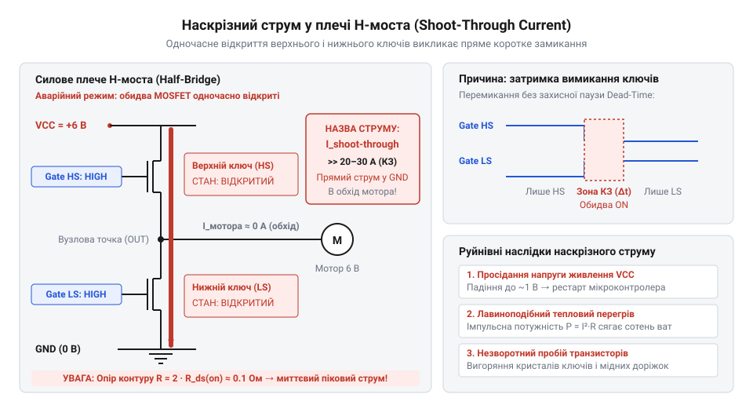
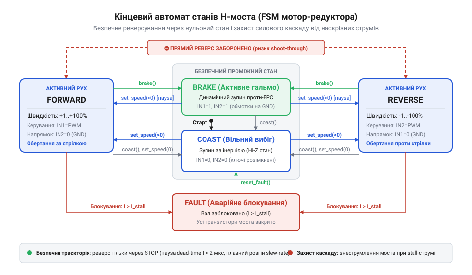
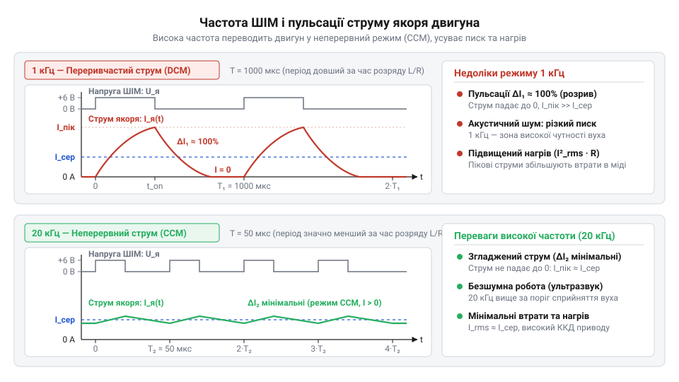
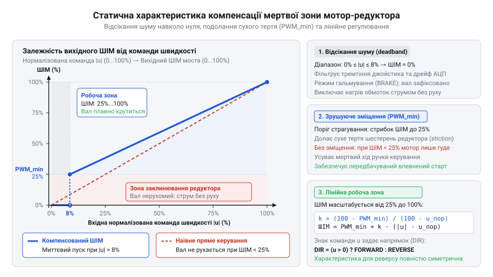
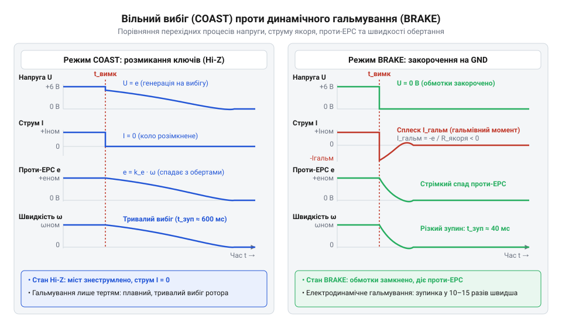
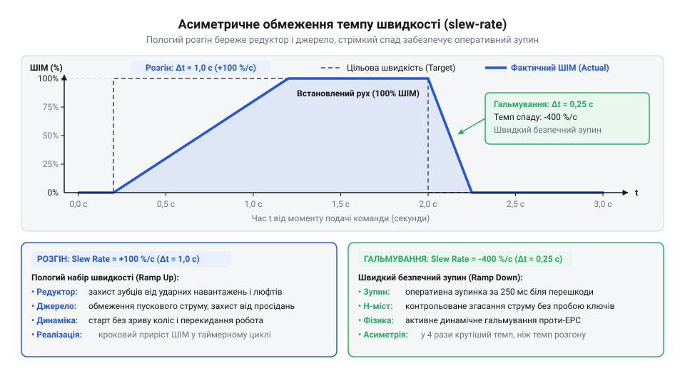
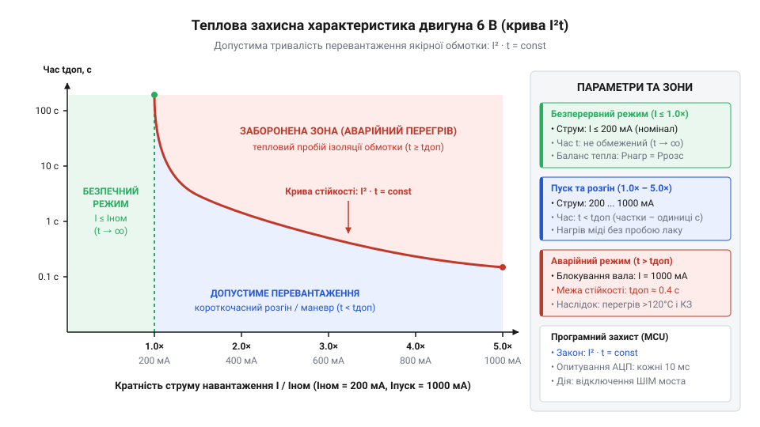
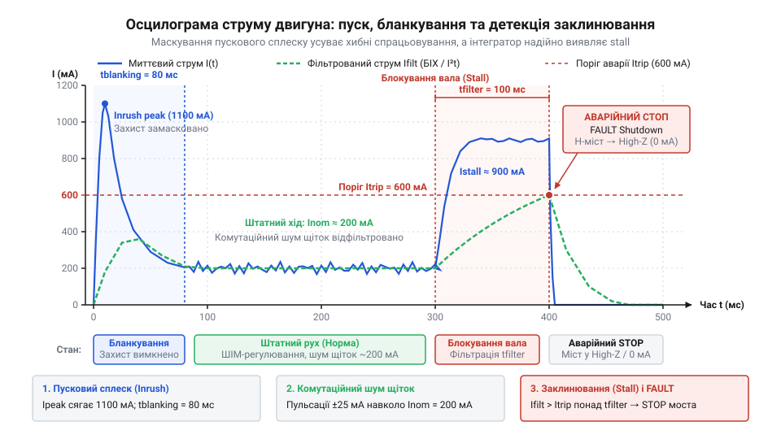
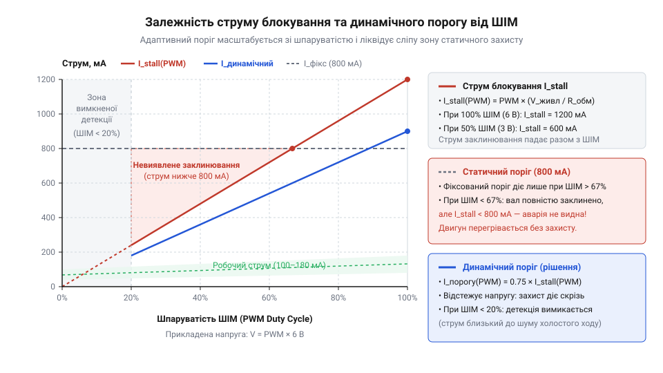
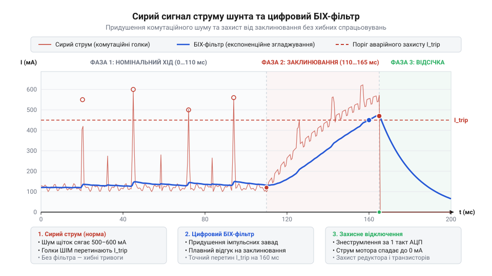

# Мотор-редуктор 6 В (100 і 600 об/хв)

<preknowlist>
- [N20 мікромотор з редуктором](root:cat-hw-actuators/n20-motor) — базові фізичні принципи роботи колекторного двигуна з механічним редуктором: виникнення проти-ЕРС під час обертання, залежність струму від навантаження на валу, кратність пускового струму та чутливість зубчастих передач до різких механічних ударів.
</preknowlist>

## Ризики прямого керування H-мостом без програмної абстракції

Пряме перемикання цифрових виводів мікроконтролера для керування силовим транзисторним H-мостом колекторного приводу, такого як [N20 мікромотор з редуктором](root:cat-hw-actuators/n20-motor), створює оманливе враження простоти. На перший погляд, достатньо встановити логічний рівень на цифровому виводі напрямку та записати значення шпаруватості в регістр таймера широтно-імпульсної модуляції (ШІМ), щоб вал почав обертатися. Проте керування електромеханічним вузлом через розрізнені низькорівневі виклики запису в регістри GPIO породжує три критичні фізичні загрози: електричний пробій ключів через наскрізні струми, механічне зрізання зубців редуктора ударним моментом і некерований дрейф механізму під час зупину.

Перша небезпека криється у внутрішній комутації ключів H-моста. Силовий каскад складається з двох напівмостових стійок (плечей). Кожне плече містить пару транзисторів (лат. *trans* + *resistor*): верхній ключ, під'єднаний до лінії живлення 6 В, та нижній ключ, з'єднаний із землею. Під час зміни полярності на обмотці двигуна мікроконтролер перемикає логічні рівні виводів за лічені одиниці наносекунд. Проте силові транзистори — чи то польові MOSFET, чи біполярні ключі інтегрального драйвера на кшталт [двоканального MOSFET-драйвера DRV8833](root:cat-hw-drivers/drv8833-motor-driver) — мають кінцеву швидкість перемикання через паразитну ємність затворів і час розсмоктування носіїв заряду. Виникає затримка вимкнення (@@en|turn-off delay@@).

Якщо керувальний код відкриває верхній ключ у той момент, коли нижній ключ того самого плеча ще не встиг повністю закритися, обидва транзистори одночасно опиняються у відкритому стані. Цей режим створює наскрізний струм (@@en|shoot-through current@@, від англ. *shoot through* — прострілювати наскрізь). На часовому проміжку від 100 до 500 наносекунд шина живлення виявляється замкненою безпосередньо на землю:

```
I_shoot = V_cc / (R_ds_on_high + R_ds_on_low + R_pcb)
        ≈ 6 В / (0.15 Ом + 0.15 Ом + 0.05 Ом)          [розрахунок для типового MOSFET-моста]
        ≈ 17.1 А                                       [короткочасний піковий імпульс]
```


*Коротке замикання шини живлення на землю через затримку закриття транзисторів напівмоста під час одночасного відмикання ключів.*

Навіть якщо кожен окремий імпульс триває частки мікросекунди, за високої частоти ШІМ такі замикання повторюються десятки тисяч разів на секунду. Миттєве виділення потужності спричиняє локальний перегрів напівпровідникового кристала, просідання живильної напруги мікроконтролера з раптовим перезавантаженням ядра та незворотний тепловий пробій вихідного каскаду. Запобігти цьому можна лише за умови апаратної або програмної паузи перед перемиканням — мертвого часу (@@en|dead-time@@), генерацію якого в таймерах мікроконтролера розглядає [апаратна генерація мертвого часу в таймерах МК](root:hw-arch/advanced-control-timer-tim1).

Друга небезпека виникає на стику електродинаміки та механіки приводу. Колекторний двигун під час обертання генерує внутрішню проти-електрорушійну силу — проти-ЕРС (лат. *electrum* + *motor*), амплітуда якої строго пропорційна кутовій швидкості обертання якоря `ω`:

```
E_emf = k_e · ω
```

Під час усталеного обертання вперед напруга проти-ЕРС спрямована назустріч напрузі живлення `V_cc`, завдяки чому робочий струм через обмотку залишається помірним. Якщо прикладний код раптово змінює напрямок на протилежний (реверс, від лат. *reversus* — повернутий назад) простим перемиканням логічних рівнів, полярність зовнішньої напруги змінюється на протилежну, тоді як ротор за інерцією продовжує обертатися вперед. Згенерована проти-ЕРС і нова напруга живлення більше не віднімаються, а додаються:

```
V_armature = -V_cc - E_emf
           = -(V_cc + k_e · ω)      [синфазне додавання напруги живлення та проти-ЕРС]
```

За максимальної кутової швидкості `E_emf ≈ V_cc`, що створює на активному опорі обмотки подвійну різницю потенціалів: близько 12 В на 6-вольтовому двигуні. Відповідно, піковий імпульс струму через якір удвічі перевищує паспортний струм короткого замикання нерухомого вала — струм заклинювання (@@en|stall current@@):

```
I_peak = (|V_armature|) / R_coil
       = (V_cc + E_emf) / R_coil    [закон Ома для кола якоря]
       ≈ (2 · V_cc) / R_coil        [за максимальної швидкості E_emf ≈ V_cc]
       = 2 · I_stall                [подвоєний струм заклинювання]
```

Оскільки електромагнітний крутний момент двигуна прямо пропорційний силі струму (`τ = k_τ · I`), на валу ротора виникає жорсткий ударний момент:

```
τ_peak = k_τ · I_peak
       ≈ 2 · τ_stall                [подвоєний пусковий крутний момент]
```

У моторах із передатним числом 1:100 або 1:298 швидкість ротора редукується багатоступеневою зубчастою передачею (редуктор, від лат. *reductor* — той, що повертає або зменшує). На перших ступенях редуктора мініатюрні шестерні мають модуль зуба менше 0.2 мм. Ударний реверс миттєво вибирає механічний люфт зачеплення подібно до ковальського молота. Латунні або пластикові зубці першого ступеня не витримують подвійного крутного моменту й зрізаються за лічені цикли перемикання. На відміну від двигунів без механічного редуктора, таких як [5V безколекторні вентилятори](root:cat-hw-actuators/fan-5v) чи [безколекторний мотор (модуль)](root:cat-hw-actuators/bldc-motor-module), колекторний мотор-редуктор вимагає суворого програмного контролю швидкості наростання струму (темпування, @@en|slew-rate@@).

Третя загроза прямого керування полягає у змішуванні різних фізичних режимів зупину. Коли алгоритм вирішує зупинити мотор і просто записує 0% у шпаруватість ШІМ, більшість простих схем вимикає всі транзистори моста. Виходи драйвера переходять у високоімпедансний стан (@@en|Hi-Z@@, від лат. *impedire* — перешкоджати). Котушка від'єднується від джерела живлення, і привід переходить у режим вільного вибігу (@@en|coast@@). Ротор обертається виключно під дією накопиченого моменту інерції, доки його не зупинить механічне тертя редуктора й навантаження. Зупинний шлях стає непередбачуваним і сильно коливається від маси робота чи кута нахилу поверхні.

На противагу вибігу, активне динамічне гальмування (@@en|dynamic braking@@, від грец. *dynamis* — сила) вимагає одночасного відкриття обох нижніх (або обох верхніх) ключів моста. Обмотка двигуна закорочується накоротко. Ротор, що продовжує обертатися, діє як генератор і формує потужний зворотний струм через замкнені ключі. Створена електромагнітна сила Лоренца гасить обертання майже миттєво. Якщо програма керує виводами хаотично, система позбавлена можливості обирати між м'яким рухом накатом та екстреною фіксацією вала.

> 🔧 **Навіщо це.**
> Пряме смикання виводів мікроконтролера покладає відповідальність за безпеку силової електроніки на розробника алгоритмів руху. Будь-яка помилка в умовному переході або випадкова зміна знака швидкості спалює транзистори наскрізним струмом чи кришить зуби редуктора. Програмний контролер H-моста відокремлює фізику заліза від математики переміщення, гарантуючи виконання захисних пауз і плавне наростання тяги незалежно від команд вищого рівня.

## Архітектурна модель контролера та кінцевий автомат режимів

Щоб захистити мікросхему драйвера та шестерні редуктора від руйнівних перехідних процесів, керування приводом організують на основі детермінованого кінцевого автомата (@@en|finite state machine@@, від грец. *automatos* — саморушний). Замість довільного встановлення напруг на окремих виводах мікроконтролера прикладний код надсилає контролеру високорівневі запити: встановити нормалізовану швидкість зі знаком у діапазоні від -1.0f (повний реверс) до +1.0f (повний хід уперед), виконати вибіг або перейти до гальмування.

Внутрішня логіка контролера інкапсулює п'ять взаємовиключних базових станів приводу:

1. `MOTOR_STATE_COAST` (вільний вибіг): усі чотири ключі H-моста закриті, виходи переведені у високоімпедансний стан Hi-Z. Напруга на котушці дорівнює нулю, струм не протікає. Вал обертається виключно за інерцією. Це базовий стан після ініціалізації та скидання живлення.
2. `MOTOR_STATE_FORWARD` (обертання вперед): ключі моста комутують живлення прямої полярності. Шпаруватість ШІМ модулює середню напругу на якорі пропорційно заданій швидкості від 0.0f до +1.0f.
3. `MOTOR_STATE_REVERSE` (обертання назад): ключі моста інвертують полярність напруги на якорі. Шпаруватість ШІМ визначається модулем від'ємної заданої швидкості від 0.0f до -1.0f.
4. `MOTOR_STATE_BRAKE` (активне динамічне гальмування): обидва нижні ключі H-моста постійно відкриті, закорочуючи виводи котушки на шину заземлення. Енергія обертання розсіюється на активному опорі обмотки та відкритих каналах ключів, забезпечуючи швидкий зупин вала.
5. `MOTOR_STATE_FAULT` (аварійне блокування): виникає за критичного апаратного збою — блокування вала ротора зі перевищенням порогу струму або перегріву. Контролер негайно розмикає всі ключі (Hi-Z) і блокує виконання будь-яких команд руху до отримання явного підтвердження скидання помилки.


*Діаграма станів і переходів кінцевого автомата контролера: безпечні траєкторії перемикання між робочими режимами руху та ізольований аварійний стан FAULT.*

Ключовим інваріантом автомата є повна заборона прямого переходу між станами `MOTOR_STATE_FORWARD` та `MOTOR_STATE_REVERSE`. Якщо зовнішній алгоритм, наприклад [ПІД-регулятор швидкості приводу](root:hw-motion/pid-motor-speed-controller), миттєво змінює команду з `+0.9f` на `-0.7f`, контролер не виконує перемикання ключів у той самий момент. Автомат ініціює програмне темпування: шпаруватість плавно знижується до нуля з обмеженням швидкості наростання (slew-rate), витримується апаратна пауза мертвого часу (dead-time), і лише після згасання струму якір перемикається на зворотний напрямок із поступовим прискоренням.

З будь-якого активного стану (`FORWARD`, `REVERSE`, `BRAKE`, `COAST`) контролер миттєво переходить у стан `FAULT`, якщо виміряний струм якоря перевищує допустимий поріг заклинювання `stall_current_ma` довше, ніж дозволяє інтервал маскування пускового викиду `stall_blanking_ms`. Зворотний вихід з аварійного стану можливий лише у стан `COAST` через виклик функції `reset_fault()`, що виключає самовільний перезапуск заблокованого механізму.

Щоб транслювати абстрактні стани кінцевого автомата у фізичний рух, контролер перетворює кожен стан у фіксовану комбінацію логічних рівнів на лініях керування типовим H-мостом: цифрових виводах вибору напрямку `IN1`, `IN2` та виводі широтно-імпульсної модуляції `PWM`. Силовий каскад моста утворюють чотири транзисторні ключі (зазвичай польові MOSFET): пара верхніх плечей високого боку (@@en|high-side@@) `Q1`, `Q3`, підключених до шини напруги живлення `VCC`, та пара нижніх плечей низького боку (@@en|low-side@@) `Q2`, `Q4`, підключених до шини заземлення `GND`. Обмотку якоря двигуна під'єднано між вихідними клемами `OUT1` (середня точка лівого півмоста `Q1`/`Q2`) та `OUT2` (середня точка правого півмоста `Q3`/`Q4`).

| Стан автомата | IN1 | IN2 | PWM | Стан ключів моста (Q1, Q2, Q3, Q4) | Стан виходів (OUT1, OUT2) | Напрямок струму та поведінка ротора |
| :--- | :---: | :---: | :---: | :--- | :--- | :--- |
| `MOTOR_STATE_COAST` | `0` | `0` | `0` | Усі розімкнені (`Q1`–`Q4` вимкнено) | Hi-Z, Hi-Z (високоімпедансний) | Струм живлення відсутній; ротор здійснює вільний вибіг за інерцією |
| `MOTOR_STATE_FORWARD` | `1` | `0` | `ШІМ` | `Q1` та `Q4` відкриті в активній фазі | `VCC`, `GND` | Струм тече від `OUT1` до `OUT2`; прискорення ротора вперед |
| `MOTOR_STATE_REVERSE` | `0` | `1` | `ШІМ` | `Q3` та `Q2` відкриті в активній фазі | `GND`, `VCC` | Струм тече від `OUT2` до `OUT1`; прискорення ротора назад |
| `MOTOR_STATE_BRAKE` | `1` | `1` | `1` | `Q2` та `Q4` постійно відкриті | `GND`, `GND` (обмотка замкнена) | Замкнений струм проти-ЕРС; активне динамічне електромагнітне гальмування |
| `MOTOR_STATE_FAULT` | `0` | `0` | `0` | Усі примусово розімкнені | Hi-Z, Hi-Z (аварійне відсікання) | Ланцюг розірвано; знеструмлення для захисту ключів і двигуна від перегріву |

Кожен із цих станів реалізує специфічний електродинамічний режим взаємодії магнітного поля статора, індуктивності обмотки та механічної підсистеми приводу:

У стані вільного вибігу (`MOTOR_STATE_COAST`) керуючі сигнали `IN1`, `IN2` та `PWM` скидаються в низький логічний рівень `0`. Усі чотири транзистори перебувають у закритому непровідному стані, переводячи виходи `OUT1` та `OUT2` у високоімпедансний стан (стан Hi-Z, від лат. *impedire* — перешкоджати). Електричний зв'язок між джерелом живлення та мотором повністю розірвано. Будь-яка залишкова магнітна енергія індуктивності якоря, що виникає при розмиканні ключів, короткочасно стікає через зворотні паразитні або захисні діоди в шину живлення (рекуперація, від лат. *recuperatio* — повернення), після чого струм в обмотці спадає до нуля. Ротор продовжує обертатися виключно за рахунок накопиченого махового моменту кінетичної інерції. Сповільнення відбувається плавно й повільно, визначаючись виключно силами механічного тертя в підшипниках та редукторному вузлі [N20 мікромотора з редуктором](root:cat-hw-actuators/n20-motor).

У робочих станах руху (`MOTOR_STATE_FORWARD` та `MOTOR_STATE_REVERSE`) контролер комутує діагональні плечі H-моста, модулюючи шпаруватість сигналу на піні `PWM`. Для обертання вперед на `IN1` виставляється `1`, а на `IN2` — `0`. Під час активної фази такту ШІМ одночасно відкриваються верхній лівий ключ `Q1` та нижній правий ключ `Q4`. Потенціал виводу `OUT1` дорівнює напрузі живлення `VCC`, а `OUT2` з'єднується із землею `GND`. Електричний струм рухається крізь обмотку якоря зліва направо (від `OUT1` до `OUT2`). Взаємодія цього струму з постійним магнітним полем збуджує тангенційну силу Лоренца, що утворює рушійний крутний момент і розганяє ротор. Одночасно при обертанні витків якоря в магнітному полі статора наводиться внутрішня проти-ЕРС (електрорушійна сила, @@en|counter-electromotive force@@, від лат. *electromotio* — збудження електрики). Проти-ЕРС діє строго назустріч напрузі живлення, завдяки чому зі зростанням обертів струм якоря автоматично знижується від великого пускового значення до робочого рівня холостого ходу.

Під час зміни напрямку на реверс (`MOTOR_STATE_REVERSE`) сигнали на цифрових виводах інвертуються: `IN1 = 0`, `IN2 = 1`. Відповідно відмикаються ключі протилежної діагоналі: верхній правий `Q3` та нижній лівий `Q2`. Полярність напруги на якорі змінюється на зворотну (`OUT1` з'єднано з `GND`, а `OUT2` — з `VCC`), вектор струму починає протікати крізь котушку у зворотному напрямку (справа наліво), змінюючи напрямок магнітного поля якоря і змушуючи ротор створювати крутний момент протилежного знака. У пасивних фазах ШІМ (коли сигнал `PWM` переходить у нуль) драйвер замикає струм через нижні або верхні ключі у режимі рециркуляції (лат. *re-* — знову та *circulatio* — обертання), що забезпечує безперервність струму в індуктивності та запобігає перенапругам.

Стан активного динамічного гальмування (`MOTOR_STATE_BRAKE`) принципово відрізняється від вибігу характером прикладеного моменту. Сигнали `IN1 = 1`, `IN2 = 1` та максимальне заповнення `PWM` (або `IN1 = 0`, `IN2 = 0` за умови активації нижніх ключів інтегральною логікою) примусово відкривають обидва нижні транзистори `Q2` і `Q4` при закритих верхніх `Q1`, `Q3`. Виходи `OUT1` і `OUT2` закорочуються між собою через шину `GND`, відсікаючи зовнішнє живлення `VCC`. Ротор, обертаючись за інерцією, миттєво переходить у генераторний режим: магнітний потік статора індукує в котушці проти-ЕРС, яка замикається крізь малий опір відкритих каналів транзисторів `R_DS(on)` та опір самої обмотки. Виникає потужний індукційний струм генерації, напрямок якого за правилом Ленца протилежний струму обертання. Взаємодія цього струму з магнітним полем статора породжує сильний електродинамічний гальмівний момент, який миттєво поглинає кінетичну енергію ротора, розсіюючи її у вигляді тепла на активних опорах кола, і забезпечує швидкий, контрольований зупин приводу без інерційного вибігу.

У стані аварійного блокування (`MOTOR_STATE_FAULT`) програмний автомат примусово скидає `IN1 = 0`, `IN2 = 0` та `PWM = 0`, а за наявності окремого апаратного виводу відключення моста чи переведення в режим сну (наприклад, `nSLEEP` або `ENABLE`) переводить його в неактивний стан. Усі чотири ключі `Q1`–`Q4` миттєво блокуються, ізолюючи мотор від шини живлення. Це повністю припиняє перегрів обмоток якоря струмом заклинювання (stall current), запобігаючи руйнуванню ізоляції котушок та тепловому пробою транзисторів драйвера. Механічна система при цьому знеструмлюється: якщо ротор заклинено зовнішньою перешкодою, з шестерень редуктора знімається руйнівний крутний момент, а за відсутності блокування ротор вільно зупиняється.

Архітектура драйвера розділяє опис системи на дві незалежні сутності: статичну конфігурацію `motor_config_t` та динамічний дескриптор приводу `motor_t` (лат. *descriptor* — той, що описує). Конфігурація задає прив'язку до фізичних пінів і ліміти безпеки, тоді як дескриптор зберігає поточний стан, швидкість і показники датчиків конкретного екземпляра мотора.

:::tabs
:::code api-motor-hbridge-controller/c/snippet-1.c
:::code api-motor-hbridge-controller/cpp/motorcontroller.cpp
:::

> 🔧 **Навіщо це.**
> Інкапсуляція апаратних ресурсів у дескриптор `motor_t` або об'єкт класу `MotorController` усуває використання глобальних змінних та жорстко закодованих номерів пінів. Це дає змогу масштабувати код на будь-яку кількість приводів у системі — від диференціального двоколісного шасі до повнопривідної платформи з чотирма колесами. Кожен мотор керується власним екземпляром автомата з індивідуальними калібруваннями струму й темпу розгону, використовуючи єдину перевірену бібліотечну логіку.

## Конфігурація периферії та ультразвуковий ШІМ: motor_init()

Під час подачі живлення або апаратного перезавантаження мікроконтролера його виводи вводу-виводу перебувають у стані за замовчуванням — у режимі входу з високим імпедансом (від лат. @@la|impedire@@ — перешкоджати). У такій невизначеній точці вхідні лінії драйвера H-моста виявляються відірваними від фіксованих рівнів напруги. Якщо на затворах силових польових транзисторів немає зовнішніх стягувальних резисторів, наведені завади або залишкові заряди паразитної ємності здатні одночасно відкрити верхній і нижній ключі одного й того самого напівмоста. Виникає наскрізне коротке замикання (англ. @@en|shoot-through@@) лінії силового живлення безпосередньо на спільний провід, що випалює кристали транзисторів за лічені мікросекунди. Навіть без фатального короткого замикання випадковий імпульс на лініях керування змушує вал різко смикнутися до початку роботи керівної програми.

Функція `motor_init()` виключає цей апаратний хаос. Її призначення — провести детерміновану перевірку всіх конфігураційних параметрів, сконфігурувати апаратний таймер мікроконтролера та перевести силове коло у гарантовано безпечний, знеструмлений стан до того, як на мотор буде подано хоча б один активний імпульс.

Функція приймає вказівники на дескриптор приводу `motor_t` та незмінну структуру конфігурації `motor_config_t`. Першим кроком драйвер перевіряє коректність виділених ліній вводу-виводу:
1. Виводи керування напівмостами `pin_in1` та `pin_in2` мають належати валідним апаратним портам і не збігатися між собою. Якщо передано неіснуючий або дубльований вивід, функція негайно припиняє виконання та повертає код помилки `MOTOR_ERR_INVALID_PIN`.
2. Задана частота апаратного таймера ШІМ (широтно-імпульсна модуляція; англ. @@en|PWM, pulse-width modulation@@) повинна укладатися в робочий діапазон драйвера та дозволяти таймеру сформувати прийнятну розрядність регулювання. Якщо розрахунковий період лічильника становить менше ніж 200 відліків (що дає неприпустимо грубий крок шпаруватості понад 0.5%) або перевищує максимальну місткість 16-бітного регістра (понад 65535 відліків), ініціалізація відхиляється з кодом `MOTOR_ERR_PWM_FAIL`.

Ключовим параметром ініціалізації є вибір робочої частоти ШІМ. Для 6-вольтових колекторних двигунів із зубчастим редуктором, таких як [N20 мікромотор з редуктором](root:cat-hw-actuators/n20-motor), стандартні частоти таймерів загального призначення (наприклад, 490 Гц або 980 Гц) створюють дві фундаментальні інженерні проблеми: акустичну та електромеханічну.

Акустична проблема полягає в тому, що частоти до 16–20 кГц лежать безпосередньо в зоні найвищої чутливості людського вуха. Під дією пульсуючого магнітного поля обмотки якоря зазнають сил Лоренца та явища магнітострикції (від лат. @@la|strictio@@ — стискання), через що осердя ротора та корпус двигуна перетворюються на електроакустичний випромінювач. Механізм видає виснажливий високочастотний писк. Перенесення частоти комутації в ультразвуковий (від лат. @@la|ultra@@ — понад, за межами та @@la|sonus@@ — звук) діапазон порядку 20–25 кГц повністю усуває чутний шум: коливання магнітного поля виходять за поріг сприйняття людини, і робота приводу стає безшумною.

Електромеханічна проблема криється у фізиці струму якоря. Обмотка двигуна має активний опір `R` та власну індуктивність (від лат. @@la|inductio@@ — наведення, спонукання) `L`. Струм в індуктивності не може змінюватися стрибком: його перехідні процеси описуються електричною часовою сталою:

```
τ_e
= L ÷ R                                              [електрична часова стала кола якоря]
```

Для типового 6-вольтового двигуна з опором обмотки `R ≈ 5 Ом` та індуктивністю `L ≈ 0.4 мГн` стала часу становить `τ_e ≈ 80 мкс`. Якщо частота ШІМ низька (наприклад, `f = 500 Гц`, період комутації `T = 2000 мкс`), період у десятки разів перевищує `τ_e`. За час паузи між імпульсами струм якоря встигає повністю спасти до нуля. Виникає режим переривчастого струму (англ. @@en|discontinuous conduction mode@@). У цьому режимі для підтримання того самого середнього механічного моменту через мотор проходять потужні гостроверхі пікові імпульси. Оскільки втрати на нагрів мідного дроту пропорційні квадрату діючого струму (`I_rms² × R`), двигун у переривчастому режимі швидко перегрівається, а на щітках колектора виникає руйнівне іскріння.

На частоті `f = 20 кГц` період імпульсів становить лише `T = 50 мкс`, що менше за сталу часу `τ_e`. Індуктивність якоря не встигає повністю розрядитися під час паузи, і струм переходить у неперервний режим (англ. @@en|continuous conduction mode@@). Струм згладжується у квазіпостійний потік із незначною амплітудою пилкоподібних пульсацій, ротор розвиває стабільний крутний момент, а щітковий вузол працює у штатному тепловому режимі.


*Осцилограми струму якоря на частотах ШІМ 1 кГц та 20 кГц: згладжування пульсацій струму індуктивністю якоря під час переходу до ультразвукової частоти.*

Збільшувати частоту значно вище 20–25 кГц (наприклад, до 100 кГц) небезпечно через динамічні комутаційні втрати в польових ключах H-моста. Кожен такт відкриття й закриття MOSFET супроводжується перезаряджанням ємності затвора та короткочасним проходженням транзистора через лінійну зону, де на ньому одночасно присутні висока напруга і великий струм. Комутаційні втрати зростають прямо пропорційно частоті комутації:

```
P_sw
= f_pwm × E_sw                                       [потужність комутаційних втрат напівмоста]
```

На частотах понад 30 кГц інтегровані силові каскади починають перегріватися навіть на холостому ходу мотора. Таким чином, 20 кГц є розрахунковим інженерним балансом: писк повністю усунуто, струм якоря залишається гладким і неперервним, а комутаційне виділення тепла на ключах не перевищує допустимих меж.

Після валідації параметрів і налаштування лічильника функція `motor_init()` виставляє обидва виводи керування у стан логічного нуля. Це розмикає всі транзистори [інтегрованих H-мостів](root:hw-motion/h-bridge-driver), переводячи силові клеми у режим вибігу, скидає регістри шпаруватості таймера в нуль і переводить кінцевий автомат приводу зі стану `MOTOR_STATE_UNINITIALIZED` у стан готовності `MOTOR_STATE_IDLE`.

> 🔧 **Навіщо це.**
> Чітка ініціалізація з попереднім апаратним глушінням силових ключів рятує мікроконтролерні контролери від вигорання вихідних каскадів у момент увімкнення акумуляторного живлення. Безпечний перехід у стан очікування на ультразвуковій частоті гарантує, що сервісні роботи та робототехнічні платформи стартуватимуть плавно, без раптових ривків редуктора й без дратуючого високочастотного писку в приміщенні.

Нижче наведено структури даних та реалізацію функції ініціалізації мотора:

:::code api-motor-hbridge-controller/c/motor-init.c

Апаратна реалізація конфігурації таймера на різних сімействах мікроконтролерів має власну специфіку регістрації та розрахунку тактування. Якщо для базового керування двигуном лічильник налаштовують на однонапрямлений рахунок угору (вирівнювання по краю), то для зниження електромагнітних завад і придушення гармонік у силових перетворювачах застосовують [симетричний ШІМ із вирівнюванням по центру](root:hw-arch/hardware-pwm):

:::tabs
:::code api-motor-hbridge-controller/c/stm32-pwm-init.c
:::code api-motor-hbridge-controller/c/esp32-pwm-init.c
:::

## Двонапрямлене задання швидкості та компенсація мертвої зони редуктора: motor_set_speed()

Апаратні таймери різних мікроконтролерів оперують цілочисельними регістрами різної розрядності: 8-бітний таймер рахує від 0 до 255, 10-бітний модуль — до 1023, а 16-бітний таймер із тактовою частотою 84 МГц на частоті 20 кГц має межу рахунку 4199 відліків. Якщо алгоритми руху вищого рівня передаватимуть «сирі» відліки регістра порівняння, прикладний код стане жорстко прив'язаним до конкретної апаратної конфігурації. Крім того, математика позиціонування та кінематика мобільних платформ вимагають вектора: рух уперед задається додатною швидкістю, реверс — від'ємною, а зупинка — нулем.

Функція `motor_set_speed()` ізолює високорівневе керування від апаратних особливостей таймерів за допомогою нормалізації (від лат. @@la|normalis@@ — прямовисний, правильний). Вона приймає уніфіковане число з рухомою комою у діапазоні від -1.0 до +1.0. Знак аргументу визначає полярність прикладання напруги до обмотки та напрямок обертання вала, а абсолютна величина масштабується у шпаруватість (англ. @@en|duty cycle@@) імпульсів таймера.

Однак пряме лінійне перетворення стикається з фізичним бар'єром механічного редуктора. Усередині малогабаритного мотор-редуктора з передавальним відношенням порядку 1:100 або 1:300 встановлено багатоступеневий каскад зубчастих коліс. Між металевими або капроновими зубцями шестерень, а також у підшипниках ковзання виникає значне сухе тертя спокою — стикція (англ. @@en|stiction@@, від @@en|static friction@@).

Сила тертя спокою завжди суттєво перевищує силу тертя руху. Якщо подати на двигун ШІМ із невеликою шпаруватістю (зазвичай нижче 15–20%), середньої напруги на якорі виявиться недостатньо для створення пускового електромагнітного моменту, здатного подолати статичний опір редуктора:

```
M_start < M_stiction                                 [умова непорушності заблокованого вала]
```

Вал залишається абсолютно нерухомим. При цьому через заблокований якір тече постійний струм короткого замикання, який цілком перетворюється на тепло: обмотка марно нагрівається, розряджаючи батарею живлення, а механізм не рухається. Утворюється зона нечутливості (англ. @@en|deadband@@) керування. Якщо оператор або ПІД-регулятор плавно збільшує команду від 0.0 до 0.18, привод взагалі не реагує, а при переході порогу 0.19 вал раптово зривається з місця на відчутній швидкості. Плавне рушання та точне повільне дотягування стають неможливими.

Алгоритм компенсації мертвої зони всередині `motor_set_speed()` виправляє цю нелінійність за допомогою двох калібрувальних параметрів:
1. `deadband_cutoff` (поріг відсікання шуму): зона гарантованого спокою (наприклад, 0.03 або 3%). Якщо абсолютна величина команди менша за це значення, драйвер примусово вимикає подачу напруги. Це виключає спонтанне повзання робота від дрейфу нуля аналогових джойстиків або високочастотного цифрового шуму регуляторів.
2. `deadband_min_duty` (мінімальна шпаруватість страгування): експериментально визначений рівень ШІМ (наприклад, 0.18 або 18%), за якого електромагнітний момент гарантовано зриває шестерні з тертя спокою в режим плавного стабільного обертання.

Коли модуль швидкості перевищує поріг `deadband_cutoff`, алгоритм виконує лінійне перемасштабування залишку діапазону швидкостей `[deadband_cutoff .. 1.0]` у робочий діапазон шпаруватості ШІМ `[deadband_min_duty .. 1.0]`:

```
duty
= deadband_min_duty + (|speed| - deadband_cutoff) × (1.0 - deadband_min_duty) ÷ (1.0 - deadband_cutoff)
```

**Умова обчислення:**
Мотор-редуктор 6 В на базі мікроконтролера з таймером ШІМ на 84 МГц (`ARR = 4199`, частота 20 кГц). Налаштування зони нечутливості: поріг відсікання шуму `deadband_cutoff = 0.05`, мінімальна зрушуюча шпаруватість `deadband_min_duty = 0.18`. На вхід подано команду половинної швидкості вперед: `speed = +0.50`. Розрахувати вихідну шпаруватість ШІМ та цілочисельне значення регістра порівняння `CCR`.

```
duty
= deadband_min_duty + (|speed| - deadband_cutoff) × (1.0 - deadband_min_duty) ÷ (1.0 - deadband_cutoff)   [формула ремапінгу мертвої зони]
= 0.18 + (0.50 - 0.05) × (1.0 - 0.18) ÷ (1.0 - 0.05)                                                     [підстановка параметрів системи]
= 0.18 + 0.45 × 0.82 ÷ 0.95                                                                               [обчислення різниць вхідного та вихідного вікон]
= 0.18 + 0.369 ÷ 0.95                                                                                     [множення амплітуди сигналу на робочий розмах]
≈ 0.18 + 0.3884                                                                                           [ділення на ефективний діапазон регулювання]
≈ 0.5684                                                                                                  [розрахункова нормалізована шпаруватість ШІМ]

CCR
= round(duty × ARR)                                                                                       [переведення нормалізованої величини у відліки таймера]
= round(0.5684 × 4199)                                                                                    [підстановка розрахованої шпаруватості та значення ARR]
= 2387                                                                                                    [значення регістра порівняння таймера]
```

Завдяки компенсації команда `0.50` формує не половинну шпаруватість 50%, а скориговану — 56.84%, зсуваючи весь робочий сектор вище смуги тертя спокою. За мінімальної команди, що ледь перевищує поріг (наприклад, `speed = 0.06`), на таймер надійде шпаруватість 18.8%, мотор негайно зрушить без зависання в режимі нагріву, а залежність фактичної швидкості від команди набуде лінійного характеру на всьому діапазоні.


*Статична характеристика залежності шпаруватості ШІМ від команди швидкості: відсікання шуму в зоні спокою, зрушуюче зміщення deadband та лінійне перемасштабування шпаруватості.*

Залежно від знака вхідного параметра функція комутує плечі моста:
- При `speed > 0`: вивід `IN1` підключається до генератора ШІМ із розрахованою шпаруватістю, а `IN2` притискається до логічного нуля (обертання вперед).
- При `speed < 0`: вивід `IN1` утримується в нулі, а `IN2` модулюється сигналом ШІМ (реверсивне обертання).
- При `speed == 0`: генерація ШІМ припиняється, драйвер переходить у режим зупинки.

> 🔧 **Навіщо це.**
> Компенсація мертвої зони усуває мертвий хід регуляторів і ліквідує накопичення інтегральної помилки (англ. @@en|integral windup@@) у ПІД-контурах швидкості. Робот отримує здатність повзти на наднизьких обертах із передбачуваною динамікою, а силове коло не витрачає енергію на холостий нагрів заклинених шестерень.

Реалізація нормалізованого задання швидкості:

:::code api-motor-hbridge-controller/c/motor-set-speed.c

Апаратне керування регістрами таймера при зміні шпаруватості:

:::tabs
:::code api-motor-hbridge-controller/c/platform-pwm-set-duty.c
:::code api-motor-hbridge-controller/c/platform-pwm-set-duty.c
:::

## Режими зупинки: вибіг Hi-Z проти динамічного гальмування у функції motor_stop()

Коли керуюча програма вимагає припинити рух, зняття імпульсів напруги можна реалізувати двома фізично різними способами. Колекторний електродвигун постійного струму є повністю оборотною електричною машиною: при підведенні струму він розвиває механічний крутний момент, а під час обертання зовнішньою силою або власною інерцією працює як генератор електричної енергії. Поведінка вала в момент зупинки повністю визначається тим, у який стан H-міст переводить свої силові ключі.

Функція `motor_stop()` підтримує два взаємовиключні режими зупинки приводу через параметр `motor_stop_mode_t`:
1. Вільний вибіг (`MOTOR_STOP_COAST`).
2. Активне динамічне гальмування (`MOTOR_STOP_BRAKE`).

У режимі вибігу (`MOTOR_STOP_COAST`) усі чотири польові транзистори H-моста примусово закриваються. Обидва виводи двигуна переходять у високоімпедансний стан (Hi-Z). У перші кілька мікросекунд після закриття ключів залишкова енергія магнітного поля обмотки скидається через зворотні паразитні діоди MOSFET у шину живлення. Після розрядки індуктивності діоди замикаються, і електричне коло якоря виявляється фізично розірваним:

```
I_armature = 0                                       [струм розімкненого кола якоря]
```

Ротор двигуна та шестерні редуктора продовжують обертатися виключно за рахунок накопиченої кінетичної енергії обертання `(J × ω²) ÷ 2`. Оскільки провідники обмотки перетинають магнітне поле статора, на щітках генерується проти-ЕРС (електрорушійна сила; англ. @@en|back-EMF@@, electromotive force; від лат. @@la|electrum@@ — бурштин та @@la|motor@@ — рушій):

```
E
= k_e × ω                                            [проти-ЕРС генераторного режиму ротора]
```

Але через те, що коло розімкнене, струм не протікає. Згідно з законом Ампера, на якір не діє жодна електродинамічна гальмівна сила:

```
M_brake = 0                                          [електромагнітний гальмівний момент відсутній]
```

Вал поступово сповільнюється лише під дією механічного тертя в підшипниках і зачепленнях редуктора:

```
J × (dω ÷ dt)
= -M_friction                                        [сповільнення під дією механічного тертя]
```

Час до повної зупинки вала в режимі вибігу є максимальним і може становити від сотень мілісекунд до кількох секунд залежно від інерції навантаження. Проте механічні навантаження на зубці редуктора при цьому прямують до нуля: сповільнення відбувається плавно й м'яко.

Принципово інша фізика виникає в режимі динамічного (від грец. @@el|dynamis@@ — сила, міць) гальмування (`MOTOR_STOP_BRAKE`). Верхні транзистори моста закриваються, а обидва нижні транзистори (low-side MOSFET) одночасно відкриваються. Обидва виводи двигуна виявляються замкненими на спільний провід (GND).

Обертаючись за інерцією, ротор продовжує генерувати проти-ЕРС `E = k_e × ω`. Але тепер виводи обмотки закорочені між собою через відкриті канали двох нижніх транзисторів із малим опором `R_ds(on)`. Утворюється замкнене електричне коло з мінімальним повним опором `R_loop = R_armature + 2 × R_ds(on)`.

У цьому замкненому контурі спалахує потужний гальмівний струм проти-ЕРС:

```
I_brake
= E ÷ R_loop                                         [закон Ома для замкненого контуру якоря]
= (k_e × ω) ÷ (R_armature + 2 × R_ds(on))            [підстановка проти-ЕРС та активного опору]
```

Напрямок цього струму строго протилежний до робочого струму, який розганяв мотор у цей бік. Згідно з правилом Ленца, індукований струм створює магнітне поле, яке протидіє першопричині свого виникнення — обертанню ротора. Виникає потужний електродинамічний гальмівний момент сили Ампера:

```
M_brake
= k_m × I_brake                                      [електромагнітний момент лоренцових сил]
= (k_m × k_e × ω) ÷ (R_armature + 2 × R_ds(on))      [підстановка гальмівного струму проти-ЕРС]
```

Оскільки конструктивний коефіцієнт двигуна `k_m` у системі SI чисельно збігається з коефіцієнтом проти-ЕРС `k_e`, гальмівний момент виявляється прямо пропорційним поточній кутовій швидкості: `M_brake = β_brake × ω`. На високій швидкості цей момент колосальний: він порівнянний із пусковим моментом мотора. Рівняння динаміки зупинки набуває вигляду:

```
J × (dω ÷ dt)
= -M_brake - M_friction                              [рівняння сповільнення при динамічному гальмуванні]
= -((k_e² ÷ R_loop) × ω) - M_friction                [експоненційне електродинамічне гальмування]
```

Швидкість експоненційно падає до нуля за лічені мілісекунди. При цьому вся кінетична енергія рухомих мас розсіюється у вигляді джоулевого тепла на активному опорі обмотки двигуна та опорі відкритих каналів транзисторів. Щойно вал зупиняється (`ω = 0`), проти-ЕРС зникає (`E = 0`), гальмівний струм спадає до нуля, і нагрів припиняється. Двигун не починає крутитися назад — він різко й мертво стає на місці.


*Часові діаграми напруги керування, струму якоря, проти-ЕРС та кутової швидкості вала: у режимі COAST струм спадає до нуля, а ротор вільно докочується за інерцією; у режимі BRAKE закорочення обмоток породжує стрибок гальмівного струму від проти-ЕРС і забезпечує круте падіння швидкості до повної зупинки.*

Вибір між режимами базується на жорстких інженерних критеріях:

Критерії вибору режиму COAST:
- Енергозбереження: у стані зупинки всі ключі розімкнені, власне споживання силового каскаду практично дорівнює нулю (актуально для автономних пристроїв із батарейним живленням).
- Захист редуктора від механічного зламу: якщо вал несе масивне навантаження з великим моментом інерції (важкі колеса, сталевий маховик), миттєве динамічне гальмування призводить до ударного зростання напруження в зубцях редуктора. Для редукторів із латунними або пластиковими шестернями такий удар загрожує зрізанням зубців передачі. COAST дозволяє інерції розсіятися плавно.
- Плавність руху: природне сповільнення накатом у транспортних візках під час скидання газу.

Критерії вибору режиму BRAKE:
- Прецизійне позиціонування: зупинка мобільного робота точно перед лінією розмітки або перешкодою без вибігу та проскакування цільової координати.
- Мінімізація гальмівного шляху: екстрена зупинка за сигналом аварійного кінцевика або оптичного бар'єра.
- Запобігання самочинному скочуванню: хоча динамічне гальмування не створює моменту утримання при повній нерухомості (`ω = 0`), будь-яка спроба зовнішньої сили провернути вал (наприклад, скочування робота зі схилу під дією сили тяжіння) негайно породжує проти-ЕРС та зустрічний гальмівний струм, який різко чинить опір скочуванню.

> 🔧 **Навіщо це.**
> Грамотне поєднання COAST і BRAKE запобігає зношуванню шестерень редуктора: штатні зупинки на рівній поверхні виконують вибігом без ударів по зубах, а динамічне гальмування активують виключно для точного доведення до мітки або екстреного стопу перед зіткненням.

Реалізація функції зупинки:

:::code api-motor-hbridge-controller/c/motor-stop.c

Об'єктно-орієнтована C++ обгортка над драйвером надає безпечний інтерфейс RAII та спрощує виклики керування рухом:

:::code api-motor-hbridge-controller/cpp/motorcontroller.cpp

## Часовий захист від наскрізних струмів та обмеження темпу прискорення

Коли транзисторний H-міст змінює напрямок обертання двигуна або модулює напругу імпульсами ШІМ, у вертикальному напівмості відбувається перемикання активних ключів: верхній транзистор, підтягнутий до позитивної шини живлення, мусить закритися, а нижній, під'єднаний до шини землі, — відкритися. Проте реальний напівпровідниковий ключ не вимикається миттєво. Затворні ємності польових транзисторів розряджаються через скінченний опір драйвера, а час повного розсмоктування заряду й закриття каналу (@@en|turn-off time@@) практично завжди перевищує час його відкриття (@@en|turn-on time@@).

Якщо подати відкривальний логічний сигнал на нижній ключ у той самий момент, коли з верхнього щойно зняли керуючу напругу, виникає коротке часове перекриття провідності. Верхній транзистор ще не встиг замкнутися, а нижній уже почав проводити струм. У результаті між клемами джерела живлення утворюється пряме коротке замикання крізь відкриті кристали обох транзисторів. Це явище називають наскрізним струмом (від англ. @@en|shoot-through@@ або @@en|cross-conduction@@). Навіть якщо таке замикання триває лише частки мікросекунди, амплітуда струму стрибає до десятків амперів і обмежується лише паразитним опором доріжок плати. Це спричиняє раптові просідання напруги живлення мікроконтролера, збої внутрішньої логіки та швидке теплове руйнування транзисторів.

Щоб усунути наскрізні струми, алгоритм керування зобов'язаний витримувати примусову паузу між вимкненням одного транзистора плеча та ввімкненням його комплементарної пари. Інтервал, під час якого обидва ключі напівмоста гарантовано утримуються в закритому, високоімпедансному стані, називають мертвим часом (від англ. @@en|dead-time@@).

Поряд із захистом електронних ключів існує критична потреба захисту механіки. Колекторний електродвигун постійного струму, такий як [N20 мікромотор з редуктором](root:cat-hw-actuators/n20-motor), на холостому ходу розвиває від 15 000 до 30 000 обертів на хвилину на валу ротора. Вбудований зубчастий редуктор знижує цю швидкість до робочих 100–600 обертів на хвилину, багаторазово збільшуючи вихідний крутний момент. Зубці перших високошвидкісних ступенів редуктора мають товщину менше міліметра.

Якщо програмний код миттєво змінює швидкість зі спокою на повну потужність (100% шпаруватості) або здійснює жорсткий реверс із +100% на -100%, електромагнітний момент двигуна стрибає до граничного пускового значення. Ротор мотора має мізерну інерцію, тоді як приєднане до вихідного вала навантаження (колесо мобільного робота чи важіль маніпулятора) чинить великий інерційний опір. Шестерні редуктора отримують потужний кінематичний удар, що призводить до стирання контактних поверхонь, деформації осей і навіть сколювання зубців передачі.

Для збереження шестерень і усунення пускових сплесків струму програма обмежує темп наростання керуючого сигналу. Ступінчаста команда цільової швидкості розгортається в часі у плавну похилу рампу. Цей механізм називають обмежувачем темпу наростання (від англ. @@en|slew-rate limiter@@, де @@en|slew-rate@@ означає швидкість зміни величини в часі).

Обчислення захисних алгоритмів виконує функція періодичного обслуговування `motor_update()`. Виклик інтерфейсної функції `motor_set_speed()` фіксує лише цільову швидкість (`target_speed`), тоді як поточна робоча швидкість (`current_speed`) підтягується до неї малими порціями під час кожного виклику `motor_update()` із дискретним кроком за часом `Δt`.

```
Δduty_max = (slew_rate_pct_s × Δt_ms) / 1000     [максимальний приріст шпаруватості за період оновлення]
```

Наприклад, якщо обмеження темпу розгону становить 200 %/с (повний розгін від 0 до 100% триває 500 мс), а функція `motor_update()` викликається з періодом 10 мс:

```
Δduty_max = (200 × 10) / 1000
          = 2 %                                  [дозволена зміна шпаруватості за одну ітерацію]
```

Коли двигун обертається вперед і отримує команду зміни напрямку на зворотний, алгоритм поступово зменшує шпаруватість кроками по 2% до повного нуля. У точці нульової швидкості драйвер переходить у стан `MOTOR_STATE_DEADTIME`: вимикає всі транзистори [транзисторного H-моста](root:hw-motion/h-bridge) і очікує завершення мікросекундного інтервалу мертвого часу. Лише після закриття раніше відкритих ключів вмикається зворотна комбінація виводів напрямку, і швидкість починає наростати у від'ємний бік.

> 🔧 **Навіщо це.**
> Пауза мертвого часу усуває наскрізні струми короткого замикання в силових транзисторах, запобігаючи перегріву ключів і просіданню напруги логіки мікроконтролера. Обмеження темпу розгону перетворює механічні удари на плавне прискорення, захищаючи мініатюрні зубці редуктора від зрізання та продовжуючи ресурс ходової частини роботів.


*Графік асиметричного розгону та гальмування: плавний рамповий вихід на робочу швидкість для захисту редуктора та швидке безпечне динамічне гальмування.*

Нижче наведено практичну реалізацію алгоритмів мертвого часу та обмеження темпу розгону у функції `motor_update()`.

:::tabs
@tab C
:::code api-motor-hbridge-controller/c/motor-init.c

@tab C++
:::code api-motor-hbridge-controller/cpp/motorstate.cpp
:::

## Зворотний зв'язок за струмом, вікно бланкування та детекція заклинювання

У роботі будь-якого механічного приводу трапляються ситуації позаштатної зупинки: колесо платформи впирається у перешкоду, захват маніпулятора стискає жорстку деталь або між шестернями редуктора застрягає стороння частка. У такому стані вихідний вал зупиняється попри подану на мотор напругу живлення.

Під час нормального обертання двигуна його якір функціонує як генератор і формує на своїх виводах зустрічну електрорушійну силу — проти-ЕРС (від англ. @@en|back-EMF@@, лат. @@la|vis electromotrix@@). Проти-ЕРС віднімається від напруги живлення, завдяки чому падіння напруги на активному опорі обмотки залишається малим, а струм споживання — помірним:

```
V_net = V_supply - V_bemf                       [результуюча напруга на активному опорі якоря]
I_run = V_net / R_armature                      [робочий струм двигуна за законом Ома]
```

Коли вал заклинює, швидкість обертання падає до нуля, внаслідок чого проти-ЕРС миттєво зникає (`V_bemf = 0`). Уся напруга живлення прикладається безпосередньо до активного омічного опору мідного дроту обмоток:

```
I_stall = V_supply / R_armature                 [струм зупиненого вала за законом Ома]
```

Для типового 6-вольтового двигуна [N20 мікромотор з редуктором](root:cat-hw-actuators/n20-motor) активний опір якоря становить близько 6 Ом. Відповідно, струм блокування вала (від англ. @@en|stall current@@) сягає 1000 мА (1 А). При цьому струм холостого ходу дорівнює лише 60–80 мА, а номінальний робочий струм під навантаженням — близько 200–250 мА. Струм блокування перевищує номінальний у 4–5 разів.

Потужність теплових втрат у замкненому корпусі двигуна підпорядковується закону Джоуля-Ленца й зростає пропорційно квадрату струму:

```
P_heat = I² × R_armature                        [потужність тепловиділення в мідному дроті обмоток]
```

При заклинюванні тепловиділення зростає у 16–25 разів порівняно зі штатним режимом. Тонкий ізоляційний лак на витках обмотки розм'якшується та вигорає протягом кількох секунд, спричиняючи незворотне міжвиткове коротке замикання й повний вихід приводу з ладу.


*Теплова захисна характеристика I²t: допустимий час безпечної роботи двигуна за різної кратності перевантаження за струмом до спрацьовування захисту.*

Щоб запобігти згорянню обмоток, драйвер повинен постійно вимірювати фактичний струм двигуна. Для цього послідовно в ланцюг заземлення H-моста встановлюють низькоомний резистор — вимірювальний шунт (від нім. @@de|Nebenschluss@@ або англ. @@en|shunt@@ — відгалуження). Протікаючи крізь шунт [підсилювача струму](root:hw-sensing/current-monitor), струм навантаження створює пропорційний спад напруги:

```
V_shunt = I_motor × R_shunt                     [спад напруги на вимірювальному шунті]
```

Цю малу напругу підсилює вимірювальний підсилювач і передає на вхід аналого-цифрового перетворювача — АЦП (від англ. @@en|ADC@@ — @@en|analog-to-digital converter@@). Функція драйвера `motor_get_current_ma()` зчитує відліки АЦП і обчислює фізичний струм у міліамперах:

```
V_adc = (adc_raw × V_ref) / ADC_MAX             [напруга на виході підсилювача]
I_ma  = (V_adc × 1000) / (R_shunt × Gain)       [відновлений струм двигуна у міліамперах]
```

Прямий контроль струму за пороговим значенням ускладнюється двома фізичними чинниками:

1. Комутаційні шуми щіткового вузла та високочастотна пульсація ШІМ створюють різкі короткочасні викиди напруги на шунті. Щоб очистити вимірювання від завад, драйвер пропускає миттєві відліки крізь цифровий рекурсивний фільтр першого порядку (експоненційне згладжування):

```
I_filt[k] = α × I_raw[k] + (1 - α) × I_filt[k-1]  [експоненційне цифрове згладжування струму]
```

2. Пусковий викид струму (@@en|inrush current@@). У момент початкового пуску зі стану спокою якір двигуна ще не обертається. Проти-ЕРС відсутня, тому в перші 20–50 мс струм природно сягає величини `I_stall`. Якби захист спрацьовував миттєво, двигун вимикався б аварійно при кожній спробі рушити з місця.

Для безпечного розгону використовують часове вікно бланкування (від англ. @@en|blanking time@@, від @@en|blank@@ — порожній, пропуск). Протягом перших 50–100 мс після старту з нульової швидкості функція `motor_check_stall()` свідомо ігнорує перевищення струмового порогу, дозволяючи ротору розігнатися й навести проти-ЕРС.

Після завершення вікна бланкування алгоритм перевіряє струм на кожному циклі. Короткочасний стрибок навантаження (наприклад, подолання стику поверхні тривалістю 50 мс) не повинен викликати аварію. Стан заклинювання вважається дійсним лише тоді, коли згладжений струм перевищує граничний поріг `stall_current_ma` безперервно протягом контрольного часу `stall_timeout_ms` (зазвичай 200–300 мс).

При підтвердженні заклинювання функція `motor_check_stall()` негайно:
- Переводить кінцевий автомат драйвера у стан `MOTOR_STATE_FAULT`.
- Знеструмлює силові транзистори H-моста, розриваючи коло протікання струму.
- Встановлює прапорець аварії, блокуючи подальше виконання команд швидкості до виклику `motor_clear_fault()`.

> 🔧 **Навіщо це.**
> Струмовий захист із вікном бланкування рятує обмотки двигуна та ключі H-моста від теплового знищення при заклинюванні редуктора або механічному блокуванні коліс. У робототехнічних захватах і поворотних вузлах цей алгоритм також використовують як програмний упор (sensorless homing) для визначення крайніх точок руху без встановлення кінцевих мікроперемикачів.


*Осцилограма струму якоря: відсікання пускового сплеску вікном бланкування та аварійне вимкнення H-моста після витримки тайм-ауту заклинювання.*

Фіксований поріг заклинювання `stall_current_ma` бездоганно працює лише за однієї умови: коли на обмотки мотора подається повна напруга живлення, тобто шпаруватість ШІМ (від англ. @@en|duty cycle@@) становить 100% (`D = 1.0`). Проте реальний привід більшість часу працює на проміжних швидкостях. Коли мікроконтролер формує на силових транзисторах H-моста імпульси зі зниженим заповненням, середня ефективна напруга на якорі зменшується пропорційно шпаруватості:

```
V_eff = D × V_supply                            [середня ефективна напруга на якорі двигуна]
```

У разі механічного блокування вала швидкість обертання дорівнює нулю, отже проти-ЕРС зникає (`V_bemf = 0`). Проте струм у колі тепер визначається не повною напругою `V_supply`, а саме ефективною напругою `V_eff`, сформованою ШІМ-комутацією:

```
I_stall(D) = V_eff / R_armature                 [струм блокування за поточної шпаруватості]
           = (D × V_supply) / R_armature        [підстановка ефективної напруги]
           = D × I_stall_max                    [лінійна залежність струму блокування від ШІМ]
```

Якщо для того самого двигуна [N20 мікромотор з редуктором](root:cat-hw-actuators/n20-motor) з максимальним струмом блокування 1000 мА встановлено фіксований поріг 800 мА, захист виявиться повністю сліпим на знижених обертах. Наприклад, на швидкості 30% шпаруватості (`D = 0.30`) напруга на моторі становить лише 1.8 В, а струм нерухомого заклиненого якоря фізично не перевищить:

```
I_stall(0.30) = 0.30 × 1000 мА                  [теоретичний розрахунок для 30% заповнення]
              = 300 мА                          [фактичний струм блокування при зниженій напрузі]
```

Оскільки виміряний струм 300 мА суттєво нижчий за статичний поріг 800 мА, функція `motor_check_stall()` ніколи не зафіксує аварію. Двигун годинами залишатиметься механічно заблокованим під струмом, шестерні зазнаватимуть невпинного статичного навантаження, пластиковий колекторний вузол повільно плавитиметься від локального перегріву єдиної зупиненої обмотки, а керівний контролер продовжуватиме вважати, що привід вільно обертається. З іншого боку, штучно знизити статичний поріг до 250 мА не можна: тоді при розгоні до 80–100% ШІМ будь-яке типове корисне навантаження спричинятиме хибні аварійні відключення.

Вирішенням цієї суперечності є алгоритм динамічного масштабування порогу (від англ. @@en|dynamic stall threshold scaling@@). Суть алгоритму полягає в перерахунку порогового струму спрацьовування на кожному такті керування відповідно до поточної шпаруватості ШІМ. Проте пряма пропорційність `I_thresh = D × I_stall_max` на практиці ламається на краях робочого діапазону через три фізичні фактори:

1. Струм холостого ходу (`I_idle`) та тертя редуктора: навіть на мінімальній швидкості справний двигун споживає 60–100 мА лише на подолання тертя щіток і сухого тертя у втулках. Поріг не може опускатися нижче номінального робочого струму, інакше зусилля з переміщення власного механізму інтерпретуватиметься як аварія.
2. Зона нечутливості за напругою (deadband): при шпаруватості нижче певної межі (наприклад, `D < 0.15`) крутний момент двигуна менший за момент статичного тертя, мотор узагалі не рушає з місця, а амплітуда вимірюваного струму порівнянна з рівнем аналогових шумів АЦП. Водночас тепловиділення при `I ≤ 150 мА` у 40 разів нижче за максимальне (`P ∝ I²`) і не становить миттєвої загрози для ізоляції мідного дроту.
3. Неідеальність ключів H-моста: падіння напруги на напівпровідникових переходах польових або біполярних транзисторів вносить нелінійне зміщення при малих заповненнях.

Через це алгоритм розбиває робочу область на дві ділянки за допомогою граничної шпаруватості відсікання `min_detect_duty` (зазвичай 150–200 проміле, тобто 15–20%):
- При `D < D_min` детекція заклинювання деактивується, захищаючи систему від хибних спрацьовувань у зоні нестабільного пуску та вибігу.
- При `D ≥ D_min` поріг лінійно інтерполюється між мінімальним безпечним струмом відсікання `min_stall_current_ma` (250–300 мА) та максимальним аварійним струмом `stall_current_ma` (800 мА):

```
I_thresh(D) = I_min + ((D - D_min) × (I_max - I_min)) / (1.0 - D_min)  [динамічний поріг]
```

У системах реального часу обчислення з рухомою комою створюють надмірне навантаження на процесорне ядро або вимагають апаратного блоку FPU. Тому в драйвері алгоритм динамічного порогу реалізовано у цілочисельних проміле (від 0 до 1000, де 1000 відповідає 100% заповнення). Обчислення зводиться до швидкого множення та одного цілочисельного ділення з 32-бітним проміжним акумулятором, що запобігає переповненню розрядної сітки:

```
duty_span    = 1000 - min_detect_duty           [робочий діапазон шпаруватості в проміле]
current_span = stall_max - stall_min            [динамічний діапазон струму в міліамперах]
duty_rel     = duty_permille - min_detect_duty  [зсув поточної шпаруватості відносно порогу]
I_thresh     = stall_min + (duty_rel × current_span) / duty_span  [цілочисельний поріг]
```

Динамічний поріг синхронізується з поточною вихідною шпаруватістю модулятора ШІМ на кожній ітерації опитування. Коли драйвер розганяє або сповільнює мотор з обмеженням швидкості наростання сигналу (slew-rate), поріг плавно зростає або спадає слідом за напругою. Якщо в процесі руху на 40% швидкості колесо натрапляє на нездоланну перешкоду, струм сягає 400 мА, динамічний поріг (близько 350 мА) фіксує перевантаження і після відліку тайм-ауту переводить систему в аварійний стан. Це забезпечує однаковий рівень чутливості та надійний захист у всьому експлуатаційному діапазоні швидкостей приводу.


*Динамічне масштабування порогу струму блокування від шпаруватості ШІМ: лінійна компенсація ефективної напруги якоря та відсікання помилкових спрацьовувань у зоні низьких заповнень.*

Нижче наведено програмну реалізацію зчитування струму через шунт та алгоритму детекції заклинювання.

:::tabs
@tab C
:::code api-motor-hbridge-controller/c/motor-stall-init.c

@tab C++
:::code api-motor-hbridge-controller/cpp/motorcurrentconfig.cpp
:::

## Завершений приклад використання API на C/C++ та підводні камені системної інтеграції

Надійна робота приводу в реальній системі вимагає узгодження програмного інтерфейсу з фізичними процесами в електричних колах і зубчастій передачі. Колекторний електродвигун постійного струму з редуктором, такий як [N20 мікромотор з редуктором](root:cat-hw-actuators/n20-motor), має механічну інерцію ротора, індуктивність обмоток і схильність до різких стрибків струму під час запуску чи раптового гальмування. Якщо прикладний код не забезпечує детермінованого періоду виклику розрахункових функцій, силова частина H-моста наражається на наскрізні струми, редуктор зазнає руйнівних ударних навантажень, а алгоритми струмового захисту або викликають хибні аварійні спрацьовування, або не встигають запобігти термічному пошкодженню якоря під час механічного заклинювання.

Архітектурно системна інтеграція драйвера розв'язує задачу розподілу обов'язків між двома часовими областями:
1. Детермінований шар низького рівня — періодичний виклик розрахункової функції `motor_update()` у перериванні апаратного таймера з фіксованим кроком часу `dt`. Цей рівень ізольовано від випадкових пауз операційної системи; він реалізує математичне інтегрування темпу розгону (@@en|slew-rate@@), витримку мертвого часу (@@en|dead-time@@), фільтрацію аналогового струму через АЦП і безперервний контроль аварійних станів.
2. Асинхронний шар прикладних задач — високорівнева логіка поведінки пристрою в головному циклі програми: вибір цільової швидкості, подача команди на динамічне гальмування перед перешкодою, зміна напрямку руху та обробка аварійних подій заклинювання через безпечне скидання функцією `motor_reset_fault()`.

> 🔧 **Навіщо це.**
> Розподіл керування між періодичним перериванням апаратного таймера та головним циклом гарантує сталість часового кроку `dt`. Якщо покласти обчислення темпування й аналіз струму на фоновий цикл із непередбачуваними затримками на опитування датчиків чи передачу пакетів зв'язку, привід або рухатиметься ривками через нерівномірні стрибки швидкості, або спалить обмотку під час блокування вала, оскільки захист не отримає процесорного часу для вимкнення ключів.

:::tabs
:::code api-motor-hbridge-controller/c/motor-init.c
:::code api-motor-hbridge-controller/cpp/motorcontroller.cpp
:::

### Підводні камені та типові помилки системної інтеграції

Практична інтеграція низькорівневого моторного API у загальну прошивку пристрою пов'язана з фізичними ефектами комутації струму та особливостями багатозадачності мікроконтролера. Порушення правил синхронізації або помилковий вибір параметрів фільтрації призводять до виходу з ладу силових транзисторів і механічних шестерень.

#### Блокуючі виклики затримок замість регулярного виклику `motor_update()`

Використання функцій блокуючого очікування на зразок `delay()` або циклів порожніх ітерацій у головному циклі програми паралізує роботу приводу, якщо обчислювальний крок `motor_update()` викликається там само, а не в апаратному таймері. 

При виникненні паузи тривалістю 500 мс замість фіксованого кроку 1 мс у системі відбуваються дві аварійні події:
1. Спотворення алгоритму темпування швидкості: зміна значення `dt` у формулі приросту призводить до того, що за один виклик швидкість стрибає відразу на всю величину різниці:
```text
Δspeed = max_slew_rate · Δt
       = 2.0 · 0.500
       = 1.0
```
Замість плавного наростання шпаруватості ШІМ мотор отримує миттєвий 100% стрибок напруги. Ротор рушає з максимальним механічним ударом, зубці шестерень редуктора зазнають надмірних напружень зрізу, а пусковий струм викликає просідання напруги на загальній шині живлення контролера.
2. Повна втрата реакції на заклинювання ротора: струмовий захист не оновлює інтегратор, доки триває затримка. Якщо вал заблокувало на початку 500-мілісекундної паузи, весь цей час через обмотку нерухомого ротора тече повний струм короткого замикання:
```text
I_stall = V_supply / R_winding
        = 6.0 / 4.0
        = 1.5 А
```
Теплова потужність, що виділяється в мікроскопічному об'ємі мідного дроту якоря, досягає:
```text
P_heat = I_stall² · R_winding
       = (1.5)² · 4.0
       = 9.0 Вт
```
За відсутності обдуву та при мізерній теплоємності якоря температура ізоляційного лаку перевищує допустимі 150 °C менш ніж за пів секунди. Відбувається міжвиткове замикання, деформація пластикових щіткотримачів і незворотне розмагнічування неодимових магнітів статора.

#### Модифікація параметрів з переривань без критичних секцій

Стан перегонів (@@en|race condition@@, від англ. *race* — перегони та *condition* — умова) виникає, коли змінні стану мотора або параметри цільової швидкості модифікуються одночасно з фонового циклу та з обробників переривань без організації критичних секцій.

Критична секція (від грец. *kritikos* — здатний розрізняти, вирішальний та лат. *sectio* — розтинання, відокремлена частина) гарантує, що операція над спільною структурою даних буде виконана неподільно (атомарно). На 32-бітних процесорах ARM Cortex-M модифікація полів структури та операції з плаваючою комою вимагають послідовності інструкцій зчитування, модифікації та запису:
```text
LDR   R0, [R1, #offset]    ; Зчитування поточного стану з пам'яті
ORR   R0, R0, #mask        ; Модифікація бітів прапорця
                           ; <-- У ЦЕЙ МОМЕНТ ВИНИКАЄ ПЕРЕРИВАННЯ
STR   R0, [R1, #offset]    ; Запис модифікованого значення назад
```
Якщо головний цикл передає команду зупинки `motor_stop()`, а таймерне переривання в ту саму мить виявляє перевантаження за струмом і переводить автомат у стан `MOTOR_STATE_FAULT`, запис із головного циклу затирає аварійний статус і повертає значення `MOTOR_STATE_BRAKING`. У результаті прапорець заклинювання втрачається, силове реле або H-міст не знеструмлюються, а програма продовжує подавати напругу на заблокований мотор.

Для усунення станів перегонів звернення до полів дескриптора приводу з прикладного коду огортаються в маскування переривань або виконуються через атомарні типи даних відповідно до правил, які розглядає тема [Критичні секції в мікроконтролерах](root:sf-tasks/critical-sections).

#### Хибні спрацьовування струмового захисту через занижений інтервал бланкування

Під час кожного ввімкнення двигуна або перемикання напрямку обертання через обмотки протікають природні короткочасні сплески струму, амплітуда яких перевищує номінальні робочі показники.

Фізична природа цих сплесків зумовлена трьома явищами:
1. Пусковий перехідний процес: згідно з рівнянням електричної рівноваги якоря, струм обмотки визначається різницею напруги живлення та проти-ЕРС обертання:
```text
I = (V_supply - E) / R_winding
  = (V_supply - k_e · ω) / R_winding
```
У момент рушання швидкість ротора дорівнює нулю (`ω = 0`), отже, проти-ЕРС `E = 0`. Протягом часу розгону (від 15 до 40 мс для малопотужних приводів) струм дорівнює струму повного заклинювання.
2. Комутаційний шум щіток: механічні мідні щітки ковзають по ламелях колектора. Під час розриву контакту з ламеллю виникає мікродуговий розряд через паразитну індуктивність секцій якоря:
```text
V_arc = -L_leak · (di / dt)
```
Цей процес породжує високочастотні голкоподібні сплески напруги на шунті тривалістю від кількох мікросекунд до десятків мікросекунд.
3. Ємнісні струми заряду затворів і зворотного відновлення діодів H-моста на кожному фронті ШІМ.

Якщо алгоритм АЦП порівнює миттєве значення струму з аварійним порогом без фільтрації та без інтервалу бланкування (@@en|blanking time@@, від англ. *blank* — вільний від записів, чистий; маскування вхідного сигналу на визначений час), перший же пусковий імпульс або комутаційна іскра на щітках миттєво переводить контролер у стан `MOTOR_STATE_FAULT`. Мотор сіпається і зупиняється на старті.

Для надійної селекції реального заклинювання реалізується дворівнева фільтрація:
- Інтервал бланкування: повне ігнорування показань компаратора струму протягом перших 25–40 мс після подачі напруги або зміни напрямку обертання, доки ротор не набере швидкість і не сформує проти-ЕРС.
- Інтегратор заклинювання: таймер перевантаження з часом підтвердження 100–200 мс. Окремі короткочасні викиди від комутації щіток зменшують накопичене значення за принципом витоку лічильника (leaky bucket), тоді як стійке механічне стопоріння викликає неперервне зростання лічильника до порогу відключення.

#### Шуми вимірювання АЦП на струмовому шунті та цифрова фільтрація для детекції заклинювання

Навіть за наявності початкового бланкування та інтегрувального таймера передача сирих відліків аналого-цифрового перетворювача (АЦП) безпосередньо в логіку детекції заклинювання створює суттєвий ризик збоїв. Силовий струм колекторного двигуна, вимірюваний на резистивному шунті (@@en|shunt resistor@@, від англ. *shunt* — відгалуження, паралельне відведення), не є гладкою величиною. Він містить високочастотні завади та імпульсні викиди, амплітуда яких у піках може в рази перевищувати середнє споживання якоря.

Фізична природа цих шумів визначається чотирма взаємопов'язаними процесами:
1. Комутаційні мікродуги щітково-колекторного вузла: під час обертання ротора механічні щітки почергово замикають і розмикають суміжні ламелі колектора. Переривання струму в індуктивності розсіювання секцій якоря породжує високовольтні мікроіскри, які наводять на шунт голкоподібні сплески тривалістю від одиниць до десятків мікросекунд.
2. ШІМ-пульсації струму: струм обмотки має пилкоподібну форму через чергування фаз прямого підключення до напруги живлення та рециркуляції через зворотні діоди H-моста. Якщо вибірка АЦП не синхронізована з вершиною або серединою імпульсу ШІМ, миттєвий відлік випадково фіксує або пік підйому струму, або мінімум спаду.
3. Комутаційний дзвін (@@en|ringing@@, від англ. *ring* — дзвонити, резонувати): швидке відкриття та закриття польових транзисторів викликає високочастотні затухаючі коливання (частотою 10–50 МГц) на паразитних індуктивностях монтажу та вихідних ємностях ключів.
4. Власний шум квантування АЦП та стрибки потенціалу силової землі щодо сигнальної під час комутації навантаження.

Якщо необроблений вимір АЦП потрапляє в пороговий компаратор безпосередньо, поодинокий комутаційний викид амплітудою понад 900 мА (за номінального робочого струму 150 мА) хибно сприймається як заклинювання ротора. Ба більше, випадковий імпульсний провал сигналу під час фази вимкнення ключа може передчасно обнулити таймер захисту під час реального механічного заклинювання, затримуючи аварійне знеструмлення і наражаючи якір на перегрів.

> 🔧 **Навіщо це.**
> Попередня цифрова фільтрація вимірів АЦП відокремлює повільний тренд зростання середнього струму заклинювання від швидкоплинних комутаційних сплесків та ШІМ-пульсацій. Це запобігає аварійним зупинкам двигуна від іскор на щітках без штучного завищення аварійного порогу, як детально обґрунтовує [Цифрова фільтрація сигналів датчиків](root:com-signal/digital-filters).

Для усунення шумів застосовують цифрову низькочастотну фільтрацію (від лат. *filtrum* — повсть, цідилок). 

Найпростіший підхід — ковзне середнє (@@en|moving average@@), яке накопичує `N` останніх вимірів у кільцевому буфері:
```text
y[k] = (1 / N) · ∑ x[k - i]      [середнє арифметичне N вимірів]
```
Ковзне середнє ефективно придушує періодичні пульсації, але вимагає виділення оперативної пам'яті під буфер розміром `N` відліків та обчислювальних витрат на оновлення циклічного покажчика.

Оптимальним компромісом для вбудованих систем є експоненційний фільтр з нескінченною імпульсною характеристикою першого порядку (БІХ-фільтр або @@en|exponential moving average@@, EMA). Він зберігає лише одне попереднє значення виходу `y[k - 1]`, виконується за фіксований час `O(1)` і не потребує виділення масивів.

Дискретне різницеве рівняння фільтра має вигляд:
```text
y[k] = α · x[k] + (1 - α) · y[k - 1]
     = y[k - 1] + α · (x[k] - y[k - 1])    [зведення до одного множення]
```
де `x[k]` — поточний сирий вимір АЦП, `y[k]` — згладжений струм на поточному кроці, `y[k - 1]` — стан фільтра на попередньому кроці, а `α` (грец. *alpha*) — коефіцієнт згладжування (`0 < α ≤ 1`).

Коефіцієнт `α` визначається періодом опитування `T_s` (кроком виклику `motor_update()`, що зазвичай становить 1 мс) та бажаною постійною часу згладжування `τ` (грец. *tau*):
```text
α = 1 - e^(-T_s / τ)
  ≈ T_s / τ                                [лінійне наближення при T_s ≪ τ]
```
Частота зрізу (@@en|cutoff frequency@@) фільтра по рівню -3 дБ становить:
```text
f_c = α / (2 · π · T_s)
```

Вибір параметра `α` є балансом між рівнем фільтрації та фазовою затримкою:
- При завищеному `α` (`α > 0.3`) фільтр слабко згладжує комутаційні голки щіток, викликаючи хибні спрацьовування.
- При заниженому `α` (`α < 0.02`) постійна часу перевищує 50 мс, через що сигнал заклинювання наростає занадто повільно, і контролер не встигає знеструмити H-міст до перегріву обмоток.
- Для кроку `T_s = 1` мс оптимальним є вибір `α = 0.06..0.10` (`τ = 10..16` мс, `f_c ≈ 10..16` Гц). За такого налаштування голчасті перешкоди амплітудою 300–500 мА послаблюються більш ніж у 10 разів, тоді як затримка реакції захисту не перевищує 15 мс при загальному порозі блокування 150 мс.

На мікроконтролерах без апаратного блоку плаваючої коми (FPU) обчислення оптимізують цілочисельною арифметикою: коефіцієнт обирають степенем двійки `α = 1 / 2^K` (наприклад, `K = 4`, `α = 1/16 = 0.0625`), замінюючи множення бітовим зсувом `>> 4` над 32-бітним акумулятором.


*Осцилограма сигналу з вимірювального шунта: придушення високочастотного комутаційного шуму щіток експоненційним БІХ-фільтром першого порядку.*

Нижче наведено програмну реалізацію експоненційного БІХ-фільтра та спосіб його інтеграції в обробку струму:

:::tabs
:::code api-motor-hbridge-controller/c/motor-filter-init.c
:::code api-motor-hbridge-controller/cpp/exponentialfilter.cpp
:::

#### Перегрів якоря та ключів через занизьку частоту ШІМ

Вибір занизької частоти імпульсного регулювання (наприклад, 490 Гц або 1 кГц, типових для базових налаштувань багатьох бібліотек) різко погіршує енергетичні та теплові характеристики приводу.

Обмотка двигуна являє собою послідовне з'єднання активного опору `R` та індуктивності `L`. Електрична постійна часу ланцюга якоря дорівнює:
```text
τ_e = L / R
```
Для мікромоторів серії N20 типова індуктивність становить від 0.5 до 1.5 мГн, а опір — близько 4 Ом, що дає постійну часу `τ_e ≈ 0.12–0.35` мс. 

Якщо період ШІМ значно перевищує постійну часу (`T_pwm ≫ τ_e`, що характерно для частоти 500 Гц з періодом 2.0 мс), струм у фазі ввімкнення встигає піднятися до максимального значення, а у фазі вимкнення — спасти до нуля. Двигун переходить у розривний режим провідності (@@en|discontinuous conduction mode@@, від лат. *dis-* — розділення та *continuus* — неперервний; режим, за якого струм індуктивності падає до нуля всередині кожного періоду комутації).

У цьому режимі виникає велика амплітуда пульсації струму `ΔI` (від лат. *pulsatio* — поштовх, коливання). Механічний обертальний момент мотора прямо пропорційний середньому струму `I_avg`:
```text
M = k_m · I_avg
```
Натомість теплові втрати в обмотках якоря визначаються діючим (середньоквадратичним) струмом `I_rms`:
```text
P_heat = I_rms² · R_winding
```
Зв'язок між діючим і середнім значенням струму за наявності пульсацій виражається співвідношенням:
```text
I_rms² = I_avg² + (ΔI)² / 12
```
Підставляючи це у формулу виділення тепла:
```text
P_heat = (I_avg² + (ΔI)² / 12) · R_winding
```
Пульсація `ΔI` не бере участі у формуванні корисного крутного моменту, проте додає тепло в мідь обмотки пропорційно квадрату своєї амплітуди. За частоти 500 Гц нагрів якоря на 20–40% перевищує нагрів на гладкому постійному струмі за однакового корисного навантаження на валу. Одночасно зростають динамічні втрати на перемикання в силових транзисторах H-моста та з'являється виразний високочастотний писк у чутному діапазоні людського вуха.

Підвищення частоти ШІМ до 20–25 кГц переводить якір у неперервний режим провідності (@@en|continuous conduction mode@@, від лат. *continuus* — неперервний та *conductio* — проведення; режим, за якого енергія в індуктивності підтримує постійний струм без падіння до нуля). За періоду `T_pwm = 50` мкс струм згладжується індуктивністю, амплітуда пульсацій `ΔI → 0`, ефективний струм збігається з середнім (`I_rms ≈ I_avg`), перегрів зникає, а звук роботи приводу переходить в ультразвукову область, як детально обґрунтовано в темі [Вибір частоти ШІМ для індуктивних навантажень](root:hw-motion/pwm-frequency-selection).
