# Мотор-редуктор 6 В (100 і 600 об/хв)

<preknowlist>
- [N20 мікромотор з редуктором](root:cat-hw-actuators/n20-motor) — електротехнічна поведінка колекторного двигуна постійного струму: залежність напрямку обертання від полярності живлення, різниця між холостим ходом, номінальним навантаженням і струмом заклинювання ротора, а також індуктивні викиди та виникнення проти-ЕРС
</preknowlist>

## Керування напрямком обертання та пастки дискретної комутації

Колекторний двигун постійного струму — наприклад, мініатюрний редукторний привод на кшталт [мікромотора N20](root:cat-hw-actuators/n20-motor) — починає обертатися, щойно крізь його якірну обмотку починає текти струм. Механічний рух виникає внаслідок дії сили Ампера на провідники зі струмом у постійному магнітному полі статора. Напрямок цієї сили, а отже, і вектор обертання вала, однозначно визначається полярністю (від пізньолатинського *polaris* — полюсний, від грецького *polos* — вісь) напруги, прикладеної до щіткового вузла. Якщо змінити підключення дротів живлення на протилежне, вектор струму в якорі розвертається на 180 градусів, і ротор починає обертатися у зворотний бік.

У найпростіших односпрямованих механізмах — помпах, витяжних вентиляторах чи конвеєрних стрічках — для керування двигуном достатньо одного транзисторного ключа (зазвичай польового N-канального MOSFET нижнього плеча, увімкненого між навантаженням і мінусовою шиною). Подаючи сигнал широтно-імпульсної модуляції (ШІМ) на затвор транзистора, регулюють шпаруватість струму й плавно змінюють швидкість обертання. Проте такий ключ працює як звичайний переривач: струм крізь його канал тече суто в одному напрямку. Змінити полярність живлення навантаження за допомогою одиночного транзистора фізично неможливо. Робот із такою схемою живлення коліс здатен їхати лише вперед: він не може від'їхати назад при зіткненні, лінійний актуатор не поверне шток у вихідне положення, а сервопривод не здублює поворот у зворотному напрямку. Для повноцінного руху механізму потрібен керований реверс (від латинського *reversus* — повернений назад).

Перша спроба розв'язати цю проблему полягає у використанні електромеханічного реле з двома групами перекидних контактів (@@en|Double Pole Double Throw@@, DPDT), яке перемикає полярність на виводах двигуна в парі з транзисторним регулятором швидкості. Проте механічна інерція контактної групи (від 5 до 15 мс) унеможливлює динамічний реверс, а розривання струму в індуктивному навантаженні спричиняє електричну дугу й швидке руйнування контактів.

Наступним логічним кроком видається повна відмова від механіки на користь схеми з чотирьох дискретних напівпровідникових ключів — двох верхніх транзисторів, підтягнутих до лінії живлення, і двох нижніх, з'єднаних із землею. Проте побудова такого моста на окремих транзисторах стикається з критичною загрозою силової електроніки — явищем наскрізного струму (@@en|shoot-through@@, або наскрізна провідність @@en|cross-conduction@@ від англійського *shoot through* — прострілювати наскрізь).

У кожному напівмостовому плечі верхній і нижній ключі з'єднані послідовно. Під час зміни напрямку руху чи комутації ШІМ один із транзисторів стійки мусить закритися, а інший — відкритися. Проте реальні напівпровідникові прилади не перемикаються миттєво. Польові транзистори мають паразитні вхідні ємності затворів, перезаряджання яких вимагає скінченного часу, а в біполярних транзисторах затримку спричиняє розсмоктування надлишкового заряду неосновних носіїв у базі. Через ці фізичні процеси тривалість закриття реального ключа майже завжди більша за тривалість його відкриття:

```
t_off > t_on
```

Якщо мікроконтролер одночасно зніме сигнал із нижнього ключа й подасть відкривальний потенціал на верхній, верхній транзистор перейде у провідний стан раніше, ніж нижній устигне розімкнутися. На інтервал часу від десятків до сотень наносекунд обидва транзистори одного вертикального плеча виявляються відкритими одночасно.

Опір каналу відкритого силового MOSFET становить частки ома. Коли обидва ключі стійки одночасно відкриті, вони утворюють шлях прямого короткого замикання шини живлення на землю в обхід обмотки двигуна:

```
I_shoot
= V_supply / (R_DS(on)_top + R_DS(on)_bottom + R_trace)    [закон Ома для наскрізного контуру]
```

При напрузі живлення всього 12 В і сумарному опорі каналів та доріжок плати у 0.1 Ом амплітуда цього наскрізного імпульсу сягає:

```
I_shoot
= 12 / 0.1
= 120 А
```

Імпульс струму понад 100 А багаторазово перевищує гранично допустимі параметри дискретних транзисторів середньої потужності. За наносекундні інтервали в напівпровідниковому кристалі виділяється пікова теплова потужність, яка спричиняє локальний тепловий пробій p-n переходу, відпаювання внутрішніх мікропровідників або розрив корпусу компонента.

Друга небезпека дискретної мостової комутації — індуктивні викиди напруги. Обмотка двигуна має власну індуктивність (від латинського *inductio* — наведення, збудження) `L`. За законом електромагнітної індукції Фарадея будь-яка швидка зміна струму в індуктивності породжує напругу самоіндукції:

```
V_L = -L · (dI / dt)
```

У момент розмикання транзисторного ключа струм намагається миттєво впасти до нуля, що створює колосальне значення швидкості зміни струму `dI / dt`. Індуктивність якоря відповідає високовольтним викидом протилежної полярності, спрямованим на підтримання зникаючого струму. Якщо цей сплеск не перехопити надшвидкими демпферними діодами, напруга на виводі транзистора стрибає до десятків і сотень вольтів, спричиняючи лавинний пробій структури та руйнування ізолюючого підзатворного діелектрика.

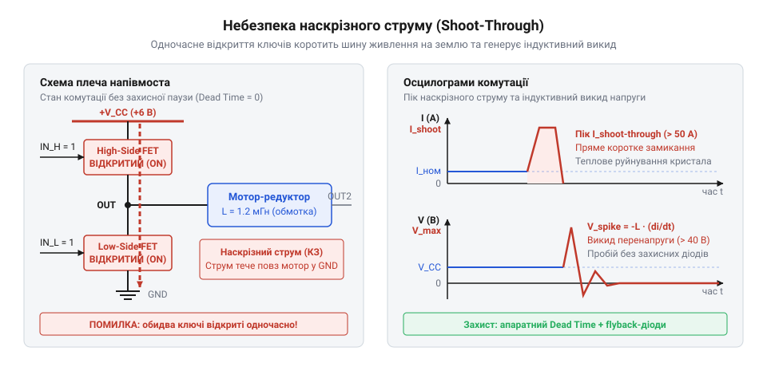
*Спрощена схема одного напівмостового плеча під час комутації: одночасне відкриття верхнього й нижнього ключів утворює шлях прямого короткого замикання шини живлення на землю з катастрофічним піком наскрізного струму, а раптове розривання кола індуктивного навантаження без демпферів спричиняє руйнівний високовольтний викид проти-ЕРС.*

Щоб дискретний міст працював стабільно, розробнику доводиться городити навколо силових ключів складну зовнішню схему: логіку взаємного блокування (@@en|cross-locking logic@@), апаратні RC-ланцюжки формування затримок перемикання — так званого мертвого часу [dead-time](root:hw-power/dead-time-generation), додаткові підсилювачі для керування затворами верхніх ключів і зовнішні діоди Шотткі з мінімальним часом відновлення. Будь-яка помилка в програмі керуючого мікроконтролера, збій тактового генератора чи наведення перешкоди на виводи вводу-виводу відкриває обидва ключі плеча й призводить до вигорання плати.

Саме тому в сучасних приводах дискретну комутацію витіснили монолітні інтегральні H-мости. У такій мікросхемі силові ключі, швидкодіючі зворотні діоди, схеми зміщення рівнів і логіка апаратного формування мертвого часу виготовлені на одному кристалі кремнію. Інтегральний драйвер фізично не дозволяє одночасно відкритися ключам одного напівмоста, навіть якщо мікроконтролер через помилку видасть активні сигнали на всі входи драйвера одночасно.

> 🔧 **Навіщо це.**
> Спроба зібрати симетричний H-міст на чотирьох дискретних транзисторах без глибокого розрахунку заряду затворів і прецизійної затримки увімкнення майже завжди завершується тепловим вибухом ключів від наскрізного струму або пробоєм від індуктивного викиду обмотки. Інтегральний H-міст ховає схеми узгодженого керування затворами, захисні зворотні діоди та генератори захисного мертвого часу всередину кристала, надаючи розробнику безпечний чотириквадрантний вузол комутації з повною апаратною стійкістю до помилок керування.

## Топологія H-моста та фізика чотириквадрантного керування

Топологія (від грецького *topos* — місце і *logos* — вчення) H-моста отримала свою назву завдяки графічній схожості принципової схеми з латинською літерою «H». Дві вертикальні лінії цієї літери утворюють стійки живлення — лівий і правий напівмости, а горизонтальну перемичку формує навантаження, яким є якір електродвигуна постійного струму.

Схема містить чотири керовані силові ключі:
- Верхній ключ лівого плеча `Q1` (@@en|high-side switch@@), підключений між позитивною шиною живлення двигуна `V_M` та вихідним вузлом `OUT1`.
- Нижній ключ лівого плеча `Q2` (@@en|low-side switch@@), підключений між вихідним вузлом `OUT1` та шиною силової землі `PGND`.
- Верхній ключ правого плеча `Q3`, підключений між шиною живлення `V_M` та вихідним вузлом `OUT2`.
- Нижній ключ правого плеча `Q4`, підключений між вихідним вузлом `OUT2` та шиною силової землі `PGND`.

Паралельно кожному ключу встановлено зворотний (демпферний) діод: анод діода з'єднано з точкою нижчого потенціалу, а катод — з точкою вищого потенціалу. У польових транзисторах MOSFET цю функцію частково виконує паразитичний внутрішній діод підкладки (@@en|body diode@@), проте в інтегральних мікросхемах паралельно ключам зазвичай інтегрують повноцінні надшвидкі діоди Шотткі з низьким прямим падінням напруги.

На відміну від найпростішого вимикача, який працює лише в одній робочій точці (додатна напруга і прямий струм споживання), мостова схема підтримує повноцінне чотириквадрантне керування приводом. У системі координат «напруга–струм» або «кутова швидкість `ω` — крутний момент `M`» виділяють чотири квадранти (від латинського *quadrans* — четверта частина):
- **Квадрант I (Рух уперед, Forward Motoring)**: напруга на якорі додатна `V > 0`, струм додатний `I > 0`. Швидкість обертання та електромагнітний момент збігаються за напрямком (`ω > 0`, `M > 0`). Джерело живлення передає електричну енергію в навантаження, двигун трансформує її в механічний рух вала вперед.
- **Квадрант II (Гальмування вперед, Forward Braking)**: вал за інерцією обертається вперед (`ω > 0`), проте електромагнітний момент спрямований у протилежний бік (`M < 0`). Прикладена напруга менша за внутрішню ЕРС двигуна або дорівнює нулю, а струм тече у зворотному напрямку (`I < 0`). Механічна енергія ротора перетворюється на електричний струм: машина переходить у режим генератора, здійснюючи електродинамічне гальмування.
- **Квадрант III (Реверсний рух, Reverse Motoring)**: полярність прикладеної напруги змінена на від'ємну (`V < 0`), струм у колі від'ємний (`I < 0`). Вал обертається у зворотний бік під дією прикладеного крутного моменту (`ω < 0`, `M < 0`). Двигун знову споживає енергію з лінії живлення, прискорюючи механізм назад.
- **Квадрант IV (Гальмування назад, Reverse Braking)**: вал за інерцією продовжує обертатися назад (`ω < 0`), але електромагнітний момент спрямований вперед (`M > 0`), перешкоджаючи обертанню. Струм у колі додатний (`I > 0`). Відбувається генераторне гальмування реверсного руху.

Усі чотири квадранти реалізуються перемиканням чотирьох базових станів ключів H-моста.

**1. Прямий рух (Forward Drive)**. Для обертання двигуна вперед схема відкриває діагональну пару ключів `Q1` та `Q4`, утримуючи `Q2` та `Q3` надійно закритими. Струм від шини живлення `V_M` тече крізь відкритий верхній лівий ключ `Q1` у клему `OUT1`, проходить крізь якірну обмотку двигуна зліва направо (від `OUT1` до `OUT2`), виходить через клему `OUT2` і крізь відкритий нижній правий ключ `Q4` стікає в силову землю `PGND`. Різниця потенціалів на моторі становить:

```
V_motor = V_OUT1 - V_OUT2 ≈ +V_M - 2 · I · R_DS(on)
```

Взаємодія струму обмотки з магнітним полем статора створює обертальний момент, що розганяє ротор у прямому напрямку (робота в квадранті I).

**2. Реверсний рух (Reverse Drive)**. Для зміни напрямку обертання ключі `Q1` та `Q4` закриваються, а протилежна діагональ — `Q3` та `Q2` — відкривається. Тепер струм від шини `V_M` проходить крізь верхній правий ключ `Q3` у клему `OUT2`, протікає крізь обмотку двигуна у зворотному напрямку (справа наліво, від `OUT2` до `OUT1`) і через відкритий нижній лівий ключ `Q2` стікає в землю `PGND`. Полярність напруги на виводах змінюється на протилежну:

```
V_motor = V_OUT1 - V_OUT2 ≈ -V_M + 2 · I · R_DS(on)
```

Сила Ампера змінює напрямок на 180 градусів, і вал двигуна розганяється у зворотному напрямку (робота в квадранті III).

**3. Вільний вибіг (холостий хід, @@en|coast@@, стан високого імпедансу Hi-Z)**. У цьому стані всі чотири силові ключі `Q1`, `Q2`, `Q3`, `Q4` розімкнені одночасно. Лінія живлення повністю відсікається від мотора, а виводи `OUT1` та `OUT2` переходять у високоімпедансний стан (від латинського *impedio* — перешкоджати, затримувати). Проте в момент розмикання ключів індуктивність обмотки якоря перешкоджає миттєвому спаданню струму. Накопичена в магнітному полі енергія:

```
W_L = (1/2) · L · I²
```

змушує струм продовжувати рух у тому самому напрямку. Якщо перед вимкненням двигун рухався вперед (струм протікав від `OUT1` до `OUT2`), струм індуктивності засмоктується з лінії силової землі крізь зворотний діод `D2`, проходить крізь якір і крізь зворотний діод `D3` проштовхується назад у шину живлення `V_M`. Цей процес скидання індуктивної енергії триває лічені мікросекунди, після чого діоди замикаються.

З цього моменту якірне коло залишається розімкненим: струм у ньому дорівнює нулю. Двигун обертається суто завдяки механічній кінетичній енергії ротора та сполученого механізму. Електромагнітне гальмівне зусилля відсутнє: ротор сповільнюється повільно й довго, втрачаючи швидкість лише через механічне тертя в підшипниках, щітках і шестернях редуктора. Якщо спробувати провернути вал такого вимкненого привода рукою, він обертатиметься вільно й майже без опору.

**4. Активне динамічне гальмування (електродинамічне гальмо, @@en|brake@@)**. Принципово інша фізична картина спостерігається під час активного гальмування. Для швидкої зупинки логіка драйвера одночасно відкриває обидва нижні ключі `Q2` та `Q4` (або в альтернативному варіанті обидва верхні ключі `Q1` та `Q3`), залишаючи протилежну пару ключів надійно закритою.

У цей момент обидві клеми двигуна `OUT1` та `OUT2` виявляються закороченими між собою через відкриті канали транзисторів і лінію силової землі (або лінію живлення).

Коли обмотка якоря продовжує обертатися за інерцією в магнітному полі з кутовою швидкістю `ω`, вона перетворюється на генератор. На її клемах виникає електрорушійна сила генерації — проти-ЕРС [counter-electromotive force](root:hw-motion/back-emf) (@@en|back electromotive force@@, або скорочено @@en|back-EMF@@):

```
E_emf = k_e · ω
```

де `k_e` — конструктивний коефіцієнт проти-ЕРС двигуна.

Оскільки клеми двигуна закорочені транзисторами, у замкненому контурі «якірна обмотка — ключ Q4 — лінія землі — ключ Q2 — якірна обмотка» виникає потужний струм короткого замикання генератора:

```
I_brake
= E_emf / (R_armature + 2 · R_DS(on))    [закон Ома для закороченого кола якоря]
```

За правилом Ленца цей струм тече в напрямку, протилежному до того струму, який щойно розганяв мотор. За законом Ампера взаємодія струму проти-ЕРС із магнітним полем статора формує зустрічний гальмівний електромагнітний момент:

```
M_brake
= k_m · I_brake                          [закон електромагнітного моменту]
= k_m · (k_e · ω) / (R_armature + 2 · R_DS(on))
```

де `k_m` — коефіцієнт крутного моменту двигуна.

Цей момент діє строго проти напрямку руху ротора (робота в квадрантах II та IV). Кінетична енергія обертової системи за частки секунди перетворюється на електричний струм і розсіюється у вигляді тепла на активному опорі обмотки `R_armature` та опорах каналів транзисторів `R_DS(on)`.

Привод зупиняється практично миттєво. Фізична властивість динамічного гальмування полягає в саморегуляції гальмівного зусилля: що вища швидкість обертання `ω`, то більша проти-ЕРС і вищий гальмівний момент. У міру сповільнення ротора проти-ЕРС спадає, і в момент повної зупинки гальмівний струм зникає сам собою. Проте утримувати нерухомий вал під зовнішнім механічним навантаженням такий режим не здатний: щойно швидкість обертання дорівнює нулю, зникає і проти-ЕРС, і викликаний нею гальмівний момент.

| Стан H-моста | Ключ Q1 (верх лівий) | Ключ Q2 (низ лівий) | Ключ Q3 (верх правий) | Ключ Q4 (низ правий) | Напруга OUT1 | Напруга OUT2 | Квадрант / Поведінка двигуна |
| :--- | :--- | :--- | :--- | :--- | :--- | :--- | :--- |
| **Прямий рух** | ВВІМК | ВИМК | ВИМК | ВВІМК | ≈ VM | ≈ PGND | Квадрант I: розгін вала вперед |
| **Реверс** | ВИМК | ВВІМК | ВВІМК | ВИМК | ≈ PGND | ≈ VM | Квадрант III: розгін вала назад |
| **Вільний вибіг** | ВИМК | ВИМК | ВИМК | ВИМК | Hi-Z | Hi-Z | Пасивний вибіг, струм індуктивності скидається в VM |
| **Гальмування (нижнє)** | ВИМК | ВВІМК | ВИМК | ВВІМК | ≈ PGND | ≈ PGND | Квадранти II / IV: якір замкнено на землю, гальмо проти-ЕРС |
| **Гальмування (верхнє)**| ВВІМК | ВИМК | ВВІМК | ВИМК | ≈ VM | ≈ VM | Квадранти II / IV: якір замкнено на VM, гальмо проти-ЕРС |
| **Аварійний стан** | ВВІМК | ВВІМК | Будь-який | Будь-який | — | — | Заборонено: наскрізне коротке замикання лівої стійки |
| **Аварійний стан** | Будь-який | Будь-який | ВВІМК | ВВІМК | — | — | Заборонено: наскрізне коротке замикання правої стійки |

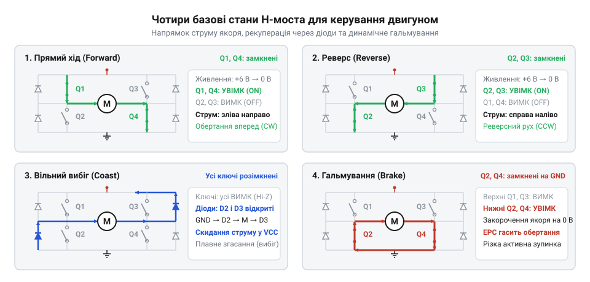
*Принципова схема H-моста у чотирьох базових режимах: прямий хід (відкриті Q1 і Q4), реверс (відкриті Q3 і Q2), вільний вибіг (усі ключі закриті, струм індуктивності скидається крізь зворотні діоди назад у джерело) та динамічне гальмування (відкриті обидва нижні ключі Q2 і Q4, що закорочує якір і створює потужний гальмівний момент від проти-ЕРС).*

> 🔧 **Навіщо це.**
> Чітке розрізнення вільного вибігу (Hi-Z) та динамічного гальмування (Brake) критично важливе для позиціювання приводів. Якщо мобільний робот виявить перешкоду й просто вимкне всі ключі драйвера (перейде у вибіг), масивна машина котитиметься за інерцією ще десятки сантиметрів і вдарить перешкоду. Переведення H-моста в режим динамічного гальмування миттєво закорочує клеми двигуна, створюючи зустрічний електромагнітний момент від проти-ЕРС і зупиняючи привод майже на місці.

## Внутрішня архітектура кремнієвого чипа H-моста

У спрощеній моделі перемикання чотирьох ключів моста виглядає миттєвим переведенням ідеальних контактів. На фізичних напівпровідникових транзисторах без внутрішньої логіки керування кристал мостового драйвера вибухне під час першої ж зміни напрямку струму через динаміку перехідних процесів у напівпровідниковій структурі.

Кожна вертикальна стійка H-моста (напівміст) складається з верхнього ключа, підключеного до шини живлення `V_M`, і нижнього ключа, з'єднаного із силовою землею `GND`. При зміні стану стійки один ключ розмикається, а інший замикається. Фізичний транзистор не вимикається миттєво: для розриву струму в каналі польового транзистора потрібно евакуювати заряд із його затвора крізь внутрішній опір драйвера (докладно динаміку розкрито у root:hw-power/mosfet-gate-charge-dynamics). Цей процес триває від десятків до сотень наносекунд.

Якщо команда на відкриття нижнього ключа надійде одночасно з вимкненням верхнього, нижній транзистор почне відкриватися в той момент, коли верхній ще проводить струм. Обидва ключі стійки одночасно переходять у стан низького омічного опору. Виникає наскрізний струм (англ. @@en|shoot-through@@ від *shoot* — пробивати і *through* — крізь) — пряме коротке замикання шини живлення на землю крізь кристал мікросхеми:

```text
I_shoot = V_M / (R_DS(on)_high + R_DS(on)_low + R_trace)
        = 12.0 В / (0.15 Ом + 0.15 Ом + 0.05 Ом)   [закон Ома для закороченої стійки напівмоста]
        = 12.0 В / 0.35 Ом                         [сумарний внутрішній опір двох відкритих каналів]
        ≈ 34.3 А                                   [руйнівний струм короткого замикання крізь кристал]
```

При струмі понад тридцять ампер локальна щільність потужності на крихітній площі кремнію досягає сотень ватів на квадратний міліметр. Це спричиняє миттєвий тепловий пробій p-n переходів, розплавлення внутрішніх контактних мікропровідників і фізичне вигорання мікросхеми.

Щоб запобігти катастрофі, у кристал інтегрують апаратний формувач мертвого часу (англ. @@en|dead-time generator@@ від *dead* — нерухомий, порожній та *time* — час), який реалізує захисний алгоритм «розрив перед замиканням» (англ. @@en|break-before-make@@ від *break* — розривати, *before* — перед та *make* — замикати). Цифровий декодер не передає зовнішній сигнал на вихідні транзистори напряму. Коли надходить команда на зміну полярності стійки, внутрішня логіка спершу примусово закриває активний транзистор, після чого витримує паузу — мертвий час `t_dead` тривалістю від 50 до 500 наносекунд. Протягом цього інтервалу обидва ключі стійки повністю знеструмлені, струм у каналі попереднього ключа гарантовано спадає до нуля, і лише тоді драйвер подає напругу відкриття на затвор протилежного ключа.

> 🔧 **Навіщо це.**
> Апаратний формувач мертвого часу унеможливлює наскрізний струм на рівні кремнієвої топології чипа. Навіть якщо помилка в коді мікроконтролера чи апаратний збій виставить конфліктні рівні на входах стійки, мікросхема витримає захисний інтервал і збереже силовий кристал від фізичного знищення.

Силові каскади сучасних мостів будують переважно на польових транзисторах з ізольованим затвором (англ. @@en|MOSFET@@ від *Metal-Oxide-Semiconductor Field-Effect Transistor*), де і нижні, і верхні ключі виготовляють N-канальними (NMOS). У кремнії рухливість електронів у 2–3 рази вища за рухливість дірок у P-канальних структурах (PMOS). Завдяки цьому N-канальний транзистор із таким самим опором відкритого каналу `R_DS(on)` займає втричі меншу площу на підкладці, що знижує вартість кристала та його паразитні ємності.

Використання N-MOSFET у верхньому плечі ускладнює керування затвором. Щоб відкрити N-канальний транзистор, напруга на затворі має перевищувати напругу на витоку на порогову величину відмикання `V_GS(th)` із запасом для повного насичення каналу:

```text
V_G = V_S + V_GS
    = V_M + V_drive               [потенціал витоку відкривається до напруги двигуна V_M]
    = 12.0 В + 5.0 В              [додавання напруги живлення мотора та напруги насичення затвора]
    = 17.0 В                      [необхідний потенціал на затворі верхнього N-MOSFET]
```

Для нижнього ключа витік з'єднаний із землею (0 В), тому затвор відкривається логічним рівнем 3.3 В або 5 В. Для верхнього ключа витік приєднаний до виводу двигуна (посилання на `root:cat-hw-actuators/n20-motor`). Коли верхній транзистор відкривається, напруга на витоку зростає майже до повної напруги живлення `V_M`. Щоб утримати ключ відкритим, на його затвор необхідно подавати напругу, вищу за `V_M` на 5–10 В.

В інтегральних драйверах для двигунів постійного струму це завдання вирішує внутрішній зарядовий насос (англ. @@en|charge pump@@ від *charge* — електричний заряд та *pump* — помпа, насос; фізичні основи наведено у root:hw-power/charge-pump-circuit). Це автономний генератор імпульсів на перемикальних ємностях усередині кристала, який безперервно видає напругу `V_M + V_CP` (де `V_CP` становить 5–7 В) і живить буфери верхніх затворів. На відміну від [бутстрепного живлення](root:hw-power/bootstrap-capacitor) (англ. @@en|bootstrap@@ від *boot* — чобіт і *strap* — ремінець), де ємність потребує періодичного підзаряджання через замикання нижнього ключа на землю, зарядовий насос працює автономно й підтримує підвищену напругу постійно.

> 🔧 **Навіщо це.**
> Інтегрований зарядовий насос дозволяє драйверу працювати зі 100% заповненням ШІМ без обмеження часу. Двигун може обертатися на максимальній швидкості безперервно, не вимагаючи періодичних пауз для підзаряджання затворних ємностей.

Обмотки ротора двигуна мають відчутну розподілену індуктивність `L`. За законом електромагнітної індукції Фарадея (від лат. *inductio* — наведення, спонукання), при вимиканні силового транзистора спад струму породжує зворотну ЕРС самоіндукції:

```text
V_L = -L · (di/dt)
```

Струм крізь індуктивність не може змінитися миттєво: магнітна енергія обмотки підтримує його протікання. Якщо розімкнути ключі, напруга на виводах моста підскочить до сотень вольт, що спричинить лавинний пробій вихідних транзисторів.

Для захисту від перенапруг паралельно кожному силовому транзистору встановлюють зворотні діоди рециркуляції (англ. @@en|freewheeling diode@@ від *freewheeling* — вільний хід і грец. δίς — двічі та ὁδός — шлях). У структурі польового транзистора вже присутній природний паразитний діод підкладки (англ. @@en|body diode@@), сформований p-n переходом між підкладкою і стоком. Коли обидва ключі стійки закриваються під час комутації, зворотний струм індуктивності замикається крізь ці діоди в лінію живлення, жорстко обмежуючи сплеск напруги на рівні `V_M + V_F` або `0 - V_F` (де `V_F` — пряме падіння на діоді).

У сучасних інтегральних чипах замість повільних паразитних діодів застосовують паралельні діоди з бар'єром Шотткі (англ. @@en|Schottky diode@@ від прізвища німецького фізика Вальтера Шотткі, нім. Walter Schottky) або алгоритм синхронного випрямлення (англ. @@en|synchronous rectification@@ від грец. σύγχроνος — одночасний та лат. *rectus* — прямий, *facere* — робити). При синхронному випрямленні схема керування примусово відкриває канал MOSFET у напрямку зворотного струму на час індуктивного скидання. Опір відкритого каналу становить сотні міліом, тому замість спаду 0.8–1.2 В на діоді падіння напруги зменшується до часток вольта, що радикально знижує нагрівання кристала.

Вхідні логічні виводи мікросхеми захищені буферами (англ. @@en|buffer@@ від давньофр. *buffe* — удар, ляпас) із тригерами Шмітта (англ. @@en|Schmitt trigger@@ від прізвища винахідника Отто Шмітта, англ. Otto Schmitt). Завдяки гістерезису (грец. ὑστέρησις — відставання, запізнення) тригер формує круті фронти логічних рівнів, фільтруючи електромагнітні наведенки від іскріння щіток колектора двигуна.

Окрім комутаційних вузлів, кремнієвий кристал містить три інтегровані компаратори (лат. @@en|comparator@@ від *comparare* — порівнювати, зіставляти) безпеки:
- Блокування при просіданні напруги UVLO (англ. @@en|under-voltage lockout@@ від *under* — під, *voltage* — напруга та *lockout* — блокування): якщо напруга живлення логіки чи мотора падає нижче критичної межі (типово 2.0–2.5 В для логіки або 4.5 В для мотора), схема блокує драйвери затворів. Це запобігає роботі транзисторів у напіввідкритому лінійному режимі, де вони перегріваються від омічних втрат.
- Захист від струмового перевантаження OCP (англ. @@en|over-current protection@@ від *over* — понад, *current* — струм та *protection* — захист): вимірює струм силових ключів і знеструмлює виходи при заклинюванні вала чи короткому замиканні.
- Теплове вимкнення TSD (англ. @@en|thermal shutdown@@ від грец. θερμός — теплий та англ. *shutdown* — зупинка): відключає силове живлення при нагріванні структури вище 150–175 °C і відновлює роботу чипа лише після охолодження кристала на величину температурного гістерезису (15–20 °C).

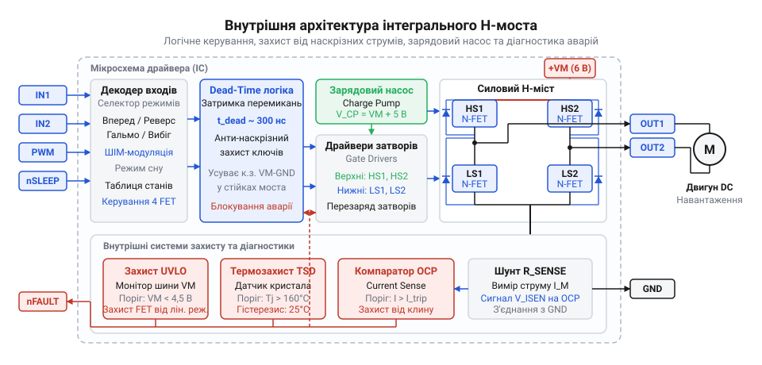
*Функціональна блок-схема мікросхеми інтегрального H-моста: логічний декодер входів, генератор затримки мертвого часу (dead-time logic), буфери керування затворами із внутрішнім зарядовим насосом для верхніх N-MOSFET, чотири вихідні силові ключі з інтегрованими діодами та внутрішні компаратори систем захисту.*

## Інтерфейси вхідного керування та логічні протоколи зв'язку

Для керування швидкістю й напрямком обертання двигуна постійного струму мікроконтролер надсилає на чип дискретні логічні стани та імпульси широтно-імпульсної модуляції (англ. @@en|pulse-width modulation@@, ШІМ; від лат. *impulsus* — поштовх і лат. *modulatio* — розміреність). Залежно від внутрішньої організації логічного декодера, інтегральні H-мости поділяються на два класи керування: схеми з незалежним керуванням стійками (`IN1`/`IN2`) та схеми з векторним керуванням (`PHASE`/`ENABLE` або `DIR`/`PWM`).

У схемі з роздільними входами стійок `IN1` та `IN2` (англ. @@en|input@@ — вхід) кожен логічний вхід безпосередньо керує станом свого напівмоста. Сигнал `IN1` задає стан виходу `OUT1`, а `IN2` — стан виходу `OUT2`:

| Вхід IN1 | Вхід IN2 | Вихід OUT1 | Вихід OUT2 | Робочий стан вихідного каскаду |
| :--- | :--- | :--- | :--- | :--- |
| `0` (Низький) | `0` (Низький) | `GND` | `GND` | Динамічне гальмування знизу (обидва нижні ключі замкнені) |
| `1` (Високий) | `0` (Низький) | `V_M` | `GND` | Прямий хід (струм тече від OUT1 до OUT2) |
| `0` (Низький) | `1` (Високий) | `GND` | `V_M` | Реверсивний хід (струм тече від OUT2 до OUT1) |
| `1` (Високий) | `1` (Високий) | `V_M` | `V_M` | Динамічне гальмування зверху (обидва верхні ключі замкнені) |

Щоб регулювати швидкість в обох напрямках через інтерфейс `IN1`/`IN2`, мікроконтролер повинен виділити два незалежні апаратні канали ШІМ від своїх внутрішніх таймерів. Під час обертання вперед таймер генерує пачки імпульсів ШІМ на вході `IN1`, тоді як лінія `IN2` утримується в нулі. Для зміни напрямку на протилежний мікроконтролер зобов'язаний програмно переналаштувати конфігурацію таймера: перевести вивід `IN1` у постійний нуль, а ШІМ подавати на вхід `IN2`.

У схемі з векторним керуванням `PHASE`/`ENABLE` (від грец. φάσις — фаза, поява та англ. @@en|enable@@ — надавати дозвіл) функції вибору напрямку та дозування енергії апаратно розділені між двома спеціалізованими лініями:
- Вхід `PHASE` (або `DIR` від англ. @@en|direction@@ — напрямок) приймає повільний статичний рівень GPIO: одиниця призначає пряме обертання, нуль — реверс.
- Вхід `ENABLE` (або `PWM`) сприймає високочастотний сигнал ШІМ, відкриваючи мостовий каскад на час тривалості активного імпульсу.

| Вхід ENABLE | Вхід PHASE | Вихід OUT1 | Вихід OUT2 | Робочий стан вихідного каскаду |
| :--- | :--- | :--- | :--- | :--- |
| `0` (Низький) | `X` (Будь-який) | `GND` / `Hi-Z` | `GND` / `Hi-Z` | Вимкнено: динамічне гальмування або вільний вибіг |
| `1` (Високий) | `1` (Високий) | `V_M` | `GND` | Прямий хід (напруга повної полярності) |
| `1` (Високий) | `0` (Низький) | `GND` | `V_M` | Реверсивний хід (інверсна полярність) |

Для векторного інтерфейсу мікроконтролеру потрібен лише один апаратний канал таймера, підключений до лінії `ENABLE`, та один дискретний пін загального призначення для лінії `PHASE`. Програма налаштовує таймер один раз під час завантаження системи. Швидкість регулюється зміною числа в регістрі шпаруватості таймера, а реверс здійснюється записом одного біта в вихідний порт мікроконтролера без зупинки чи переконфігурації таймера.

> 🔧 **Навіщо це.**
> Інтерфейс PHASE/ENABLE вдвічі скорочує потребу в апаратних таймерах мікроконтролера. Якщо на чотириколісному роботі керувати кожним колесом через IN1/IN2, знадобиться вісім каналів ШІМ, що вимагає старших дорогих мікроконтролерів; чипи з лініями PHASE/ENABLE обходяться чотирма каналами ШІМ і чотирма звичайними пінами GPIO.

Крім основних входів руху, сучасні інтегральні чипи оснащуються допоміжними лініями енергозбереження та діагностики:
- Вхід режиму сну `nSLEEP` (англ. @@en|sleep mode@@ від *sleep* — спати): інверсна логіка позначена символом «n» (від англ. @@en|negative-true logic@@). Коли на цей вивід подається низький логічний рівень (`0`), внутрішня схема відключає зарядовий насос, джерела опорного струму та вхідні компаратори, а силові ключі переходять у розімкнений високоімпедансний стан (High-Z). Струм споживання драйвера зменшується з робочих 2–8 мА до часток мікроампера (< 1–2 мкА), що захищає акумулятор від виснаження під час простою пристрою.
- Вихід діагностики несправності `nFAULT` (англ. @@en|fault@@ від лат. *fallere* — хибити, помилятися): виконаний за схемотехнікою відкритого стоку (англ. @@en|open-drain@@ від *open* — відкритий і *drain* — стік польового транзистора; принципи організації розглянуто у root:hw-digital/wired-and). Внутрішній слабкострумовий транзистор залишається закритим у штатному режимі, тому зовнішній або внутрішній підтягувальний резистор (англ. @@en|pull-up resistor@@ від *pull* — тягнути та *up* — вгору) утримує на лінії високий рівень. Якщо спрацював захист від перегріву TSD, струмове перевантаження OCP або захист від зниження напруги UVLO, внутрішній транзистор відкривається і притягує шину до нуля.

> 🔧 **Навіщо це.**
> Вихід відкритого стоку nFAULT дає змогу об'єднати аварійні виводи кількох незалежних чипів на один вхід апаратного переривання мікроконтролера за схемою монтажного АБО (wired-OR). Одночасно він вирішує проблему узгодження напруг: підтяжка резистора до 3.3 В дозволяє безпечно зчитувати статус високовольтної мікросхеми без додаткових дільників.

Напруги живлення мікроконтролерів варіюються від 3.3 В у сучасних 32-бітних архітектурах до 5.0 В у класичних системах. Вхідні логічні каскади інтегральних H-мостів узгоджують ці сигнали завдяки сумісності з порогами ТТЛ (англ. @@en|transistor-transistor logic@@, TTL від лат. *trans* — через, *resistor* — опір, і грец. λογική — логіка):
- Поріг гарантованої логічної одиниці `V_IH` (англ. @@en|high-level input voltage@@) становить 1.5–2.0 В.
- Поріг гарантованого логічного нуля `V_IL` (англ. @@en|low-level input voltage@@) становить 0.7–0.8 В.

Оскільки напруга 3.3 В упевнено перевищує поріг `V_IH = 2.0 В`, мікроконтролер надійно комутує драйвер без застосування зовнішніх перетворювачів логічних рівнів (англ. @@en|level shifter@@). Для захисту від випадкового пуску двигуна під час скидання або прошивки процесора входи мікросхеми містять внутрішні стягувальні резистори (англ. @@en|pull-down resistor@@) опором 100–300 кОм, які фіксують нульовий стан на лініях керування до завершення ініціалізації портів виводу.

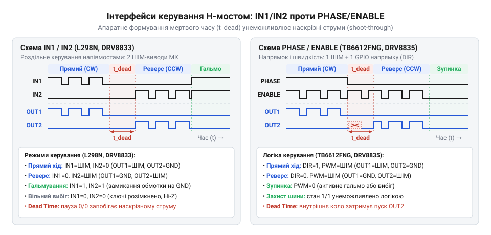
*Часові діаграми керування для двох типів вхідної логіки: схема IN1/IN2 (почергове подавання ШІМ на роздільні входи напівмостів) проти схеми PHASE/ENABLE (рівень DIR задає напрямок, а ШІМ на вході PWM регулює шпаруватість); на вихідних сигналах OUT1 і OUT2 видно апаратне формування захисних інтервалів мертвого часу.*

## Комутаційні процеси під час регулювання швидкості методом ШІМ: режими швидкого й повільного спаду струму

Коли швидкість обертання двигуна постійного струму регулюють методом широтно-імпульсної модуляції (від лат. *modulatio* — розміреність, гармонійність), керування зводиться до формування середнього значення струму в його обмотках. Ротор колекторного двигуна, як-от мікромотора [N20](root:cat-hw-actuators/n20-motor), являє собою індуктивне навантаження. Електрично його описують послідовним колом із власного активного опору дроту `R`, індуктивності котушок `L` (від лат. *inductio* — наведення) та джерела внутрішньої проти-ЕРС `E`, породженої обертанням якоря в магнітному полі статора.

Індуктивність має фундаментальну властивість підтримувати неперервність магнітного потоку: струм крізь котушку не здатний змінитися стрибком. Під час активного імпульсу ШІМ два діагональні транзистори H-моста відкриті й під'єднують обмотку до шини живлення `V_M`. Струм зростає, долаючи проти-ЕРС, і накопичує енергію в магнітному полі осердя. Проте період ШІМ неминуче ділиться на фазу накачування та пасивну паузу. Щойно ключі прямого ходу закриваються, надходження енергії від джерела припиняється, але магнітне поле колапсує, підтримуючи струм у тому самому напрямку. Якщо не надати струму самоіндукції безпечного замкненого контуру, індуктивний викид напруги викличе лавинний пробій вихідних ключів. Драйвер запобігає аварії, спрямовуючи рециркуляцію за одним із двох шляхів: у контур повільного чи швидкого спаду.

### Контур повільного спаду струму (Slow Decay)

У режимі повільного спаду струму (англ. @@en|slow decay@@, від лат. *de-* — вниз і *cadere* — падати) під час паузи ШІМ драйвер одночасно вмикає обидва нижні або обидва верхні ключі моста, повністю відсікаючи зовнішню шину живлення `V_M`. Найчастіше використовують нижні N-канальні польові транзистори через їхній малий опір відкритого каналу `R_DS(on)`.

У такій конфігурації клеми двигуна закорочуються між собою через відкриті транзистори на спільну шину землі. Струм індуктивності замикається у внутрішній петлі напівмоста й продовжує текти крізь обидва відкриті ключі. Оскільки зовнішньої зустрічної напруги тут немає, магнітне поле згасає лише під дією невеликого падіння напруги на активному опорі дроту `R`, опорах ключів та проти-ЕРС обертання `E`. Протидіюча напруга в петлі вимірюється десятими частками або одиницями вольта, тому швидкість спаду струму `di/dt` є дуже низькою, а струм спадає повільно й полого.

Замикання виводів рухомого двигуна спричиняє електродинамічне гальмування: струм від власної проти-ЕРС породжує гальмівний електромагнітний момент. З цієї причини режим @@en|slow decay@@ також називають режимом динамічного гальмування (англ. @@en|brake mode@@).

### Контур швидкого спаду струму (Fast Decay)

У режимі швидкого спаду струму (англ. @@en|fast decay@@) під час паузи ШІМ транзистори робочої діагоналі вимикаються, і струм самоіндукції примусово скидається назад у шину живлення `V_M`. Це відбувається або пасивно — крізь захисні діоди закритої діагоналі, або активно — завдяки відкриванню протилежної пари транзисторів (синхронне випрямлення).

Оскільки індуктивність прагне втримати струм, на одній клемі потенціал зростає вище напруги живлення `V_M`, а на другій — падає нижче землі. Струм долає повний зустрічний потенціал джерела, буквально повертаючи накопичену енергію магнітного поля назад у конденсатори фільтра шини живлення. Протидіюча напруга контуру дорівнює сумі напруги джерела `V_M` та проти-ЕРС, що в десятки разів перевищує втрати в петлі напівмоста. Як наслідок, швидкість спаду струму `di/dt` колосальна: магнітне поле колапсує стрімко, струм обвалюється до нуля за частки періоду ШІМ, а діоди замикаються до початку наступного такту.

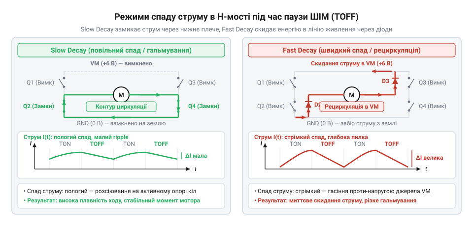
*Контури струму в індуктивності обмотки мотора під час паузи ШІМ: у режимі Slow Decay струм замикається у внутрішній петлі через нижні ключі, забезпечуючи плавне згасання з мінімальною амплітудою пульсацій, тоді як у Fast Decay струм повертається у шину живлення крізь діоди або діагональні транзистори під дією зустрічної напруги VM, спричиняючи стрімкий спад струму та глибокі пульсації електромагнітного моменту.*

### Пульсації струму, неперервний режим і лінійність моменту

Різниця у швидкості спаду магнітного поля безпосередньо формує вихідні характеристики приводу:

1. **Амплітуда пульсацій струму (`ΔI`).** У режимі Slow Decay пологий нахил спаду забезпечує неперервне протікання струму крізь обмотку протягом усього періоду модуляції (англ. @@en|continuous conduction mode@@). За робочих частот ШІМ (15–25 кГц) струм не встигає істотно впасти, а його пульсації від піку до піку становлять одиниці відсотків. У режимі Fast Decay через стрімкий спад коло переходить у переривчастий режим струму (англ. @@en|discontinuous conduction mode@@): струм повністю обнуляється задовго до закінчення паузи, спричиняючи глибокі коливання великої амплітуди.

2. **Стабільність механічного моменту.** Електромагнітний момент мотора прямо пропорційний миттєвому струму ротора: `M = k_m · I`. Стрімкі спади струму в режимі Fast Decay генерують різкі механічні мікроудари з частотою комутації, викликаючи підвищений знос редуктора, вібрацію та виразний писк. Натомість Slow Decay підтримує плавний, рівномірний обертальний момент.

3. **Лінійність регулювання швидкості.** За неперервного струму в режимі Slow Decay середня напруга на двигуні лінійно пропорційна коефіцієнту заповнення ШІМ (`D`): `V_avg = D · V_M`. Швидкість регулюється передбачувано в усьому діапазоні. У режимі Fast Decay раннє обнулення струму створює мертву зону керування на низьких значеннях `D`, де мотор не зрушує з місця без збільшення шпаруватості.

4. **Тепловтрати в залізі якоря.** Глибокі коливання струму у Fast Decay змушують якір щоциклу перемагнічуватися за широкою петлею гістерезису, що призводить до паразитного нагрівання ротора вихровими струмами навіть під помірним навантаженням.

> 🔧 **Навіщо це.**
> Попри значні пульсації, Fast Decay є необхідним інструментом там, де потрібне надшвидке скидання моменту чи миттєве гальмування рухомих вузлів. У повільному режимі струм продовжує циркулювати в котушках, і привід вибігає вперед за інерцією ще кілька мілісекунд після зняття імпульсу. Fast Decay примусово викачує магнітну енергію в шину живлення, обнуляючи рушійну силу за частки мікросекунди. Аналогічно під час керування [кроковими моторами](root:cat-hw-actuators/28byj-48-stepper) надмірно повільний спад струму спотворює синусоїду мікрокроку на високих обертах. Сучасні інтелектуальні драйвери поєднують обидва підходи у змішаному режимі (англ. @@en|mixed decay@@): спочатку струм обвалюють швидким спадом для скидання надлишку енергії, а потім утримують повільним спадом для збереження плавності моменту.

## Схемотехнічне обв'язування інтегрального H-моста: розведення живлення, фільтрація та вимірювання струму

Інтегральний драйвер H-моста поєднує в єдиному напівпровідниковому кристалі дві принципово несумісні підсистеми: прецизійну слабкострумову цифрову логіку (схеми генерації мертвого часу, логічні дешифратори входів, компаратори захисту від надструму) та потужний силовий комутатор, крізь ключі якого за наносекунди проходять струми в одиниці або десятки амперів. Нехтування схемотехнічними правилами обв'язування призводить до того, що індуктивні та комутаційні викиди мотора проникають у цифрові кола, спричиняючи спотворення керуючих сигналів, зависання мікроконтролера або пробій ключів перенапругою.

### Розділення шин живлення логіки (VCC) та силового каскаду (VM)

Перше фундаментальне правило побудови вузла H-моста — суворе розмежування напруги живлення внутрішньої логіки `V_CC` (зазвичай 3.3 В або 5 В) та силової шини живлення двигуна `V_M` (від 6 В до 40 В і більше).

Під час запуску, реверсу або механічного заклинювання вала двигун споживає пусковий струм, що у рази перевищує номінальний робочий струм. Оскільки первинне джерело (акумулятор чи блок живлення) і з'єднувальні дроти мають кінцевий внутрішній опір, силове навантаження створює різкі короткочасні просідання напруги на клемі `V_M`. Якщо цифрова логіка драйвера живиться від тієї ж нерозв'язаної шини, просідання напруги нижче порогового значення викликає спрацьовування внутрішнього захисту від зниженої напруги (англ. @@en|Under-Voltage Lockout@@, UVLO, від англ. *under-* — під, *voltage* — напруга та *lockout* — блокування) або скидання керуючого мікроконтролера за сигналом @@en|Brown-Out Reset@@ (BOR).

Тому напругу `V_CC` формують через окремий стабілізатор з малим падінням напруги (англ. @@en|Low-Dropout Regulator@@, LDO), вхід якого відокремлюють від силової шини захисним діодом та власним локальним конденсатором.

### Ефект накачування напруги (Voltage Pumping) та локальні блокувальні конденсатори

Під час динамічного гальмування двигуна або в пасивній фазі ШІМ у режимі Fast Decay виникає протилежна небезпека — різкий сплеск напруги на силовій шині `V_M` вище напруги первинного джерела. Коли ротор продовжує обертатися за інерцією, двигун перетворюється на генератор постійного струму. Силові транзистори H-моста та їхні внутрішні зворотні діоди формують еквівалент підвищувального імпульсного регулятора (англ. @@en|boost converter@@), який забирає кінетичну енергію ротора й виштовхує електричний заряд назад у лінію живлення.

Більшість імпульсних стабілізаторів і батарейних блоків є односпрямованими джерелами: вони здатні лише віддавати струм, але не можуть приймати його назад. Рекуперована енергія спрямовується на заряджання паразитної та власної ємності силової шини:
```
V_max
= √(V_M0² + (2 · E_regen) / C_bulk)              [напруга накачування на шині живлення мотора]
```
де `V_M0` — початкова напруга живлення, `E_regen` — кінетична енергія гальмування, а `C_bulk` — ємність конденсаторів на шині моста. Якщо ємність `C_bulk` замала, потенціал `V_max` легко перевищує гранично допустиму напругу пробою ключів драйвера, миттєво руйнуючи напівпровідникову структуру. Якщо ж ємності буферних конденсаторів недостатньо, для гасіння великої кінетичної енергії рекуперації застосовують [схеми активного гальмівного розряду](root:hw-motion/halmuvannia-motora).

Для демпфування (від нім. *dämpfen* — глушити, приглушувати) цих процесів безпосередньо біля виводів силового живлення H-моста монтують пару узгоджених конденсаторів:

1. **Електролітичний конденсатор великої ємності (`C_bulk`, 47–470 мкФ).** Працює як локальний накопичувальний буфер. Він поглинає струми генерації під час гальмування, запобігаючи небезпечному зростанню напруги, а також миттєво віддає струм у фазі активного розгону, нівелюючи індуктивність довгих живильних проводів.

2. **Керамічний конденсатор (`C_bypass`, 0.1–1.0 мкФ, діелектрик X7R або X5R).** Електролітичний конденсатор через рулонну будову має високу еквівалентну послідовну індуктивність (англ. @@en|Equivalent Series Inductance@@, ESL) та опір (англ. @@en|Equivalent Series Resistance@@, ESR). Він не встигає реагувати на високочастотні перемикання транзисторів із фронтами тривалістю в кілька наносекунд. Багатошарова низькоіндуктивна кераміка розміщується впритул до виводів `V_M` і `PGND` чипа (на відстані не далі ніж 2 мм) і гасить короткі наносекундні сплески напруги безпосередньо в точці їхнього зародження.

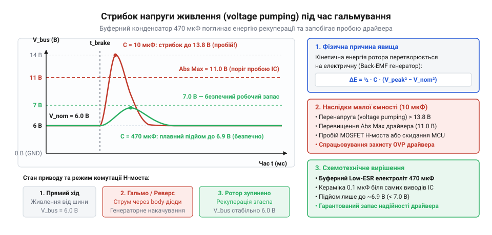
*Осцилограма стрибка напруги на шині живлення під час динамічного гальмування приводу за наявності буферного конденсатора малого та належного номіналу.*

### Організація системних земель: явище Ground Bounce та трасування «зіркою»

Кожен міліметр мідної доріжки друкованої плати має власну паразитну індуктивність, яка орієнтовно дорівнює `L_trace ≈ 1 нГн/мм`. Під час комутації струму силового каскаду 3 А за час фронту перемикання транзистора `Δt = 6 нс` швидкість зміни струму сягає величезного значення:
```
di/dt
= 3 А / (6 · 10⁻⁹ с)
= 5 · 10⁸ А/с                            [швидкість наростання комутаційного струму]
```
Якщо цей силовий імпульс стікає на землю через відрізок друкованої доріжки завдовжки лише 15 мм (`L_trace = 15 нГн`), закон індукції створює на ній локальний перепад напруги:
```
U_bounce
= L_trace · (di/dt)
= 15 · 10⁻⁹ Гн · 5 · 10⁸ А/с
= 7.5 В                                  [амплітуда сплеску потенціалу на паразитній індуктивності]
```
Це явище називають підстрибуванням землі (англ. @@en|ground bounce@@). Якщо в цю спільну доріжку ввімкнено мінусовий вивід цифрової логіки мікроконтролера або сигнальну землю драйвера, їхній опорний нульовий рівень раптово підскакує на 7.5 В відносно мінуса живлення. Цифровий нуль на вході драйвера перетворюється на логічну одиницю, компаратори захисту видають хибні спрацьовування, а на портах мікроконтролера виникає стан замикання кристала (англ. @@en|latch-up@@).

Для подолання цього ефекту схему ділять на дві фізично ізольовані землі:
- **Силова земля (`PGND`, Power Ground):** пропускає зворотні струми обмоток двигуна, струм силових конденсаторів фільтра та виводів витоків нижніх ключів. Її трасують широкими мідними полігонами мінімальної довжини.
- **Сигнальна земля (`GND` або `AGND`, Analog Ground):** слугує опорним нулем для чутливих цифрових входів логіки, вбудованих джерел опорної напруги чипа та вимірювальних кіл.

Обидві землі проєктують на платі ізольованими масивами й об'єднують виключно в одній спільній точці за схемою «зірка» (англ. @@en|star ground@@). Фізично точку об'єднання розташовують безпосередньо на мінусовій контактній площадці електролітичного конденсатора `C_bulk`.

### Вимірювання струму через шунт ISENSE

У багатьох інтегральних H-мостах витоки нижніх ключів об'єднано й виведено на окрему контактну ніжку `ISENSE`. Між цим виводом і силовою землею `PGND` включають прецизійний низькоомний токовимірювальний резистор — шунт (англ. @@en|shunt@@ — відгалуження; від староанглійського *scunten* — звертати вбік; принципи вибору таких компонентів розглядає [струмовимірювальний шунт](root:hw-sensing/shunt-current-sensing)).

Струм моста, проходячи крізь резистор, створює пропорційне падіння напруги:
```
V_SENSE = I_motor · R_SENSE
```
Опір шунта обирають малим (0.05–0.2 Ом), щоб зменшити статичні теплові втрати `P = I² · R_SENSE`. Шунт має бути виключно безіндукційним (металоплівковим або фольговим SMD), адже паразитна індуктивність дротяних резисторів спотворює сигнал імпульсними сплесками `L · (di/dt)`.

Сигнал з виводу `ISENSE` подається на внутрішній компаратор драйвера (від лат. *comparare* — порівнювати) або на АЦП мікроконтролера для обмеження струму. У моменти відкривання ключів паразитні ємності затворів і струми зворотного відновлення діодів викликають короткочасні викиди тривалістю 50–150 нс. Щоб компаратор не сприймав цей сплеск за аварійне заклинювання ротора, лінію вимірювання обов'язково захищають низькочастотним RC-фільтром із резистора 1 кОм та керамічного конденсатора 100–330 пФ біля входу мікросхеми, або задіюють схему апаратного маскування переднього фронту (англ. @@en|leading-edge blanking@@, LEB).

### Фільтрація щіткових завад на двигуні

Колекторний двигун генерує інтенсивні електромагнітні завади високої частоти внаслідок постійного іскріння під час розмикання щіток з ламелями колектора. Цей шум поширюється дротами живлення назад до драйвера й випромінюється в простір (докладніше про конструкцію захисту йдеться у матеріалі [фільтрація щіткових завад](root:hw-motion/brush-dc-motor-emi-filtering)).

Для його придушення безпосередньо на виводах двигуна збирають фільтр із трьох керамічних конденсаторів:
- Один конденсатор ємністю 10–100 нФ запаюють між клемами двигуна для гасіння диференціальних високочастотних коливань.
- Два конденсатори ємністю 1–10 нФ під'єднують від кожної клеми на металевий корпус двигуна. Металевий корпус відіграє роль екрана, замикаючи синфазні паразитні струми всередині мотора й не пускаючи їх у з'єднувальний кабель.

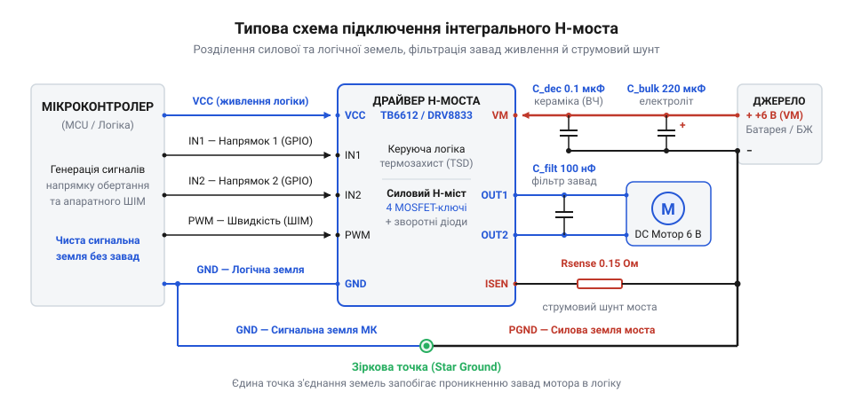
*Принципова схема вузла інтегрального H-моста: шини логіки VCC та мотора VM розділені, на силовому вході встановлено зв'язку електролітичного й керамічного конденсаторів, сигнальна земля GND та силова PGND сходяться в одній точці на фільтрі, а вивід ISENSE під'єднано через безіндукційний шунт із RC-фільтрацією.*

> 🔧 **Навіщо це.**
> Помилки в розведенні системної землі та відсутність керамічних блокувальних конденсаторів — найпоширеніша причина випадкових збоїв у мобільних роботах. Спроба живити логіку мікроконтролера та силовий H-міст від однієї лінії без фільтрів призводить до того, що під час кожного реверсу двигуна мікроконтролер мимовільно перезавантажується, шина I2C блокується через перепад рівнів, а драйвер вимикається за аварійним захистом. Грамотне трасування земель «зіркою» та встановлення комплементарної пари конденсаторів усувають ці проблеми на апаратному рівні.

## Вбудовані апаратні захисти та алгоритми обробки аварійних станів

Колекторний двигун постійного струму — це динамічне навантаження з непередбачуваною механічною поведінкою. Під час штатної роботи струм його якірної обмотки обмежується не лише активним омічним опором мідного дроту, а й внутрішньою електрорушійною силою — проти-ЕРС, що генерується внаслідок обертання якоря в магнітному полі статора. Проте в реальних механізмах (наприклад, у [N20 мікромоторі з редуктором](root:cat-hw-actuators/n20-motor)) вихідний вал або редуктор може натрапити на нездоланну механічну перешкоду. У мить зупинки ротора (заклинювання) проти-ЕРС миттєво спадає до нуля, і єдиним обмежником струму в колі залишається активний опір якірної обмотки та відкритих ключів моста. Струм стрибкоподібно зростає до пускового значення заклинювання, перевищуючи номінальний робочий струм у 5–10 разів.

Ще небезпечнішим сценарієм є глухе коротке замикання між вихідними клемами мотора або пробій однієї з обмоток на корпус: струм у силовому контурі обмежується лише мізерним опором доріжок друкованої плати та паразитними індуктивностями з'єднувальних дротів, досягаючи десятків амперів за лічені частки мікросекунди. Без спеціалізованих внутрішніх захистів кристал драйвера перегрівається за мілісекунди, а тепловий удар спричиняє вигоряння кремнієвих переходів або відрив внутрішніх алюмінієвих чи золотих розварювальних дротиків від контактних майданчиків корпусу. Щоб запобігти руйнуванню, сучасні інтегральні H-мости містять комплекс апаратних захистів, реалізованих безпосередньо в кремнієвій топології чипа: захист від струмового перевантаження, тепловий захист із гістерезисом та захист від неприпустимого зниження напруги живлення.

Апаратний захист від перевантаження за струмом — @@en|overcurrent protection@@ (OCP; від англ. *over-* — понад, *current* — струм, та лат. *protectio* — прикриття, захист) — безперервно відстежує амплітуду струму через силові ключі. Для цього кристал використовує або вбудовані дзеркала струму на спеціальних вимірювальних комірках польових транзисторів (SenseFET), або падіння напруги на зовнішньому низькоіндуктивному резисторі-шунті в колі спільних витоків нижніх ключів. Отриманий сигнал напруги надходить на швидкодійний компаратор (від лат. *comparator* — той, що порівнює), який зіставляє його з фіксованим опорним порогом спрацьовування `I_OCP`.

Проте кожна комутація силового ключа супроводжується перезаряджанням паразитної вихідної ємності напівпровідника та іскрінням щіток механічного колектора, що породжує короткочасні високочастотні сплески струму тривалістю від кількох десятків до сотень наносекунд. Якби компаратор реагував на них миттєво, драйвер хибно вимикався б на початку кожного такту ШІМ. Щоб уникнути помилкових спрацьовувань, у кремнії реалізовано апаратне маскування або бланкування — @@en|current sense blanking@@ (від англ. *blanking* — гасіння, затемнення): компаратор примусово ігнорує вимірювальний сигнал протягом перших 1–3 мкс після кожного відмикання силового ключа. Цей часовий проміжок називають часом бланкування (`t_blank`).

Якщо струм перевищує поріг `I_OCP` після завершення часу `t_blank`, схемотехніка H-моста реалізує одну з двох поведінкових моделей:

1. **Циклічне струмове обмеження** — @@en|current chopping@@ (від англ. *chop* — рубати, сікти): компаратор струму при досягненні порогу миттєво вимикає активний ключ і переводить міст у стан пасивного рециркуляційного гальмування (slow decay по нижніх або верхніх ключах) на фіксований час вимкнення `t_off` (зазвичай 15–40 мкс). Струм в індуктивності мотора за цей час спадає. Після закінчення `t_off` ключ знову відмикається. Якщо вал усе ще заклинений, струм за кілька мікросекунд знову доростає до порогу `I_OCP`, і цикл повторюється. Струм у двигуні набуває форми високочастотної пилки, стабілізуючись на середньому рівні близько `I_OCP`. Це дозволяє мотору розвивати максимальний обертовий момент (наприклад, щоб зірвати застряглий редуктор), але змушує ключі розсіювати значну потужність.
2. **Повне захисне вимкнення з фіксацією** — @@en|latch-off shutdown@@ (від англ. *latch* — засувка, фіксатор): при виявленні тривалого перевантаження драйвер миттєво блокує всі чотири ключі у високоімпедансний стан (Hi-Z), повністю знеструмлюючи виходи. Двигун переходить у режим вільного вибігу. Цей стан фіксується внутрішнім тригером: мікросхема не відновить роботу самостійно, доки керівний мікроконтролер не перезапустить її імпульсом скидання (наприклад, переведенням лінії `ENABLE` або `nSLEEP` у низький логічний рівень на визначений час) чи повним вимкненням живлення. У багатьох драйверах застосовують автоскидання через таймаут повторної спроби (`t_retry`, 100–500 мс): мікросхема вимикається, чекає пів секунди і робить коротку спробу запуску. Якщо коротке замикання не зникло, цикл вимкнення повторюється з низьким коефіцієнтом заповнення, що знижує середню потужність нагріву до безпечного рівня.

> 🔧 **Навіщо це.**
> Циклічне обмеження струму (chopping) рятує механіку від удару при короткочасному заклинюванні (наприклад, коли колесо мобільного робота долає крутий поріг): мотор не вимикається, а тисне граничним безпечним моментом. Натомість режим повного вимкнення (latch-off) призначений для захисту від металевого короткого замикання клем: пропускання навіть найкоротших імпульсів струму через опір, близький до нуля, випарувало б кристалічний канал за лічені мілісекунди.

Якщо заклинювання триває довго й міст працює в режимі струмового подрібнення (chopping), розсіювана теплова потужність викликає невпинне підвищення температури кремнієвого кристала `T_j` (junction temperature). Для запобігання термічній деградації напівпровідникової структури чип має вбудовану систему теплового захисту — @@en|thermal shutdown@@ (TSD; від грец. *therme* — тепло, та англ. *shutdown* — зупинка, вимкнення). Безпосередньо біля вихідних транзисторів інтегровано напівпровідниковий термочутливий елемент (групу p-n переходів з каліброваним від'ємним температурним коефіцієнтом спаду напруги). Коли температура кристала досягає критичного порогу спрацьовування `T_TSD` (типово 150...175 °C), внутрішня логіка негайно переводить усі ключі у стан Hi-Z.

Критично важливим вузлом теплового захисту є схема термогістерезису — @@en|thermal hysteresis@@ (від грец. *hysteresis* — відставання, спізнення). Якби схема відновлювала роботу одразу після зниження температури на частку градуса нижче 160 °C, виникло б явище теплової генерації (термоциклування): кристал, віддавши мікроскопічну порцію тепла в підкладку, охолов би за частки мілісекунди, драйвер увімкнувся б під навантаження, миттєво нагрівся назад до 160 °C і знову вимкнувся. Така циклічна вібрація температури з частотою в сотні герц викликає термомеханічну втому кристала, мікротріщини в кремнії та відрив контактних розварок. Термогістерезис блокує відновлення вихідних каскадів доти, доки кристал не охолоне на величину гістерезису `ΔT_hys` (зазвичай 15–30 °C) — тобто нижче температури відновлення `T_rec = T_TSD - ΔT_hys` (близько 130...140 °C). Час охолодження через мідні полігони плати займає від кількох сотень мілісекунд до кількох секунд, гарантуючи стійку паузу для відведення тепла.

Парадоксальною для інженера-початківця є ситуація, коли зниження напруги живлення спалює силові транзистори швидше за перенапругу. Причина полягає у фізиці роботи затворів польових транзисторів MOSFET. Для повного відкриття N-канального транзистора та досягнення його мінімального паспортного опору відкритого каналу `R_DS(on)` на затвор необхідно подати напругу `V_GS` величиною щонайменше 4.5–10 В відносно витоку. Якщо акумуляторна батарея глибоко розряджена або високий пусковий струм мотора викликає просідання шини живлення, напруга затворних драйверів або зарядового насоса падає. Затворної напруги стає недостатньо для глибокого насичення транзистора: він виходить з омічного режиму й переходить у лінійний (активний) режим. Опір каналу стрибкоподібно зростає від десятих часток ома до кількох ом чи десятків ом. Коли через транзистор із опором каналу 5 Ом проходить струм 2 А, розсіювана потужність на одному ключі за законом Джоуля-Ленца (`P = I² · R`) сягає 20 Вт замість штатних 0.8 Вт. Транзистор локально розжарюється й вигорає за частки мікросекунди.

Для унеможливлення роботи ключів у лінійному режимі застосовують захист від неприпустимого зниження напруги — @@en|under-voltage lockout@@ (UVLO; від англ. *under-* — нижче, *voltage* — напруга, та *lockout* — блокування). Вузол UVLO безперервно порівнює напругу логічного живлення, силове живлення та потенціал внутрішнього зарядового насоса з каліброваним опорним джерелом. Якщо напруга падає нижче критичного рівня `V_UVLO_fall`, драйвер блокує затворні драйвери та примусово закриває всі ключі незалежно від логічних сигналів на керівних входах. Повернення в робочий стан дозволяється лише тоді, коли напруга підніметься вище порогу ввімкнення `V_UVLO_rise`. Різниця між цими порогами становить електричний гістерезис (зазвичай 200–500 мВ), який запобігає безперервному клацанню ключів через пульсації напруги на внутрішньому опорі джерела під час комутацій.

Для інформування керівного мікроконтролера про аварійний стан інтегральні драйвери містять спеціалізований діагностичний вивід `FAULT` (або `nFAULT` / `FAULT_N`, де префікс `n` позначає активний низький рівень — @@en|active-low@@). Вивід схемотехнічно організовано за топологією відкритого стоку — @@en|open-drain output@@ (від англ. *open drain* — відкритий стік). Усередині чипа лінія з'єднана лише зі стоком малопотужного N-канального польового транзистора, витік якого сидить на сигнальній землі. У нормальному робочому стані цей транзистор закритий, і вивід перебуває у стані високого імпедансу (плаваючий вивід). При виникненні будь-якої апаратної аварії (OCP, TSD або UVLO) внутрішня схема відмикає транзистор, який примусово притягує зовнішню лінію до потенціалу землі (0 В).

Для зчитування сигналу мікроконтролером лінію обов'язково підтягують до шини живлення мікроконтролера через зовнішній резистор опором 10 кОм. Схемотехніка відкритого стоку дає дві ключові системні переваги:
- Безпечне узгодження логічних рівнів: підтягувальний резистор підключають до напруги живлення порту мікроконтролера (наприклад, 3.3 В або 1.8 В), незалежно від того, що сам силовий H-міст живиться від напруги 12 В чи 24 В.
- Монтажне «АБО» (@@en|wired-OR@@): діагностичні виводи кількох окремих драйверів або обох каналів подвійного моста можна об'єднати на одну фізичну лінію і підключити до одного входу переривання мікроконтролера з одним спільним підтягувальним резистором. Падіння потенціалу лінії до нуля сигналізує про виникнення аварії щонайменше в одному з каналів приводу.

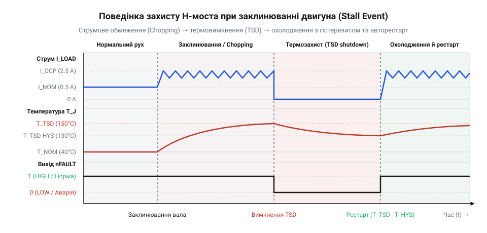
*Графіки електричних сигналів під час аварійного стану заклинювання вала двигуна: наростання струму до порогу OCP, перехід чипа в режим циклічного струмового обмеження (chopping), подальше нагрівання кристала до спрацьовування термозахисту (TSD), перехід виходу FAULT у низький логічний рівень та відновлення після охолодження завдяки гістерезису.*

На наведеній діаграмі наочно простежується часова послідовність реакцій внутрішніх захистів на аварійне механічне блокування вала:
1. У момент зупинки ротора струм двигуна стрімко наростає за експонентою до встановленого внутрішнього порогу `I_OCP`.
2. Досягнувши порогу, схема захисту активує режим циклічного подрібнення струму (chopping): струм утримується у безпечному діапазоні навколо `I_OCP`, змінюючись за пилкоподібним законом під час циклів рециркуляції.
3. Оскільки аварійний струм утримується на високому рівні тривалий час, розсіювання потужності на кристалі веде до безперервного зростання його температури `T_j`.
4. Коли температура сягає критичної межі `T_TSD`, спрацьовує термозахист: ключі моста вимикаються у високоімпедансний стан, струм спадає до нуля, а вихід `FAULT` відкритим стоком замикається на землю, переходячи в низький логічний рівень.
5. Після повного вимкнення навантаження кристал починає остигати. Щойно його температура опускається нижче порогу відновлення `T_rec` (завдяки температурному гістерезису `ΔT_hys`), внутрішнє блокування знімається, сигнал `FAULT` повертається у високий рівень через зовнішню підтяжку, і драйвер знову готовий сприймати імпульси керування.

Просте періодичне опитування стану лінії `FAULT` у головному циклі мікроконтролера є небезпечною практикою: якщо тривалість ітерації циклу складає десятки мілісекунд, за цей час редуктор заклиненого приводу може зазнати непоправних механічних пошкоджень, а кристал моста перебуватиме під тепловим стресом. Надійний алгоритм обробки аварій реалізують через апаратне переривання мікроконтролера за спадним фронтом сигналу (Falling Edge) у поєднанні зі скінченним автоматом станів:

1. **Миттєва апаратна зупинка**: в обробнику переривання (ISR) мікроконтролер негайно скидає коефіцієнт заповнення ШІМ у нуль або переводить керівні лінії `IN1 / IN2` у низький рівень. Подавати ШІМ-сигнал на мікросхему, що перебуває в стані апаратної аварії, неприпустимо.
2. **Фільтрація перешкод (дебаунс)**: оскільки іскріння колектора може наводити короткочасні голчасті перешкоди тривалістю в сотні наносекунд на лінію відкритого стоку, автомат стану чекає 1–2 мс і перевіряє стан піна ще раз. Якщо на піні зберігається низький рівень — стан аварії підтверджено.
3. **Пауза охолодження (Cooldown)**: запускається неблоківний програмний таймер очікування тривалістю 1–3 секунди, необхідний для гарантованого охолодження кристала та розсіювання тепла через друковану плату.
4. **Спроба відновлення (Retry)**: якщо після завершення таймера охолодження лінія `FAULT` повернулася у високий рівень, система робить спробу м'якого перезапуску з поступовим наростанням коефіцієнта заповнення ШІМ. Лічильник помилок фіксує спробу.
5. **Аварійне блокування (Permanent Lockout)**: якщо аварія повторюється кілька разів поспіль протягом короткого вікна спостереження (наприклад, 3 спроби за 10 секунд), автомат переходить у стан остаточного блокування, повністю відключає живлення силової шини зовнішнім ключем і передає статус критичної помилки у верхньорівневу систему.

Нижче наведено робочу програмну реалізацію описаного захисного автомата станів для популярних платформ мікроконтролерів.

:::tabs
:::code comp-hbridge-driver/c/driverstate.c
```stm32-hal
// C: Реалізація автомата захисту на платформі STM32 HAL з перериванням EXTI
#include "main.h"

typedef enum {
    MOTOR_RUNNING,
    MOTOR_DEBOUNCE,
    MOTOR_COOLDOWN,
    MOTOR_LOCKOUT
} MotorState_t;

static volatile uint8_t g_fault_flag = 0;
static MotorState_t g_motor_state = MOTOR_RUNNING;
static uint32_t g_state_timer = 0;
static uint8_t g_retry_count = 0;
static uint32_t g_last_success_time = 0;

#define MAX_RETRY_COUNT  3
#define COOLDOWN_DELAY   1500 // Час охолодження у мілісекундах
#define DEBOUNCE_DELAY   2    // Час підтвердження аварії у мілісекундах

// Зовнішній таймер ШІМ (наприклад, TIM1 канал 1)
extern TIM_HandleTypeDef htim1;

static void Motor_HardwareStop(void) {
    // Негайне глушіння виходу ШІМ на рівні таймера
    __HAL_TIM_SET_COMPARE(&htim1, TIM_CHANNEL_1, 0);
    HAL_GPIO_WritePin(MOTOR_IN2_GPIO_Port, MOTOR_IN2_Pin, GPIO_PIN_RESET);
}

static void Motor_RestoreSpeed(void) {
    // Відновлення робочого коефіцієнта заповнення ШІМ
    __HAL_TIM_SET_COMPARE(&htim1, TIM_CHANNEL_1, 600); // 60% потужності
    HAL_GPIO_WritePin(MOTOR_IN2_GPIO_Port, MOTOR_IN2_Pin, GPIO_PIN_RESET);
}

// Стандартний зворотний виклик обробника зовнішніх переривань STM32 HAL
void HAL_GPIO_EXTI_Callback(uint16_t GPIO_Pin) {
    if (GPIO_Pin == FAULT_Pin) {
        // Миттєве апаратне вимкнення просто всередині ISR
        Motor_HardwareStop();
        g_fault_flag = 1;
    }
}

void MotorProtection_Process(void) {
    uint32_t now = HAL_GetTick();

    switch (g_motor_state) {
        case MOTOR_RUNNING:
            if (g_fault_flag) {
                g_fault_flag = 0;
                g_state_timer = now;
                g_motor_state = MOTOR_DEBOUNCE;
            }
            break;

        case MOTOR_DEBOUNCE:
            if (now - g_state_timer >= DEBOUNCE_DELAY) {
                // Перевірка реального рівня на піні nFAULT
                if (HAL_GPIO_ReadPin(FAULT_GPIO_Port, FAULT_Pin) == GPIO_PIN_RESET) {
                    g_retry_count++;
                    if (g_retry_count >= MAX_RETRY_COUNT) {
                        g_motor_state = MOTOR_LOCKOUT;
                    } else {
                        g_state_timer = now;
                        g_motor_state = MOTOR_COOLDOWN;
                    }
                } else {
                    // Хибне спрацьовування від комутаційної завади
                    Motor_RestoreSpeed();
                    g_motor_state = MOTOR_RUNNING;
                }
            }
            break;

        case MOTOR_COOLDOWN:
            if (now - g_state_timer >= COOLDOWN_DELAY) {
                // Якщо лінія повернулася у високий стан — драйвер остиг
                if (HAL_GPIO_ReadPin(FAULT_GPIO_Port, FAULT_Pin) == GPIO_PIN_SET) {
                    Motor_RestoreSpeed();
                    g_motor_state = MOTOR_RUNNING;
                } else {
                    // Драйвер досі гарячий: продовжуємо очікування
                    g_state_timer = now;
                }
            }
            break;

        case MOTOR_LOCKOUT:
            Motor_HardwareStop();
            // Сигналізація аварії в системний лог або шину CAN/UART
            break;
    }

    // Скидання лічильника спроб після 10 секунд безперервної стабільної роботи
    if (g_motor_state == MOTOR_RUNNING && (now - g_last_success_time >= 10000)) {
        g_retry_count = 0;
        g_last_success_time = now;
    }
}
```
:::

## Внутрішня класифікація інтегральних H-мостів за технологією вихідних каскадів і ступенем інтеграції

Інтегральний H-міст є силовим посередником між джерелом живлення та індуктивним навантаженням. Уся електрична енергія, що живить двигун, повинна пройти крізь два одночасно відкритих ключі — верхній і нижній. При цьому кожен мілівольт падіння напруги на внутрішніх ключах віднімається від напруги, прикладеної до клем мотора, і безповоротно перетворюється на тепло всередині кремнієвого кристала.

Для систем із низьковольтним живленням від акумуляторів або стандартних шин 5–6 В (як під час живлення [N20 мікромотора з редуктором](root:cat-hw-actuators/n20-motor)) втрата навіть 1.5–2 В на транзисторах є критичною: мотор втрачає понад третину своєї потужності та швидкості, а мікросхема потребує масивного охолодження. За внутрішньою фізичною будовою силових каскадів та архітектурою керування інтегральні мости поділяються на дві фундаментальні технологічні епохи: класичні біполярні мікросхеми на парах Дарлінгтона та сучасні польові чипи на MOSFET-структурах.

Історично перші масові монолітні драйвери створювалися за біполярною технологією на базі біполярних транзисторів типу BJT (@@en|bipolar junction transistor@@; від лат. *bi-* — подвійний, *polus* — полюс). Потужні біполярні транзистори при великих колекторних струмах мають низький коефіцієнт підсилення за струмом `β` (або `h_FE`), що зазвичай становить від 10 до 25. Щоб наситити такий вихідний транзистор струмом 1.5 А, у його базу необхідно безперервно вливати керуючий струм силою 60–150 мА, що є неприпустимим навантаженням для вбудованих малопотужних цифрових логічних каскадів чипа.

Щоб подолати це обмеження, вихідні ключі почали будувати за схемою Дарлінгтона — @@en|Darlington pair@@ (названа на честь винахідника Сідні Дарлінгтона): каскадному з'єднанні двох біполярних транзисторів на одному кристалі, де емітер першого транзистора керує базою другого. Їхній результуючий коефіцієнт підсилення дорівнює добутку коефіцієнтів обох транзисторів:
`β_total ≈ β1 · β2`
Це дозволило відкривати потужні вихідні каскади струмами логіки величиною в кілька мікроамперів.

Проте за високе підсилення довелося заплатити фізично непереборним схемотехнічним недоліком: високою залишковою напругою насичення `V_CE(sat)` (collector-to-emitter saturation voltage). У складеному транзисторі Дарлінгтона колекторно-базовий перехід вихідного транзистора не може бути зміщений у прямому напрямку, оскільки потенціал його бази завжди нижчий за колектор на величину спаду напруги керуючого транзистора. У результаті спад напруги на відкритій парі Дарлінгтона становить:
`V_CE(sat) = V_BE2 + V_CE(sat)1`
Навіть у режимі глибокого насичення цей спад не опускається нижче 0.9–1.2 В, а під номінальним робочим струмом сягає від 1.2 до 1.8 В на кожному окремому ключі.

Оскільки струм у H-мості одночасно проходить крізь верхній ключ (high-side) та нижній ключ (low-side), сумарне падіння напруги на біполярному мості сягає значних величин:
`V_bridge_loss = V_CE(sat)_high + V_CE(sat)_low ≈ 1.8...3.0 В` (типово 2.0–2.4 В).

Це породжує два важких експлуатаційних наслідки:
1. Катастрофічне просідання напруги на моторі: якщо силова шина має напругу 6 В, до обмоток двигуна доходить лише `6 В - 2.2 В = 3.8 В`. Мотор втрачає майже 37% напруги, пропорційно втрачаючи оберти та крутний момент. При живленні від одного літієвого акумулятора (3.7 В) мотору залишається лише 1.5 В, чого часто недостатньо навіть для зриву шестерень редуктора з місця.
2. Лінійне зростання тепловтрат від струму: розсіювана теплова потужність на біполярних переходах у статичному стані визначається прямим добутком струму на спад напруги:

```
P_cond
= V_bridge_loss · I_motor       [статичні втрати біполярного моста]
= 2.2 В · 1.5 А                 [підстановка робочих параметрів]
= 3.3 Вт                        [теплова потужність на кристалі]
```

При струмі 1.5 А біполярна мікросхема виділяє 3.3 Вт тепла. Корпус драйвера без масивного металевого радіатора за такої потужності розжарюється вище 120 °C за лічені секунди, неминуче викликаючи спрацьовування теплового захисту TSD.

Сучасні інтегральні H-мости будують за технологіями DMOS (Double-diffused Metal-Oxide-Semiconductor) або CMOS. На відміну від біполярного транзистора з його потенційним бар'єром p-n переходів, повністю відкритий польовий транзистор MOSFET (@@en|metal-oxide-semiconductor field-effect transistor@@; метал-оксид-напівпровідник польовий транзистор) поводиться як чистий лінійний омічний опір. Цей опір називають опором відкритого каналу `R_DS(on)` (від @@en|drain-to-source on-resistance@@; опір стік-витік у відкритому стані).

Падіння напруги на відкритому польовому транзисторі строго підпорядковується закону Ома: воно не має початкового мертвого порогу в 1–2 В, починається точно з нуля і зростає лінійно зі струмом. Сумарний опір моста дорівнює сумі опорів верхнього та нижнього каналів:
`R_DS(on)_total = R_DS(on)_high + R_DS(on)_low`
У сучасних мікросхемах цей сумарний опір становить від 0.1 до 0.4 Ом (а в передових чипах опускається нижче 50 мОм).

Розрахуємо втрати для того самого навантаження зі струмом 1.5 А при сумарному опорі каналів 0.2 Ом:

```
V_bridge_loss
= I_motor · R_DS(on)_total      [падіння напруги на польовому мості]
= 1.5 А · 0.2 Ом                [підстановка опору каналів]
= 0.3 В                         [втрата напруги на мості]

P_cond
= I_motor² · R_DS(on)_total     [статичні втрати потужності]
= (1.5 А)² · 0.2 Ом             [квадратична залежність від струму]
= 0.45 Вт                       [теплова потужність на кристалі]
```

Порівняння демонструє кардинальну перевагу польової технології:
- Напруга на клемах двигуна становить `6.0 В - 0.3 В = 5.7 В` (95% напруги джерела живлення замість 63% у біполярному мості). Двигун працює з повною віддачею паспорту.
- Теплове виділення становить лише 0.45 Вт проти 3.3 Вт — нагрів скоротився більш ніж у 7 разів. Драйвер у компактному корпусі для поверхневого монтажу (наприклад, SOIC-8 або QFN) розсіює це тепло безпосередньо через мідні полігони плати без жодних навісних радіаторів.

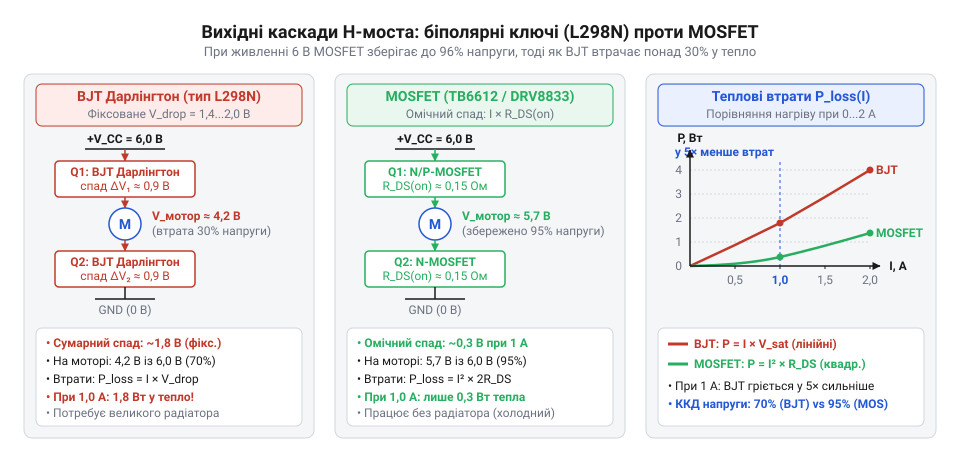
*Порівняльна схема вихідного каскаду на біполярних парах Дарлінгтона проти комплементарної або N-канальної пари MOSFET: показано еквівалентні падіння напруги на відкритих ключах (фіксоване 1.2–2.0 В у BJT проти лінійного омічного спаду I*RDS(on) у MOSFET) та графік залежності теплових втрат від струму.*

Наведена схема та графічні характеристики розкривають фундаментальну термодинамічну відмінність між двома технологіями:
- Біполярний каскад демонструє практично горизонтальну полицю падіння напруги: навіть при мізерному струмі 100 мА на ньому безглуздо втрачається понад 1.8 В. Графік тепловтрат BJT зростає лінійно з крутим нахилом, перетворюючи чип на піч уже на малих струмах.
- Польовий каскад має вихідну характеристику, що виходить строго з нульової точки: при малих струмах втрати напруги прямують до нуля. Графік потужності MOSFET має квадратичну форму (`I² · R`): у зоні малих і середніх струмів (до 2–3 А) тепловтрати мізерні, і лише на великих перевантаженнях квадратична крива перетинає лінійну характеристику біполярного моста.

Окрім напівпровідникової структури самих ключів, клас інтегральних H-мостів розділяється за ступенем компонентної інтеграції на дві великі інженерні підгрупи:

1. **Монолітні драйвери з вбудованими ключами** — @@en|monolithic H-bridge drivers@@ (від грец. *monolithos* — суцільний камінь):
У монолітному драйвері вся система — цифрова логіка декодування входів, схеми захисту від наскрізних струмів (dead-time), захисти OCP, TSD, UVLO, внутрішній зарядовий насос та всі чотири силові транзистори H-моста — сформовані на єдиному кристалі кремнію та запаковані в спільний корпус.
- Діапазон застосування: електродвигуни постійного струму з робочими струмами від часток ампера до 2–5 А (піково до 7 А) при напругах живлення шини до 36–45 В.
- Переваги: гранична мініатюризація друкованої плати, відсутність потреби в зовнішніх затворних резисторах, мінімальна кількість пасивних компонентів обв'язки (лише блокувальні конденсатори живлення), абсолютна захищеність силових ключів завдяки внутрішньому кремнієвому моніторингу температури безпосередньо в точці нагріву.
- Обмеження: жорсткий тепловий ліміт пластикового корпусу мікросхеми. Навіть при наявності металевого теплорозподільного майданчика (PowerPAD), припаяного до мідного полігону плати, корпус рідко може розсіяти понад 2–3 Вт постійної теплової потужності. Збільшення розмірів кремнієвого кристала для зниження опору `R_DS(on)` призводить до стрімкого здорожчання чипа.
Типовими прикладами навантаження для таких драйверів є мініатюрні приводи робототехніки ([N20 мікромотор з редуктором](root:cat-hw-actuators/n20-motor)), мембранні насоси ([водяна помпа RS-360SH](root:cat-hw-actuators/water-pump-rs360sh)), приводи дзеркал і замків в автомобільній електроніці.

2. **Мостові контролери та переддрайвери** — @@en|gate drivers@@ (від англ. *gate* — затвор польового транзистора, *driver* — формувач сигналу керування):
Переддрайвер містить усередині кремнієвого чипа цифрову логіку захистів, компаратори перевантаження, схеми затримки мертвого часу та швидкодіючі потужні буферні вихідні підсилювачі, але **не містить силових ключів**. Виходами такої мікросхеми є лінії керування затворами зовнішніх дискретних польових транзисторів: `GH1, GL1` (Gate High / Gate Low) для першої стійки моста та `GH2, GL2` для другої.
- Фізична необхідність: для керування електродвигунами потужністю в сотні ват або кіловати (тягові приводи коліс, промислові сервоприводи, лебідки) струми комутації сягають 30–200 А. Для таких струмів використовують потужні дискретні N-канальні MOSFET з ультранизьким опором каналу (1–3 мОм) у великих металізованих корпусах (TO-220, D2PAK тощо). Такі транзистори мають колосальну сумарну ємність затвора (тисячі пікофарад). Щоб перезарядити цю ємність за 20–50 наносекунд і не дати транзистору згоріти від динамічних втрат під час перемикання ШІМ, переддрайвер мусить видавати в затвор імпульсний струм амплітудою 1–4 А.
Крім того, для живлення верхніх N-канальних транзисторів переддрайвер реалізує зовнішній бутстрепний вузол (bootstrap) з діодом і конденсатором, який піднімає потенціал затвора на 10–12 В вище напруги силового живлення мотора під час відмикання верхнього ключа. Детальніше схемотехніка затворних драйверів розкривається в матеріалі про [драйвери затворів дискретних MOSFET](root:hw-power/gate-driver).
- Переваги: практично необмежена потужність приводу, можливість гнучкого просторового рознесення силових транзисторів на друкованій платі або окремих радіаторах для легкого відведення десятків ват тепла, висока ремонтопридатність силової частини без необхідності заміни інтегральної мікросхеми керування.
- Складність: високі вимоги до трасування друкованої плати. Паразитна індуктивність доріжок затворного контуру викликає небезпечні високочастотні коливання напруги на затворі, що вимагає ретельного розрахунку демпферних RC-ланцюгів (сніберів) і захисних затворних резисторів.

> 🔧 **Навіщо це.**
> Вибір між монолітним чипом і зв'язкою «переддрайвер + зовнішні ключі» визначається тепловим бюджетом і струмом приводу. Для моторів потужністю до 20–30 Вт монолітний драйвер заощаджує до 70% площі друкованої плати та позбавляє від розрахунку паразитних індуктивностей затворних контурів. Проте для важких моторів понад 100 Вт спроба втримати струм у монолітному кристалі призводить до миттєвого перегріву — там безальтернативно обирають переддрайвер, вивільняючи тепло на дискретні транзистори з міліомним опором.

Щоб швидко та безпомилково визначити архітектурний тип інтегрального H-моста під час аналізу технічної документації (даташиту), звертають увагу на такі ключові діагностичні ознаки:

1. **Параметри вихідних каскадів у таблиці електричних характеристик**:
   - Якщо в даташиті вказано падіння напруги насичення виходів: `Output Saturation Voltage`, `V_CE(sat)` або рівні напруги `V_OL` і `V_OH` величиною 0.8–2.0 В при фіксованому струмі — перед вами класичний біполярний міст на складених транзисторах Дарлінгтона.
   - Якщо в паспорті зазначено опір увімкненого стану: `On-State Resistance`, `High-Side R_DS(on)`, `Low-Side R_DS(on)` або `Total Bridge On-Resistance` у міліомах чи омах — це сучасний польовий мікросхемний драйвер на MOSFET.
2. **Призначення виводів цоколівки мікросхеми**:
   - Монолітний драйвер містить виводи, призначені для прямого підключення клем двигуна: `OUT1, OUT2` (або `MA, MB`).
   - Переддрайвер (gate driver) не має потужних моторних виходів: його виводи маркуються як `GH1, GL1, GH2, GL2` (Gate High / Gate Low), а поруч обов'язково присутні виводи підключення бутстрепних конденсаторів `BST1, BST2` (або `BOOT1, BOOT2`).
3. **Графік залежності вихідних втрат від струму**:
   - Графік, лінія якого починається зі зміщенням 1.5–2.0 В на осі напруги при нульовому струмі, прямо вказує на біполярні переходи Дарлінгтона.
   - Пряма пропорційна лінія, що починається строго з точки (0 В, 0 А) і підпорядковується закону Ома `U = I · R`, однозначно свідчить про польову структуру вихідного каскаду.

## Межі застосування, баланс потужності та тепловий розрахунок драйвера

Інтегральний драйвер виходить з ладу за лічені мікросекунди, якщо напруга на його ключах перевищить напругу лавинного пробою або якщо виділене кремнієвим кристалом тепло не встигне перейти в навколишнє середовище. Надійний вузол керування мотором узгоджує дві протилежні межі: пікові електричні навантаження, які визначаються фізикою колекторного двигуна, та температурний режим напівпровідникової структури, обмежений теплопровідністю корпусу й друкованої плати.

Паспортні абсолютні максимуми (@@en|absolute maximum ratings@@) визначають бар'єр, вихід за який призводить до необоротної деградації (від лат. *degradatio* — зниження, занепад) напівпровідникового кристала або його фізичного руйнування. Робочий діапазон ніколи не призначають впритул до цих меж. Якщо в документації зазначено абсолютний максимум напруги живлення `V_CC,max = 18 В`, безпечна робоча напруга не повинна перевищувати 12–14 В. Індуктивне навантаження — як-от обмотка [мікромотора N20](root:cat-hw-actuators/n20-motor) — під час комутації генерує різкі сплески напруги, що додаються до постійної напруги шини живлення. Запас у 20–30% між робочою напругою та абсолютним максимумом гарантує, що короткочасний індуктивний сплеск не викличе пробою зворотних діодів чи структури транзисторів.

Друга межа — різниця між піковим струмом (@@en|peak current@@) та тривалим номінальним струмом (@@en|continuous current@@, від лат. *continuus* — неперервний). У документації інтегральних драйверів нерідко акцентують на піковому струмі — наприклад, 2.5 А. Проте цей струм кристал витримує лише протягом кількох мілісекунд, поки триває запуск двигуна. Тривала робота на такому струмі неможлива через стрімкий тепловий перегрів. Визначальним параметром для вибору драйвера є струм заклинювання вала (@@en|stall current@@):

```text
I_stall
= V_CC / R_coil                               [закон Ома для омічного опору заблокованого ротора]
```

У момент пуску або при механічному блокуванні редуктора ротор не обертається, внутрішня проти-ЕРС дорівнює нулю, і струм обмежується виключно активним опором мідного дроту обмотки. Для компактних приводів струм заклинювання може у 5–8 разів перевищувати робочий струм під навантаженням. Драйвер мусить або витримувати цей струм у межах своєї області безпечної роботи (@@en|safe operating area@@, SOA), або мати вбудований компаратор захисту від перевантаження за струмом, що обмежує шпаруватість чи вимикає виходи. Якщо температура кристала (@@en|junction temperature@@, від лат. *junctio* — з'єднання) досягає граничного значення `T_J,max` (зазвичай 150 °C), вбудована схема термозахисту примусово переводить ключі у високоімпедансний стан, рятуючи мікросхему від теплового пробою.

Тепло, яке виділяє мікросхема драйвера під час роботи, складається з трьох фізично відмінних компонентів:

```text
P_total
= P_cond + P_sw + P_quiescent                 [сумарний тепловий баланс інтегрального драйвера]
```

де `P_cond` — статичні втрати провідності (@@en|conduction losses@@), `P_sw` — динамічні комутаційні втрати перемикання (@@en|switching losses@@), а `P_quiescent` — потужність споживання внутрішньої логіки та драйверів затворів (від лат. *quiescentia* — стан спокою).

Статичні втрати провідності виникають через те, що відкриті ключі H-моста мають скінченний електричний опір (від лат. *resistentia* — протидія). У кожен момент руху струм двигуна тече крізь послідовний ланцюг із двох увімкнених транзисторів: одного верхнього (high-side) та одного нижнього (low-side). У драйверах на польових транзисторах втрати визначаються опором відкритого каналу сток-витік `R_DS(on)`:

```text
P_cond
= I_RMS² · (R_DS(on)_H + R_DS(on)_L)
= 2 · I_RMS² · R_DS(on)                       [закон Джоуля — Ленца для двох послідовних польових ключів]
```

де `I_RMS` — середньоквадратичне значення струму двигуна. При розрахунках обов'язково враховують, що опір кремнієвого каналу `R_DS(on)` має позитивний температурний коефіцієнт: при нагріванні кристала від 25 °C до 125 °C опір зростає в 1.5–1.7 раза. Якщо проігнорувати цей ефект, розрахункове тепловиділення виявиться заниженим майже вдвічі[^1].

Динамічні втрати виникають під час широтно-імпульсної модуляції (ШІМ). Польовий транзистор перемикається зі стану відсічки в стан насичення не миттєво. Протягом часу наростання `t_r` (від англ. @@en|rise time@@) та часу спаду `t_f` (від англ. @@en|fall time@@) опір каналу плавно змінюється, і на транзисторі одночасно присутні висока напруга та робочий струм навантаження. Потужність, що виділяється в активній зоні двох ключів стійки моста за один такт комутації:

```text
P_sw
= 0.5 · V_CC · I_load · (t_r + t_f) · f_PWM   [усереднені втрати активного переходу ключів при ШІМ]
```

де `f_PWM` — частота широтно-імпульсної модуляції. До цієї величини додаються втрати на перезарядження вихідної ємності сток-витік `C_OSS` та енергія зворотного відновлення внутрішніх антипаралельних діодів. На частотах 1–10 кГц комутаційні втрати становлять 5–10% від загальних, але через лінійне зростання з частотою на 30–50 кГц втрати `P_sw` зрівнюються зі статичними, а на 80–100 кГц стають головним джерелом перегріву чипа.

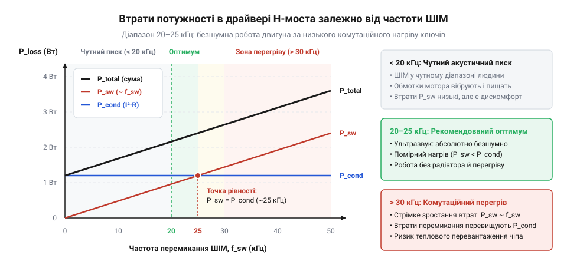
*Графік перетину кривих статичних втрат провідності та динамічних втрат перемикання залежно від частоти ШІМ, де видно точку різкого домінування комутаційного нагріву понад 30 кГц.*

> 🔧 **Навіщо це.**
> Розрахунок балансу потужності показує точку критичного компромісу: гонитва за ультразвуковою частотою ШІМ заради безшумності здатна розігріти драйвер до спрацьовування термозахисту навіть на половинному струмі двигуна. Знаючи співвідношення `P_cond` і `P_sw`, інженер обирає правильний баланс між частотою модуляції та площею охолодження друкованої плати.

Виділене кристалом тепло повинно безперервно відводитися в навколишнє середовище, інакше температура структури зростатиме до настання теплового пробою. Тепловий потік описується тепловим еквівалентом закону Ома:

```text
ΔT
= T_J - T_A                                   [перепад температур між кристалом і повітрям]
= P_total · R_θJA                             [закон теплового потоку для стаціонарного стану]
```

де `T_J` — температура кристала, `T_A` — температура навколишнього середовища (від англ. @@en|ambient@@, зазвичай приймають +40...+50 °C усередині закритого корпусу приладу), а `R_θJA` — сумарний тепловий опір кристал-середовище (@@en|junction-to-ambient thermal resistance@@, вимірюється в °C/Вт, від грец. *therme* — тепло).

Тепловий шлях розбивається на послідовні ланки: внутрішній тепловий опір від кристала до металевої основи корпусу `R_θJC` (@@en|junction-to-case@@), опір шару припою або пасти `R_θCS` (@@en|case-to-sink@@) та тепловий опір тепловідводу до повітря `R_θSA` (@@en|sink-to-ambient@@). Звичайні пластмасові SMD-корпуси без металевої підкладки розсіюють тепло вкрай неефективно: їхній опір `R_θJA` становить 100–160 °C/Вт. Це означає, що при потужності втрат усього 0.8 Вт перегрів кристала відносно повітря сягає `0.8 Вт · 120 °C/Вт = 96 °C`, що за температури середовища +40 °C дає небезпечні `T_J = 136 °C`.

Щоб подолати теплоізоляцію пластмаси, сучасні інтегральні H-мости виготовляють у корпусах із відкритим металевим майданчиком на днищі — PowerPAD або @@en|exposed pad@@. Кристал монтується безпосередньо на металеву несучу пластину вивідної рамки, завдяки чому внутрішній тепловий опір `R_θJC` знижується до 1.5–4 °C/Вт. Основним радіатором для такого корпусу слугує сама друкована плата.

Проте склотекстоліт марки FR-4 має низьку теплопровідність — близько 0.3 Вт/(м·К), тоді як мідь проводить тепло у понад 1000 разів краще (близько 390 Вт/(м·К)). Тепловий потік не може ефективно пройти крізь товщу склотекстоліту безпосередньо на нижній шар. Для відведення тепла у глибину плати під майданчиком PowerPAD розташовують масив теплових перехідних отворів (@@en|thermal vias@@, від англ. *via*, лат. *via* — шлях). Стінки отворів діаметром 0.3–0.35 мм покривають шаром гальванічної міді завтовшки 20–25 мкм із кроком між центрами отворів 1.0–1.2 мм. Така сітка забезпечує вертикальний теплопровідний міст, який переносить енергію на внутрішні та нижній мідні шари плати, детальніше розібрані в [тепловому розрахунку друкованих плат](root:hw-pcb/thermal-management-pcb).

Площа мідного полігону (від грец. *polygonos* — багатокутний) на зовнішніх шарах відіграє вирішальну роль у зниженні `R_θJA`. Збільшення площі міді від 50 мм² до 500–600 мм² на двошаровій платі зі стандартною фольгою 35 мкм (1 oz) знижує сумарний тепловий опір `R_θJA` з 95 °C/Вт до 38–42 °C/Вт. Подальше розростання полігону понад 1000 мм² дає слабкий ефект, оскільки тонка мідна фольга має власний опір теплопередачі вздовж площини, і тепло просто не доходить до далеких країв полігону.

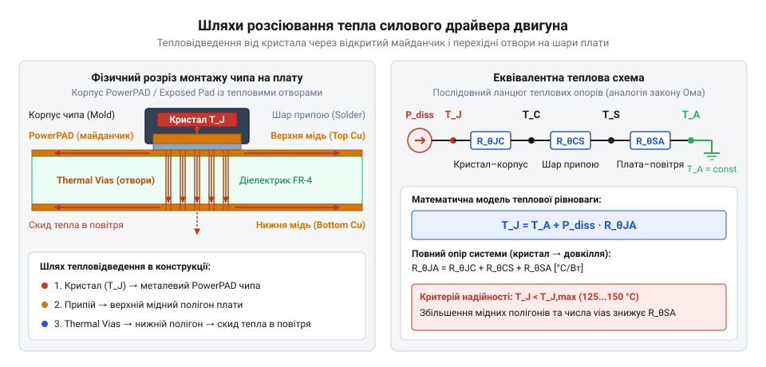
*Модель передачі тепла від кремнієвого кристала інтегрального H-моста через відкритий контактний майданчик (PowerPAD) і масив теплових перехідних отворів на мідні полігони друкованої плати, а також еквівалентна схема теплового опору ланцюга кристал—корпус—середовище.*

**Умова розрахунку:** Інтегральний польовий H-міст живить двигун напругою `V_CC = 12 В` зі струмом під навантаженням `I_load = 1.2 А`. Опір відкритого каналу ключів за кімнатної температури становить `0.22 Ом`. З урахуванням нагріву каналу до робочої температури приймаємо підвищений опір `R_DS(on) = 0.32 Ом`. Частота ШІМ дорівнює `f_PWM = 20 кГц`, сумарний час фронтів комутації `t_r + t_f = 70 нс`. Струм власного споживання мікросхеми становить `5 мА`. Пристрій працює всередині корпусу за температури `T_A = 45 °C`. Порівняємо нагрів кристала за відсутності мідного тепловідводу (`R_θJA = 95 °C/Вт`) та з полігоном площею 600 мм² і масивом теплових отворів (`R_θJA = 40 °C/Вт`).

Покрокове обчислення балансу потужності:

```text
P_cond
= 2 · I_load² · R_DS(on)                       [статичні втрати на двох відкритих ключах]
= 2 · (1.2 А)² · 0.32 Ом                      [підстановка робочого струму та гарячого опору каналу]
= 2 · 1.44 А² · 0.32 Ом                       [розрахунок квадрата струму]
= 0.922 Вт                                    [потужність статичного нагріву каналів]

P_sw
= 0.5 · V_CC · I_load · (t_r + t_f) · f_PWM   [комутаційні втрати перемикання при ШІМ]
= 0.5 · 12 В · 1.2 А · 70 · 10⁻⁹ с · 20 · 10³ с⁻¹ [підстановка напруги, струму, часу фронтів та частоти]
= 7.2 Вт · 1.4 · 10⁻³                         [добуток амплітудних величин на відносну тривалість]
= 0.010 Вт                                    [динамічні комутаційні тепловтрати]

P_quiescent
= V_CC · I_q                                  [потужність споживання внутрішніх кіл логіки]
= 12 В · 0.005 А                              [підстановка робочої напруги та струму спокою]
= 0.060 Вт                                    [фонові втрати керування]

P_total
= P_cond + P_sw + P_quiescent                 [баланс потужності всіх теплових джерел]
= 0.922 Вт + 0.010 Вт + 0.060 Вт              [сумування втрат]
= 0.992 Вт                                    [сумарне теплове виділення кристала драйвера]
```

Визначаємо кінцеву температуру кристала для двох варіантів трасування плати:

```text
T_J_без_полігону
= T_A + P_total · R_θJA                       [температура кристала без розвиненого тепловідводу]
= 45 °C + 0.992 Вт · 95 °C/Вт                 [підстановка параметрів для стандартного посадкового місця]
= 45 °C + 94.2 °C                             [перепад температури кристал-повітря]
= 139.2 °C                                    [небезпечний перегрів на межі спрацьовування термозахисту]

T_J_з_полігоном
= T_A + P_total · R_θJA                       [температура кристала з полігоном та тепловими віа]
= 45 °C + 0.992 Вт · 40 °C/Вт                 [підстановка параметрів плати з PowerPAD і тепловими віа]
= 45 °C + 39.7 °C                             [перепад температури з якісним відведенням тепла]
= 84.7 °C                                     [комфортний робочий тепловий режим із запасом 65 °C]
```

Без спеціального відведення тепла через PowerPAD той самий драйвер за постійного навантаження 1.2 А розігрівається майже до 140 °C і за найменшого перевантаження чи зупинки вала вимикається внутрішнім термозахистом. Організація полігону з масивом отворів знижує температуру структури до безпечних 85 °C.

[^1]: У біполярних H-мостах замість омічного опору каналу діє постійне падіння напруги насичення колектор-емітер `V_CE(sat)` (0.7–1.2 В на ключ). Статичні втрати зростають пропорційно струму (`P_cond = 2 · V_CE(sat) · I`), тому вже при струмах понад 0.5 А біполярні ключі перегріваються набагато сильніше за польові й вимагають масивних радіаторів.

## Практичні інженерні граблі та правила надійного трасування друкованої плати

Навіть бездоганно розрахована за струмом і теплом схема H-моста починає непередбачувано скидати мікроконтролер, генерувати фальшиві спрацьовування датчиків або випалювати вихідні ключі в перші ж секунди випробувань, якщо під час трасування друкованої плати проігноровано паразитні параметри провідників і закони комутації струмів. Індуктивність доріжки довжиною в кілька сантиметрів та швидкість зміни струму перетворюють плату на джерело імпульсних сплесків напруги, здатних зруйнувати логічні рівні керування.

Друкована доріжка або провідник на платі не є ідеальним еквіпотенціальним провідником. Кожен міліметр траси має розподілений активний опір та паразитну індуктивність (від лат. *inductio* — наведення), що для типової доріжки завширшки 0.3–0.5 мм становить близько 0.8–1.2 нГн на міліметр довжини.

Під час перемикання ключів H-моста силове індуктивне навантаження комутується за лічені десятки наносекунд. Коли струм у кілька амперів вмикається або вимикається за час `dt = 20–40 нс`, виникає надзвичайно висока швидкість наростання струму `dI/dt`, що досягає значень `10⁸ А/с`. Згідно із законом електромагнітної індукції Фарадея, на паразитній індуктивності земляної доріжки `L_trace` наводиться імпульс напруги:

```text
V_bounce
= L_trace · (dI / dt)                         [наведена напруга на паразитній індуктивності провідника]
```

Якщо силова земля двигуна (@@en|power ground@@, PGND) та сигнальна земля мікроконтролера (@@en|signal ground@@, AGND/GND) з'єднані послідовно однією доріжкою, виникає явище «підстрибування» землі (@@en|ground bounce@@). Потенціал силового виводу землі драйвера на мікросекунди зміщується відносно нуля мікроконтролера на 1–2 В. Логічний нуль на вході керування, відправлений мікроконтролером, драйвер сприймає як напругу нижче нуля або, навпаки, як логічну одиницю через зсув порогів компаратора. Наслідком стають спотворення імпульсів ШІМ, помилкові сигнали аварії FAULT, втрата синхронізації цифрових інтерфейсів або самовільне скидання мікроконтролера через наведення на шину скидання RESET.

Розв'язання цієї проблеми полягає у фізичному розведенні земель «зіркою» (@@en|star grounding@@). Силовий контур із великими швидкостями струму `dI/dt` трасується широким полігоном окремо від чутливих цифрових і аналогових ліній керування. Полігони PGND та AGND об'єднуються строго в одній точці — безпосередньо біля мінусового виводу силового фільтрувального конденсатора плати.

Двигун постійного струму є оборотною електромеханічною машиною. Під час швидкого реверсу або динамічного гальмування кінетична енергія ротора та обертового механізму продовжує крутити вал. Двигун переходить у генераторний режим, виробляючи проти-ЕРС. Струм через вбудовані зворотні діоди H-моста скидається назад у шину живлення `V_CC`. Відбувається процес рекуперації (від лат. *recuperatio* — повернення, зворотне отримання).

Більшість імпульсних перетворювачів напруги (DC-DC buck converters) та лінійних стабілізаторів (LDO) є суто односпрямованими: вони здатні віддавати струм у навантаження, але не можуть поглинати зворотний струм. Коли рекуперативний струм вливається в шину живлення, а в системі немає інших потужних споживачів, цей заряд спрямовується у вихідні конденсатори джерела. Напруга на шині `V_CC` починає неконтрольовано зростати — це явище називають накачуванням шини живлення (@@en|voltage pumping@@ або @@en|bus pumping@@). Якщо буферна ємність замала, стрибок напруги може за мікросекунди перевищити абсолютний максимум чипа `V_CC,max`, спричинивши лавинний пробій транзисторів.

Для захисту від накачування напруги безпосередньо біля виводів живлення драйвера встановлюють буферний електролітичний або танталовий конденсатор великої ємності (@@en|bulk capacitor@@, від англ. *bulk* — основна маса) номіналом 47–220 мкФ із низьким еквівалентним послідовним опором (@@en|low-ESR@@, від лат. *resistentia* — опір). Конденсатор діє як демпфер, поглинаючи кінетичний імпульс заряду без критичного зростання напруги. У високовольтних системах або приводах із великою масою на валу паралельно до буферного конденсатора встановлюють захисний супресор (TVS-діод), детальніше розібраний у [захисті кіл від викидів проти-ЕРС](root:hw-power/transient-suppression).

У колекторних двигунах постійного струму, зокрема в [мікромоторах N20](root:cat-hw-actuators/n20-motor), механічні щітки під час обертання ковзають по металевих ламелях колектора, циклічно комутуючи струм в обмотках ротора. Розрив контакту зі струмоведучою ламеллю супроводжується мікродуговими розрядами та іскрінням.

Ці іскри генерують широкий спектр електромагнітних завад від сотень кілогерців до кількох сотень мегагерців. Завади діляться на два класи: диференціальні (між двома виводами живлення мотора, від лат. *differentia* — різниця) та синфазні (між обома виводами та корпусом двигуна або загальною землею, від грец. *syn* — разом та *phasis* — поява). Довгі проводи від драйвера до мотора перетворюються на випромінювальні антени, що глушать радіоканали, наводять імпульсні перешкоди на аналогові лінії датчиків і викликають збої процесора.

Для заглушення щіткових завад безпосередньо на клемах мотора встановлюють трирівневу фільтрацію, деталізовану в [придушенні завад щіткових колекторних вузлів](root:hw-analog/brush-dc-noise-suppression):
1. Диференціальний керамічний конденсатор ємністю 10–100 нФ (тип діелектрика X7R) монтується з найкоротшими виводами безпосередньо між двома контактами двигуна, шунтуючи високочастотні викиди між обмотками.
2. Два синфазні конденсатори ємністю 1–10 нФ підключаються від кожного контакту двигуна на його металевий корпус, замикаючи високочастотні струми наведення на екрануючу гільзу мотора.
3. Силові дроти живлення між виходом H-моста та двигуном скручують у виту пару (@@en|twisted pair@@) із кроком скручування 1–2 см. Це мінімізує площу контуру випромінювання та забезпечує взаємне віднімання електромагнітних полів прямого й зворотного струмів.

Вибір частоти широтно-імпульсної модуляції є інженерним балансом між акустичним комфортом людини, втратами в залізі двигуна та комутаційним нагрівом ключів драйвера:
- **Діапазон нижче 20 кГц (зазвичай 1–10 кГц):**
  У цьому діапазоні динамічні втрати перемикання транзисторів `P_sw` зведені до мінімуму, оскільки переходи між станами відбуваються відносно рідко. Драйвер залишається холодним навіть без масивного тепловідводу. Проте пульсації струму викликають механічні коливання обмоток і статора через магнітострикцію. Двигун генерує гучний і вкрай неприємний високочастотний писк, який добре чує людське вухо (чутний діапазон від 20 Гц до 20 кГц, від грец. *akoustikos* — слуховий). Крім того, на низьких частотах збільшується розмах пульсацій струму `ΔI`, що підвищує омічний нагрів обмоток ротора.
- **Діапазон вище 20 кГц (ультразвуковий, 20–30 кГц):**
  Перехід за межу 20 кГц робить роботу приводу абсолютно безшумною для людини. Висока частота зменшує пульсації струму: індуктивність обмотки діє як ефективний фільтр низьких частот, і струм через двигун стає практично неперервним і плавним, покращуючи лінійність керування на низьких обертах.
- **Діапазон понад 40–50 кГц:**
  Надмірне підвищення частоти стрімко роздуває комутаційні втрати драйвера `P_sw`, які лінійно залежать від частоти. Драйвер починає інтенсивно грітися, вимагаючи збільшення площі міді або примусового обдуву. Додатково у феромагнітному осерді ротора зростають втрати на гістерезис і вихрові струми (струми Фуко), що призводить до падіння коефіцієнта корисної дії самого двигуна.

Оптимальним компромісом для більшості мікромоторів постійного струму є частота в діапазоні **20–25 кГц**: вона забезпечує абсолютну акустичну безшумність, утримуючи динамічні комутаційні тепловтрати драйвера на контрольованому рівні.

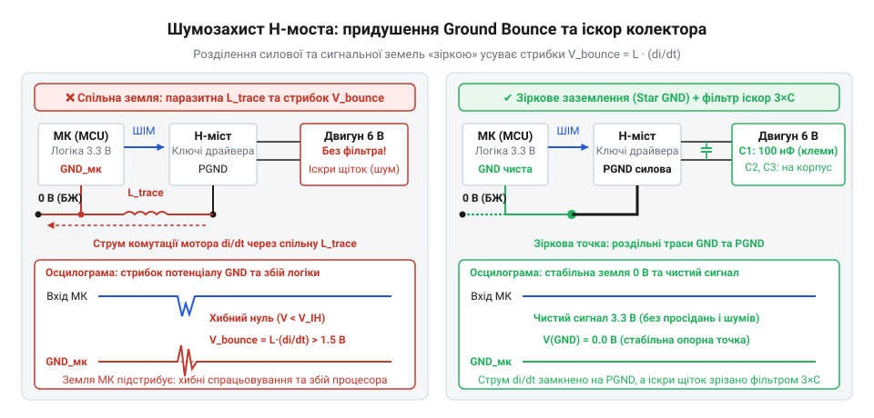
*Схема паразитних індуктивностей і ємностей плати: механізм підстрибування потенціалу землі на розподілених індуктивностях доріжок при комутаціях, правильна топологія з'єднання силової та логічної земель «зіркою» та трирівневе заглушення щіткових завад.*

> 🔧 **Навіщо це.**
> Грамотне трасування плати та правильний монтаж фільтрів позбавляють пристрій від «плаваючих» дефектів: раптових перезавантажень мікроконтролера під час реверсу мотора, спотворень показів аналогових датчиків та виходу ключів драйвера з ладу через підстрибування землі.

Перед відправкою друкованої плати у виробництво конструкцію перевіряють за обов'язковим контрольним списком:
1. **Локальний керамічний конденсатор:** Конденсатор ємністю 0.1–1.0 мкФ (кераміка X7R) з робочою напругою щонайменше в 1.5 раза вищою за робочу напругу шини живлення встановлено впритул (2–3 мм) до силових виводів живлення драйвера. Площа контуру струму між виводами `V_CC`, конденсатором і виводом `PGND` зведена до абсолютного мінімуму.
2. **Буферний електролітичний конденсатор:** Поруч із драйвером встановлено електролітичний або танталовий конденсатор ємністю 47–220 мкФ класу low-ESR для демпфування рекуперативних викидів проти-ЕРС та запобігання накачуванню напруги шини живлення.
3. **Розділення силової та сигнальної земель:** Доріжки та полігони силової землі PGND і сигнальної землі AGND прокладено незалежно й з'єднано строго в одній точці за схемою «зірка» безпосередньо біля виводів буферного конденсатора.
4. **Тепловідвід PowerPAD:** Під металевим черевцем корпусу драйвера виконано мідний майданчик, з'єднаний із внутрішніми та нижніми шарами за допомогою масиву з 4–9 теплових перехідних отворів (діаметр свердла 0.3 мм, крок 1.0–1.2 мм). Сумарна площа мідного полігону становить не менше 400–600 мм².
5. **Трасування силових виходів:** Доріжки від виходів драйвера OUT1 та OUT2 до клем двигуна мають максимальну ширину (не менше 1 мм на 1 А струму для міді 35 мкм), прокладені симетрично й не проходять під чутливими лініями інтерфейсів, кварцовими резонаторами чи аналоговими ланцюгами.
6. **Захист від щіткових завад:** Безпосередньо на корпусі колекторного двигуна змонтовано триконденсаторний фільтр (10–100 нФ між виводами та 2×1–10 нФ на металевий корпус двигуна), а кабельний джгут до мотора скручено у виту пару.
7. **Налаштування частоти ШІМ:** Таймер мікроконтролера налаштовано на генерацію ШІМ у діапазоні 20–25 кГц, що гарантує відсутність акустичного свисту без критичного зростання динамічних комутаційних втрат.
