# Мотор-редуктор 6 В (100 і 600 об/хв)

<preknowlist>
- [N20 мікромотор з редуктором](root:cat-hw-actuators/n20-motor) — електрофізичні властивості колекторного двигуна постійного струму (висока кутова швидкість холостого ходу, малий статичний крутний момент, залежність струму та тепловиділення від навантаження на валу) та розуміння необхідності поєднання мотора з механічним редуктором в єдиний привод
</preknowlist>

## Чому пряме підключення мотора не працює: дефіцит крутного моменту та неминучість редуктора

Якщо під'єднати мініатюрний колекторний електродвигун постійного струму до джерела живлення, його вал миттєво розганяється з характерним тонким дзижчанням. Проте спроба зупинити цей гладенький сталевий стрижень двома пальцями виявляє парадоксальну річ: обертання припиняється від найлегшого дотику. Двигун обертається, але зовсім не має механічної сили.

У мехатроніці та робототехніці привод мусить виконувати відчутну механічну роботу: обертати колесо під вагою шасі, підіймати важіль маніпулятора чи пересувати ригель замка. Спроба посадити колесо чи важіль безпосередньо на вихідний вал такого мотора закінчується повною непрацездатністю системи через глибокий розрив між фізичними параметрами двигуна та потребами навантаження.

Типовий мініатюрний колекторний двигун постійного струму на холостому ходу розвиває від 8000 до 20 000 обертів на хвилину (@@en|RPM@@). Без редуктора на такій швидкості (наприклад, 12 000 об/хв) звичайне колесо мобільного робота діаметром 40 мм давало б теоретичну швидкість близько 25 м/с — понад 90 км/год. На такій швидкості легкий робот некерований: він не здатний ані стабільно тримати траєкторію, ані вчасно реагувати на перешкоди за показами сенсорів.

Водночас крутний момент (від латинського *torquere* — скручувати, англійською @@en|torque@@) на валу такого двигуна є мізерним і рідко перевищує 0.5–2 мН·м (міліньютон-метри). На радіусі колеса `R = 20 мм` (0.02 м) цей момент створює тягове зусилля:

```
F
= T / R
= 0.001 Н·м / 0.02 м
= 0.05 Н
```

Це зусилля відповідає вазі всього у 5 грамів. Будь-який опір коченню шини, найменша нерівність поверхні чи внутрішнє тертя в осі шасі виявляються більшими за цю силу. Колесо не здатне навіть зрушити платформу з місця, а двигун миттєво переходить у режим заклинювання (англ. @@en|stall condition@@).

Під час повної зупинки вала під напругою в обмотках якоря зникає протиелектрорушійна сила (проти-ЕРС), яка за нормального обертання врівноважує напругу живлення й обмежує струм. Усе джерело живлення виявляється замкненим на суто омічний опір тонкого мідного дроту обмоток. Струм стрибкоподібно зростає до значення струму заклинювання, виділяючи величезну теплову потужність (`P = I² · R`). За лічені секунди лакова ізоляція витків плавиться, щітковий вузол обвуглюється, і двигун безповоротно згоряє.

Природна спроба розв'язати проблему електричним шляхом через зниження напруги або застосування широтно-імпульсної модуляції (ШІМ, англійською @@en|PWM@@) — див. [ШІМ-керування швидкістю електродвигунів](root:hw-motion/pwm-motor-speed-control) — закінчується невдачею. Електромагнітний крутний момент двигуна постійного струму прямо пропорційний силі струму в обмотках якоря (`T = k[m] · I`), про що свідчить [механічна характеристика двигуна постійного струму](root:hw-motion/motor-torque-speed-curve). Зменшуючи шпаруватість імпульсів ШІМ, ми зменшуємо середнє значення напруги. Разом із напругою пропорційно зменшується пусковий струм, а отже, катастрофічно падає і без того слабкий крутний момент рушання. Мотор втрачає здатність подолати навіть власне тертя в підшипниках і глухне ще швидше. Електронне керування зменшує підведену електричну потужність, але не вміє трансформувати надлишкову швидкість у силу.

Механічна потужність обертового руху визначається добутком крутного моменту `T` на кутову швидкість `ω`:

```
P = T · ω
```

Електродвигун виробляє високу корисну потужність виключно на високих кутових швидкостях. Щоб узгодити швидкісний двигун із повільним і важким навантаженням без втрати енергії, необхідно примусово зменшити швидкість обертання: у скільки разів падає кутова швидкість `ω`, у стільки ж разів зростає корисний крутний момент `T`.

Механічним перетворювачем швидкості в крутний момент виступає редуктор (від латинського *reducere* — зменшувати, повертати назад, англійською @@en|gearbox@@ або @@en|speed reducer@@). У мехатроніці електродвигун і редуктор майже ніколи не розглядають окремо: їх конструктивно поєднують у єдиний силовий блок, прикладом якого є [N20 мікромотор з редуктором](root:cat-hw-actuators/n20-motor).

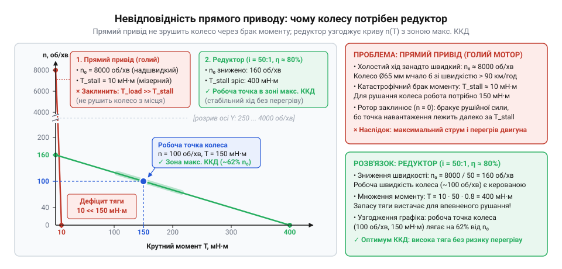
*Графік механічної характеристики колекторного двигуна (залежність швидкості від крутного моменту) з накладеною робочою точкою колеса робота: наочно видно несумісність між надшвидкісним холостим ходом і високим статичним моментом рушання.*

> 🔧 **Навіщо це.** Електродвигун ефективно генерує корисну потужність лише на високих кутових швидкостях (тисячі обертів на хвилину), де висока проти-ЕРС стабілізує струм і захищає обмотки від перегріву. Робочі органи машин, навпаки, потребують малих швидкостей (десятки чи сотні обертів на хвилину) та високої тяги. Прямозубий редуктор усуває цю несумісність механічно: він перетворює невикористовну кінетичну енергію надшвидкого обертання ротора у високий крутний момент, захищаючи двигун від заклинювання та теплового руйнування.

## Кінематика прямозубої пари та багатоступеневий ланцюг блок-шестерень

Найпростішим способом зменшити кутову швидкість і збільшити крутний момент є використання двох циліндричних шестерень із прямими зубцями (англ. @@en|spur gear@@), розташованих на паралельних валах. Ведуча шестерня меншого діаметра, насаджена безпосередньо на вал електродвигуна, називається піньйоном (від французького *pignon* — зубчасте колесо, англійською @@en|pinion@@). Вона перебуває в зачепленні з більшим зубчастим колесом (англ. @@en|driven gear@@), закріпленим на сусідньому веденому валу.

Зубці обох коліс мають однаковий крок `p`, що забезпечує їхнє плавне зачеплення без ударів. Під час обертання початкові кола шестерень котяться одне по одному без проковзування, тому лінійна швидкість `v` у полюсі зачеплення на ділильних радіусах `r[1]` та `r[2]` є однаковою:

```
v = ω[1] · r[1] = ω[2] · r[2]
```

Оскільки довжина кола ділильного радіуса пропорційна кількості зубців (`2 · π · r = z · p`), радіуси коліс співвідносяться точно так само, як кількість зубів: `r[2] / r[1] = z[2] / z[1]`.

Передавальне відношення або передавальне число (англ. @@en|gear ratio@@) прямозубої пари позначається літерою `i` і визначається співвідношенням швидкостей, радіусів та кількості зубців:

```
i
= ω[1] / ω[2]              [означення через відношення кутових швидкостей]
= r[2] / r[1]              [рівність лінійних швидкостей у полюсі зачеплення]
= z[2] / z[1]              [пропорційність радіуса кількості зубців]
```

Ведене колесо робить один повний оберт за той час, поки ведучий піньйон здійснює `z[2] / z[1]` обертів. Кутова швидкість веденого вала зменшується рівно в `i` разів.

Для отримання відчутного сповільнення — наприклад, `i = 100:1` — однієї пари шестерень недостатньо через геометричні та механічні обмеження евольвентного зачеплення. Щоб зубці плавно котилися без заклинювання, їхній профіль формують за евольвентою. Якщо кількість зубів ведучого піньйона зменшити нижче граничного значення (зазвичай `z[min] ≈ 12..14` при стандартному куті зачеплення 20°), виникає геометричне підрізання ніжки зуба (англ. @@en|undercutting@@). Ніжка стає тонкою, втрачає міцність на згин і зрізається за мінімального навантаження.

Якщо обрати мінімально допустимий піньйон із кількістю зубів `z[1] = 12`, то для коефіцієнта `i = 100` ведене колесо мусило б мати:

```
z[2]
= i · z[1]
= 100 · 12
= 1200 зубів
```

Навіть за дрібного модуля зубців `m = 0.3 мм` (де ділильний діаметр колеса визначається як `d = m · z`):
- діаметр ведучого піньйона становитиме `d[1] = 0.3 мм · 12 = 3.6 мм`;
- діаметр веденого колеса сягне `d[2] = 0.3 мм · 1200 = 360 мм` (36 сантиметрів);
- міжосьова відстань між валами перевищить `a = (d[1] + d[2]) / 2 ≈ 181.8 мм`.

Такий редуктор фізично неможливо інтегрувати в мініатюрний мехатронний пристрій. Крім того, велетенське колесо має колосальний власний момент інерції. Через це передавальне число окремої пари прямозубих циліндричних шестерень у компактних приводах не перевищує значень від 3:1 до 6:1.

Проблему розмірів розв'язують послідовним багатоступеневим кінематичним ланцюгом (зубчастим рядом, англ. @@en|gear train@@) на паралельних осях, використовуючи комбіновані блок-шестерні (англ. @@en|compound gear@@). Блок-шестерня являє собою монолітну деталь із двома зубчастими вінцями різного діаметра, що вільно обертається на нерухомій сталевій осі або запресована на проміжний вал. Велике колесо вінця сприймає зусилля від малого піньйона попереднього вала, а співвісний малий піньйон блок-шестерні обертається з тією ж кутовою швидкістю і передає обертання далі — на велике колесо наступного вала.

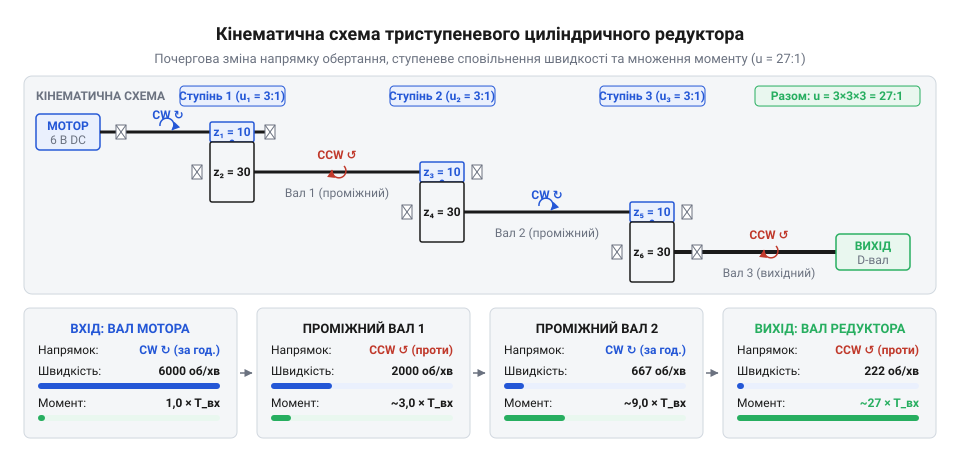
*Кінематична схема триступеневого циліндричного прямозубого редуктора з паралельними валами: ведучий піньйон мотора через дві проміжні комбіновані блок-шестерні приводить вихідне колесо; кількість зубів пар визначає поетапне падіння швидкості обертання та пропорційне зростання крутного моменту.*

Якщо кінематичний ланцюг містить `k` послідовних ступенів, ведучий піньйон мотора `z[1]` передає рух на колесо `z[2]`. На його осі закріплено піньйон `z[3]`, кутова швидкість якого дорівнює кутовій швидкості колеса (`ω[3] = ω[2]`). Далі піньйон `z[3]` обертає колесо `z[4]`, і процес повторюється до вихідного колеса `z[2k]`.

Кутові швидкості між ступенями зв'язані співвідношеннями:

```
ω[1] / ω[2] = z[2] / z[1] = i[1]
ω[3] / ω[4] = z[4] / z[3] = i[2]
...
ω[2k-1] / ω[2k] = z[2k] / z[2k-1] = i[k]
```

Сумарне передавальне число `i[total]` виражається через відношення кутової швидкості вала мотора `ω[вх] = ω[1]` до швидкості вихідного вала `ω[вих] = ω[2k]`:

```
i[total]
= ω[вх] / ω[вих]           [означення сумарного передавального числа]
= (ω[1] / ω[2]) · (ω[3] / ω[4]) · ... · (ω[2k-1] / ω[2k]) [розклад ланцюга на співвідношення швидкостей]
= i[1] · i[2] · ... · i[k] [добуток передавальних чисел окремих ступенів]
= (z[2] / z[1]) · (z[4] / z[3]) · ... · (z[2k] / z[2k-1]) [підстановка кількості зубів усіх пар]
```

Сумарне передавальне число багатоступеневого редуктора дорівнює добутку передавальних чисел усіх його ступенів. Завдяки перемноженню коефіцієнтів передавальне число 100:1 легко досягається ланцюгом із трьох ступенів (наприклад, `4 · 5 · 5 = 100`), де діаметр найбільшого колеса не перевищує 15–18 мм.

Кожна пара шестерень зовнішнього зачеплення змінює напрямок обертання на протилежний. При непарній кількості ступенів (`k = 1, 3, 5`) вихідний вал обертається у бік, протилежний до вала електродвигуна. При парній кількості ступенів (`k = 2, 4`) вихідний вал і ротор мотора обертаються в одному напрямку.

Вихідна кутова швидкість `ω[вих]` і частота обертання `n[вих]` падають кратно сумарному передавальному числу:

```
ω[вих] = ω[вх] / i[total]
n[вих] = n[вх] / i[total]
```

В ідеальному механізмі без втрат на тертя (де коефіцієнт корисної дії `η = 1`) вихідна механічна потужність дорівнює вхідній:

```
P[вих] = P[вх]
T[вих] · ω[вих] = T[вх] · ω[вх]
```

Звідси теоретичний вихідний крутний момент зростає строго пропорційно сумарному передавальному числу:

```
T[вих]
= T[вх] · (ω[вх] / ω[вих])
= T[вх] · i[total]
```

**Розрахунок кінематики триступеневого циліндричного редуктора мехатронного приводу**

Вихідні параметри системи:
- Електродвигун розвиває швидкість `n[вх] = 12000 об/хв` за крутного моменту `T[вх] = 1.2 мН·м`.
- Ступінь 1: ведучий піньйон мотора `z[1] = 10`, ведене колесо першої блок-шестерні `z[2] = 40`.
- Ступінь 2: піньйон першої блок-шестерні `z[3] = 10`, колесо другої блок-шестерні `z[4] = 50`.
- Ступінь 3: піньйон другої блок-шестерні `z[5] = 12`, вихідне колесо робочого вала `z[6] = 60`.

```
i[1]
= z[2] / z[1]              [передавальне число першого ступеня]
= 40 / 10                  [підстановка кількості зубів першої пари]
= 4                        [коефіцієнт редукції ступеня 1]

i[2]
= z[4] / z[3]              [передавальне число другого ступеня]
= 50 / 10                  [підстановка кількості зубів другої пари]
= 5                        [коефіцієнт редукції ступеня 2]

i[3]
= z[6] / z[5]              [передавальне число третього ступеня]
= 60 / 12                  [підстановка кількості зубів третьої пари]
= 5                        [коефіцієнт редукції ступеня 3]

i[total]
= i[1] · i[2] · i[3]       [множення передавальних чисел ступенів]
= 4 · 5 · 5                [перемноження окремих коефіцієнтів]
= 100                      [сумарне передавальне число ланцюга]

n[вих]
= n[вх] / i[total]         [зниження частоти обертання вихідного вала]
= 12000 / 100              [ділення вхідної швидкості на коефіцієнт]
= 120 об/хв                [вихідна швидкість обертання (2 об/с)]

T[вих_теор]
= T[вх] · i[total]         [теоретичне масштабування крутного моменту]
= 1.2 · 100                [множення вхідного моменту на коефіцієнт]
= 120 мН·м                 [теоретичний вихідний крутний момент (0.12 Н·м)]
```

Триступеневий прямозубий редуктор трансформував надшвидкісний холостий рух у практичну швидкість 120 об/хв (два повні оберти за секунду) та збільшив корисний крутний момент у 100 разів — із 1.2 мН·м до 120 мН·м (0.12 Н·м), чого достатньо для переміщення шасі робота масою понад 1 кг.

> 🔧 **Навіщо це.** Блок-шестерня («велике колесо — малий піньйон») є базовим кінематичним елементом мініатюрних редукторів. Вона дозволяє розбити величезне кратне співвідношення на добуток кількох невеликих множників. Завдяки цьому редуктор із передавальним числом 100:1 чи 300:1 компонується в об'ємі кількох кубічних сантиметрів на базі шестерень із діаметром усього 10–18 мм, усуваючи потребу в громіздких одноступеневих передачах.

## Втрати в зачепленні, спад сумарного ККД і фактичний крутний момент

При розрахунку приводу часто припускають, що редуктор (від лат. *reducere* — повертати назад, зменшувати) є ідеальним перетворювачем: за передавального числа `i = 100` очікують стократного зростання крутного моменту при стократному падінні кутової швидкості. Закон збереження потужності для ідеального механізму передбачає повну передачу енергії: `P_вих = P_вх`. Проте на практиці зібраний механізм раптово зупиняється під навантаженням, яке мав би легко долати за паспортом, металевий або пластиковий корпус редуктора відчутно нагрівається, а струм двигуна перевищує розрахункові величини. Причина полягає в неминучих фізичних втратах потужності на кожному ступені передачі.

У прямозубій циліндричній передачі корисна потужність перетворюється на тепло на двох основних ділянках: у зубчастому зачепленні (@@en|gear mesh@@) та в опорних підшипниках валів.
У евольвентному зачепленні (евольвента — від лат. *evolvens*, що розгортається) взаємодія профілів зубів не є чистим коченням. Чисте кочення поверхонь відбувається виключно в одній геометричній точці — полюсі зачеплення. На всіх інших ділянках робочої лінії зачеплення контактні поверхні зубів одночасно котяться і проковзують одна по одній під дією значного нормального тиску. Це ковзання зумовлює тертя, яке безперервно відбирає частку корисної потужності.
Друге джерело втрат — тертя в опорах валів. Зусилля взаємодії зубів розкладається на колову (тангенціальну) силу, що створює корисний обертовий рух, та радіальну силу, яка намагається розсунути осі валів. Обидві сили навантажують цапфи валів у підшипникових опорах, створюючи момент опору тертя ковзання.
У результаті коефіцієнт (від лат. *co-* — разом і *efficiens* — той, що діє) корисної дії одного ступеня прямозубої циліндричної передачі (@@en|efficiency@@, `η_ст`) у мініатюрних механізмах становить від 85% до 95% (`η_ст = 0.85...0.95`). Тобто від 5% до 15% потужності втрачається на кожному окремому зачепленні.

Один ступінь циліндричної прямозубої передачі з міркувань габаритів зазвичай має передавальне число від 2.5:1 до 5:1. Щоб досягти значної редукції (`i = 100:1` або `i = 1000:1`), у редукторі послідовно з'єднують від 4 до 6 ступенів.
Оскільки кожен наступний ступінь отримує механічну потужність, яка вже зменшилася на попередньому, сумарний ККД редуктора `η_сум` дорівнює добутку ККД усіх його ступенів:

```
η_сум
= η₁ · η₂ · ... · η_n      [добуток ККД послідовних ступенів]
```

Якщо всі `n` ступенів виконані за однаковим класом точності та мають середній ступеневий ККД `η_ст`, розрахунок спрощується до степеневої залежності:

```
η_сум
= (η_ст)ⁿ                  [степінь за кількістю ступенів n]
```

Ця мультиплікативна залежність пояснює стрімку втрату ефективності зі зростанням кількості передач. Якщо ступінь має типовий ККД 90% (`η_ст = 0.90`):
- для 2 ступенів: `0.90² = 0.81` (81%);
- для 4 ступенів: `0.90⁴ ≈ 0.656` (65.6%);
- для 6 ступенів: `0.90⁶ ≈ 0.531` (53.1%).
Якщо ж якість виготовлення зубів є бюджетною або редуктор працює в умовах дефіциту мастила, де ступеневий ККД падає до 85% (`η_ст = 0.85`), сумарний показник падає нижче половини:
- для 4 ступенів: `0.85⁴ ≈ 0.522` (52.2%);
- для 5 ступенів: `0.85⁵ ≈ 0.444` (44.4%);
- для 6 ступенів: `0.85⁶ ≈ 0.377` (37.7%).
У 5–6-ступеневих передачах від 55% до 65% механічної енергії ротора витрачається на внутрішнє тертя, перетворюючись на тепло всередині механізму.

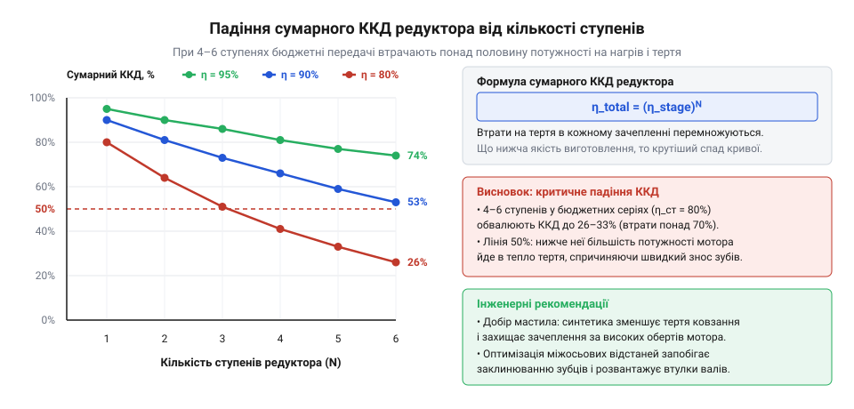
*Графік падіння сумарного коефіцієнта корисної дії редуктора залежно від кількості ступенів: через мультиплікативний характер втрат загальний ККД чотири- та шестиступеневих редукторів знижується до 40–60%, перетворюючи більшу частину механічної потужності на тепло.*

Втрачена механічна потужність `P_втрат = P_вх · (1 - η_сум)` виділяється всередині корпусу редуктора у вигляді тепла. Через мізерний об'єм мініатюрного корпусу навіть розсіювання 1–2 Вт викликає швидкий внутрішній нагрів. Окрім тертя поверхонь у зачепленні, на швидкохідних вхідних ступенях (де вал мотора обертається зі швидкістю 6000–12000 об/хв) помітний гідродинамічний опір створює шар пластичного мастила, що підвищує втрати холостого ходу. Фізику зміни в'язкості (від лат. *viscum* — пташиний клей; @@en|viscosity@@) базових олив під дією температури та режими граничного змащування винесено в окрему статтю про [пластичні мастила та трибологію приводів](root:hw-motion/drive-lubrication-greases).

Колекторний двигун постійного струму, як-от [N20 мікромотор з редуктором](root:cat-hw-actuators/n20-motor), має спадну лінійну механічну характеристику: його кутова швидкість максимальна без навантаження й лінійно падає зі зростанням гальмівного моменту на валу, тоді як струм зростає пропорційно навантаженню.
Внутрішнє тертя шестерень та втулок діє як додатковий внутрішній момент опору, прикладений безпосередньо до ротора. Через цей постійний паразитарний опір мотор має помітний струм холостого ходу (@@en|no-load current@@), а швидкість обертання приводу без корисного навантаження виявляється на 10–20% нижчою за розрахункову.
Коли до вихідного вала прикладається корисне навантаження `M_вих`, зведений до вала мотора момент опору становить:

```
M_звед
= M_вих / (i · η_сум)      [зведений момент опору на валу двигуна]
```

Через низький ККД `η_сум` цей зведений момент суттєво перевищує ідеальне значення `M_вих / i`. Робоча точка мотора зсувається далі праворуч уздовж механічної характеристики — у зону меншої швидкості, вищого споживання струму та підвищеного джоулевого нагріву обмоток ротора (`P_ел = I² · R_обм`).

Фактичний крутний момент на вихідному валу редуктора `M_вих` визначається добутком моменту двигуна `M_вх`, передавального числа `i` та сумарного ККД `η_сум`:

```
M_вих
= M_вх · i · η_сум         [фактичний вихідний крутний момент]
```

**Приклад розрахунку приводу під робоче навантаження.**
Двигун постійного струму з напругою живлення 6 В розвиває на валу номінальний крутний момент `M_вх = 0.8 мН·м`. Необхідно визначити реальний вихідний момент для 4-ступеневого редуктора з передавальним числом `i = 100:1` та середнім ККД одного ступеня `η_ст = 0.88`.

```
η_сум
= 0.88⁴                    [піднесення ККД ступеня до степеня n = 4]
≈ 0.5997                   [сумарний ККД передачі ≈ 60%]

M_вих_ід
= M_вх · i                 [ідеальний момент без урахування втрат]
= 0.8 · 100
= 80 мН·м                  [ідеальний момент = 0.08 Н·м]

M_вих
= M_вих_ід · η_сум         [урахування сумарних втрат передачі]
= 80 · 0.5997
≈ 47.98 мН·м               [фактичний корисний момент ≈ 0.048 Н·м]
```

Фактичний момент становить лише близько 48 мН·м замість ідеальних 80 мН·м: понад 40% вихідного силового потенціалу втрачено на тертя у зачепленнях та опорах.

> 🔧 **Навіщо це.**
> Розрахунок фактичного моменту через сумарний ККД запобігає проектуванню приводів, що глухнуть під номінальним навантаженням. Якщо обрати редуктор лише за ідеальним передавальним числом `i = M_вих / M_вх`, вихідний вал не зрушить механізм із місця, двигун перейде в режим аварійної зупинки зі споживанням пускового струму, а його обмотки швидко вийдуть з ладу від перегріву.

## Просторова компоновка «сендвіч», опори валів та обмеження радіального навантаження

Розміщення 4–6 пар циліндричних шестерень в обмеженому об'ємі мікроприводу вимагає жорсткої конструкції, здатної витримувати міжцентрові сили зачеплення без деформації осей. Лінійне розташування валів зробило б редуктор надмірно довгим і схильним до перекосів.
Щоб мінімізувати габарити, застосовують компонування з паралельними осями між двома опорними пластинами — так званий сендвіч-корпус (від англ. @@en|sandwich gearbox@@; сендвіч — від англ. *sandwich*, багатошарова структура). Штамповані металеві пластини жорстко дистанціюють між собою, що забезпечує сталість міжцентрових відстаней зачеплення та унеможливлює перекіс осей під робочим навантаженням. Альтернативою такій схемі є [планетарні редуктори](root:hw-motion/planetary-gearbox) з коаксіальним компонуванням, де крутний момент симетрично розподіляється між кількома сателітами довкола центральної осі.

У циліндричному багатоступеневому редукторі кожна проміжна передавальна ланка виконана у вигляді блок-шестірні — суцільної деталі, що поєднує на спільній маточині велике зубчасте колесо (ведене для попереднього ступеня) і малу шестірню-триб (ведучу для наступного ступеня). Діаметр великого колеса в кілька разів перевищує міжцентрову відстань між сусідніми валами.
Щоб виключити взаємне торкання сусідніх коліс, осі валів розташовують не вздовж однієї прямої, а зигзагом у шаховому порядку довкола центральної поздовжньої осі редуктора. При цьому шестерні розносять по висоті корпусу з взаємним осьовим перекриттям:
- Перша ведуча шестірня (на валу мотора) обертає велике колесо першої блок-шестірні в площині біля задньої пластини;
- Малий триб цієї блок-шестірні входить у зачеплення з великим колесом другої блок-шестірні, розташованим у площині біля передньої пластини;
- Таке почергове чергування площин зачеплення дозволяє щільно упакувати кінематичний ланцюг у корпус перерізом лише 10×12 мм і водночас збалансувати напрямки радіальних сил зачеплення, знижуючи згинальний момент на опорних пластинах.
У мініатюрних редукторах проміжні осі найчастіше виконують як нерухомі гартовані сталеві штифти, запресовані в пластини корпусу, а самі блок-шестерні вільно обертаються на них. Обертовим разом із шестірнею є лише вихідний вал, що сприймає зовнішнє навантаження.

У бюджетних мініатюрних редукторах через обмеженість внутрішнього простору та собівартість не застосовують кулькові підшипники (@@en|ball bearings@@). Опорами для валів слугують підшипники ковзання — втулки (похідне від *втулити* — вставляти, притуляти; @@en|sleeve bushing@@), запресовані в отвори опорних пластин, або ж самі отвори в латунних пластинах корпусу.
Найчастіше втулки виготовляють із порошкової спеченої бронзи, насиченої мастилом під вакуумом. Під час обертання вала в зоні тертя виникає локальне нагрівання, мастило під дією капілярного ефекту виходить із мікропор бронзи на поверхню тертя й формує тонку роздільну плівку, знижуючи знос цапфи. Проте підшипник ковзання розрахований на сприйняття радіальних навантажень лише за умови точної співвісності вала та втулки. Детальніше трибологічні та силові межі опор різного типу розглянуто в статті про [підшипники ковзання та кочення в мехатроніці](root:hw-motion/sleeve-and-ball-bearings).

Вихідний вал передає зусилля на приводні колеса, шківи зубчастих ременів, шестерні чи тяги. Для запобігання провертанню маточини циліндричний вал має лиску — плоский зріз, формуючи D-подібний переріз (D-вал, @@en|D-shaft@@).
Під час роботи приводу на кінець цього вала діють зовнішні сили:
- Радіальне навантаження (від лат. *radialis* — променевий; `F_рад`) — сила, напрямлена перпендикулярно до осі вала, спричинена натягом паса, тиском зовнішньої передачі або масою пристрою, що спирається на колесо;
- Консольне навантаження (від фр. *console* — виступ, опора; @@en|overhung load@@) — радіальна сила, прикладена на плечі `L` (виліт консолі) від торця передньої опорної пластини редуктора.
Ця сила створює згинальний момент:

```
M_зг
= F_рад · L                [згинальний момент консольного зусилля]
```

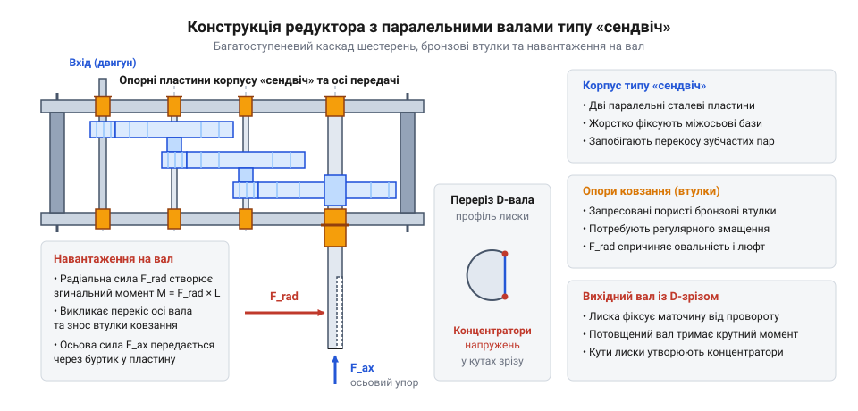
*Конструктивний просторовий розріз мініатюрного редуктора сендвіч-типу: опорні пластини з паралельними осями, шахове перекриття блок-шестерень і розподіл згинальних реакцій у короткій опорній втулці консольного D-вала.*

Критична вразливість сендвіч-редукторів криється в надзвичайно малій довжині опорної втулки вихідного вала (зазвичай 2–4 мм) та невеликій відстані між передньою і задньою пластинами (`d_опор`).
Якщо до кінця вала прикласти радіальну силу `F_рад` на плечі `L`, радіальна реакція на кромці передньої втулки `R_опори` обчислюється з балансу моментів:

```
R_опори
= F_рад · (1 + L / d_опор) [реакція на зовнішньому краю передньої втулки]
```

Оскільки виліт колеса чи шківа `L` часто перевищує внутрішню базу редуктора `d_опор` (`L > d_опор`), зусилля на крайку втулки перевищує зовнішнє навантаження в 2–4 рази. Відсутність кулькового підшипника робить цю ситуацію руйнівною для механізму:
1. Локальний кромковий тиск: коротка циліндрична втулка не здатна компенсувати згинальний момент. Вал спирається на край втулки, контактний тиск перевищує межу текучості бронзи, мастильна плівка витискається, і починається сухе стирання металу.
2. Кутовий перекіс осі вала: під дією моменту тонка передня пластина сендвіч-корпусу зазнає пружного прогину, а сам вал нахиляється на певний кут відносно проектної осі.
3. Кромковий контакт зубів: внутрішнє зубчасте колесо вихідного ступеня нахиляється разом із валом. Замість рівномірного прилягання по всій ширині вінця зуби вихідного колеса контактують із трибом попереднього ступеня лише своїми гострими крайками. Напруження контакту та згину на крайці зуба зростають у 5–10 разів.
4. Заклинювання та аварійний знос: через надмірний точковий тиск виникає мікросхоплювання зубів, передача починає заїдати, стрімко зростає внутрішній опір, а при реверсі або пуску зуби вихідного ступеня зрізаються. Водночас отвір у бронзовій втулці набуває овальної форми, з'являється незворотний радіальний люфт, і редуктор виходить з ладу.

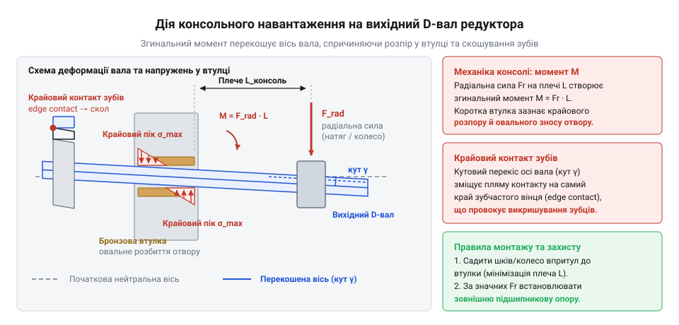
*Схема дії консольного зусилля на вихідний D-вал: плече сили, розподіл реакцій у короткій передній втулці, кутовий перекіс осі вала та зміщення плями контакту зубів вихідного ступеня на край вінця.*

Щоб забезпечити надійну роботу редуктора при дії поперечних зусиль, дотримуються трьох конструктивних правил:
1. Мінімізація плеча консолі: маточину колеса або шківа насаджують на D-вал упритул до торця редуктора (`L → 0`), що зводить згинальний момент до мінімуму.
2. Встановлення зовнішньої опорної вальниці: при використанні редуктора в приводі коліс мобільних платформ або пасових передач на рамі механізму монтують додатковий кульковий підшипник, що утримує вільний кінець вала за колесом. Це перетворює консольну схему на двоопорну балку й повністю знімає згинальний момент із сендвіч-корпусу.
3. Розв'язка за допомогою муфт: якщо вихідний вал з'єднується з іншим механізмом, застосовують пружні або кулачкові муфти, які передають виключно крутний момент і компенсують несоосність, захищаючи пластини редуктора від сторонніх радіальних та осьових сил.

> 🔧 **Навіщо це.**
> Захист вихідного вала від консольного навантаження запобігає головній причині передчасного виходу редукторів із ладу. У мобільних роботах і сервоприводах зуби вихідного ступеня майже ніколи не зношуються від робочого крутного моменту — їх зрізає через перекіс вала під вагою конструкції або від удару колеса об перешкоду, що призводить до кромкового заклинювання передачі.

## Наростання крутного моменту вздовж ступенів і вибір матеріалів шестерень

Колекторний двигун постійного струму малого габариту — такий як [N20 мікромотор з редуктором](root:cat-hw-actuators/n20-motor) — розвиває швидкість обертання ротора від 8 000 до 15 000 об/хв, але його власний крутний момент становить лічені частки міліньютон-метра (0.2–0.5 мН·м). Щоб змусити такий двигун повертати важіль сервоприводу або приводити в рух колесо мобільного шасі, кутову швидкість знижують у десятки чи сотні разів за допомогою багатоступеневої передачі. Проте закон збереження потужності є невблаганним: у міру падіння кутової швидкості крутний момент вздовж передавального ланцюга зростає лавиноподібно.

Кінематичний ланцюг редуктора складається з послідовності зубчастих пар. Кожен проміжний ступінь `k` зменшує частоту обертання у власне передавальне число `i[k]` (відношення числа зубів веденого колеса `z[вед,k]` до числа зубів тягового триба `z[тяг,k]`) і вносить втрати на тертя, які описуються коефіцієнтом корисної дії ступеня `η[k]` (зазвичай `η[k] = 0.90 ... 0.95` для якісних циліндричних прямозубих пар).
Крутний момент `T[k]` на валу кожного наступного ступеня наростає за рекурентною залежністю:

```
T[k] = T[k-1] · i[k] · η[k]
```

Якщо чотириступеневий редуктор має загальне передавальне число `i[заг] = 256` (чотири ступені з `i[k] = 4`), навантаження розподіляється між входом і виходом із колосальною нерівномірністю:
- Вхідний моторний вал і перша пара шестерень обертаються зі швидкістю понад 12 000 об/хв, передаючи крихітний момент `T[0] = 0.25 мН·м`. При ділильному діаметрі триба 2.5 мм колове зусилля взаємодії зубців становить лише 0.2 Н (близько двадцяти грамів сили).
- Вихідний же вал робить лише 47 об/хв, проте на ньому формується крутний момент близько 46 мН·м. При радіусі вихідного вінця 4 мм зусилля на зубець сягає 11.5 Н — майже у шістдесят разів більше, ніж на вході.

Ця колова сила `F_t = (2 · T) / d` діє на кожен зубець як зосереджене згинальне навантаження на коротку консольну балку. Небезпечна зона зуба — перехідна крива біля основи ніжки, де геометрія створює різку концентрацію згинальних напружень. Водночас у рухомій точці дотику евольвентних поверхонь виникають колосальні тиски стискання — [контактні напруження Герца](root:hw-motion/contact-stress-hertz).

Швидкохідний вхідний ступінь майже не відчуває механічних сил згину. Головними викликами для нього є висока лінійна швидкість взаємного ковзання евольвент, нагрівання від тертя та високочастотна вібрація (зубчаста частота зачеплення сягає 2–3 кГц), яка створює пронизливий акустичний вереск приводу.
Натомість на тихохідному вихідному ступені ковзання вкрай повільне, зате згинальні напруження біля основи зуба наближаються до границі плинності матеріалу. Будь-який динамічний удар, ривок навантаження чи аварійне заклинювання вихідного вала загрожує миттєвим зрізанням зубів вихідного вінця.

> 🔧 **Навіщо це.** Спроба зібрати редуктор з шестерень одного матеріалу завжди веде до конструкційного глухого кута. Суцільносталевий редуктор нестерпно пищить і дзеленчить на швидкості 12 000 об/хв, важкий, дорогий і швидко стирається без постійної масляної ванни. Суцільнопластиковий редуктор працює безшумно, проте миттєво зрізає зуби вихідного вінця під час першого ж робочого навантаження або пускового перевантаження.

### Конструкційні матеріали шестерень

Для вирішення цього компромісу деталі редукторів виготовляють із трьох принципово різних класів матеріалів:

1. **Термопластичні інженерні полімери:**
Поліоксиметилен (від грецького *polys* — численний, *oxys* — кислий, *methy* — вино, спирт та *hyle* — дерево; скорочено POM, @@en|polyoxymethylene@@, також відомий як поліацеталь) та поліаміди (нейлон, PA66).
Ці матеріали відзначаються низьким модулем пружності (2.5–3.5 ГПа проти 200 ГПа у конструкційної сталі). Під дією зусилля полімерний зубець злегка підгинається, компенсуючи мікропохибки профілю і розподіляючи тиск вздовж усієї контактної лінії. Завдяки високому коефіцієнту внутрішнього демпфування вібрацій полімери поглинають високочастотні удари зачеплення, забезпечуючи безшумну роботу приводу. Пара тертя «сталевий триб — полімерне колесо» має низький коефіцієнт сухого тертя (самозмащуваність), мала маса полімеру знижує момент інерції, а лиття під тиском дозволяє масово виробляти вінці складної форми з мінімальною собівартістю.
Головні обмеження полімерів — низька границя міцності на згин (допустимі напруження не перевищують 50–70 МПа) та виражена схильність до повзучості або в'язкої плинності (англ. @@en|creep@@ — повільне сповзання під навантаженням). Під дією тривалого статичного моменту полімерний зубець незворотно деформується («пливе»), втрачаючи геометричний профіль навіть без перевищення межі міцності. Крім того, коефіцієнт лінійного теплового розширення POM у 6–8 разів вищий, ніж у сталі, що при нагріванні різко зменшує зазори.

2. **Сплави кольорових металів:**
Латуні (мідно-цинкові сплави) та олов'янисті або алюмінієві бронзи.
Вони мають границю міцності на згин 150–250 МПа, відмінно протистоять стиранню та задиранню поверхонь тертя при взаємодії зі сталевими валами, мають високу теплопровідність і не схильні до повзучості. Латунні шестерні добре припрацьовуються, згладжуючи мікронерівності контакту, і служать ідеальним матеріалом для проміжних ступенів, де крутний момент уже небезпечний для полімерів, але швидкість ще занадто висока для важкої сталі.

3. **Конструкційні сталі:**
Спечені порошкові сталі (отримані методом [порошкової металургії](root:hw-motion/powder-metallurgy-gears), англ. @@en|powder metallurgy@@) та монолітні загартовані або цементовані сталі.
Спечені шестерні дешеві в масовому виробництві й завдяки пористості утримують мастило для тривалого самозмащування, проте поступаються монолітній сталі в ударній в'язкості.
Для максимальних навантажень застосовують монолітні фрезеровані сталеві шестерні з об'ємним загартуванням або поверхневою цементацією. Твердість робочого шару сягає 56–62 HRC при в'язкій серцевині зуба. Допустиме згинальне напруження гартованої сталі перевищує 800–1200 МПа, що дає максимальний опір зрізанню та контактному викришуванню під дією колових сил.

### Принцип гібридного компонування

Найдосконаліші мініатюрні редуктори будують за гібридним (каскадним) принципом розподілу матеріалів:

- **Вхідний швидкохідний ступінь:** моторний сталевий або латунний триб працює в парі з веденим колесом із поліоксиметилену (POM). Полімер гасить резонанси та акустичний писк щіткового вузла двигуна на 10 000–15 000 об/хв. Навантаження тут настільки мізерні, що ризик плинності або поломки пластику повністю відсутній.
- **Проміжні ступені:** латунні або спечені металокерамічні шестерні. Вони сприймають помножений у десятки разів момент, стабільно тримають геометрію і гарантують плавне ковзання без задирання.
- **Вихідний тихохідний ступінь:** суцільна загартована або спечена сталь високої щільності. На швидкостях у десятки обертів на хвилину шум зачеплення вже не виникає, натомість сталевий вінець надійно тримає піковий статичний момент і гасить динамічні удари зовнішнього навантаження.

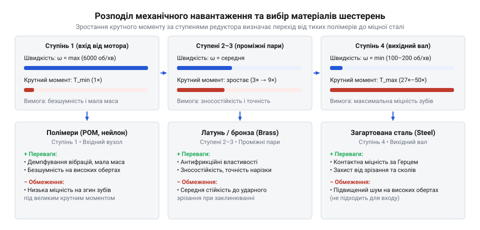
*Розподіл крутного моменту та згинальних напружень уздовж кінематичного ланцюга редуктора зі зіставленням конструкційних матеріалів шестерень: полімери на швидкохідному вході демпфують високочастотний шум за малих навантажень, латунь на проміжних ступенях захищає від абразивного зносу, а загартована сталь на тихохідному вихідному ступені витримує пікові контактні тиски та запобігає зрізанню зубів.*

Покажемо розрахунок наростання навантаження для чотириступеневого редуктора:

**Початкові умови:**
Вхідний момент двигуна `T[0] = 0.25 мН·м`, передавальне число кожного ступеня `i[k] = 4.0`, ККД одного ступеня `η[k] = 0.92`. Ділильний діаметр вінця першого ступеня `d[1] = 3.0 мм`, вихідного вінця `d[4] = 8.0 мм`.

```
T[0] = 0.25 мН·м                      [вхідний момент мотора на валу]

T[1] = 0.25 · 4.0 · 0.92
     = 0.92 мН·м                      [момент після 1-го ступеня: POM]

T[2] = 0.92 · 4.0 · 0.92
     = 3.39 мН·м                      [момент після 2-го ступеня: POM/латунь]

T[3] = 3.39 · 4.0 · 0.92
     = 12.48 мН·м                     [момент після 3-го ступеня: латунь]

T[4] = 12.48 · 4.0 · 0.92
     = 45.93 мН·м                     [вихідний статичний момент: сталь]
```

Порівняємо колове зусилля взаємодії зубців на першому та останньому ступенях:

```
d[1] = 0.003 м
F_t[1] = (2 · 0.92 · 10⁻³) / 0.003
       = 0.61 Н                       [колове зусилля на 1-му ступені]

d[4] = 0.008 м
F_t[4] = (2 · 45.93 · 10⁻³) / 0.008
       = 11.48 Н                      [колове зусилля на вихідному ступені]
```

Зусилля на вихідному вінці зросло майже в 19 разів. За ширини зуба 1.2 мм згинальне напруження біля основи ніжки сягає 95–110 МПа. Для поліоксиметилену (допустима межа 60–65 МПа) це гарантований злам або швидке зминання профілю, тоді як загартована сталь несе це навантаження із шестикратним запасом надійності.

## Бічний зазор зачеплення, кутовий люфт і динаміка замкненого контуру

Якби два евольвентні зубчасті колеса виготовили з абсолютно точним профілем і звели в зачеплення без щілин — так, щоб товщина зуба строго дорівнювала ширині западини парного колеса, — такий редуктор намертво заклинило б під час перших обертів. Деталі реального механізму неминуче мають технологічні похибки: ексцентриситет вінця відносно осі обертання, биття валів у підшипникових втулках ковзання, неточність кроку нарізання зубів та похибку міжосьових відстаней між опорними пластинами корпусу. До того ж тертя у зачепленні неминуче виділяє тепло: металеві та полімерні колеса розширюються, збільшуючи свій геометричний об'єм. Без технологічного проміжку найменше розширення призводить до розпирання зубів, зриву мастильної плівки та катастрофічного заклинювання.

Для безвідмовної роботи між неробочими профілями спряжених зубців обов'язково закладається гарантований зазор — бічний зазор (англ. @@en|backlash@@ від слів *back* — позаду та *lash* — удар, хльостання). Це мінімальна відстань між неробочими евольвентними поверхнями зубців, коли їхні робочі грані щільно притиснуті одна до одної. Бічний зазор формують навмисним витонченням тіла зуба на стадії нарізання вінця або незначним збільшенням міжосьової відстані в корпусі. Він запобігає заклинюванню при нагріванні, компенсує радіальне биття і створює гідродинамічний простір для циркуляції пластичного мастила.

Поки редуктор обертається в один бік під дією стабільного моменту опору, тяговий зуб постійно спирається на робочий профіль веденого, і бічний зазор ніяк себе не проявляє. Проте ситуація докорінно змінюється під час реверсу напрямку обертання або зміни знаку навантаження (наприклад, коли важіль робота переходить верхню точку рівноваги й сила тяжіння починає тягнути його вперед швидше за швидкість приводу).

У мить зміни напрямку обертання робочий контакт розривається. Тяговий зуб повинен безперешкодно пройти вільну відстань бічного зазору, не передаючи моменту, перш ніж упреться у протилежний профіль западини веденого колеса. Кут повороту вихідного вала, в межах якого вхідний вал уже провертається, а на вихідному валу рух ще не передається, називають кутовою мертвою зоною (англ. @@en|deadband@@ від слів *dead* — нерухомий, мертвий та *band* — смуга, зона), або сумарним кутовим люфтом редуктора.

### Підсумовування люфту вздовж передавального ланцюга

Кожен ступінь редуктора має власний бічний кутовий люфт зачеплення `Δθ_k`. Проте внесок кожного ступеня у загальну кутову мертву зону вихідного вала є кардинально різним. Оскільки кутовий рух масштабується передавальним числом, власний люфт будь-якого ступеня при передачі на вихід ділиться на добуток передавальних чисел усіх наступних за ним ступенів:

```
Δθ_вих,k = Δθ_k / i_{k+1...n}
```

Сумарний кутовий люфт на вихідному валу `n`-ступеневого редуктора визначається сумою:

```
Δθ_вих = Δθ_n + (Δθ_{n-1} / i_n) + (Δθ_{n-2} / (i_n · i_{n-1})) + ... + (Δθ_1 / (i_n · ... · i_2))
```

де `Δθ_n` — власний люфт зачеплення вихідного ступеня, а `Δθ_1` — люфт пари швидкохідного вала двигуна.

**Розрахунок сумарного кутового люфту на виході:**
Нехай чотириступеневий редуктор має передавальне число кожного ступеня `i_k = 4.0` (загальне `i_заг = 256`), а власний кутовий люфт у зачепленні кожної пари однаковий і становить `Δθ_k = 0.8°`.

```
Δθ_1_вих = 0.8° / 64  = 0.0125°       [внесок 1-го ступеня: знехтовно малий]
Δθ_2_вих = 0.8° / 16  = 0.0500°       [внесок 2-го ступеня]
Δθ_3_вих = 0.8° / 4   = 0.2000°       [внесок 3-го ступеня: помітний]
Δθ_4_вих = 0.8° / 1   = 0.8000°       [внесок вихідного ступеня: прямий 1:1]

Δθ_вих   = 0.8000° + 0.2000° + 0.0500° + 0.0125°
         = 1.0625°                    [сумарний кутовий люфт на вихідному валу]
```

Цей розрахунок виявляє фундаментальну закономірність: понад 75% сумарного кутового люфту редуктора створює безпосередньо вихідний ступінь, ще близько 19% додає передостанній, тоді як перші два ступені біля двигуна практично не впливають на вихідну точність. Тому спроби виготовляти швидкохідні вхідні шестерні з прецизійною точністю заради зменшення мертвої зони позбавлені практичного сенсу — вся конструкторська боротьба за зменшення люфту зосереджується на вихідному ступені.

### Пружна деформація під навантаженням

Кутовий люфт — це геометрична характеристика ненавантаженої передачі. Проте коли до вихідного вала прикладається робочий момент опору, кутове відхилення вала зростає за рахунок пружної піддатливості компонентів: вигину тіла зубців, крутильної деформації проміжних валів і радіального зміщення осей у втулках під дією сил розпирання.
Повний кут похибки вихідного вала є сумою геометричного люфту та пружного зміщення:

```
θ_похибка = Δθ_вих + (T_вих / C_крут)
```

де `C_крут` — крутильна жорсткість редуктора (Н·м/рад). Якщо шестерні виготовлені з термопластів (POM або нейлону), модуль пружності яких у 60–80 разів менший за сталь, пружна кутова деформація зубів під номінальним моментом може перевищувати геометричний люфт у 2–3 рази.

> 🔧 **Навіщо це.** Якщо ви будуєте замкнений сервопривід із датчиком зворотного зв'язку на вихідному валу, кутовий люфт перетворює замкнений контур на нелінійну коливальну систему. За спроби підняти точність позиціювання збільшенням коефіцієнтів підсилення система впадає в неперервні автоколивання навколо цільової точки з дзвоном, вібраціями та перегрівом двигуна.

### Вплив люфту на замкнені системи регулювання

Розглянемо сервопривід, положення якого стабілізує [ПІД-регулятор](root:math-analysis/pid-calculus), а фактичний кут повороту навантаження вимірює [енкодер кута повороту](root:hw-sensing/angle-rotation-sensing) безпосередньо на вихідному валу редуктора.
Коли вихідний вал потрапляє в інтервал мертвої зони `[-Δθ_вих / 2; +Δθ_вих / 2]`:

1. Жорсткий зв'язок між двигуном і навантаженням зникає. Двигун обертається, намагаючись скомпенсувати зафіксовану помилку кута `e(t)`, але вихідний вал стоїть на місці. Енкодер не реєструє жодного руху.
2. Інтегральна складова регулятора `I` накопичує незмінну помилку в часі, стрімко нарощуючи напругу на обмотках двигуна.
3. Ротор двигуна розганяється в межах вільного бічного зазору, запасаючи значну кінетичну енергію `(J · ω²) / 2`.
4. Коли зазор повністю вибирається, тяговий зуб на повній швидкості врізається у ведений зуб протилежним боком (ударне зачеплення).
5. Вихідний вал під дією накопиченої енергії різко зривається з місця і пролітає цільову точку наскрізь, утворюючи значне динамічне перерегулювання (англ. @@en|overshoot@@).
6. Помилка миттєво змінює знак. Регулятор перемикає полярність напруги на двигуні, намагаючись повернути вал назад. Процес повторюється симетрично: вибірка зазору у зворотному напрямку, розгін ротора, удар, проліт точки.

У системі виникають стійкі незатухаючі автоколивання — граничний цикл (англ. @@en|limit cycle@@). Збільшення коефіцієнта пропорційного підсилення `K_p` не усуває коливання, а лише посилює енергію ударів зубців, спричиняючи втомне викришування робочих граней та зрізання вінця.

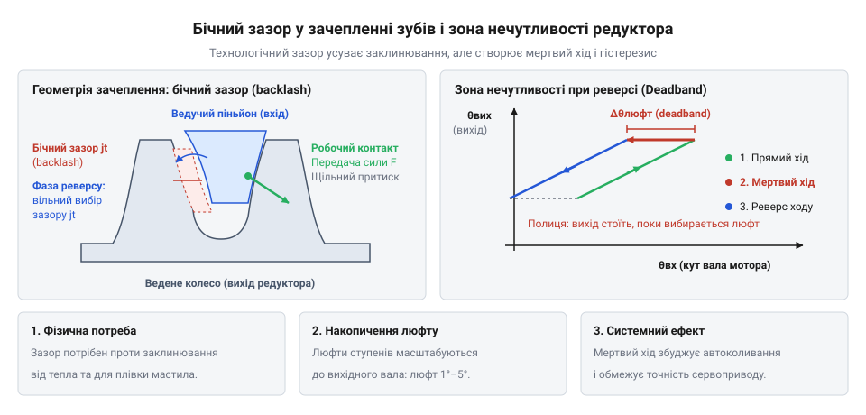
*Геометрична будова бічного зазору (backlash) між евольвентними профілями зубів і його трансформація в кутову зону нечутливості (deadband) на вихідному валу: розрив передачі руху під час реверсу мотора, вільний пробіг зубця крізь щілину зазору та фазове запізнення в системі позиціювання.*

### Механічні методи вибірки люфту

Щоб усунути автоколивання і зберегти точність позиціювання, застосовують спеціальні механічні та алгоритмічні рішення:

1. **Розрізні підпружинені шестерні (англ. @@en|split gear@@ або @@en|anti-backlash gear@@):**
Ведене зубчасте колесо виготовляють із двох ідентичних тонких дисків-вінців, встановлених на спільну вісь. Між вінцями встановлюють тангенціальну пружину або торсіонний пружний елемент, який намагається повернути вінці назустріч один одному. Під час зачеплення зі сталевим трибом пружина розсуває зуби: перший вінець упирається в ліву сторону западини триба, а другий — у праву сторону. Бічний зазор вибирається повністю.
Головне обмеження розрізної шестерні — вона передає безлюфтовий рух лише доти, доки робочий момент не перевищує момент пружини:

```
T_робочий < T_пружини
```

Якщо зовнішній момент перевищить зусилля пружини, вона стиснеться до упору, вінці зімкнуться, і кутовий люфт миттєво відновиться. Додатково постійне тертя двох вінців знижує ККД ступеня на 5–10% і прискорює знос.

2. **Підпружинені плаваючі осі:**
Осі проміжних валів монтують у радіальних пазах із підтисканням пружиною в напрямку центру спряженого вінця. Зазор вибирається зведенням міжосьової відстані, проте це створює нерівномірний знос вінців через відхилення від теоретичної міжосьової відстані зачеплення.

3. **Розділення контурів керування:**
У прецизійних сервоприводах швидкохідний контур швидкості замикають за енкодером на валу двигуна (де зазор ще відсутній), а контур положення коригують за вихідним датчиком із програмною зоною нечутливості в мікроконтролері. Це дозволяє придушити граничний цикл автоколивань без перевантаження механіки підпружиненими вінцями.

## Бар'єр зворотної дії, динамічний удар та механізми захисту зубів

У практиці конструювання приводів нерідко виникає потреба перевірити рухливість механізму вручну: покрутити пальцями вихідний вал, змінити положення важеля маніпулятора або пересунути зупиненого колісного робота. На малих передавальних числах механізм піддається зусиллю легко, розганяючи ротор двигуна з ледь чутним дзижчанням. Проте коли передавальне число редуктора перевищує 100:1, спроба провернути систему за вихідний вал наштовхується на глухий опір: конструкція поводиться як жорстко заблокований моноліт. Якщо прикласти більше зусилля або спробувати провернути вал різким ривком, лунає сухий тріск, і вал раптово прокручується з проскоком. Розбирання показує типову картину механічної аварії: шестерня вихідного ступеня повністю втратила кілька зубців поспіль, хоча сам якір двигуна навіть не зрушив з місця.

Прямозубі циліндричні передачі теоретично належать до класу зворотно-рухомих систем (англ. @@en|back-drivable@@, від давньоангл. *bæc* — назад та *drīfan* — штовхати): симетричний евольвентний профіль здатний однаково передавати зусилля як від шестерні до колеса, так і у зворотному напрямку. У прямому режимі редуктор знижує частоту обертання й примножує крутний момент двигуна. Кожен зубчастий ступінь втрачає частку механічної енергії на тертя ковзання між профілями зубів та в підшипникових втулках валів, маючи прямий коефіцієнт корисної дії (ККД, від лат. *co-* — разом і *efficiens* — той, що діє) `η_ст ≈ 0.90 ... 0.95`. Сумарний прямий ККД багатоступеневої передачі дорівнює добутку ККД усіх її ступенів: наприклад, для чотириступеневого редуктора `η_прям = (0.92)⁴ ≈ 0.716` (близько 72%).

Коли напрямок потоку механічної потужності змінюється на протилежний, редуктор перетворюється на мультиплікатор: тепер повільний вихідний вал повинен послідовно розганяти кожен проміжний ступінь і розкручувати ротор мотора. При зміні ведучої ланки вектори сил тертя у зачепленні змінюють свій напрямок відносно лінії зачеплення, через що необхідне зусилля прокручування стрімко зростає. Зворотний ККД зубчастого ступеня `η_зворот` завжди суттєво нижчий за прямий і наближено описується співвідношенням:

```
η_зворот
= 2 - (1 / η_ст)                       [залежність зворотного ККД ступеня від втрат на тертя в зачепленні]
```

Якщо прямий ККД окремого ступеня через загусле мастило, вироблення втулок або мікроперекоси валів падає, наприклад, до `η_ст = 0.85`, його зворотний ККД становить лише `2 - (1 / 0.85) ≈ 0.823`. Для чотирьох послідовних ступенів сумарний зворотний ККД падає до величини `(0.823)⁴ ≈ 0.458` (менше 46%). Якщо ж прямий сумарний ККД редуктора через велику кількість ступенів виявляється нижчим за 50% (`η_прям ≤ 0.50`), зворотний ККД падає до нуля або стає від'ємним (`η_зворот ≤ 0`). У системі виникає ефект механічного самогальмування (від англ. @@en|self-locking@@, де *self* — сам та *lock* — замикати) або клин втрат: внутрішній опір тертя в зачепленнях та опорах зростає швидше, ніж рушійний момент, здатний зрушити кінематичний ланцюг.

Зовнішній крутний момент, прикладений до вихідного вала, не може подолати опір тертя розганяючихся ступенів і повністю перетворюється на руйнівні контактні реакції в зачепленні вихідної пари. Тангенціальна складова сили створює екстремальний згинальний момент в основі ніжки зуба, а радіальна розпірна сила відштовхує вали один від одного, спричиняючи пружний прогин осей і деформацію корпусних пластин. Зуби вихідного колеса зрізаються або викришуються задовго до того, як імпульс руху зможе зрушити з мертвої точки ротор двигуна.

> 🔧 **Навіщо це.**
> Бар'єр зворотної дії визначає поведінку робототехнічних вузлів у знеструмленому стані. У приводах вертикального підйому або затискних механізмах високе передавальне число з ефектом самогальмування дозволяє пасивно утримувати вантаж без витрат електроенергії на обмотках мотора. Водночас у маніпуляторах або колісних шасі, які взаємодіють із людиною чи зовнішніми перешкодами, незворотний редуктор стає джерелом крихкої аварії: будь-який випадковий поштовх виламує зуби вихідного ступеня. Для безпечних механізмів передавальне число обмежують, обираючи високоточні ступені з ККД понад 85–90%, або обов'язково інтегрують захисні муфти.

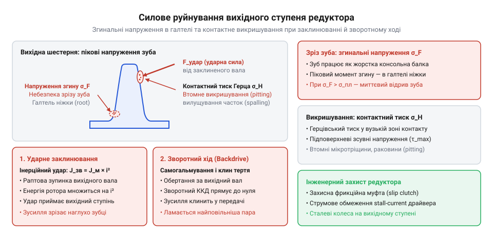
*Силове руйнування вихідного ступеня редуктора: під час зворотного ходу сили тертя утворюють клин самогальмування з небезпечними розпірними силами, а при динамічній зупинці навантаження зведена інерція ротора викликає піковий згинальний удар, що зрізає зуб в основі.*

Другим катастрофічним процесом руйнування є динамічний удар під час раптової зупинки навантаження на повному ходу. Типові ситуації — удар ланки маніпулятора об жорсткий упор, заклинювання ведучого колеса в перешкоді або заїдання вихідного механізму. Вихідний вал зупиняється практично миттєво. Проте якір електродвигуна (наприклад, [N20 мікромотор з редуктором](root:cat-hw-actuators/n20-motor)) володіє власним моментом інерції (від лат. *inertia* — бездіяльність, нерухомість) `J_ротор`, обертаючись зі швидкістю 10 000 ... 15 000 об/хв.

Інерційні характеристики ротора, перераховані на вихідний вал крізь передавальне число `i`, масштабуються квадратично. Цю величину називають зведеним моментом інерції (англ. @@en|reflected inertia@@):

```
J_звед
= J_ротор · i²                          [квадратичне зведення моменту інерції ротора до вихідного вала]
```

При передавальному числі `i = 150:1` зведена інерція перевищує власну інерцію ротора у `150² = 22 500` разів. Кінетична енергія ротора `E_кін = (J_ротор · ω_ротор²) / 2` під час блокування вихідного вала повинна розсіятися за короткий проміжок часу гальмування `Δt`, який визначається мікросекундною пружною деформацією одного або двох контактуючих зубів (зазвичай від 0.5 до 3 мілісекунд). Динамічний крутний момент, що обрушується на зачеплення, визначається рівнянням кутового сповільнення:

```
M_дин
= J_звед · ε                            [основне рівняння динаміки обертального руху]
= (J_ротор · i²) · (ω_вих / Δt)         [підстановка зведеного моменту інерції та кутового сповільнення]
= J_ротор · i · (ω_ротор / Δt)          [перехід до кутової швидкості ротора через співвідношення ω_вих = ω_ротор / i]
```

Розрахуємо амплітуду динамічного удару для типового мініатюрного привода з передавальним числом `i = 150`, моментом інерції ротора `J_ротор = 0.5 · 10⁻⁷ кг·м²`, кутовою швидкістю ротора `ω_ротор = 1200 рад/с` (близько 11 500 об/хв) та часом гальмування `Δt = 2 мс` (`0.002 с`):

```
M_дин
= 0.5 · 10⁻⁷ · 150 · (1200 / 0.002)     [підстановка параметрів ротора, редуктора й часу пружного удару]
= 7.5 · 10⁻⁶ · 600000                   [обчислення миттєвого кутового сповільнення ротора]
= 4.5 Н·м                               [піковий динамічний момент на вихідному зубчастому вінці]
```

Статичний пусковий момент такого мініатюрного мотора становить близько `0.005 Н·м`, що на виході редуктора з урахуванням втрат дає крутний момент порядку `0.5 Н·м`. Отриманий динамічний удар `4.5 Н·м` у дев'ять разів перевищує граничний крутний момент, на який розраховано зачеплення. Зведена інерція ротора діє як кінематичний ковальський молот: напруження згину в галтелі ніжки зуба багаторазово перевищують границю міцності матеріалу, викликаючи ударне зрізання зубів (англ. @@en|tooth shear failure@@).

Для захисту редукторів від ударних перевантажень та зворотного заклинювання застосовують спеціальні інженерні рішення:

1. Фрикційна захисна муфта (від лат. *frictio* — тертя, англ. @@en|slipper clutch@@): розташовується безпосередньо всередині маточини вихідного зубчастого колеса або на стику вихідного вала з механізмом. Пакет фрикційних дисків або полімерних шайб підтискається тарілчастою пружиною Бельвіля (англ. @@en|Belleville spring@@). Коли крутний момент перевищує налаштований поріг проковзування, муфта прокручується, поглинаючи кінетичну енергію ротора у вигляді тепла тертя й обмежуючи навантаження на зубці безпечним рівнем. Конструкція таких вузлів описана у темі про [захисні фрикційні муфти](root:hw-motion/friction-torque-limiter).
2. Зрізний штифт (англ. @@en|shear pin@@, від давньоангл. *sceran* — різати та лат. *pinna* — вістря, стрижень): механічний запобіжник каліброваного перерізу з м'якого металу (латунь, мідь, алюміній) або полімеру, що фіксує зубчасте колесо чи важіль на валу. При аварійному заклинюванні штифт зрізається поперечним зусиллям, миттєво розмикаючи кінематичний ланцюг і рятуючи редуктор ціною заміни однієї копійчаної деталі.
3. Програмне струмове обмеження: контролер зчитує падіння напруги на струмовимірювальному шунті драйвера двигуна. Під час зупинки вала струм якірної обмотки стрибкоподібно зростає до струму короткого замикання (заклинювання), за чим алгоритм вимикає ШІМ-керування або переводить міст у режим вільного вибігу.

> 🔧 **Навіщо це.**
> Програмний захист за струмом надійно оберігає обмотки двигуна від перегріву та згоряння при затяжному упорі, проте він фізично не здатен врятувати зубці від ударного зрізання під час раптової зупинки. Швидкість наростання струму лімітується індуктивністю обмотки двигуна, а реакція мікроконтролера займає від кількох сотень мікросекунд до кількох мілісекунд. Водночас хвиля пружної деформації поширюється металом зі швидкістю звуку (понад 5000 м/с) і сколює зуб за перші долі мілісекунди після зіткнення. Тому надійний привід будують за принципом двоконтурного захисту: механічна муфта зрізає миттєвий динамічний пік удару ротора, а програмне струмове відсікання знеструмлює двигун за 10–50 мілісекунд, захищаючи фрикційні накладки муфти від зносу та перегріву.

## Довгостроковий ресурс: втомний пітинг, трибологія мастил та режими навантаження

Коли прямозубий редуктор надійно захищений від аварійних динамічних ударів та заклинювання зворотної дії, тривалість його роботи підпорядковується повільним процесам втомного руйнування та зношування поверхонь тертя. Механізм може стабільно функціонувати сотні годин під штатним моментом, після чого в ньому з'являється підвищений акустичний шум, вібрація, наростає кутовий люфт або виникають раптові заїдання. Довговічність зачеплення визначається контактною витривалістю матеріалу шестерень і стабільністю мастильного шару в зонах контакту.

Основним граничним станом металевих зубчастих коліс при тривалій експлуатації є втомний пітинг (від англ. @@en|pitting@@, від @@en|pit@@ — ямка, заглибина; або контактне викришування):

Прямозубі колеса передають зусилля вздовж вузької контактної лінії між евольвентними профілями. Через мізерну площу контакту стичні напруження, що розраховуються за моделлю пружного контакту Герца (від нім. *Hertzsche Pressung*, на честь Генріха Герца), досягають значень у 500–1200 МПа. Кожен оберт шестерні викликає черговий імпульс циклічного навантаження. На глибині кількох десятків мікрометрів під поверхнею зубів, де виникають максимальні дотичні напруження зсуву, поступово зароджуються субповерхневі мікротріщини.

З накопиченням циклів завантаження тріщини проростають назовні під гострим кутом до робочої грані. Мастило, що потрапляє в гирло мікротріщини, при кожному вході зуба в зачеплення зазнає гідростатичного стиснення високим контактним тиском. Воно спрацьовує як гідравлічний клин, розпираючи стінки порожнини та відколюючи крихітні лусочки металу. На контактній поверхні виникають мікроскопічні кратероподібні ямки — пітинг. Геометрія евольвенти необоротно спотворюється: плавне перекочування змінюється ударним навантаженням на краях вибоїн, що викликає лавиноподібне викришування всієї робочої смуги та подальший злам ослабленого зуба. Фізичні основи цього явища висвітлені у темі про [контактну втому зубчастих передач](root:hw-motion/gear-tooth-strength).

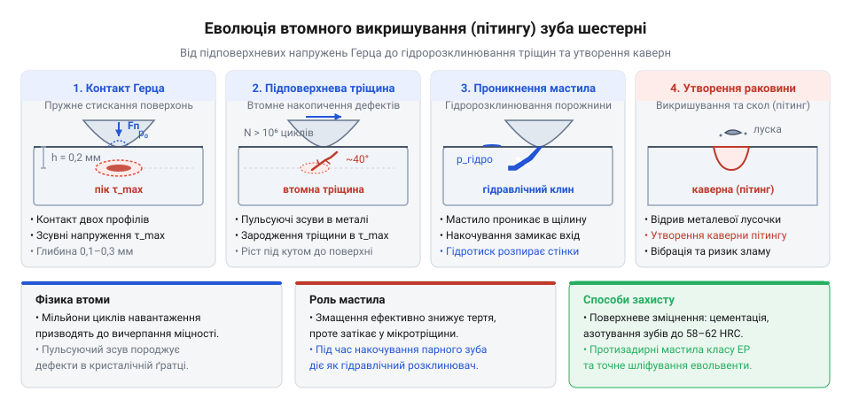
*Еволюція втомного викришування робочої поверхні зуба: від зародження підповерхневої мікротріщини Герца до утворення раковини пітингу та сколу зуба.*

Поряд із втомним викришуванням відбувається абразивне стирання (від лат. *abrasio* — зіскрібання). У прямозубому зачепленні чисте кочення профілів існує лише в одній лінії — на початковому циліндрі (полюсі зачеплення). В усіх інших точках взаємодії верхівка одного зуба котиться з одночасним поздовжнім ковзанням по ніжці спряженого зуба. Якщо розділова мастильна плівка руйнується, мікронерівності металу вступають у прямий контакт, викликаючи локальне зварювання поверхонь і мікрозадирання (англ. @@en|scuffing@@). Відокремлені частки зносу перетворюються на вільний абразив, який циркулює в зачепленні, сточуючи зуби до клиноподібного витончення й збільшуючи кутовий люфт.

Керує інтенсивністю контактного зносу трибологія (від грец. *tribos* — тертя та *logos* — вчення) — наука про механізми тертя, зношування та змащування взаємодіючих тіл. У мініатюрних циліндричних редукторах рідкі оливи не застосовують через відсутність герметичних манжет на валах: рідка фаза швидко витікає крізь зазори підшипникових втулок. Роботу вузла забезпечують пластичні мастила (англ. @@en|grease@@), що складаються з базової оливи, загусника та функціональних присадок:

- Літієві мила (на основі 12-гідроксистеарату літію): найбільш універсальний і стабільний каркас загусника. Мильні волокна формують просторову сітку, яка утримує мікрокраплі оливи подібно до губки. Літієві мастила мають високу механічну стабільність, не розшаровуються від тривалої вібрації та працюють у діапазоні температур від −30 °C до +120 °C.
- Синтетичні базові оливи на базі поліальфаолефінів (ПАО) та силіконові основи (полісилоксани): вирізняються високим індексом в'язкості — вони майже не гуснуть на морозі й не втрачають в'язкості під час нагрівання. Проте силіконові оливи мають помітно нижчу міцність граничної плівки у контактах «сталь по сталі» чи «сталь по бронзі», тому їх використання обмежують переважно полімерними або слабонавантаженими зубчастими передачами.
- Тверді мікроприсадки: для запобігання задиранням за високих питомих тисків до складу мастил додають субмікронний політетрафторетилен (PTFE, тефлон) або дисульфід молібдену `MoS₂`. Частинки PTFE заповнюють мікрозаглибини шорсткості металу, забезпечуючи низький коефіцієнт тертя ковзання (до 0.04) навіть тоді, коли контактні тиски повністю витісняють рідку мастильну плівку на тихохідному вихідному ступені. Хімічні аспекти таких складів деталізовано у темі про [мастильні матеріали та трибологію полімерів](root:hw-motion/lubricants-polymer-tribology).

Окремим критичним фактором є хімічна сумісність мастил із конструкційними пластиками. У багатьох мініатюрних редукторах швидкохідні або проміжні шестерні виготовляють із термопластів — поліацеталю (POM, поліоксиметилен) та поліаміду (нейлон PA66) — задля зниження шуму й зменшення маси. Поширена помилка — використання універсальних автомобільних або індустріальних мастил, що містять естерові синтетичні компоненти, ароматичні вуглеводні або активні сірчано-фосфорні протизносні комплекси. Такі речовини ініціюють корозійне розтріскування полімерів під напруженням (англ. @@en|environmental stress cracking@@, ESC): молекули активного середовища дифундують у поверхневий шар пластику, розриваючи міжмолекулярні зв'язки в зонах внутрішніх напружень (основа навантаженого зуба або маточина, напресована на сталевий вал). Полімер втрачає пластичність і кришиться на фрагменти під незначним навантаженням. Для шестерень із POM та нейлону допускаються виключно хімічно нейтральні мастила на основі високоочищених мінеральних або ПАО-олив із літієвим милом або PTFE-загусником.

> 🔧 **Навіщо це.**
> Змащування мініатюрного редуктора випадковими побутовими аерозолями з розчинниками або автомобільними трансмісійними пастами — найшвидший спосіб вивести привод з ладу. Леткі вуглеводневі розчинники вимивають заводське мастило, а їх залишки розчиняють структуру пластикових шестерень POM і нейлону, викликаючи розтріскування зубців за лічені дні. Належний підбір сумісного мастила гарантує збереження ресурсу пластикових коліс на сотні тисяч циклів.

Фізичні умови роботи мастила на різних ступенях багатоступеневого редуктора кардинально різняться:

На першому ступені, з'єднаному з валом мотора, швидкість обертання сягає 10 000–15 000 об/хв. При такій коловій швидкості відцентрові сили зривають мастило із зубчастого вінця за перші ж секунди роботи (англ. @@en|centrifugal sling-off@@). Якщо мастило не володіє достатньою тиксотропією (від грец. *thixis* — дотик та *trope* — зміна; здатність розріджуватися при деформації зсуву й миттєво гуснути у стані спокою) та адгезією до металу, перший ступінь починає працювати практично «всуху», прискорено зношуючись від сухого тертя.

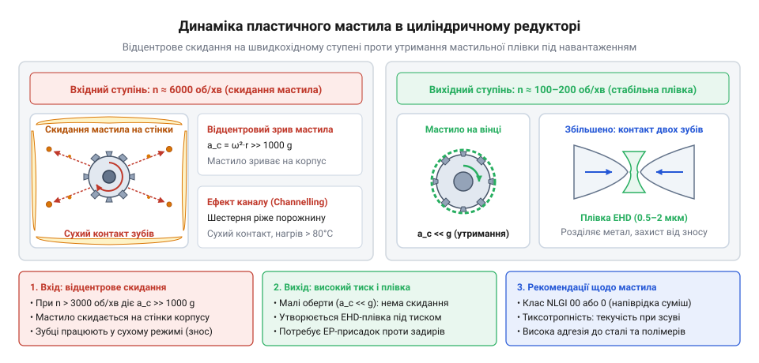
*Поведінка пластичного мастила в прямозубому редукторі: відцентрове скидання на першому швидкісному ступені та формування стабільної плівки на навантаженому вихідному ступені.*

Водночас більшість мініатюрних редукторів мають напіввідкритий корпус сендвіч-типу без герметичних ущільнень. Постійний контакт із навколишнім повітрям викликає випаровування летких фракцій базової оливи та окиснення згущувача. Мастило висихає, перетворюючись на тверду липку кірку, на яку налипає пил із повітря. Замість захисної плівки в зачепленні утворюється абразивна суспензія, що веде до падіння ККД, зростання робочого струму та заклинювання передачі.

На ресурс механізму істотно впливає тепловий стан вузла. Тепло генерується як усередині редуктора через тертя в зачепленнях та втулках, так і надходить від фланця електродвигуна, нагрітого робочим струмом. При зростанні температури редуктора понад 60–70 °C в'язкість базової оливи мастила падає в кілька разів: товщина гідродинамічного клину стає меншою за висоту шорсткості поверхні зубів, що переводить тертя в граничний режим і різко прискорює пітинг. Тепловий баланс визначається коефіцієнтом тривалості ввімкнення (англ. @@en|duty cycle@@, `DC`):

```
DC
= (t_роб / (t_роб + t_пауз)) · 100%     [коефіцієнт відносної тривалості ввімкнення привода за цикл]
```

При тривалій безперервній роботі (`DC > 60%`) під граничним навантаженням редуктор не встигає розсіювати тепло через малу площу корпусу, внаслідок чого напрацювання до відмови скорочується у 3–5 разів порівняно з короткочасними режимами (`DC ≤ 25%`).

У реальних приводах навантаження ніколи не буває строго постійним: фази прискорення з максимальним моментом чергуються з рухом за інерцією, робочим ходом та паузами. Оцінювати ресурс редуктора за середнім арифметичним моментом не можна, оскільки накопичення втомних пошкоджень у матеріалі має кубічну залежність відповідно до кривої витривалості Велера (від нім. *Wöhler-Kurve*, на честь Августа Велера). Для розрахунку ресурсу визначають еквівалентний крутний момент `M_екв`:

```
M_екв
= ³√((∑ (Mᵢ³ · nᵢ · tᵢ)) / (∑ (nᵢ · tᵢ))) [еквівалентний момент за правилом контактної втоми Пальмгрена–Майнера]
```

де `Mᵢ`, `nᵢ` та `tᵢ` — крутний момент, частота обертання та тривалість кожного окремого інтервалу робочого циклу.

Фактичний ресурс зачеплення `L_факт` (у годинах) визначається відносно паспортом гарантованого ресурсу `L_ном` при номінальному моменті `M_ном` та швидкості `n_ном`:

```
L_факт
= L_ном · (M_ном / M_екв)³ · (n_ном / n_екв) [степенева залежність ресурсу від контактних напружень зачеплення]
```

Розглянемо практичний інженерний розрахунок. Паспортний номінальний ресурс редуктора становить `L_ном = 3000 год` при частоті `n_ном = 100 об/хв` і крутному моменті `M_ном = 0.3 Н·м`. Робочий цикл механізму триває 100 секунд і складається з двох інтервалів:
- Фаза робочого навантаження: тривалість `t₁ = 20 с`, швидкість вала `n₁ = 60 об/хв`, крутний момент `M₁ = 0.8 Н·м`;
- Фаза холостого повернення: тривалість `t₂ = 80 с`, швидкість вала `n₂ = 100 об/хв`, крутний момент `M₂ = 0.2 Н·м`.

Обчислимо еквівалентний крутний момент навантажувального циклу:

```
M_екв
= ³√((0.8³ · 60 · 20 + 0.2³ · 100 · 80) / (60 · 20 + 100 · 80)) [підстановка параметрів навантаженої та холостої фаз]
= ³√((0.512 · 1200 + 0.008 · 8000) / (1200 + 8000))            [обчислення добутків моментів і кутових переміщень]
= ³√((614.4 + 64) / 9200)                                       [підсумовування циклічного контактного навантаження]
= ³√(678.4 / 9200)                                              [визначення середньозваженої інтенсивності навантаження]
= ³√(0.07374)                                                   [добування кубічного кореня]
≈ 0.419 Н·м                                                     [еквівалентний крутний момент циклу]
```

Середня частота обертання вихідного вала за цикл:

```
n_екв
= (60 · 20 + 100 · 80) / (20 + 80)                              [зважена швидкість за сумарний час робочого циклу]
= (1200 + 8000) / 100                                           [підсумовування кількості обертів]
= 92 об/хв                                                      [середня експлуатаційна частота обертання]
```

Розрахуємо прогнозоване напрацювання редуктора до появи втомного пітингу:

```
L_факт
= 3000 · (0.3 / 0.419)³ · (100 / 92)                            [розрахунок напрацювання з урахуванням моменту та швидкості]
= 3000 · (0.716)³ · 1.087                                       [обчислення відносних коефіцієнтів навантаження]
= 3000 · 0.367 · 1.087                                          [врахування нелінійного кубічного закону втоми]
≈ 1197 год                                                      [прогнозований реальний ресурс зачеплення]
```

> 🔧 **Навіщо це.**
> Хоча важка фаза з підвищеним моментом `0.8 Н·м` займає лише 20% від загального часу роботи привода, еквівалентний крутний момент через кубічну залежність втомного викришування зріс з номінальних 0.3 Н·м до 0.419 Н·м. Це скоротило реальний ресурс редуктора у 2.5 раза — з 3000 до приблизно 1200 годин. Розрахунок за еквівалентним моментом запобігає несподіваному виходу серійного обладнання з ладу, дозволяючи інженеру закласти коректний запас міцності або внести регламентну заміну привода до сервісного графіка мехатронного комплексу.

## Покроковий інженерний розрахунок і вибір прямозубого редуктора

Безпосереднє підключення мініатюрного електродвигуна до механічного навантаження майже завжди є непрацездатним: електродвигун постійного струму (як-от базовий двигун, що використовується в [N20 мікромотор з редуктором](root:cat-hw-actuators/n20-motor)) розвиває максимальну потужність на швидкостях у кілька тисяч обертів на хвилину, створюючи при цьому мізерний крутний момент. Мехатронне навантаження — тягове колесо мобільної платформи, суглоб маніпулятора чи ходовий гвинт подачі — навпаки, вимагає помірної швидкості та значного зусилля.

Спроба підібрати редуктор суто за необхідною швидкістю обертання та каталожним моментом блокування регулярно закінчується однією з трьох типових аварій:
1. Двигун перегрівається і виходить з ладу під час розгонів, бо неузгоджений момент інерції навантаження змушує його працювати в режимі постійного динамічного перевантаження.
2. Зубці вихідного ступеня зрізаються під час першого ж аварійного зіткнення з механічним упором через колосальний динамічний удар від обертової інерції ротора.
3. Опорні втулки вихідного вала овалізуються за лічені десятки годин роботи через невраховані радіальні консольні сили від колеса або натягу паса.

Щоб привод працював надійно та відпрацьовував закладений ресурс, інженерний розрахунок прямозубого редуктора з паралельними валами (англ. @@en|spur gear@@, пряма циліндрична шестерня) виконують за строгою послідовністю із семи кроків.

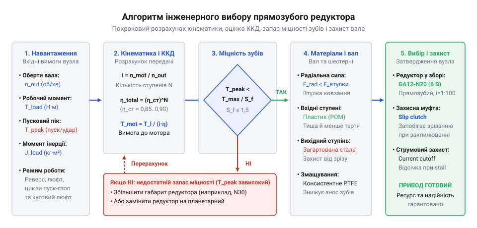
*Послідовність семи інженерних кроків підбору циліндричного прямозубого редуктора: від формування вимог навантаження до перевірки механічних обмежень, міцності та трибології з ітеративним поверненням у разі перевищення граничних значень.*

### Крок 1. Визначення робочої точки навантаження

Розрахунок починається з боку навантаження: воно диктує необхідну кутову швидкість `ω_load` (вимірюється в рад/с; перерахунок із частоти обертання `n` в об/хв виконується як `ω = 2 · π · n ÷ 60`), час виходу на цю швидкість `t_acc` та статичний опір руху.

Кутове прискорення розгону:

```
α_load
= ω_load ÷ t_acc                         [визначення кутового прискорення]
```

Повний крутний момент навантаження складається зі статичної та динамічної складових:
1. Статичний момент `T_static` враховує постійні сили опору: тертя в напрямних, опір коченню коліс, силу тяжіння при підйомі вантажу або зусилля різання/стискання.
2. Динамічний момент `T_dyn` витрачається виключно на подолання інерції навантаження `J_load` під час прискорення:

```
T_dyn
= J_load · α_load                        [основний закон динаміки обертового руху]
```

Піковий крутний момент, який редуктор зобов'язаний передати робочому органу на етапі пуску:

```
T_load_peak
= T_static + T_dyn                       [сумарний піковий момент навантаження]
```

Для циклічних механізмів (розгін — рівномірний рух — гальмування — пауза) окремо розраховують середньоквадратичний тривалий момент `T_rms`:

```
T_rms
= √((T_acc² · t_acc + T_static² · t_const + T_dec² · t_dec) ÷ t_cycle)   [еквівалентний тепловий момент]
```

Саме величина `T_rms` визначає тривале теплове навантаження на обмотки мотора та втомну довговічність зубців, тоді як `T_load_peak` перевіряє вузол на статичну міцність.

### Крок 2. Розрахунок передавального числа з урахуванням мультиплікативного падіння ККД

Колекторні двигуни мають максимальний коефіцієнт корисної дії (@@en|efficiency@@) у вузькому діапазоні: зазвичай при швидкості обертання близько `0.75..0.85` від швидкості холостого ходу `ω_0` і навантаженні `0.20..0.25` від пускового моменту блокування. Обравши номінальну швидкість мотора `ω_motor_nom`, визначають попереднє кінематичне передавальне число (англ. @@en|gear ratio@@, від лат. ratio — відношення):

```
i
= ω_motor_nom ÷ ω_load                   [кінематичне передавальне число]
```

У прямозубих циліндричних передачах із паралельними валами передавальне число одного ступеня зазвичай обирають у межах `u_stage ≈ 2.5..4.5`. Занадто велике число на один ступінь вимагає мініатюрної тягової шестерні (триба) з малою кількістю зубів (менше 10–12), що призводить до небезпечного підрізання ніжки зуба та зниження плавності зачеплення. Тому редуктор будують багатоступеневим. Кількість ступенів `k`:

```
k
= ceil(ln(i) ÷ ln(u_stage_avg))          [кількість послідовних пар зачеплення]
```

Кожен ступінь редуктора створює втрати на тертя кочення та ковзання в евольвентному зачепленні, а також тертя цапф валів у бронзових чи сталевих підшипникових втулках ковзання. Середній ККД одного мініатюрного прямозубого ступеня становить `η_stage ≈ 0.90..0.93`.

Оскільки ступені з'єднані послідовно, їхні коефіцієнти корисної дії перемножуються. Сумарний ККД спадає мультиплікативно як показникова функція:

```
η_total
= (η_stage)ᵏ                             [мультиплікативний ККД багатоступеневої передачі]
```

Для 4-ступеневого редуктора з `η_stage = 0.91` сумарний ККД становить лише `0.91⁴ ≈ 0.686`, а для 5-ступеневого — `0.624`. Понад третина вхідної потужності втрачається у вигляді тепла.

Необхідний крутний момент, який мотор повинен розвинути на своєму валу з урахуванням втрат:

```
T_motor_req
= T_load_peak ÷ (i · η_total)            [необхідний електромагнітний момент мотора]
```

Якщо розрахований `T_motor_req` перевищує тривалий номінальний момент двигуна `T_motor_nom`, конструктор зобов'язаний або збільшити передавальне число `i`, або вибрати потужніший двигун.

### Крок 3. Узгодження моментів інерції ротора та навантаження

Прискорення приводу залежить не лише від крутного моменту, а й від інерції всієї кінематичної системи. Коли мотор розганяє масивне навантаження через редуктор, інерція навантаження відображається на вал мотора зі зменшенням, пропорційним квадрату передавального числа.

Зведений момент інерції навантаження (англ. @@en|reflected inertia@@):

```
J_load_ref
= J_load ÷ i²                            [інерція навантаження, зведена до вала мотора]
```

Повний момент інерції, який розганяє електромагнітне поле статора:

```
J_total
= J_rotor + J_load_ref
= J_rotor + J_load ÷ i²                  [сумарна інерція системи на валу мотора]
```

Для досягнення максимального кутового прискорення робочого органа за мінімальних втрат потужності в обмотках мотора діє критерій узгодження інерції (англ. @@en|inertia matching@@): зведена інерція навантаження має дорівнювати інерції ротора двигуна:

```
J_load ÷ i² ≈ J_rotor                    [критерій ідеального динамічного узгодження]
```

Коефіцієнт узгодження інерцій:

```
λ
= J_load_ref ÷ J_rotor
= J_load ÷ (i² · J_rotor)                [коефіцієнт відношення інерцій]
```

> 🔧 **Навіщо це.**
> Відношення інерцій `λ` визначає смугу пропускання контуру керування та енергетичну ефективність сервоприводу. Якщо `λ >> 10`, навантаження повністю домінує над мотором. Привод стає динамічно «млявим», посилюється резонансна схильність механізму, а в контурі керування виникають автоколивання через пружні мікродеформації зубців. Якщо `λ << 0.2`, передавальне число завищене: понад 80% крутного моменту мотор спалює на розгін власного ротора, так і не віддавши корисну динамічну потужність назовні. У прецизійній робототехніці прагнуть `λ ≈ 1`, а в мобільних мехатронних вузлах допустимим вважається діапазон `0.5 ≤ λ ≤ 5`.

### Крок 4. Перевірка статичної міцності вихідного ступеня та запасу проти динамічного удару

У редукторі кожен наступний вал обертається повільніше, але передає значно більший крутний момент. Найбільше навантаження сприймає зубчасте зачеплення останнього (вихідного) ступеня. Саме тут виникають критичні напруження згину в основі зуба (англ. @@en|bending stress@@) та контактні напруження здавлювання.

Паспортний статичний момент руйнування редуктора `T_max_static` порівнюють із моментом, який виникає при аварійному блокуванні мотора (англ. @@en|stall torque@@):

```
T_out_stall
= T_motor_stall · i · η_total            [вихідний крутний момент при заклинюванні мотора]
```

Якщо `T_out_stall > T_max_static`, редуктор не захищений від власного двигуна: у разі механічного заклинювання вихідного вала мотор миттєво зріже зуби вихідної шестерні.

Ще небезпечнішим є динамічний удар під час раптової зупинки. Ротор мотора, що обертається з великою швидкістю `ω_motor`, має кінетичну енергію `E_k = 0.5 · J_rotor · ω_motor²`. Якщо робочий орган ударяється об твердий нерухомий упор, час зупинки `Δt_stop` визначається лише пружністю матеріалу і становить частки мілісекунди.

Обертовий момент удару, що скидається в зачеплення:

```
T_shock
≈ T_static + (J_rotor · i · η_total) · (ω_motor ÷ Δt_stop)   [динамічний піковий удар від інерції ротора]
```

> 🔧 **Навіщо це.**
> Редуктори з великим передавальним числом (`i > 100`) є самознищуваними при жорстких ударах: інерція ротора, посилена мультиплікатором швидкості `i`, створює імпульс сили, здатний зруйнувати загартовані сталеві шестерні задовго до того, як спрацює електронний захист драйвера за струмом. Запобігають руйнуванню двома шляхами: програмним плавним формуванням траєкторій з обмеженням ривка (англ. jerk limit) та механічним захистом — встановленням між вихідним валом і навантаженням [запобіжні фрикційні муфти](root:hw-motion/mechanical-slip-clutch).

Окремо перевіряють здатність передачі до зворотного обертання (англ. @@en|back-drivability@@). При спробі провернути редуктор прикладанням моменту до вихідного вала сумарний ККД зворотного ходу падає за залежністю `η_back = 2 - 1 ÷ η_total`. Якщо прямий ККД редуктора нижчий за 50% (`η_total < 0.5`), зворотний ККД стає нульовим або від'ємним — передача самогальмується на терті зачеплення. Спроба провернути такий заблокований механізм рукою чи зовнішнім зусиллям призводить до згинального зламу зубців.

### Крок 5. Оцінка припустимості кутового люфту та крутильної піддатливості

Кутовий люфт (від нім. *Luft* — зазор; англ. @@en|backlash@@ — вільний зазор між неробочими профілями зубів у спряженій парі) виникає через технологічні допуски на товщину зуба та міжосьову відстань, запобігаючи термомеханічному заклинюванню передачі.

Кожен ступінь передачі має власний кутовий зазор `θ_b_j`. Однак кутовий люфт початкових ступенів редукується наступними парами:

```
θ_backlash_total
= θ_b_k + θ_b_{k-1} ÷ u_k + θ_b_{k-2} ÷ (u_k · u_{k-1}) + ...   [накопичення люфту на вихідному валу]
```

Оскільки люфт першого і другого ступенів ділиться на значні передавальні числа наступних пар, від 85% до 95% усього люфту на вихідному валу визначається бічним зазором останнього ступеня `θ_b_k`. У типових мініатюрних прямозубих редукторах загальний кутовий люфт становить `1°..3°` (60–180 кутових мінут).

Окрім геометричного люфту, під навантаженням проявляється пружна крутильна піддатливість (англ. @@en|torsional compliance@@) ланцюга шестерень — сумарний вигин тонких зубців та мікроскручування валів:

```
Δθ_torsion
= T_out ÷ K_torsion                      [пружний кутовий прогин під моментом]
```

де `K_torsion` — крутильна жорсткість редуктора (Н·м/рад). Сумарна похибка положення вихідного вала:

```
Δθ_total
= θ_backlash_total + Δθ_torsion          [повна кутова неточність передачі]
```

У системах позиціювання з енкодером на валу двигуна ця похибка залишається невидимою для контролера: датчик фіксує поворот ротора, тоді як вихідний вал не рухається в межах зони мертвого ходу. На відміну від прямого приводу крокових моторів (наприклад, [28BYJ-48 — кроковий мотор (5V)](root:cat-hw-actuators/28byj-48-stepper)), редукторний привод вимагає програмного вибирання люфту при кожній зміні напрямку руху.

### Крок 6. Вибір матеріалів шестерень за критеріями шуму, ресурсу та собівартості

В інженерній практиці рідко виготовляють усі колеса багатоступеневого редуктора з одного матеріалу. Оптимальна конструкція комбінує матеріали відповідно до умов роботи конкретного ступеня:
- Вхідний ступінь (вал двигуна та перша проміжна пара): швидкість обертання максимальна (до 10 000 об/хв), передаваний момент мізерний. Головні фактори — акустичний шум і зношування від високочастотного тертя. Тут застосовують інженерні полімери: поліоксиметилен (англ. @@en|polyoxymethylene@@, POM / поліацеталь) або капролон (поліамід PA6). Завдяки низькому модулю пружності полімерний зуб демпфує динамічний удар під час входу в зачеплення, забезпечуючи тиху роботу приводу.
- Проміжні ступені: помірна швидкість, зростаючий крутний момент. Застосовують конструкційну латунь (сплави Cu-Zn) або високоміцні вуглепластики. Пара латунь-сталь демонструє низький коефіцієнт сухого тертя та високу припрацьовуваність.
- Вихідний ступінь: низька швидкість обертання, максимальний крутний момент. Визначальним є ризик втомного руйнування та контактного викришування робочих поверхонь (пітингу, англ. @@en|pitting@@, від англ. pit — заглибина, ямка; докладніше про механіку процесу див. [контактна втома та пітинг зубчастих коліс](root:hw-motion/gear-tooth-strength)). Тут застосовують шестерні зі спеченої порошкової сталі або загартованої вуглецевої сталі з твердістю контактної зони не менше 45–50 HRC.

| Критерій порівняння | Інженерні полімери (POM, нейлон) | Латунь та бронза | Загартована сталь |
| :--- | :--- | :--- | :--- |
| Рівень акустичного шуму | Мінімальний (ефект глушіння) | Помірний | Підвищений (металевий дзвін) |
| Допустимий контактний тиск | Низький (< 40–50 МПа) | Середній (150–250 МПа) | Високий (> 800–1200 МПа) |
| Здатність витримувати зріз зубів | Мінімальна | Середня | Максимальна |
| Чутливість до відсутності мастила | Низька (самозмащувальні пари) | Середня | Критична (швидке заїдання) |
| Технологія та собівартість | Лиття під тиском (наймасовіша) | Точіння / зубофрезерування | Порошкова металургія або шліфування |

Комбінація «полімер на вході — метал на виході» забезпечує баланс: редуктор залишається тихим, але витримує повний паспортний момент.

### Крок 7. Перевірка радіальних та консольних навантажень на опори вихідного вала

Вихідний вал передає крутний момент на робочий орган, але одночасно сприймає поперечні сили: натяг зубчастого паса, тиск зачеплення відкритої ланцюгової зірочки або радіальну реакцію опорної поверхні на ведуче колесо.

Консольне навантаження (англ. @@en|overhung load@@) діє на вихідний вал на плечі `L` від лицьової стінки корпуса редуктора. Ця сила `F_radial` створює згинальний момент `M_bend = F_radial · L`, який навантажує підшипникові опори вала всередині корпуса редуктора.

Якщо відстань між передньою та задньою опорними втулками корпуса дорівнює `L_span`, то згідно з правилом важеля реакції на опорах становлять:

```
F_bearing_front
= F_radial · (1 + L ÷ L_span)            [радіальна реакція на передній втулці]
```

```
F_bearing_rear
= F_radial · (L ÷ L_span)                [радіальна реакція на задній втулці]
```

У мініатюрних циліндричних редукторах сендвіч-типу міжопорна база вкрай мала: зазвичай `L_span ≈ 4..6 мм`. Якщо ж на вал насаджено широке колесо з вильотом центра маточини `L = 10..12 мм`, відношення `L ÷ L_span` сягає `2..2.5`. У результаті зусилля на передню втулку `F_bearing_front` перевищує радіальну силу колеса в 3–3.5 раза!

> 🔧 **Навіщо це.**
> Більшість мініатюрних прямозубих редукторів використовують пористі бронзографітові втулки ковзання, розраховані на суворе обмеження фактора `P · v` (добуток контактного тиску на лінійну швидкість ковзання). Перевантаження передньої втулки викликає її миттєву пластичну деформацію та овалізацію отвору. Вал перекошується, паралельність осей останнього ступеня порушується, і зачеплення переходить у кромковий режим контакту: навантаження концентрується на кутиках зубів. Це спричиняє викришування металу та повне заклинювання редуктора навіть за номінального крутного моменту. Колеса або важкі шківи заборонено консольно спирати на вал редуктора — навантаження повинна тримати зовнішня підшипникова опора шасі.

### Наскрізний інженерний розрахунок приводу мехатронного модуля

Проілюструємо застосування покрокового алгоритму на практичному завданні підбору приводу ведучого колеса автономної колісної платформи.

**Вихідні вимоги навантаження:**
- Лінійна швидкість руху платформи: `v = 0.25 м/с`.
- Діаметр ведучого колеса: `D_wheel = 0.04 м` (радіус `R = 0.02 м`).
- Маса платформи, що припадає на одне колесо: `m_wheel = 0.45 кг` (нормальна сила тяжіння `F_norm ≈ 4.41 Н`).
- Статичний опір руху (тертя кочення та подолання ухилу 5°): `F_resist = 1.6 Н`.
- Потрібний час розгону до повної швидкості: `t_acc = 0.04 с`.
- Момент інерції колеса разом із масою платформи, зведеною до осі обертання: `J_load = 1.8 × 10⁻⁴ кг·м²`.
- Виліт колеса від торця корпуса редуктора: `L = 8 мм`; міжпідшипникова база редуктора: `L_span = 5 мм`.

**Параметри базового двигуна (колекторний мікромотор постійного струму 6 В):**
- Швидкість холостого ходу: `n_0 = 8000 об/хв` (`ω_0 ≈ 837.7 рад/с`).
- Номінальна робоча точка двигуна: швидкість `ω_motor_nom = 625 рад/с` (~5970 об/хв), номінальний момент `T_motor_nom = 0.0035 Н·м` (3.5 мН·м).
- Момент блокування (stall torque): `T_motor_stall = 0.015 Н·м` (15.0 мН·м).
- Момент інерції ротора: `J_rotor = 1.0 × 10⁻⁷ кг·м²`.

**Послідовний розрахунок за алгоритмом:**

**Крок 1: Робоча точка навантаження.**
Кутова швидкість обертання колеса:

```
ω_load
= v ÷ R                                  [лінійна швидкість через радіус колеса]
= 0.25 ÷ 0.02                            [підстановка значень]
= 12.5 рад/с                             [еквівалентно 119.4 об/хв]
```

Кутове прискорення та динамічний момент розгону:

```
α_load
= ω_load ÷ t_acc                         [розрахунок прискорення]
= 12.5 ÷ 0.04                            [підстановка значень]
= 312.5 рад/с²                           [кутове прискорення колеса]
```

```
T_dyn
= J_load · α_load                        [динамічний момент]
= (1.8 × 10⁻⁴) · 312.5                   [підстановка інерції та прискорення]
= 0.05625 Н·м                            [56.25 мН·м]
```

Статичний опір на радіусі колеса: `T_static = F_resist · R = 1.6 Н · 0.02 м = 0.032 Н·м` (32.0 мН·м).
Піковий крутний момент навантаження:

```
T_load_peak
= T_static + T_dyn                       [сумарний піковий момент]
= 0.032 + 0.05625                        [додавання статичної та динамічної складових]
= 0.08825 Н·м                            [88.25 мН·м]
```

**Крок 2: Передавальне число та оцінка ККД.**
Кінематичне передавальне число:

```
i
= ω_motor_nom ÷ ω_load                   [відношення швидкостей]
= 625 ÷ 12.5                             [підстановка номіналу мотора та навантаження]
= 50                                     [потрібне передавальне число]
```

Для реалізації передавального числа `i = 50` обираємо триступеневий редуктор (`k = 3`) із середнім ступенем редукції однієї пари `u_stage = ³√50 ≈ 3.68`.
Приймаємо ККД одного ступеня на втулках ковзання `η_stage = 0.91`. Сумарний ККД триступеневої прямозубої передачі:

```
η_total
= (η_stage)³                             [сумарний ККД трьох пар зачеплення]
= 0.91³                                  [піднесення до куба]
≈ 0.7536                                 [75.36 % корисної потужності]
```

Перевірка потрібного моменту мотора в тривалому статичному режимі:

```
T_motor_cont
= T_static ÷ (i · η_total)               [необхідний тривалий момент мотора]
= 0.032 ÷ (50 · 0.7536)                  [підстановка значень]
= 0.032 ÷ 37.68                          [обчислення знаменника]
≈ 0.00085 Н·м = 0.85 мН·м                [значно нижче номіналу 3.5 мН·м — перегрів виключено]
```

Перевірка потрібного моменту мотора під час пікового розгону:

```
T_motor_peak
= T_load_peak ÷ (i · η_total)            [необхідний піковий пусковий момент]
= 0.08825 ÷ 37.68                        [підстановка пікового моменту та редукції з ККД]
≈ 0.00234 Н·м = 2.34 мН·м                [менше номіналу мотора 3.5 мН·м — пуск легкий]
```

**Крок 3: Узгодження інерції.**
Зведений момент інерції колеса з платформою:

```
J_load_ref
= J_load ÷ i²                            [зведення інерції через квадрат передавального числа]
= (1.8 × 10⁻⁴) ÷ 50²                     [підстановка значень]
= (1.8 × 10⁻⁴) ÷ 2500                    [квадрат 50]
= 7.2 × 10⁻⁸ кг·м²                       [зведена інерція на валу ротора]
```

Коефіцієнт узгодження інерцій:

```
λ
= J_load_ref ÷ J_rotor                   [відношення зведеної інерції до інерції ротора]
= (7.2 × 10⁻⁸) ÷ (1.0 × 10⁻⁷)            [підстановка значень]
= 0.72                                   [чудове узгодження в діапазоні 0.5..2.0]
```

Двигун не витрачає надмірної енергії на подолання власної інерції, а система не схильна до резонансного розгойдування контуру швидкості.

**Крок 4: Міцність вихідного ступеня та аварійний удар.**
Триступеневий редуктор такого класу має паспортизований тривалий робочий крутний момент `T_rated = 0.15 Н·м` і граничний статичний момент зрізу зубців `T_max_static = 0.40 Н·м`.
Тривалий робочий момент `T_static = 0.032 Н·м` забезпечує коефіцієнт запасу `S = 0.15 ÷ 0.032 ≈ 4.7`.

Перевіримо момент при аварійному блокуванні мотора під напругою 6 В:

```
T_out_stall
= T_motor_stall · i · η_total            [вихідний момент при заклинюванні вала]
= 0.015 · 50 · 0.7536                    [підстановка моменту блокування мотора]
≈ 0.565 Н·м                              [результат перевищує поріг руйнування 0.40 Н·м!]
```

*Критичний інженерний висновок:* `T_out_stall (0.565 Н·м) > T_max_static (0.40 Н·м)`. Якщо колесо застрягне, мотор зріже зубці вихідного ступеня.
*Рішення:* обмежити струм драйвера двигуна на рівні `I_limit = 0.53 · I_stall`, щоб максимальний вихідний момент заклинювання не перевищував безпечні `0.30 Н·м`.

**Крок 5: Оцінка люфту.**
Сумарний кутовий люфт редуктора становить `θ_backlash ≈ 1.8°` (`0.0314 рад`).
Лінійний люфт на ободі колеса діаметром 40 мм:

```
Δs
= R · θ_backlash                         [лінійний мертвий хід колеса]
= 0.02 · 0.0314                          [підстановка радіуса та кута в радіанах]
≈ 0.00063 м = 0.63 мм                    [люфт обода колеса]
```

Для мобільної колісної платформи лінійний зазор 0.63 мм є цілком прийнятним, проте алгоритм одометрії за енкодером на моторі повинен додавати корекцію мертвого ходу під час реверсу напрямку руху.

**Крок 6: Вибір матеріалів.**
- Ступінь 1 (шестерня мотора 6000 об/хв): поліоксиметилен (POM) для безшумної роботи.
- Ступінь 2: шестерні з конструкційної латуні.
- Ступінь 3: триб із загартованої сталі, вихідне зубчасте колесо — зі спеченої конструкційної сталі.

**Крок 7: Консольне навантаження на підшипникові опори.**
Радіальна сила на колесі від ваги становить `F_radial = 4.41 Н`. При вильоті `L = 8 мм` і базі втулок `L_span = 5 мм` реакція на передній втулці корпуса дорівнює:

```
F_bearing_front
= F_radial · (1 + L ÷ L_span)            [розрахунок навантаження на передню опору]
= 4.41 · (1 + 8 ÷ 5)                     [геометрія консолі]
= 4.41 · 2.6                             [коефіцієнт мультиплікації консолі]
≈ 11.47 Н                                [навантаження на передню втулку ковзання]
```

Допустиме паспортне радіальне навантаження на бронзову втулку діаметром 3 мм у таких редукторах становить лише `5.0 Н`. Розраховане зусилля `11.47 Н` перевищує допустиму межу більш ніж у 2.2 раза! Пряме консольне встановлення колеса на вихідний вал редуктора гарантовано розіб'є втулку та заклинить передачу за перші 15–20 годин експлуатації.

*Остаточне конструктивне рішення:* вісь колеса повинна спиратися на незалежний кульковий підшипник, встановлений у тримачі рами платформи. Цей зовнішній вузол сприйме всю радіальну силу 4.41 Н, а вал редуктора з'єднається з віссю колеса через розв'язувальну муфту зі шліцами або плоским зрізом (англ. D-shaft), передаючи суто обертальний крутний момент.
