# Мотор-редуктор 6 В (100 і 600 об/хв)

## Пастка прямого приводу: чому голий мікромотор не зрушить колесо

Спроба зібрати першу рухому колісну платформу майже завжди починається з інтуїтивного, але хибного рішення: узяти мініатюрний 6-вольтовий колекторний двигун постійного струму, насадити стандартне колесо діаметром 65 мм прямо на його сталевий вал діаметром 1–2 мм і подати напругу з батарейного відсіку. Очікування просте — двигун крутиться, отже, закріплене на ньому колесо покотить шасі по підлозі. Реальність обертається миттєвим інженерним фіаско: робот не зрушує з місця ні на міліметр, двигун ледь чутно пищить, а за кілька секунд пластиковий корпус починає нагріватися й наповнювати кімнату запахом перегрітого ізоляційного лаку.

Причина цієї невдачі криється у фундаментальній розбіжності між механічними характеристиками високообертового мікромотора та фізичними вимогами до рушія наземного транспорту. Якщо ввімкнути типовий мініатюрний [колекторний двигун постійного струму](root:hw-motion/brushed-dc-motor) без навантаження, його ротор (лат. *rotare* — обертатися) під напругою 6 В миттєво розженеться до шаленої швидкості від 6000 до 12000 об/хв (обертів на хвилину). Якби колесо діаметром 65 мм (радіус `r = 0.0325 м`) спромоглося обертатися з такою кутовою швидкістю, лінійна швидкість кочення досягла б колосальних значень:

```
v
= ω · r                              [лінійна швидкість через кутову]
= (10000 · 2 · π / 60) · 0.0325      [підстановка частоти 10000 об/хв і радіуса]
≈ 1047 · 0.0325                      [кутова швидкість у радіанах за секунду]
≈ 34 м/с                             [множення]
```

Тридцять чотири метри за секунду — це понад 120 км/год. Мініатюрне шасі масою у кількасот грамів не здатне контрольовано рухатися з такою швидкістю у приміщенні, але катастрофа настає ще до початку будь-якого руху. Проблема полягає в тому, що на такій кутовій швидкості власний крутний момент (лат. *momentum* — рушійна сила, поштовх, від *movere* — рухати) мініатюрного ротора становить мізерні величини: від 0.5 до 1.0 мН·м (міліньютон-метрів), тобто близько `0.001 Н·м`.

Щоб з'ясувати, яку реальну силу тяги цей мотор здатен створити в точці контакту колеса з опорною поверхнею, крутний момент ділять на радіус колеса:

```
F
= M / r                              [сила тяги на ободі колеса]
= 0.001 / 0.0325                     [підстановка крутного моменту й радіуса]
≈ 0.031 Н                            [ділення]
```

Тягове зусилля 0.031 Н еквівалентне силі тяжіння, яка діє на вантаж масою лише 3.1 грама. Навіть найлегша колісна платформа разом із парою елементів живлення важить щонайменше 200–300 грамів. Сила тертя спокою, опір кочення пружної гуми об підлогу та необхідність надати платформі початкового прискорення вимагають тяги щонайменше у 0.5–1.5 Н. Двигуну прямого приводу бракує обертального зусилля у 20–50 разів, тому ротор виявляється повністю затиснутим зовнішнім навантаженням.

Зупинка вала під напругою переводить електромеханічну систему в аварійний стан. Поки якір вільно обертається у магнітному полі статора (лат. *stator* — той, що стоїть нерухомо), у його мідних обмотках генерується електрорушійна сила індукції, або проти-ЕРС (англ. @@en|back-EMF@@). Вона спрямована назустріч напрузі живлення та обмежує струм споживання до безпечних 50–100 мА. Проте коли вал заблоковано, кутова швидкість дорівнює нулю (`ω = 0`), а проти-ЕРС миттєво зникає. 

Уся напруга джерела 6 В прикладається безпосередньо до низького омічного опору тонкого мідного дроту обмоток і щітково-колекторного вузла, який зазвичай становить лише 3–4 Ом. У колі виникає струм блокування (англ. @@en|stall current@@), що сягає 1.5–2 А:

```
I[stall]
= U / R                              [закон Ома за нульової проти-ЕРС]
= 6 / 3.5                            [підстановка напруги живлення та омічного опору]
≈ 1.71 А                             [ділення]
```

Увесь цей струм перетворюється на теплові втрати Джоуля безпосередньо в об'ємі мініатюрного якоря:

```
P[heat]
= I² · R                             [потужність теплових втрат]
= 1.71² · 3.5                        [підстановка струму блокування й опору]
≈ 10.2 Вт                            [обчислення виділення тепла]
```

Розсіяти десять ватів теплової потужності в закритому металевому циліндрі розміром із наперсток неможливо. Температура мідного дроту за лічені секунди долає поріг у 150 °C, ізоляційний лак деградує, виникає міжвиткове коротке замикання, і мотор остаточно виходить із ладу. Якщо ж підняти платформу в повітря, знявши опір поверхні, колеса почнуть верещати на надзвукових обертах із шаленою вібрацією, а під час опускання на підлогу знову пробуксують, спалять гуму й заклинять під вагою шасі.

У цьому проявляється головна суперечність електромеханіки мікроприводів. Механічна потужність обертання визначається добутком крутного моменту на кутову швидкість:

```
P
= M · ω                              [механічна потужність обертання]
```

Отримати великий крутний момент безпосередньо від малогабаритного ротора фізично неможливо: магнітний потік постійних магнітів обмежений геометрією, переріз мідного дроту мізерний, а плече прикладання сили Ампера становить лише кілька міліметрів. Тому свою корисну механічну потужність у 1–3 Вт мініатюрний двигун набирає виключно завдяки екстремальній кутовій швидкості `ω`. Натомість рушій робота вимагає діаметрально протилежного робочого режиму: низької швидкості (100–600 об/хв для забезпечення комфортних для керування 0.3–1.5 м/с) і помноженого у десятки разів крутного моменту, здатного долати підйоми, нерівності та інерцію ваги.

Пряме з'єднання вала з навантаженням виключається. Потрібен проміжний перетворювач, який забере надлишкові оберти та пропорційно перетворить їх на бракуюче зусилля. Цим механізмом виступає редуктор (лат. *reductor* — той, що відводить назад, повертає, від *reducere* — повертати, зменшувати).

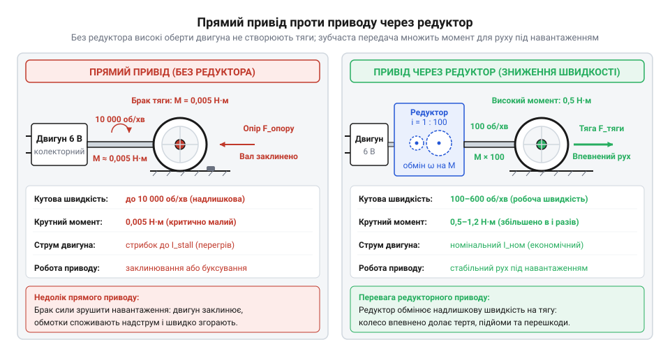
*Прямий привід проти редуктора: мікромотор без редукції на високих обертах втрачає здатність зрушити колесо під навантаженням і переходить у тепловий пробій, тоді як редуктор розмінює надлишкову кутову швидкість на багаторазове збільшення крутного моменту.*

Зрозуміти, як інженерна потреба у компактних автономних приводах для авіамоделізму та побутової техніки привела до відмови від громіздких пружин і створення доступних сучасних мікроприводів, допомагає [історія розвитку та мініатюризації електромеханічних приводів](root:cat-hw-actuators/gearmotor-6v/hist-miniature-gearmotors.md).

> 🔧 **Навіщо це.** Розуміння балансу швидкості та крутного моменту застерігає розробника від фатальної помилки: спроби сповільнити голий мотор за допомогою широтно-імпульсної модуляції (ШІМ). Зниження середньої напруги через ШІМ зменшує оберти ротора, але водночас пропорційно зрізає і без того мікроскопічний крутний момент, перетворюючи двигун на нагрівальний елемент під найменшим навантаженням. Єдиний спосіб отримати низьку швидкість зі збереженням і примноженням тяги — це механічна редукція.

## Анатомія мотор-редуктора: як шестерні розмінюють швидкість на силу

Щоб розв'язати конфлікт між високими обертами двигуна та потребою в тязі, у компактному габариті об'єднують два функціональні блоки: швидкісний колекторний двигун постійного струму та циліндричний багатоступеневий прямозубий редуктор. Такий тандем утворює монолітний вузол — мотор-редуктор, найпопулярнішим представником якого в робототехніці є [мікромотор типорозміру N20](root:cat-hw-actuators/n20-motor) та класичні жовті приводи типу TT.

Електрична секція приводу містить статор із двома високонамагніченими дугоподібними постійними магнітами, закріпленими всередині штампованого сталевого стакана. Усередині магнітного поля обертається якір, зібраний із пластин електротехнічної сталі для мінімізації втрат на вихрові струми. На осердя намотано мідні котушки, згруповані у три полюсні секції. Триполюсна симетрія — це мінімально необхідна конфігурація: вона гарантує, що ротор ніколи не застрягне в мертвій точці з нульовим крутним моментом і самостійно запуститься з будь-якого кутового положення. На задньому кінці вала встановлено колектор (лат. *collector* — збирач, від *colligere* — збирати) із трьох мідних ламелей, по яких ковзають пружні пелюсткові щітки з бронзи або композитного графіту, комутуючи струм в обмотках під час кожного півоберту.

Передня частина вала ротора виходить крізь опорну втулку фланця у порожнину зубчастого редуктора. На цей вал із натягом посаджено ведучу мініатюрну шестерню з малим числом зубців — первинний триб (нім. *Trieb* — рушій, від *treiben* — гнати, рухати). Редуктор побудовано за кінематичною схемою [прямозубих циліндричних передач](root:hw-motion/spur-gear-transmission). Чому не можна обійтися лише однією парою зубчастих коліс для отримання потрібного уповільнення, наприклад, у 100 разів?

Якби ми спробували отримати передавальне число 100:1 в один ступінь, зачепивши триб ротора на `z₁ = 10` зубців за одне ведене колесо, це колесо мусило б мати `z₂ = 1000` зубців. Навіть із мініатюрним стандартним модулем зубця `m = 0.3 мм` діаметр такого колеса перевищив би 300 мм:
```
d
= m · z                              [ділильний діаметр зубчастого вінця]
= 0.3 · 1000                         [підстановка модуля й кількості зубців]
= 300 мм                             [множення]
```
Така передача знищила б будь-яку компактність пристрою. Замість цього багатоступеневий редуктор розбиває загальне зниження на каскад послідовних ступенів, розміщених між двома паралельними пластинами корпусу на нерухомих гартованих сталевих осях. 

На кожній проміжній осі вільно обертається подвійна блокова шестерня, що складається з двох жорстко з'єднаних вінців різного діаметра:
1. Великого веденого зубчастого вінця з кількістю зубців `z[driven]`, який приймає обертання від попереднього триба.
2. Малого ведучого триба з кількістю зубців `z[driving]`, виготовленого заодно з веденим вінцем або запресованого на нього, який передає рух на великий вінець наступної осі.

Для кожного окремого ступеня `k` передавальне число визначається відношенням кількості зубців веденого колеса до кількості зубців ведучого триба:

```
i[k]
= z[driven, k] / z[driving, k]        [передавальне число одного ступеня]
```

Оскільки осі з'єднані послідовно, загальне передавальне число (англ. @@en|gear ratio@@ `i`) усього редуктора дорівнює добутку передавальних чисел усіх ступенів каскаду:

```
i
= i₁ · i₂ · ... · iₙ                 [добуток передавальних чисел каскаду]
= (z₂ / z₁) · (z₄ / z₃) · ... · (z₂ₙ / z₂ₙ₋₁) [розгортання через зубці ступенів]
```

Розглянемо типовий 4-ступеневий каскад редуктора N20 на 100 об/хв. Первинний триб на валу якоря має `z₁ = 10` зубців і входить у зачеплення з великим вінцем першої блокової шестерні `z₂ = 32`. Її триб `z₃ = 10` обертає колесо `z₄ = 30`. Наступний триб `z₅ = 10` рухає колесо `z₆ = 34`, а фінальний триб `z₇ = 9` обертає вихідне зубчасте колесо `z₈ = 36`. Підставимо ці параметри у формулу:

```
i
= (32 / 10) · (30 / 10) · (34 / 10) · (36 / 9) [підстановка кількості зубців за ступенями]
= 3.2 · 3.0 · 3.4 · 4.0             [обчислення коефіцієнтів окремих ступенів]
= 130.56                            [підсумкове передавальне число редуктора]
```

Якщо швидкість якірного ротора під номінальним навантаженням становить `n[motor] = 13000 об/хв`, то швидкість на вихідному валу складе:

```
n[out]
= n[motor] / i                      [кутова швидкість вихідного вала]
= 13000 / 130.56                    [підстановка обертів мотора й передавального числа]
≈ 99.6 об/хв                        [ділення]
```

Саме так отримують номінальні 100 об/хв. Натомість версія на 600 об/хв проєктується зовсім інакше: їй потрібне передавальне число лише біля `i ≈ 20..25`. Для цього з редуктора прибирають один чи два проміжні ступені або змінюють співвідношення зубців на парах, лишаючи всього 2–3 ступені передачі.

Вихідний ступінь редуктора зазнає найбільшого механічного навантаження, тому його шестерня має максимальну ширину вінця. Її запресовано безпосередньо на вихідний вал діаметром 3 мм. Щоб виключити прокручування колеса чи муфти на валу під час пікового навантаження, вихідний вал виготовляють із лискою — D-подібним зрізом (англ. @@en|D-shaft@@). Гвинт кріплення колісної втулки впирається в плоску грань вала, створюючи надійний геометричний упор, що витримує багаторазово помножений крутний момент без радіального ковзання.

Зубчасте перетворення підпорядковується закону збереження енергії, проте механічна передача не є ідеальною. Кожен контакт прямозубої пари супроводжується тертям ковзання та кочення поверхонь евольвентних профілів, що зумовлює коефіцієнт корисної дії (ККД) окремого ступеня на рівні `η[k] ≈ 0.90..0.95`. Загальний [ККД редуктора](root:hw-motion/mechanical-efficiency-of-gearboxes) падає як добуток ККД кожного ступеня:

```
η[total]
= η₁ · η₂ · ... · ηₙ                 [загальний ККД багатоступеневого редуктора]
```

Для чотириступеневого каскаду за середнього ККД одного ступеня `η[k] = 0.92`:

```
η[total]
= 0.92⁴                              [піднесення до степеня кількості ступенів]
≈ 0.716                              [обчислення підсумкового ККД]
```

Близько 28% механічної енергії втрачається на внутрішнє тертя та в'язкий опір консистентного мастила. Крутний момент на вихідному валу збільшується пропорційно передавальному числу, але з урахуванням втрат:

```
M[out]
= M[motor] · i · η[total]            [вихідний крутний момент з урахуванням ККД]
```

Якщо мотор генерує `0.8 мН·м`, на валу редуктора 130.56:1 отримаємо:

```
M[out]
= 0.0008 · 130.56 · 0.716            [підстановка значень моменту, редукції та ККД]
≈ 0.0748 Н·м                         [множення]
≈ 74.8 мН·м                          [переведення в міліньютон-метри]
```

Крутний момент зріс майже в 94 рази. Цього зусилля цілком достатньо, щоб колесо діаметром 65 мм створювало тягу понад `2.3 Н` (еквівалент ваги 235 грамів на одне колесо), впевнено розганяючи платформу та долаючи підйоми.

Зворотним боком багатоступеневої конструкції є [кутовий люфт](root:hw-motion/gear-backlash-and-deadband) (нім. *Luft* — повітря, зазор між деталями). Зубці сусідніх шестерень не можуть стискатися з нульовим зазором, інакше найменша температурна деформація або неточність штампування призведе до заклинювання механізму. Мікроскопічні бічні проміжки між зубами кожного ступеня підсумовуються вздовж усього кінематичного ланцюга. 

Коли мотор змінює напрямок обертання, вихідний вал не рушає одразу: ротор має повернутися на певний кут холостого ходу, доки всі зуби виберуть зазори та увійдуть у механічний контакт протилежними робочими гранями. У колісних роботах такий люфт у кілька градусів є допустимим, але в системах точного кутового позиціонування він створює мертву зону (гістерезис), яку неможливо усунути без зовнішніх датчиків зворотного зв'язку — наприклад, [квадратурних енкодерів кутового переміщення](root:hw-sensing/quadrature-rotary-encoders).

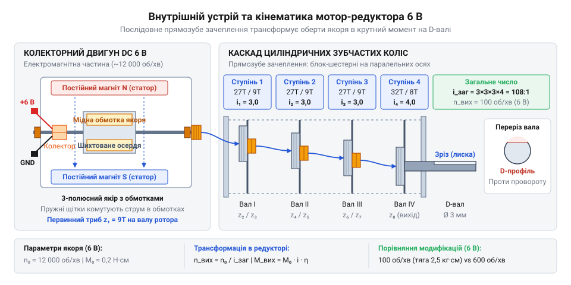
*Кінематика мотор-редуктора в розрізі: первинний швидкохідний триб вала якоря передає рух через каскад проміжних валів із прямозубими шестернями на вихідний D-подібний вал, послідовно помножуючи крутний момент.*

Детальні вимоги до матеріалів шестерень, порівняння латуні, сталі та нейлону, а також граничні навантаження розкрито у статті про [конструктивні особливості мініатюрних циліндричних зубчастих редукторів](root:cat-hw-actuators/gearmotor-6v/comp-spur-gearbox.md). Механічні посадочні розміри, діаметри валів і максимальні радіальні сили наведено у розділі [залізний інтерфейс і характеристики 6-вольтових мотор-редукторів](root:cat-hw-actuators/gearmotor-6v/api-dc-gearmotor-hardware.md), а повне математичне моделювання тяги доступне у матеріалі про [математичний апарат кінематики та динаміки редукторного приводу](root:cat-hw-actuators/gearmotor-6v/math-gearmotor-kinematics-and-traction.md).

> 🔧 **Навіщо це.** Розрахунок передавального числа за кількістю зубців дозволяє інженеру ще до складання механізму точно розрахувати не лише фінальну швидкість і тягу робота, а й передбачити падіння ККД та величину накопиченого люфту. Це дає змогу усвідомлено обирати між швидкісною модифікацією на 600 об/хв із високим ККД і малою кількістю ступенів та тяговою версією на 100 об/хв для навантажених завдань.

## Дилема швидкості й тяги: вибір між модифікаціями на 100 і 600 об/хв

У конструюванні мініатюрної робототехніки базовий колекторний привід на 6 В виглядає оманливо однаково: той самий металевий або пластиковий корпус, ті самі монтажні отвори, те саме номінальне живлення від чотирьох пальчикових батарейок чи двох банок літію з понижувальним стабілізатором. Ба більше, всередині обох версій обертається абсолютно ідентичний колекторний мікромотор (типорозміру N20 або серії 130), власний ротор якого на холостому ходу видає шалені 10 000–12 000 об/хв із крихітним власним моментом близько 0.0015–0.002 Н·м. Однак у каталогах розробник бачить дві діаметрально протилежні за поведінкою модифікації: на 100 об/хв та на 600 об/хв.

Вибір між ними — це не просто питання «повільніше чи швидше поїде платформа». Це жорсткий компроміс між корисним тяговим зусиллям на колесі, коефіцієнтом корисної дії механічної передачі та схильністю приводу раптово глухнути перед найменшою перешкодою. Усю різницю створює механічний редуктор (від латинського *reductor* — той, що відводить назад або зменшує), який транслює надшвидкий обертовий рух ротора у повільний, але силовий рух вихідного вала. Ключовою характеристикою редуктора виступає передавальне число (співвідношення частот обертання вхідного й вихідного валів, англійською @@en|gear ratio@@), яке позначається літерою `i`.

У версії на 100 об/хв конструкторам потрібно зменшити швидкість ротора приблизно в 100–120 разів (`i ≈ 100:1..120:1`). Розмістити таку редукцію в крихітному об'ємі коробки передач за допомогою однієї або двох пар шестерень фізично неможливо: ведена шестерня мусила б мати діаметр у сотню разів більший за тягову шестерню-трибку, що перетворило б редуктор на гігантську конструкцію. Тому передавальне число розбивають на 4 або 5 послідовних каскадів прямозубих циліндричних передач, які детально розглянуто в темі про [прямозубі циліндричні передачі та редуктори](root:hw-motion/spur-gear-transmission).

Кожен ступінь редукції складається з блокової шестерні, де велике зубчасте колесо сприймає рух від попереднього ступеня, а співвісна маленька шестерня передає його далі. Проте кожен контакт зубців супроводжується тертям ковзання, а кожен проміжний вал треться об стінки бронзових втулок корпусу. Якщо один окремий циліндричний ступінь у мініатюрному виконанні має коефіцієнт корисної дії (ККД) `η_ст ≈ 0.86..0.88` (86–88%), то загальний ККД редуктора з `k` ступенів обчислюється як добуток ефективностей усіх пар зачеплення:

    η_заг = η_стᵏ
          = 0.87⁵            [піднесення ККД одного ступеня до степеня числа ступенів]
          ≈ 0.498            [підсумковий коефіцієнт корисної дії 5-ступеневого редуктора]

Через це модифікація на 100 об/хв неминуче розсіює до 40–50% усієї механічної енергії мотора у вигляді тепла на шестернях і втулках: реальний ККД такого редуктора рідко перевищує 50–60%. Але залишкового виграшу в моменті вистачає із солідним запасом. Якщо помножити базовий момент мотора `0.002 Н·м` на передавальне число `100` і врахувати ККД `0.55`, то на вихідному D-подібному валу утворюється понад `0.11 Н·м` номінального крутного моменту (від латинського *momentum* — рушійна сила; англійською @@en|torque@@), а в режимі короткочасного перевантаження — до `0.20–0.25 Н·м`. Завдяки такій тязі привід упевнено штовхає важке шасі, пролазить крізь густий ворс килима та долає круті підйоми.

Модифікація на 600 об/хв має зовсім іншу внутрішню архітектуру. Тут потрібне значно скромніше передавальне число: `i ≈ 15:1..20:1`. Для такого масштабування достатньо всього 2 або 3 ступенів шестерень:

    η_заг = η_ст³
          = 0.88³            [піднесення ККД ступеня до кількості каскадів швидкісної версії]
          ≈ 0.681            [підсумковий ККД 3-ступеневого редуктора]

Мала кількість рухомих деталей знижує опір тертя, завдяки чому ККД швидкісного редуктора сягає 75–80%. Енергія передається на вал із мінімальними втратами, забезпечуючи високу кутову швидкість. Але розплата за швидкість — пропорційна втрата сили. Помноживши базовий момент ротора `0.002 Н·м` на передавальне число `18` і ККД `0.75`, отримуємо на виході лише близько `0.027 Н·м` — майже вчетверо менше, ніж у тихохідної версії.

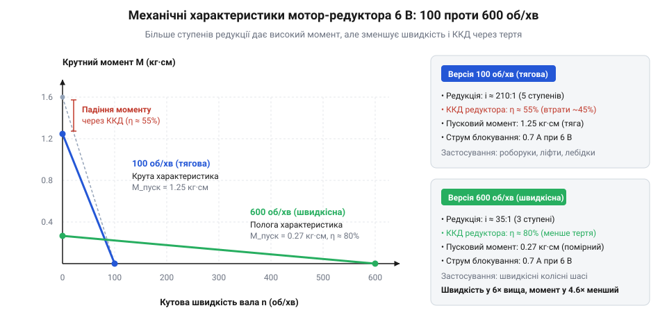
*Механічні характеристики редукторів на 100 і 600 об/хв: тихохідна модифікація забезпечує круту тягову криву з високим крутним моментом ціною втрат ККД у багатоступеневому зачепленні, тоді як швидкісна версія має вищий ККД, але стрімко втрачає оберти під навантаженням.*

> 🔧 **Навіщо це.**
> Помилка у виборі між 100 та 600 об/хв ламає пристрій ще на етапі ескізу. Якщо встановити привід на 600 об/хв на мобільного робота масою понад 300–400 грамів, колеса загрузнуть на першому ж стику ламінату чи килимовому покритті: мотор просто не подолає статичний опір кочення і заглохне. Натомість версія на 100 об/хв у швидкісному сортувальному механізмі або роботі-гонщику за лінією створить непереборну перешкоду за лінійною швидкістю, попутно марнуючи половину заряду батареї на розігрів шестерень.

Для остаточного інженерного вибору розраховують кінематику руху колісної платформи. Лінійна швидкість `v` (м/с) і тягове зусилля колеса `F_тяг` (Н) безпосередньо пов'язані з кутовою швидкістю вала `ω` (рад/с), частотою обертання `n` (об/хв) та радіусом колеса `r` (м):

    ω = 2 · π · n ÷ 60
    v = ω · r
    F_тяг = M_вих ÷ r

**Розрахунок тягового зусилля для колеса радіусом 0.03 м (діаметр 60 мм)**
```
F_тяг_100 = M_вих ÷ r
          = 0.12 ÷ 0.03        [підстановка моменту тихохідної версії 0.12 Н·м і радіуса 0.03 м]
          = 4.0                [тягове зусилля на ободі одного ведучого колеса, Н]
```

Для колісної пари на двох моторах сумарна тяга складе `2 · 4.0 = 8.0 Н`. Робот масою `0.6 кг` має вагу близько `5.9 Н`. На похилій площині з підйомом 20 градусів (`sin(20°) ≈ 0.342`) сила скочування дорівнює `5.9 · 0.342 ≈ 2.02 Н`. Запас тяги понад триразовий, тому платформа спокійно виїде на гірку.

Якщо ж на ті самі колеса поставити мотори на 600 об/хв:

```
F_тяг_600 = M_вих ÷ r
          = 0.027 ÷ 0.03       [підстановка моменту швидкісної версії 0.027 Н·м]
          = 0.9                [тягове зусилля на ободі одного колеса, Н]
```

Сумарна тяга двох коліс складає лише `1.8 Н`. Цього недостатньо навіть для компенсації сили тяжіння на схилі `2.02 Н`, не кажучи вже про опір тертя кочення. Робот зупиниться посеред підйому, а двигуни перейдуть в аварійний режим зупиненого ротора.

Крім втрат ККД, багатоступеневий каскад на 100 об/хв має ще один побічний ефект: накопичення сумарного кутового люфту (від німецького *Luft* — повітря, проміжок між сусідніми тілами; англійською @@en|backlash@@). Кожен зазор між зубами множиться на передавальні числа наступних ступенів, створюючи на вихідному валу вільний холостий кутовий хід до 2–5 градусів. Це неприпустимо для прецизійних маніпуляторів, проте цілком прийнятно для ходових шасі. Математичні формули розрахунку тяги та граничного кута підйому наведено у вставці [Математичний апарат кінематики та тяги мотор-редуктора](root:cat-hw-actuators/gearmotor-6v/math-gearmotor-kinematics-and-traction.md), а конструктивні матеріали зубчастих коліс — у матеріалі про [циліндричні зубчасті редуктори](root:cat-hw-actuators/gearmotor-6v/comp-spur-gearbox.md).

Типовий приклад використання мініатюрних моторів лінійки [N20 мікромотор з редуктором](root:cat-hw-actuators/n20-motor) з порівнянням обох редукцій на практиці представлено у проєкті [Колісна диференціальна платформа](root:cat-hw-actuators/gearmotor-6v/proj-wheeled-differential-platform.md), а граничні допустимі механічні радіальні навантаження на підшипники вала зазначено у специфікації [Апаратний інтерфейс мотор-редуктора 6 В](root:cat-hw-actuators/gearmotor-6v/api-dc-gearmotor-hardware.md).

Правило практичного вибору просте:
1. Версію на **100 об/хв** обирають для роботів масою від 0.3 до 1.5 кг, коліс діаметром понад 40 мм, підйомних кранів, сервоприводів заслінок, гусеничних всюдиходів і пристроїв, де критичний стабільний крутний момент і здатність долати складний рельєф без ризику заклинювання.
2. Версію на **600 об/хв** обирають лише для легких конструкцій вагою до 200–250 грамів із колесами малого радіуса (20–30 мм), мініатюрних швидкісних трасових машинок, систем скидання легких деталей або вентиляторних механізмів, де потрібна максимальна лінійна швидкість на рівній гладкій поверхні й майже відсутній зовнішній опір.

## Електромеханічний баланс якоря: як навантаження диктує споживання струму

Механічний опір на вихідному валу редуктора не просто навантажує зубці шестерень — він миттєво транслюється в електричні процеси всередині електродвигуна, безпосередньо керуючи струмом, який привід вимагає від 6-вольтового джерела живлення.

Якщо під'єднати 6-вольтовий мотор-редуктор без навантаження до лабораторного блока живлення, амперметр покаже скромні 50–80 мА. Двигун весело дзижчить, споживаючи менше ніж пів вата потужності. Але варто міцно схопити вихідний вал пальцями й повністю зупинити його обертання, як струм підскочить до 1.5–2.5 А — у тридцять-сорок разів більше за холостий хід. Дріт обмотки почне розжарюватися, джерело живлення відчує просідання напруги, а якщо мотор живиться від однієї шини з мікроконтролером, останній миттєво піде в аварійне перезавантаження через скидання живлення.

Щоб зрозуміти причину такого стрибка, необхідно зазирнути в електричне коло якоря (від німецького *Anker* — зачіп, стяжка). Якір становить собою залізний осердявий барабан із пазами, в які вкладено кілька секцій мідного дроту, що під'єднані до ламелей колектора. Принцип взаємодії струмів обмотки та постійних магнітів статора докладно викладено у статті про [колекторний двигун постійного струму](root:hw-motion/brushed-dc-motor).

Коли на клеми подається напруга `U = 6 В`, струм проходить через щітковий вузол у витки якоря. Магнітне поле статора виштовхує провідники зі струмом із силою Ампера, змушуючи ротор прискорюватися. Проте, обертаючись усередині постійного магнітного поля, мідні витки якоря самі перетинають лінії магнітної індукції. Відповідно до фундаментального закону електромагнітної індукції Фарадея, в рухомому провіднику збуджується електрорушійна сила.

За правилом Ленца, ця наведена ЕРС спрямована строго назустріч зовнішній напрузі живлення, яка спричинила рух. Тому її називають проти-електрорушійною силою, або проти-ЕРС (від грецького *elektron* та латинського *motio*; в англомовній літературі @@en|back-EMF@@, скорочення від @@en|back electromotive force@@). Величина проти-ЕРС `E` прямо пропорційна кутовій швидкості ротора `ω`:

    E = k_e · ω

де `k_e` — конструктивна стала проти-ЕРС двигуна (В·с/рад), яка визначається геометрією витків якоря та індукцією магнітів статора.

Повний баланс напруг у якірному колі двигуна в усталеному режимі описується другим законом Кірхгофа:

    U = E + I · R_a

де `U` — напруга на клемах (6 В), `I` — струм якірного кола (А), а `R_a` — сумарний активний омічний опір (названий на честь фізика Георга Ома; опір постійному струму) мідної обмотки якоря та перехідного контакту графітових або металевих щіток із колектором (Ом).

Якщо виразити звідси струм, отримаємо ключове рівняння електромеханіки двигуна постійного струму:

    I = (U - E) ÷ R_a

Ця залежність бездоганно пояснює поведінку мотора в усіх трьох експлуатаційних режимах:

1. **Режим холостого ходу (англійською @@en|no-load condition@@):**
   На вихідному валу немає корисного навантаження. Мотор розганяється до максимальної швидкості `ω₀`. Зі зростанням швидкості проти-ЕРС `E` стрімко збільшується, доки практично не зрівняється з напругою живлення `U`: наприклад, при напрузі 6.0 В проти-ЕРС сягає `5.80–5.85 В`.
   Різниця `(U - E)` становить мізерні `0.15–0.20 В`. Цього перепаду напруги вистачає лише на те, щоб протиснути крізь опір обмотки `R_a = 2.5 Ом` мінімальний струм:

    I₀ = (6.0 - 5.85) ÷ 2.5
       = 0.15 ÷ 2.5           [падіння напруги на омічному опорі якоря]
       = 0.06                 [струм холостого ходу в амперах, 60 мА]

   Цей крихітний струм створює рівно стільки електромагнітного моменту, скільки потрібно для подолання тертя щіток об колектор і тертя в підшипниках та редукторі. Двигун перебуває в ідеальній динамічній рівновазі.

2. **Робота під корисним навантаженням:**
   Коли колесо робота зустрічає опір ґрунту або схилу, зовнішній гальмівний момент сповільнює вихідний вал і ротор двигуна (`ω` зменшується).
   Щойно швидкість падає, проти-ЕРС `E = k_e · ω` негайно зменшується — наприклад, опускається з 5.85 В до 4.5 В або 3.5 В.
   Різниця потенціалів `(U - E)` миттєво зростає в кілька разів: із 0.15 В до 1.5–2.5 В.
   Відповідно, струм якірного кола автоматично зростає: мотор починає споживати 0.6–1.0 А.
   Оскільки розвиваний електромагнітний крутний момент прямо пропорційний силі струму (`M = k_m · I`, де `k_m` — конструктивна стала моменту, Н·м/А), зростання струму створює підвищене обертальне зусилля, що компенсує навантаження. Мотор саморегулюється: механічне гальмування автоматично відкриває електричний вентиль для подачі додаткового струму від джерела живлення.

3. **Аварійний режим блокування вала (англійською @@en|stall condition@@):**
   Якщо механічний опір перевищує можливості приводу і ротор повністю зупиняється (`ω = 0`), генерація проти-ЕРС припиняється: `E = 0 В`.
   Тепер прикладеній напрузі 6 В не протистоїть нічого, крім власного омічного опору тонкого мідного дроту обмотки:

    I_бок = U ÷ R_a
          = 6.0 ÷ 2.5         [ділення напруги живлення на чистий омічний опір]
          = 2.4               [струм блокування ротора в амперах, А]

Струм блокування (струм короткого замикання нерухомого якоря, англійською @@en|stall current@@) у 40 разів перевищує струм холостого ходу! При цьому механічна швидкість дорівнює нулю, отже корисна механічна потужність дорівнює нулю (`P_мех = M · 0 = 0`). Уся підведена електрична потужність `P_ел = 6.0 В · 2.4 А = 14.4 Вт` на 100% перетворюється на теплові втрати Джоуля-Ленца (`I² · R_a`) усередині тонких витків якоря. Маса міді в роторі мікромотора становить лічені грами, тому обмотка нагрівається зі швидкістю десятків градусів за секунду. Вже через 3–5 секунд ізоляційний лак витків деградує, виникає міжвиткове замикання, і двигун назавжди згоряє.

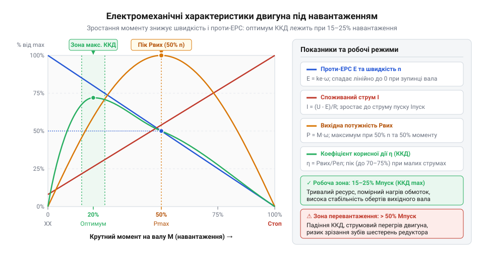
*Суміщені електромеханічні криві двигуна: проти-ЕРС лінійно спадає зі зростанням механічного моменту, струм якоря лінійно зростає, механічна потужність сягає піка при 50% холостих обертів, а зона максимального ККД зосереджена в інтервалі 15–25% від моменту блокування.*

Зіставивши криві крутного моменту, кутової швидкості та споживаного струму, отримують навантажувальну характеристику двигуна, яка виявляє дві критичні робочі точки:

По-перше, **точка максимальної механічної потужності (`P_макс`)**. Механічна потужність дорівнює добутку крутного моменту на кутову швидкість:

    P_мех = M · ω

Оскільки кутова швидкість лінійно спадає зі зростанням моменту від максимуму `ω₀` до нуля, крива потужності має вигляд симетричної параболи з вершиною строго посередині. Мотор віддає найбільшу корисну механічну потужність у механізм тоді, коли навантаження уповільнює його швидкість рівно на 50% від холостого ходу (`ω = 0.5 · ω₀`), а розвиваний момент досягає половини моменту блокування (`M = 0.5 · M_бок`). 

Однак працювати в цій точці постійно категорично не можна! У точці `P_макс` струм становить половину від струму блокування (понад 1 А для мотора N20), обмотки виділяють велику кількість тепла, а електричний ККД падає нижче за 45–50%. Це зона важкої перевантажувальної роботи, припустима лише протягом кількох секунд під час динамічного розгону або подолання порогів.

По-друге, **точка максимального ККД (`η_макс`)**. Електричний коефіцієнт корисної дії двигуна визначається співвідношенням корисної механічної потужності до повної електричної потужності від джерела:

    η = P_мех ÷ P_ел
      = (M · ω) ÷ (U · I)

На холостому ходу ККД дорівнює нулю, оскільки корисний момент `M = 0`. При повному блокуванні ККД також дорівнює нулю, оскільки швидкість `ω = 0`. Пік кривої ефективності (`η_макс ≈ 65..75%`) розташований зовсім не посередині, а в зоні помірного навантаження — при крутному моменті, що становить лише **15–25% від моменту блокування**, де ротор зберігає **75–85% від своєї холостої швидкості**.

> 🔧 **Навіщо це.**
> Розрахунок приводу під режим максимального ККД — головний секрет автономності мобільних роботів. Якщо колеса й редуктор підібрані так, що на номінальній швидкості мотор навантажений на 20% від моменту зупинки, проти-ЕРС залишається високою (близько 4.8–5.0 В), струм утримується в діапазоні 250–350 мА, батарея не просідає, а двигун може працювати годинами без відчутного нагріву. Перевантаження понад 40% моменту різко скорочує час життя акумулятора й загрожує термічним пробоєм.

**Розрахунок робочого струму та проти-ЕРС під навантаженням**
```
E = k_e · ω
  = 0.0045 · 1050              [множення сталої проти-ЕРС 0.0045 В·с/рад на швидкість якоря 1050 рад/с]
  = 4.725                      [проти-ЕРС якоря у вольтах, В]
```
```
I = (U - E) ÷ R_a
  = (6.0 - 4.725) ÷ 2.5        [віднімання проти-ЕРС від напруги живлення та ділення на опір якоря]
  = 1.275 ÷ 2.5                [падіння напруги на активному опорі обмотки, В]
  = 0.51                       [споживаний робочий струм в амперах, А]
```

Повний математичний вивід диференціальних рівнянь перехідних процесів та балансу потужностей подано у вставці [Електромеханічна модель двигуна постійного струму](root:cat-hw-actuators/gearmotor-6v/math-dc-motor-electromechanics.md). Електричні паспорти реальних двигунів із точними значеннями опорів обмоток наведено у довіднику [Апаратний інтерфейс мотор-редуктора 6 В](root:cat-hw-actuators/gearmotor-6v/api-dc-gearmotor-hardware.md), а схемотехніку керування струмами двигуна за допомогою напівпровідникових ключів розглянуто в статті [Силові H-мости для індуктивних навантажень](root:hw-motion/h-bridge).

## Струм блокування: фізика заклинювання та межі теплового руйнування

Коли колісний робот впирається в непереборну перешкоду, сторонній предмет потрапляє в рухомі елементи або маніпулятор досягає крайнього механічного упору, вихідний вал редуктора зупиняється. Через високе передавальне число циліндричної зубчастої передачі ця механічна зупинка миттєво знерухомлює ротор двигуна. Ззовні пристрій здається спокійним і знеструмленим, проте всередині мініатюрного 6-вольтового двигуна починається гостра електромеханічна криза — режим повного блокування вала (@@en|stall condition@@, від англ. *stall* — зупинка, глушіння).

Під час обертання [колекторний двигун постійного струму](root:hw-motion/brushed-dc-motor) одночасно виконує роль силового привода та електричного генератора. Коли обмотки якоря (в електротехніці — рухома частина колекторної машини, що несе робочу обмотку) перетинають магнітне поле постійних магнітів статора (від латинського *stator* — той, що стоїть нерухомо), у них індукується проти-електрорушійна сила — проти-ЕРС (@@en|back-EMF@@, від англ. *electromotive force*). Електрична рівновага якірного кола підпорядковується фундаментальному співвідношенню напруг:

```
U = I · R_arm + E_emf
```

де `U` — напруга живлення, `I` — струм якоря, `R_arm` — активний омічний опір мідної обмотки та щіткового контакту, а `E_emf` — проти-ЕРС. Величина проти-ЕРС прямо пропорційна кутовій швидкості обертання ротора `ω`:

```
E_emf = k_e · ω
```

де `k_e` — конструктивна стала напруги двигуна.

Щойно вал механічно зупинено, кутова швидкість ротора падає до нуля: `ω = 0`. Разом із нею миттєво й повністю зникає зустрічна напруга: `E_emf = 0 В`. Зрівноважувальний бар'єр ліквідовано. Уся напруга джерела живлення опиняється прикладеною до малого суто омічного опору мідного дроту обмоток якоря та перехідного контакту графітових або металевих щіток на мідних ламелях колектора (від латинського *lamella* — пластинка, платівка; *collector* — збирач).

Згідно з характеристиками [електромеханічної моделі привода](root:cat-hw-actuators/gearmotor-6v/math-dc-motor-electromechanics.md) та довідника [параметрів мотор-редуктора](root:cat-hw-actuators/gearmotor-6v/api-dc-gearmotor-hardware.md), активний опір якірного кола `R_arm` мініатюрного 6-вольтового двигуна становить лише 3.8–5.0 Ом (типове середнє значення — близько 4.0 Ом).

Під час вільного обертання без навантаження ротор розвиває максимальну швидкість, проти-ЕРС сягає майже 5.7–5.8 В, а струм холостого ходу становить усього `I_0 ≈ 0.06–0.08 А` (60–80 мА). За повної зупинки вала діє виключно омічний закон Ома:

**Розрахунок струму блокування при напрузі живлення 6 В:**
```
I_stall
= U / R_arm              [закон Ома за повної відсутності проти-ЕРС]
= 6.0 / 4.0              [підстановка напруги живлення 6 В та опору якоря 4 Ом]
= 1.5 А                  [граничний струм блокування вала]
```

Струм блокування (@@en|stall current@@) підскакує до 1.2–1.6 А. Це в 15–20 разів перевищує струм холостого ходу і в 4–5 разів — тривалий робочий струм під нормальним навантаженням (0.3–0.4 А). Оскільки кутова швидкість дорівнює нулю, корисна механічна потужність на валу дорівнює нулю:

```
P_mech = M · ω = 0 Вт
```

Це означає, що абсолютно вся споживана від джерела живлення електрична енергія перетворюється всередині двигуна виключно на тепло.

Згідно із законом Джоуля-Ленца, потужність теплових втрат зростає пропорційно квадрату струму:

```
P_heat = I² · R_arm
```

У номінальному робочому режимі при струмі `I_nom = 0.3 А` якір виділяє невелику потужність:

```
P_heat_nom
= (0.3)² · 4.0
= 0.09 · 4.0
= 0.36 Вт
```

Ці частки вата легко відводяться крізь внутрішнє повітряне середовище до сталевого корпуса двигуна та розсіюються у довкілля. Проте в режимі блокування вала баланс тепла зазнає руйнівного зламу:

**Розрахунок потужності теплових втрат у заблокованому якорі:**
```
P_heat_stall
= I_stall² · R_arm       [закон Джоуля-Ленца]
= (1.5)² · 4.0           [квадрат струму блокування на активний опір обмотки]
= 2.25 · 4.0
= 9.0 Вт                 [теплова потужність втрат у замкненому об'ємі двигуна]
```

Дев'ять ват теплової потужності виділяються у крихітному осерді якоря, загальна маса мідного дроту якого не перевищує 2.5 грама (`m ≈ 0.0025 кг`).

Питома теплоємність міді становить `c_Cu ≈ 385 Дж/(кг · °C)`. Оскільки ротор знерухомлений, внутрішньої примусової вентиляції немає, а тонкий повітряний зазор між якорем і статором працює як теплоізолятор. У перші секунди процес має практично адіабатичний характер — майже вся теплова енергія накопичується безпосередньо в обмотці:

**Швидкість зростання температури якірної обмотки:**
```
dT / dt
= P_heat / (m · c_Cu)    [рівняння адіабатичного нагріву]
= 9.0 / (0.0025 · 385)   [підстановка теплової потужності та маси міді]
= 9.0 / 0.9625
≈ 9.35 °C/с              [температурний приріст за кожну секунду блокування]
```

Усього за 10–12 секунд температура обмотки злітає від кімнатної (+25 °C) до +120...+140 °C, запускаючи каскадне руйнування двигуна:

1. **Термічна деструкція лакової ізоляції.** Дріт обмотки вкритий тонкою плівкою поліамідного або поліуретанового лаку [класу нагрівостійкості](root:hw-components/winding-insulation-classes) B (до 130 °C) або F (до 155 °C). Перевищення цієї температури призводить до розм'якшення та обвуглювання лаку. Сусідні витки замикаються між собою, створюючи міжвиткові замикання. Активний опір якоря `R_arm` падає, струм зростає ще сильніше, і котушка остаточно перегорає.
2. **Розпайка та деформація колекторного вузла.** Кінці обмоток з'єднані з ламелями колектора олов'яно-свинцевим або безсвинцевим припоєм із температурою плавлення 180–220 °C. Локальний перегрів розплавляє контакт; рідкий метал під тиском щіток розбризкується і закорочує сусідні пластини. Одночасно пластикова полімерна втулка колектора плавиться, ламелі перекошуються, і щітковий механізм клинить намертво.
3. **Незворотне розмагнічування статора.** Тепловий потік від розжареного якоря випромінюванням нагріває постійні магніти статора. Неодимові магніти (NdFeB), типові для високопродуктивних мікроприводів, втрачають залишкову магнітну індукцію (@@en|thermal demagnetization@@) вже при нагріванні понад 80–120 °C. Навіть якщо обмотка вціліє, розмагнічений статор не відновить силових властивостей: двигун назавжди втратить до 50–70% свого крутного моменту.

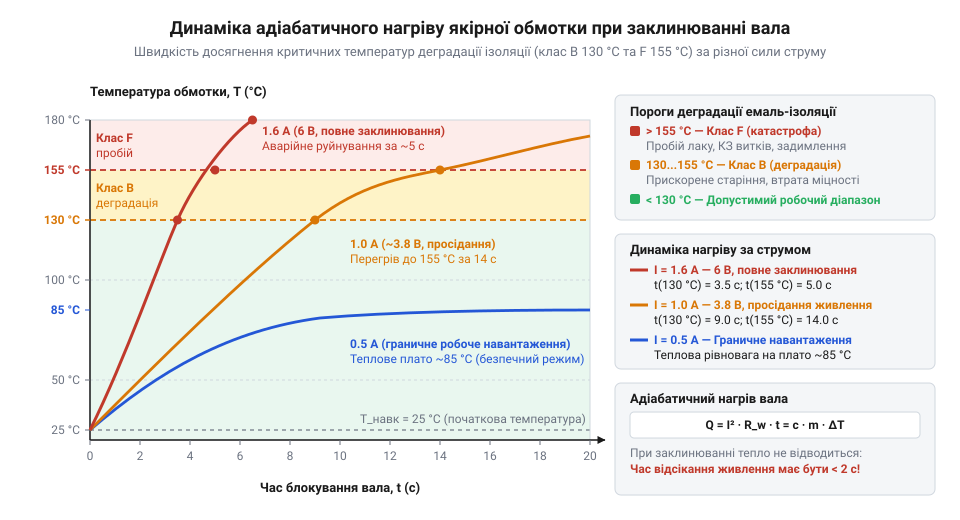
*Залежність температури якірної обмотки від часу за різної сили струму блокування: виділення теплової потужності перетинає критичні пороги нагрівостійкості ізоляції (130 °C і 155 °C) за лічені секунди.*

Крім теплової загибелі електричної частини, заклинювання несе механічну загрозу редуктору. Під струмом блокування двигун розвиває граничний електромагнітний момент `M_stall`. Багатократно посилений [циліндричним редуктором](root:cat-hw-actuators/gearmotor-6v/comp-spur-gearbox.md), цей крутний момент створює критичні напруження зсуву в зубах шестерень. Якщо зупинка відбулася раптово на повному ходу, кінетична енергія маси робота зрізає мініатюрні зубці вихідного ступеня редуктора ще до того, як обмотка встигне нагрітися.

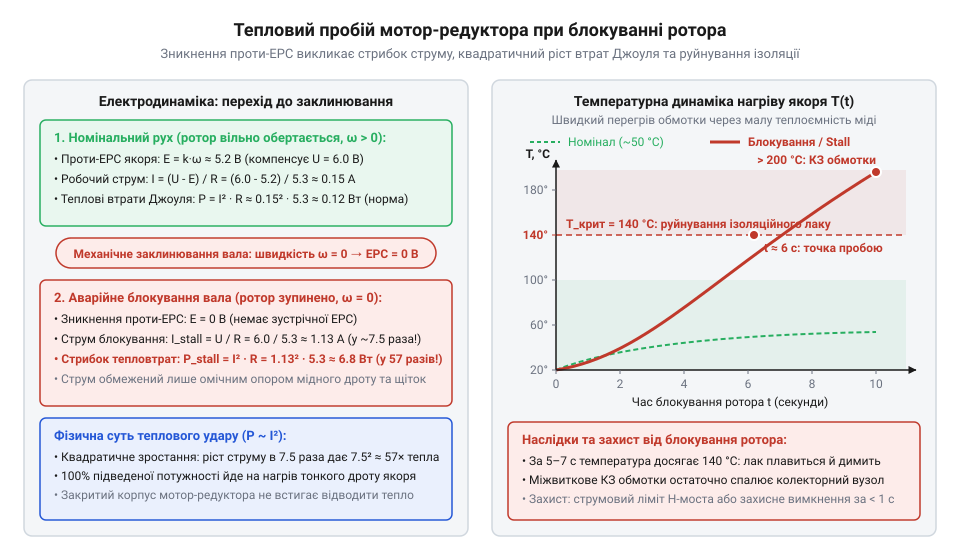
*Кінетичний та тепловий колапс при блокуванні ротора: зникнення проти-ЕРС перетворює якір на низькоомний нагрівач, чия теплова потужність за лічені секунди руйнує ізоляцію та магнітну систему двигуна.*

> 🔧 **Навіщо це.**
> Граничний час безпечного блокування 6-вольтового колекторного двигуна не перевищує 1.5–2 секунд. Надійна система керування обов'язково контролює струм: якщо за даними струмовимірювального шунта навантаження перевищує поріг 0.8–1.0 А довше за 150–200 мс, керуючий контролер аварійно відключає ШІМ, рятуючи привід від термічного вигорання та зрізання зубців, як показано на прикладі [двоколісної платформи](root:cat-hw-actuators/gearmotor-6v/proj-wheeled-differential-platform.md). У простіших пристроях послідовно з мотором встановлюють [полімерні самовідновні запобіжники](root:hw-components/ptc-fuse) (PTC), що обмежують струм у разі аварійної зупинки вала.

## Комутаційні завади колектора: фізика іскріння та локальна фільтрація

Навіть за помірного навантаження, коли струм споживання не перевищує номінальних 0.2–0.4 А, колекторний мотор-редуктор здатний паралізувати роботу навколишньої цифрової схеми. Типова ситуація на практиці: у момент запуску ходового мотора мікроконтролер раптово перезавантажується, покази аналогових датчиків починають хаотично коливатися, а цифрові шини зв'язку I2C або SPI зависають. Причина полягає не в просіданні живильної напруги батареї, а у високочастотних процесах механічної комутації струму в колекторно-щітковому вузлі.

Колектор являє собою циліндричний барабан із розділених ізолятором мідних пластин-ламелей, по яких ковзають нерухомі пружні щітки. За швидкості обертання ротора 6000–10000 об/хв кожна щітка переходить з однієї ламелі на іншу сотні разів за секунду (комутація, від латинського *commutatio* — зміна, перемикання).

Обмотки якоря мають власну індуктивність (від латинського *inductio* — наведення) `L_arm`, що зазвичай становить 50–200 мкГн. Згідно із законом електромагнітної індукції Фарадея, будь-яка зміна струму в котушці викликає появу напруги самоіндукції, що протидіє цій зміні:

```
u_L = -L · (di / dt)
```

Коли контакт щітки з черговою ламеллю колектора розривається, струм силою 0.3–0.5 А, що протікав крізь секцію якоря, має миттєво впасти до нуля. Оскільки фізичне розмикання контактів триває частки мікросекунди (`dt → 0`), швидкість спадання струму `di / dt` досягає десятків мільйонів амперів за секунду.

Як наслідок, ЕРС самоіндукції породжує зворотний високовольтний сплеск напруги амплітудою 30–80 В (а за різкої зміни навантаження — понад 100 В), незважаючи на те, що номінальне живлення схеми становить лише 6 В.

Коли щітка відходить від ламелі, повітряний зазор між ними на початковому етапі вимірюється мікронами. Напруженість електричного поля в такому проміжку миттєво перевищує межу діелектричного пробою повітря (~3 кВ/мм; для зазору в 10 мкм достатньо напруги 30 В). Відбувається лавинна іонізація повітря — спалахує плазмовий мікродуговий розряд. Це те саме іскріння щіток, яке спостерігається крізь вентиляційні отвори корпуса мотора.

Ці мікродугові розряди перетворюють колекторний вузол на джерело широкосмугових електромагнітних завад (@@en|electromagnetic interference@@, EMI), які поширюються двома шляхами:

- **Кондуктивні завади (шум у провідниках живлення).** Високовольтні імпульси самоіндукції проникають безпосередньо у шину живлення. Через паразитну індуктивність дротів у колі виникають високочастотні коливання та глибокі просідання напруги. Вони пробиваються крізь лінійні стабілізатори та провокують помилкове спрацьовування апаратних детекторів просідання живлення (BOD) мікроконтролера.
- **Випромінювані радіозавади (шум в ефірі).** Дроти, якими двигун під'єднано до плати керування, починають діяти як передавальні антени. Спектр комутаційної іскри містить гармоніки від сотень кілогерців до десятків мегагерців. Цей високочастотний шум наводиться на вхідні кола аналого-цифрових перетворювачів, кварцові резонатори та лінії синхронізації цифрових інтерфейсів.

Крім того, плазмові мікродуги поступово випалюють поверхню ламелей та стирають контактні щітки, забруднюючи внутрішній простір мотора графітовим пилом, як докладно розглянуто в темі про [іскріння колектора та придушення комутаційних завад](root:hw-analog/brush-commutator-noise-and-snubbers).

Встановлення конденсаторів на платі контролера або драйвера не усуває радіовипромінювання, оскільки провідники завдовжки 15–30 см від плати до мотора продовжують працювати антенами. Фільтрація має виконуватися виключно локально — безпосередньо на корпусі та клемах двигуна.

Основним інженерним стандартом захисту є **триконденсаторний керамічний фільтр**:

1. **Диференціальний конденсатор `C1` ємністю 10–100 нФ (найчастіше 100 нФ, багатошарова кераміка X7R або C0G).**
   Припаюється безпосередньо між двома клемами живлення двигуна з найкоротшими виводами. Він створює шлях найменшого опору для високочастотного диференціального шуму (@@en|differential-mode noise@@). Імпульсні струми комутації замикаються крізь `C1` по контуру в кілька міліметрів, не виходячи у силову проводку.
2. **Синфазні конденсатори `C2` та `C3` ємністю 10–47 нФ.**
   Припаюються від кожної клеми двигуна безпосередньо на його сталевий металевий корпус (стакан). Металевий корпус двигуна відіграє роль екрана Фарадея. Конденсатори `C2` та `C3` скидають синфазні високочастотні завади (@@en|common-mode noise@@), наведені крізь паразитну ємність обмоток, на металевий корпус, замикаючи їх на землю та перешкоджаючи випромінюванню радіохвиль в ефір.
3. **Захисні діоди Шотткі.**
   Швидкодіючі діоди Шотткі (на честь німецького фізика Вальтера Шотткі, @@de|Walter Schottky@@) встановлюються зустрічно-паралельно мотору або інтегруються в плечі [силових H-мостів](root:hw-motion/h-bridge). Завдяки малому прямому спаду напруги (`V_F ≈ 0.3–0.4 В`) та практично нульовому часу зворотного відновлення (`t_rr ≈ 0 нс`), вони своєчасно підхоплюють та гасять індуктивні викиди самоіндукції, захищаючи напівпровідникові ключі.

Для постійного струму живлення 6 В (`f = 0 Гц`) реактивний опір керамічного конденсатора прямує до нескінченності: `X_C = ∞`, тому фільтр не споживає енергії. Проте для комутаційного сплеску з еквівалентною частотою завади `f = 10 МГц` його опір падає практично до нуля:

**Розрахунок реактивного опору диференціального фільтра на частоті 10 МГц:**
```
X_C
= 1 / (2 · π · f · C)     [формула ємнісного реактивного опору]
= 1 / (2 · 3.1416 · 10 · 10⁶ · 100 · 10⁻⁹)
= 1 / (6.2832 · 1.0)
≈ 0.159 Ом               [майже нульовий опір для струмів завади]
```

Опір 0.16 Ом перетворює конденсатор на еквівалент короткого замикання для високочастотного шуму, локалізуючи його в межах моторного вузла.

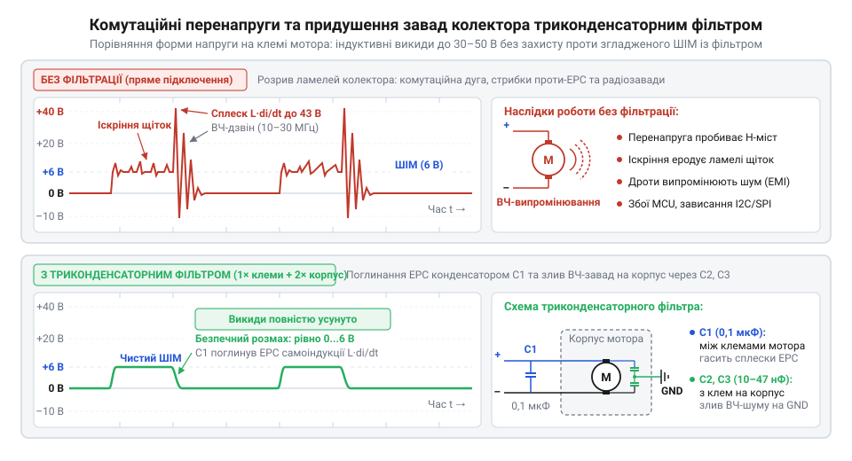
*Осцилограма напруги на клемі двигуна без фільтра та з триконденсаторним фільтром: встановлення керамічних конденсаторів гасить високовольтні комутаційні викиди самоіндукції та запобігає проникненню завад у шину живлення.*

Монтаж фільтра вимагає дотримання правил високочастотної схемотехніки. Кожен додатковий міліметр виводу конденсатора додає близько 1 нГн паразитної індуктивності, що на мегагерцових частотах знецінює ємність. Тому виводи деталей обрізають до мінімальної довжини у 2–3 мм.

Для припаювання `C2` та `C3` до сталевого стакана мотора ділянку корпусу зачищають скальпелем від оксидів і наносять активний або нейтральний флюс. Паяння здійснюють прогрітим жалом паяльника (40–60 Вт) за час не більше 1.5–2 секунд. Тривалий перегрів корпусу неприпустимий: тепло передається пластиковому задньому щитку, викликаючи деформацію щіткотримачів і втрату співвісності підшипника вала.


*Схема триконденсаторного фільтра та захисних діодів Шотткі: локалізація диференціального шуму між виводами та шунтування синфазних радіозавад на металевий корпус двигуна.*

> 🔧 **Навіщо це.**
> Монтаж триконденсаторного фільтра безпосередньо на мотор — найдешевша й найефективніша страховка від непередбачуваних збоїв вбудованої системи. Спільно з [розділенням живлення силових та логічних кіл](root:hw-power/power-rail-isolation-for-motors) та правильним розведенням [силового драйвера моторів](root:cat-hw-actuators/gearmotor-6v/proj-hbridge-motor-driver.md) цей вузол прибирає до 95% випадкових збоїв ліній зв'язку, спотворень АЦП та перезавантажень мікроконтролера під час керування приводом.

## Керування полярністю та динамічне гальмування: анатомія H-моста

Пряме підключення колекторного мотор-редуктора до цифрового виходу мікроконтролера гарантовано виводить кремнієвий кристал із ладу. Логічний вивід загального призначення (GPIO) здатен безпечно видавати струм не більше ніж 10–20 мА при напрузі 3.3 В або 5 В. Колекторний 6-вольтовий двигун навіть без механічного навантаження споживає на холостому ході від 60 до 120 мА, під номінальним моментом редуктора — від 300 до 600 мА, а в момент рушання чи аварійного зупинення вала струм підскакує до 1.5 А. Спроба живити мотор безпосередньо від мікроконтролера викликає миттєвий тепловий пробій вихідного каскаду або переводить кристал у стан паразитного тиристорного замикання (тиристорний защіп).

Одиничний транзисторний ключ (наприклад, польовий транзистор у нижньому плечі) вирішує проблему струмового навантаження, але дозволяє лише вмикати та вимикати живлення в одному напрямку. Для зміни напрямку обертання вала постійного струму необхідно змінити полярність напруги на клемах якоря: подача «плюса» на контакт A та «мінуса» на B змушує ротор обертатися за годинниковою стрілкою, тоді як подача «плюса» на B та «мінуса» на A змінює вектор сили Ампера та спричиняє реверс. Схемотехнічна топологія, що виконує цю комутацію за допомогою чотирьох керованих ключів, називається **H-мостом** (від англ. @@en|H-bridge@@, через візуальну схожість схеми з великою літерою «H», де якір двигуна утворює горизонтальну перемичку). Ключами моста виступають силові польові транзистори — MOSFET (від англ. @@en|metal-oxide-semiconductor field-effect transistor@@ — польовий транзистор зі структурою метал-оксид-напівпровідник) або біполярні транзистори з ізольованим затвором (IGBT). Верхні ключі з'єднують клеми двигуна з позитивною шиною живлення +6 В, а нижні — із загальним проводом (GND).

> 🔧 **Навіщо це.**
> Транзисторний H-міст дає змогу повністю контролювати напрямок обертання, вільний вибіг та активне екстрене гальмування приводу логічними рівнями мікроконтролера без електромеханічних реле, контакти яких зношуються від електричної дуги та перемикаються десятки мілісекунд.

Схема H-моста має чотири дискретні стани, кожен із яких відповідає окремому механічному та електродинамічному режиму роботи приводу:

1. **Прямий хід (обертання вперед).** Відкриті верхній лівий ключ `Q₁` та нижній правий ключ `Q₄`; ключі `Q₂` та `Q₃` надійно закриті. Струм тече за контуром: `+6 В → Q₁ → клема A → обмотка якоря → клема B → Q₄ → GND`. Магнітне поле статора розкручує ротор у прямому напрямку, створюючи корисний тяговий момент.
2. **Реверсивний хід (обертання назад).** Відкриті верхній правий ключ `Q₃` та нижній лівий ключ `Q₂`; ключі `Q₁` та `Q₄` закриті. Струм тече у зворотному напрямку: `+6 В → Q₃ → клема B → обмотка якоря → клема A → Q₂ → GND`. Полярність магнітного поля ротора інвертується, вал починає обертатися проти годинникової стрілки.
3. **Вільний вибіг (стан високого імпедансу).** Усі чотири ключі (`Q₁`, `Q₂`, `Q₃`, `Q₄`) розімкнені. Двигун повністю відрізаний від шини живлення та землі, виходи перебувають у високоімпедансному стані (Hi-Z). Струм через обмотку від джерела не тече. Ротор сповільнюється виключно внаслідок механічних втрат: тертя шестерень редуктора, тертя щіток об колектор і гідродинамічного опору мастила. У версії редуктора на 100 об/хв велика кількість ступенів зубчастої передачі зупиняє вал швидше, проте точна зупинка без гальмівного моменту неможлива — платформа продовжує котитися за інерцією.
4. **Активне динамічне гальмування (електродинамічне гальмо).** Обидва нижні ключі `Q₂` та `Q₄` одночасно відкриті (або, навпаки, відкриті обидва верхні ключі `Q₁` та `Q₃`), тоді як протилежна пара ключів закрита. Клеми двигуна A та B виявляються замкненими накоротко через відкриті канали транзисторів і земляну шину. Обертаючись за інерцією у постійному магнітному полі статора, ротор перетворюється на електричний генератор і формує електрорушійну силу індукції — проти-ЕРС (від грецького @@en|elektron@@ — бурштин та латинського @@en|motio@@ — рух). У замкненому контурі виникає потужний гальмівний струм:
   `I_гальм = E / (R_якір + 2 · R_ds_on)`
   За правилом Ленца, магнітне поле цього індукованого струму чинить жорстку протидію руху, створюючи електродинамічний гальмівний момент. Вал зупиняється практично миттєво без вибігу, що критично для точного маневрування та аварійної зупинки перед перешкодою.

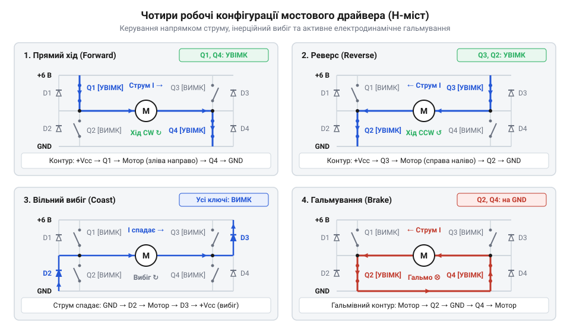
*Комутація силових ключів за діагоналями задає напрямок струму, одночасне розмикання переводить мотор у вільний вибіг, а замикання нижнього плеча спричиняє швидке електродинамічне гальмування струмом проти-ЕРС.*

Головна небезпека мостової схеми криється у випадковому одночасному відкритті верхнього та нижнього ключів однієї стійки (наприклад, `Q₁` та `Q₂`). У цей момент шина живлення +6 В з'єднується із землею напряму через відкриті кремнієві канали транзисторів, оминаючи опір обмотки двигуна. Виникає **наскрізний струм** (англ. @@en|shoot-through@@ або @@en|cross-conduction@@). Опір такого контуру становить соті або десяті частки ома, через що струм короткого замикання за мікросекунди досягає десятків амперів. Це спричиняє миттєвий тепловий вибух кристалів MOSFET і перепалювання доріжок друкованої плати.

Фізична причина наскрізного струму під час зміни полярності полягає в асиметрії часу перемикання транзисторів. [Заряд і розряд паразитної ємності затвора](root:hw-power/gate-driver) вимагають скінченного часу, причому час закриття транзистора (`t_off`) майже завжди довший за час відкриття (`t_on`). Якщо логіка керування перемикає ключі миттєво в один і той самий такт, нижній транзистор уже почне проводити струм, коли верхній ще не встиг закритися.

Щоб запобігти наскрізному струму, у керуючі сигнали впроваджують апаратну захисну затримку — **мертвий час** (англ. @@en|dead-time@@). Це інтервал часу, протягом якого обидва транзистори стійки гарантовано примусово закриті, перш ніж відкриється протилежний ключ. Величина мертвого часу розраховується з урахуванням граничних затримок перемикання силових ключів:

```
t_dead ≥ t_off(max) - t_on(min) + t_margin
```

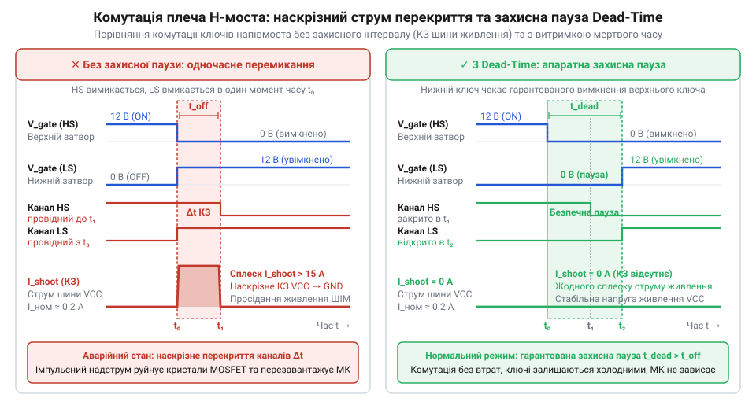
*Затримка вимкнення транзистора без захисної паузи спричиняє одночасну провідність обох ключів стійки та сплеск наскрізного струму, тоді як апаратний мертвий час dead-time повністю розносить інтервали провідності й усуває коротке замикання.*

Для мініатюрних 6-вольтових моторів дискретні мости на окремих транзисторах застосовують рідко через громіздкість схем захисту затворів. Стандартом є інтегральні мікросхеми драйверів (див. [узагальнений клас інтегральних H-мостів](root:cat-hw-actuators/gearmotor-6v/comp-hbridge-driver.md)), такі як DRV8833, TB6612FNG або MAX14870. Усередині вони містять апаратну логіку перехресного блокування, генератор мертвого часу, інтегровані швидкодійні діоди для відведення струмів самоіндукції та термозахист. Їхня інтеграція в силове коло детально розглядається в межах [силових H-мостів для індуктивних навантажень](root:hw-motion/h-bridge) та [практичної побудови схеми керування на базі H-моста](root:cat-hw-actuators/gearmotor-6v/proj-hbridge-motor-driver.md), а відповідні прототипи функцій керування зібрані у [програмному інтерфейсі драйвера H-моста](root:cat-hw-actuators/gearmotor-6v/api-motor-hbridge-controller.md).

## Дозування швидкості: широтно-імпульсна модуляція та плавний пуск

Пряме перемикання ключів H-моста подає на мотор або повні 6 В, або нуль. Однак колісному роботу чи поворотному приводу недостатньо рухатися лише з максимальною швидкістю. Зниження напруги класичним лінійним способом — за допомогою послідовного реостата чи лінійного стабілізатора — є енергетично згубним. Якщо для зменшення швидкості вдвічі знизити напругу з 6 В до 3 В на моторі, що споживає струм 0.5 А, лінійний елемент змушений розсіяти у вигляді тепла:

```
P_втрат
= (U_живл - U_мотор) · I    [потужність теплових втрат лінійного регулятора]
= (6.0 В - 3.0 В) · 0.5 А   [підстановка робочих параметрів]
= 1.5 Вт                    [теплова потужність на радіаторі]
```

Ці півтора вата марно розряджають батарею та вимагають масивного радіатора. Крім того, при постійній напрузі 3 В різко падає пусковий крутний момент двигуна: мотор легко зупиняється на першій нерівності рельєфу, оскільки лінійне обмеження напруги обмежує й пусковий струм.

Енергоефективне регулювання забезпечує **широтно-імпульсна модуляція** (ШІМ, від латинського @@en|modulatio@@ — мірність, розміреність та англ. @@en|pulse-width modulation@@, PWM). Її суть полягає в тому, що амплітуда імпульсів напруги залишається незмінною і дорівнює повній напрузі джерела 6 В, але змінюється співвідношення між часом увімкненого та вимкненого стану ключів.

Основним параметром ШІМ є коефіцієнт заповнення або **шпаруватість** (англ. @@en|duty cycle@@), що позначається як `D`:

```
D = t_on / T
```

де `t_on` — тривалість активного імпульсу, а `T` — повний період повторення імпульсів (`T = t_on + t_off`). Середнє значення напруги, прикладеної до обмотки двигуна, прямо пропорційне шпаруватості:

```
U_сер
= D · U_живл               [означення середньої напруги за період ШІМ]
= 0.40 · 6.0 В             [розрахунок для шпаруватості 40% та живлення 6 В]
= 2.4 В                    [середнє значення напруги]
```

Двигун не смикається від прямокутних імпульсів завдяки індуктивності якоря `L`. Обмотка являє собою послідовне RL-коло, у якому струм не здатний змінюватися стрибком:
`U_L = L · (dI / dt)`
Під час імпульсу `t_on` струм в обмотці наростає за експонентою, накопичуючи енергію в магнітному полі. У паузі `t_off`, коли ключі розмикаються або комутуються в режим рециркуляції, накопичена енергія самоіндукції підтримує протікання струму через захисні діоди чи канали транзисторів. Якщо частота повторення імпульсів достатньо висока, струм не встигає впасти до нуля: він згладжується індуктивністю і коливається навколо середнього значення `I_сер`. Відповідно, крутний момент залишається стабільним, а транзистори працюють виключно у ключовому режимі (або повністю відкриті з мінімальним опором, або повністю закриті), забезпечуючи ККД перетворювача на рівні 90–95%.

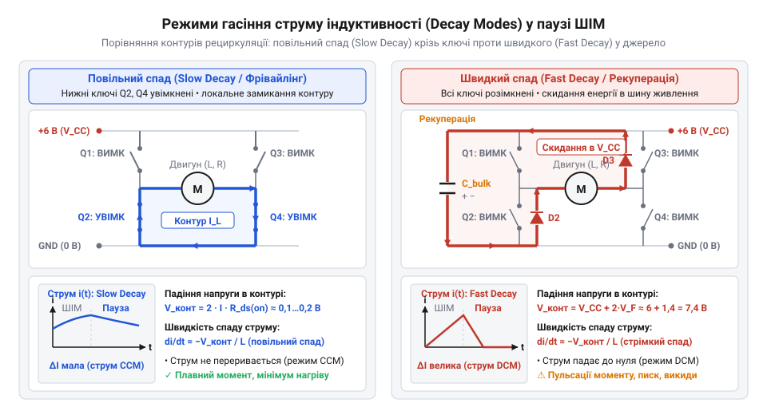
*Рециркуляція струму самоіндукції через відкриті транзистори забезпечує повільний спад із мінімальними пульсаціями, тоді як скидання енергії в джерело через зворотні діоди спричиняє швидкий спад струму ціною підвищеного нагріву.*

> 🔧 **Навіщо це.**
> Правильний вибір частоти ШІМ усуває акустичний писк редуктора та перегрів силових ключів, а програмний алгоритм плавного пуску захищає тендітні шестерні від зрізання зубців під час різкого наростання струму блокування.

Частота ШІМ-сигналу (`f_ШІМ = 1 / T`) є предметом суворого інженерного компромісу між механічною поведінкою приводу та тепловими втратами напівпровідників:

- **Занижена частота (`f_ШІМ < 1 кГц`).** Період коливань стає довшим за електричну сталу часу обмотки якоря (`τ = L / R_якір`). Пульсація струму `ΔI` стає гігантською: між імпульсами струм падає до нуля. На низьких обертах вал двигуна починає помітно вібрувати та смикатися, зуби шестерень відчувають постійні мікроудари у зоні кутового люфту. Крім того, частоти від 100 Гц до 10–15 кГц потрапляють прямо в діапазон чутливості людського вуха: магнітострикція сердечника та коливання витків обмотки перетворюють мотор на гучномовець, що генерує нестерпний високочастотний акустичний писк.
- **Завищена частота (`f_ШІМ > 30–50 кГц`).** Механічний рух стає абсолютно плавним, а звук повністю зникає в ультразвуковій зоні. Проте кожен цикл увімкнення та вимкнення MOSFET супроводжується перезаряджанням ємності затвора через активну зону, де транзистор одночасно перебуває під струмом і напругою. Потужність динамічних комутаційних втрат зростає лінійно зі зростанням частоти:
  `P_дин ≈ f_ШІМ · E_перемикання`
  На частотах понад 40 кГц компактні інтегральні драйвери нагріваються до 100 °C і переходять у аварійне термовимкнення навіть при половинному навантаженні двигуна.
- **Оптимальний діапазон: від 8 до 20 кГц.** Частота близько 16–20 кГц лежить на верхній межі чутності дорослої людини (робота приводу стає безшумною), а динамічні втрати силових ключів залишаються незначними й не потребують додаткових тепловідводів.

Окрему критичну проблему становить миттєвий пуск двигуна. Якщо мікроконтролер стрибком подає 100% шпаруватості на нерухомий ротор (`ω = 0`), проти-ЕРС індукції дорівнює нулю (`E = 0`). Уся напруга 6 В виявляється прикладеною до холодного активного опору якоря (`R_якір ≈ 4 Ом`):

```
I_пуск
= (U_живл - E) / R_якір    [закон Ома для якірного кола при нульовій швидкості]
= (6.0 В - 0 В) / 4.0 Ом   [підстановка напруги 6 В та нульової проти-ЕРС]
= 1.5 А                    [піковий пусковий струм блокування]
```

Цей півтораамперний імпульс у 15 разів перевищує струм холостого ходу та завдає подвійного удару:
1. **Електричний удар.** Внутрішній опір джерела живлення та індуктивність дротів спричиняють глибоке імпульсне просідання напруги, що скидає мікроконтролер через апаратний захист від зниження живлення (brownout reset).
2. **Механічний удар.** Піковий електромагнітний момент рушання миттєво б'є по зубчастій передачі редуктора. У редукторі на 100 об/хв із передавальним числом понад 1:100 це ударне зусилля багаторазово множиться на кожному ступені, спричиняючи втомне сколювання та зрізання латунних або пластикових зубців першого вихідного ступеня (див. [узагальнений клас мініатюрних циліндричних зубчастих редукторів](root:cat-hw-actuators/gearmotor-6v/comp-spur-gearbox.md) та [прямозубі циліндричні передачі та редуктори](root:hw-motion/spur-gear-transmission)).

Для повного усунення цих ударів застосовують алгоритм **плавного пуску** (англ. @@en|soft-start@@). Програма мікроконтролера нарощує шпаруватість від нуля до цільового значення східцями протягом 150–300 мс. У міру розгону ротора виникає та наростає проти-ЕРС, компенсуючи прикладену напругу, завдяки чому струм у будь-який момент часу не перевищує 0.4–0.6 А, а шестерні вибирають механічні люфти плавно й без ударів.

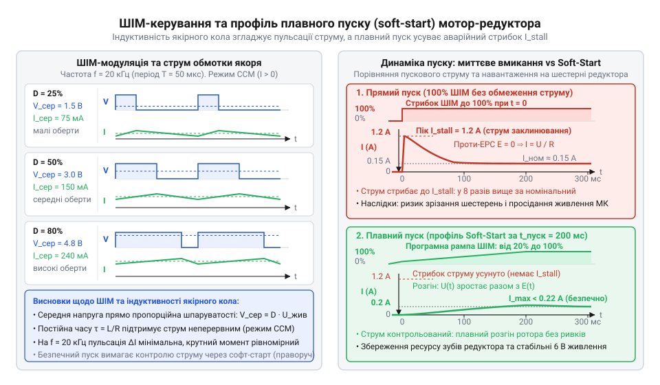
*Шпаруватість імпульсів задає середню напругу, індуктивність якоря підтримує безперервний струм, а східчасте наростання коефіцієнта заповнення усуває небезпечний пусковий пік струму та захищає зубці редуктора від удару.*

:::tabs

@tab arduino-cpp
:::code gearmotor-6v-d/cpp/motor-set-mode.cpp

@tab stm32-hal-c
:::code gearmotor-6v-d/c/motor-set-direction.c

:::

Практична взаємодія мікроконтролера з редуктором на колісній платформі вимагає узгодження динаміки обох моторів з урахуванням навантаження (див. [практичну реалізацію ходової частини робота](root:cat-hw-actuators/gearmotor-6v/proj-wheeled-differential-platform.md)), а захист від просідань напруги при розгоні забезпечується схемотехнічними методами, викладеними в розділі [розділення живлення силових та логічних кіл](root:hw-power/power-rail-isolation-for-motors). Поведінка якірного кола під ШІМ-напругою описується закономірностями [колекторного двигуна постійного струму](root:hw-motion/brushed-dc-motor), архітектуру апаратних таймерів, роботу регістрів автоперезавантаження й порівняння та формування сигналів із мертвим часом розглядає [апаратна генерація ШІМ у таймерах мікроконтролерів](root:hw-arch/hardware-pwm), а програмна абстракція керування каналами реалізується через [програмний інтерфейс драйвера H-моста](root:cat-hw-actuators/gearmotor-6v/api-motor-hbridge-controller.md).

## Архітектура живлення приводу: захист логіки від просідань напруги та перекосів землі

Колісна платформа на базі мотор-редукторів успішно проходить стендові випробування, доки її колеса вільно обертаються у повітрі. Проте щойно пристрій ставлять на поверхню й подають команду рушання вперед, мікроконтролер миттєво зависає або гасне світлодіодами й перезавантажується, навіть не провернувши вихідні вали. Спроби усунути збій зміною таймінгів у коді чи оптимізацією обробників переривань не дають результату. Причина криється в електродинаміці батарейного живлення: у момент пуску знерухомлені обмотки моторів поводяться як низькоомне навантаження, викликаючи колосальний стрибок струму, який миттєво просаджує напругу хімічного джерела та руйнує стабільність цифрової логіки.

У стані спокою кутова швидкість ротора дорівнює нулю, тому електрорушійна сила самоіндукції (проти-ЕРС) у якірному колі відсутня. Єдиним фізичним обмежувачем струму залишається власний активний опір мідного дроту обмоток якоря (близько 4 Ом для типового 6-вольтового колекторного двигуна) та перехідний опір щіткового вузла. Під час подачі номінальної напруги 6 В пусковий струм блокування одного двигуна досягає 1.5 А. Якщо система одночасно вмикає два ходові приводи, сумарний стрибок споживання сягає 3 А.

Будь-яке автономне джерело живлення (гальванічні батареї, акумулятори) та підвідні провідники мають власний внутрішній опір втрат `R_int` та опір з'єднувальних дротів і роз'ємів `R_wire`. Стрибкоподібне зростання струму створює на цьому сумарному паразитному опорі значний спад напруги згідно із законом Ома для повного кола:

```
U_sag
= I_stall_total · (R_int + R_wire)              [падіння напруги на внутрішньому опорі джерела]
= 3.0 · (0.8 + 0.2)                             [струм двох моторів 3 А при сумарному опорі 1 Ом]
= 3.0 В                                         [величина динамічного просідання шини живлення]
```

Якщо свіжозаряджене джерело під помірним навантаженням видавало 6.0 В, то внаслідок пускового стрибка напруга на загальній шині живлення за частки мікросекунди падає до неприпустимого значення:

```
U_bus_min
= U_bat - U_sag                                 [результуюча напруга на шині живлення]
= 6.0 - 3.0
= 3.0 В                                         [напруга на вході стабілізатора мікроконтролера]
```

Цифрові схеми керування живляться від фіксованого стабілізованого рівня 3.3 В або 5.0 В через інтегральні лінійні або імпульсні перетворювачі. Лінійний регулятор вимагає мінімального перепаду між вхідною та вихідною напругою (англ. @@en|dropout voltage@@ — напруга падіння стабілізатора). Коли вхідна напруга просідає до 3.0 В, регулятор втрачає здатність стабілізувати вихід, і напруга на процесорному ядрі різко падає.

Мікроконтролери оснащені апаратним супервізором напруги — [системою виявлення аварійного просідання живлення](root:hw-arch/microcontroller-brownout-reset) (англ. @@en|brownout reset@@, від англ. @@en|brownout@@ — спад освітлення або часткове знеструмлення мережі, та @@en|reset@@ — апаратне скидання). Щойно напруга ядра опускається нижче критичної межі (наприклад, 2.7 В для 3.3-вольтових чіпів або 4.3 В для 5-вольтових), вбудований компаратор негайно виставляє сигнал апаратного скиду, зупиняючи виконання інструкцій, аби захистити регістри та пам'ять від руйнування.

У стані скиду виводи мікроконтролера переходять у високоімпедансний стан. Керуючі сигнали, що відкривали ключі [силового H-моста для індуктивних навантажень](root:hw-motion/h-bridge), зникають, транзистори закриваються, і струм моторів падає до нуля. Спад напруги на внутрішньому опорі батареї миттєво зникає, напруга на клемах відновлюється до 6 В, супервізор знімає скид, процесор заново завантажується, ініціалізує периферію, знову подає сигнал на рух — і потрапляє в нескінченний циклічний рестарт (англ. @@en|brownout loop@@).

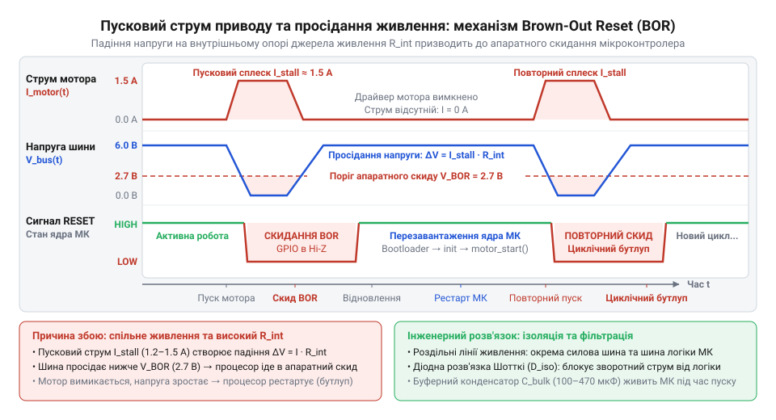
*Осцилограма пускового струму мотора, просідання напруги живлення та моменту спрацьовування BOR: пусковий кидок струму просаджує напругу батареї нижче порогу стабілізації, провокуючи апаратне скидання мікроконтролера та циклічний рестарт системи.*

Друга руйнівна системна проблема — паразитні потенціали на земляній шині. Струм завжди замикається у повне контурне коло: потужний струм, що зайшов у двигун із плюсової шини, мусить повернутися назад до мінуса батареї через мінусовий провідник. Земляний дріт або доріжка друкованої плати не є ідеальним провідником: вони мають власний опір `R_trace` та помітну розподілену індуктивність `L_trace`.

Коли мотори розганяються або комутуються високою частотою широтно-імпульсної модуляції, поворотний струм амплітудою в кілька ампер спричиняє на земляному провіднику динамічний сплеск напруги:

```
V_gnd_bounce
= (I · R_trace) + (L_trace · (dI / dt))          [динамічний зсув потенціалу земляної шини]
```

Якщо цифрова земля мікроконтролера з'єднана шлейфом після силової землі драйвера, цей сплеск зміщує потенціал «нуля» всієї цифрової схеми відносно акумулятора. Це явище називають підскакуванням землі (англ. @@en|ground bounce@@). Зсув нуля навіть на 0.5 В призводить до того, що логічний нуль на вхідних лініях сприймається мікроконтролером як логічна одиниця, зависають апаратні інтерфейси зв'язку, а у гіршому випадку відмикаються паразитні тиристорні структури всередині кремнієвого кристала чіпа (англ. @@en|latch-up@@ — тиристорне замикання), випалюючи кристалічну структуру мікросхеми.

Для гарантованого захисту від просідань живлення та підскакування землі застосовують жорстку трикомпонентну топологію електричної мережі:

1. **Фізичне розведення шин живлення.** Двигуни та чутлива цифрова логіка отримують живлення за двома незалежними трасами. Силові клеми драйвера підключаються безпосередньо до акумулятора або виходу потужного імпульсного перетворювача через власні дроти значного перерізу. Логіка мікроконтролера живиться через окремий стабілізатор із високим коефіцієнтом придушення нестабільності живлення (англ. @@en|PSRR@@ — Power Supply Rejection Ratio), відповідно до принципів, які викладає [Розділення живлення силових та логічних кіл](root:hw-power/power-rail-isolation-for-motors).
2. **Топологія зіркового заземлення (Star GND).** Заборонено з'єднувати земляні виводи мікроконтролера та силового драйвера послідовним ланцюжком. Усі мінусові провідники зводяться в єдину фізичну точку — центр зірки (англ. @@en|star grounding@@ — заземлення зіркою), розташований безпосередньо на мінусовій клемі батареї або негативному виводі первинного накопичувального конденсатора. Від цієї точки прокладають дві відокремлені гілки: одну — виключно для силового контуру драйвера, другу — суто для цифрової землі мікроконтролера та вимірювальних давачів. Поворотний струм моторів циркулює лише у своїй петлі та не перетинає сигнальну землю.
3. **Локальні буферні конденсатори.** Безпосередньо біля силових клем живлення [інтегрального H-моста](root:cat-hw-actuators/gearmotor-6v/comp-hbridge-driver.md) встановлюють електролітичний конденсатор ємністю 470–1000 мкФ з низьким еквівалентним послідовним опором (англ. @@en|Low ESR@@ — Low Equivalent Series Resistance). У перші мікросекунди пуску, коли індуктивність довгих батарейних дротів чинить опір миттєвому наростанню струму, цей конденсатор віддає локальний заряд, нівелюючи удар по джерелу. Паралельно електролітичній ємності припаюють керамічний конденсатор ємністю 100 нФ для придушення високочастотного іскріння щіток і перемикання ключів, взаємодіючи з фільтрами, які описує [Іскріння колектора та придушення комутаційних завад](root:hw-analog/brush-commutator-noise-and-snubbers).

> 🔧 **Навіщо це.**
> Зіркове заземлення та локальні буферні ємності біля H-моста усувають апаратні перезавантаження керуючої плати під час різких маневрів мобільного робота. Без правильної силової архітектури жодна програмна оптимізація алгоритмів руху не захистить систему від раптового скидання процесора.

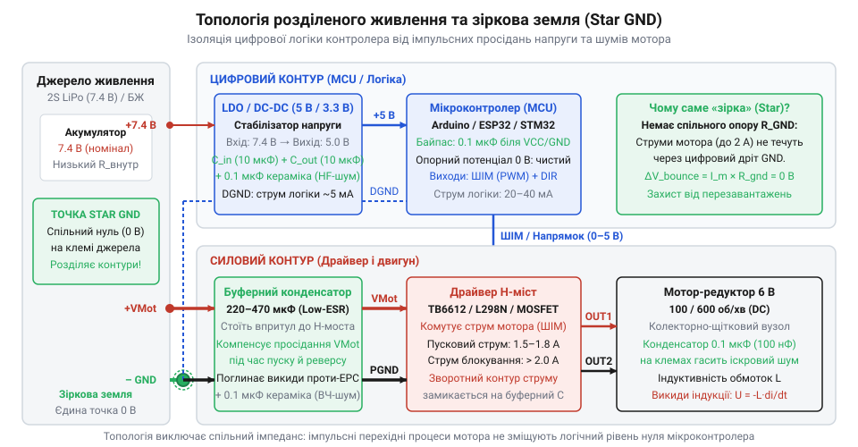
*Схема розділення силової та сигнальної шин живлення: зведення мінусових провідників у єдину точку Star GND та локальний буферний конденсатор усувають просідання напруги логіки й цифрові перешкоди.*

Детальний приклад схемотехнічного трасування та монтажу цих захисних компонентів наведено у вставці [Практична побудова схеми керування на H-мості](root:cat-hw-actuators/gearmotor-6v/proj-hbridge-motor-driver.md).

## Механічна живучість редуктора та захист зубців від ударних навантажень

Колісна платформа на базі мотор-редукторів успішно проходить стендові випробування, доки її колеса вільно обертаються у повітрі. Проте під час зіткнення з жорсткою перешкодою або при подачі команди миттєвого реверсу на повному ходу з механічного вузла лунає характерний тріск. Ротор електродвигуна продовжує обертатися з високим виттям, але вихідний вал зупиняється назавжди. Механічний редуктор знищено: зубці шестерень вихідного ступеня зрізано під корінь.

Ця аварія зумовлена кінематикою понижувального редуктора, чий принцип розміну швидкості на момент описано у статті [Будова та механіка циліндричних редукторів](root:cat-hw-actuators/gearmotor-6v/comp-spur-gearbox.md). У модифікації на 100 об/хв ротор без навантаження обертається зі швидкістю близько 12 000–15 000 об/хв, а передавальне число складає від 1:100 до 1:150. Обертальний момент самого ротора не перевищує часток ньютон-сантиметра, тому вхідні ступені редуктора зазнають мізерних механічних зусиль.

Однак на вихідному ступені крутний момент зростає в сотню разів, досягаючи в режимі повного блокування вала 0.8–1.0 Н·м. При цьому габарити шестерень у мініатюрних приводах, таких як [N20 мікромотор з редуктором](root:cat-hw-actuators/n20-motor), становлять лічені міліметри: радіус ділильного кола вихідної шестерні `r_gear` зазвичай не перевищує 5 мм, а модуль зубця становить 0.2–0.3 мм.

Тангенціальна сила, прикладена до єдиного зачепленого зубця вихідної шестерні в момент зупинки вала, визначається співвідношенням моменту та плеча сили:

```
F_tangential
= M_stall / r_gear                              [зв'язок сили й обертального моменту на радіусі шестерні]
= 0.8 / 0.005                                   [момент блокування 0.8 Н·м на радіусі 5 мм]
= 160 Н                                         [статична сила, що згинає зубець шестерні]
```

Сила 160 Н еквівалентна тиску вантажу масою понад 16 кг на поверхню крихітного металевого виступу шириною 1.2 мм і товщиною 0.4 мм. Напруження зрізу в основі цього зубця розраховується через площу його поперечного перерізу:

```
tau_shear
= F_tangential / (b_tooth · s_tooth)            [напруження зрізу в основі зубця]
= 160 / (0.0012 · 0.0004)                       [ширина вінця 1.2 мм при товщині зубця 0.4 мм]
= 160 / 4.8e-7
= 333 МПа                                       [статичне напруження зрізу матеріалу]
```

Отримане значення зіставляється з границею текучості та зрізу матеріалу шестерень (грецькою літерою `τ` позначають дотичне напруження зсуву):
- **Полімери (нейлон, поліамід):** границя міцності на зріз складає лише 60–80 МПа. При статичному напруженні 333 МПа полімерний зубець зрізається миттєво. Пластикові редуктори дешеві й тихі, але не витримують значного навантаження.
- **Латунь (мідно-цинковий сплав):** границя зрізу становить 200–250 МПа. Статичний момент блокування латунний зубець витримує на грані плинності, проте динамічний удар спричиняє викришування металу.
- **Загартована сталь:** границя міцності перевищує 600–800 МПа, гарантуючи стійкість каскаду [прямозубої циліндричної передачі](root:hw-motion/spur-gear-transmission) навіть в екстремальних режимах.

Руйнівна дія багаторазово посилюється явищем мертвого ходу — механічного люфту шестерень (англ. @@en|backlash@@ — зазор між сполученими зубами). Зазор конструктивно необхідний для запобігання заклинюванню від теплового розширення металу. Проте в багатоступеневому редукторі зазори кожного каскаду перемножуються з урахуванням передавальних чисел, створюючи на вихідному валу сумарний люфт до 5–10°.

Коли контролер раптово перемикає напрямок обертання двигуна на повному ходу в режим гальмування протиувімкненням (англ. @@en|plugging@@), зубець долає вільний простір люфту без механічного опору. Ротор мотора разом із шестернями встигає набрати значну швидкість і з розгону б'є по зворотній поверхні спряженого зубця. Динамічний коефіцієнт удару збільшує миттєве навантаження у 3–5 разів порівняно зі статичним, неминуче зрізаючи навіть латунні зуби.

Оскільки датчиків кінцевого положення всередині мікромотора немає, захистити редуктор від удару можна лише шляхом оперативного контролю струму якоря. Згідно з електромеханічними законами двигуна постійного струму, розвиваний обертальний момент прямо пропорційний споживаному струму, що зафіксовано в паспорті [Електричні та механічні параметри 6-вольтового мотор-редуктора](root:cat-hw-actuators/gearmotor-6v/api-dc-gearmotor-hardware.md). Блокування вала або перешкода викликають стрибок струму до величини струму зупинки.

Апаратна частина захисту використовує прецизійний низькоомний струмовимірювальний резистор — шунт (від англ. @@en|shunt@@ — відгалужувач або паралельний опір), увімкнений у нижнє плече (англ. @@en|low-side current sensing@@) між нижніми транзисторами H-моста та спільною точкою Star GND. Падіння напруги на шунті вимірюється безпосередньо відносно землі:

```
U_shunt
= I_stall · R_shunt                             [закон Ома для ділянки кола з шунтом]
= 1.5 · 0.1                                     [струм зупинки 1.5 А через опір 0.1 Ом]
= 0.15 В                                        [падіння напруги 150 мВ, що подається на АЦП]
```

Опір шунта обирають у межах 0.05–0.1 Ом. При номіналі 0.1 Ом падіння напруги 150 мВ легко оцифровується вбудованим АЦП, а розсіювана теплова потужність складає менше 0.23 Вт, що не перегріває плату. Напруга із шунта проходить крізь фільтр низьких частот (резистор 1 кОм та конденсатор 100 нФ) для відсікання імпульсів комутації ШІМ; для роботи з меншими спадами напруги або вимірювання струму у верхньому плечі моста застосовують спеціалізовані [підсилювачі та монітори струму в силових колах](root:hw-sensing/current-monitor).

Програмний алгоритм мусить розрізняти два стани: безпечний пусковий кидок струму та аварійне заклинювання редуктора. При штатному старті струм короткочасно зростає до 1.5 А, але спадає до номінальних 200–300 мА за 20–40 мс у міру розгону ротора. Якщо вимикати живлення негайно, мотор не зможе стартувати.

Тому захист реалізують за часовим вікном:
1. Якщо виміряний струм перевищує 80% від струму блокування (понад 1.2 А для 6-вольтового мотора), алгоритм фіксує перевантаження та запускає таймер.
2. Якщо струм залишається вище критичної межі довше 150–200 мс, контролер класифікує стан як заклинювання або перешкоду.
3. Шпаруватість ШІМ миттєво скидається до нуля, виходи драйвера переводяться у стан вільного вибігу, і редуктор розвантажується до виникнення втоми металу.

> 🔧 **Навіщо це.**
> Контроль струму за допомогою шунта з тайм-аутом 150–200 мс захищає редуктор від зрізання зубців при блокуванні коліс об перешкоди, запобігаючи руйнуванню механіки та перегріву обмоток.

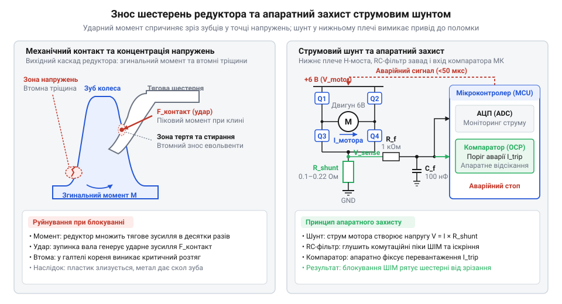
*Концентрація згинальних і зсувних напружень на ніжці зубця шестерні під час блокування вала та схема підключення низькоомного шунта до АЦП контролера для аварійного вимкнення ШІМ.*

Нижче наведено практичну реалізацію неблокуючого алгоритму струмового захисту:

:::tabs
:::code gearmotor-6v-d/c/emergencystop.c
:::code gearmotor-6v-d/c/emergency-stop.c
:::

Програмну інтеграцію логіки захисту в загальний контур керування драйвером наведено в [Програмному інтерфейсі драйвера H-моста](root:cat-hw-actuators/gearmotor-6v/api-motor-hbridge-controller.md), а методику експериментального навантажувального тестування колісного шасі описано у вставці [Колісна диференціальна платформа та навантажувальні тести](root:cat-hw-actuators/gearmotor-6v/proj-wheeled-differential-platform.md).
