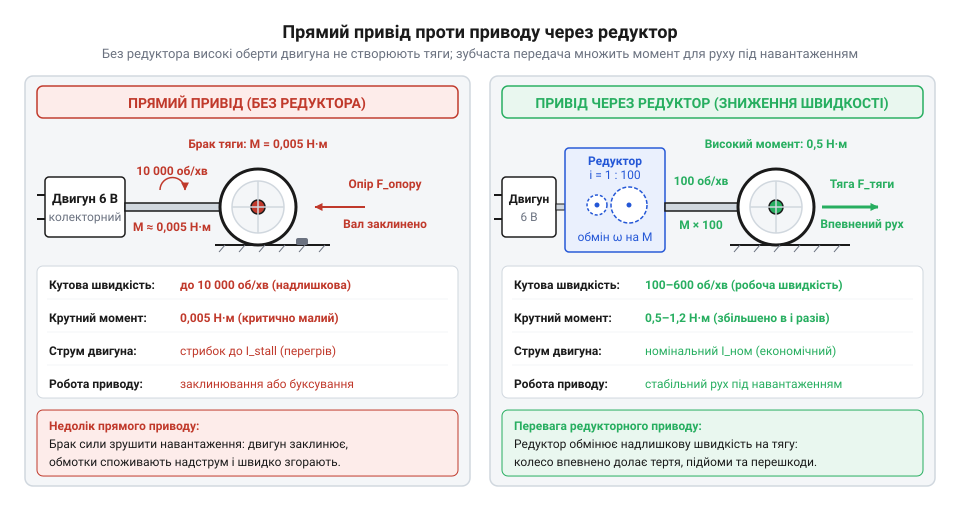
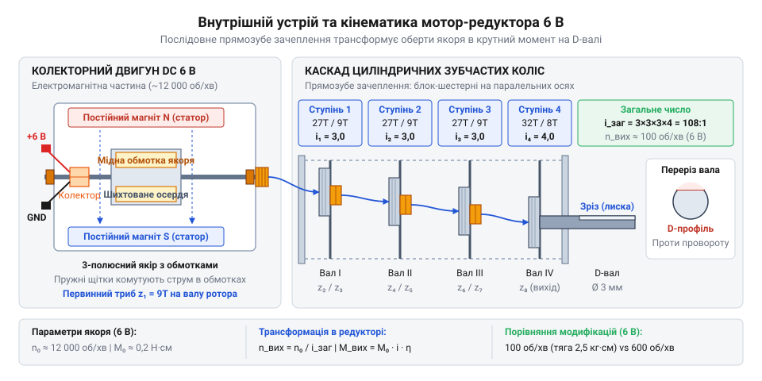
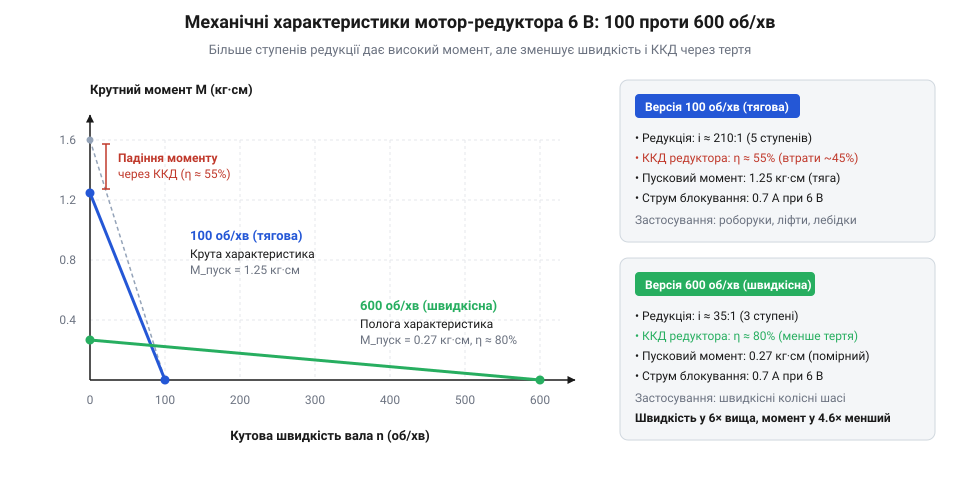
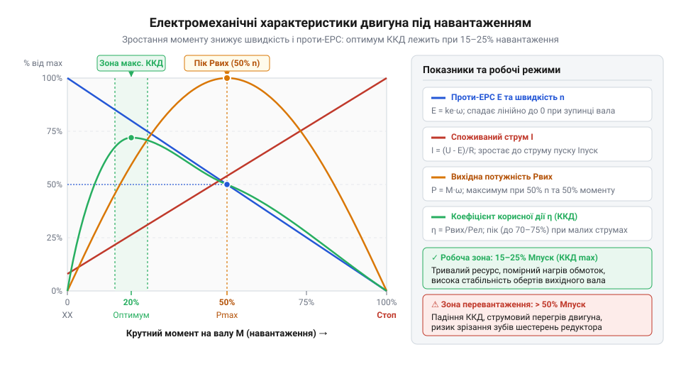
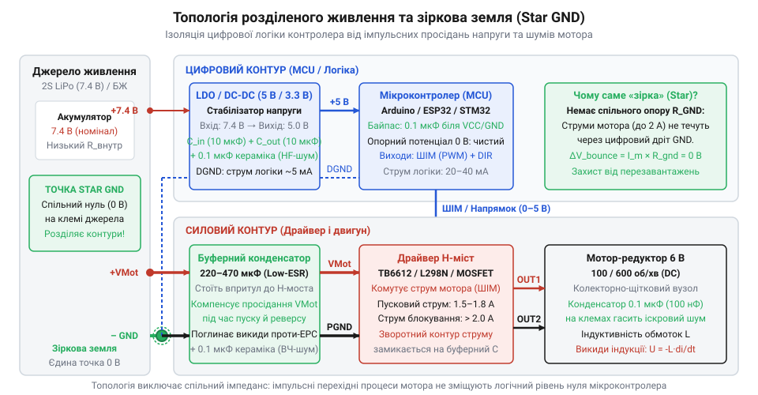
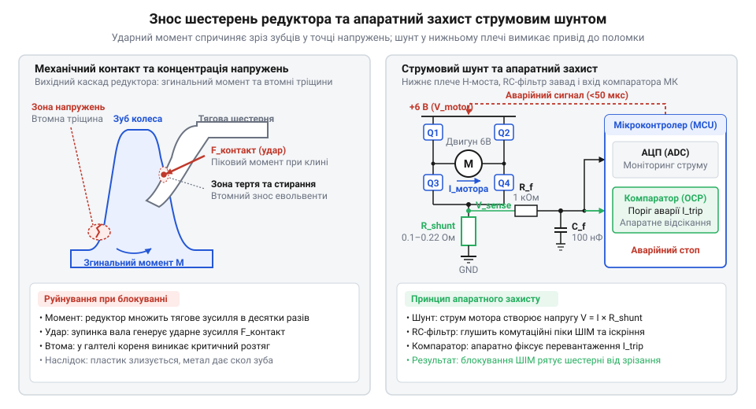

# Мотор-редуктор 6 В (100 і 600 об/хв)

## Пастка прямого приводу: чому голий мікромотор не зрушить колісну платформу

Типовий малогабаритний [колекторний двигун постійного струму](root:hw-motion/brushed-dc-motor) на холостому ходу розвиває швидкість від 6000 до 12000 обертів на хвилину. Якщо закріпити колесо безпосередньо на його валу, колісна платформа не рушить з місця. Двигун видасть короткий писк, ротор (від латинського *rotare* — обертатися) заклинить у нерухомому стані, а металевий корпус за лічені секунди розігріється до небезпечної температури.

Причина полягає у механічному балансі потужності. Обертальна потужність дорівнює добутку крутного моменту `τ` на кутову швидкість `ω`. За фіксованої електричної потужності мікромотора у частки вата висока швидкість ротора означає вкрай малий власний момент: за 10000 об/хв він становить лише 0.1–0.2 мН·м. На колесі радіусом 30 мм такий момент створює силу тяги менше ніж 0.01 Н (близько одного грама сили). Цього зусилля недостатньо, щоб подолати сухе тертя спокою у втулках шасі та опір кочення коліс.

Прямий привід добре працює там, де стартовий опір близький до нуля і зростає лише разом зі швидкістю середовища — як у крильчатках охолодження ([5V безколекторні вентилятори](root:cat-hw-actuators/fan-5v)) або в рідинних помпах ([водяна помпа RS-360SH](root:cat-hw-actuators/water-pump-rs360sh)). Натомість для наземної колісної платформи максимальний крутний момент потрібен саме в момент рушання з місця.

Механічна зупинка вала миттєво спричиняє електричну аварію. Під час обертання обмотка якоря перетинає магнітне поле статора, створюючи проти-ЕРС (зворотну електрорушійну силу, @@en|back-EMF@@) `E`. Вона спрямована проти напруги живлення `V` і стримує якірний струм:

    I = (V - E) / R               [робочий струм якоря під час обертання]

Коли колесо заблоковане навантаженням, кутова швидкість дорівнює нулю (`ω = 0`), а проти-ЕРС миттєво зникає (`E = 0`). Струм обмежується лише активним омічним опором мідного дроту обмотки `R`:

    I_stall = V / R               [струм блокування за нерухомого ротора]

Струм блокування (@@en|stall current@@) перевищує холостий струм у 10–30 разів. Оскільки ротор не рухається, електрична потужність не виконує механічної роботи й повністю перетворюється на тепло Джоуля (`P = I_stall² · R`), спричиняючи стрімкий перегрів двигуна.

Зниження напруги живлення або шпаруватості сигналу ШІМ (широтно-імпульсної модуляції) без редуктора ситуацію не рятує. Крутний момент двигуна постійного струму прямо пропорційний струму в обмотці (`τ = k_t · I`). Зменшуючи напругу, джерело живлення зменшує струм, що пропорційно зрізає і без того критично малий момент рушання. Платформа все одно залишається нерухомою, а двигун потрапляє у стан заклинювання вже за зниженої напруги.


*Прямий привід не здатен подолати тертя спокою колісної платформи через мізерний крутний момент ротора, тоді як механічний редуктор знижує кутову швидкість і пропорційно нарощує тягу.*

> 🔧 **Навіщо це.**
> Струм блокування `I_stall = V / R` задає пікове навантаження на ключі драйвера мотора та джерело живлення: вибір компонентів без запасу на цей струм призводить до вигоряння силових транзисторів при найменшому механічному заклинюванні коліс.

## Анатомія зубчастого редуктора: принцип розміну швидкості на крутний момент

Щоб перетворити високообертовий мікромотор на рушій для колісного робота, надлишкову швидкість ротора необхідно розміняти на силу тяги. Цю функцію виконує зубчастий редуктор (від латинського *reductio* — зменшення, повернення назад) — механічна передача з каскаду циліндричних шестерень.

В основі редукції лежить зачеплення ведучої шестірні з меншою кількістю зубців `z₁` та веденої шестірні з більшою кількістю зубців `z₂`. Лінійна швидкість зубців у точці дотику однакова, тому ведена шестірня обертається повільніше, але з більшим плечем сили. Передавальне число однієї пари зубчастих коліс дорівнює:

    i_ступеня = z₂ / z₁           [передавальне число зубчастої пари]

Реалізувати потрібне для коліс сповільнення з 10000 до 100–600 об/хв однією парою шестерень неможливо: за діаметра моторної шестірні 2 мм ведене колесо мало б сягати від 30 до 200 мм, що робить привід занадто громіздким.

Тому редуктор будують як багатоступеневий каскад: на проміжних валах закріплено пари шестерень різного діаметра, де кожен наступний ступінь додатково сповільнює обертання. Загальне передавальне число каскаду `i` дорівнює добутку передавальних чисел усіх ступенів:

    i = i₁ · i₂ · ... · iₙ        [загальне передавальне число каскаду]

Каскад зменшує кутову швидкість вихідного вала `ω_out` і примножує крутний момент `τ_out` відносно вхідних параметрів ротора `ω_in` та `τ_in`:

    i = ω_in / ω_out              [кінематичне співвідношення кутових швидкостей]
      = τ_out / (τ_in · η)        [рівняння крутного моменту з урахуванням втрат]

Аналогічний каскадний принцип використовує і [28BYJ-48 — кроковий мотор (5V)](root:cat-hw-actuators/28byj-48-stepper), де вбудований редуктор 1:64 компенсує скромний власний момент крокового двигуна.

Вихідний вал редуктора зазнає великого обертального навантаження. Звичайний круглий циліндричний вал під таким моментом неминуче провертається всередині маточини колеса через зминання пластику. Щоб запобігти цьому, вихідний вал виготовляють із поздовжнім плоским зрізом — це D-подібний вал (@@en|D-shaft@@). Зріз створює жорсткий геометричний упор: крутний момент передається через нормальний тиск плоских граней, що гарантує надійне зчеплення з колесом без проковзування.

Багатоступеневий зубчастий каскад має два фундаментальні інженерні обмеження:

1. **Падіння коефіцієнта корисної дії.** У кожному зачепленні шестерень виникає тертя ковзання між зубцями та тертя у втулках осей. Якщо ККД одного циліндричного ступеня `η_stage` становить 85–90%, то сумарний ККД `η_total` каскаду з `n` ступенів різко падає через перемноження:

       η_total = η_stageⁿ            [сумарний ККД багатоступеневої передачі]

   У редукторах на 4–5 ступенів сумарний ККД рідко перевищує 50–65%: решта механічної енергії ротора розсіюється у вигляді тепла тертя.

2. **Кутовий люфт (від німецького *Luft* — проміжок, повітря; @@en|backlash@@).** Зубці шестерень завжди мають мікроскопічний проміжок для вільного кочення без заклинювання. У каскаді ці технологічні зазори накопичуються від вала до вала. Під час зміни напрямку обертання двигун проходить певний кут ухолосту, доки зубці всіх шестерень не виберуть зазори і не притиснуться протилежними гранями. Цей накопичений люфт створює «мертву зону» на кілька градусів, що знижує точність позиціонування платформи за енкодерами.


*Каскад циліндричних шестерень послідовно знижує кутову швидкість і багаторазово підвищує крутний момент на вихідному D-подібному валу, розплачуючись накопиченим люфтом і втратою ККД.*

> 🔧 **Навіщо це.**
> Знання передавального числа та геометрії D-вала необхідне для розрахунку тяги шасі й надійної фіксації коліс, а врахування кутового люфту захищає ПІД-регулятори швидкості від виникнення високочастотних автоколивань при зміні напрямку руху.

## Компроміс швидкості й сили: інженерний вибір між модифікаціями на 100 та 600 об/хв

Під час конструювання мобільного робота часто постає вибір між двома ззовні однаковими мотор-редукторами в класичному жовтому пластиковому корпусі. Обидва пристрої живляться від напруги 6 В, проте один маркований як 100 об/хв (обертів на хвилину, @@en|RPM@@ — @@en|revolutions per minute@@), а інший — 600 об/хв. Усередині обох моделей встановлено ідентичний колекторний мікромотор типорозміру 130, який під напругою 6 В на холостому ходу обертається зі швидкістю близько 10 000–12 000 об/хв. Різниця в характеристиках зумовлена виключно передатним числом (від лат. @@la|ratio@@ — відношення, англ. @@en|gear ratio@@) редуктора.

Версія на 100 об/хв має передатне число близько 1:120. Щоб зменшити частоту обертання у понад сто разів, каскад редуктора містить 4–5 послідовних зубчастих ступенів. Кожне зачеплення пластикових шестерень створює тертя в зубах і посадкових цапфах, через що коефіцієнт корисної дії (ККД) механізму становить близько 50%. Проте значне передатне число багаторазово підсилює крутний момент (англ. @@en|torque@@, від лат. @@la|torquere@@ — скручувати): на вихідному валу двигун розвиває зусилля близько 0.8–1.0 кг·см (0.08–0.1 Н·м). Цього моменту достатньо для стабільного руху колісних платформ масою до 1–1.5 кг. Робот із такими моторами впевнено стартує з місця, долає ворсисті килими, стики підлогового покриття та підйоми крутизною до 15–20°, розвиваючи лінійну швидкість близько 0.3 м/с за стандартного діаметра коліс 65 мм.

Швидкісна модифікація на 600 об/хв побудована на спрощеному редукторі з передатним числом приблизно 1:18–1:20. Цей механізм налічує всього 2–3 ступені передачі. Завдяки меншій кількості рухомих деталей тертя істотно знижується, а ККД редуктора сягає 70–75%. Проте через малу редукцію вихідний крутний момент падає на три чверті порівняно з версією на 100 об/хв і не перевищує 0.2 кг·см. За такого низького моменту двигун глухне перед найменшими перешкодами: порогами кімнат, нерівностями стиків чи навіть переходом на ворсисту поверхню. Варіант на 600 об/хв придатний лише для надлегких платформ масою до 300–400 г, що рухаються виключно по ідеально гладких горизонтальних площинах (полірованому дереву, акрилу або рівному лінолеуму).

Ця відмінність відображає фундаментальний закон збереження механічної енергії: добуток крутного моменту на кутову швидкість є сталою величиною для встановленого мотора (`P = M · ω`). Неможливо збільшити швидкість без пропорційної втрати сили без збільшення потужності самого джерела. Коли в проєкті потрібні подібні компроміси передатних чисел, але в обмежених габаритах, інженери застосовують суцільнометалевий [N20 мікромотор з редуктором](root:cat-hw-actuators/n20-motor), де широкий вибір редукцій від 30 до 1000 об/хв поєднується з мініатюрним форм-фактором.


*Співвідношення моменту та швидкості для модифікацій на 100 і 600 об/хв: скорочення ступенів редукції підвищує оберти вала, але зменшує корисну тягу вчетверо.*

> 🔧 **Навіщо це.**
> Поширена помилка розробників-початківців — обирати модифікацію на 600 об/хв, сподіваючись збудувати швидкого робота. На практиці типове навчальне шасі з акумулятором та електронікою виявляється занадто важким: мотор глухне під час рушання або зупиняється на першому ж килимовому покритті. Для мобільних платформ масою близько 1 кг версія на 100 об/хв є обов'язковим базовим стандартом, оскільки забезпечує необхідний чотирикратний запас тяги для подолання сил тертя спокою.

## Електромеханічний баланс якоря: проти-ЕРС і фізика струму блокування

Під час вимірювання споживання ненавантаженого двигуна амперметр показує лише 50–70 мА. Проте якщо зупинити вихідний вал рукою, струм миттєво злітає до 1.5–2 А — у 20–30 разів. Щоб зрозуміти, чому нерухомий двигун перетворюється на надпотужний споживач струму, а під час вільного обертання майже не навантажує джерело, слід простежити електромагнітні процеси в обмотках якоря (від лат. @@la|armatura@@ — озброєння, спорядження, англ. @@en|armature@@) всередині поля статора (від лат. @@la|stator@@ — той, хто стоїть нерухомо).

Коли напруга живлення `V` прикладається до щіток, струм проходить через мідні обмотки якоря, створюючи магнітне поле, яке відштовхується від полюсів постійних магнітів статора й розкручує ротор. Водночас витки ротора обертаються всередині магнітного поля статора й перетинають його магнітні силові лінії. За законом електромагнітної індукції Фарадея в рухомому провіднику збуджується власна електрорушійна сила (ЕРС). За правилом Ленца ця індукована напруга спрямована проти напруги живлення. Її називають проти-електрорушійною силою або проти-ЕРС (англ. @@en|back-EMF@@ чи @@en|counter-electromotive force@@).

Величина проти-ЕРС `E` прямо пропорційна кутовій швидкості обертання ротора `ω`:

```text
E = k_e · ω
```

де `k_e` — конструктивна стала двигуна. Оскільки проти-ЕРС діє назустріч напрузі живлення `V`, результуючий струм в обмотці якоря визначається їхньою різницею та активним електричним опором мідного дроту `R`:

```text
I = (V - E) / R
```

У режимі холостого ходу ротор розганяється до максимальної швидкості. На цій швидкості проти-ЕРС майже зрівнюється з напругою живлення (`E ≈ V`). Різниця `V - E` становить усього кілька десятих вольта — рівно стільки, скільки потрібно, щоб створити малий струм (40–70 мА) для покриття втрат на тертя в підшипниках та щітковому вузлі.

Коли на вал діє механічне навантаження, ротор пригальмовує і його кутова швидкість `ω` зменшується. Падіння швидкості миттєво знижує величину проти-ЕРС `E`. Різниця напруг `V - E` збільшується, викликаючи пропорційне зростання струму якоря `I`. Оскільки електромагнітний крутний момент прямо пропорційний силі струму (`M = k_m · I`), мотор автоматично генерує додаткову тягу у відповідь на опір руху. Цей природний електромеханічний зворотний зв'язок динамічно врівноважує навантаження без участі мікроконтролера.

У разі повного заклинювання ротора обертання припиняється:

```text
ω = 0
= E = 0                  [проти-ЕРС повністю зникає]
```

За відсутності проти-ЕРС струм обмежується виключно малим омічним опором мідного дроту обмотки (типово `R ≈ 3–4 Ом` для 6-вольтового двигуна):

```text
I_stall
= V / R                  [закон Ома за відсутності проти-ЕРС]
= 6 / 4                  [напруга 6 В і активний опір обмотки 4 Ом]
= 1.5 А                  [струм блокування у 25 разів перевищує холостий хід]
```

Цей стан називають струмом блокування (англ. @@en|stall current@@).

Стрибок струму до 1.5–2 А викликає різке зростання виділення джоулевого тепла на обмотках якоря:

```text
P_heat
= I² · R                 [закон Джоуля-Ленца]
= 1.5² · 4               [підстановка струму блокування 1.5 А та опору 4 Ом]
= 9 Вт                   [теплова потужність у закритому об'ємі мотора]
```

Теплова потужність 9 Вт у крихітному закритому металевому корпусі мікромотора спричиняє швидкий перегрів до 120–150 °C за 3–5 секунд. Такий стрибок температури викликає незворотну теплову деградацію обмоток і постійних магнітів статора.

У складніших приводах, таких як [Безколекторний мотор (модуль)](root:cat-hw-actuators/bldc-motor-module), проти-ЕРС додатково використовують для безсенсорного обчислення кутового положення ротора в просторі. Проте в колекторному двигуні проти-ЕРС є насамперед природним обмежувачем струму, руйнування якого під час заклинювання загрожує термічним знищенням привода.


*Навантажувальні характеристики колекторного мотора: зі зниженням кутової швидкості ротора проти-ЕРС спадає до нуля, а струм споживання та теплове навантаження стрімко зростають до критичних значень.*

> 🔧 **Навіщо це.**
> Струм блокування диктує вибір усіх елементів системи живлення та керування. Силові ключі драйверів моторів завжди підбирають за струмом заклинювання `I_stall`, а не за струмом холостого ходу чи номінального руху. Якщо H-міст розрахований на номінальні 0.8 А, а мотор блокується на перешкоді й споживає 1.5 А, вихідні транзистори мікросхеми вигорять за лічені секунди. Надійні алгоритми керування реалізують захист: контролюють струм через шунт або за сигналами енкодерів виявляють зупинку коліс і негайно вимикають подачу напруги.

## Архітектура живлення: захист логіки від просідань напруги та перекосів землі

Під час рушання з місця або різкого гальмування 6-вольтового мотора струм через якір миттєво зростає від часток ампера до струму блокування, який нерідко сягає 1.5–2 А. Будь-яке реальне хімічне джерело живлення — батарейки чи акумулятор — має власний внутрішній опір `R_int`. Коли струм навантаження `I` різко підскакує, на цьому внутрішньому опорі виникає пропорційний спад напруги:

```
ΔV = I · R_int
```

У результаті вихідна напруга батареї різко просідає. Якщо від тієї самої батареї живиться стабілізатор мікроконтролера, напруга на його вході може впасти нижче мінімального робочого порогу стабілізації. Живлення цифрової логіки провалюється, і в мікроконтролері спрацьовує вбудований вузол захисту — [Brownout Reset](root:hw-arch/brownout) (від англ. @@en|brownout@@ — спад напруги та @@en|reset@@ — скидання). Контролер екстрено перезавантажується, сигнал на драйвер мотора зникає, струм спадає до нуля, напруга живлення повертається в норму — і процесор починає завантажуватися знову. Щойно програма знову намагається увімкнути мотор, циклічне перезавантаження повторюється без кінця.

Друга небезпека криється в спільній лінії повернення струму — земляному провіднику. Доріжки друкованої плати та монтажні дроти мають власний опір і паразитну індуктивність. Коли потужний зворотний струм мотора повертається по тонкій спільній доріжці, на ній виникає спад напруги, що зміщує потенціал цифрової землі відносно мінуса батареї. Це явище називають [перекосом землі](root:hw-pcb/ground-bounce) (від англ. @@en|ground bounce@@). Через такий зсув логічний нуль на цифрових шинах передачі даних сприймається мікроконтролером як помилкова одиниця, сенсори зависають, а керування приводом блокується.


*Топологія підключення з окремими лініями живлення, буферним конденсатором біля драйвера та єдиною точкою заземлення Star GND, що усуває просідання напруги та зависання мікроконтролера.*

Щоб мотор і цифрова частина працювали стабільно, схему живлення будують за трьома правилами:
1. **Роздільні шини живлення.** Лінії живлення мостового драйвера мотора та стабілізатора мікроконтролера прокладають окремими трасами безпосередньо від клем джерела.
2. **Заземлення зіркою.** Силові провідники драйвера, мікроконтролера й сенсорів сходяться в одну фізичну точку на мінусовій клемі джерела — топологія @@en|star ground@@. Силовий поворотний струм іде своїм проводом і не створює перепадів напруги на цифровій землі.
3. **Буферна ємність.** Безпосередньо біля виводів живлення драйвера встановлюють електролітичний конденсатор (від латин. *condensare* — згущувати, накопичувати) ємністю 100–470 мкФ із низьким внутрішнім опором (@@en|low-ESR@@). У мить пуску він миттєво віддає накопичену енергію, згладжуючи просідання на загальній шині.

> 🔧 **Навіщо це.**
> Заземлення зіркою та локальний буферний конденсатор усувають спонтанні перезавантаження мікроконтролера та зависання цифрових шин, щойно роботизована платформа рушає з місця або різко змінює напрямок руху.

## Механічна живучість редуктора та захист зубців від ударних навантажень

Багатоступеневий зубчастий редуктор (від латин. *reducere* — зменшувати, повертати назад) помножує крутний момент від одного ступеня передачі до іншого. Якщо зубці першої шестерні на валу ротора зазнають мізерного навантаження, то вихідний ступінь сприймає повний вихідний момент механізму. Коли вихідний вал зупиняється об перешкоду, двигун розвиває граничний крутний момент блокування. Помножене зусилля прикладається до крихітних зубців останньої пари шестерень (у компактних приводах на кшталт [N20 мікромотора з редуктором](root:cat-hw-actuators/n20-motor) їх штампують із латуні або поліацеталю POM): механічні напруження згину та зсуву перевищують границю міцності, і зубці безповоротно зрізаються або відламуються біля основи.

Ще руйнівнішим за плавне заклинювання є раптовий реверс мотора на повному ходу. Між зачепленнями зубців завжди існує технологічний люфт (від нім. *Luft* — зазор, вільний простір). Завдяки сумарному зазору всіх ступенів ротор мотора під час зміни полярності встигає вільно розігнатися у зворотному напрямку, перш ніж вибереться вільний хід зубців. Якщо реверс виконується миттєво, без безпечної паузи (@@en|dead time@@ — мертвий час) чи плавного уповільнення (@@en|slew rate@@), вибирання люфту завершується жорстким ударом. Кінетична енергія розігнаного ротора миттєво скидається в зачеплення, зрізаючи зубці редуктора подібно до удару молотка.


*Механічні напруження в зачепленні зубчастої передачі під час блокування вала та алгоритм струмового захисту з часовим вікном фільтрації.*

Оскільки струм споживання колекторного мотора прямо пропорційний навантаженню на його валу, надійним захистом механіки слугує струмовий контроль:
1. **Струмовимірювальний шунт.** У нижнє плече мостового драйвера між мінусом транзисторів і землею вмикають прецизійний резистор малого опору (0.1–0.5 Ом) — шунт (від англ. @@en|shunt@@ — відгалуження). Спад напруги на ньому точно відповідає струму через обмотки мотора й зчитується мікроконтролером через АЦП або швидкий компаратор.
2. **Фільтрація пускового викиду.** Під час штатного пуску струм короткочасно підскакує, поки ротор не розкрутиться й не створить проти-ЕРС. Керуюча програма закладає часове вікно ігнорування (@@en|blanking window@@) тривалістю 150–200 мс, щоб не сприймати нормальний пуск за аварію.
3. **Аварійне вимкнення.** Якщо струм перевищує встановлений поріг довше за 150–200 мс, мікроконтролер констатує механічне заклинювання або застрягання приводу й миттєво вимикає ШІМ-сигнал драйвера. Знеструмлений мотор зупиняється до того, як надмірний момент встигне зламати зубці редуктора або перегріти обмотку.

> 🔧 **Навіщо це.**
> Струмовий моніторинг із програмним вимкненням захищає передачі від зрізання зубців, коли мобільний робот упирається в стіну або колесо заклинює сторонній предмет.
