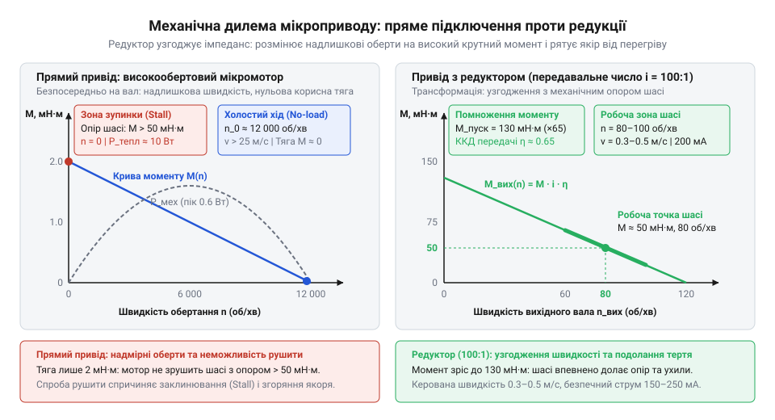
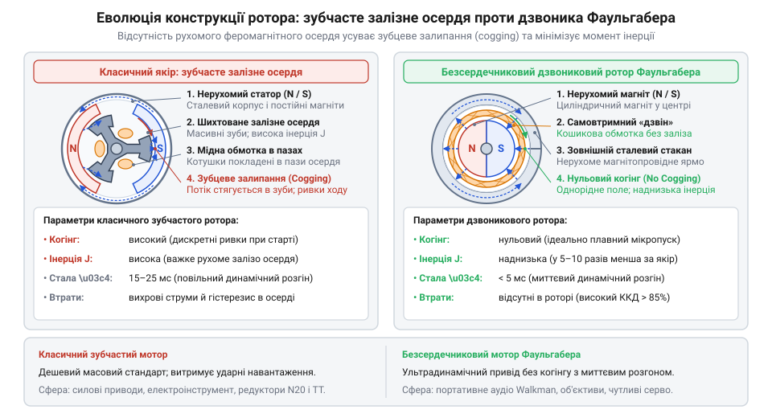
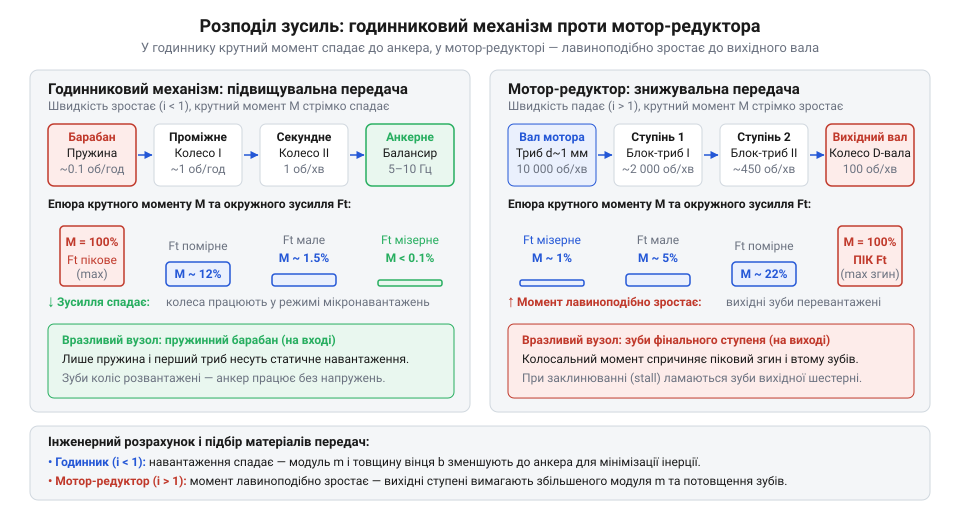
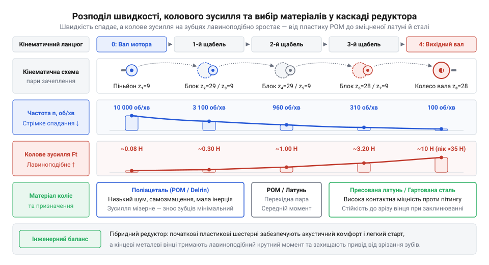
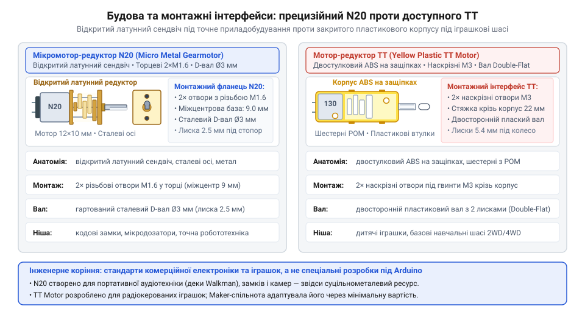
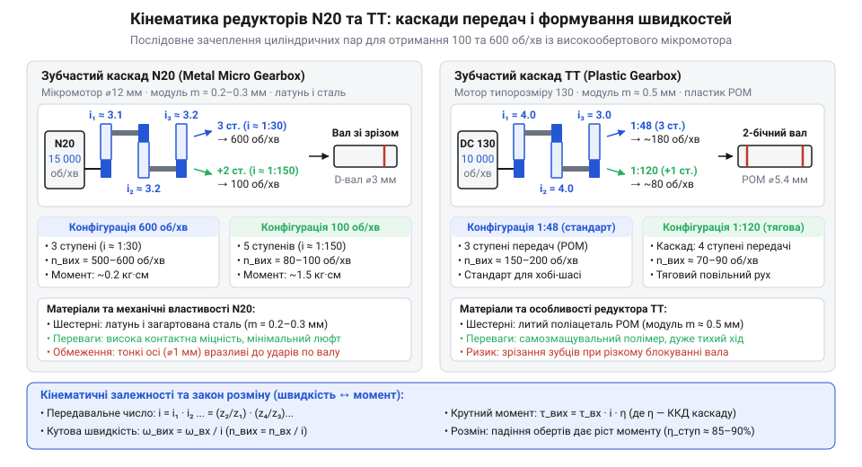
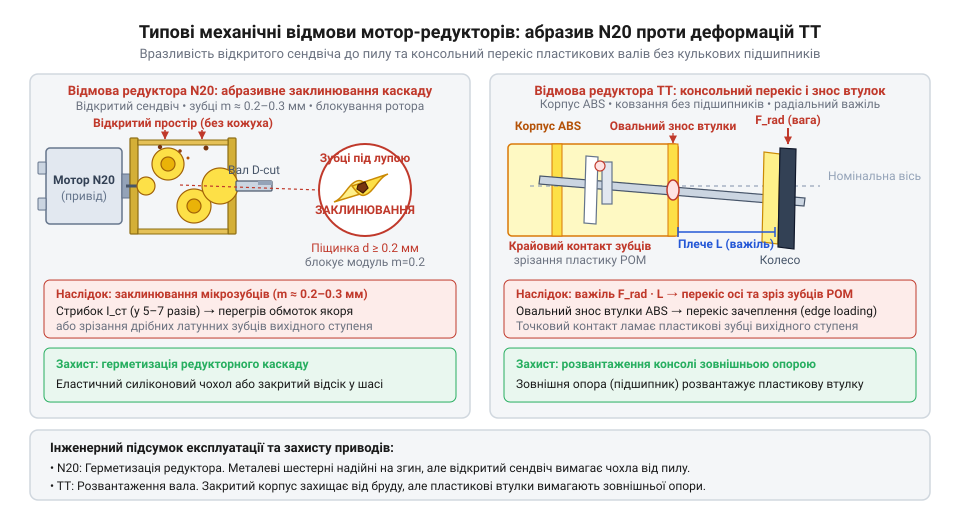

# Мотор-редуктор 6 В (100 і 600 об/хв)

<preknowlist>
- [N20 мікромотор з редуктором](root:cat-hw-actuators/n20-motor) — Загальне уявлення про будову сучасного мікропривода: колекторний двигун постійного струму, металевий прямокутний редуктор, вихідний D-подібний вал і базове співвідношення між напругою, струмом, швидкістю обертання та крутним моментом.
</preknowlist>

## Межа механічного заводу: глухий кут пружинних приводів 1940–1950-х років

У середині XX століття створення автономного приладу впиралося в жорсткі межі. Мережевий дріт прив'язував прилад до стіни, а тогочасні свинцево-кислотні акумулятори важили кілограми. Польові реєстратори, кінокамери та перші авіамоделі потребували механічної роботи без розетки — протягувати плівку чи повертати кермо. Єдиним автономним джерелом енергії був [пружинний завод](root:hw-motion/spring-clockwork-actuators) (від нім. @@de|Federwerk@@) — спіральна сталева стрічка всередині зубчастого барабана.

Принцип дії спирався на пружну деформацію загартованої легованої сталі: ключ стискав витки навколо осі, накопичуючи енергію, а розкручування барабана обертало зубчасті колеса. Проте за автономність доводилося платити чотирма принциповими вадами.

Перша — крутний момент (від лат. @@la|torquere@@ — скручувати), що нелінійно спадав із розкручуванням стрічки. Повний завод давав піковий момент, але з кожним обертом напруження в сталі падало, і наприкінці ходу момент зменшувався в кілька разів. Механізм ставав млявим і не міг подолати тертя у власних осях.

Друга вада — нестабільна швидкість. Кінокамерам потрібні були стабільні 16–24 кадри на секунду, а диктофонам — стала швидкість носія, інакше спотворювався звук. Щоб стримати розгін на початку заводу, в кінематику вбудовували відцентрові регулятори (гальма Ватта). Вони примусово спалювали надлишковий момент на тертя тягарців об стінки барабана: від 40 % до 60 % накопиченої енергії перетворювалося на даремне тепло.

Третя вада — непридатність до дистанційного електричного керування та плавного реверсу. Пружину не можна запустити слабким сигналом або сповільнити без важких кулачків і муфт. В авіамоделях 1950-х років стерном керував пружинний ескапмент (від англ. @@en|escapement@@ — спуск): радіоімпульс крізь реле відпускав храповик рівно на один зуб, повертаючи кермо на фіксований кут. Для зміни курсу доводилося «клацати» імпульсами крізь нейтраль; пропорційного контролю чи швидкого реверсу не існувало.

Четверта вада — мізерний час роботи через скромну енергоємність пружинної сталі. Завод ручної кінокамери давав лише 20–35 секунд зйомки, після чого оператор мусив знову зводити пружину вручну.

Пряма заміна пружини електродвигуном постійного струму з батареєю тоді не працювала. Доступні двигуни створювалися для важкої промисловості й авіації: вони важили сотні грамів, мали масивні корпуси й магніти зі сплаву AlNiCo з низькою коерцитивною силою (від лат. @@la|coercere@@ — утримувати).

Спроба пропорційно зменшити звичайний пазовий мотор до діаметра 10–15 мм зайшла в глухий кут. Тертя у втулках, опір щіток на колекторі та магнітне прилипання зубців ротора до полюсів (зубцевий момент, @@en|cogging torque@@) у мікромасштабі майже не зменшувалися. Власний електромагнітний момент мініатюрного ротора виявлявся заслабким, щоб зрушити з місця навіть ненавантажений вал.

> 🔧 **Навіщо це.**
> Розуміння фізичних меж пружинного заводу показує, що електрифікація приводів була викликана не модою на батарейки, а фундаментальною нездатністю механічних пружин забезпечити стабільну швидкість, тривалу роботу та дистанційне керування рухом.

## Електродинамічна пастка масштабування та неминучість редуктора

Невдача простого геометричного зменшення двигуна криється в законах електродинаміки, які описують взаємодію магнітних полів і струмів у замкнених контурах. Електромагнітний крутний момент (від лат. @@la|torquere@@ — скручувати) колекторного двигуна створюється силою Лоренца, що діє на провідники обмотки якоря, розташовані в магнітному полі статора.

Для циліндричного ротора радіусом `r` і довжиною `L`, що має `N` активних провідників зі струмом `I` у магнітному полі з індукцією `B`, електромагнітний момент виражається ланцюжком співвідношень:

```
T = F · r
  = (B · I · L · N) · r          [сила Ампера для N провідників у магнітному полі B]
  = B · I · (L · r · N)          [геометрія активної зони ротора]
  ∝ B · I · V_ротора             [пропорційність об'єму циліндра V ∝ r² · L]
```

Тут проявляється фундаментальна геометрична нерівність: крутний момент прямо пропорційний об'єму ротора `V_ротора`, тобто кубу лінійних розмірів (`d³`, де `d` — характерний діаметр двигуна). Магнітну індукцію `B` у повітряному зазорі неможливо збільшити довільно: вона жорстко обмежена явищем магнітного насичення сталі (близько 1.5–1.8 Тл) та залишковою намагніченістю постійних магнітів. Якщо зменшити всі лінійні розміри двигуна в 5 разів (наприклад, із діаметра 50 мм до 10 мм), об'єм активного заліза й міді неминуче скорочується в 125 разів:

```
V_масштаб = (1 / 5)³
          = 1 / 125              [масштабування об'єму за кубічним законом]
          = 0.008                [падіння об'єму ротора у 125 разів]
```

Ба більше, зі зменшенням розмірів переріз пазів для мідного дроту падає пропорційно квадрату діаметра (`d²`), а площа поверхні двигуна, яка відводить тепло в навколишнє середовище, також скорочується як `d²`. Щоб мікромотор не згорів від теплових втрат Джоуля в перші секунди після ввімкнення, струм у тонкому дроті доводиться суворо обмежувати. У результаті власний тривалий крутний момент колекторного мікромотора діаметром 10–12 мм падає до мізерних величин — від 0.2 до 0.5 мН·м (міліньютон-метра).

Проте будь-який виконавчий механізм оцінюють не лише за крутним моментом, а й за механічною потужністю `P`, яка дорівнює добутку крутного моменту `T` на кутову швидкість `ω`:

```
P = T · ω
```

де `ω = 2 · π · n / 60` — кутова швидкість (рад/с), а `n` — частота обертання (об/хв).

Якщо крутний момент `T` фізично затиснутий на рівні часток міліньютон-метра через мікроскопічний об'єм ротора, то отримати корисну механічну потужність (наприклад, 1 Вт, необхідний для переміщення лінзового блоку чи протягування стрічки) можна лише за рахунок багаторазового збільшення другого множника — швидкості обертання:

```
P = T · ω
  = 0.0005 · (2 · π · 20000 / 60)    [робоча точка: момент 0.5 мН·м при 20 000 об/хв]
  = 0.0005 · 2094.4                  [кутова швидкість ротора в рад/с]
  ≈ 1.05 Вт                          [корисна вихідна механічна потужність]
```

Закони електродинаміки невблаганні: мініатюрний колекторний двигун може бути енергетично ефективним і корисним виключно на ультрависоких швидкостях — від 15 000 до 30 000 об/хв. На такій швидкості в обмотках ротора генерується значна проти-електрорушійна сила (проти-ЕРС, від лат. @@la|electromotio@@ — рух електрики), яка врівноважує напругу живлення й утримує робочий струм на безпечному рівні.

Однак реальним споживачам механічного руху — колесам шасі, затворам фотоапаратів, запірним кулачкам чи стрічкопротяжним валикам — потрібні зовсім інші параметри: низька швидкість (від 60 до 300 об/хв) і відчутний крутний момент (від 50 до 300 мН·м).

Спроба змусити мікромотор напряму працювати на низьких обертах шляхом зниження живильної напруги обертається катастрофою. Якщо зменшити напругу з номінальних 6 В до умовних 0.2 В, щоб ротор крутився повільно, проти-ЕРС зникає разом зі швидкістю. Пусковий момент при цьому падає нижче порога внутрішнього тертя щіток і підшипників, і двигун взагалі не стартує.

Якщо ж подати на мотор штатну напругу, але штучно загальмувати його вал навантаженням до 100–200 об/хв, проти-ЕРС знову прямує до нуля. Опір кола тепер визначається лише активним опором мідного дроту `R`, і через мотор протікає струм повної зупинки (@@en|stall current@@):

```
I_зупинки = U / R
```

В обмотці мікромотора використано мідний провід завтовшки з людську волосину (діаметром 0.04–0.07 мм). За відсутності проти-ЕРС уся електрична енергія перетворюється на тепло Джоуля `I² · R`. Маса міді в роторі становить лише 1–2 грами, тому температура обмотки злітає зі швидкістю десятків градусів на секунду. Вже через 3–5 секунд тонкий шар поліуретанового лаку плавиться, виникає міжвиткове коротке замикання, і двигун безповоротно виходить із ладу.


*Механічна та потужнісна характеристики колекторного мікромотора: прямий привід на низьких обертах неминуче призводить до зупинки й теплового руйнування, тоді як знижувальний редуктор переносить робочу точку в зону високого крутного моменту при збереженні оптимального швидкісного режиму ротора.*

З цієї суперечності між мікроскопічним електромагнітним моментом і потребою в низьких робочих обертах випливав єдиний інженерний вихід: розрив привода на дві спеціалізовані частини. Перша частина — надшвидкісний мікроелектродвигун, що працює у своїй природній електродинамічній зоні (15 000–30 000 об/хв) з високою проти-ЕРС і мінімальним нагрівом. Друга частина — багатоступеневий знижувальний редуктор (від лат. @@la|reducere@@ — відводити назад, зменшувати).

Редуктор працює як обертовий важіль Архімеда. Він ділить надлишкову кутову швидкість мотора на передавальне відношення `i`, одночасно помножуючи вихідний крутний момент:

```
i = ω_мотора / ω_навантаження
T_навантаження = T_мотора · i · η    [де η — коефіцієнт корисної дії передачі]
```

Знижуючи швидкість у 100–300 разів, редуктор перетворює мізерні 0.3 мН·м власного моменту двигуна на 30–90 мН·м на вихідному валу — силу, достатню для повороту засувки замка чи подолання тертя ґрунту колесом робота.

Сучасним прямим спадкоємцем цієї інженерної знахідки став стандартизований [мікромотор N20](root:cat-hw-actuators/n20-motor), де колекторний двигун жорстко об'єднаний із прямокутним зубчастим редуктором в один неподільний вузол. У пізніших приладах низькі оберти без шестерень навчилися отримувати за допомогою багатополюсних [крокових моторів](root:cat-hw-actuators/28byj-48-stepper) або електронно комутованих [безколекторних моторів](root:cat-hw-actuators/bldc-motor-module), проте в середині XX століття саме комбінація швидкохідного двигуна постійного струму та механічного редуктора відкрила еру масових автономних приводів.

> 🔧 **Навіщо це.**
> Електродинамічний [закон масштабування](root:hw-motion/dc-motor-scaling-laws) застерігає від спроб отримати повільний рух простим зменшенням напруги живлення двигуна або через малий коефієнт заповнення ШІМ. Без знижувального редуктора колекторний мікромотор на низькій швидкості втрачає крутний момент, легко зупиняється від найменшого опору та миттєво згорає від надструму зупинки.

## Дзвониковий ротор і подолання зубцевого залипання

Спроба зменшити колекторний двигун постійного струму до розміру монети виявила електродинамічну межу. У великих машинах пазовий залізний ротор (латинське @@la|armatura@@ — каркас) працював бездоганно. Але в мікромасштабі пази вміщують замало витків, і крутний момент на низьких обертах різко падає. Щоб віддавати прийнятну механічну потужність, мікромотор мусив крутитися на 10 000–30 000 об/хв. Проте від низької напруги він або взагалі не міг зрушити з місця, або смикався ривками, марно висаджуючи батареї.

Причиною був зубцевий момент (@@en|cogging torque@@, від англійського *cog* — зубець колеса; магнітне залипання). Поле нерухомого статора (латинське @@la|stator@@ — нерухомий) шукає шлях із найменшим магнітним опором ([релуктансом](root:ph-electromagnetism/magnetic-reluctance)). Щоразу, коли залізний зубець ротора стає навпроти полюса магніту, повітряний зазор мінімізується, утворюючи магнітну потенціальну яму. Щоб провернути вал далі, потрібне додаткове механічне зусилля.

У великих моторах інерція вала легко долає ці бар'єри. У мікромасштабі ж зубцевий момент співмірний із корисним електромагнітним моментом. Щоб вирвати зубець із пастки, потрібна підвищена стартова напруга. Виникав стрибок пускового струму, після якого двигун різко зривався у високі оберти: це виключало повільне позиціонування й плавний пуск від слабких батарей. Додатково масивне залізо створювало високий момент інерції та втрати енергії на вихрові струми (струми Фуко) і циклічне перемагнічування.

У 1958 році німецький інженер Фріц Фаульгабер (Fritz Faulhaber) запатентував дзвониковий безсердечниковий двигун (@@de|Glockenankermotor@@, або @@en|coreless motor@@), повністю усунувши залізо з рухомої частини.

Магнітну систему вивернули: постійний магніт зафіксували в центрі, а лінії поля замкнули зовнішньою сталевою трубкою-ярмом. У кільцевому проміжку обертається порожнистий тонкостінний купол-дзвін, закріплений на валу лише з торця через опорний фланець із колектором.

Купол виготовляли без каркаса: мідний дріт укладали за кошиковою схемою під кутом до осі обертання, скріплюючи термореактивним лаком у самовтримну просторову сітку. В обертовому вузлі не залишилося заліза — лише мідь і компаунд.


*Порівняння магнітної геометрії роторів: у пазовому осерді лінії поля концентруються в залізних зубцях, створюючи магнітні потенціальні ями й зубцеве залипання, тоді як безсердечниковий дзвониковий ротор Фаульгабера утворює рівномірний повітряний зазор без залипання та різко зменшує інерцію рухомої частини.*

Вилучення заліза зняло фізичні обмеження мікропривода:
- Оскільки магнітний опір зазору незмінний під будь-яким кутом, зубцевий момент повністю зник: двигун рушає від часток вольта й обертається без ривків.
- Низька маса тонкостінного купола різко знизила момент інерції: механічна стала часу скоротилася до лічених мілісекунд, забезпечивши миттєвий відгук.
- Відсутність рухомого феромагнетика усунула втрати на гістерезис і вихрові струми, піднявши ККД вище 80%.

> 🔧 **Навіщо це.**
> Подолання зубцевого моменту усуває ривки на малих обертах, дає змогу рушати на мінімальному пусковому струмі без просідання напруги батарей і забезпечує лінійну залежність між струмом живлення та вихідним крутним моментом.

Винахід Фаульгабера розділив розвиток приводів на дві інженерні філософії:

Швейцарсько-німецька школа (Faulhaber та заснована в 1961 році в Заксельні Maxon) обрала шлях максимальної прецизійності: безсердечникові мотори з колекторами зі сплавів золота, паладію й срібла та рубіновими підшипниками. Вони стали незамінними в медицині, авіакосмосі й оптиці, але через трудомістке ручне складання залишалися дорогими.

Японська школа (Mabuchi Motor) зробила ставку на технологічність і масовість. Залишивши пазовий ротор, інженери скосили пази для зменшення залипання, запровадили автоматичне штампування тонкої сталі, машинне намотування та дешеві барієві й стронцієві феритові магніти замість коштовних сплавів Alnico, здешевивши мотор у десятки разів.

Цей поділ визначив індустрію: дорогі безсердечникові мотори зайняли точне приладобудування, а дешеві пазові мікромотори лягли в основу масових форматів, включно з найпоширенішим [N20 мікромотор з редуктором](root:cat-hw-actuators/n20-motor), тоді як безконтактні вузли згодом перейшли на [безколекторні мотори](root:cat-hw-actuators/bldc-motor-module).

## Кінематичний розрив із годинникарством: народження силового мікроредуктора

Поява швидкісного мікромотора створила нову інженерну проблему. Двигун розміром із фалангу пальця легко розвивав 15 000 – 25 000 об/хв, але його крутний момент був мізерним — частки міліньютон-метра. Вал можна було зупинити легким дотиком, тоді як сервоприводам радіокерованих моделей, протяжним механізмам магнітофонів і затворам фотоапаратів потрібні були робочі швидкості від 50 до 300 об/хв і тягове зусилля, у сотні разів більше. Зменшити оберти й пропорційно помножити момент міг лише понижувальний зубчастий редуктор (латинське @@la|reducere@@ — повертати назад, зменшувати).

У 1960-х роках інженери звернулися до багатовікового досвіду годинникарів Швейцарії та Південної Німеччини. Годинникові майстри досконало володіли мистецтвом мініатюрних передач: нарізали мікроскопічні шестерні, монтували тонкі загартовані цапфи й збирали вузли на латунних платинах. Перші редуктори для мікромоторів спробували сконструювати за точними правилами годинникових механізмів.

Ці редуктори виходили з ладу за лічені години роботи. Вхідні шестерні швидко перетворювалися на металевий пил, проміжні осі розбивали посадочні отвори й перекошувалися, а зубці вихідних зубчастих коліс ламалися біля основи.

Причина полягала в протилежній природі кінематичних ланцюгів годинника та редуктора мотора. Механічний годинник — це підвищувальна передача (@@en|speed-multiplying train@@). Джерелом енергії в ньому слугує масивна пружина заводного барабана, яка обертається вкрай повільно, але має величезний крутний момент. Кожен наступний ступінь колісної передачі підвищує швидкість обертання, через що крутний момент на кожному кроці спадає:
```
M[наступний] = M[попередній] ÷ i
```
Коли обертання досягає швидкісного анкерного колеса, зусилля між зубцями падає до часток грама. Тому годинникові колеса мають тонкі спиці, делікатні циклоїдні зубці й цапфи в рубінових підшипниках: швидкісні деталі годинника практично не несуть механічного напруження.

У редукторі електродвигуна напрямок потоку сили дзеркально протилежний. Це знижувальна передача (@@en|reduction gear train@@), де швидкість ділиться, а момент на кожному ступені лавиноподібно зростає:
```
M_вих = M_вх · i · η
```
де `i` — загальне передатне число, а `η` — коефіцієнт корисної дії передачі.

Така геометрія навантаження породила дві протилежні форми руйнування:
1. На вході редуктора: первинний триб (німецьке @@de|Trieb@@ — мала шестірня зачеплення) на валу мотора обертався зі швидкістю понад 20 000 об/хв. Величезна швидкість відносного ковзання поверхонь миттєво здирала мастило, викликаючи сухе тертя, перегрів і знос м'яких сплавів годинникового типу.
2. На виході редуктора: швидкість обертання спадала до одиниць або десятків обертів на хвилину, але крутний момент досягав максимуму. Тангенціальна сила на зубцях останніх ступенів зростала в сотні разів. Тонкі зубці годинникової форми зазнавали руйнівного згинального напруження біля кореня й відламувалися. Водночас високі контактні напруження за Герцом спричиняли пітинг (@@en|pitting@@, від англійського *pit* — ямка) — втомне викришування мікрочасток металу з робочих поверхонь.


*Розподіл напружень у кінематичних ланцюгах: у годинниковій підвищувальній передачі зусилля спадає до мінімального на швидкому анкері, тоді як у моторному редукторі навантаження лавиноподібно зростає від надшвидкого первинного триба до вихідного вала, створюючи пікові згинальні напруження на кінцевих зубцях.*

Аби забезпечити довговічність компактного привода, знадобився перехід до силової мікрокінематики:
- Заміна циклоїдного профілю на модифіковане [евольвентне зачеплення](root:hw-motion/involute-gear-profile) (латинське @@la|evolvens@@ — той, що розгортається). Евольвента забезпечує сталий кут зачеплення і рівномірний перекіт контактної лінії без заклинювання, навіть за незначних відхилень міжосьової відстані під навантаженням.
- Стандартизація силових мікромодулів: розміри зубців перевели на метричний модуль (латинське @@la|modulus@@ — міра; відношення ділильного діаметра до кількості зубців `m = d ÷ z`) величиною `m = 0.2` та `m = 0.3 мм`. Такий масштаб зберіг достатню товщину кореня зуба проти згину й дозволив умістити багатоступеневий редуктор в об'єм менше ніж один кубічний сантиметр, проте вимагав окремого розрахунку [евольвентного мікрозачеплення](root:hw-motion/involute-micro-gearing) на контактні напруження та питоме ковзання.
- Матеріали та штампування: шестерні почали виготовляти як цілісні блок-шестерні (малий сталевий триб, напресований на латунне колесо наступного ступеня, або єдина монолітна деталь). Замість різання фрезою освоїли прецизійне послідовне штампування з холоднокатаної нагартованої латуні (зокрема свинцевистої латуні CuZn39Pb3, чиї свинцеві включення слугують внутрішнім сухим мастилом і запобігають схоплюванню металу).
- Жорсткі несучі платини: на зміну годинниковим цапфам прийшли загартовані шліфовані сталеві осі, запресовані в міцні металеві платини. Осі тримають фіксовану міжосьову відстань і сприймають радіальні навантаження, не дозволяючи шестерням розходитися під дією розпірних сил зачеплення.

> 🔧 **Навіщо це.**
> Розуміння нерівномірного розподілу зусиль уздовж передачі пояснює типові несправності мотор-редукторів: вхідні шестерні страждають від швидкісного абразивного стирання, а вихідні ламаються від надмірного крутного моменту. Через це в надійних сервоприводах перші ступені часто змащують рідкими мастилами з високою плинністю, а кінцеві — густими протизадирними пастами.

Ці силові стандарти визначили конструкцію компактних металевих приводів на десятиліття вперед: саме за такою схемою з паралельними сталевими осями та штампованими латунними блок-шестернями будується сучасний [N20 мікромотор з редуктором](root:cat-hw-actuators/n20-motor), а кінематичний принцип багатоступеневого зниження швидкості згодом перейшов і в редукторні [крокові мотори 28BYJ-48](root:cat-hw-actuators/28byj-48-stepper).

## Латунь проти полімерів: матеріалознавча революція 1970–1980-х років

Портативна споживча електроніка кінця 1970-х років (касетні аудіоплеєри, компактні фотоапарати, побутові відеокамери) сформувала жорсткі вимоги до мікропривода:
- Зниження швидкості та множення моменту: ротор колекторного мотора працює на `8 000–15 000 об/хв` за моменту в частки міліньютон-метра. Протягування стрічки чи зведення затвора вимагають зменшення швидкості в сотні разів із пропорційним збільшенням зусилля — тобто редуктора (від лат. @@reducere@@ — повертати назад, зменшувати).
- Копійчана собівартість: традиційне годинникове зубофрезерування латуні коштувало десятки доларів за вузол, що багаторазово перевищувало бюджет масових виробів.

Розв'язком стало [високоточне мікролиття деталей під тиском](root:hw-motion/micro-gear-injection-molding) з інженерних термопластів (від грец. @@therme@@ — тепло та @@plastos@@ — виліплений) — поліоксиметилену (від грец. @@poly@@ — багато, @@oxys@@ — кислий та лат. @@methyl@@; POM або @@en|Delrin@@) і поліамідів. Сталеві багатогніздові форми за кілька секунд відливали монолітні блоки вінця й трибки без подальшої механічної обробки.

Перехід на пластик, зокрема на [поліоксиметиленові зубчасті передачі](root:hw-motion/pom-micro-gears), спричинив гостру інженерну суперечку між конструкторами класичної школи та розробниками споживчої техніки. Для масового ринку полімери відкривали нечувані переваги:
1. Копійчана собівартість: витрати матеріалу на одну мікрошестерню становили частки грама, а кілька автоматичних термопластавтоматів замінювали цілий завод годинникових зубофрезерних верстатів.
2. Мініатюрна інерція та маса: густина поліоксиметилену (`≈ 1.41 г/см³`) ушестеро менша за густину латуні (`≈ 8.5 г/см³`). Низька маса деталей різко знижує момент інерції кінематичного ланцюга, заощаджуючи заряд батареї під час частих циклів старту, гальмування та реверсу.
3. Акустична тиша: контакт пружних полімерних зубців має високе внутрішнє демпфування (від нім. @@dämpfen@@ — глушити). Металеві шестерні на високих швидкостях дзвенять від ударів зубців, тоді як POM поглинає вібрації, усуваючи неприпустиме виття біля навушників чи мікрофона камери.
4. Робота без рідкого мастила: пара тертя «сталева вісь — отвір із POM» має низький сухий коефіцієнт тертя ковзання (`0.15–0.25`). Рідке мастило в компактній техніці з часом висихало, збирало пил або випаровувалося й осідало плівкою на оптичних лінзах і магнітних головках.

Проте закони фізики твердого тіла виявили зворотний бік полімерів у силових вузлах через три фундаментальні вади:
- Холодна повзучість (від англ. @@en|creep@@ — повзти; повільна незворотна деформація під постійним навантаженням). Якщо пластикове колесо тривалий час утримує статичне навантаження (як у камері зі зведеною бойовою пружиною затвора), макромолекули повільно зміщуються. Навіть за кімнатної температури зубець пластично деформується, його евольвентний профіль (від лат. @@evolvens@@ — той, що розгортає) спотворюється, крок розтягується, і редуктор заклинює або зрізає зубці.
- Низька теплопровідність і термічний зрив зачеплення. Теплопровідність поліоксиметилену становить лише близько `0.23 Вт/(м·К)`, тоді як у латуні вона сягає `115 Вт/(м·К)` — різниця у пів тисячі разів. Під час зачеплення зубці не лише котяться, а й ковзають один по одному. Якщо полімерна шестерня передає помітне зусилля на великій швидкості, тепло від тертя не встигає відводитися вглиб тіла шестерні чи через вал. Температура контакту стрімко наближається до точки плавлення POM (`165–175 °C`): полімер різко втрачає модуль пружності, розм'якшується, а зубці злизуються за лічені секунди.
- Термічне розширення. Коефіцієнт лінійного теплового розширення POM (`≈ 11 · 10⁻⁵ К⁻¹`) ушестеро перевищує показник сталі та латуні. При зміні робочої температури від `-10 °C` на морозі до `+45 °C` у нагрітому сонцем салоні авто міжосьові зазори в редукторі відчутно деформуються: редуктор або заклинює від теплового розпирання зубців, або зачеплення стає надто мілким, що веде до проскакування зубців.

Розв'язанням суперечки став інженерний поділ кінематичного ланцюга за рівнем напружень. Механічна потужність обертання дорівнює добутку крутного моменту на кутову швидкість: `P = T · ω`. У багатоступінчастому редукторі кожен послідовний ступінь зменшує кутову швидкість і пропорційно нарощує крутний момент, а отже й колове зусилля на зубцях.

Розглянемо типовий колекторний мікромотор, ротор якого обертається зі швидкістю `12 000 об/хв`, розвиваючи початковий момент `0.4 мН·м` на вхідній трибці ділильного діаметра `2 мм`:

```
F_t1
= 2 · T_вх / d₁          [зв'язок колового зусилля з крутним моментом на ділильному діаметрі]
= 2 · 0.0004 / 0.002     [підстановка початкового моменту ротора та діаметра вхідної трибки]
= 0.4 Н                  [колове зусилля на першому швидкісному ступені]
```

Якщо передатне число редуктора становить `i = 150`, а загальний коефіцієнт корисної дії з урахуванням тертя у зачепленнях дорівнює `η = 0.60`, то вихідний крутний момент зростає на два порядки:

```
T_вих
= T_вх · i · η           [множення крутного моменту передатним числом з урахуванням втрат]
= 0.0004 · 150 · 0.60    [підстановка параметрів редуктора]
= 0.036 Н·м              [вихідний крутний момент становить 36 мН·м]
```

На вихідному зубчастому колесі ділильного діаметра `6 мм` колове зусилля сягає кардинально іншого масштабу:

```
F_t_вих
= 2 · T_вих / d_вих      [колове зусилля на зубцях тихохідного вихідного ступеня]
= 2 · 0.036 / 0.006      [підстановка вихідного моменту та діаметра колеса]
= 12.0 Н                 [колове зусилля зросло у 30 разів]
```

Цей розрахунок чітко розмежовує зони роботи матеріалів:
- На вхідних ступенях зусилля на зубець становить мізерні `0.4 Н`. За такого навантаження поліоксиметилен ніколи не зазнає холодної повзучості, його низька інерція зберігає заряд батареї, а високе демпфування повністю гасить акустичне виття мотора на швидкості `12 000 об/хв`.
- На вихідних ступенях навантаження зростає до десятків ньютонів. На тонких зубцях мікромодуля це створює контактні напруження в сотні мегапаскалів, що неминуче викликають зминання та втомне руйнування полімеру. Проте швидкість обертання тут становить лише близько одного оберту на секунду: за такої тихохідності фрикційне саморозігрівання дорівнює нулю, а тверді латунні шестерні працюють практично безшумно й без ризику зношування.


*Зміна частоти обертання й колового зусилля на зубцях уздовж кінематичного ланцюга редуктора: висока швидкість і мале зусилля на вхідних ступенях дають змогу використати легкий і безшумний поліоксиметилен, а зростання навантаження на тихохідному виході вимагає міцної латуні.*

Так сформувався зрілий гібридний стандарт: швидкісні перші ступені мікроредукторів почали виготовляти з литого POM або нейлону, а силові вихідні ступені залишили за суцільнометалевими латунними чи порошковими бронзовими шестернями. Водночас галузі приладобудування з екстремальними вимогами до міцності та ресурсу (електронні кодові замки, медичні інфузійні насоси) зберегли повністю металеву конструкцію всіх ступенів, що згодом оформилася в стандартизований [N20 мікромотор з редуктором](root:cat-hw-actuators/n20-motor). Натомість сектор недорогих іграшок та базової автоматики обрав шлях повного переходу на литий пластик, закріпивши технологічний поділ мікроприводів на два паралельні класи.

> 🔧 **Навіщо це.**
> Розуміння матеріалознавчої межі між пластиком і латунню запобігає фатальним помилкам під час проєктування електромеханічних вузлів. Якщо пристрій тривалий час утримує механічне зусилля в заблокованому стані (наприклад, електромеханічна защіпка чи поворотний клапан під дією зворотної пружини), суцільнопластиковий редуктор зазнає холодної повзучості зубців і заклинить механізм навіть без перегріву двигуна. Навпаки, у приладах із чутливими мікрофонами чи вимогами до ультранизького енергоспоживання суцільнометалевий редуктор створить неприпустимий високочастотний акустичний фон і перевитрату струму на розгоні ротора. Крім того, поліоксиметилен хімічно несумісний із мінеральними оливами з вмістом ароматичних вуглеводнів (вони спричиняють розтріскування пластику під напруженням), тому пластикові редуктори або залишають сухими, або змащують виключно нейтральними силіконовими сумішами з додаванням тефлону (PTFE).

## Індустріальне походження N20 та TT: комерційні замки, іграшки та шеньчженьська стандартизація

Мініатюрний латунний редуктор N20 та яскраво-жовтий TT часто сприймають як вироби суто для аматорської робототехніки чи платформ на кшталт Arduino. Це історична ілюзія: у 1990–2000-х роках ринок хобі був малим, щоб окупити дорогі прес-форми та прецизійні штампи. Обидва форм-фактори народилися як розв'язки для масової промислової техніки, де важили кожен міліметр об'єму та цент собівартості. Їхню геометрію, матеріали, отвори кріплення та ряди швидкостей визначили конкретні пристрої: готельні замки, медичні насоси й дитячі радіокеровані моделі.

### Замковий ригель і медичний дозатор: геометрія форм-фактора N20

Наприкінці 1990-х років світовий готельний сектор масово переходив зі звичайних механічних ключів на магнітні та безконтактні чип-картки. Замок нового покоління мав уміщати батарейний блок, зчитувач карток, електронну плату керування та виконавчий механізм, здатний переміщати масивний сталевий ригель (від німецького @@de|Riegel@@ — засув, поперечка). Увесь привод мав поміщатися всередині стандартизованого врізного паза дверного полотна завширшки лише 12–16 мм, не послаблюючи протипожежні та протизламні властивості дверей.

Вузький врізний паз виключав соленоїди: вони не вміщалися за габаритами, вимагали струму в кілька амперів і ризикували відчинитися від удару. Потрібен був двигун із редуктором (від латинського @@la|reducere@@ — відводити назад, повертати, зменшувати). Однак крихітний ротор діаметром 10–12 мм розвиває момент лише 0.2–0.4 мН·м на обертах холостого ходу 15 000–20 000 об/хв. Щоб подолати опір ущільнювачів і пересунути засув, на вихідному валу потрібен момент 0.1–0.3 Н·м — тобто посилення в сотні разів у прямокутному габариті моторчика.

Розв'язком став суцільнометалевий прямокутний мотор-редуктор на базі двигуна типорозміру N20. Механіки скомпонували циліндричний двигун зі зрізаними пласькими боковинами (завдяки чому корпус не провертається у гнізді) та каскадний редуктор із перерізом 12×10 мм. Кожна деталь цього вузла розв'язувала конкретну експлуатаційну проблему замка:

1. **Суцільнометалеві шестерні з латуні та сталі.** У коробці розміром 12×10 мм зубчасті колеса мають мікромодуль зуба `m = 0.2 ... 0.25 мм`. Пластмасові зубці такого розміру не витримували б контактних напружень під час зламу чи затискання ригеля. Тонкі зубчасті колеса прецизійно штампували з латуні або спікали з порошку, а проміжні осі виготовляли з гартованої полірованої сталі.
2. **Фронтальні різьбові отвори M1.6.** На передній латунній пластині редуктора нарізано два глухі різьбові отвори M1.6 з міжосьовою відстанню 9 мм. Завдяки цьому мотор жорстко кріплять двома гвинтами прямо до металевого шасі замка спереду, уникаючи хомутів, що збільшили б монтажну ширину вузла.
3. **Вихідний D-подібний вал діаметром 3 мм.** Гладкий валик діаметром 3 мм провертався б у кулачку замка, а фіксувальні гвинти розхитувалися від ударів дверей. Тому на валу N20 зняли пласку лиску глибиною 0.5 мм, створивши D-подібний профіль (від англійського @@en|D-shaft@@). Замикання за формою (від англійського @@en|form-fit@@) надійно передає обертання на ригель без проковзування.

Крім готельних замків, компактний прямокутник N20 ідеально підійшов для медичних шприцевих дозаторів (від латинського @@la|infusio@@ — вливання, упорскування). Там D-подібний вал з'єднували з прецизійним ходовим гвинтом, де висока редукція забезпечувала плавний крок подачі ліків. Ще однією сферою застосування стали поворотні камери відеоспостереження, де приводи ховали всередину тонких шарнірних кронштейнів.

### Іграшковий конвеєр і побутові диспенсери: дешевизна редуктора TT

Паралельно з прецизійним металевим N20 у провінції Гуандун (виробничі кластери міст Шеньчжень, Дунгуань та Шаньтоу) виникла інша інженерна потреба. Китайська індустрія іграшок випускала мільйони недорогих радіокерованих машинок, рухомих ляльок і роботів. Собівартість привода для масової іграшки не могла перевищувати кількох десятків центів, що повністю виключало використання металорізання, фрезерування чи латунного штампування.

Так з'явився привод типу TT (заводське позначення циліндричного редуктора з подвійним валом, у побуті — «жовтий мотор»). За його основу взяли гранично дешевий та відпрацьований [колекторний двигун типорозміру 130](root:cat-hw-actuators/dc-motor-130), серійний ще для магнітофонів 1970-х років. Навколо нього спроєктували трансмісію, де кожне рішення підпорядковувалося принципу технологічності масового лиття:

1. **Двостулковий пластиковий корпус на защіпках.** Корпус редуктора складається з двох литих половинок без складальних гвинтів: вони замикаються пружними защіпками за частку секунди прямо на конвеєрі під час ручного складання.
2. **Шестерні з поліоксиметилену.** Усі зубчасті колеса відливають із поліоксиметилену (від грецьких @@el|polys@@ — численний, @@el|oxys@@ — кислий та англійського @@en|methylene@@, скорочено @@en|POM@@ або капролон). Цей конструкційний полімер має низький коефіцієнт тертя, високу зносостійкість і працює без мастила. Якщо дитина руками зупиняє колесо машинки чи штовхає її проти ходу, пружні полімерні зубці згинаються, поглинаючи удар замість сколювання.
3. **Двосторонній пласький вихідний вал.** Замість круглого металевого валика редуктор TT отримав пластиковий вал із двома симетричними лисками (діаметр 5.4 мм, відстань між лисками 3.7 мм), виведений на обидва боки корпусу. Це дозволило без інструментів і гвинтів напресовувати литі колеса на будь-який бік або використовувати один вихід під колесо, а протилежний — під диск оптичного датчика швидкості.
4. **Наскрізні монтажні отвори.** Замість глухої різьби корпус має два наскрізні канали під гвинти M3, що проходять крізь усе тіло редуктора. Це дозволяє притискати мотор до штампованого листового чи литого пластикового днища іграшки звичайними довгими саморізами чи шпильками.

Окрім іграшок, дешевий редуктор TT застосовують в автоматичних дозаторах рідкого мила та паперових рушників, де обмежений ресурс компенсується копійчаною ціною заміни вузла.


*Конструктивна будова приводів N20 та TT відображає їхні вихідні експлуатаційні завдання: відкритий латунний редуктор N20 зі сталевими осями та торцевими різьбовими отворами M1.6 спроєктовано для витримування значних навантажень у вузьких пазах замків і шприцевих дозаторів, тоді як розбірний пластиковий корпус TT із шестернями з поліоксиметилену та двостороннім плаським валом оптимізовано під миттєве замикання в іграшкових шасі.*

### Шеньчженьська стандартизація: чому саме 100 та 600 об/хв

На початку 2000-х років сотні фабрик у дельті Перлинної річки в Китаї копіювали та вдосконалювали ці редуктори. Щоб здешевити оснащення та уніфікувати штампи для зубчастих коліс, виробники провели масштабну стандартизацію (від давньофранцузького @@fro|estandart@@ через англійське @@en|standard@@ — мірило, зразок).

Першим стандартом стало робоче живлення. Оскільки замки, дозатори й іграшки живилися від двох–чотирьох батарейок AA або одного літієвого акумулятора, базову напругу зафіксували в діапазоні 3–6 В. При напрузі 6 В двигуни N20 чи 130 обертаються з частотою холостого ходу близько `15 000 об/хв`.

Другим кроком стала фіксація ряду передавальних чисел. Кожна додаткова пара зубчастих коліс у редукторі утворює один ступінь редукції. Змінюючи кількість ступенів у фіксованому корпусі (зазвичай від двох до п'яти), фабрики сформували лінійку передавальних чисел: від `1:10` до `1:1000` (найчастіше `1:30`, `1:50`, `1:100`, `1:150`, `1:250`, `1:298`).

Лідерами за обсягами випуску стали два номінали швидкості при напрузі 6 В: 100 та 600 об/хв. Цей вибір спирався на фізичні та ергономічні розрахунки:

**1. Стандарт 100 об/хв — повільний силовий режим.**
Швидкість 100 обертів за хвилину відповідає приблизно 1.67 об/с. За такої кутової швидкості кулачковий механізм або рейкова передача висуває замковий ригель на 20 мм за 0.6–1.0 секунди. Для людини це сприймається як комфортне й миттєве спрацьовування замка. Водночас високий коефіцієнт редукції багаторазово підсилює крутний момент.

Розрахунок вихідної швидкості та крутного моменту для силового виконання N20 при живленні 6 В:
```
n_вих
= n_дв ÷ i                  [визначення вихідної швидкості через передавальне число]
= 15000 ÷ 150               [номінальні 15000 об/хв ротора двигуна N20 і каскад 150:1]
= 100 об/хв                 [вихідна швидкість стандартного низькообертового привода]
```

```
M_вих
= M_дв × i × η              [збільшення крутного моменту з урахуванням втрат у передачі]
= 0.0003 × 150 × 0.60       [момент ротора 0.3 мН·м, передавальне число 150:1, ККД латунного каскаду]
= 0.027 Н·м                 [корисний вихідний крутний момент замкового привода (≈ 0.275 кг·см)]
```

Підсумковий крутний момент `0.027 Н·м` утримує засув навіть за значного перекосу дверного полотна, гарантуючи надійне відкриття.

**2. Стандарт 600 об/хв — швидкісний динамічний режим.**
Частота 600 об/хв дає 10 обертів за секунду. Для радіокерованої іграшки з типовим діаметром колеса 65 мм це забезпечує лінійну швидкість близько 2 м/с (понад 7 км/год) — динамічний рух, який захоплює дитину. У поворотних камерах відеоспостереження така швидкість дозволяє швидко перекинути об'єктив на потрібну зону.

Розрахунок вихідної швидкості для швидкісного редуктора:
```
n_вих
= n_дв ÷ i                  [визначення вихідної швидкості для швидкісного каскаду]
= 15000 ÷ 25                [номінальні 15000 об/хв ротора та мале передавальне число 25:1]
= 600 об/хв                 [вихідна швидкість стандартного високообертового привода]
```


*Кінематичні схеми зубчастих каскадів редукторів N20 та TT: послідовне зачеплення циліндричних шестерень із розрахованими передавальними числами ступенів трансформує 15 000 об/хв ротора двигуна у стандартизовані режими 100 об/хв для замкових приводів або 600 об/хв для динамічних колісних шасі.*

> 🔧 **Навіщо це.**
> Розуміння вихідного призначення мотор-редукторів дозволяє уникнути критичних помилок під час проєктування власних конструкцій: якщо пристрою потрібна жорстка просторова фіксація у вузькому каналі та стійкість до контактного напруження під час упору в перешкоду — обирають металевий [N20 мікромотор з редуктором](root:cat-hw-actuators/n20-motor); якщо ж потрібне легке шасі на колесах, стійке до падінь та ударів, де привод працює як пружний демпфер — обирають пластиковий редуктор TT.

### Розвінчання міфу про «ардуїнівські мотори» та їхні експлуатаційні вади

Коли на межі 2000-х і 2010-х років у світі спалахнула хвиля інтересу до робототехніки своїми руками та платформі Arduino, розробникам аматорських конструкторів терміново знадобилися дешеві, доступні сервомеханізми й мотор-колеса. Інженери з Шеньчженя не винаходили нового: вони взяли гігантські наклади замкових моторів N20 та іграшкових редукторів TT, додали дешеві колеса й почали маркувати їх як «мотори для роботів Arduino».

Масовий перехід цих приводів в автономні платформи оголив низку вроджених вад, непомітних у їхньому «рідному» середовищі:

1. **Повна відкритість латунного редуктора N20.** Усередині замкового короба чи медичного приладу редуктор працював у закритому, чистому середовищі. Коли ж N20 встановлюють на колеса мобільного робота, дрібний пісок, пил і волокна килима потрапляють безпосередньо у відкритий каскад. Для мікромодуля `m = 0.2 мм` навіть дрібна піщинка між зубцями спричиняє заклинювання або зминання латунного колеса.
2. **Втулки ковзання замість кулькових підшипників.** Для готельного замка характерний короткочасний режим: двигун вмикається на 1–2 секунди 10–20 разів на добу (близько двох годин на рік), тому бронзові втулки служать роками. У мобільному роботі безперервне тертя швидко розбиває отвори у крайніх пластинах N20: вал перекошується, зачеплення шестерень порушується, а струм різко зростає через тертя.
3. **Радіальні та осьові люфти.** Люфт (від німецького @@de|Luft@@ — вільний простір, зазор) вихідного вала в 0.3–0.5 мм не мав значення для ригеля чи обертання колеса дитячої машинки. Але під час спроби використати N20 чи TT у точній одометрії цей зазор викликає розбіжність енкодерів і накопичення кутової похибки платформи. На відміну від спеціалізованих крокових приводів на кшталт [28BYJ-48 — кроковий мотор (5V)](root:cat-hw-actuators/28byj-48-stepper) чи систем із прецизійним керуванням швидкості, як-от [безколекторний мотор (модуль)](root:cat-hw-actuators/bldc-motor-module), звичайний колекторний редуктор має відчутний мертвий хід.

Усвідомлення комерційного коріння N20 та TT позбавляє інженера ілюзій: ці компоненти стали всесвітнім стандартом не завдяки видатній точності чи довговічності, а завдяки доступності та стандартизованій геометрії, оплаченій мільйонами виготовлених замків та іграшок.

## Спадщина комерційного конвеєра: чому мікроприводи не створювали для роботів

Колісний робот раптово зупиняється посеред кімнати: крихітний двигун гуде, споживання струму злітає до межі перегріву драйвера, а колесо заклинило намертво. Причина типова: піщинка застрягла між мікроскопічними зубцями редуктора, а вихідний вал перекосився в розбитому посадковому гнізді. У каталогах компонентів мініатюрний [N20 мікромотор з редуктором](root:cat-hw-actuators/n20-motor) та двовісний жовтий редуктор @@en|TT motor@@ зазвичай називають «приводами для роботів» чи «модулями колісного шасі Arduino». Через такий опис виникає хибне враження, ніби їх спроєктували спеціально для аматорської робототехніки.

Насправді мейкерський рух рубежу 2010-х років не створював власної електромеханічної бази — він просто увібрав велетенські надлишки копійчаних промислових вузлів, які фабрики Китаю штампували мільйонами для побутової техніки. Справжнє походження цих приводів суто утилітарне:
- Форм-фактор N20 розроблявся для запірних ригелів у готельних електронних замках, сейфах, автоматичних дозаторах мила та портативних термопринтерах.
- Форм-фактор TT проєктувався для масових радіокерованих іграшок і диспенсерів рушників.

Цю ж історію поділяє кроковий двигун [28BYJ-48 — кроковий мотор (5V)](root:cat-hw-actuators/28byj-48-stepper), створений як гранично здешевлений привід жалюзі в кондиціонерах. Хвиля Arduino створила попит на доступну механіку, і торговельні майданчики перенаправили мільйонні складські залишки вузлів для замків та іграшок аматорам.

Ігнорування комерційного минулого цих приводів спричиняє серйозні інженерні помилки: вузол змушують працювати в середовищі, яке його швидко руйнує.

Перша вразливість — відкритий каркас металевого редуктора N20 (від лат. *reducere* — зменшувати, повертати назад). Усередині замкового механізму чи дозатора цей блок захищений від пилу корпусом приладу. Задля економії металу та ваги виробники відмовилися від зовнішнього кожуха: шестерні тримаються лише на тонких латунних пластинах, розпертих на стійках.

На шасі візка відкритий механізм опиняється в кількох міліметрах від підлоги, звідки колесо затягує ворс і пісок. Модуль зубців у редукторі N20 становить лише `m ≈ 0.2 ... 0.3 мм`, а висота зубця не перевищує `0.6 мм`. Звичайна піщинка не деформується в зачепленні: вона або намертво клиниться між зубцями, зупиняючи вал і викликаючи аварійний струм зупинки (@@en|stall current@@), або швидко зрізає м'які латунні вінці.

Друга вразливість — [консольне навантаження](root:hw-motion/subminiature-gearbox-mechanics) та відсутність [радіальних кулькових підшипників](root:hw-motion/shaft-bearing-arrangements). У замку вихідний вал повертає ригель, відчуваючи винятково крутний момент навколо своєї осі. На мобільній платформі колесо насаджують прямо на вихідний вал: вага рами й акумуляторів створює постійний згинальний момент на консолі (від фр. *console* — кронштейн, опора із закріпленим одним кінцем).

У редукторах формату TT пластиковий вал обертається просто в циліндричних отворах корпусу. Під постійним згинальним зусиллям він перекошується, і осі зубчастих передач втрачають паралельність. Зубці контактують лише кутами, місцеве напруження різко зростає: полімер зминається, шестерні клинять, а посадковий отвір у пластику розбивається у видовжений овал.


*Порівняльний розріз редукторів N20 та TT під навантаженням шасі: відкриті шестерні затягують абразив, а консольний пластиковий вал перекошується під вагою рами, тому безпосередня посадка коліс на мотор швидко руйнує передачу.*

Третя вада — фундаментальна невідповідність тривалості увімкнення (@@en|duty cycle@@). Замок працює в короткочасному повторному режимі: мотор крутиться близько секунди, після чого годинами лишається знеструмленим, а загальний набіг рідко перевищує 15 годин за весь десятирічний термін служби. Опорами валів у N20 слугують найпростіші втулки ковзання (від нім. *Hülse* — гільза) з мікроскопічною порцією заводського мастила.

На шасі робота той самий мотор запускають у тривалому безперервному режимі (@@en|continuous duty@@). Тертя сталевого вала швидко нагріває втулку, мастило разом із пилом перетворюється на абразив, і метал стирається. З збільшений люфт (від нім. *Luft* — зазор, проміжок) віддаляє осі одна від одної: глибина зачеплення падає, і шестерні проскакують із тріскотом, зрізаючи залишки вінців.

До цього додається вроджений кутовий люфт здешевленого зубчастого ланцюга. Непомітний у замку, на шасі цей мертвий хід збиває прямолінійний рух: візок постійно рискає, а одометрія за обертами мотора швидко накопичує грубу похибку без зовнішніх енкодерів на колесах.

> 🔧 **Навіщо це.**
> Розуміння справжнього призначення комерційних вузлів дає змогу будувати надійну механіку:
> 1. **Розвантажуйте вихідний вал.** Не навішуйте важкі колеса безпосередньо на консольний вал редуктора N20 чи TT. Вісь колеса повинна спиратися на власну пару підшипників на рамі шасі, а мотор має передавати лише обертальний момент через муфту або пас.
> 2. **Ізолюйте передачу від пилу.** Відкриті шестерні N20 необхідно закривати герметичними надрукованими ковпаками чи еластичними пильовиками.
> 3. **Оцінюйте реальний ресурс.** Для тривалого руху N20 і TT — компоненти тимчасові або навчальні. Якщо пристрій розрахований на сотні й тисячі годин безперервної роботи, застосовують промислові мотор-редуктори із закритим картером і кульковими підшипниками або переходять на [безколекторний мотор (модуль)](root:cat-hw-actuators/bldc-motor-module).
