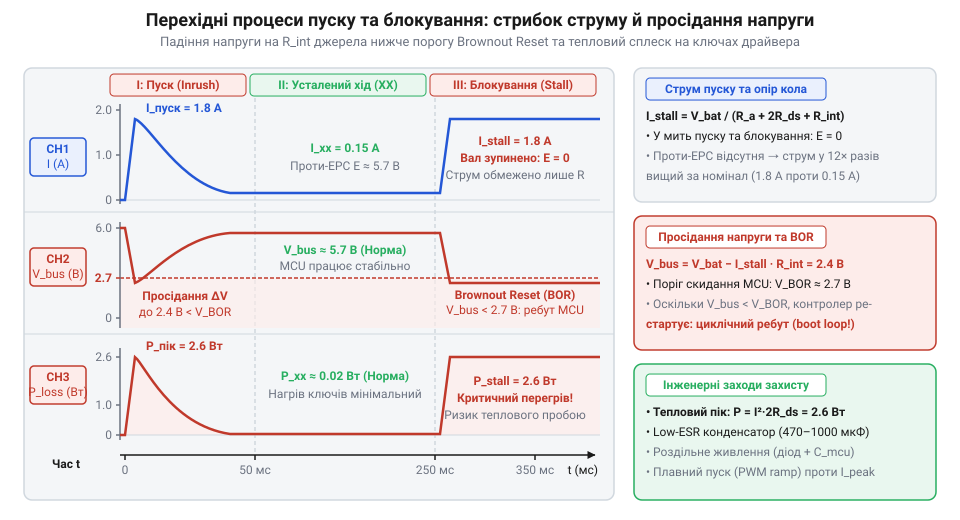
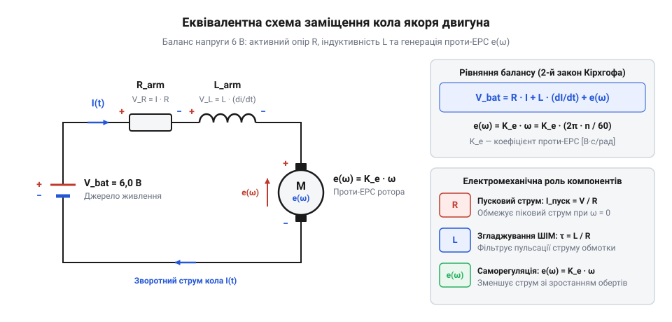
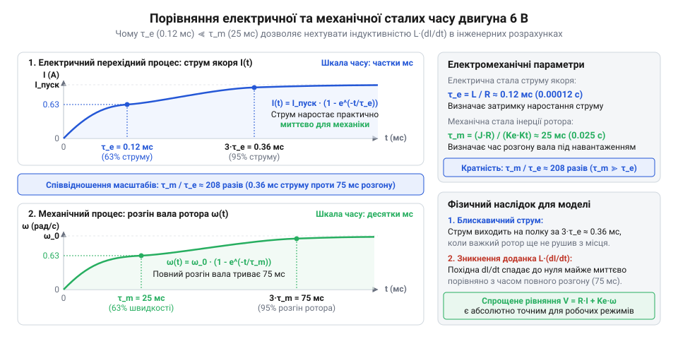
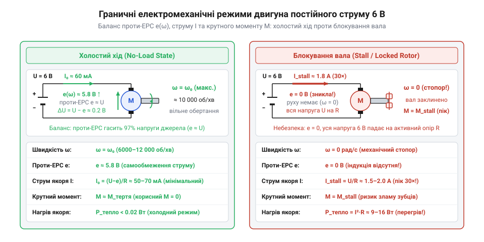
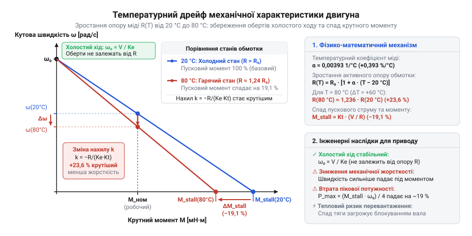
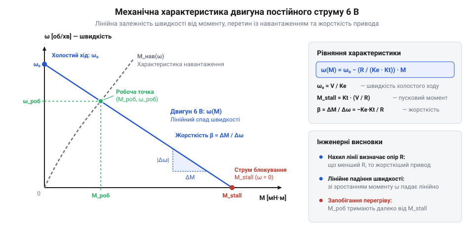
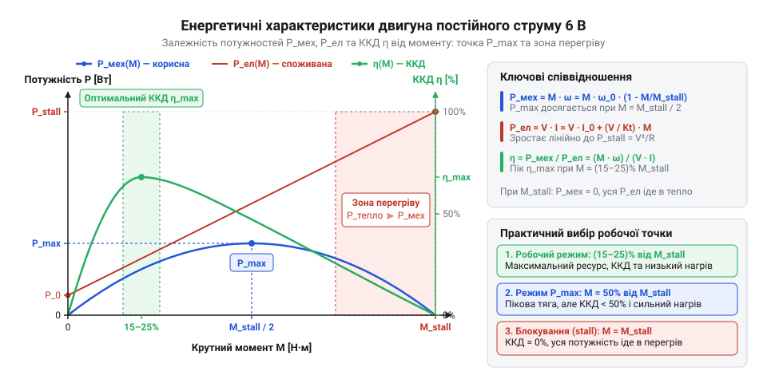
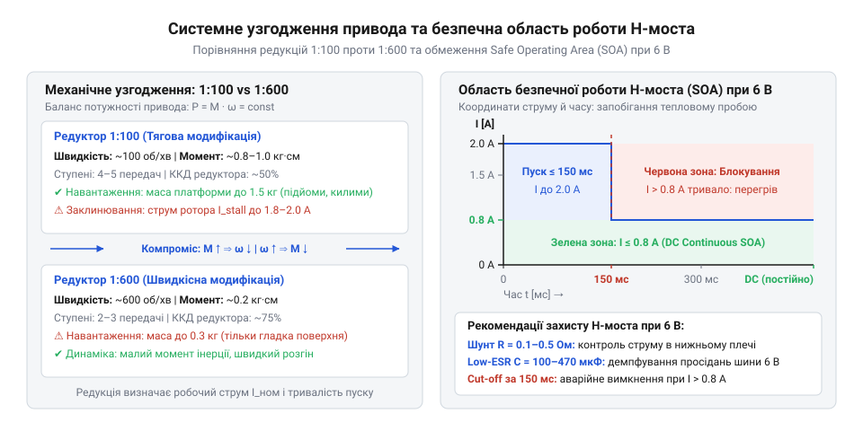

# Мотор-редуктор 6 В (100 і 600 об/хв)

<preknowlist>
- [N20 мікромотор з редуктором](root:cat-hw-actuators/n20-motor) — Конструктивна будова колекторно-щіткового вузла, призначення інтегрованого циліндричного редуктора, номінальна робоча напруга 6 В, поняття механічного заклинювання ротора та супутнього просідання шини живлення.
</preknowlist>

## Пусковий стрибок і просідання напруги: чому двигун не є звичайним резистором

Підключення компактного колекторного мотор-редуктора [N20](root:cat-hw-actuators/n20-motor) з номінальною робочою напругою 6 В до спільної шини живлення мікроконтролерного пристрою часто призводить до аварійної поведінки схеми. У момент подачі напруги або при найменшому механічному навантаженні на вихідний вал керуючий контролер раптово скидається, починаючи нескінченний цикл перезавантажень, а вихідні транзистори силового драйвера стрімко розігріваються і деградують.

Причиною такого збою є апаратне скидання через просідання напруги живлення — @@en|brownout reset@@ (від англ. *brownout* — спад напруги в мережі; [захист від просідання живлення](root:hw-arch/brownout-reset-protection)). Лінійний стабілізатор або імпульсний перетворювач втрачає здатність утримувати стабільні 3.3 В чи 5 В для логіки, коли вхідна 6-вольтова лінія провалюється через надмірний сплеск споживаного струму. Але чому мініатюрний двигун узагалі створює такий сплеск?

Якщо виміряти опір нерухомого двигуна N20 звичайним цифровим мультиметром між двома його клемами, прилад зафіксує суто омічний опір мідного дроту обмоток ротора (лат. *rotor*, від *rotare* — обертатися). Для типового 6-вольтового мікромотора цей опір становить близько `R = 8.5 Ом`. Якщо сприймати мотор як звичайний пасивний резистор (лат. *resisto* — опиратися), закон Ома дає однозначне значення струму, який двигун мав би споживати від джерела постійної напруги `U = 6 В`:

```
I
= U / R                                 [закон Ома для однорідної ділянки кола]
= (6 В) / (8.5 Ом)                      [підстановка напруги живлення та активного опору]
≈ 0.71 А                                [ділення]
```

Проте вимірювання на реальному стенді показують цілковито іншу картину. Коли двигун підключають до лабораторного блока живлення 6 В без механічного навантаження на валу, амперметр у режимі холостого ходу (англ. @@en|no-load current@@) фіксує лише `0.04–0.06 А` (40–60 мА). Це більш ніж у дванадцять разів менше за величину `0.71 А`, розраховану за законом Ома. Фізичний мідний дріт котушки не міг раптово змінити опір з 8.5 Ом до 100–150 Ом — його переріз, довжина та питомий опір залишилися незмінними.

Справжня природа привода проявляється під механічним навантаженням. Варто лише затиснути вихідний вал редуктора пальцями і примусово його зупинити, як струм миттєво підскакує вгору — від мізерних 50 мА до очікуваних `0.71 А`. Цей граничний струм заклиненого вала називають струмом блокування — @@en|stall current@@ (від англ. *stall* — заглухнути, зупинити рух). Рівно такий самий короткочасний сплеск — пусковий струм (англ. @@en|inrush current@@) — виникає під час кожного пуску двигуна з нерухомого стану, доки вал не розженеться до робочої швидкості.


*Осцилограма перехідного процесу під час пуску та заклинювання ротора 6 В двигуна: стрибок струму до рівня блокування викликає миттєве просідання напруги шини живлення нижче порогу скидання логіки мікроконтролера та різкий сплеск потужності теплових втрат на силових транзисторах драйвера.*

Цей пусковий стрибок стає руйнівним, якщо розробник спирається на "номінальний" струм руху при розрахунку силового каскаду. Електронний перемикач — наприклад, [силовий H-міст](root:hw-motion/h-bridge) (англ. @@en|H-bridge@@; мостова схема з чотирьох комутуючих ключів), побудований на малопотужних польових або біполярних транзисторах (англ. *transistor*, від *transfer* — переносити + *resistor* — опір), розрахованих лише на 200–300 мА тривалого навантаження, миттєво потрапляє в аварійний режим. Потужність теплових втрат на відкритому каналі польового транзистора пропорційна квадрату протікаючого струму:

```
P_втрат
= I² · R_DS(on)                         [закон Джоуля — Ленца для активного опору відкритого каналу]
```

При стрибку струму з 0.05 А до 0.71 А потужність нагріву кожного силового ключа зростає у `(0.71 / 0.05)² ≈ 200` разів. Кристал напівпровідника не встигає відвести тепло в навколишнє середовище, виникає локальний термоудар, і структура транзистора деградує або пробивається.

Пасивний резистор не здатен пояснити цей ефект: його електричний опір постійний і не залежить від подій у зовнішньому механічному просторі. Двигун постійного струму принципово відрізняється від пасивного елемента тим, що його електричний стан нерозривно пов'язаний із механічним рухом. Споживаний струм є не постійною паспортною константою, а функцією кутової швидкості обертання ротора `ω`. Без урахування цього електромеханічного взаємозв'язку неможливо ні забезпечити стабільність шини живлення, ні правильно підібрати компоненти силового драйвера.

> 🔧 **Навіщо це.**
> Розраховувати джерело живлення, ширину силових доріжок друкованої плати, ключі драйвера та фільтрувальні ємності за "номінальним" робочим струмом привода — типова інженерна помилка, що призводить до циклічних збоїв. Будь-який колекторний двигун під час кожного пуску або при механічному заклинюванні редуктора перетворюється на низькоомний резистор, споживаючи повний струм блокування `I_stall`. Розуміння залежності струму від швидкості дозволяє коректно вибрати запас за піковим струмом ключів, розрахувати розв'язувальні конденсатори для придушення просідання напруги та реалізувати програмний плавний пуск.

Щоб математично визначити, чому саме обертання ротора так сильно знижує споживання струму і яка фізична величина протистоїть прикладеним 6 В, необхідно побудувати внутрішню електричну схему заміщення двигуна.

## Еквівалентна схема кола якоря та фізика проти-ЕРС

Для формального розрахунку електричних процесів представимо внутрішню будову двигуна у вигляді еквівалентної схеми із зосередженими параметрами. Обертова частина колекторного двигуна, на якій розміщені робочі обмотки, називається якорем (морськ. запозичення з нід. *anker*, в електродинаміці еквівалент лат. *armatura* — захисне оснащення, обладунок). Обмотка якоря складається з кількох секцій мідного дроту, покладених у пази сталевого осердя, і з'єднується із зовнішнім колом через рухомий вузол — колектор (лат. *collector*, від *colligere* — збирати) та щітки.

У будь-який момент часу електричний контур якоря замінюється послідовним сполученням трьох базових елементів:
1. **Активний опір обмотки `R`** (лат. *activus* — дієвий): сумарний омічний опір мідного дроту котушок та перехідного контакту щітково-колекторного вузла. На цьому опорі електрична енергія необоротно розсіюється у вигляді джоулевого тепла.
2. **Еквівалентна індуктивність `L`** (лат. *inductio* — наведення, спонукання): власна індуктивність витків обмотки на феромагнітному осерді. Вона накопичує магнітну енергію та чинить інерційний опір будь-якій зміні сили струму.
3. **Джерело внутрішньої напруги — проти-ЕРС `e`** (проти-електрорушійна сила, англ. @@en|back-EMF@@, скор. від *counter-electromotive force*; [визначення швидкості за проти-ЕРС](root:hw-motion/motor-back-emf-sensing)): наведена генераторна напруга, амплітуда якої прямо пропорційна кутовій швидкості руху ротора.


*Еквівалентна електрична схема кола якоря двигуна: послідовне з'єднання активного опору обмотки R, еквівалентної індуктивності L та джерела проти-ЕРС e(ω), підключених до зовнішнього джерела постійної напруги 6 В.*

Фізична природа виникнення проти-ЕРС описується фундаментальним законом електромагнітної індукції Фарадея ([закон електромагнітної індукції Фарадея](root:ph-electromagnetism/faraday-law); англ. @@en|Faraday's law of induction@@). Статор двигуна (лат. *stator*, від *stare* — стояти) формує постійне просторове магнітне поле за допомогою пари постійних магнітів. Коли якір обертається з кутовою швидкістю `ω` (вимірюється в радіанах за секунду, рад/с; грец. *γωνία* — кут), його мідні провідники перетинають силові лінії магнітної індукції статора. Магнітний потік `Φ` (грец. *роя*, потік), що охоплюється витками котушок, безперервно змінюється з часом.

За законом Фарадея, зміна магнітного потоку породжує в контурі електрорушійну силу `e = - dΦ / dt`. Відповідно до правила Ленца, полярність наведеної ЕРС завжди спрямована так, щоб створений нею власний магнітний потік чинив опір зовнішній зміні. У двигуні постійного струму це означає, що наведена ЕРС спрямована строго назустріч зовнішній прикладеній напрузі живлення `U = 6 В`. Обертовий якір неминуче функціонує одночасно як двигун і як вбудований генератор (лат. *generator* — виробник, творець), який намагається штовхати носії заряду у зворотному напрямку.

Оскільки магнітне поле збудження створене постійними магнітами і його потік `Φ` є величиною незмінною, амплітуда генерованої проти-ЕРС прямо пропорційна виключно кутовій швидкості обертання вала `ω`:

```
e
= Ke · ω                                [рівняння проти-ЕРС для постійного магнітного потоку]
```

де `Ke` — конструктивна стала проти-ЕРС двигуна (лат. *constans* — незмінний), яка визначається кількістю витків обмотки ротора, геометрією магнітопроводу та залишковою індукцією статора. У системі СІ коефіцієнт `Ke` має розмірність вольт-секунда на радіан: `(В · с) / рад` (або вольт на рад/с).

Складемо рівняння електричного стану кола якоря за другим законом Кірхгофа. Алгебрична сума напруги джерела живлення та падінь напруг на всіх елементах замкненого контуру дорівнює нулю:

```
U
= U_R + U_L + e                         [другий закон Кірхгофа для контуру якоря]
= I · R + L · (dI/dt) + Ke · ω          [підстановка компонентних рівнянь падінь напруг]
```

Це повне лінійне диференціальне рівняння (лат. *differentia* — різниця) першого порядку для електричного кола якоря двигуна. Воно зв'язує струм `I(t)` зі швидкістю ротора `ω(t)` у динаміці.

Порівняємо два характерні часові масштаби процесів у системі: швидкість наростання електричного струму та швидкість механічного розгону ротора. Електромагнітна інерційність кола задається електричною сталою часу:

```
τ_e
= L / R                                 [означення електричної сталої часу кола]
```

Для мотор-редуктора N20 типове значення індуктивності обмотки становить `L ≈ 1.0 мГн` (`1.0 · 10⁻³ Гн`), а активний опір — `R ≈ 8.5 Ом`. Обчислимо електричну сталу часу кола якоря:

```
τ_e
= (1.0 · 10⁻³ Гн) / (8.5 Ом)             [числові значення обмотки N20]
≈ 0.000118 с                            [ділення]
≈ 0.12 мс                               [переведення в мілісекунди]
```

Електричний струм досягає 63% свого максимального значення всього за 0.12 мс, а перехідний електромагнітний процес триває менше ніж 0.5 мс (`3 · τ_e`).

Натомість механічна зміна кутової швидкості ротора лімітується моментом інерції його маси та пов'язаного редуктора. Механічна стала часу привода `τ_m` (англ. @@en|mechanical time constant@@) для моторів цього класу становить від 10 до 50 мс. Співвідношення між цими величинами виражається строгим правилом:

```
τ_e ≪ τ_m                               [співвідношення електричного та механічного масштабів часу]
```

Оскільки електрична стала часу на два порядки менша за механічну, перехідні процеси в електричному колі протікають практично миттєво відносно будь-якої відчутної зміни швидкості обертання вала. При будь-якому плавному розгоні, гальмуванні або зміні навантаження струм миттєво приймає значення, що відповідає поточній швидкості `ω`.


*Співвідношення часових масштабів перехідного процесу струму (електрична стала τ_e ≈ 0.12 мс) та механічного розгону ротора (механічна стала τ_m ≈ 25 мс): перехідні процеси в електричному колі завершуються на два порядки швидше за механічні, що наочно показує обґрунтованість відкидання dI/dt.*

Це дає змогу для всіх стаціонарних та повільних механічних процесів знехтувати індуктивним падінням напруги: `L · (dI/dt) ≈ 0`. Таке спрощення називається квазістаціонарним наближенням (лат. *quasi* — майже, нібито + *stationarius* — сталий, нерухомий). Диференціальне рівняння балансу напруг зводиться до алгебричного:

```
U
= I · R + Ke · ω                        [квазістаціонарний баланс напруг при dI/dt ≈ 0]
```

Виразимо звідси усталений струм кола якоря:

```
I
= (U - e) / R                           [закон Ома для кола з проти-ЕРС]
= (U - Ke · ω) / R                      [підстановка виразу проти-ЕРС e = Ke · ω]
```

Отримана залежність розкриває фізичну основу роботи двигуна при напрузі 6 В:
- **У режимі блокування вала (`ω = 0`):** ротор зупинено, провідники не перетинають магнітне поле статора, і проти-ЕРС зникає (`e = 0`). Струм обмежується виключно омічним опором міді:

```
I_stall
= U / R                                 [струм блокування при ω = 0 і e = 0]
= (6 В) / (8.5 Ом)                      [підстановка напруги живлення та активного опору]
≈ 0.71 А                                [ділення]
```

- **У режимі холостого ходу без навантаження (`ω = ω_0`):** ротор розвиває граничну кутову швидкість `ω_0`. Витки перетинають магнітний потік із максимальною частотою, і проти-ЕРС досягає рівня, близького до напруги джерела: `e ≈ 5.65 В`. Результуюча різниця напруг на активному опорі падає до десятих часток вольта:

```
U - e
= 6.0 В - 5.65 В                        [різниця зовнішньої напруги та внутрішньої проти-ЕРС]
= 0.35 В                                [віднімання]
```

Струм якоря автоматично зменшується до величини струму холостого ходу:

```
I_0
= (0.35 В) / (8.5 Ом)                   [струм холостого ходу]
≈ 0.041 А = 41 мА                       [ділення]
```

Цього малого струму рівно достатньо для створення обертового моменту, що компенсує внутрішнє тертя в підшипниках та на щітках.
- **Під час збільшення механічного опору на валу:** момент навантаження пригальмовує ротор, швидкість `ω` падає, проти-ЕРС `e = Ke · ω` зменшується, чисельник `(U - e)` зростає, і струм `I` автоматично збільшується, генеруючи додаткове тягове зусилля.

> 🔧 **Навіщо це.**
> Квазістаціонарне рівняння `I = (U - Ke · ω) / R` дає інженеру аналітичний інструмент для розрахунку теплових та електричних параметрів привода без складних прямих вимірювань під навантаженням. Знаючи паспортні параметри двигуна `R` та `Ke`, можна обчислити струм і нагрів обмотки для будь-якої заданої швидкості руху. Крім того, це рівняння лежить в основі безсенсорного керування (англ. @@en|sensorless control@@): вимірюючи напругу `U` та струм `I` на вимірювальному шунті драйвера, мікроконтролер обчислює поточну проти-ЕРС `e = U - I · R`, а з неї визначає швидкість обертання вала `ω = e / Ke` без встановлення оптичних чи магнітних енкодерів.

Колекторний двигун є замкненою електромеханічною системою зі зворотним зв'язком: механічна швидкість вала визначає електричний струм через проти-ЕРС, а електричний струм формує механічний крутний момент, який підтримує цю швидкість.

## Електромагнітний крутний момент, тотожність констант і граничні стани при 6 В

Провідник зі струмом, вміщений у поперечне магнітне поле, зазнає дії механічного зусилля. Це фундаментальний прояв магнітної складової сили Лоренца (названої на честь нідерландського фізика Гендріка Лоренца, англ. @@en|Lorentz force@@), яка відхиляє рухомі заряди всередині кристалічної ґратки провідника. На одиночний провідник активної довжини `l`, через який тече струм `I` у магнітному полі з індукцією `B`, діє сила:

```
F = B · I · l                     [сила Лоренца для провідника зі струмом]
```

У роторі колекторного двигуна провідники обмотки закріплені в пазах осердя на відстані `r` (радіус якоря) від осі обертання. Сила, що діє на провідник, створює елементарний механічний крутний момент (лат. *momentum* — рушійна сила, поштовх, англ. @@en|torque@@) відносно осі:

```
M_1 = F · r
= B · I · l · r                   [момент одного провідника на плечі ротора]
```

Ротор складається з просторово розподілених секцій, що сумарно містять `N_a` активних провідників, зкомутованих пластинами колектора. Оскільки внутрішня геометрія ротора та магнітний потік `Φ` постійних магнітів статора залишаються незмінними, усі конструктивні параметри згортаються в єдиний коефіцієнт — сталу крутного моменту двигуна (лат. *constans* — постійний, незмінний, англ. @@en|torque constant@@), яку позначають `K_t`:

```
M_em = K_t · I                    [електромагнітний крутний момент двигуна]
```

де `M_em` — сумарний електромагнітний момент (Н·м), `I` — струм у колі якоря (А), а стала `K_t` вимірюється в `Н·м / А`. Залежність між струмом якоря та крутним моментом є строго лінійною: подвоєння сили струму в обмотці приводить до рівно двократного зростання обертового зусилля на валу.

Електромеханічний перетворювач пов'язує електричний контур із механічним рухом. Коли ротор обертається з кутовою швидкістю `ω` (грец. *gonia* — кут), у його витках за законом електромагнітної індукції наводиться проти-ЕРС (електрорушійна сила, скорочення від лат. *electrum* та грец. *dynamis* — сила, англ. @@en|back electromotive force@@):

```
e = K_e · ω                       [проти-ЕРС як функція кутової швидкості]
```

де `K_e` — стала проти-ЕРС двигуна, що вимірюється у `В / (рад/с)`.

Електрична потужність, яка відбирається від джерела живлення за вирахуванням омічного нагріву міді (`I² · R`), трансформується магнітним полем у механічний рух. Ця потужність внутрішнього електромеханічного перетворення `P_em` дорівнює добутку проти-ЕРС на струм якоря:

```
P_em = e · I                      [електрична потужність перетворення]
```

Одночасно з боку механіки електромагнітні сили здійснюють роботу з механічною потужністю `P_мех`, яка визначається добутком розвиваного електромагнітного моменту на кутову швидкість вала:

```
P_мех = M_em · ω                  [розвивана механічна потужність]
```

В ідеальному електромеханічному перетворювачі магнітне поле статора передає потужність без внутрішнього накопичення чи додаткового розсіювання: активний опір винесено в електричну частину моделі, а тертя — в механічну. За фундаментальним законом збереження енергії ці дві потужності мусять бути тотожними:

```
P_em = P_мех                      [закон збереження потужності перетворення]
e · I = M_em · ω                  [рівність електричної та механічної потужностей]
(K_e · ω) · I = (K_t · I) · ω     [підстановка виразів проти-ЕРС та моменту]
K_e · ω · I = K_t · ω · I         [комутативність добутку скалярних величин]
K_e = K_t                         [скорочення на спільний добуток ω · I ≠ 0]
```

У міжнародній системі одиниць СІ стала проти-ЕРС `K_e` і стала крутного моменту `K_t` чисельно рівні. Розмірності цих двох коефіцієнтів фізично тотожні:

```
[K_e] = В / (рад/с)
= (В · с) / рад                   [розмірність коефіцієнта проти-ЕРС]
= ((Дж / Кл) · с) / рад           [за визначенням вольта: 1 В = 1 Дж / 1 Кл]
= ((Н · м / (А · с)) · с) / рад   [за визначенням кулона: 1 Кл = 1 А · с]
= (Н · м) / (А · рад)             [скорочення секунд]
= Н · м / А                       [радіан є безрозмірним геометричним кутом]
= [K_t]                           [розмірність коефіцієнта крутного моменту]
```

Це спрощує інженерні розрахунки: визначивши експериментально проти-ЕРС двигуна на заданій швидкості обертання, конструктор автоматично отримує коефіцієнт крутного моменту безпосередньо в `Н·м / А`.

Динаміка обертання ротора описується другим законом Ньютона для обертального руху відносно поздовжньої осі. Кутове прискорення `dω / dt` визначається різницею між рушійним моментом та силами опору:

```
J · (dω / dt) = M_em - M_нав - M_тер   [диференціальне рівняння руху ротора]
```

де `J` — момент інерції ротора (лат. *inertia* — бездіяльність, непорушність, англ. @@en|moment of inertia@@), що вимірюється в `кг · м²`;
`M_em = K_t · I` — рушійний електромагнітний крутний момент;
`M_нав` — гальмівний момент зовнішнього корисного навантаження;
`M_тер` — внутрішній гальмівний момент тертя в підшипниках, втулках ковзання та щітковому вузлі.

Коли прискорювальні процеси завершуються і швидкість стабілізується (`dω / dt = 0`), диференціальне рівняння переходить у статичний баланс моментів:

```
M_em = M_нав + M_тер              [умова квазістаціонарної рівноваги моментів]
```

Робота двигуна при живленні фіксованою напругою 6 В обмежена двома граничними станами, між якими розподілені всі можливі робочі точки.

**Режим ідеального холостого ходу (англ. @@en|no-load condition@@).**
Зовнішнє корисне навантаження повністю відсутнє: `M_нав = 0`. В ідеальному двигуні без внутрішнього тертя (`M_тер = 0`) для підтримки незмінної швидкості рушійний момент не потрібен: `M_em = 0`. Отже, струм якоря спадає до нуля:

```
I = 0 А                           [струм ідеального холостого ходу]
```

Оскільки струм визначається виразом `I = (U - e) / R = 0`, проти-ЕРС мусить точно зрівноважити прикладену живильну напругу `U = 6 В`:

```
e = U = 6 В                       [повна компенсація напруги проти-ЕРС]
```

Кутова швидкість ротора досягає теоретичної верхньої межі — швидкості ідеального холостого ходу:

```
ω_0 = U / K_e
= 6 / K_e                         [кутова швидкість холостого ходу при 6 В]
```

У реальному двигуні внутрішнє тертя втулок і контакт щіток вимагають постійного подолання: `M_тер > 0`. Щоб утримувати швидкість, ротор мусить розвивати момент `M_em = M_тер`. Через це фактичний струм холостого ходу `I_0` ніколи не спадає до нуля:

```
I_0 = M_тер / K_t                 [фактичний струм холостого ходу]
```

Через падіння напруги `I_0 · R` на активному опорі обмотки проти-ЕРС виявляється трохи нижчою за 6 В:

```
e_xx = 6 - I_0 · R                [фактична проти-ЕРС холостого ходу]
```

Відповідно, реальна швидкість холостого ходу `ω_xx = (6 - I_0 · R) / K_e` на 1–3% менша за теоретичну швидкість `ω_0`.

**Критичний режим повного блокування ротора (заклинювання, англ. @@en|stall condition@@).**
Вал двигуна нерухомо затиснуто зовнішнім зусиллям або заклинено в механізмі: `ω = 0`.
Через відсутність руху провідники не перетинають магнітні силові лінії, тому швидкість зміни магнітного потоку дорівнює нулю і за законом Фарадея проти-ЕРС зникає:

```
e = K_e · 0 = 0 В                 [зникнення проти-ЕРС при заклинюванні]
```

З електричного контуру випадає внутрішній зустрічний потенціал, що обмежував струм під час руху. Струм у колі якоря визначається виключно омічним опором мідного дроту обмоток `R`:

```
I_stall = U / R
= 6 / R                           [пусковий струм блокування при 6 В]
```

За максимального струму створюваний електромагнітний момент також сягає пікового теоретичного значення — моменту заклинювання (пускового моменту):

```
M_stall = K_t · I_stall
= K_t · (6 / R)                   [максимальний пусковий момент при 6 В]
```

У стані заклинювання корисна механічна потужність дорівнює нулю (`P_мех = M_stall · 0 = 0 Вт`), але споживана від джерела живлення електрична потужність досягає свого піка:

```
P_ел = 6 · I_stall
= 6² / R
= 36 / R                          [електрична потужність втрат при 6 В]
```

Уся ця енергія без залишку перетворюється на тепло Джоуля-Ленца в тонкому дроті обмоток. Оскільки маса міді ротора становить лічені грами, обмотка нагрівається зі швидкістю десятків градусів за секунду. За тривалого заклинювання без спрацьовування струмового захисту лакова ізоляція витків розплавляється, що спричиняє міжвитковий пробій і незворотний вихід мотора з ладу.


*Діаграма балансу напруг і моментів у двох граничних режимах: при холостому ході проти-ЕРС зрівноважує прикладену напругу 6 В за мінімального струму I_0, а під час заклинювання ротора проти-ЕРС спадає до нуля, спричиняючи стрибок струму до I_stall = 6/R і сплеск моменту.*

> 🔧 **Навіщо це.** Струм блокування `I_stall` задає граничні вимоги до схемотехніки керування. Якщо силовий мікроконтролерний комутатор, такий як драйвер [H-міст для керування двигуном постійного струму](root:hw-motion/h-bridge), обрано без урахування `I_stall`, випадкове заклинювання ротора миттєво спалить вихідні польові транзистори через лавинне тепловий пробій. Окрім того, стрибок струму до `I_stall` призводить до глибокого просідання напруги на загальній 6-вольтовій шині, що викликає апаратне перезавантаження чутливої цифрової електроніки.

**Розрахунок граничних параметрів 6-вольтового мікромотора.**
Розглянемо параметри колекторного мікромотора типу [N20 мікромотор з редуктором](root:cat-hw-actuators/n20-motor). Активний опір його якірної обмотки становить `R = 8.5 Ом`. Виміряна частота обертання вала ротора без навантаження на вході в редуктор сягає 15 000 об/хв. Переведемо частоту обертання в кутову швидкість:

```
ω_0 = (15000 · 2 · π) / 60
≈ 1570.8 рад/с                    [переведення частоти обертання в кутову швидкість]
```

Обчислюємо електромеханічні константи `K_e` та `K_t`:

```
K_e = U / ω_0
= 6 / 1570.8
≈ 0.00382 В·с / рад               [коефіцієнт проти-ЕРС]
K_t = K_e ≈ 0.00382 Н·м / А       [коефіцієнт крутного моменту за тотожністю СІ]
```

Розраховуємо струм блокування та максимальний пусковий момент вала ротора при напрузі 6 В:

```
I_stall = U / R
= 6 / 8.5
≈ 0.706 А                         [піковий струм блокування при 6 В]
M_stall = K_t · I_stall
= 0.00382 · 0.706
≈ 0.00270 Н·м = 2.70 мН·м         [піковий крутний момент ротора без редукції]
```

Теплова потужність, яка розсіюється на міді якоря при заклинюванні вала:

```
P_втрат = U · I_stall
= 6 · 0.706
≈ 4.24 Вт                         [теплова потужність джоулевих втрат]
```

Для двигуна вагою близько 10 грамів постійне розсіювання 4.24 Вт призводить до катастрофічного нагріву за 3–5 секунд, тому джерело живлення 6 В та драйвер обов'язково розраховують на тривалий струм щонайменше 0.71 А або захищають схемою струмового відсікання.

## Лінійна механічна характеристика, жорсткість і статична робоча точка привода

Між двома екстремальними полюсами — вільним обертанням без навантаження на швидкості `ω_0` та повною зупинкою ротора із заклинюванням при моменті `M_stall` — розгортається весь робочий діапазон привода. Для проектування корисної роботи машини необхідно знати, на скільки саме сповільниться вал двигуна при прикладанні довільного проміжного моменту опору.

Функціональну залежність кутової швидкості обертання вала від розвиваного крутного моменту називають механічною характеристикою електродвигуна (грец. *mechanike* — мистецтво проектувати машини, грец. *charakter* — риса, прикмета, англ. @@en|torque-speed characteristic@@).

Знайдемо цю залежність аналітично. Квазістаціонарне рівняння балансу напруг у колі якоря має вигляд:

```
U = e + I · R                     [квазістаціонарне рівняння балансу напруг]
```

Виразимо проти-ЕРС через кутову швидкість `e = K_e · ω`. Струм якоря зв'язаний із крутним моментом співвідношенням `M_em = K_t · I`. В усталеному стані рушійний електромагнітний момент врівноважує сумарний момент опору на валу `M_em = M`, звідки струм дорівнює:

```
I = M / K_t                       [струм як функція крутного моменту]
```

Підставимо отримані вирази для проти-ЕРС `e` та струму `I` в рівняння балансу напруг:

```
U = K_e · ω + (M / K_t) · R       [підстановка проти-ЕРС та струму через момент]
K_e · ω = U - (R / K_t) · M       [перенесення падіння напруги на опорі обмотки]
ω(M) = (U / K_e) - (R / (K_e · K_t)) · M   [ділення обох частин рівняння на K_e]
```

Отриманий вираз є класичним рівнянням прямої лінії вигляду `y(x) = y_0 - k · x`.
Перший член `U / K_e` відповідає швидкості ідеального холостого ходу `ω_0`.
Коефіцієнт нахилу зв'язаний із граничним моментом блокування `M_stall = (K_t · U) / R`:

```
R / (K_e · K_t) = (U / K_e) / ((K_t · U) / R)
= ω_0 / M_stall                   [зв'язок нахилу з граничними параметрами]
```

Підставивши цей вираз, записуємо нормалізоване рівняння механічної характеристики двигуна:

```
ω(M) = ω_0 · (1 - M / M_stall)    [лінійне рівняння механічної характеристики]
```

При фіксованій живильній напрузі 6 В кутова швидкість обертання лінійно спадає зі зростанням корисного моменту навантаження: кожному приросту моменту відповідає пропорційне падіння швидкості ротора.

Кутовий нахил прямої лінії визначає чутливість частоти обертання до механічного навантаження. Величину, що показує здатність електромеханічної системи утримувати швидкість при зростанні моменту, називають статичною жорсткістю механічної характеристики (англ. @@en|speed regulation@@ або @@en|mechanical stiffness@@, позначається грецькою літерою `β`):

```
β = |dM / dω|
= (K_e · K_t) / R                 [статична жорсткість механічної характеристики]
```

Розмірність жорсткості в системі СІ:

```
[β] = (Н·м) / (рад/с)
= (Н · м · с) / рад               [розмірність статичної жорсткості]
```

Фізичний зміст жорсткості `β`:
- Що менший активний опір міді `R` і що сильніше магнітне поле статора (більші константи `K_e` та `K_t`), то вища величина `β`. Механічна характеристика є пологою («жорсткою»): навіть суттєве зростання навантаження викликає лише незначне сповільнення ротора.
- У малопотужних мініатюрних двигунах через тонкий дріт обмотки опір `R` відносно великий, тому величина `β` мала. Їхня характеристика є крутою («м'якою»): швидкість помітно просідає навіть за помірного моменту опору.

Важлива властивість: формула `β = (K_e · K_t) / R` не містить живильної напруги `U`. Жорсткість є інваріантом конструкції двигуна (лат. *invariabilis* — незмінний). Якщо змінювати живильну напругу (наприклад, живити мотор від 3 В чи регулювати напругу через ШІМ), нахил прямої не змінюється: лінія зміщується паралельно самій собі вздовж осі швидкості `ω`.


*Зсув і зміна нахилу механічної характеристики двигуна внаслідок нагрівання мідної обмотки від 20 °C до 80 °C при тривалому навантаженні: зростання активного опору міді знижує статичну жорсткість характеристики та пусковий момент, спричиняючи додаткове просідання робочої частоти обертання.*

Здатність двигуна самостійно генерувати потрібний момент без зовнішніх контролерів базується на природному контурі від'ємного зворотного зв'язку (англ. @@en|negative feedback@@) за проти-ЕРС:

1. До вала, що обертався з усталеною швидкістю, прикладається додатковий гальмівний момент навантаження `M_нав`.
2. Виникає нерівновага моментів: рушійний електромагнітний момент менший за сумарний опір (`M_em - M_нав < 0`).
3. За диференціальним рівнянням руху ротора `J · (dω / dt) < 0` ротор починає гальмувати, його кутова швидкість `ω` падає.
4. Зменшення швидкості за законом Фарадея автоматично зменшує індуковану проти-ЕРС: `e = K_e · ω ↓`.
5. Зниження проти-ЕРС збільшує падіння напруги на омічному опорі обмотки: `ΔU = U - e ↑`.
6. За законом Ома струм через якір зростає: `I = (U - e) / R ↑`.
7. Зростання струму за силою Ампера збільшує рушійний електромагнітний крутний момент: `M_em = K_t · I ↑`.
8. Зростаючий момент гальмує падіння швидкості. Сповільнення ротора припиняється рівно тоді, коли новий момент `M_em` зрівноважує збільшений момент навантаження: `M_em = M_нав + M_тер`.
9. Двигун переходить у нову точку рівноваги `dω / dt = 0`, але вже за меншої швидкості та більшого струму.

Проти-ЕРС виконує роль безінерційного вбудованого регулятора струму, який миттєво транслює зміни механічного опору на валу у відповідну зміну споживання електричної потужності.

Статична робоча точка привода (англ. @@en|operating point@@) — це стан динамічної рівноваги, за якого електромагнітний момент двигуна точно дорівнює моменту опору керованого механізму при однаковій кутовій швидкості:

```
M_em(ω) = M_нав(ω) + M_тер        [умова рівноваги в статичній робочій точці]
```

Геометрично робоча точка `(M_роб, ω_роб)` є перетином низхідної лінії механічної характеристики двигуна `ω(M)` та висхідної навантажувальної характеристики приєднаного механізму `M_нав(ω)`.

Залежність моменту опору від швидкості визначається фізикою механізму:
- Постійний момент опору (`M_нав = const`): підйом вантажу проти сили тяжіння або сухе тертя ковзання. На площині `(M, ω)` це вертикальна пряма. Робоча швидкість зміщується вниз пропорційно моменту:
```
ω_роб = ω_0 - (M_нав / β)         [робоча швидкість за постійного моменту опору]
```
- В'язке тертя (`M_нав = b_v · ω`): ламінарне тертя у рідинних опорах ковзання, де опір зростає лінійно зі швидкістю.
- Вентиляторний (квадратичний) опір (`M_нав = c_w · ω²`): аеродинамічний опір лопатей у пристроях на зразок [5V безколекторні вентилятори](root:cat-hw-actuators/fan-5v) або гідродинамічний опір робочого колеса у приводах типу [Водяна помпа RS-360SH](root:cat-hw-actuators/water-pump-rs360sh). Точка перетину параболи навантаження з прямою двигуна однозначно фіксує усталену частоту обертання та робочий струм.


*Графік лінійної механічної характеристики двигуна при напрузі 6 В (кутова швидкість як функція крутного моменту): лінія сполучає точки холостого ходу та заклинювання, а її перетин із кривою навантаження визначає положення статичної робочої точки привода.*

> 🔧 **Навіщо це.** Побудова механічної характеристики позбавляє потреби підбирати мотор експериментально. Маючи рівняння навантаження механізму, конструктор ще до виготовлення деталей розраховує, на скільки впадуть оберти колеса робота при зміні поверхні, чи вистачить крутного моменту на підйомі та який струм споживатиме пристрій від акумулятора при 6 В.

**Розрахунок робочої точки мікромотора N20 під навантаженням.**
Використаємо параметри двигуна N20: живильна напруга `U = 6 В`, опір якоря `R = 8.5 Ом`, сталі двигуна `K_e = K_t = 0.00382 Н·м / А`, швидкість холостого ходу `ω_0 = 1570.8 рад/с` (15 000 об/хв), пусковий момент заклинювання `M_stall = 0.00270 Н·м`.

Обчислимо статичну жорсткість механічної характеристики:

```
β = (K_e · K_t) / R
= (0.00382 · 0.00382) / 8.5
= 0.00001459 / 8.5
≈ 1.717 · 10⁻⁶ (Н·м·с) / рад     [статична жорсткість характеристики двигуна]
```

Нехай до вала двигуна прикладено постійний корисний момент навантаження `M_нав = 0.00080 Н·м` (0.80 мН·м, що становить близько 30% від пускового моменту), а момент внутрішнього тертя дорівнює `M_тер = 0.00010 Н·м`.
Сумарний гальмівний момент на валу становить:

```
M_сумарний = M_нав + M_тер
= 0.00080 + 0.00010
= 0.00090 Н·м = 0.90 мН·м        [сумарний момент опору в робочій точці]
```

Визначаємо усталену кутову швидкість ротора в робочій точці:

```
ω_роб = ω_0 - (M_сумарний / β)
= 1570.8 - (0.00090 / (1.717 · 10⁻⁶))
= 1570.8 - 524.2
= 1046.6 рад/с                   [усталена кутова швидкість під навантаженням]
```

Переведемо отриману швидкість у частоту обертання:

```
n_роб = (ω_роб · 60) / (2 · π)
= (1046.6 · 60) / (2 · 3.14159)
≈ 9994 об/хв                     [частота обертання під робочим навантаженням]
```

Під дією 33% сумарного навантаження швидкість ротора зменшилася рівно на одну третину — з 15 000 об/хв до приблизно 10 000 об/хв, що підтверджує строгу лінійність моделі.

Обчислюємо електричні показники в робочій точці:

```
I_роб = M_сумарний / K_t
= 0.00090 / 0.00382
≈ 0.236 А = 236 мА               [робочий струм якоря]
e_роб = K_e · ω_роб
= 0.00382 · 1046.6
≈ 4.00 В                         [проти-ЕРС на робочій швидкості]
```

Перевіримо електричний баланс кола якоря при 6 В:

```
U_перевірка = e_роб + I_роб · R
= 4.00 + 0.236 · 8.5
= 4.00 + 2.00
= 6.00 В                         [баланс напруг кола якоря повністю зійшовся]
```

Розрахунок наочно показує фізику процесу: під дією навантаження швидкість знизилася рівно настільки, щоб проти-ЕРС впала з 6.00 В до 4.00 В. Звільнені 2.00 В різниці напруг створили через опір 8.5 Ом струм 236 мА, який забезпечив необхідний крутний момент 0.90 мН·м.

## Корисна потужність, теплові втрати та оптимум коефіцієнта корисної дії

Коли електромеханічна система переміщує навантаження, перше інженерне прагнення — отримати від привода якомога більшу механічну роботу за одиницю часу, тобто максимізувати корисну механічну потужність (англ. @@en|mechanical power@@, від лат. *potentia* — сила, здатність діяти). Якщо ротор під напругою 6 В навантажувати сильніше, крутний момент зростає, але кутова швидкість обертання неминуче падає. У якій саме точці вал віддає найбільшу потужність у зовнішнє середовище? Небезпечна пастка полягає в тому, що режим максимальної механічної віддачі є водночас точкою катастрофічного теплового перевантаження: у ній рівно половина підведеної електричної енергії перетворюється на тепло всередині обмотки якоря, а коефіцієнт корисної дії падає нижче прийнятного рівня.

Корисна механічна потужність обертового руху `P_мех` визначається як добуток крутного моменту `M` на кутову швидкість `ω`. Оскільки між кутовою швидкістю та крутним моментом діє лінійний зв'язок механічної характеристики `ω(M) = ω_0 · (1 - M / M_stall)`, де `ω_0` — кутова швидкість ідеального холостого ходу, а `M_stall` — пусковий момент повного заклинювання ротора, вираз для потужності набуває вигляду квадратичної функції:

```text
P_мех(M)
= M · ω                               [означення обертальної механічної потужності]
= M · ω_0 · (1 - M / M_stall)         [підстановка лінійної механічної характеристики ω(M)]
= ω_0 · M - (ω_0 / M_stall) · M²      [розкриття дужок: залежність другого порядку від моменту]
```

Графік цієї залежності є класичною параболою, вітки якої спрямовані вниз, оскільки коефіцієнт при квадратичному члені `-ω_0 / M_stall` строго від'ємний. Функція має два нульові значення:
1. При `M = 0` (режим ідеального холостого ходу): ротор обертається з граничною кутовою швидкістю `ω_0`, проте механічний момент опору на валу відсутній, тому корисна робота не виконується: `P_мех(0) = 0`.
2. При `M = M_stall` (режим повного механічного заклинювання вала): ротор створює граничний крутний момент `M_stall`, але кутова швидкість спадає до нуля (`ω = 0`). Обертання припиняється, отже, механічна потужність знову дорівнює нулю: `P_мех(M_stall) = 0`.

Оскільки квадратична парабола є строго симетричною відносно своєї вершини, її єдиний локальний максимум розташований точно посередині між нулями. Знайдемо цю екстремальну точку через першу похідну:

```text
dP_мех / dM
= d(ω_0 · M - (ω_0 / M_stall) · M²) / dM   [взяття першої похідної функції потужності за моментом]
= ω_0 - 2 · (ω_0 / M_stall) · M            [диференціювання степеневих доданків]
= 0                                        [необхідна умова екстремуму гладкої функції]
```

```text
2 · (ω_0 / M_stall) · M
= ω_0                                 [перенесення лінійного члена у праву частину]
```

```text
M
= M_stall / 2                         [скорочення на ω_0 та виділення точки максимуму моменту]
```

Підставивши знайдений момент `M = M_stall / 2` назад у рівняння лінійної механічної характеристики, отримуємо робочу кутову швидкість ротора в точці пікової механічної потужності:

```text
ω
= ω_0 · (1 - (M_stall / 2) / M_stall) [підстановка моменту у вираз кутової швидкості]
= ω_0 · (1 - 1 / 2)                   [скорочення моменту заклинювання]
= ω_0 / 2                             [кутова швидкість дорівнює рівно половині холостої швидкості]
```

Обчислимо граничне значення цієї максимальної корисної механічної потужності:

```text
P_мех,max
= M · ω                               [формула потужності через параметри робочої точки]
= (M_stall / 2) · (ω_0 / 2)           [підстановка знайдених екстремальних координат]
= (M_stall · ω_0) / 4                 [спрощення добутку дробів]
= ((Kt · I_stall) · (U / Ke)) / 4     [вираження граничних величин через Kt, Ke та I_stall]
= (U · I_stall) / 4                   [числова тотожність Ke = Kt у системі одиниць СІ]
```

Тепер простежимо, що в цей самий момент відбувається з електричною енергією. Від джерела живлення з постійною напругою `U = 6 В` двигун споживає електричну потужність `P_ел = U · I` (англ. @@en|electrical power@@). Оскільки в точці пікової механічної віддачі швидкість вала зменшилася вдвічі (`ω = ω_0 / 2`), згенерована проти-ЕРС (електрорушійна сила, що протидіє струму за законом Фарадея) також становить рівно половину від напруги живлення:

```text
e
= Ke · ω                              [закон електромагнітної індукції для обмотки якоря]
= Ke · (ω_0 / 2)                      [підстановка кутової швидкості в точці максимуму потужності]
= Ke · (U / (2 · Ke))                 [підстановка виразу швидкості холостого ходу ω_0 = U / Ke]
= U / 2                               [проти-ЕРС дорівнює половині напруги джерела живлення]
```

Струм якоря у квазістаціонарному стані визначається різницею між прикладеною напругою `U` та проти-ЕРС `e`, поділеною на активний омічний опір обмотки `R`:

```text
I
= (U - e) / R                         [закон Ома для кола якоря з урахуванням проти-ЕРС]
= (U - U / 2) / R                     [підстановка величини проти-ЕРС e = U / 2]
= U / (2 · R)                         [результуюча спадна різниця потенціалів на опорі якоря]
= I_stall / 2                         [струм у точці піку потужності дорівнює половині струму блокування]
```

Звідси споживана від 6-вольтової шини повна електрична потужність дорівнює:

```text
P_ел
= U · I                               [загальна електрична потужність, споживана від джерела]
= U · (I_stall / 2)                   [підстановка робочого струму I = I_stall / 2]
= (U · I_stall) / 2                   [електрична потужність джерела живлення]
```

Куди зникає різниця між підведеною електричною потужністю `P_ел` та корисною механічною потужністю `P_мех,max`? Вона повністю розсіюється у вигляді тепла. Теплові джоулеві втрати (англ. @@en|Joule losses@@, за ім'ям англійського фізика Джеймса Джоуля, англ. @@en|Joule heating@@; від лат. *calor* — тепло та *resistentia* — опір) на активному опорі мідного дроту обмотки ротора підкоряються закону Джоуля — Ленца:

```text
P_втрат
= I² · R                              [закон Джоуля — Ленца для омічного опору обмотки якоря]
= (I_stall / 2)² · R                  [підстановка робочого струму I = I_stall / 2]
= (I_stall² · R) / 4                  [піднесення дробу до квадрата]
= (I_stall · (I_stall · R)) / 4       [групування множників у чисельнику]
= (U · I_stall) / 4                   [підстановка падіння напруги в заблокованому роторі U = I_stall · R]
```

Зведемо баланс потужностей системи:

```text
P_ел
= P_мех,max + P_втрат                 [закон збереження енергії для електромеханічного кола]
= (U · I_stall) / 4 + (U · I_stall) / 4 [сума корисної механічної потужності та теплових втрат]
= (U · I_stall) / 2                   [повна електрична потужність, спожита від джерела]
```

Висновок невблаганний: у точці максимальної механічної потужності корисна потужність і теплові втрати строго однакові: `P_мех,max = P_втрат = (U · I_stall) / 4`. Половина всієї енергії джерела перетворюється на тепло безпосередньо у тонких витках ротора.

Енергетичну ефективність перетворення описує коефіцієнт корисної дії (ККД, англ. @@en|efficiency@@, від лат. *coefficiens* — той, що сприяє, та *efficere* — здійснювати; позначається грецькою літерою `η` — ета), який дорівнює відношенню корисної механічної потужності до повної електричної: `η = P_мех / P_ел`. У точці пікової механічної потужності теоретичний ККД становить:

```text
η
= P_мех,max / P_ел                    [означення коефіцієнта корисної дії]
= ((U · I_stall) / 4) / ((U · I_stall) / 2) [підстановка механічної та електричної потужностей]
= 1 / 2 = 0.5                         [скорочення спільних множників: рівно 50%]
```

У реальному двигуні в колі якоря завжди протікає струм холостого ходу `I_0` (англ. @@en|no-load current@@), зумовлений тертям щіток об колектор, гідродинамічним опором мастила в підшипниках та вихровими струмами в осерді ротора. Загальний струм під навантаженням описується виразом `I(M) = I_0 + M / Kt`. З урахуванням цього крива ККД набуває форми:

```text
η(M)
= P_мех / P_ел                        [означення ККД реального двигуна]
= (M · ω_0 · (1 - M / M_stall)) / (U · (I_0 + M / Kt)) [розгорнутий вираз через параметри навантаження]
```

Проаналізуємо поведінку функції `η(M)` на границях:
- При `M → 0`: корисна механічна потужність прямує до нуля, але джерело 6 В віддає потужність холостого ходу `P_ел,0 = U · I_0 > 0`. Отже, `η(0) = 0`. Уся енергія витрачається на подолання внутрішніх втрат.
- При `M = M_stall`: ротор заблокований, кутова швидкість дорівнює нулю, тому механічна потужність `P_мех = 0`. Споживання від джерела сягає піка `P_ел = U · I_stall`, і вся ця енергія виділяється у вигляді тепла в заблокованій обмотці. Отже, `η(M_stall) = 0`.

Оскільки функція `η(M)` неперервна, дорівнює нулю на обох краях робочого діапазону і строго додатна між ними, вона досягає максимуму у внутрішній точці `M_opt`. Якщо позначити безрозмірний момент як `m = M / M_stall ∈ [0, 1]`, а відношення струмів як `γ = I_0 / I_stall`, функція ККД записується у вигляді:

```text
η(m)
= (m - m²) / (γ + m)                  [безрозмірний запис функції енергетичної ефективності]
```

Знайдемо екстремум, прирівнявши похідну до нуля:

```text
dη / dm
= d((m - m²) / (γ + m)) / dm          [похідна частки двох функцій]
= ((1 - 2 · m) · (γ + m) - (m - m²) · 1) / (γ + m)² [правило диференціювання частки]
= (γ - 2 · γ · m - m²) / (γ + m)²     [розкриття дужок і зведення подібних доданків]
= 0                                   [умова максимуму коефіцієнта корисної дії]
```

Прирівнюючи чисельник до нуля, отримуємо характеристичне квадратне рівняння:

```text
m² + 2 · γ · m - γ
= 0                                   [квадратне рівняння для точки оптимуму ККД]
```

Додатний фізичний корінь цього рівняння визначає відносний момент максимального ККД:

```text
m_opt
= -γ + √(γ² + γ)                      [розв'язок квадратного рівняння через дискримінант]
= √(γ · (1 + γ)) - γ                  [зручна форма для інженерного розрахунку]
```

Для мініатюрних двигунів постійного струму при 6 В струм холостого ходу зазвичай становить від 4% до 10% від струму блокування, тобто параметр `γ = I_0 / I_stall ≈ 0.04 ... 0.10`. Обчислимо границі оптимальної точки:
- При `γ = 0.05`: `m_opt = √(0.05 · 1.05) - 0.05 = √0.0525 - 0.05 ≈ 0.229 - 0.05 = 0.179` (17.9% від моменту блокування).
- При `γ = 0.10`: `m_opt = √(0.10 · 1.10) - 0.10 = √0.1100 - 0.10 ≈ 0.332 - 0.10 = 0.232` (23.2% від моменту блокування).

Математичний аналіз доводить: точка максимального ККД завжди зміщена в зону малих навантажень — від 15% до 25% від моменту блокування `M_stall`. У цій зоні реальний ККД якісного мікродвигуна сягає 65–75%. Натомість у точці максимальної механічної потужності (`m = 0.5`) через додатковий внесок струму холостого ходу реальний ККД падає нижче 45%:

```text
η(0.5)
= (0.5 - 0.25) / (0.05 + 0.5)         [підстановка m = 0.5 та γ = 0.05]
= 0.25 / 0.55                         [обчислення відношення]
≈ 0.455                               [реальний ККД у точці максимальної потужності становить лише 45.5%]
```


*Суміщений графік корисної механічної потужності P_мех (парабола з вершиною при M_stall / 2), споживаної електричної потужності P_ел та коефіцієнта корисної дії η від крутного моменту M із виділенням зони максимального ККД та зони небезпечного перегріву.*

> 🔧 **Навіщо це.**
> Розрахунок кривої ККД та теплових втрат запобігає класичній помилці проектування, коли мотор підбирають «впритул» під максимальну механічну віддачу. Якщо мікромотор 6 В зі струмом блокування `I_stall = 0.8 А` безперервно експлуатувати при `M = M_stall / 2`, всередині його закритого корпусу об'ємом близько 2 см³ постійно виділятиметься `P_втрат = (6 · 0.8) / 4 = 1.2 Вт` джоулевого тепла. Без примусового охолодження ротор нагріється вище 100 °C за дві-три хвилини: ізоляційний лак обмотки деградує, виникає міжвиткове замикання, а постійні магніти статора зазнають необоротної теплової демагнетизації. Безпечний режим тривалої роботи вимагає вибору робочої точки суворо в зоні пікового ККД — при навантаженні `M ≤ 0.2 ... 0.25 · M_stall`. У цій області теплові втрати менші у 4–5 разів, а ресурс привода збільшується на порядки.

## Механічна редукція та узгодження мотор-редуктора з силовим каскадом при 6 В

Власний ротор мініатюрного колекторного двигуна при напрузі 6 В обертається із надвисокою швидкістю (від 6 000 до 15 000 об/хв, тобто `ω_0 ≈ 600 ... 1500 рад/с`), проте розвиває мізерний пусковий крутний момент `M_stall` порядку 2–4 мН·м. Якщо спробувати приєднати до такого вала колесо мобільної платформи чи ходовий гвинт лінійного привода, сили сухого тертя спокою миттєво заблокують рух: проти-ЕРС не виникне, струм стрибне до струму блокування, а вал залишиться нерухомим. Для узгодження високої кутової швидкості та малого моменту ротора з повільним і високоомним механічним навантаженням застосовують зубчастий механічний редуктор (англ. @@en|gearbox@@, від лат. *reductor* — той, що відводить назад, зменшує; від *reducere*).

Редуктор змінює кутову швидкість і крутний момент за рахунок передавального числа (англ. @@en|gear ratio@@, позначається літерою `i`):

```text
i
= ω / ω_вих                           [відношення кутової швидкості ротора до швидкості вихідного вала]
= n / n_вих                           [відношення частот обертання у звичних об/хв]
= z_вих / z_вх                        [відношення кількості зубів веденого та ведучого коліс]
```

Швидкість на вихідному валу редуктора пропорційно зменшується:

```text
ω_вих
= ω / i                               [кінематичне перетворення кутової швидкості]
```

Збільшення крутного моменту обмежується силами контактного тертя у зубчастих зачепленнях та тертям ковзання в осях шестерень, які описуються коефіцієнтом корисної дії редуктора `η_ред` (від лат. *effectus* — дія, виконання). Для багатоступеневих циліндричних зубчастих механізмів загальний ККД становить `η_ред = η_ступень^k`, де `k` — число ступенів зачеплення. Для малогабаритних металевих редукторів типово `η_ред ≈ 0.65 ... 0.80`. З балансу механічної потужності `P_вих = P_вх · η_ред` випливає співвідношення для вихідного моменту:

```text
M_вих · ω_вих
= (M · ω) · η_ред                     [закон збереження механічної потужності з урахуванням втрат]
```

```text
M_вих · (ω / i)
= M · ω · η_ред                       [підстановка кінематичного співвідношення для кутової швидкості]
```

```text
M_вих
= M · i · η_ред                       [підсилення крутного моменту з урахуванням ККД передачі]
```

Крім масштабування швидкості та моменту, редуктор докорінно змінює динамічний опір системи під час розгону. Прискорення зовнішнього інерційного навантаження (колеса чи маховика з моментом інерції `J_нав`) потребує механічної енергії. Порівняємо кінетичну енергію навантаження, виражену через швидкість ротора, з енергією еквівалентного приведеного тіла (англ. @@en|reflected moment of inertia@@, від лат. *inertia* — непорушність, бездіяльність):

```text
E_кін
= (J_нав · ω_вих²) / 2                [кінетична енергія обертання фізичного навантаження]
= (J_нав · (ω / i)²) / 2              [підстановка кінематичного зв'язку кутових швидкостей]
= (1 / 2) · (J_нав / i²) · ω²         [винесення передавального числа за дужки]
= (J_прив · ω²) / 2                   [еквівалентна кінетична енергія, приведена до вала ротора]
```

```text
J_прив
= J_нав / i²                          [приведений момент інерції навантаження на валу ротора]
```

Квадратична залежність приведеного моменту інерції від передавального числа `i²` — вирішальний фактор електромеханічного прискорювача: редуктор із передавальним числом `i = 100` зменшує відчутну для ротора інерцію зовнішнього механізму в `10 000` разів! Завдяки цьому двигун миттєво долає динамічний опір навантаження без тривалого пробуксовування в пусковій зоні.

Порівняємо дві типові заводські конфігурації 6-вольтового мікропривода [N20 мікромотор з редуктором](root:cat-hw-actuators/n20-motor), побудовані на базі однакового ротора зі швидкістю холостого ходу `n_0 = 15 000 об/хв`, крутним моментом заклинювання `M_stall = 2.5 мН·м` та струмом блокування `I_stall = 0.8 А`:
1. **Конфігурація 600 об/хв** (швидкісна версія):
   - Передавальне число `i = 25` (3 ступені редуктора, `η_ред ≈ 0.80`).
   - Холоста швидкість вихідного вала: `n_вих,0 = 15 000 / 25 = 600 об/хв` (`ω_вих,0 ≈ 62.8 рад/с`).
   - Вихідний момент блокування: `M_вих,stall = 2.5 мН·м · 25 · 0.80 = 50 мН·м = 0.05 Н·м` (близько 0.5 кгс·см).
   - Область застосування: швидкісні оглядові платформи, сканери та механізми подачі легких матеріалів.
2. **Конфігурація 100 об/хв** (силова версія):
   - Передавальне число `i = 150` (5 ступенів редуктора, `η_ред ≈ 0.65`).
   - Холоста швидкість вихідного вала: `n_вих,0 = 15 000 / 150 = 100 об/хв` (`ω_вих,0 ≈ 10.5 рад/с`).
   - Вихідний момент блокування: `M_вих,stall = 2.5 мН·м · 150 · 0.65 = 243.75 мН·м ≈ 0.244 Н·м` (близько 2.44 кгс·см).
   - Область застосування: шасі мобільних роботів, замкові фіксатори, шарніри маніпуляторів.

Зверніть увагу: хоча корисний момент виріс майже у 5 разів, електричний струм блокування `I_stall = 0.8 А` лишився абсолютно незмінним, оскільки омічний опір мідної обмотки `R = U / I_stall = 6 / 0.8 = 7.5 Ом` визначається виключно геометрією дроту всередині двигуна.

Інженерний алгоритм вибору робочої точки готового мотор-редуктора при 6 В складається з чотирьох кроків:
1. **Визначення статичного опору**: знайти тривалий момент опору навантаження `M_нав` та бажану робочу швидкість `ω_нав`.
2. **Забезпечення енергетичного запасу**: для запобігання перегріву номінальний робочий момент не повинен перевищувати 20–25% від моменту блокування привода: `M_вих,ном ≤ 0.25 · M_вих,stall`. Звідси необхідний момент блокування мотор-редуктора: `M_вих,stall ≥ 4 · M_нав`.
3. **Обчислення передавального числа**: обрати редуктор із числом `i ≥ (4 · M_нав) / (M_stall · η_ред)`.
4. **Перевірка робочої швидкості під навантаженням**: при робочому моменті `0.25 · M_вих,stall` швидкість вихідного вала становить `ω_вих ≈ 0.75 · (ω_0 / i)`. Якщо вона менша за `ω_нав`, не можна зменшувати передавальне число за рахунок перевантаження двигуна — необхідно брати мотор більшого типорозміру з вищою габаритною потужністю.

Для двонапрямленого керування мотор-редуктором застосовують напівпровідниковий мостовий комутатор — H-міст (англ. @@en|H-bridge@@), побудований на 4 польових або біполярних транзисторах. Архітектуру цих силових каскадів докладно розкрито у статті про [драйвери двигунів: дискретні та інтегральні H-мости](root:hw-motion/h-bridge).

Розраховуючи силовий каскад, інженер мусить розрізняти тривалий та піковий струми:
- Тривалий робочий струм у точці оптимального ККД становить лише `I_ном ≈ I_0 + 0.25 · I_stall ≈ 0.2 ... 0.25 А`.
- Проте при пуску двигуна з місця кутова швидкість ротора дорівнює нулю (`ω = 0`), отже проти-ЕРС ще не виникла (`e = 0`). У перший момент через відкриті ключі H-моста протікає повний струм блокування:

```text
I_пуск
= (U - e) / R                         [рівняння струму якоря при ненульовій проти-ЕРС]
= (6 - 0) / R                         [підстановка e = 0 у момент нерухомого ротора]
= U / R = I_stall                     [струм пуску строго дорівнює струму заклинювання]
```

Аналогічний стрибок виникає при випадковому механічному заклинюванні шестерень редуктора, а при різкому реверсі обертання на повному ходу проти-ЕРС ротора складається з напругою живлення, породжуючи короткочасний сплеск струму до `(U + e) / R ≈ 2 · I_stall = 1.6 А`!

Тому вибір ключів драйвера базується на аналізі області безпечної роботи транзисторів (англ. @@en|Safe Operating Area@@, @@en|SOA@@, від лат. *operari* — діяти). Діаграма SOA встановлює граничні межі напруги стік-витік `V_DS` та струму стоку `I_D` для уникнення теплового пробою напівпровідникового кристала:
- Максимальний тривалий струм каналу `I_D,cont` повинен мати двократний запас відносно номінального: `I_D,cont ≥ 2 · I_ном`.
- Максимальний імпульсний струм драйвера `I_D,pulse` (для імпульсів тривалістю 10–50 мс у межах SOA) обов'язково повинен перекривати струм блокування ротора: `I_D,pulse ≥ 1.5 ... 2.0 · I_stall`.

Під час комутації ключів H-моста та різких пусків стрибок струму `I_stall` не може миттєво пройти крізь сполучні дроти живлення через їхню паразитну індуктивність `L_пров` та внутрішній опір джерела. Швидке наростання струму `dI/dt` спричиняє паразитний спад напруги на лінії живлення 6 В: `ΔU = L_пров · (dI / dt) + I_stall · R_внутр`. У результаті напруга шини короткочасно просідає до 3–4 В, провокуючи скидання керуючого мікроконтролера через детектор аварійного спаду живлення (англ. @@en|brownout reset@@).

Для стабілізації шини живлення безпосередньо біля виводів живлення H-моста встановлюють буферний конденсатор (англ. @@en|bulk capacitor@@, від фр. *buffer* — пом'якшувати удар, та лат. *condensare* — згущувати). За час реакції джерела живлення `Δt` (зазвичай від 50 до 100 мкс) спад напруги не повинен перевищувати допустимої величини `ΔU_доп` (не більше 0.2–0.3 В):

```text
ΔQ
= I_stall · Δt                        [заряд, що відбирається двигуном за час перехідного процесу]
= C · ΔU_доп                          [заряд, відданий обкладками буферного конденсатора]
```

```text
C
≥ (I_stall · Δt) / ΔU_доп             [мінімальна необхідна ємність буферного конденсатора]
```

Розрахуємо мінімальну ємність для мікропривода зі струмом блокування `I_stall = 0.8 А`, часом перехідного процесу стабілізатора `Δt = 100 мкс = 10⁻⁴ с` та допустимою амплітудою просідання `ΔU_доп = 0.2 В`:

```text
C
≥ (0.8 · 10⁻⁴) / 0.2                  [підстановка розрахункових параметрів системи 6 В]
= 4 · 10⁻⁴ Ф                          [значення ємності в системі СІ]
= 400 мкФ                             [переведення розрахункового значення в мікрофаради]
```

На практиці обирають стандартний електролітичний конденсатор номіналом `470 мкФ` або `1000 мкФ` з низьким еквівалентним послідовним опором (англ. @@en|Low ESR@@) та запасом за напругою не менше 10–16 В. Крім того, безпосередньо між контактами щіток двигуна припаюють керамічний конденсатор ємністю 0.1 мкФ для придушення високочастотних комутаційних іскор та електромагнітних завад (англ. @@en|electromagnetic interference@@, @@en|EMI@@). Системотехнічні правила такої розв'язки подані у статті про [фільтрацію та декуплінг шин живлення в індуктивних навантаженнях](root:hw-power/power-supply-decoupling).


*Схема узгодження параметрів ротора двигуна з навантаженням через редуктор (порівняння характеристик для передавальних чисел 1:25 та 1:150) разом із діаграмою області безпечної роботи (SOA) силового H-моста при 6 В.*

> 🔧 **Навіщо це.**
> Інженерне узгодження редуктора, драйвера та фільтруючих ємностей усуває приховані збої вбудованих систем. Спроба розрахувати силове коло лише за номінальним робочим струмом (0.2 А) призводить до того, що при першому ж наїзді колеса на перешкоду струм блокування (0.8 А) викликає глибоке просідання напруги 6 В, мікроконтролер циклічно перезавантажується по brownout reset, а транзистори H-моста, не розраховані на роботу в імпульсній зоні SOA при стрибках `I_stall`, виходять з ладу через тепловий пробій кристала. Послідовний розрахунок гарантує, що привід розвиває необхідне зусилля без ризику згоряння електроніки та апаратних перезавантажень.
