# Мотор-редуктор 6 В (100 і 600 об/хв)

<preknowlist>
- [N20 мікромотор з редуктором](root:cat-hw-actuators/n20-motor) — базові фізичні поняття роботи мініатюрного колекторного електродвигуна постійного струму: залежність струму від механічного навантаження на валу, струм холостого ходу та небезпека струму повного блокування (stall current), а також загальне уявлення про необхідність понижуючого редуктора для обертання коліс
</preknowlist>

## Фізична криза прямого приводу: надлишок швидкості та дефіцит моменту

Спроба насадити ходове колесо безпосередньо на вихідний вал 6-вольтового двигуна постійного струму демонструє повну непридатність прямого приводу (@@en|direct drive@@, від латинського *directus* — прямий). Колісна платформа масою навіть у кілька сотень грамів не зрушує з місця або безпорадно гуде, перегріваючи обмотки. Щоб зрозуміти причину, простежимо перетворення електричної потужності в механічну тягу на контактній плямі колеса.

Стандартний мініатюрний колекторний двигун (як-от якірний вузол мікроприводу root:cat-hw-actuators/n20-motor або мотор класу 130 з теорії колекторних машин root:hw-motion/brushed-dc-motor) оптимізований під високу частоту обертання ротора (від латинського *rotare* — обертатися). При номінальній напрузі 6 В якір розвиває без навантаження частоту холостого ходу `n = 6000 об/хв`. Зв'язок між частотою обертання та кутовою швидкістю ротора `ω` (грец. `γωνία` — кут) визначає кінематичне співвідношення:

```
ω = 2 · π · n ÷ 60
  = 2 · 3.14159 · 6000 ÷ 60   [підстановка частоти холостого ходу n = 6000 об/хв]
  ≈ 628.3 рад/с              [кутова швидкість ротора без редуктора]
```

Якщо колесо з типовим радіусом `R = 30 мм = 0.03 м` закріпити безпосередньо на валу ротора, теоретична лінійна швидкість `v` на ободі сягне надвисоких значень:

```
v = ω · R
  = 628.3 · 0.03             [добуток кутової швидкості на плече радіуса колеса]
  ≈ 18.85 м/с                [лінійна швидкість кочення]
  = 18.85 · 3.6              [переведення одиниць з м/с у км/год]
  ≈ 67.9 км/год              [теоретична швидкість платформи при 6000 об/хв]
```

Проте платформа не зрушить з місця. Причина криється у дефіциті крутного моменту (від латинського *momentum* — рушійна сила, поштовх) — здатності вала долати зовнішній механічний опір (маркер @@en|torque@@).

Через малі габарити магнітної системи та жорсткі обмеження струму пусковий крутний момент (@@en|stall torque@@, момент заблокованого ротора) становить усього `M_stall ≈ 2..4 мН·м` (міліньютон-метрів). Для типового значення `M_stall = 3 мН·м = 0.003 Н·м` на ободі колеса радіусом `R` виникає дотична сила тяги `F_traction`:

```
F_traction
= M ÷ R                      [визначення тангенціальної сили через момент і плече]
= 0.003 ÷ 0.03               [підстановка пускового моменту 3 мН·м і радіуса 30 мм]
= 0.1 Н                      [гранична сила тяги нерозігнаного колеса]
```

Сила `0.1 Н` еквівалентна вазі тягарця масою `m = F ÷ g ≈ 0.1 ÷ 9.81 ≈ 0.0102 кг ≈ 10 г` — зусилля становить лише десять грамів сили. Тим часом навіть у легкого шасі масою 300–500 г опір тертя спокою у підшипниках та початкова деформація шини помітно перевищують 0.1 Н. Двигун не здатен зрушити візок з місця.

Спроба сповільнити платформу зниженням напруги живлення через широтно-імпульсну модуляцію або регулятор призводить до глухого кута. В електродвигуні постійного струму момент прямо пропорційний струму ротора, а пусковий струм за нерухомого вала обмежується напругою `U` та активним опором обмоток `R_w`:

```
M_stall ∝ I_stall
        = U ÷ R_w            [закон Ома для нерухомого якоря за відсутності проти-ЕРС]
```

Зменшення напруги в 10 разів (з 6 В до 0.6 В) задля прийнятної швидкості пропорційно зменшує і пусковий струм. Крутний момент падає до мізерних `0.3 мН·м`, а сила тяги на ободі — до `0.01 Н` (близько одного грама сили). Ротор повністю блокується.

За заблокованого ротора протиелектрорушійна сила (проти-ЕРС, @@en|back-EMF@@) дорівнює нулю: провідники не перетинають магнітне поле статора (від латинського *stare* — стояти). Струм сягає значення короткого замикання. Вся електрична енергія перетворюється на тепло Джоуля — Ленца: тонкий дріт обмоток за секунди нагрівається понад 150 °C, лакова ізоляція плавиться, і двигун згоряє від міжвиткового замикання.

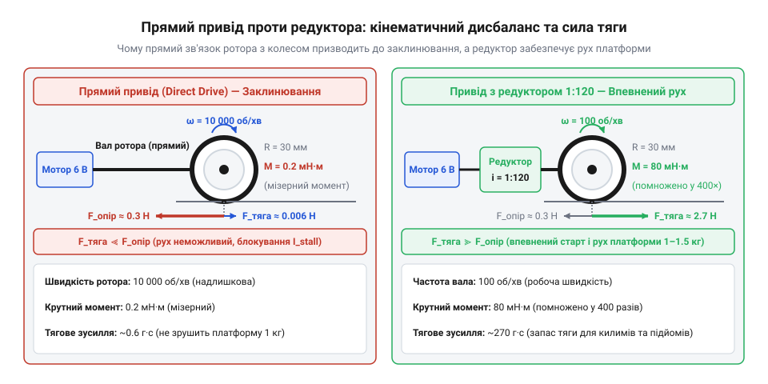
*Порівняння прямого приводу від ротора та приводу через редуктор: без редуктора критично бракує сили тяги для подолання опору спокою.*

Виникає фізична напруга: мікромотор є джерелом надвисокої кутової швидкості при вкрай малому механічному моменті, тоді як для руху платформи потрібні помірні оберти й висока тяга. Поєднати ці вимоги безпосередньо неможливо.

> 🔧 **Навіщо це.**
> Електромеханічні рушії малої потужності не здатні передавати енергію на ходові колеса напряму. Спроба зменшити швидкість електричним дроселюванням знесилює привід і спалює обмотки струмом зупинки. Щоб збалансувати надлишкову швидкість і дефіцит сили, необхідний механічний трансформатор обертання — редуктор (від латинського *reducere* — зменшувати, повертати назад; маркер @@en|reduction gearbox@@).

## Кінематика зубчастої передачі та каскадування ступенів редуктора

Щоб трансформувати надлишкову кутову швидкість ротора у пропорційне збільшення крутного моменту, обертання передають через механізм примусового контакту зубців — зубчасту передачу (@@en|gear drive@@ або @@en|gear train@@). Жорстке зачеплення усуває ковзання, тож зміну швидкості суворо визначає геометрія шестерень.

У базовій циліндричній зубчастій парі мале ведуче колесо називають шестірнею (@@en|pinion@@), а ведене — зубчастим колесом (@@en|driven gear@@). У кінематиці (від грецького *kīnēmatos* — рух, маркер @@en|kinematics@@) шестерні розглядають як ділильні кола (@@en|pitch circle@@) з радіусами `r₁` та `r₂`, що котяться одне по одному без ковзання. З умови відсутності ковзання в полюсі зачеплення лінійні колові швидкості обох кіл однакові:

```
v_contact = ω₁ · r₁ = ω₂ · r₂
```

де `ω₁` та `ω₂` — кутові швидкості ведучого та веденого коліс. Звідси випливає відношення кутових швидкостей:

```
ω₁ ÷ ω₂ = r₂ ÷ r₁
```

Для плавного входу в зачеплення лінійний крок зубців `p` (відстань між сусідніми зубами вздовж ділильного кола) у коліс мусить збігатися. Довжина ділильного кола шестірні з кількістю зубців `z` дорівнює `2 · π · r = p · z`. Звідси визначається стандартизований геометричний параметр — модуль зачеплення `m` (від латинського *modulus* — міра, маркер @@en|gear module@@), що вимірюється в міліметрах:

```
m = p ÷ π = 2 · r ÷ z
```

Радіус початкового кола кожного колеса виражається через модуль і кількість його зубців:

```
r = m · z ÷ 2
```

Підставивши вираз радіуса у формулу швидкостей, отримуємо залежність для передавального числа пари `i` (маркер @@en|gear ratio@@):

```
i = ω₁ ÷ ω₂
  = r₂ ÷ r₁                  [з рівності колових швидкостей v_contact = ω₁ · r₁ = ω₂ · r₂]
  = (m · z₂ ÷ 2) ÷ (m · z₁ ÷ 2) [підстановка радіуса через модуль m і число зубців z]
  = z₂ ÷ z₁                  [скорочення спільного множника m ÷ 2]
```

Через однаковий модуль `m` передавальне число точно дорівнює співвідношенню кількості зубців веденого і ведучого коліс.

Чому ж не можна отримати високе передавальне число (наприклад, `i = 60`) однією парою шестерень?

Фізичним обмеженням виступає мінімальна кількість зубців малої шестірні. При нарізанні зуба інструментом мале число зубців призводить до інтерференції профілів — підрізання ніжки зуба, що різко знижує його міцність на злам. Для стандартного кута профілю 20° критична межа становить `z₁ ≥ 14..17`, а в мініатюрних шестірнях рідко беруть `z₁ < 10..12`.

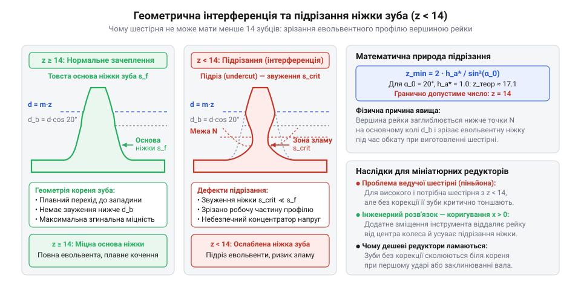
*Схема геометричної інтерференції та підрізання ніжки евольвентного зуба при кількості зубців z < 14, що показує причину обмеження мінімального розміру шестірні.*

Якщо обрати граничне значення `z₁ = 10`, то для досягнення коефіцієнта редукції `i = 60` ведена шестірня мусить мати:

```
z₂ = i · z₁
   = 60 · 10                 [визначення кількості зубців веденого колеса]
   = 600                     [необхідна кількість зубців]
```

За типового для мініатюрних редукторів модуля `m = 0.2 мм` ведена шестірня мала б підсумковий діаметр `d₂ = 12 см` — це вдесятеро більше за двигун (10–12 мм), що унеможливлює її компактне компонування.

Розв'язанням є каскадування — послідовне з'єднання кількох ступенів зачеплення (від латинського *gradus* — крок, маркер @@en|multistage reduction@@). Ступенем редуктора (@@en|gear stage@@) називають одну кінематичну пару шестерень. У багатоступеневому редукторі на кожній проміжній осі жорстко закріплено дві шестірні: ведене колесо попереднього ступеня та ведучу наступного, які обертаються як єдине ціле з однаковою кутовою швидкістю.

Сумарне передавальне число каскаду з `k` послідовних ступенів утворює мультиплікативний ланцюг:

```
i_total
= ω_вхід ÷ ω_вихід
= (ω₁ ÷ ω₂) · (ω₂ ÷ ω₃) · ... · (ωₖ ÷ ω_вихід) [ланцюговий добуток відношень проміжних швидкостей]
= i₁ · i₂ · ... · iₖ                           [добуток передавальних чисел кожного ступеня]
```

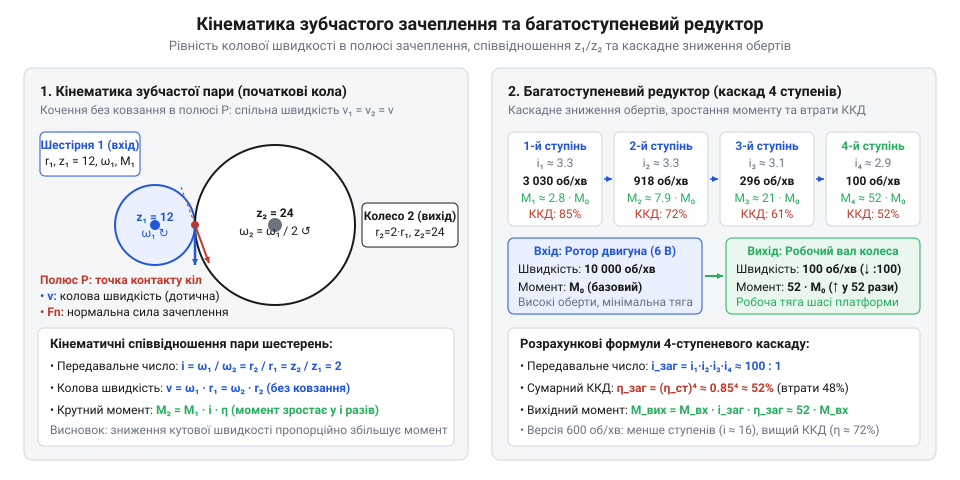
*Кінематична схема зачеплення зубчастої пари та компонування багатоступеневого редуктора: спільна колова швидкість на контакті трансформується через послідовні ступені зі зменшенням вихідної частоти обертання.*

> 🔧 **Навіщо це.**
> Багатоступеневе каскадування дозволяє перемножувати передавальні числа окремих пар, зберігаючи радіуси шестерень у межах кількох міліметрів. Завдяки цьому редуктор із передавальним числом від 10:1 до 300:1 укладається в мініатюрну коробку безпосередньо на фланці мотора.

Порівняємо дві типові серійні модифікації 6-вольтового мотор-редуктора: на 600 об/хв та на 100 об/хв. Обидві версії побудовані на базі ідентичного електродвигуна, якір якого при напрузі 6 В обертається з частотою `n_in ≈ 6000 об/хв` (`ω_in ≈ 628.3 рад/с`). Їхня різниця полягає у кількості та параметрах ступенів редуктора:

1. **Модифікація на 600 об/хв (швидкісна версія):**
   Потребує невеликого коефіцієнта сповільнення:
   ```
   i_total = n_in ÷ n_out
           = 6000 ÷ 600      [відношення частоти мотора до вихідної частоти]
           = 10              [низьке передавальне число]
   ```
   Таке передавальне число реалізується двома ступенями зачеплення. Наприклад, перший ступінь має шестірні `z₁ = 10` та `z₂ = 32` (`i₁ = 3.2`), а другий — `z₃ = 10` та `z₄ = 31` (`i₂ = 3.1`):
   ```
   i_total = i₁ · i₂ = 3.2 · 3.1 = 9.92 ≈ 10
   ```
   Вихідна кутова швидкість такого приводу:
   ```
   ω_out = ω_in ÷ i_total
         = 628.3 ÷ 10        [кутова швидкість вихідного вала для версії 600 об/хв]
         ≈ 62.8 рад/с
   ```

2. **Модифікація на 100 об/хв (тягова силова версія):**
   Вимагає глибокого зниження швидкості:
   ```
   i_total = n_in ÷ n_out
           = 6000 ÷ 100      [відношення частот для силової модифікації]
           = 60              [високе передавальне число]
   ```
   Щоб досягти коефіцієнта 60 при малих радіусах шестерень, редуктор будують із 4 або 5 послідовних ступенів:
   ```
   i_total = i₁ · i₂ · i₃ · i₄
           ≈ 2.78 · 2.78 · 2.78 · 2.78  [розподіл коефіцієнта редукції по 4 однакових ступенях]
           ≈ 60
   ```
   Вихідна кутова швидкість ушестеро менша:
   ```
   ω_out = ω_in ÷ i_total
         = 628.3 ÷ 60        [кутова швидкість вихідного вала для версії 100 об/хв]
         ≈ 10.47 рад/с
   ```

Вибір модифікації редуктора задає кінематичну базу приводу: швидкісна версія на 600 об/хв орієнтована на динамічне переміщення легкої платформи, тоді як версія на 100 об/хв жертвує лінійною швидкістю заради багаторазового приросту вихідного крутного моменту.

## Трансформація крутного моменту та баланс потужності в ідеальному редукторі

Ротор мініатюрного 6-вольтового електродвигуна здатний обертатися зі швидкістю понад п'ятнадцять тисяч обертів за хвилину, проте його власний обертальний важіль настільки малий, що вал можна миттєво зупинити легким дотиком пальця. Якщо з'єднати такий мотор безпосередньо з ходовим колесом мобільної платформи, візок навіть не рушить з місця: ротор захлинеться від нестачі пускового зусилля. Колісному рушію потрібна не стрімкість обертання ненавантаженого якоря, а сила, спроможна подолати інерцію маси та опір руху. Коли зубчастий механізм знижує швидкість обертання до десятків чи сотень обертів за хвилину, зусилля на вихідному валу зростає в десятки й сотні разів. Цей виграш у силі не є створенням енергії з порожнечі — він безпосередньо випливає з фундаментального балансу механічної потужності замкненої системи.

Щоб простежити природу цього силового виграшу, розглянемо механіку обертального руху. Під час обертання твердого тіла навколо закріпленої осі аналогом сили є крутний момент (лат. `momentum` — рушійна сила, поштовх; англ. @@en|torque@@) — міра обертальної дії сили, що визначається як добуток дотичної сили `F` на плече прикладання `r` відносно центра обертання:

`M = F · r`

Крутний момент вимірюється в ньютон-метрах (Н·м). Швидкість обертання вала описує кутова швидкість (грец. `γωνία` — кут; англ. @@en|angular velocity@@) `ω`, вимірювана в радіанах за секунду (рад/с). Механічна потужність (англ. @@en|mechanical power@@) `P`, що передається крізь обертовий вал у кожен момент часу, дорівнює добутку крутного моменту на кутову швидкість:

`P = M · ω`

Потужність вимірюється у ватах (Вт) і показує енергетичний потік: скільки джоулів механічної енергії проходить крізь переріз вала щосекунди.

Якщо уявити ідеальний зубчастий механізм без внутрішнього тертя між контактуючими поверхнями та без опору в підшипникових опорах, у ньому немає каналів розсіювання енергії. За фундаментальним законом збереження механічної енергії вся механічна потужність, яку ротор передає на вхідну шестерню редуктора (`P_in`), повинна без залишку перейти на вихідний вал (`P_out`):

`P_in = P_out`

Розписавши потужність на вході та виході через крутні моменти й кутові швидкості, дістаємо рівняння силового балансу:

`M_in · ω_in = M_out · ω_out`

де `M_in` та `ω_in` — крутний момент і кутова швидкість ротора двигуна, а `M_out` та `ω_out` — крутний момент і кутова швидкість вихідного вала приводу.

Кінематика зубчастої передачі однозначно задає співвідношення швидкостей через передавальне число (англ. @@en|gear ratio@@) `i`, яке визначає, у скільки разів редуктор сповільнює обертання:

`i = ω_in / ω_out`

Поєднавши енергетичний баланс із кінематичним зв'язком швидкостей, виводимо крутний момент на вихідному валу ідеального редуктора:

```
P_out = P_in                                   [закон збереження механічної потужності в ідеальній системі]
M_out · ω_out = M_in · ω_in                    [розклад механічної потужності на момент і кутову швидкість]
M_out = M_in · (ω_in / ω_out)                  [ділення обох частин рівняння на вихідну кутову швидкість ω_out]
M_out = M_in · i                               [підстановка кінематичного передавального числа i = ω_in / ω_out]
```

Цей висновок розкриває фізичну сутність механічного редуктора як ідеального механічного трансформатора (лат. `transformare` — перетворювати; англ. @@en|mechanical transformer@@). Подібно до електричного трансформатора, де зниження напруги супроводжується пропорційним зростанням сили струму при збереженні повної електричної потужності, зубчастий редуктор перерозподіляє механічні параметри обертання. Він не генерує додаткових ватів, але неминуче трансформує рух: примусове сповільнення кутової швидкості вала в `i` разів автоматично спричиняє пропорційне зростання вихідного крутного моменту рівно в `i` разів.

На площині координат «кутова швидкість — крутний момент» умова сталості механічної потужності задає рівнобічну гіперболу `M = P / ω`. Кожна точка цієї кривої відповідає тій самій потужності ротора, але реалізує іншу комбінацію швидкості й зусилля. Змінюючи передавальне число редуктора, інженер переміщує робочу точку системи вздовж цієї ізолінії енергії.

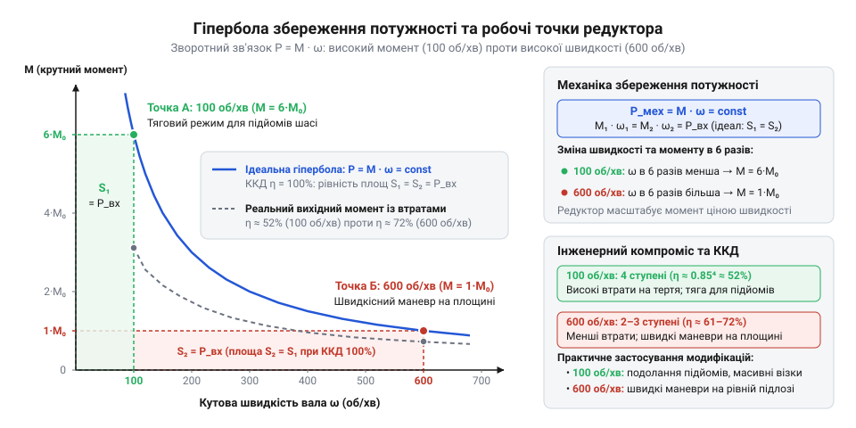
*Графік гіперболи ідеального збереження механічної потужності на площині «кутова швидкість — крутний момент»: зменшення швидкості вшестеро переміщує робочу точку з версії 600 об/хв на 100 об/хв уздовж ізолінії потужності, забезпечуючи пропорційне шестикратне зростання крутного моменту.*

Зіставимо поведінку двох поширених серійних модифікацій 6-вольтового приводу, побудованих на базі єдиного уніфікованого двигуна [N20 мікромотор з редуктором](root:cat-hw-actuators/n20-motor) — швидкісної версії на 600 об/хв та тягової версії на 100 об/хв.

В обох випадках використовується однаковий ротор, який за номінального живлення 6 В розвиває швидкість холостого ходу близько `n_rotor = 18 000` об/хв і створює номінальний електромагнітний момент `M_in = 0.08` мН·м (`8 × 10⁻⁵` Н·м). Оскільки базовий електродвигун однаковий, вхідна потужність ротора для обох приладів ідентична:

`P_in = M_in · ω_in = 8 × 10⁻⁵ Н·м · (18 000 · 2π / 60 рад/с) ≈ 0.151 Вт`

Кінематичні передавальні числа цих редукторів розраховуються безпосередньо зі співвідношення частот обертання ротора та вихідного вала:

Для версії 600 об/хв:
`i_600 = 18 000 об/хв / 600 об/хв = 30`

Для версії 100 об/хв:
`i_100 = 18 000 об/хв / 100 об/хв = 180`

Обчислимо ідеальний вихідний крутний момент для обох модифікацій:

```
M_out,600 = M_in · i_600                       [формула ідеальної трансформації крутного моменту]
          = 0.08 мН·м · 30                     [підстановка базового моменту ротора та передавального числа i = 30]
          = 2.40 мН·м                          [ідеальний крутний момент вихідного вала версії 600 об/хв]
```

```
M_out,100 = M_in · i_100                       [формула ідеальної трансформації крутного моменту]
          = 0.08 мН·м · 180                    [підстановка базового моменту ротора та передавального числа i = 180]
          = 14.40 мН·м                         [ідеальний крутний момент вихідного вала версії 100 об/хв]
```

Знайдемо кратність підсилення моменту між цими версіями:

```
M_out,100 / M_out,600 = (M_in · i_100) / (M_in · i_600)  [відношення вихідних моментів модифікацій]
                      = i_100 / i_600                    [скорочення однакового крутного моменту ротора M_in]
                      = 180 / 30                         [підстановка передавальних чисел]
                      = 6                                [шестикратний виграш у вихідному крутному моменті]
```

За однакової механічної потужності ротора версія на 100 об/хв забезпечує рівно в 6 разів більший ідеальний крутний момент, ніж версія на 600 об/хв. Фізична плата за цей виграш у силі суворо зафіксована балансом збереження енергії: вал версії на 100 об/хв обертається рівно вшестеро повільніше.

> 🔧 **Навіщо це.**
> Формула ідеального силового перетворення `M_out = M_in · i` встановлює верхню теоретичну межу крутного моменту приводу. Якщо для обраної швидкості шасі розрахункова потреба в тязі вимагає потужності `P = M_out · ω_out`, яка перевищує можливості ротора, жодне передавальне число не зможе розв'язати задачу: швидкість і момент неможливо нарощувати одночасно без встановлення потужнішого електродвигуна.

## Реальні механічні втрати та мультиплікативне накопичення ККД

Формула ідеального редуктора малює оманливу картину необмеженого нарощування сили: здається, що достатньо підібрати передавальне число в тисячу разів — і мікроскопічний двигун зможе підняти будь-який вантаж. Проте реальний експеримент швидко руйнує цю ілюзію. Під час навантажувальних тестів модифікація на 100 об/хв замість очікуваного шестикратного приросту тяги демонструє ледве чотирикратне зростання порівняно з версією на 600 об/хв, а сам металевий редуктор помітно розігрівається вже за кілька хвилин роботи. Спроба передати крутний момент крізь тверді кінематичні пари неминуче наштовхується на опір тертя, що відбирає частку корисної потужності на кожному кроці зачеплення.

У циліндричних зубчастих передачах мініатюрних мотор-редукторів діють три незалежні механізми паразитного розсіювання енергії:

1. **Тертя ковзання в зубчастому зачепленні.** Профілі шестерень нарізані за формою евольвенти (лат. `evolvens` — той, що розгортає; англ. @@en|involute gearing@@). Теоретично евольвентне спряження забезпечує кочення контактних поверхонь без проковзування, але чисте кочення відбувається виключно в одній геометричній точці — полюсі зачеплення на ділильному колі. В усіх інших фазах контакту, коли верхівка одного зуба заходить у зачеплення та ковзає вздовж ніжки сусіднього зуба, виникає відносне тертя ковзання (англ. @@en|sliding friction@@). Оскільки контактні напруження в плямі дотику мініатюрних зубців сягають сотень мегапаскалів, це мікроковзання безперервно розсіює енергію. Більше про кінематику та розрахунок геометрії контакту описано в матеріалі [евольвентне зубчасте зачеплення](root:hw-motion/gear-tooth-geometry).

2. **Тертя цапф у підшипниках ковзання.** Осі шестерень у мікроприводах типу N20 не мають шарикопідшипників через жорсткі габаритні обмеження: сталеві осі безпосередньо спираються на круглі отвори в латунних опорних пластинах корпусу, утворюючи підшипники ковзання цапф (нім. `Zapfen` — шийка вала, цапфа; англ. @@en|journal bearing@@). Під час передачі моменту зубці розпираються радіальною силою, пропорційною тангенсу кута зачеплення (типово 20°). Ця сила притискає цапфу осі до стінки втулки, породжуючи значний гальмівний момент сухого або напіврідкісного тертя на кожному проміжному валу. Детальний аналіз навантажень на опори викладено у статті [підшипники ковзання в мікроприводах](root:hw-motion/journal-bearing-friction).

3. **Гідродинамічний та в'язкісний опір мастила.** Для захисту зубців від абразивного стирання в корпус закладається консистентне мастило. Проте мікроплівка мастила чинить гідродинамічний опір в'язкого зсуву (грец. `ὕδωρ` — вода, `δύναμις` — сила; лат. `viscosus` — в'язкий, липкий; англ. @@en|viscous friction@@). Обертання шестерень призводить до безупинного витискання мастила із западин зубців та його перемішування, що створює швидкісний опір обертанню навіть за відсутності корисного навантаження.

Усі ці паразитні втрати інтегруються в єдиний енергетичний показник ступеня передачі — коефіцієнт корисної дії (ККД; лат. `coefficiens` — той, що сприяє разом; англ. @@en|mechanical efficiency@@) `η_stage`. Локальний ККД окремої зубчастої пари виражає відношення переданої потужності до підведеної:

`η_stage = P_out,stage / P_in,stage = 1 - (P_loss,stage / P_in,stage)`

Для мініатюрних прямозубих циліндричних шестерень, що працюють на відкритих підшипниках ковзання, локальний ККД одного ступеня лежить у вузьких межах:

`η_stage ≈ 0.85 ... 0.92`

Це означає, що кожна пара шестерень безповоротно розсіює від 8% до 15% механічної енергії, яка надходить на її тяговий зуб.

Багатоступеневий редуктор являє собою послідовний кінематичний ланцюг, де кожна проміжна шестерня живиться механічною потужністю, яка вже пройшла крізь попередній ступінь і зменшилася на його втрати. Якщо редуктор містить `N` послідовних ступенів передачі, потужність на виході першого ступеня становить:

`P_1 = P_rotor · η_1`

На вхід другого ступеня потрапляє вже зменшена потужність `P_1`, тому на його виході залишається:

`P_2 = P_1 · η_2 = P_rotor · η_1 · η_2`

Для `N` однакових послідовних ступенів сумарна ефективність підпорядковується мультиплікативному накопиченню втрат (лат. `multiplicare` — примножувати; англ. @@en|multiplicative loss@@):

```
η_total = P_out / P_rotor                      [означення підсумкового коефіцієнта корисної дії системи]
        = η₁ · η₂ · ... · η_N                  [добуток локальних ККД окремих послідовних ступенів]
        = (η_stage)ᴺ                           [експоненційне спрощення за однакової ефективності ступенів]
```

Експоненційне падіння ККД показує, наскільки різко деградує ефективність механізму з додаванням кожного наступного зачеплення. Простежимо це для середнього ККД ступеня `η_stage = 0.90`:

- 1 ступінь (`N = 1`): `η_total = 0.90¹ = 0.900` (втрачено 10.0% енергії)
- 2 ступені (`N = 2`): `η_total = 0.90² = 0.810` (втрачено 19.0% енергії)
- 3 ступені (`N = 3`): `η_total = 0.90³ = 0.729` (втрачено 27.1% енергії)
- 4 ступені (`N = 4`): `η_total = 0.90⁴ ≈ 0.656` (втрачено 34.4% енергії)
- 5 ступенів (`N = 5`): `η_total = 0.90⁵ ≈ 0.590` (втрачено 41.0% енергії)

Якщо якість обробки поверхонь нижча або мастило загусло на морозі (`η_stage ≈ 0.87`), то для п'ятиступеневого редуктора сумарний ККД деградує до `0.87⁵ ≈ 0.498`: понад половина всієї потужності ротора втрачається ще до того, як рух дійде до колеса.

Оскільки кінематичне передавальне число `i = ω_rotor / ω_out` жорстко зафіксоване числом зубців шестерень і не залежить від тертя, усе падіння потужності б'є виключно по вихідному крутному моменту:

```
P_out = P_rotor · η_total                      [зв'язок реальної вихідної потужності із сумарним ККД]
M_out · ω_out = M_rotor · ω_rotor · η_total    [розклад механічної потужності на крутний момент і кутову швидкість]
M_out = M_rotor · (ω_rotor / ω_out) · η_total  [ділення обох частин рівняння на ω_out]
M_out = M_rotor · i · η_total                  [підстановка кінематичного числа i та підсумкового ККД η_total]
```

Дійсний крутний момент на валу редуктора дорівнює ідеальному моменту, помноженому на підсумковий ККД `η_total`.

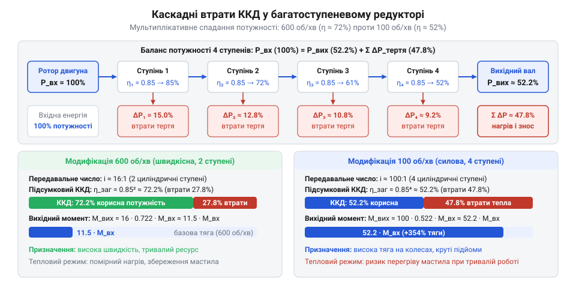
*Схема проходження потоку потужності крізь послідовні ступені редуктора з відведенням тепла на тертя та порівняльна діаграма підсумкового ККД: у двозрізному редукторі на 600 об/хв втрачається до 15–19% потужності, тоді як у п'ятиступеневому варіанті на 100 об/хв через мультиплікативне накопичення втрат розсіюється від 34% до 48% енергії.*

Саме мультиплікативне падіння ККД пояснює розбіжність між модифікаціями на 600 та 100 об/хв:

Для версії на 600 об/хв потрібне невелике передавальне число `i_600 = 30`. Таке сповільнення легко реалізується лише двома ступенями зачеплення (`N = 2`, наприклад, дві послідовні пари з відношенням приблизно 1:5.5). Підсумковий ККД такого редуктора становить:

`η_total,600 = (0.90 ... 0.92)² ≈ 0.81 ... 0.85`

Втрати енергії у швидкісній версії не перевищують 15–19%.

Для версії на 100 об/хв необхідне передавальне число `i_100 = 180`. У компактному корпусі неможливо отримати відношення більше ніж 1:3 ... 1:4 на один ступінь, оскільки діаметр великої шестерні обмежений шириною редуктора (10–12 мм), а кількість зубців малої тягової шестерні не може бути меншою за 10–12 через підрізання ніжки евольвентного зуба. Тому конструктори змушені будувати ланцюг із чотирьох або п'яти ступенів (`N = 4 ... 5`). Для п'ятиступеневої передачі ККД падає до:

`η_total,100 = (0.87 ... 0.91)⁵ ≈ 0.50 ... 0.62`

Обчислимо реальний вихідний момент обох версій за базового моменту ротора `M_rotor = 0.08` мН·м, прийнявши типові значення `η_total,600 = 0.83` та `η_total,100 = 0.58`:

```
M_out,600 = M_rotor · i_600 · η_total,600      [формула реального моменту з урахуванням втрат]
          = 0.08 мН·м · 30 · 0.83              [підстановка параметрів двоступеневої версії]
          = 1.99 мН·м                          [реальний крутний момент приводу 600 об/хв]
```

```
M_out,100 = M_rotor · i_100 · η_total,100      [формула реального моменту з урахуванням втрат]
          = 0.08 мН·м · 180 · 0.58             [підстановка параметрів п'ятиступеневої версії]
          = 8.35 мН·м                          [реальний крутний момент приводу 100 об/хв]
```

Порівняємо реальне співвідношення моментів:

```
M_out,100 / M_out,600 = 8.35 мН·м / 1.99 мН·м  [відношення фактичних вихідних моментів]
                      ≈ 4.20                   [реальний коефіцієнт підсилення крутного моменту]
```

Замість очікуваного шестикратного виграшу за моментом інженер отримує посилення лише в 4.2 раза. Майже 30% очікуваного приросту крутного моменту поглинає внутрішнє тертя додаткових ступенів.

Внутрішнє тертя породжує два небезпечні експлуатаційні явища:

- **Момент холостого ходу (англ. @@en|no-load torque@@ `M_idle`).** Опір зачеплення та в'язкість мастила присутні завжди, навіть коли вал вільно обертається в повітрі. Щоб просто зрушити шестерні з місця й підтримувати обертання, ротор повинен розвинути стартовий момент подолання власного тертя редуктора `M_idle`. Саме тому струм холостого ходу редукторного двигуна на 100 об/хв (50–80 мА) у два-три рази перевищує струм ненавантаженого двигуна без редуктора (20–30 мА). Цей паразитний опір скорочує корисний динамічний діапазон мотора.

- **Теплове розсіювання (лат. `dissipatio` — розсіювання; англ. @@en|heat dissipation@@).** Загублена потужність не зникає:

`P_loss = P_rotor · (1 - η_total)`

У версії на 100 об/хв від 34% до 48% усієї механічної потужності ротора безпосередньо в корпусі редуктора перетворюється на тепло. За розмірів металевого редукторного блока лише 12 × 10 × 9 мм площа його тепловідведення надзвичайно мала. При безперервній роботі під навантаженням температура шестерень швидко сягає 55–70 °C. Перегрів розріджує мастило, руйнує захисну плівку на металі й викликає прискорене стирання контактних поверхонь зубців.

> 🔧 **Навіщо це.**
> Розрахунок мультиплікативного ККД `η_total = (η_stage)ᴺ` уберігає від критичної помилки при оцінці тяги мобільного шасі. Розрахунок за ідеальним моментом призведе до створення слабкого робота, який застрягне на першому ж підйомі, оскільки багатоступеневий редуктор на 100 об/хв поглинає до половини енергії двигуна. Інженер зобов'язаний закладати дійсний ККД `η_total ≤ 0.6` для багатоступеневих приводів і враховувати теплове навантаження на закритий редукторний блок.

## Колесо як важіль: трансформація крутного моменту в лінійну тягу та швидкість

Вихідний вал мотор-редуктора передає обертову механічну енергію, виражену кутовою швидкістю та крутним моментом. Проте цільова функція мобільного колісного шасі — лінійне переміщення платформи в просторі. Сам по собі вихідний вал не штовхає візок уперед: обертальний рух трансформується в поступальний лише в момент взаємодії насадженого на вал колеса з опорною поверхнею. Інженерний вибір геометричних параметрів колеса негайно ставить конструктора перед жорстким фізичним компромісом: зі збільшенням діаметра колеса візок мусить рухатися швидше, однак втрачає здатність зрушити з місця на найменшій нерівності; якщо ж діаметр зменшити — тягова спроможність різко зростає, але швидкість платформи падає до неприйнятного мінімуму. Колесо є не просто геометричною опорою, а безпосереднім продовженням механічної трансмісії — обертовим важелем, де кожен міліметр радіуса невідворотно змінює баланс між швидкістю та силою тяги.

Розгляньмо кінематику кочення без ковзання. Нехай вихідний вал редуктора обертається з кутовою швидкістю (англ. @@en|angular velocity@@) `ω_out` (вимірюється в радіанах за секунду, рад/с) або з частотою обертання `n_out` (вимірюється в обертах за хвилину, об/хв). Колесо має радіус `R` (від лат. *radius* — спиця колеса, промінь), що є відстанню від геометричної осі обертання до крайнього зовнішнього радіуса обода або пружної шини.

За один повний оберт вала (кут повороту `2 · π` радіан) колесо без проковзування прокочується вперед на відстань, що дорівнює довжині кола протектора: `L = 2 · π · R`. Якщо за хвилину вал робить `n_out` повних обертів, то за одну секунду він здійснює `n_out / 60` обертів. Відповідно, шлях, який долає вісь колеса за одну секунду — тобто лінійна швидкість (англ. @@en|linear velocity@@) осі візка `v` (м/с) — визначається аналітично:

```
v = (2 · π · R) · (n_out / 60)
  = (2 · π · n_out / 60) · R                     [перегрупування співмножників]
  = ω_out · R                                    [визначення кутової швидкості ω_out = 2·π·n_out / 60]
```

Зв'язок лінійний: лінійна швидкість осі прямо пропорційна радіусу колеса. Збільшення радіуса колеса вдвічі рівно вдвічі збільшує швидкість переміщення робота за незмінних обертів двигуна.

Тепер простежимо зворотний бік цього перетворення — силову динаміку. Крутний момент (від лат. *momentum* — рушійна сила, поштовх; в англомовній інженерній літературі — @@en|torque@@) `M_out` на вихідному валу редуктора характеризує обертальне зусилля. В зоні безпосереднього контакту колеса з опорною площиною — плямі контакту (англ. @@en|contact patch@@) — крутний момент перетворюється на дотичне поздовжнє зусилля, що штовхає візок уперед: силу тяги (від лат. *tractio* — тягнення, волочіння; англ. @@en|traction force@@) `F_traction`.

Колесо діє як класичний важіль (від прасл. *vaga* — вага, тягар). За відсутності проковзування миттєва точка контакту шини з поверхнею є нерухомою точкою опори — миттєвим центром швидкостей, а відстань від осі обертання до цієї точки дорівнює радіусу колеса `R`, який виступає плечем прикладання сили. Момент сили за означенням дорівнює добутку дотичної сили на плече важеля:

```
M_out = F_traction · R                           [рівняння моменту відносно осі обертання]
```

Звідси дотична сила тяги, яку розвиває колесо на поверхні, обернено пропорційна радіусу:

```
F_traction = M_out / R                           [ділення крутного моменту на плече важеля R]
```

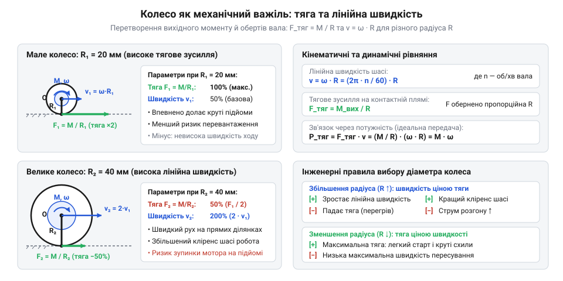
*Колесо як обертовий важіль: зі зростанням радіуса R лінійна швидкість осі v зростає прямо пропорційно плечу, тоді як дотична сила тяги F_traction на опорній поверхні пропорційно спадає.*

Аналіз рівнянь виявляє фундамент компромісу: радіус колеса `R` міститься в чисельнику формули лінійної швидкості `v = ω_out · R`, але водночас перебуває в знаменнику формули сили тяги `F_traction = M_out / R`. Збільшення радіуса колеса дає лінійний виграш у швидкості, однак сплачується за це настільки ж лінійним спадом тягового зусилля на контактній поверхні. Кожен додатковий міліметр радіуса вимагає від приводу пропорційно більшого крутного моменту `M = F · R` для створення тієї самої сили штовхання.

> 🔧 **Навіщо це.** Підбір радіуса колеса — це найпростіший спосіб скоригувати характеристики приводу без втручання в конструкцію редуктора. Якщо зібраний робот не здатен зрушити з місця на перешкоді чи перегріває двигуни, встановлення коліс меншого діаметра миттєво нарощує силу тяги без додавання шестерень і втрат ККД. Навпаки, якщо тяговий запас надлишковий, збільшення діаметра коліс дозволяє розігнати платформу без підвищення напруги живлення.

Порівняймо поведінку двох поширених модифікацій 6-вольтового приводу (як-от [N20 мікромотор з редуктором](root:cat-hw-actuators/n20-motor)) за номінальних умов роботи:
1. Високошвидкісна версія (600 об/хв): `n_out = 600 об/хв`, вихідна кутова швидкість `ω_out ≈ 62.83 рад/с`, тривалий номінальний момент `M_nom = 0.040 Н·м` (4.0 Н·см).
2. Тягова низькошвидкісна версія (100 об/хв): `n_out = 100 об/хв`, вихідна кутова швидкість `ω_out ≈ 10.47 рад/с`, тривалий номінальний момент `M_nom = 0.240 Н·м` (24.0 Н·см).

Оцінимо їхню дію з трьома типовими калібрами робототехнічних коліс:
- Компактне колесо: діаметр `D = 34 мм` (радіус `R = 0.017 м`);
- Середнє колесо: діаметр `D = 42 мм` (радіус `R = 0.021 м`);
- Велике колесо: діаметр `D = 65 мм` (радіус `R = 0.0325 м`).

Обчислення лінійної швидкості `v` та сили тяги `F_traction` одного колеса зведені в інженерну таблицю:

| Діаметр колеса D | Радіус R | Мотор 600 об/хв: швидкість v | Мотор 600 об/хв: тяга F_traction | Мотор 100 об/хв: швидкість v | Мотор 100 об/хв: тяга F_traction |
| :--- | :--- | :--- | :--- | :--- | :--- |
| 34 мм | 0.0170 м | 1.07 м/с | 2.35 Н (~240 г) | 0.18 м/с | 14.12 Н (~1.44 кг) |
| 42 мм | 0.0210 м | 1.32 м/с | 1.90 Н (~194 г) | 0.22 м/с | 11.43 Н (~1.17 кг) |
| 65 мм | 0.0325 м | 2.04 м/с | 1.23 Н (~125 г) | 0.34 м/с | 7.38 Н (~0.75 кг) |

Числа наочно демонструють межу практичного застосування. Поєднання швидкісного мотора на 600 об/хв із великим колесом діаметром 65 мм забезпечує вражаючу теоретичну швидкість 2.04 м/с, однак тягове зусилля одного колеса падає до 1.23 Н (еквівалент ваги всього у 125 грамів). Навіть для двомоторного шасі сумарна номінальна тяга складе лише 2.46 Н. Якщо мобільний робот разом із акумулятором важить 400–500 г, то найменший стик покриття, опір килима чи мікропідйом вимагатимуть сили, більшої за цю межу: двигун не зможе розвинути оберти, струм зросте, а мотор почне небезпечно перегріватися.

Натомість мотор на 100 об/хв з тим самим 65-міліметровим колесом генерує 7.38 Н тяги на одне колесо (у 6 разів більше), зберігаючи робочу лінійну швидкість 34 см/с. А з малим 34-міліметровим колесом тяга сягає 14.12 Н на колесо: пара таких приводів створює понад 2.8 кг сумарного штовхального зусилля, що дозволяє легкій платформі впевнено долати пороги та штовхати корисне навантаження, жертвуючи швидкістю заради гарантованого подолання опору.

## Динамічна рівновага на похилій площині: опір коченню та необхідний момент

На горизонтальній опорній площині опір руху колісного шасі мінімальний: приводу достатньо подолати внутрішнє тертя в редукторі та незначну мікродеформацію матеріалу шини. Проте в реальних умовах робот постійно стикається з похилими поверхнями — пандусами, узвозами та нерівностями рельєфу. Щойно кут нахилу відхиляється від нуля, просторова орієнтація гравітаційного навантаження змінюється: сила тяжіння перестає діяти суто перпендикулярно до площини й починає неперервно стягувати шасі вниз уздовж схилу. Якщо сумарна тягова сила коліс виявиться бодай на частку відсотка меншою за сукупний опір скочування та кочення, рух угору припиниться, платформа покотиться назад або двигун увійде в аварійний режим зупинки ротора. Щоб гарантувати стабільне підіймання шасі без перевантаження електроприводу, необхідно скласти рівняння динамічної рівноваги системи.

Розгляньмо рух колісного візка загальною масою `m` (кг), який долає похилу площину (від лат. *inclinatio* — нахил; англ. @@en|inclined plane@@) з кутом підйому `α` відносно горизонталі. Візок спирається на поверхню колесами радіуса `R`, причому `k` коліс є тяговими (активними), і кожне з них з'єднане з власним мотор-редуктором, що розвиває на вихідному валу крутний момент `M_out`. Решта коліс (якщо вони є, наприклад, пасивний опорний кастор) вільно котяться, не створюючи активної тяги.

Для аналізу силової взаємодії складемо діаграму сил вільного тіла (англ. @@en|free-body diagram@@). Виберемо систему координат, у якій вісь `x` орієнтована паралельно до похилої площини у напрямку руху шасі вгору, а вісь `y` — перпендикулярно до площини в бік вільного простору.

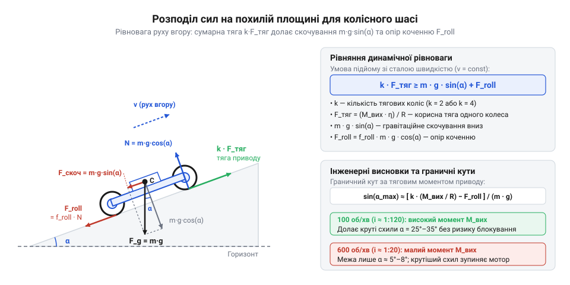
*Розподіл сил на підйомі: сумарна рушійна тяга k·F_traction урівноважує гравітаційну скочувальну складову m·g·sin(α) та силу опору коченню f_roll·m·g·cos(α).*

На колісне шасі в процесі руху діють такі сили:
1. Повна сила тяжіння `G = m · g`, спрямована строго вертикально вниз до центра Землі (де `g ≈ 9.81 м/с²` — прискорення вільного падіння). У вибраній системі координат вектор сили тяжіння розкладається на дві складові:
   - Нормальна складова, що притискає шасі до площини: `G_y = m · g · cos(α)`.
   - Скочувальна поздовжня складова сили тяжіння (англ. @@en|slope resistance force@@): `F_slope = m · g · sin(α)`, спрямована вниз уздовж площини проти напрямку руху.
2. Повна нормальна реакція опори (від лат. *normalis* — перпендикулярний; прямовисний) `N`, прикладена з боку опорної площини. За відсутності відриву шасі чи його занурення вглиб поверхні сили вздовж осі `y` взаємно зрівноважуються:
   ```
   N - m · g · cos(α) = 0                         [рівновага сил уздовж осі y]
   N = m · g · cos(α)                             [величина нормальної реакції опори]
   ```
3. Сила опору коченню (англ. @@en|rolling resistance@@) `F_roll`. Під час кочення еластична шина колеса безперервно деформується на вході в контактну пляму й відновлює форму на виході з неї. Через внутрішній механічний гістерезис (від грец. ὑστέρησις — запізнення, відставання) у матеріалі шини тиск на передню частину плями контакту вищий, ніж на задню, що створює постійний гальмівний опір коченню. Докладно фізику цих втрат вивчає [механіка опору коченню](root:ph-mechanics/rolling-resistance). В інженерних розрахунках цей опір описують силою, пропорційною нормальній реакції поверхні:
   ```
   F_roll = f_roll · N
          = f_roll · m · g · cos(α)               [підстановка нормальної реакції N]
   ```
   де `f_roll` — безрозмірний коефіцієнт опору коченню (англ. @@en|rolling resistance coefficient@@). Для твердих полімерних коліс по рівній підлозі `f_roll ≈ 0.015...0.025`, для звичайних гумових коліс по лінолеуму чи ламінату `f_roll ≈ 0.025...0.035`, а для руху по м'якому килиму чи нерівній поверхні він зростає до `0.06...0.10`.

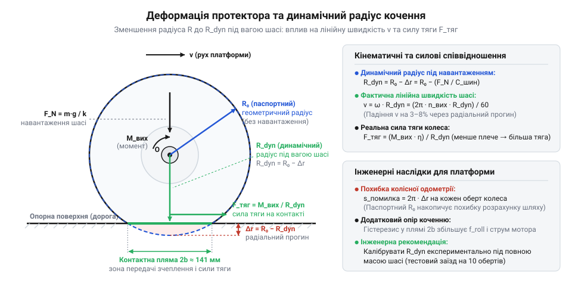
*Схема деформації еластичного протектора під вагою шасі: показано зменшення геометричного радіуса R до динамічного радіуса кочення R_dyn у зоні плями контакту.*

4. Сумарна сила тяги приводу `F_total`. Оскільки шасі має `k` тягових коліс, кожне з яких під дією крутного моменту `M_out` створює на контактній плямі дотичне зусилля `F_traction = M_out / R`, сумарне рушійне зусилля становить:
   ```
   F_total = k · F_traction
           = k · (M_out / R)                      [сумарна тяга k однакових мотор-коліс]
   ```

Складемо рівняння динамічної рівноваги (від грец. δύнаμις — сила та лат. *aequilibrium* — рівновага) за другим законом Ньютона в проєкції на вісь руху `x`:

```
k · F_traction - F_slope - F_roll = m · a         [другий закон Ньютона вздовж осі руху]
```

Для сталого підйому візка з постійною швидкістю прискорення дорівнює нулю (`a = 0`). Отже, для подолання схилу без падіння швидкості сумарна тяга двигунів мусить щонайменше дорівнювати сумі сил опору або перевищувати її:

```
k · F_traction - m · g · sin(α) - f_roll · m · g · cos(α) ≥ 0  [умова подолання опору без сповільнення]
k · F_traction ≥ m · g · sin(α) + f_roll · m · g · cos(α)      [перенесення сил опору в праву частину]
k · (M_out / R) ≥ m · g · (sin(α) + f_roll · cos(α))           [винесення m·g та підстановка сили тяги M_out/R]
```

Отримана нерівність — це повне рівняння тягового балансу колісного шасі на похилій площині. Воно пов'язує параметри навантаження (масу `m`, кут `α`, опір покриття `f_roll`) з параметрами рушія (радіусом `R`, кількістю приводів `k` та моментом `M_out`).

З цього рівняння однозначно визначається мінімально необхідний крутний момент `M_req`, який зобов'язаний розвивати вихідний вал кожного окремого мотор-редуктора:

```
k · (M_out / R) ≥ m · g · (sin(α) + f_roll · cos(α))           [рівняння тягового балансу]
M_out / R ≥ (m · g / k) · (sin(α) + f_roll · cos(α))           [ділення на кількість тягових коліс k]
M_req = (m · g · R / k) · (sin(α) + f_roll · cos(α))           [множення на плече важеля — радіус колеса R]
```

Структура формули наочно вказує шляхи оптимізації приводу:
- Зменшення радіуса колеса `R` або маси шасі `m` лінійно зменшує потрібний крутний момент мотора;
- Збільшення числа тягових коліс `k` пропорційно ділить навантаження між моторами (перехід від схеми 2WD до 4WD удвічі зменшує вимоги до моменту кожного мотора);
- У дужках коефіцієнтів опору складова `sin(α)` відповідає за подолання гравітації, а `f_roll · cos(α)` — за подолання внутрішнього тертя кочення. Якщо на пологому підйомі (до 2°...3°) опір коченню співмірний із гравітаційним, то вже при куті `α = 15°` гравітаційна складова перевищує опір коченню майже вдесятеро.

> 🔧 **Навіщо це.** Розрахунок мінімально необхідного крутного моменту `M_req` запобігає виходу двигуна в небезпечний режим повного блокування вала (англ. @@en|stall@@). Якщо крутний момент мотора під навантаженням опуститься нижче за `M_req`, швидкість обертання впаде до нуля, проти-ЕРС зникне, і через нерухомий якір потече струм короткого замикання (струм блокування), який за кілька секунд розплавить щітковий вузол і може випалити ключі драйвера мотора. Інженерний розрахунок гарантує, що робочий момент двигуна на максимальному ухилі залишається в межах тривалого номінального паспорта з запасом не менше 30–50%.

Проведемо покроковий розрахунок типової робототехнічної платформи:
- Маса шасі: `m = 0.50 кг` (500 г);
- Кількість тягових мотор-коліс: `k = 2` (двоколісний візок із пасивним опорним роликом);
- Радіус ведучих коліс: `R = 0.021 м` (популярний діаметр колеса 42 мм);
- Розрахунковий максимальний кут підйому: `α = 15°`;
- Коефіцієнт опору коченню гумової шини по гладкій підлозі: `f_roll = 0.03`;
- Прискорення вільного падіння: `g = 9.81 м/с²`.

Послідовний розрахунок компонентів сил опору:
```
sin(15°) ≈ 0.2588                                              [тригонометричний коефіцієнт ухилу]
cos(15°) ≈ 0.9659                                              [тригонометричний коефіцієнт притискання]
f_roll · cos(15°) = 0.03 · 0.9659 ≈ 0.0290                     [питомий опір коченню з урахуванням ухилу]
sin(15°) + f_roll · cos(15°) = 0.2588 + 0.0290 = 0.2878        [сумарний безрозмірний коефіцієнт опору]
```

Обчислимо мінімальний крутний момент для одного мотор-редуктора:

```
M_req = (m · g · R / k) · (sin(α) + f_roll · cos(α))
      = (0.50 · 9.81 · 0.021 / 2) · 0.2878                     [підстановка параметрів шасі]
      = (0.1030 / 2) · 0.2878                                  [обчислення добутку m·g·R]
      = 0.0515 · 0.2878                                        [ділення на число ведучих коліс k=2]
      = 0.01482 Н·м ≈ 0.0148 Н·м                               [мінімально необхідний момент одного мотора]
```

Отримане значення `M_req ≈ 0.0148 Н·м` відповідає приблизно `1.48 Н·см` (або `151 г·см`).

Зіставимо розраховану потребу з параметрами моторів:
- Мотор на 600 об/хв має номінальний крутний момент `M_nom = 0.040 Н·м`. Потрібне навантаження `0.0148 Н·м` становить 37% від його номіналу — на ухилі 15° із колесами 42 мм привод впорається. Проте якщо збільшити діаметр коліс до 65 мм (`R = 0.0325 м`) або якщо кут підйому зросте до 30° (`sin(30°) = 0.5`, `cos(30°) = 0.866`):
  ```
  M_req = (0.50 · 9.81 · 0.0325 / 2) · (0.5 + 0.03 · 0.866)
        = 0.0797 · 0.5260
        ≈ 0.0419 Н·м                                           [значення перевищує номінальну межу 0.040 Н·м]
  ```
  У таких умовах мотор на 600 об/хв вимушений працювати в зоні небезпечного теплового перевантаження, а випадковий застій чи шорсткість викличуть блокування ротора.
- Мотор на 100 об/хв має номінальний крутний момент `M_nom = 0.240 Н·м`. Для нього базове навантаження `0.0148 Н·м` становить лише 6.2% від номіналу, а навіть в екстремальному режимі нахилу 30° з великими колесами 65 мм навантаження `0.0419 Н·м` становить лише 17.5% від номіналу. Двигун працює в оптимальній холодній зоні характеристик із багаторазовим запасом тяги, гарантуючи надійний рух на будь-якому складному рельєфі.

## Границі експлуатації шасі: зрив зчеплення проти аварійного блокування двигуна

Коли колісна платформа рушає на крутий схил або бере корисний вантаж, привід опиняється між двома механічними відмовами. Якщо крутний момент перевищує можливості фрикційного контакту з поверхнею, колеса зриваються в пробуксовку: шасі зупиняється, марнуючи енергію батареї на стирання протектора. Якщо ж контакт надійний, але крутного моменту бракує для подолання тяжіння й тертя, ротор зупиняється — настає повне механічне блокування, що за лічені секунди загрожує спаленням мідних обмоток та зрізанням зубців редуктора. Розрахунок приводу починається з визначення меж, які відокремлюють штатний рух від шліфування підлоги та аварійного стопоріння.

Перша критична межа задається взаємодією колісного рушія з опорною площиною. Зрив коліс у пробуксовку (англ. *slip* — ковзання) — @@en|wheel slip@@ — настає тоді, коли потрібне тягове зусилля перевищує граничну силу тертя спокою в контактній плямі. Згідно з класичним [законом сухого тертя Кулона](root:ph-mechanics/coulomb-friction-model) (лат. *frictio* — тертя), максимальна поздовжня сила зчеплення прямо пропорційна нормальній силі притискання колеса до поверхні:

```
F_grip_max
= μ_grip · N_drive                             [закон сухого тертя Амонтона-Кулона]
= μ_grip · m · g · cos(α) · γ                  [нормальна реакція на ведучих колесах на схилі]
```

Тут `μ_grip` (грец. *my*) — безрозмірний коефіцієнт зчеплення (@@en|friction coefficient@@, лат. *coefficiens* — той, що сприяє разом) матеріалу шини з поверхнею, `m` — загальна маса платформи, `g` — прискорення вільного падіння (`g ≈ 9.81 м/с²`), `α` (грец. *alpha*) — кут нахилу поверхні до горизонту, а `γ` (грец. *gamma*) — частка загальної маси, яка реально навантажує тягову вісь (`0 < γ ≤ 1`). Зі зростанням кута підйому нормальна складова ваги зменшується пропорційно `cos(α)`, тому гранична сила зчеплення неминуче падає: що крутіший схил, то легше колесам зірватися в ковзання.

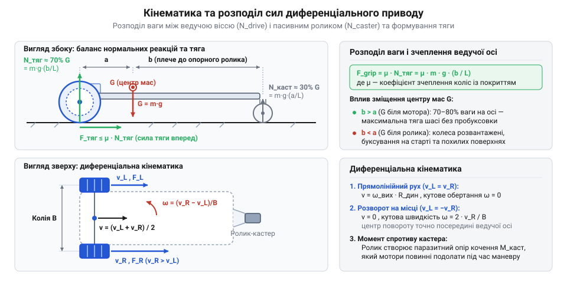
*Схема сил та кінематики диференціального приводу: розподіл нормальних реакцій між тяговою віссю і роликом та вектори тяги.*

Друга критична межа диктується внутрішньою електромеханікою самого двигуна. У мініатюрному колекторному двигуні постійного струму, такому як [N20 мікромотор з редуктором](root:cat-hw-actuators/n20-motor), обертання якоря в магнітному полі статора генерує проти-ЕРС (електрорушійну силу, лат. *electromotio*), спрямовану назустріч напрузі живлення. Проти-ЕРС обмежує споживаний струм під час обертання. Проте коли зовнішній опір змушує ротор повністю зупинитися (`ω = 0`, де `ω` — грец. *omega*, кутова швидкість), проти-ЕРС падає до нуля. Струм через якірні обмотки злітає до граничного струму блокування (англ. *stall* — зупинка ротора під навантаженням) — @@en|stall current@@:

```
I_stall
= U / R_coil                                   [закон Ома за відсутності проти-ЕРС]
```

де `U` — напруга живлення, а `R_coil` — активний омічний опір дроту обмоток. У серійних 6-вольтових двигунах струм `I_stall` сягає 1.0–1.6 А, що у 15–20 разів перевищує струм холостого ходу. Такий стрибок струму викликає дві аварійні небезпеки:
1. Лавинне теплове виділення за [законом Джоуля-Ленца](root:hw-motion/joule-lenz-law) (лат. *lex Joule-Lenz*):
```
Q = I_stall² · R_coil · t
```
Кількість теплоти `Q` зростає квадратично від струму. За мізерної теплоємності крихітного мідного ротора температура обмоток за 3–5 секунд перевищує 150 °C. Тонкий шар ізоляційного лаку плавиться, виникає міжвиткове коротке замикання, і двигун необоротно перегорає.
2. Руйнування редуктора максимальним моментом блокування — @@en|stall torque@@:
```
M_stall_out
= M_stall_rotor · i · η_total                  [трансформація моменту редуктором з урахуванням втрат]
```
де `i` — передавальне число редуктора (лат. *relatio*), а `η_total` (грец. *eta*) — його сумарний ККД. У редукторах із великим передавальним числом вихідний момент заклинювання настільки високий, що згинальні напруження на зубах останнього ступеня перевищують границю міцності латуні, зрізаючи або викришуючи зубці передачі під час удару об нерухому перешкоду.

Щоб гарантувати тривалу безаварійну роботу приводу, робоча точка не повинна наближатися до моменту блокування. Номінальний робочий момент (лат. *nominalem* — іменний) — @@en|rated torque@@ — обмежують на рівні не більше 25–30% від моменту блокування:

```
M_rated ≤ 0.25 · M_stall_out                   [критерій допустимого тривалого навантаження]
```

Це правило утримує струм у безпечних межах 200–300 мА, виключає деградацію неодимових магнітів від перегріву та захищає зубчасту передачу від контактної втоми.

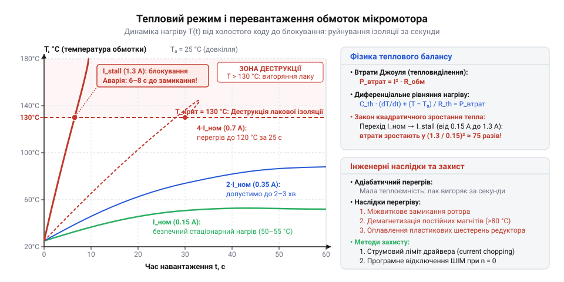
*Криві нагріву обмоток мікромотора в часі при струмах від номінального до струму блокування: за повного стопоріння ротора температура за лічені секунди перетинає критичну лінію деструкції лакової ізоляції 150 °C, тоді як утримання робочого струму в номінальних межах гарантує безпечний тепловий баланс.*

> 🔧 **Навіщо це.**
> Запас крутного моменту захищає не лише мотор, а й бортову електроніку. Якщо обрати двигун із запасом менше ніж 3–4 рази, будь-яка локальна нерівність або застрягання колеса підкине струм до пікового значення `I_stall`. Це викличе миттєве просідання напруги на клемах акумулятора нижче порогу стабілізації живлення й призведе до апаратного перезавантаження керуючого мікроконтролера.

Знаючи номінальний безпечний момент `M_rated`, можна вивести точну аналітичну формулу граничного кута підйому `α_max`, який платформа здатна долати без перегріву двигунів. Для рівномірного руху вгору сумарна тягова сила `k` двигунів повинна врівноважувати скатну силу тяжіння та [опір коченню](root:ph-mechanics/rolling-resistance) (лат. *resistentia* — опір):

```
F_thrust_total ≥ F_gravity_parallel + F_roll   [умова динамічної рівноваги на підйомі]
k · (M_rated / R) ≥ m · g · sin(α) + f_roll · m · g · cos(α)  [підстановка важільного зв'язку та сил опору]
```

Тут `k` — кількість тягових двигунів, `R` — радіус коліс (лат. *radius* — спиця, промінь), а `f_roll` — безрозмірний коефіцієнт опору коченню еластичного колеса по твердій поверхні. Поділивши нерівність на силу тяжіння всієї платформи `m · g`, отримуємо остаточний вираз граничного кута:

```
sin(α_max) + f_roll · cos(α_max)
≤ (k · M_rated) / (m · g · R)                  [аналітична межа безпечного кута підйому]
```

Для пологих підйомів (`α < 15°`), де `sin(α) ≈ α` (в радіанах), а `cos(α) ≈ 1`, граничний кут оцінюють спрощено: `α_max ≈ (k · M_rated) / (m · g · R) - f_roll`.

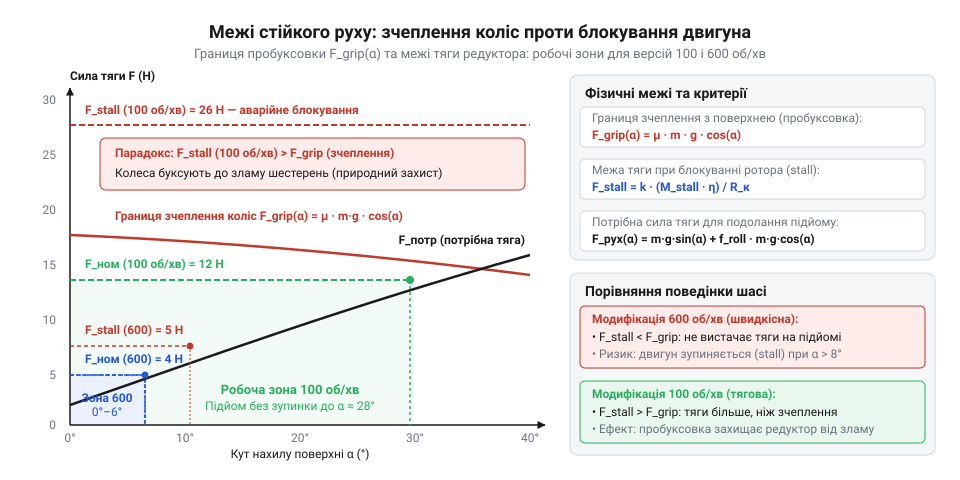
*Залежність сили тяги від кута підйому: крива фрикційного контакту F_grip падає через зменшення притискної сили, а горизонтальні межі моменту редуктора визначають безпечний номінальний коридор і аварійну межу повного блокування ротора.*

Порівняння двох серійних модифікацій 6-вольтового мотор-редуктора — на 600 об/хв та 100 об/хв — наочно демонструє вплив передавального числа на прохідність. Розглянемо платформу масою `m = 1.0 кг` із двома ведучими двигунами (`k = 2`), колесами радіусом `R = 32 мм = 0.032 м` та коефіцієнтом опору коченню `f_roll = 0.02`:

1. Модифікація 600 об/хв:
Редуктор має невелике передавальне число (`i ≈ 30`), через що момент блокування становить лише `M_stall_out ≈ 0.20 Н·м` (2.0 кг·см).
Безпечний номінальний момент: `M_rated = 0.25 · 0.20 = 0.050 Н·м`.
Обчислюємо допустиме навантаження за формулою:
```
(k · M_rated) / (m · g · R)
= (2 · 0.050) / (1.0 · 9.81 · 0.032)           [підстановка параметрів для версії 600 об/хв]
= 0.100 / 0.3139                               [добуток сили тяжіння та радіуса колеса]
≈ 0.3185                                       [допустима тягова спроможність приводу]
```
Умова підйому `sin(α) + 0.02 · cos(α) ≤ 0.3185` дає теоретичний кут близько 17°. Проте через реальне падіння напруги під навантаженням та втрати в шарнірах безпечний підйом за маси 1 кг звужується до мізерних `3–5°`: крутіший пандус змушує мотор споживати надмірний струм і швидко перегріває обмотки.

2. Модифікація 100 об/хв:
Завдяки глибокому редукуванню (`i ≈ 150...200`), момент блокування сягає `M_stall_out ≈ 1.10 Н·м` (11.0 кг·см).
Безпечний номінальний момент: `M_rated = 0.25 · 1.10 = 0.275 Н·м`.
Обчислюємо допустиме навантаження:
```
(k · M_rated) / (m · g · R)
= (2 · 0.275) / (1.0 · 9.81 · 0.032)           [підстановка параметрів для версії 100 об/хв]
= 0.550 / 0.3139                               [добуток сили тяжіння та плеча колеса]
≈ 1.752                                        [допустима тягова спроможність приводу]
```
Отримане значення `1.752` перевищує теоретичну одиницю (максимум `sin(α)`): надлишкової тяги вистачило б навіть на підйом 90°. На практиці граничний кут для версії 100 об/хв обмежений виключно зчепленням коліс із поверхнею: на гумових шинах по сухому бетону (`μ_grip ≈ 0.6...0.7`, `γ = 0.65`) платформа долає підйоми до `15–20°` без жодного натяку на тепловий перегрів двигунів.

## Інженерний алгоритм підбору мотор-редуктора та геометрії колісного рушія

Підбір механічних компонентів колісного шасі часто роблять навмання: беруть колеса «зручного» діаметра і ставлять мотор, який виявився під рукою. Наслідок такого підходу завжди один з двох: або платформа виходить безпорадно повільною, або вона рушає бадьоро, але захлинається і перегріває драйвер на першому ж невеликому ухилі чи стику плитки. Помилка полягає в ігноруванні ланцюга взаємозв'язків між крутним моментом, частотою обертання, радіусом колеса та фізичним зчепленням з ґрунтом. Інженерна методика вимагає послідовного розрахунку, де кожен крок спирається на вимоги технічного завдання та запобігає виходу приводу за межі безпечної роботи.

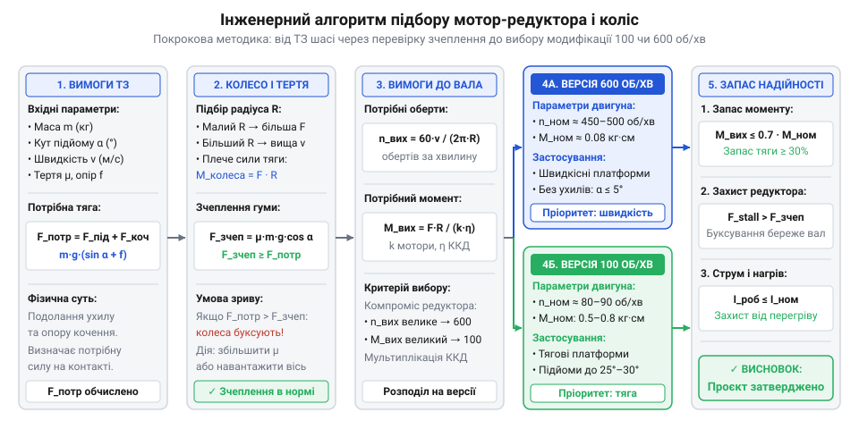
*Послідовність інженерного проєктування: від обмежень технічного завдання та перевірки межі зчеплення до підбору радіуса колеса, вибору модифікації редуктора і верифікації триразового запасу за моментом блокування.*

Повний інженерний алгоритм складається з шести послідовних розрахункових кроків:

### Крок 1. Визначення загального тягового зусилля
З технічного завдання фіксують базові експлуатаційні параметри:
- Повна маса шасі з урахуванням корисного навантаження: `m` (кг).
- Бажана маршова швидкість руху: `v_des` (м/с).
- Максимальний кут підйому траси: `α_max` (градуси).
- Кількість тягових двигунів: `k` (зазвичай 2 або 4).
- Коефіцієнт опору коченню: `f_roll` (для гуми по твердій підлозі `0.015–0.030`).
- Коефіцієнт зчеплення шини з покриттям: `μ_grip` (для гуми по сухому покриттю `0.6–0.8`).
- Частка ваги платформи, що тисне на тягову вісь: `γ` (`0 < γ ≤ 1`).

Сумарне тягове зусилля `F_pull_total`, необхідне для рівномірного руху на максимальному ухилі, складається зі скатної сили та опору коченню:

```
F_pull_total
= m · g · sin(α_max) + f_roll · m · g · cos(α_max) [сума скатної сили та опору коченню]
= m · g · (sin(α_max) + f_roll · cos(α_max))   [загальна тягова сила шасі]
```

### Крок 2. Перевірка реалізовності тяги за фрикційним контактом
Перед тим як підбирати мотор, перевіряють, чи здатні колеса передати обчислену тягу дорожньому покриттю без зриву в пробуксовку (@@en|wheel slip@@):

```
F_grip_max
= μ_grip · m · g · cos(α_max) · γ              [гранична сила тертя спокою контактної плями]
```

Критерій допустимості:
```
F_pull_total ≤ F_grip_max                      [умова руху без пробуксовки коліс]
```
Якщо ця нерівність не виконується, збільшення потужності моторів безглузде: колеса просто шліфуватимуть поверхню. Розробник зобов'язаний змінити конструкцію: збільшити частку навантаження на ведучу вісь `γ`, обрати шини з вищим коефіцієнтом `μ_grip` або перейти на повнопривідну компоновку шасі (`k = 4`, `γ = 1.0`).

### Крок 3. Вибір радіуса колеса
Дорожній просвіт (англ. *clearance* — вільний зазор, лат. *clarus*) — @@en|ground clearance@@ — диктує мінімальну висоту осі над землею для подолання перешкод. Водночас колесо працює як важіль (грец. *mochlos*): його радіус `R` прямо визначає необхідний крутний момент на валу для створення сили тяги: `M_req = F_thrust · R`.
Збільшення діаметра колеса покращує прохідність нерівностей і підвищує швидкість, проте пропорційно збільшує навантаження на редуктор. Тому радіус колеса `R` обирають мінімально допустимим із точки зору кліренсу (радіус має перевищувати висоту типових перешкод маршруту у 1.5–2 рази).

### Крок 4. Розрахунок необхідної частоти обертання вала
Колесо радіусом `R` за один оберт проходить шлях `2 · π · R`. Для забезпечення маршової лінійної швидкості `v_des` кутова швидкість обертання вала становить `ω = v_des / R`. Переводячи кутову швидкість у практичні оберти за хвилину (об/хв, @@en|revolutions per minute@@):

```
n_req
= (60 · v_des) / (2 · π · R)                   [необхідна частота обертання колеса під навантаженням]
```

### Крок 5. Вибір модифікації редуктора та розрахунок робочого моменту
Під робочим навантаженням частота обертання колекторного двигуна просідає приблизно до 75–85% від частоти холостого ходу (@@en|no-load speed@@) — `n_no_load`. Тому паспортна швидкість холостого ходу обраної модифікації повинна перевищувати розрахункову:

```
n_no_load ≥ n_req / 0.80                       [врахування просідання обертів під робочим моментом]
```

Розраховують статичний крутний момент, який має розвивати кожен окремий двигун:

```
M_req = (F_pull_total · R) / k                 [потрібний робочий крутний момент на валу двигуна]
```

### Крок 6. Перевірка коефіцієнта запасу за моментом блокування
Коефіцієнт запасу (лат. *factor* — той, що робить) — @@en|safety factor@@ — визначається як відношення паспортного моменту блокування `M_stall` до необхідного робочого моменту:

```
k_safe = M_stall / M_req ≥ 3.0                 [критерій надійності та захисту від перегріву]
```

Якщо `k_safe < 3.0`, мотор працюватиме в режимі небезпечного теплового навантаження. Потрібно перейти на модифікацію з більшим передавальним числом, зменшити радіус коліс або додати кількість приводів.

> 🔧 **Навіщо це.**
> Запас за моментом `k_safe ≥ 3` розв'язує проблему пускових струмів та інерційного розгону. Під час старту з місця двигун короткочасно споживає струм, набагато вищий за номінальний, щоб надати масі прискорення. Якщо розрахунковий запас за моментом становить щонайменше 3, піковий динамічний момент розгону вкладається в зону пружності зубців редуктора і не викликає теплового удару в обмотках.

### Наскрізні числові розрахунки двох реальних шасі на напрузі 6 В

#### Конструкція 1: Швидкісний робот-кур'єр для офісних приміщень
Платформа розробляється для транспортування дрібних вантажів по абсолютно рівній підлозі (ламінат, лінолеум) із високою швидкістю.
- Вхідні дані: повна маса `m = 0.8 кг`, бажана швидкість `v_des = 0.8 м/с`, підйом відсутній (`α_max = 0°`), коефіцієнт опору коченню `f_roll = 0.015`, коефіцієнт зчеплення `μ_grip = 0.6`. Привід диференціальний на базі двох двигунів (`k = 2`) із пасивним поворотним роликом (частка маси на ведучих колесах `γ = 0.65`).

1. Розрахунок тягового зусилля:
```
F_pull_total
= 0.8 · 9.81 · (sin(0°) + 0.015 · cos(0°))      [підстановка параметрів для горизонтальної підлоги]
= 7.848 · (0 + 0.015 · 1.0)                    [обчислення сили опору коченню]
= 7.848 · 0.015                                [множення сили тяжіння на коефіцієнт опору]
≈ 0.118 Н                                      [сумарна сила опору руху]
```

2. Перевірка зчеплення:
```
F_grip_max
= 0.6 · 0.8 · 9.81 · cos(0°) · 0.65            [максимальна сила фрикційного контакту]
= 0.6 · 7.848 · 0.65                           [добуток нормальної сили та коефіцієнта зчеплення]
≈ 3.06 Н                                       [гранична сила зчеплення перед пробуксовкою]
```
Умова `0.118 Н ≤ 3.06 Н` виконується з 26-кратним запасом: пробуксовка на рівній підлозі повністю виключена.

3. Вибір коліс:
Для рівної підлоги дорожній просвіт не критичний. Обираємо мініатюрні легкі колеса радіусом `R = 17 мм = 0.017 м` (зовнішній діаметр `D = 34 мм`).

4. Розрахунок обертів:
```
n_req
= (60 · 0.8) / (2 · π · 0.017)                 [необхідна частота обертання вала]
= 48 / 0.1068                                  [ділення швидкості на довжину окружності колеса]
≈ 449 об/хв                                    [робочі оберти під навантаженням]
```

5. Вибір двигуна:
Версія 100 об/хв фізично не здатна розвинути такі оберти. Обираємо версію **600 об/хв**. Її частота холостого ходу 600 об/хв із запасом покриває умову `n_no_load ≥ 449 / 0.80 = 561 об/хв`.

6. Перевірка моменту та запасу:
```
M_req
= (0.118 · 0.017) / 2                          [статичний момент на один двигун]
= 0.0020 / 2                                   [добуток тяги на плече важеля]
≈ 0.0010 Н·м                                   [робочий момент двигуна (0.010 кг·см)]
```
Паспортний момент блокування версії 600 об/хв становить `M_stall ≈ 0.20 Н·м` (2.0 кг·см).
Коефіцієнт статичного запасу:
```
k_safe
= 0.20 / 0.0010                                [відношення моменту блокування до робочого]
= 200                                          [коефіцієнт запасу при рівномірному русі]
```
Отриманий коефіцієнт запасу `k_safe = 200` колосально перевищує мінімальний поріг `3.0` (робочий статичний момент становить лише `0.5%` від `M_stall`). Двигун працює в надзвичайно легкому режимі, споживає струм близько 80–120 мА, практично не нагрівається і гарантує тривалий термін служби батареї та редуктора.

#### Конструкція 2: Платформний всюдихід для похилих трас і пандусів
Платформа призначена для подолання похилих трас, порогів і пандусів із помірною швидкістю та підвищеною прохідністю.
- Вхідні дані: повна маса `m = 1.5 кг`, максимальний кут підйому `α_max = 15°` (`sin(15°) ≈ 0.2588`, `cos(15°) ≈ 0.9659`), поверхня — грубий бетон (`f_roll = 0.03`, `μ_grip = 0.75`), бажана швидкість руху `v_des = 0.2 м/с`, кількість ведучих двигунів `k = 2` (частка маси на тягових колесах `γ = 0.70`).

1. Розрахунок тягового зусилля:
```
F_pull_total
= 1.5 · 9.81 · (sin(15°) + 0.03 · cos(15°))    [баланс сили тяжіння та опору коченню на схилі]
= 14.715 · (0.2588 + 0.03 · 0.9659)            [підстановка значень тригонометричних функцій]
= 14.715 · (0.2588 + 0.0290)                   [додавання опору деформації колеса і поверхні]
= 14.715 · 0.2878                              [сумарний безрозмірний опір руху]
≈ 4.235 Н                                      [необхідне тягове зусилля на підйомі]
```

2. Перевірка зчеплення:
```
F_grip_max
= 0.75 · 1.5 · 9.81 · cos(15°) · 0.70          [максимальна сила фрикційного контакту]
= 0.75 · 14.715 · 0.9659 · 0.70                [добуток коефіцієнта зчеплення та нормальної реакції]
≈ 7.46 Н                                       [гранична сила зчеплення перед пробуксовкою]
```
Умова відсутності пробуксовки `4.235 Н ≤ 7.46 Н` виконується із запасом `7.46 / 4.235 ≈ 1.76`: шасі долатиме 15-градусний пандус без зриву в шліфування.

3. Вибір коліс:
Для проходження стиків і порогів потрібен дорожній просвіт не менше 30 мм. Обираємо колеса збільшеного діаметра `D = 65 мм` із м'яким гумовим протектором, радіус `R = 32.5 мм = 0.0325 м`.

4. Розрахунок обертів:
```
n_req
= (60 · 0.2) / (2 · π · 0.0325)                [розрахунок частоти обертання вала]
= 12 / 0.2042                                  [ділення лінійної швидкості на довжину окружності]
≈ 58.8 об/хв                                   [робочі оберти колеса під навантаженням]
```

5. Вибір двигуна:
Якщо помилково обрати версію 600 об/хв, її момент блокування складе лише `0.20 Н·м`. Необхідний робочий момент на один мотор:
```
M_req
= (4.235 · 0.0325) / 2                         [момент на валу одного тягового двигуна]
= 0.1376 / 2                                   [сумарний необхідний крутний момент]
≈ 0.0688 Н·м                                   [робочий момент двигуна (0.70 кг·см)]
```
Для версії 600 об/хв коефіцієнт запасу складе `k_safe = 0.20 / 0.0688 ≈ 2.91`. Мотор працюватиме на 34% від моменту блокування, що виходить за межі допустимого тривалого нагріву (25%). Струм підскочить до 500–600 мА, викличе швидкий перегрів і неконтрольовано високу швидкість на рівних ділянках.

Обираємо модифікацію **100 об/хв**:
Паспортна частота холостого ходу 100 об/хв під розрахунковим навантаженням `0.0688 Н·м` просяде якраз до `65–70 об/хв`, що практично ідеально відповідає цільовим `58.8 об/хв` (реальна швидкість шасі становитиме близько `0.22 м/с`).
Паспортний момент блокування для версії 100 об/хв становить `M_stall ≈ 1.10 Н·м` (11.0 кг·см).

6. Перевірка запасу моменту:
```
k_safe
= 1.10 / 0.0688                                [відношення моменту блокування до робочого]
≈ 16.0                                         [коефіцієнт безпечного запасу за моментом]
```
Коефіцієнт запасу `k_safe = 16.0` суттєво перевищує необхідний мінімум `3.0`. Робочий момент становить лише `6.2%` від моменту блокування. Струм споживання залишається на безпечному рівні 180–220 мА, двигуни не зазнають теплового стресу, шестерні захищені від ударних сколів, а платформа впевнено долає круті підйоми.
