# Мотор-редуктор 6 В (100 і 600 об/хв)

<preknowlist>
- [N20 мікромотор з редуктором](root:cat-hw-actuators/n20-motor) — електрофізичні основи колекторного двигуна постійного струму, механіка зубчастого редуктора, залежність обертів і моменту від напруги та поняття пускового струму блокування вала (stall current)
</preknowlist>

## Проблема безпосереднього підключення двигуна до мікроконтролера та межі однотранзисторних схем

Спроба з'єднати клеми 6-вольтового колекторного двигуна, як-от [N20 мікромотор з редуктором](root:cat-hw-actuators/n20-motor), безпосередньо з виводами GPIO (від англ. @@en|General Purpose Input/Output@@) мікроконтролера закінчується термічним руйнуванням кремнієвого кристала. На логічному рівні пряме з'єднання здається оманливо простим: високий рівень на виводі вмикає обертання, а низький — знеструмлює привід. Проте на фізичному рівні вихідний буфер розрахований лише на перезаряджання малих ємностей логічних входів або живлення індикаторних світлодіодів, а не на індуктивне електромеханічне навантаження.

Вихідний каскад типового мікроконтролера побудований за двотактною схемою (@@en|push-pull@@) на комплементарній парі польових транзисторів: верхньому P-канальному, що комутує вивід на шину живлення, та нижньому N-канальному, що замикає його на землю. Розміри каналів на підкладці становлять частки мікрона, а смужки міжкомпонентної металізації витримують суворо обмежену густину струму.

Гранично допустимий струм одного виводу GPIO становить від 20 до 40 мА, а сумарний струм порту рідко перевищує 100–150 мА. Навіть на холостому ходу 6-вольтовий колекторний мотор-редуктор споживає 70–120 мА, а під номінальним корисним навантаженням — 150–300 мА, що у 5–15 разів перевищує абсолютний максимум для виводу процесора.

Найнебезпечніший режим настає в момент пуску з місця або за механічного блокування вихідного вала редуктора (стан блокування вала, @@en|stall@@). Поки ротор нерухомий, електрорушійна сила не генерується, і струм у колі обмежується лише активним омічним опором обмоток якоря. Для 6-вольтових моторів опір обмотки `R_w` становить 2.5–4.5 Ом.

Пусковий струм блокування вала визначається законом Ома:
```
I_stall
= U_supply / R_winding          [закон Ома для нерухомого ротора]
= 6.0 V / 3.2 Ω                 [номінальні параметри 6-вольтового двигуна]
= 1.875 A                       [пусковий струм блокування вала]
```
Струм величиною майже 1.9 А перевищує допустиму норму виводу мікроконтролера майже у сто разів. За такого навантаження на внутрішньому опорі відкритого транзистора вихідного каскаду падає практично вся напруга живлення. Локальний розігрів спричиняє руйнування мікропровідників кристала та електричний пробій підкладки з утворенням паразитної тиристорної структури (явище замикання, @@en|latch-up@@), що незворотно випалює цифровий порт або весь мікроконтролер.

Другою руйнівною загрозою є індуктивність обмотки двигуна (від лат. @@la|inductio@@ — наведення, збудження), яка накопичує енергію в магнітному полі ротора. Спроба вимкнути вивід GPIO розриває ланцюг живлення, викликаючи індуктивний викид напруги проти-ЕРС:
```
V_spike
= -L · (di / dt)                [закон електромагнітної індукції Фарадея]
```
Оскільки внутрішній польовий транзистор закривається за одиниці наносекунд (`dt → 0`), крутизна спаду струму породжує імпульс амплітудою від десятків до сотень вольтів. Вбудовані захисні діоди від електростатичних розрядів (ESD-діоди) розраховані лише на наноджоулеві сплески — під дією індуктивного викиду вони миттєво випаровуються, відкриваючи високій напрузі прямий шлях до логічних вентилів процесора.

Дефіцит струму долають розв'язкою на дискретному транзисторі (від англ. @@en|transfer resistor@@ — керований опір), наприклад MOSFET-ключі ([дискретний польовий транзистор як силовий ключ](root:hw-components/mosfet-power-switch)) N-типу за схемою нижнього ключа (@@en|low-side switch@@). Вивід мікроконтролера лише перезаряджає ізольований затвор струмом у кілька міліамперів, тоді як силове коло комутує струми двигуна від окремого джерела 6 В. Паралельно двигуну встановлюють захисний діод ([індуктивний викид напруги та захисні діоди](root:hw-components/flyback-inductive-spike)) для безпечного замикання індуктивних викидів під час вимикання.

Проте однотранзисторна схема має принципову межу — однополярність: струм тече лише в одному фіксованому напрямку. Змінити напрямок обертання вала (виконати реверс, від лат. @@la|reversus@@ — повернений назад) неможливо, оскільки для зміни знака електромагнітного моменту потрібна зворотна полярність напруги на клемах якоря. До того ж каскад не підтримує активного динамічного гальмування: при закритті ключа ротор котиться за інерцією, зупиняючись лише від тертя.

Спроба розв'язати проблему реверсу додаванням електромеханічного реле (від фр. @@fr|relais@@ — змінна упряж) із парою перекидних контактів (DPDT, @@en|double pole double throw@@) усуває проблему зміни полярності, проте виключає широтно-імпульсну модуляцію (ШІМ) для плавного керування швидкістю. Механічний якір перемикається за 5–20 мілісекунд (не більше 10–20 Гц), тоді як для керування двигуном потрібна частота 15–25 кГц: високочастотний сигнал спричиняє лише акустичний брязкіт і швидке зварювання контактів.

Виникає однозначна технічна потреба у повністю напівпровідниковій системі комутації, яка забезпечує безконтактну зміну полярності напруги на навантаженні, підтримує високочастотну ШІМ для прецизійного регулювання обертів і витримує високі пускові та блокувальні струми приводу.

> 🔧 **Навіщо це.**
> Розуміння фізичних меж виводів мікроконтролера та однотранзисторних схем захищає розробника від термічного пошкодження плати на макеті. Замість спроб компенсувати обмеження реле інженер одразу переходить до побудови повномостового симетричного ключового каскаду.

## Топологія H-моста та базові режими комутації навантаження

Архітектурною відповіддю на потребу двонапрямленого керування навантаженням від одного однополярного джерела живлення є мостова схема, яка через геометричну схожість принципової схеми отримала назву H-міст (@@en|H-bridge@@). Чотири керовані напівпровідникові ключі формують дві вертикальні паралельні стійки (плечі або напівмости, @@en|half-bridges@@), підключені між шиною живлення двигуна `V_motor` та спільним заземленням `GND`. Навантаження — колекторний двигун постійного струму — вмикається в центральну горизонтальну перемичку між середніми точками цих стійок, повторюючи обриси латинської літери «H».

Кожна зі стійок містить два ключі:
- Ліва стійка (напівміст A): верхній ключ Q1 (High-Side A) та нижній ключ Q2 (Low-Side A). Точка їхнього спільного з'єднання є вихідною клемою мотора A.
- Права стійка (напівміст B): верхній ключ Q3 (High-Side B) та нижній ключ Q4 (Low-Side B). Точка їхнього з'єднання є вихідною клемою мотора B.

Як комутаційні елементи використовують біполярні або кремнієві польові транзистори. Керуючи станом цих чотирьох ключів, можна довільно підключати клеми мотора до шини живлення або землі, повністю ізолювати їх або закорочувати між собою.

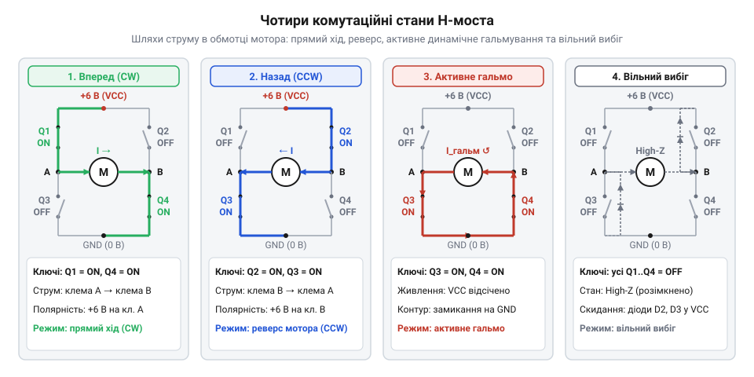
*Чотири комутаційні стани H-моста та шляхи протікання струму крізь обмотку мотора: діагональні пари ключів задають полярність напруги та напрямок обертання, замикання обох нижніх ключів закорочує обмотку для демпфування проти-ЕРС, а розмикання всіх ключів переводить ротор у вільний вибіг.*

Для реалізації обертання вала використовують діагональну комутацію ключів.

**Прямий рух (Forward):**
У цьому стані одночасно відкриваються ключі першої діагоналі: верхній лівий Q1 і нижній правий Q4. Ключі Q2 і Q3 залишаються надійно розімкненими. Потенціал клеми A стає рівним напрузі шини живлення `V_motor`, а потенціал клеми B прив'язується до шини заземлення `GND`.

Напруга, прикладена до двигуна, становить:
```
V_AB
= V_A - V_B                    [визначення різниці потенціалів на клемах]
= V_motor - 0 V                 [потенціали через відкриті ключі Q1 та Q4]
= +V_motor                      [пряма полярність напруги живлення]
```
Струм протікає за замкненим контуром: шина `V_motor` → відкритий канал Q1 → клема A → обмотка якоря зліва направо → клема B → відкритий канал Q4 → шина `GND`. Взаємодія струму обмотки з магнітним полем статора створює крутний момент, що розганяє ротор у прямому напрямку (за годинниковою стрілкою).

**Зворотний рух (Reverse):**
Діагональ Q1-Q4 вимикається, і натомість відкривається протилежна діагональна пара: верхній правий ключ Q3 та нижній лівий ключ Q2. Ключі Q1 і Q4 повністю закриті. У цій конфігурації клема B з'єднується з шиною `V_motor`, а клема A сідає на землю `GND`.

Напруга на обмотці змінює знак на протилежний:
```
V_AB
= V_A - V_B                    [визначення різниці потенціалів на клемах]
= 0 V - V_motor                 [потенціали через відкриті ключі Q2 та Q3]
= -V_motor                      [зворотна полярність напруги живлення]
```
Струм протікає крізь якір у зворотному напрямку — від клеми B до клеми A (справа наліво). Відповідно, вектор електромагнітного моменту змінює свій напрямок на 180 градусів, забезпечуючи реверсивне обертання вала (проти годинникової стрілки).

Крім активного обертання, схема H-моста забезпечує два принципово відмінні пасивні режими зупинки приводу, що визначають динаміку руху системи:

**Вільний вибіг (Coasting / стан високого імпедансу Hi-Z):**
Усі чотири ключі Q1, Q2, Q3, Q4 одночасно розмикаються. Клеми двигуна A і B виявляються повністю відрізаними як від живильної шини, так і від землі. Опір між клемами та лініями живлення прямує до нескінченності (стан високого імпедансу, від лат. @@la|impedire@@ — перешкоджати).

Струм від джерела живлення не споживається (`I = 0`). Обертання ротора підтримується виключно за рахунок накопиченої кінетичної енергії власної маси якоря та зачеплених шестерень редуктора. Оскільки зовнішнє електричне коло розірване, струм проти-ЕРС не може протікати крізь якір. Сповільнення приводу відбувається повільно, під дією механічного тертя в щітках, бронзових або кулькових вальницях та зубчастих парах. У цьому стані вихідний вал можна легко провернути зовнішнім механічним зусиллям.

**Активне динамічне гальмування (Dynamic Braking / електродинамічний затиск):**
Принципово інша поведінка виникає, коли ключі верхнього рівня Q1 і Q3 розімкнені, а обидва нижні ключі Q2 і Q4 одночасно замикаються на землю (нижній затиск, @@en|low-side clamp@@). Альтернативний варіант — одночасне замикання верхніх ключів Q1 і Q3 при розімкнених нижніх (верхній затиск, @@en|high-side clamp@@), проте на практиці частіше застосовують нижнє замикання, оскільки N-канальні транзистори мають менший внутрішній опір каналу.

У такому стані двигун від'єднаний від джерела енергії, але його клеми A і B закорочені між собою через відкриті транзистори та спільну мідну доріжку землі. Ротор, що продовжує обертатися за інерцією, перетинає постійне магнітне поле статора. У результаті явища електромагнітної індукції двигун миттєво перетворюється на електричний генератор (від лат. @@la|generator@@ — породжувач, творець).

На клемах машини виникає генераторна електрорушійна сила (проти-ЕРС), амплітуда якої прямо пропорційна миттєвій кутовій швидкості обертання ротора:
```
E_emf
= k_e · ω                       [рівняння генераторної проти-ЕРС двигуна]
```
де `k_e` — конструктивна стала напруги двигуна, а `ω` — поточна кутова швидкість обертання якоря.

Оскільки клеми з'єднані накоротко через ключі з мінімальним паразитно-активним опором, згенерована напруга викликає в замкненому контурі обмоток потужний струм короткого замикання:
```
I_brake
= E_emf / (R_winding + 2 · R_ds_on)   [струм короткого замикання генератора]
≈ E_emf / R_winding                   [опір відкритого каналу MOSFET знехтовно малий]
```
За правилом Ленца, напрямок цього індукованого струму завжди такий, що створюваний ним власний магнітний потік протидіє зміні зовнішнього магнітного потоку, тобто протидіє першопричині явища — обертанню ротора. У повітряному зазорі виникає потужний гальмівний електромагнітний момент:
```
M_brake
= k_t · I_brake                 [електромагнітний гальмівний момент]
= (k_t · k_e · ω) / R_winding   [лінійна залежність гальмування від швидкості]
```
де `k_t` — коефіцієнт крутного моменту двигуна.

Кінетична енергія рухомих мас якоря та шестерень миттєво розсіюється у вигляді тепла Джоуля-Ленца на активному омічному опорі мідного дроту самої обмотки якоря (`Q = I_brake^2 · R_w · t`). Вал зазнає миттєвого пружного спротиву та зупиняється за лічені мілісекунди.

Важливо враховувати межу застосування динамічного (від грец. @@grc|δύναμις@@ — сила) гальмування: величина гальмівного моменту спадає пропорційно зменшенню швидкості ротора. У момент повної зупинки (`ω = 0`) генераторна проти-ЕРС падає до нуля, гальмівний струм зникає, і залишковий момент утримання стає рівним нулю. Динамічне гальмування не може слугувати стоянковим гальмом — воно не здатне протистояти тривалій дії статичного навантаження на валу без додаткового механічного блокування (черв'ячної передачі чи фрикційної муфти).

Чотири ключі H-моста дають 16 теоретично можливих двійкових комбінацій. Однак більшість із них є електрично неприпустимими або аварійними. Повна матриця дозволених комутаційних станів моста виглядає так:

| Стан моста | Ключ Q1 (HL) | Ключ Q2 (LL) | Ключ Q3 (HR) | Ключ Q4 (LR) | Потенціал A | Потенціал B | Фізичний режим навантаження |
|:---|:---:|:---:|:---:|:---:|:---:|:---:|:---|
| **Вільний вибіг (Hi-Z)** | 0 (Вимк) | 0 (Вимк) | 0 (Вимк) | 0 (Вимк) | Hi-Z | Hi-Z | Струм нульовий, кочення вала виключно за інерцією |
| **Прямий хід (Forward)** | **1 (Увімк)** | 0 (Вимк) | 0 (Вимк) | **1 (Увімк)** | `+V_motor` | GND | Обертання вперед, струм крізь мотор зліва направо |
| **Зворотний хід (Reverse)** | 0 (Вимк) | **1 (Увімк)** | **1 (Увімк)** | 0 (Вимк) | GND | `+V_motor` | Обертання назад, струм крізь мотор справа наліво |
| **Динамічне гальмо (Low-Side)** | 0 (Вимк) | **1 (Увімк)** | 0 (Вимк) | **1 (Увімк)** | GND | GND | Клеми замкнені на землю, активне гасіння проти-ЕРС |
| **Динамічне гальмо (High-Side)** | **1 (Увімк)** | 0 (Вимк) | **1 (Увімк)** | 0 (Вимк) | `+V_motor` | `+V_motor` | Клеми замкнені на живлення, активне гасіння проти-ЕРС |
| **АВАРІЯ (Shoot-Through стійки A)** | **1 (Увімк)** | **1 (Увімк)** | X | X | КЗ | X | Коротке замикання шини живлення на землю через плече A! |
| **АВАРІЯ (Shoot-Through стійки B)** | X | X | **1 (Увімк)** | **1 (Увімк)** | X | КЗ | Коротке замикання шини живлення на землю через плече B! |

Коли в межах однієї вертикальної стійки одночасно відкриваються верхній і нижній транзистори (Q1 і Q2 або Q3 і Q4), опір між живильною шиною V_motor та землею GND падає практично до нуля, минаючи опір обмотки двигуна. Виникає катастрофічний наскрізний струм (@@en|shoot-through@@ або поперечна провідність). Струм короткого замикання обмежується лише внутрішнім опором джерела живлення та відкритих каналів транзисторів, сягаючи десятків або сотень амперів. Це призводить до вибухового руйнування корпусів транзисторів та вигорання друкованих провідників плати за одиниці мікросекунд. Для запобігання цьому явищу алгоритм керування мусить гарантувати інтервал розриву перед замиканням (захисний мертвий час, @@en|dead-time@@), реалізований за допомогою апаратних засобів мікроконтролера ([захисний час перемикання напівмоста (dead-time)](root:hw-power/dead-time-sizing)).

> 🔧 **Навіщо це.**
> Розуміння матриці станів H-моста дає розробнику точний контроль над кінематикою робототехнічного приводу. У задачах точного позиціонування перехід у режим вільного вибігу спричиняє перебіг координати через інерцію важкого редуктора, тоді як активне динамічне гальмування зупиняє рух без вибігу. Натомість під час руху накатом вільний вибіг зберігає запас енергії акумулятора та виключає зайві знакозмінні механічні удари в шестернях.

## Небезпека наскрізного струму (shoot-through) та формування захисного мертвого часу (dead-time)

Стійка H-моста об'єднує два силові ключі: верхній підімкнено до шини 6 В, а нижній — до заземлення. Клему двигуна підключено до середньої точки між ними. В ідеальній схемі комутація (лат. @@la|commutatio@@ — зміна, чергування) миттєва: один транзистор закривається рівно в мить відкриття другого. У реальних напівпровідниках перехідні процеси мають скінченну швидкість. Одночасне перемикання каналів стійки створює вікно перекриття на десятки чи сотні наносекунд, коли обидва транзистори відкриті. Шина живлення замикається на землю через низький опір кристалів. Це аварійне явище називають наскрізним струмом (англ. @@en|shoot-through@@, від *shoot through* — прострілювати наскрізь; також відоме як струм перекриття або поперечна провідність, англ. @@en|cross-conduction@@).

Першопричина наскрізного струму — асиметрія комутації: реальний транзистор вимикається довше, ніж вмикається. Якщо в біполярних ключах затримку визначає розсмоктування заряду в базі, то в польових МОН-транзисторах ([MOSFET](root:hw-components/mosfet-power-switch)) нашого моста вона зумовлена перезаряджанням паразитних ємностей затвора C_gs та C_gd (ефект Міллера). Щоб відкрити транзистор, достатньо зарядити затвор до порогової напруги каналу V_th (1.2–2.0 В). Натомість під час вимкнення розрядний струм має примусово стягнути весь заряд Q_g крізь опір драйвера нижче порогу. Через це час закриття t_off сягає 120–350 нс, тоді як відкриття зустрічного ключа t_on завершується за 25–60 нс.

У вікні перекриття опір між шиною 6 В та GND обмежений лише сумою відкритих каналів R_DS(on) транзисторів і доріжок (0.15–0.3 Ом). За законом Ома амплітуда струму миттєво досягає вибухових значень:
`
I_shoot = V_motor / (R_DS_high + R_DS_low + R_trace)         [закон Ома для кола короткого замикання стійки]
I_shoot = 6.0 В / (0.08 Ом + 0.08 Ом + 0.04 Ом)              [підстановка параметрів дискретних ключів]
I_shoot = 30.0 А                                             [імпульсний наскрізний струм короткого замикання]
`
Струм у 30 А виділяє на кристалах пікову імпульсну потужність P = I² · R ≈ (30 А)² · 0.16 Ом = 144 Вт. За частки мікросекунди тепло не встигає відійти до тепловідводу, викликаючи локальний тепловий пробій кристала та руйнування транзистора. Одночасно різке наростання струму di/dt створює на індуктивності провідників живлення глибоке просідання напруги, провокуючи апаратне скидання мікроконтролера (brown-out reset) і циклічне зависання пристрою.

> 🔧 **Навіщо це.**
Захисний мертвий час запобігає вибуховому руйнуванню силових транзисторів і неконтрольованому перезавантаженню мікроконтролера: витримавши коротку апаратну паузу перед відкриттям зустрічного ключа, ми усуваємо пряме коротке замикання шини живлення на землю під час кожного такту ШІМ або зміни напрямку обертання.

Для усунення наскрізних струмів у керування H-мостом закладають обов'язковий часовий інтервал — захисний мертвий час (англ. @@en|dead-time@@, від *dead* — недіючий, знеструмлений та *time* — час).
Його формують за непорушним правилом «розрив перед замиканням» (англ. @@en|break-before-make@@): перед відкриттям ключа протилежний транзистор стійки гарантовано закривається, після чого витримується часова пауза 	_dead.
Розрахунок тривалості мертвого часу виконують за найгіршими граничними значеннями з паспорта ключів:
`
t_dead ≥ (t_off(max) - t_on(min)) + t_margin                 [умова безпечного рознесення фаз комутації]
t_dead ≥ (280 · 10⁻⁹ с - 30 · 10⁻⁹ с) + 150 · 10⁻⁹ с         [підстановка часових параметрів комутації]
t_dead ≥ 400 · 10⁻⁹ с = 0.40 мкс                             [мінімальний розрахунковий мертвий час]
`
Запас t_margin (100–200 нс) є обов'язковим, оскільки при нагріванні MOSFET під час роботи час спаду напруги зростає на 20–40%. Якщо затвори підімкнені до мікроконтролера через обмежувальні резистори без спеціалізованого [драйвера затворів](root:hw-power/half-bridge-gate-driver), обмежений вихідний струм пінів (20–30 мА) затягує перезаряджання ємностей затвора до 1–2 мкс, вимагаючи збільшення t_dead. Крім того, послідовний резистор затвора виконує роль демпфера: надмірне зменшення його опору задля прискорення перезаряджання ємностей провокує [паразитний дзвін затвора](root:hw-power/mosfet-gate-ringing) через резонанс із паразитною індуктивністю доріжок.

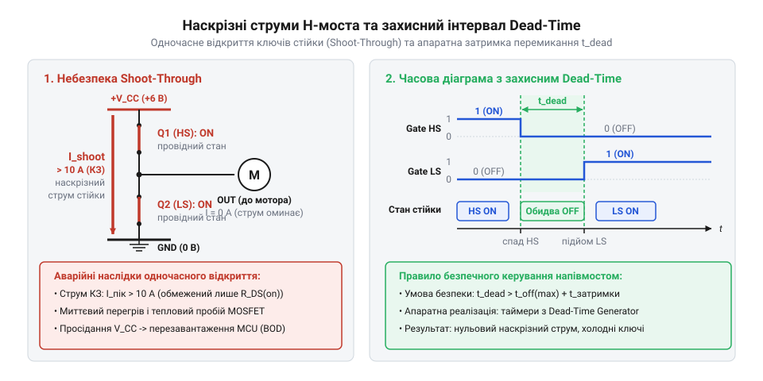
*Діаграма часових затримок перемикання ключів напівмоста: перекриття станів провідності викликає імпульсний наскрізний струм, а введення мертвого часу t_dead розносить інтервали відкриття транзисторів і запобігає короткому замиканню шини живлення.*

У сучасних системах формування мікросекундного захисного часу покладають на апаратний блок таймера — генератор мертвого часу (Dead-Time Generator, DTG). Таймер генерує комплементарні ШІМ-сигнали, а його логіка автоматично затримує кожен наростаючий фронт на задану кількість тактів:
:::code proj-hbridge-motor-driver/c/gearmotor_driver.c 44-53
Регістр dtr приймає значення відліків мертвого часу dead_time_counts. За частоти тактування таймера 20 МГц (тривалість такту 50 нс) запис числа 25 формує захисну апаратну затримку 25 · 50 нс = 1.25 мкс. Апаратна логіка гарантує паузу незалежно від переривань чи затримок процесора.

Окрім потактового захисту ШІМ, існує макроскопічний захист від наскрізних струмів та перевантажень — програмна пауза мертвої зони (англ. @@en|deadband@@) під час реверсу напрямку обертання.
Коли вал обертається під навантаженням, обмотки генерують зустрічну ЕРС. Миттєва зміна полярності прикладає напругу живлення 6 В у фазі з проти-ЕРС, створюючи режим протиувімкнення зі струмом, що у кілька разів перевищує пусковий. Тому логіка драйвера реалізує програмний принцип break-before-make:
:::code proj-hbridge-motor-driver/cpp/gearmotor.cpp 145-162
Перед комутацією ліній напрямку IN1 та IN2 сигнал ШІМ примусово скидається в 0, а під час реверсу кінцевий автомат витримує програмну паузу тривалістю 30–50 мс (deadTimeMs). За цей час індуктивні струми спадають, а ротор сповільнюється, що виключає ударні навантаження на зубці редуктора й усуває струмові удари в живленні.

Величина мертвого часу є предметом інженерного компромісу. Якщо встановити t_dead надмірно великим (понад 4–5 мкс при частоті ШІМ 20 кГц), виникає спотворення робочої характеристики приводу: з'являється нечутливість на низьких шпаруватостях через зменшення корисної тривалості імпульсу. Окрім того, протягом захисної паузи обидва ключі закриті, і струм обмотки змушений замикатися крізь зворотні діоди, що збільшує теплове розсіювання на платі. Оптимальним є значення t_dead, що перевищує паспортний час закриття транзистора t_off у 1.5–2 рази.

## Захист ключів від індуктивної проти-ЕРС за допомогою діодів Шотткі

З точки зору електродинаміки якір колекторного двигуна постійного струму ([N20 мікромотор](root:cat-hw-actuators/n20-motor)) є індуктивною котушкою з власною індуктивністю `L` (0.2–1.5 мГн) та послідовним активним опором обмотки `R` (10–25 Ом). Під час проходження струму `I` крізь замкнену діагональ H-моста в магнітному полі осердя й повітряного зазору накопичується магнітна енергія, пропорційна квадрату сили струму: `E = (1/2) · L · I²`.
Коли керуючий транзистор закривається за командою ШІМ або зупинки, струм в обмотці не здатний зникнути миттєво, оскільки магнітне поле не може сколапсувати з нескінченною швидкістю. Згідно із законом електромагнітної індукції Фарадея (грец. @@el|ēlektron@@ — бурштин, лат. @@la|inductio@@ — наведення, спонукання), зміна магнітного потоку породжує електрорушійну силу самоіндукції, яка намагається підтримати зникаючий струм у попередньому напрямку:
```
V_L = -L · (di/dt)                                           [закон електромагнітної індукції Фарадея]
```
Оскільки сучасний польовий транзистор закривається за лічені десятки наносекунд, похідна струму `di/dt` досягає колосальних від'ємних величин, перетворюючи обмотку двигуна на генератор високовольтного імпульсу зворотної полярності (англ. @@en|flyback spike@@ або індуктивний викид).

Покажемо порядок амплітуди цього сплеску на реальних параметрах 6-вольтового приводу:
```
V_L = -1.2 · 10⁻³ Гн · (-0.6 А / 50 · 10⁻⁹ с)                [струм 0.6 А розривається за 50 нс]
V_L = +14 400 В                                              [теоретична амплітуда ЕРС самоіндукції без обмеження]
```
У реальному пристрої напруга обмежується паразитною ємністю монтажу та лавинним пробоєм транзисторів, проте амплітуда сплеску легко перевищує 60–150 В на клемах закритого ключа лише за кілька наносекунд.
Полярність напруги самоіндукції протилежна до прикладеної напруги живлення. Коли ключ розмикається, потенціал вихідного вузла моста злітає значно вище позитивної шини живлення 6 В або провалюється глибоко нижче потенціалу землі. Силові транзистори з гранично допустимою напругою стік-витік `V_DSS` 20–30 В миттєво потрапляють у режим лавинного пробою (англ. @@en|avalanche breakdown@@). Якщо енергія індуктивного імпульсу перевищує паспортну стійкість транзистора до лавинного удару `E_AS`, ізолюючий шар підкладки руйнується, викликаючи незворотне коротке замикання стоку на витік.

> 🔧 **Навіщо це.**
Зворотні діоди Шотткі утилізують руйнівну енергію магнітного поля обмотки двигуна: зрізаючи високовольтні сплески проти-ЕРС на рівні шини живлення, вони оберігають силові транзистори від лавинного пробою та повертають накопичену індуктивну енергію назад у контур живлення.

Щоб запобігти високовольтному перенапруженню, паралельно кожному з чотирьох транзисторів моста підключають швидкодіючий захисний діод в антипаралельному включенні: аноди з'єднують із нижчими за потенціалом вузлами (шина заземлення або вихід моста), а катоди — з вищими (вихід моста або шина живлення `V_motor`).
У нормальному робочому режимі діоди закриті зворотною напругою живлення і не впливають на протікання робочого струму. Проте в момент вимкнення транзисторів струм самоіндукції обмотки змінює знак напруги на клемах і миттєво відкриває відповідну пару захисних діодів:
- На клемі, де струм витікає з мотора, напруга зростає вище рівня `V_motor` і відкриває верхній діод, з'єднаний із шиною живлення.
- На клемі, куди струм повертається, напруга опускається нижче 0 В і відкриває нижній діод, з'єднаний із шиною заземлення.
Виникає безпечний контур вільного ходу струму (англ. @@en|freewheeling path@@): струм самоіндукції замикається крізь нижній діод, обмотку двигуна, верхній діод і надходить у шину живлення, підзаряджаючи згладжувальний конденсатор `V_motor`. Цей процес називають рекуперацією (лат. @@la|recuperatio@@ — повернення, зворотне отримання) індуктивної енергії.
Напруга на клемах напівмоста жорстко фіксується (англ. @@en|voltage clamping@@ — захисне зрізання) на безпечному рівні:
```
V_drain_max = V_motor + V_F                                  [рівень фіксації напруги верхнім діодом]
V_drain_max = 6.0 В + 0.35 В = 6.35 В                        [максимальна напруга на стоці закритого транзистора]
V_source_min = 0 В - V_F = -0.35 В                           [мінімальна напруга на витоку закритого ключа]
```
де `V_F` — пряме падіння напруги на відкритому захисному діоді. Максимальна напруга на будь-якому транзисторі моста не може перевищити величину `V_motor + V_F ≈ 6.35 В`, що гарантує абсолютну безпеку для ключів із робочою напругою 20–30 В.

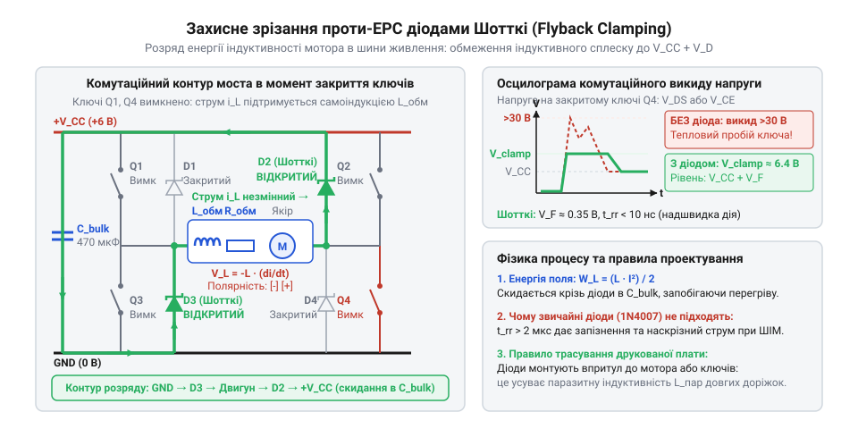
*Схема замкненого контуру розряджання енергії індуктивності мотора крізь діоди Шотткі в шини живлення в момент закриття транзисторів: показано полярність проти-ЕРС та захисне зрізання амплітуди викиду напруги.*

Вирішальним фактором надійності схеми є тип використовуваного діода. Застосування звичайних кремнієвих випрямних діодів із PN-переходом (наприклад, широко відомої серії 1N4001–1N4007) у високочастотних колах ШІМ суворо неприпустиме.
У кремнієвому PN-переході під час прямого протікання струму накопичуються неосновні носії заряду. Коли транзистор знову відкривається і прикладає до діода зворотну напругу, діод не здатний закритися миттєво: йому потрібен час зворотного відновлення (англ. @@en|reverse recovery time@@, `t_rr`), щоб накопичений заряд розсмоктався. У стандартних кремнієвих випрямлячів час `t_rr` становить від 2 до 5 мкс (2000–5000 нс). При частоті ШІМ 20 кГц (період 50 мкс) протягом 5 мкс кожного такту відкритий діод створює пряме коротке замикання для зустрічного транзистора, що викликає величезні кидки струму, перегрівання та генерацію радіозавад.

Діод Шотткі (названий на честь німецького фізика Вальтера Шотткі, нім. @@de|Walter Schottky@@) побудований на контакті метал-напівпровідник (англ. @@en|metal-semiconductor junction@@). Струм у ньому переноситься виключно основними носіями заряду (електронами). За відсутності накопичення неосновних носіїв час зворотного відновлення `t_rr` практично дорівнює нулю (одиниці наносекунд, що визначається виключно власною ємністю переходу). Діод вимикається миттєво, усуваючи струмові кидки при ввімкненні зустрічного ключа.
Крім того, контакт метал-напівпровідник має значно меншу висоту потенційного бар'єра: пряме падіння напруги `V_F` діода Шотткі становить лише 0.30–0.40 В порівняно з 0.8–1.1 В у кремнієвих діодів. Це вдвічі знижує теплові втрати потужності `P = I · V_F` під час протікання струму рекуперації.

Більшість польових транзисторів мають власний вбудований технологічний діод (англ. @@en|body diode@@), утворений p-n переходом між кремнієвою підкладкою та витоком. Проте покладатися лише на внутрішній діод MOSFET небезпечно:
1. Внутрішній body-діод є кремнієвим PN-переходом із незадовільною швидкодією (`t_rr` становить 70–200 нс) та значним зарядом відновлення `Q_rr`.
2. Пряме падіння напруги на внутрішньому діоді високе (`V_F` досягає 0.9–1.2 В). При струмі 1 А кристал транзистора розсіює близько 1 Вт додаткового паразитного тепла.
Зовнішній діод Шотткі, підключений паралельно транзистору, відкривається першим, оскільки його поріг відкриття (0.35 В) значно нижчий за поріг кремнієвого body-діода (0.8 В). У результаті весь струм індуктивного розряду протікає крізь зовнішній Шотткі, запобігаючи перегріванню транзистора та усуваючи паразитні коливання напруги.

Для надійної роботи приводу діоди Шотткі підбирають за такими паспортними параметрами:
1. Максимальна повторювана зворотна напруга `V_RRM`. Для 6-вольтового живлення обирають діоди з запасом щонайменше втричі (`V_RRM ≥ 20 - 40 В`), наприклад SS14, 1N5819 або SS34. Менший запас є небезпечним через паразитні коливання на індуктивності з'єднувальних проводів.
2. Номінальний прямий струм `I_F(AV)` та максимальний імпульсний струм `I_FSM`. Діод зобов'язаний витримувати максимальний пусковий струм або струм блокування вала ([stall current](root:cat-hw-actuators/n20-motor)), який для 6 В мотор-редукторів становить 0.8–1.2 А. Вибір діодів на струм 1–3 А гарантує багатократний запас міцності.
3. Зворотний струм витоку `I_R`. Особливістю бар'єра Шотткі є зростання струму витоку при нагріванні (до 1–3 мА при 100 °C). Для низьковольтної силової шини 6 В це не створює небезпеки, проте повинно враховуватися в автономних системах, де критичним є споживання в режимі глибокого сну.

Схемотехнічний діодний захист безпосередньо взаємодіє з програмними режимами зупинки двигуна.
У режимі вільного вибігу (coasting) усі чотири транзистори моста розмикаються:
:::code proj-hbridge-motor-driver/c/gearmotor_driver.c 98-109
Струм самоіндукції миттєво підхоплюється діодами Шотткі й скидається в шину живлення за лічені мікросекунди. Після розсіювання магнітної енергії діоди закриваються, і двигун сповільнюється виключно за рахунок механічного тертя в підшипниках та редукторі.
Натомість у режимі активного електродинамічного гальмування (braking):
:::code proj-hbridge-motor-driver/c/gearmotor_driver.c 86-96
Обидва нижні транзистори примусово відкриваються, закорочуючи клеми двигуна на шину заземлення через активний опір каналів `R_DS(on)`. Проти-ЕРС обертання викликає потужний струм короткого замикання, який миттєво зупиняє ротор за рахунок створення електромагнітного гальмівного моменту без виникнення високовольтних індуктивних викидів.

## Розділення шин живлення та топологія заземлення «зіркою» (Star GND)

Типова картина налагодження першого привода: на макетній платі збирають схему з мікроконтролером, транзисторним H-мостом і мотор-редуктором на зразок [N20 мікромотор з редуктором](root:cat-hw-actuators/n20-motor). Ключі захищені діодами Шотткі від індуктивних викидів. Програма успішно проходить ініціалізацію, блимає світлодіодом, але щойно надходить команда пуску двигуна — мікроконтролер миттєво зависає або йде в циклічне перезавантаження.

Причина збою — не пробій транзисторів і не помилка коду, а два паразитичні явища через різкі динамічні струми мотора: імпульсне просідання напруги живлення та підстрибування потенціалу на спільній землі.

У момент пуску ротор нерухомий, обертання відсутнє, а проти-ЕРС дорівнює нулю. Єдиною перешкодою для струму залишається власний активний опір обмотки `R_winding`, який у 6-вольтових приводах становить 3–5 Ом. При поданні напруги виникає пусковий струм блокування (від англ. @@en|stall current@@):

I_stall
= V_motor / R_winding              [закон Ома для нерухомого ротора]
= 6 В / 4 Ом                       [підстановка номінальної напруги та опору обмотки]
= 1.5 А                            [пусковий струм через відкриті ключі моста]

Струм зростає стрибком за лічені мікросекунди. Будь-яке джерело чи стабілізатор мають внутрішній опір `R_internal` та індуктивність дротів `L_wire`. Під час протікання імпульсу 1.5 А напруга на вихідних клемах падає. Це явище називають імпульсним просіданням напруги (від англ. @@en|voltage sag@@ — провисання напруги):

ΔV_drop
= I_stall · R_internal + L_wire · (di/dt)  [падіння напруги на внутрішньому імпедансі джерела]

Якщо цифрова частина живиться від тієї самої батареї без достатнього запасу напруги, шина живлення логіки `V_logic` провалюється нижче допустимого рівня (менше 2.7 В для 3.3-вольтового ядра). Вбудований апаратний супервізор — детектор аварійного зниження напруги (від англ. @@en|Brown-Out Reset@@, BOR; див. [детектор аварійного зниження напруги живлення](root:hw-arch/brown-out-reset-detector)) — формує скид Reset для запобігання пошкодженню регістрів та Flash-пам'яті.

Після скидання мікроконтролер вимикає виходи, транзистори моста розмикаються, струм зникає, а напруга відновлюється. Процесор починає виконувати код із нуля, знову вмикає мотор — і система потрапляє в замкнене коло нескінченних перезапусків.

Друга небезпека криється в спільній земляній шині. За шлейфового з'єднання — коли від мінуса батареї провід іде на мікроконтролер, а звідти до драйвера, — сильний струм мотора повертається до джерела через земляну доріжку цифрової схеми.

Кожен реальний провідник володіє омічним опором `R_trace` та паразитною індуктивністю `L_trace`. При комутації пускового струму 1.5 А на 15-сантиметровому шлейфі сумарне падіння напруги піднімає потенціал земляної доріжки майже на 0.25 В (0.225 В омічного падіння та 0.023 В індуктивного сплеску), а на довгих тонких дротах макетної плати зміщення сягає 0.5–1 В.

Це явище називають підстрибуванням потенціалу землі (від англ. @@en|ground bounce@@; див. [підстрибування потенціалу землі в імпульсній електроніці](root:hw-pcb/ground-bounce-noise)). Для мікроконтролера вивід GND лишається точкою відліку 0 В, але зовнішні рівні зміщуються: вхідний нуль зчитується як одиниця, збиваються шини SPI та I2C. Якщо зсув перевищить 0.6 В, відкриваються захисні діоди КМОН-структур, спричиняючи тиристорний ефект защіпки (від англ. @@en|latch-up@@; див. [тиристорний ефект latch-up](root:hw-digital/cmos-latch-up)) та вигоряння чипа.

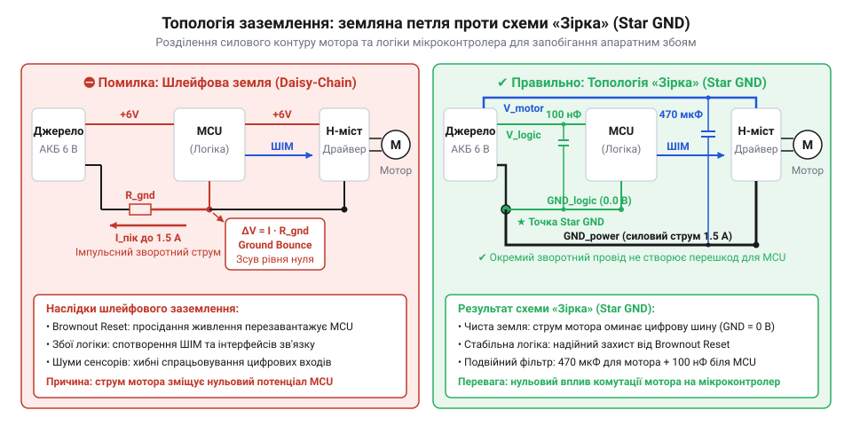
*Послідовний шлейф створює спільний опір землі й веде до збоїв логіки при стрибках струму, тоді як топологія «зіркою» розділяє струмові шляхи й замикає імпульси моста на локальний буферний конденсатор.*

Стабільна робота силового вузла досягається виконанням трьох схемотехнічних правил:

1. **Фізичне розділення шин живлення.** Лінії `V_motor` (6 В) і `V_logic` (3.3 В або 5 В) розводять незалежно. За живлення від спільної батареї в коло мікроконтролера встановлюють діод Шотткі та накопичувальний конденсатор перед стабілізатором. Діод блокує зворотний струм: під час просідання напруги на батареї конденсатор живить мікроконтролер, не розряджаючись у силову шину.

2. **Локальна буферизація енергії біля ключів моста.** Безпосередньо біля виводів живлення H-моста встановлюють електролітичний конденсатор ємністю 100–470 мкФ із низьким еквівалентним послідовним опором (від англ. @@en|Equivalent Series Resistance@@, Low-ESR). Конденсатор діє як локальний резервуар: у момент перемикання ключів перші мікросекунди струм береться з його електричного поля, а не довгих дротів живлення від джерела. Паралельно обов'язково запаюють керамічний конденсатор на 100 нФ для придушення високочастотних комутаційних сплесків.

3. **[Топологія заземлення «зіркою»](root:hw-pcb/star-ground-topology) (@@en|Star GND@@).** Землю логіки (Logic GND) і силову землю H-моста (Power GND) розводять окремими лініями. Вони з'єднуються виключно в одній фізичній точці — на мінусовій клемі джерела або буферного конденсатора. Струм мотора повертається лише через силовий провід, не створюючи падіння напруги на землі мікроконтролера. Це виключає зміщення сигнальних рівнів і помилкові спрацьовування BOR.

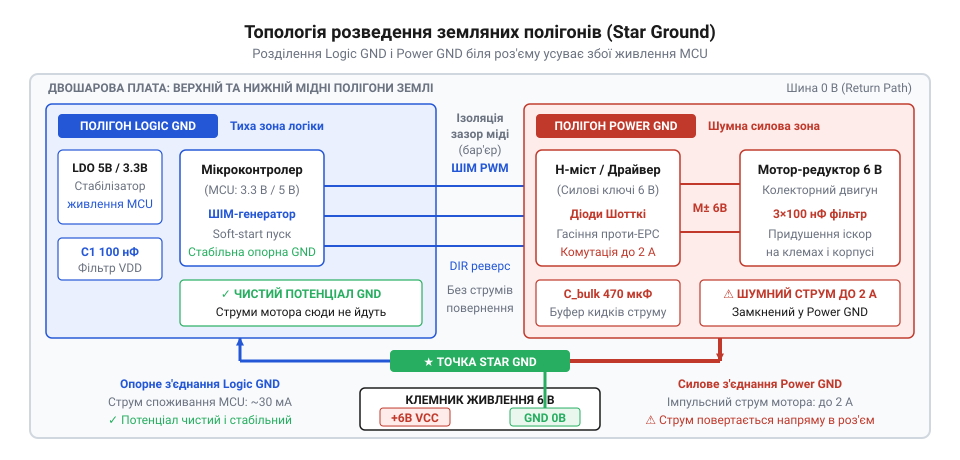
*Топологія розведення земляних полігонів Logic GND та Power GND на двошаровій друкованій платі з єдиною точкою з'єднання біля роз'єму живлення: фізичне розділення площин усуває спільний омічний імпеданс і захищає цифрові кола мікроконтролера від комутаційних сплесків струму мотора.*

> 🔧 **Навіщо це.**
> Топологія заземлення «зіркою» разом із локальною буферизацією живлення — фундаментальний захист вбудованої системи з електродвигунами від апаратних збоїв. Вона ізолює процесорне ядро від імпульсних сплесків силового каскаду, гарантуючи передбачувану роботу цифрових шин, таймерів та АЦП незалежно від механічного навантаження на валу редуктора.

## Фільтрація іскрових завад щітково-колекторного вузла керамічними конденсаторами

Навіть за розділеного живлення та заземлення зіркою колекторний двигун залишається потужним джерелом електромагнітного шуму: цифрові лінії мікроконтролера фіксують хибні переривання, покази АЦП коливаються на десятки відліків, а бездротовий зв'язок втрачає пакети. Причина — у механіці передачі струму на обертовий ротор.

Струм надходить на обмотки через комутатор: нерухомі щітки ковзають по мідних пластинах — ламелях колектора (від латинського @@en|lamella@@ — тонка пластинка), почергово переходячи з однієї пластини на іншу.

Через власну індуктивність секції обмотки `L_winding` розрив контакту викликає стрибок ЕРС самоіндукції:

V_arc = -L_winding · (di/dt)

Ця напруга пробиває повітряний зазор між щіткою та ламеллю, запалюючи дуговий розряд — іскріння (детальніше цей механізм розкриває стаття [електромагнітні завади від дугового розряду щітково-колекторних машин](root:hw-motion/emi-brush-arcing)). Мікродуга — це плазмовий канал із крутим фронтом наростання струму (`t_rise < 2–5 нс`).

За гармонійним аналізом Фур'є наносекундний фронт генерує широкосмуговий спектр електромагнітних завад (від англ. @@en|Electromagnetic Interference@@, EMI):

f_max
≈ 1 / (π · t_rise)                [верхня межа спектра завади за фронтом]
≈ 1 / (3.1416 · 2 · 10⁻⁹ с)       [підстановка фронту мікродуги 2 нс]
≈ 159 · 10⁶ Гц                    [спектр завад сягає 160 МГц]

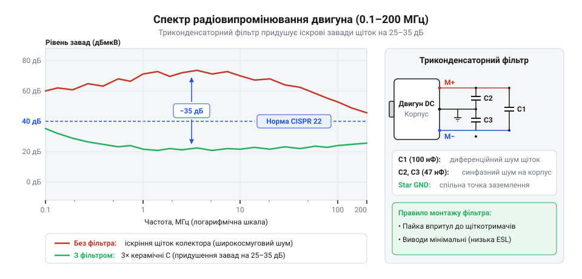
*Амплітудно-частотний спектр іскріння щіток сягає 160–200 МГц без фільтрації, а встановлення триконденсаторного керамічного фільтра пригнічує високочастотний шум на 20–30 дБ у всьому діапазоні.*

Ці завади діють у двох формах:

- **Диференціальна завада** (від латинського @@en|differentia@@ — різниця) виникає між живильними клемами мотора. Її імпульси поширюються дротами у протифазі, загрожуючи пробити вихідні транзистори H-моста.
- **Синфазна завада** (від грецького @@en|syn@@ — разом та @@en|phasis@@ — поява) наводиться між обмотками ротора й металевим корпусом через паразитну ємність статора. Струм тече обома дротами в одному напрямку: дроти й корпус утворюють антену, що випромінює радіохвилі та збуджує струми в колах мікроконтролера.

Електролітичні конденсатори на платі керування цей шум не придушують: через індуктивність рулону фольги на частотах понад 1–2 МГц вони втрачають ємнісні властивості й стають дроселями.

Для нейтралізації завад застосовують [триконденсаторний фільтр із керамічних конденсаторів](root:hw-motion/motor-brush-snubber) з низькою власною індуктивністю (дискових або монолітних з діелектриком X7R чи NP0):

1. **Конденсатор C1 (10–100 нФ)** запаюють безпосередньо між клемами двигуна для шунтування високочастотної диференціальної складової. На частоті 10 МГц конденсатор ємністю 47 нФ має мізерний реактивний опір:

X_C1
= 1 / (2 · π · f · C)              [ємнісний опір змінного струму]
= 1 / (2 · 3.1416 · 10 · 10⁶ Гц · 47 · 10⁻⁹ Ф) [підстановка частоти 10 МГц та ємності 47 нФ]
= 0.3386 Ом                        [реактивний опір для завади]

Оскільки 0.34 Ом набагато менше за хвильовий опір дротів, енергія іскри замикається в локальному контурі на клемах і не йде в лінію живлення.

2. **Конденсатори C2 та C3 (10–47 нФ)** з'єднують кожну клему двигуна з його металевим корпусом (статором), що працює як клітка Фарадея. Вони створюють для синфазного струму міст низького опору: паразитна енергія замикається на шасі двигуна замість випромінювання через дроти в радіоефір.

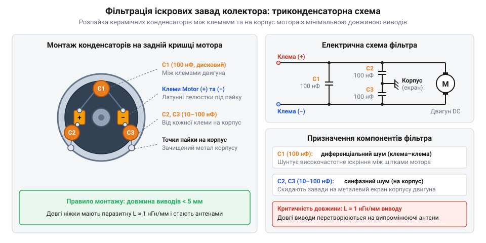
*Розпайка конденсатора C1 між клемами пригнічує диференціальну заваду, а пара C2 і C3 відводить синфазний радіочастотний шум на металевий корпус двигуна, блокуючи випромінювання в ефір.*

Головне інженерне правило монтажу фільтра — **мінімальна довжина виводів**. Кожен міліметр ніжки конденсатора має власну індуктивність близько 1 нГн/мм. Довгі виводи по 15 мм (сумарно `L_lead ≈ 30 нГн`) утворюють із ємністю 47 нФ коливальний контур із резонансом уже на 4.2 МГц. Вище цієї межі ємність перетворюється на котушку індуктивності: на частотах 50–100 МГц фільтр із довгими ніжками замість шунтування завад сам працює як резонансна антена.

Тому конденсатори монтують упритул до двигуна. Виводи C1 обрізають до кількох міліметрів і запаюють на клеми. Для C2 та C3 статор зачищають надфілем від оксидів і лаку до чистого металу, лудять і з'єднують найкоротшими перемичками.

У промислових приводах фільтр доповнюють феритовими бусинами (від латинського @@en|ferrum@@ — залізо) на живильних дротах біля двигуна, утворюючи П-подібний LC-фільтр низьких частот.

> 🔧 **Навіщо це.**
> Триконденсаторний керамічний фільтр безпосередньо на корпусі двигуна гасить радіочастотний шум у точці його зародження. Без нього високочастотні струми колектора перетворюють дроти живлення на передавальну антену, яка блокує радіозв'язок, спотворює покази АЦП і викликає хибні апаратні переривання мікроконтролера.

## Регулювання швидкості за допомогою ШІМ: вибір частоти та режими спаду струму (decay)

Пряме підключення мотор-редуктора до 6 В розганяє вал до максимуму. Коли потрібно сповільнити рух — для маневрування робота чи натягування троса лебідкою, — знижують середню напругу на клемах. Лінійне регулювання (баластним резистором чи регулювальним транзистором) розсіює надлишок потужності в тепло: за живлення 6 В і струму 0.5 А падіння 3 В на регуляторі виділяє 1.5 Вт, швидко розряджаючи акумулятор і вимагаючи масивного радіатора.

Розв'язанням є імпульсне керування — широтно-імпульсна модуляція (ШІМ, від лат. @@la|modulatio@@ — мірність). Ключі H-моста працюють у ключовому режимі: вони або повністю відкриті (опір каналу — лічені десятки міліом, падіння напруги мізерне), або повністю закриті. Середня напруга на двигуні пропорційна шпаруватості (коефіцієнту заповнення, англ. @@en|duty cycle@@) — відношенню часу активного стану `t_on` до повного періоду комутації `T_pwm`. На відміну від крокових двигунів на зразок [28BYJ-48 — кроковий мотор (5V)](root:cat-hw-actuators/28byj-48-stepper) із жорстким перемиканням фаз, швидкість колекторного мотор-редуктора плавно задається саме шпаруватістю ШІМ.

Проте якір колекторного двигуна не є звичайним резистором. Еквівалентна електрична схема містить послідовний активний опір дроту `R`, власну індуктивність котушок `L` (від лат. @@la|inductio@@ — наведення) та проти-електрорушійну силу (проти-ЕРС, англ. @@en|back-EMF@@), яку генерує ротор під час обертання в магнітному полі:

    V(t) = R · i(t) + L · (di/dt) + e(t)

Механічна інерція якоря й шестерень редуктора діє як фільтр низьких частот для швидкості: масивний вал не реагує на мікросекундні імпульси. Однак струм у колі визначається електромагнітною сталою часу `τ_e = L / R` (від десятків мікросекунд до мілісекунд). Шлях, яким замикається струм індуктивності під час паузи ШІМ (`t_off`), цілком визначає стабільність обертів і втрати енергії в приводі.

### Режими спаду струму: швидкий проти повільного

Коли активні транзистори H-моста закриваються наприкінці імпульсу ШІМ, струм в індуктивності не зникає миттєво. ЕРС самоіндукції підтримує його, змінюючи знак напруги на клемах (`V = -L · (di/dt)`). Залежно від стану ключів у цій пасивній фазі виникає два процеси циркуляції струму — швидкий або повільний спад ([Режими спаду струму в мостових перетворювачах](root:hw-motion/h-bridge-decay-modes), англ. @@en|decay mode@@, від лат. @@la|decadere@@ — спадати).

У режимі швидкого спаду (англ. @@en|fast decay@@) обидва транзистори діагоналі вимикаються одночасно. Індуктивний викид відкриває захисні діоди Шотткі протилежних плечей моста, і струм скидається назад у шину 6 В контуром: земля — нижній діод — обмотка — верхній діод — шина живлення. До клем прикладається протилежна напруга джерела:

    V_motor = -(V_supply + 2 · V_d)

де `V_d` — пряме падіння на діоді (~0.3–0.4 В). Напруга живлення діє назустріч струму самоіндукції, тому спад струму `di/dt` максимально стрімкий. За низької індуктивності чи малої частоти ШІМ струм спадає до нуля ще до кінця періоду (режим розривного струму, англ. @@en|discontinuous conduction mode@@, DCM). У моменти паузи без струму двигун різко втрачає крутний момент: з'являється «мертва зона» на малих коефіцієнтах заповнення (вал стоїть до 25–30% ШІМ), а скидання енергії в джерело створює викиди напруги на шині.

У режимі повільного спаду (англ. @@en|slow decay@@) під час паузи ШІМ розмикається лише верхній транзистор, а нижній лишається відкритим (або обидва нижні ключі закорочуються на землю). Клеми двигуна замикаються між собою через нижнє плече моста. Струм індуктивності циркулює локальним низькоомним кільцем: обмотка — нижній ключ — діод (або синхронно відкритий другий нижній ключ). Напруга на клемах близька до нуля, і струм спадає повільніше — його гасять опір міді `R` та проти-ЕРС `e(t)`:

    di/dt = -(R · i + e) / L

Струм в обмотці залишається неперервним (режим CCM) навіть за мінімальної шпаруватості. Пульсації струму різко падають, мотор-редуктор упевнено тягне на наднизьких швидкостях (від 5–10% ШІМ), а зв'язок між шпаруватістю та обертами вала стає лінійним.

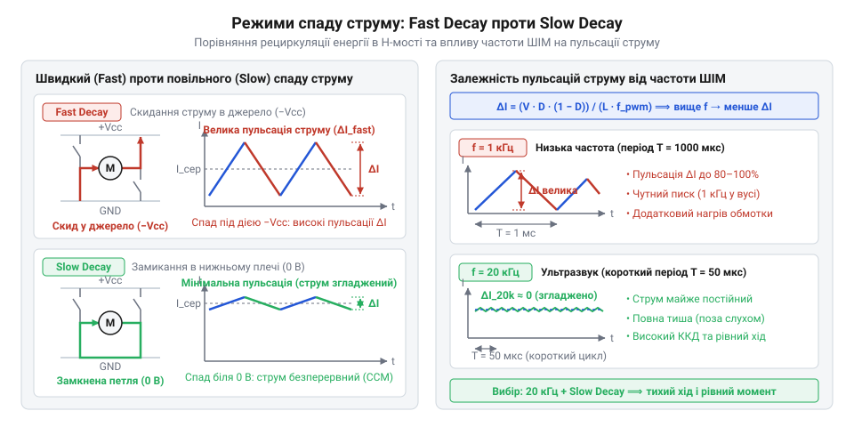
*Форми струму в обмотці двигуна для режимів швидкого спаду (fast decay) та повільного спаду (slow decay) і вплив частоти комутації на амплітуду пульсацій струму.*

> 🔧 **Навіщо це.**
> Режим повільного спаду (slow decay) є стандартним вибором для точного приладового приводу, колісних платформ та лебідок. Закорочення обмотки через нижнє плече моста в паузах ШІМ усуває провали крутного моменту, стабілізує рух на малих обертах і захищає шину живлення від небезпечних викидів перенапруги.

### Компроміс вибору частоти ШІМ: акустичний резонанс проти комутаційних втрат

Вибір тактової частоти ШІМ `f_pwm` вимагає пошуку інженерної рівноваги між акустикою редуктора та динамічним нагріванням транзисторів.

Якщо вибрати низьку частоту в діапазоні 1–8 кГц (типове налаштування за замовчуванням у багатьох мікроконтролерах), з'являються дві проблеми:
1. **Нестерпний акустичний писк.** Обмотки двигуна під дією змінного струму вібрують через магнітострикцію. Корпус і шестерні редуктора діють як акустичний резонатор: механізм видає гучний, пронизливий писк у найчутливішому для людського вуха діапазоні.
2. **Великий розмах пульсацій струму `ΔI`.** За період `T = 1 / 2000 Гц = 500 мкс` струм встигає глибоко спасти. Піковий струм значно перевищує середній, викликаючи надлишкове нагрівання міді джоулевим теплом (`P = I_rms² · R`), адже середньоквадратичний струм пульсацій помітно вищий за постійний струм того самого моменту.

Підвищення частоти до 50–100 кГц усуває писк, проте спричиняє швидке зростання динамічних втрат перемикання силових транзисторів. Потужність втрат на кожному ключі складається зі статичних втрат відкритого каналу `P_cond` та динамічних втрат комутації `P_sw`:

    P_total = P_cond + P_sw
            = I² · R_ds(on) + 0.5 · V_supply · I · (t_r + t_f) · f_pwm

де `t_r` та `t_f` — тривалості фронту наростання та спаду імпульсу (час перезаряджання ємності затвора польового транзистора драйвером). Якщо на низькій частоті доданок `P_sw` мізерний, то на частотах понад 30–50 кГц ключі перемикаються десятки тисяч разів на секунду: транзистори розігріваються навіть на холостому ходу, ККД падає, а інтервали захисного мертвого часу ([Апаратна генерація dead-time](root:hw-power/h-bridge-dead-time-hardware)) спотворюють характеристику керування.

Оптимальним компромісом для двигунів класу [N20 мікромотор з редуктором](root:cat-hw-actuators/n20-motor) є ультразвуковий діапазон **20–25 кГц**. По-перше, частота 20 кГц лежить вище порогу чутності людини — привід працює бездоганно тихо. По-друге, період ШІМ (`T = 40–50 мкс`) у сотні разів перевищує тривалість перемикання транзисторів (`t_r + t_f ≈ 100–300 нс`), завдяки чому комутаційні втрати не перевищують лічених відсотків загальної потужності.

Для двигуна з індуктивністю `L = 1.2 мГн` (`V_supply = 6 В`, `e = 2.5 В`, `D = 0.5`) у режимі повільного спаду розмах пульсацій струму `ΔI = (V_supply - e) · D · (1 - D) / (L · f_pwm)` різко залежить від частоти:

| Частота ШІМ | Пульсації `ΔI` | Акустичний шум | Стан приводу |
|:---|:---|:---|:---|
| **2 кГц** | 365 мА | Пронизливий писк | Глибокі пульсації, перегрів обмотки |
| **20 кГц** | 36 мА | Повна тиша | Гладкий нерозривний струм, стабільний хід |

Підвищення частоти комутації до 20 кГц знижує пульсації струму вдесятеро — з 365 мА до 36 мА. Струм в обмотці стає практично нерозривним, що усуває джоулів перегрів міді та забезпечує плавне обертання вала без дрижання.

## Динаміка механічного редуктора та алгоритм плавного пуску (soft-start)

Понижувальний шестерний редуктор (від лат. @@la|reductor@@ — той, що відводить назад) містить каскад зубчастих коліс із латуні або термопласту, які знижують кутову швидкість якоря (з 10 000–15 000 об/хв до робочих 100 або 600 об/хв) і пропорційно передавальному числу множать крутний момент. Між зубцями спряжених шестерень обов'язково є технологічний зазор ([Механічний люфт у зубчастих редукторах](root:hw-motion/gearbox-backlash-impact), люфт, від нім. @@de|Luft@@ — повітря, проміжок), потрібний для змащення й вільного обертання без заклинювання при нагріванні. У стані спокою контактні площини зубців не стиснуті або торкаються довільними гранями.

У момент подачі повної напруги 6 В на нерухомий двигун стається одночасний електричний та механічний удар.
З точки зору електрофізики: ротор ще нерухомий (`ω = 0`), тому внутрішня проти-ЕРС повністю відсутня (`e = 0`). Пусковий струм блокування вала обмежується виключно омічним опором мідного дроту якоря:

    I_stall = V_supply / R

Для компактного двигуна з опором `R = 6 Ом` струм у першу мілісекунду злітає до `I_stall = 6 / 6 = 1.0 А`. При номінальному холостому струмі 70–90 мА цей стрибок перевищує робоче споживання у 10–15 разів. Подібний надструм характерний для багатьох силових приводів, зокрема колекторних вузлів [Водяна помпа RS-360SH](root:cat-hw-actuators/water-pump-rs360sh). Якщо внутрішній опір акумулятора чи джерела живлення становить, приміром, `R_src = 1.2 Ом`, імпульс 1 А спричиняє раптове просідання шини живлення на `ΔV = 1.0 · 1.2 = 1.2 В`. Напруга логічного кола мікроконтролера падає нижче порогу схеми скидання за зниженням напруги (Brown-out Reset, BOR), і контролер циклічно перезавантажується під час кожної спроби старту.

З точки зору механіки: електромагнітний крутний момент двигуна лінійно пов'язаний зі струмом якоря: `M(t) = k_m · i(t)`. Стрибок струму генерує десятикратний ударний момент. Ротор за долі мілісекунди обирає механічний люфт шестерень і на високій швидкості б'є провідним зубом по веденому зубчастому колесу, яке через інерцію навантаженого вала ще залишається нерухомим. Такий динамічний удар спричиняє втомні тріщини металу, викришує латунні зуби й зрізає пластикові шестерні вже за кілька десятків жорстких пусків.

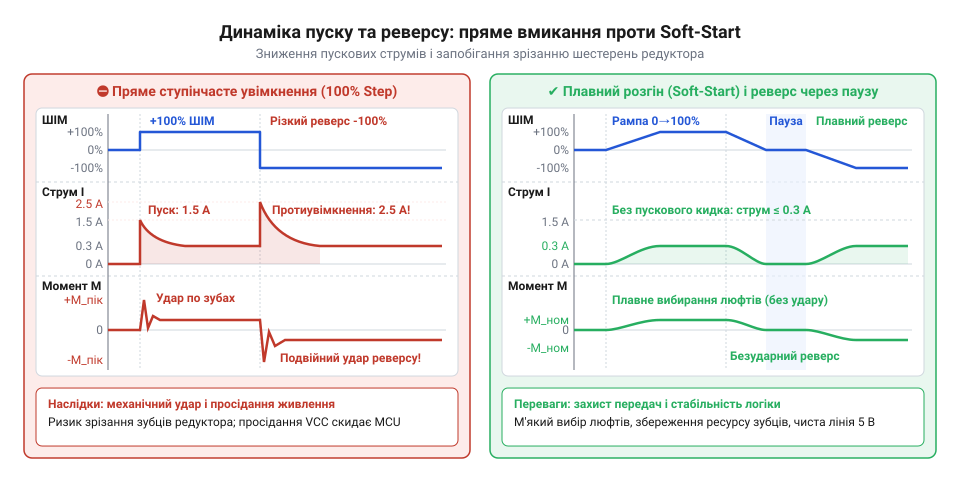
*Графіки залежності коефіцієнта заповнення ШІМ, струму споживання та крутного моменту в часі: порівняння різкого прямого пуску та керованого плавного розгону (soft-start).*

> 🔧 **Навіщо це.**
> Алгоритм плавного пуску (soft-start) замінює стрибкоподібне ввімкнення лінійним наростанням шпаруватості ШІМ від нуля до цільового значення протягом 100–400 мс. Це обмежує темп зростання струму `di/dt` та похідну крутного моменту: зуби редуктора вибирають зазори плавно й без ударів, а струм утримується в безпечних межах у міру наростання внутрішньої проти-ЕРС.

### Небезпека миттєвого реверсу

Найбільш руйнівною подією для колекторного мотор-редуктора є миттєва зміна напрямку обертання H-моста на повній швидкості без попереднього гальмування.

Коли двигун обертається вперед на швидкості, близькій до холостого ходу, генератор проти-ЕРС виробляє зустрічну напругу `e ≈ 5.0 В`. Якщо мікроконтролер миттєво перемикає діагоналі моста на зворотний хід, напруга джерела живлення `-6 В` прикладається *послідовно-узгоджено* з проти-ЕРС ротора, який продовжує за інерцією крутитися вперед:

    V_net = V_supply + e = 6.0 + 5.0 = 11.0 В

Струм протиувімкнення (англ. @@en|plugging current@@) сягає критичного піка:

    I_plug = V_net / R = 11.0 / 6.0 ≈ 1.83 А

Цей струм майже вдвічі перевищує навіть струм мертвого блокування вала. Він спричиняє потужне іскріння на колекторних пластинах, викликає аварійне просідання напруги процесора та генерує зворотний динамічний удар. Зуби редуктора отримують колосальне ударне навантаження в протилежні грані під час руху на повній швидкості, що призводить до миттєвого зрізання зубчастих вінців.

Безпечний протокол реверсу містить три суворо послідовні фази:
1. **Кероване деселерування:** лінійне зменшення коефіцієнта заповнення ШІМ поточного напрямку до нуля.
2. **Захисна пауза мертвої зони (deadband):** витримка вала в знеструмленому стані протягом 30–150 мс для гасіння магнітної енергії обмоток і повної механічної зупинки ротора.
3. **Плавний пуск у зворотному напрямку:** перемикання конфігурації ключів H-моста та лінійний розгін soft-start у протилежний бік.

### Скінченний автомат драйвера та принципова схема

Для надійної реалізації без блокування основного циклу виконання мікроконтролера керування організовується на базі скінченного автомата станів (FSM, від англ. @@en|finite state machine@@). Драйвер не застосовує блокувальних очікувань, а робить обчислювальний крок за періодичним сигналом системного таймера (SysTick).

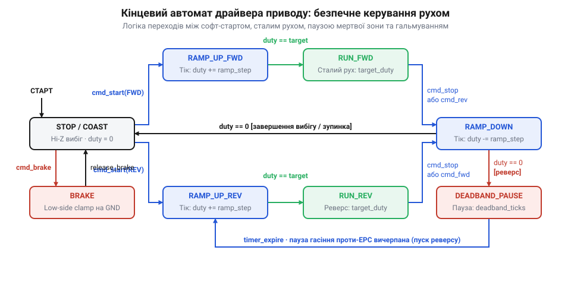
*Граф станів програмного драйвера керування мотором: переходи між станами зупинки, плавного прискорення вперед, сталого ходу, плавного гальмування, активного стопу та реверсу з урахуванням таймерних подій.*

Схема підключення апаратної частини об'єднує цифрову логіку мікроконтролера, захищені силові напівмости, контури захисту та фільтрації:

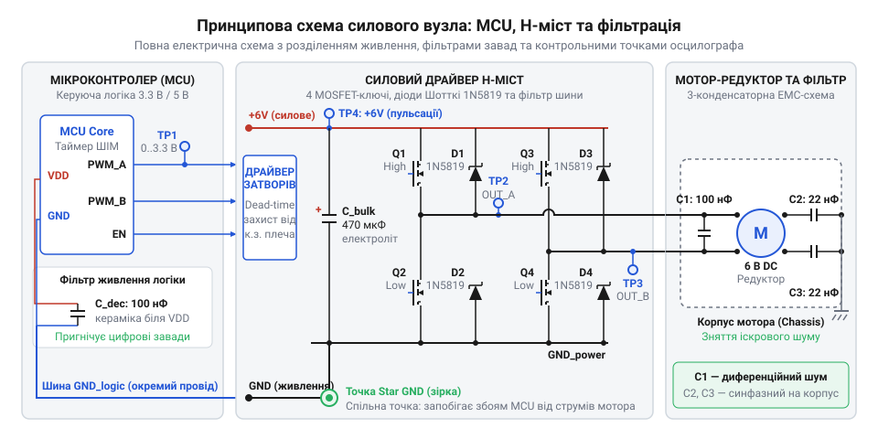
*Повна принципова електрична схема силового вузла H-моста з підключенням до виводів мікроконтролера, комутаційними ключами, діодами, фільтрами, роздільним живленням та контрольними точками для вимірювання осцилографом.*

Силові лінії моста живляться від шини `+6V_MOTOR`, розв'язаної електролітичним конденсатором великої ємності та високочастотною керамікою, а мікроконтролер підключено до стабілізованої шини `+3.3V_MCU`. Земляні провідники сходяться в єдиній точці заземлення зіркою (Star GND), що виключає протікання моторних струмів через сигнальні земляні полігони. На схемі розміщено контрольні точки `TP_PWM`, `TP_OUT1`, `TP_OUT2` та `TP_ISENSE` для осцилографічного контролю тривалості мертвого часу dead-time, контролю форми напруги на клемах та моніторингу падіння на токовимірювальному шунті. Безпосередньо біля клем мотор-редуктора розпаяно триконденсаторний керамічний фільтр (один конденсатор 100 нФ між виводами та два по 47 нФ на металевий кожух), який замикає високочастотний струм колекторного іскріння найкоротшим контуром, екрануючи цифрову частину.

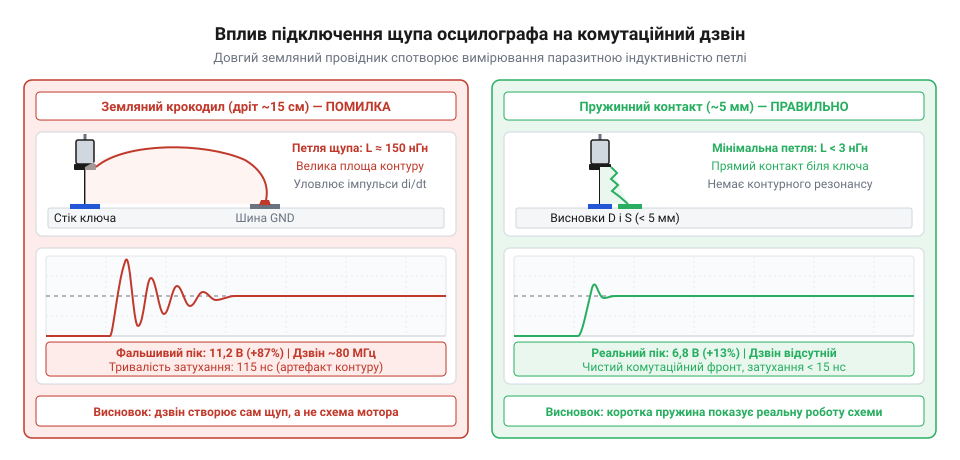
*Порівняння форми осцилограми комутаційного дзвону при підключенні щупа довгим земляним крокодилом та коротким пружинним контактом безпосередньо біля ключа: паразитна індуктивність довгого дроту утворює хибний високовольтний дзвін, тоді як короткий пружинний контакт відображає справжню картину комутації.*

### Програмна реалізація алгоритмів

Розгляньмо будову драйвера, що поєднує в собі апаратний захист ключів моста та алгоритм захисту редуктора. Конфігурація та дескриптор приводу інкапсулюють робочі параметри:

:::tabs
:::code proj-hbridge-motor-driver/c/gearmotor_driver.h 28-54
:::code proj-hbridge-motor-driver/cpp/gearmotor.hpp 45-54
:::

Структура `gearmotor_config_t` задає системні константи: роздільну здатність періоду ШІМ `pwm_period`, апаратний час мертвої зони ключів `dead_time_counts`, інтенсивність розгону `ramp_step` та захисну паузу зупинки `deadband_ticks`. Дескриптор `gearmotor_t` відстежує активну швидкість `current_duty`, цільове завдання `target_duty` та стан автомата `state`.

Для запобігання наскрізному струму (shoot-through) у плечах напівмостів апаратний таймер формує комплементарні ШІМ-сигнали з автоматичною вставкою мертвого часу (dead-time):

:::code proj-hbridge-motor-driver/c/gearmotor_driver.c 21-53

Регістр `bdtr` таймера налаштовує вбудований генератор затримки (Dead-Time Generator, DTG): при зміні стану плеча відкриття чергового транзистора блокується на час розряджання затвора попередника (зазвичай 1–2 мкс). Комутація виходів у регістрі `ccer` гарантує безпечне керування ключами:

:::tabs
:::code proj-hbridge-motor-driver/c/gearmotor_driver.c 61-110
:::code proj-hbridge-motor-driver/cpp/gearmotor.cpp 145-162
:::

У стані `MOTOR_STATE_FORWARD` напівміст A комутується ШІМ-сигналом із захистом dead-time, а на напівмості B нижній ключ залишається постійно відкритим (`CH2N = 1`). Завдяки цьому під час пасивного напівперіоду ШІМ реалізується режим повільного спаду струму (slow decay). У режимі `MOTOR_STATE_BRAKE` обидва верхні ключі вимкнені, а обидва нижні примусово замкнені на землю, демпфуючи обертання ротора струмом проти-ЕРС.

Основне обчислення лінійної рампи та логіка перемикання станів зосереджені у функції `gearmotor_update()`:

:::tabs
:::code proj-hbridge-motor-driver/c/gearmotor_driver.c 192-276
:::code proj-hbridge-motor-driver/cpp/gearmotor.cpp 200-260
:::

У стані `MOTOR_STATE_STOP` лічильник `deadband_counter` утримує ключі моста розімкненими, гарантуючи повне згасання струму та зупинку вала перед пуском. Під час руху вперед автомат плавно додає крок `ramp_step` до активної шпаруватості кожного виклику, доки вона не зрівняється з цільовим значенням `target_duty`.

Якщо під час руху надходить команда зміни напрямку, функція `gearmotor_set_direction()` не чіпає поточний стан ключів:

:::code proj-hbridge-motor-driver/c/gearmotor_driver.c 166-190

Автомат у `gearmotor_update()` фіксує розбіжність цільового та активного напрямків і послідовно зменшує шпаруватість із кроком `ramp_step` до повного нуля. Щойно рух зупинено, драйвер переходить у стан `MOTOR_STATE_STOP` і запускає лічильник мертвої зони `deadband_counter = deadband_ticks`. Лише після відліку паузи розпочнеться плавне прискорення у зворотному напрямку:

:::code proj-hbridge-motor-driver/c/gearmotor_driver.c 278-314

Інтеграція драйвера в суперцикл мікроконтролера забезпечує надійне й ритмічне виконання всіх часових інтервалів:

:::tabs
:::code proj-hbridge-motor-driver/c/main.c 88-143
:::code proj-hbridge-motor-driver/cpp/main.cpp 75-117
:::

Завдяки квантуванню часу з інтервалом 10 мс (`SYSTEM_TICK_MS`) та кроку приросту `ramp_step = 25` при періоді таймера 1000 відліків плавний пуск триває 400 мс. Пусковий струм надійно зрізається, лінія живлення логіки залишається стабільною без просідань, а зубчасті передачі редуктора працюють м'яко й безперебійно протягом усього терміну служби.

## Архітектура прошивки та реалізація драйвера на апаратному таймері мікроконтролера

Керування силовим H-мостом як парою звичайних дискретних виходів мікроконтролера спричиняє коротке замикання при першому ж реверсі. Цифровий вивід процесора перемикається за одиниці наносекунд, тоді як затворна ємність польового транзистора розряджається значно довше. Якщо відкрити нижній ключ напівмоста до повного закриття верхнього, обидва транзистори плеча замкнуть шину 6 В на землю. Імпульсний наскрізний струм (англ. @@en|shoot-through@@) у десятки ампер спричиняє тепловий пробій ключів або перезавантаження процесора від просідання живлення.

Не менш руйнівним є миттєвий реверс. Обертовий ротор колекторного двигуна працює як генератор, наводячи зустрічну проти-ЕРС. При миттєвій зміні полярності напруга джерела живлення додається до проти-ЕРС:

**Розрахунок струму протиувімкнення за миттєвого реверсу мотора 6 В:**
```
I_plug
= (V_CC + E_back) / R_motor     [сумування напруги живлення та згенерованої ротором проти-ЕРС]
= (6.0 + 4.8) / 3.8             [підстановка: номінал 6 В, ЕРС 4.8 В на 80% обертів, опір обмотки 3.8 Ом]
= 10.8 / 3.8                    [повне спадання напруги на активному опорі якоря]
≈ 2.84 А                        [піковий струм удару протиувімкнення]
```
*Висновок: піковий струм протиувімкнення майже вдвічі перевищує пусковий струм блокування вала (1.58 А), що створює ударний гальмівний момент і небезпеку механічного зрізання зубців мікроредуктора.*

Такий удар зрізає передачі [N20 мікромоторів з редуктором](root:cat-hw-actuators/n20-motor) на 100 або 600 об/хв. Надійна прошивка виключає ці аварії трьома рівнями захисту:
1. Апаратна комплементарна ШІМ із гарантованим мертвим часом (англ. @@en|dead-time@@).
2. Кінцевий автомат (англ. @@en|finite-state machine@@, FSM, від латинського @@la|finis@@ — межа, кінець) із детермінованими переходами між режимами.
3. Неблокувальний алгоритм розгону й гальмування (англ. @@en|soft-start@@ / @@en|soft-stop@@) із захисною паузою (англ. @@en|deadband@@) під час реверсу.

### Кінцевий автомат керування приводом

Стан приводу описується дискретними режимами силового моста:
- `STOP` (вільний вибіг / @@en|coasting@@, від давньофранцузького @@fro|coste@@ — рух уздовж берега за інерцією): усі ключі моста вимкнені (Hi-Z), струм затухає через зворотні діоди, ротор зупиняється тертям у редукторі.
- `FORWARD` (прямий рух): напівміст A комутується ШІМ-сигналом, нижній ключ напівмоста B відкритий на GND.
- `REVERSE` (зворотний рух): напівміст B комутується ШІМ-сигналом, нижній ключ напівмоста A відкритий на GND.
- `BRAKE` (активне електродинамічне гальмування / @@en|dynamic braking@@, від грецького @@el|dynamis@@ — сила): верхні ключі розімкнені, нижні замкнені на GND (режим @@en|low-side clamp@@). Закорочена обмотка гасить обертання зустрічним струмом проти-ЕРС, зупиняючи вал за мілісекунди.

Головне правило кінцевого автомата: **прямий перехід між станами `FORWARD` і `REVERSE` заборонено**. Зміна напрямку можлива виключно через скидання шпаруватості (англ. @@en|duty cycle@@) до нуля, перехід у стан `STOP` і витримку захисної мертвої зони для повного гасіння енергії обмотки.

Публічні інтерфейси модуля керування на C та C++ стандартизують взаємодію із системним кодом:

:::tabs
:::code proj-hbridge-motor-driver/c/gearmotor_driver.h
:::code proj-hbridge-motor-driver/cpp/gearmotor.hpp
:::

> 🔧 **Навіщо це.**
> Поділ логіки на кінцевий автомат та обчислювач темпу розгону розриває залежність між користувацькими командами та реакцією силових ключів. Хоч би як швидко зовнішня програма змінювала задану швидкість чи напрямок, силовий міст відпрацьовує переходи виключно за безпечною лінійною рампою, зберігаючи ресурс зубчастих коліс редуктора та запобігаючи тепловому пробою транзисторів.

### Апаратний таймер, комплементарні виходи та захисний інтервал dead-time

Для усунення наскрізного струму між вимкненням одного ключа та вмиканням протилежного вводиться затримка dead-time. Програмні паузи легко спотворюються перериваннями процесора, тому комутація напівмостів покладається на апаратний таймер із генератором комплементарних сигналів (CHx / CHxN) та вбудованим вузлом dead-time (DTG).

**Розрахунок тривалості мертвого часу таймера для частоти 20 МГц:**
```
t_dead
= dead_time_counts × T_clock    [означення затримки апаратного вузла DTG]
= 25 × (1 / 20 000 000)          [підстановка значень: 25 відліків при частоті 20 МГц]
= 25 × 50 · 10⁻⁹                [період одного такту таймера становить 50 нс]
= 1.25 · 10⁻⁶ с = 1.25 мкс      [безпечний інтервал перемикання MOSFET]
```
*Висновок: пауза 1.25 мкс із п'ятикратним запасом перевищує типовий час закриття транзисторів (100–250 нс), унеможливлюючи наскрізний струм.*

У низькорівневому шарі C регістри таймера інкапсульовані в структуру `timer_hardware_t`. Функція `hw_timer_apply` напряму транслює стан автомата в конфігураційні біти регістрів таймера:

:::code proj-hbridge-motor-driver/c/gearmotor_driver.c 21-110

Якщо мікроконтролер має апаратний моторний модуль, керування мостом спрощується до двох ШІМ-каналів із автоматичним мапуванням станів. Без нього захист будують за принципом «розрив перед замиканням» (англ. @@en|break-before-make@@): у C++-драйвері таблиця комутації `BRIDGE_COMMUTATION_TABLE` та метод `applyHBridge` скидають ШІМ до нуля перед зміною станів дискретних виводів напрямку IN1/IN2, розриваючи струмовий контур до перемикання ключів:

:::code proj-hbridge-motor-driver/cpp/gearmotor.cpp 8-31

:::code proj-hbridge-motor-driver/cpp/gearmotor.cpp 134-162

### Неблокувальний алгоритм плавного пуску та безпечного реверсу

Плавний пуск (soft-start) обмежує швидкість наростання струму (`dI/dt`) та моменту (`dM/dt`). Шпаруватість ШІМ змінюється з фіксованим кроком `ramp_step` щокванту виклику періодичної функції `update`, не блокуючи потік виконання програми (busy-waiting).

При зміні напрямку алгоритм послідовно проходить три захищені фази:
1. **Лінійне гальмування:** поточна шпаруватість зменшується з темпом деселерації до нуля.
2. **Пауза мертвої зони (deadband):** у стані нульової шпаруватості лічильник `deadband_ticks` тримає всі ключі вимкненими (Hi-Z), поки струм обмотки повністю розсіюється через захисні діоди.
3. **Лінійний розгін:** після закінчення паузи змінюється полярність комутації, і шпаруватість плавно зростає до цільової.

Логіка покрокового оновлення стану в драйвері на C реалізована всередині `gearmotor_update`:

:::code proj-hbridge-motor-driver/c/gearmotor_driver.c 192-319

У реалізації на C++ дробовий накопичувач `m_rampAccumulator` забезпечує точність темпу розгону при нерівномірних інтервалах `deltaMs` без використання ресурсомісткої арифметики з рухомою комою:

:::code proj-hbridge-motor-driver/cpp/gearmotor.cpp 164-279

Публічні методи ініціалізації, встановлення цільової швидкості, аварійного гальмування та вибігу валідують коректність вхідних параметрів:

:::code proj-hbridge-motor-driver/c/gearmotor_driver.c 118-190

:::code proj-hbridge-motor-driver/c/gearmotor_driver.c 321-386

:::code proj-hbridge-motor-driver/cpp/gearmotor.cpp 35-91

:::code proj-hbridge-motor-driver/cpp/gearmotor.cpp 93-133

Повні вихідні коди модулів драйвера для C та C++:

:::tabs
:::code proj-hbridge-motor-driver/c/gearmotor_driver.c
:::code proj-hbridge-motor-driver/cpp/gearmotor.cpp
:::

### Інтеграція драйвера у головний суперцикл

Демонстраційні програми показують роботу створених компонентів у реальному часі за періодичного виклику SysTick із кроком 10 або 20 мс: розгін уперед до 75–80%, безпечний реверс із паузою мертвої зони, динамічне гальмування та вибіг:

:::tabs
:::code proj-hbridge-motor-driver/c/main.c
:::code proj-hbridge-motor-driver/cpp/main.cpp
:::

Обидві реалізації мають константну обчислювальну складність `O(1)`, не здійснюють динамічного виділення пам'яті в купі й готові до роботи в критичних за часом застосунках.

---
